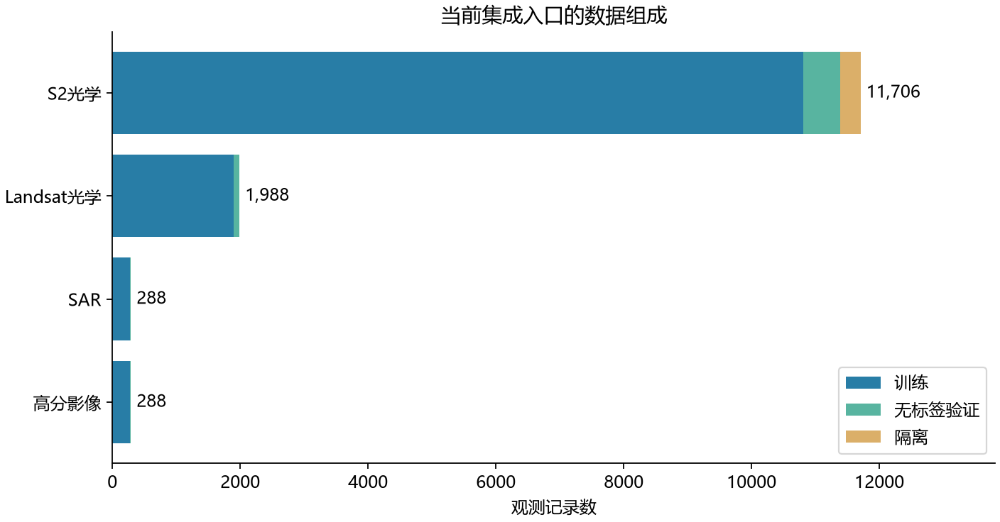
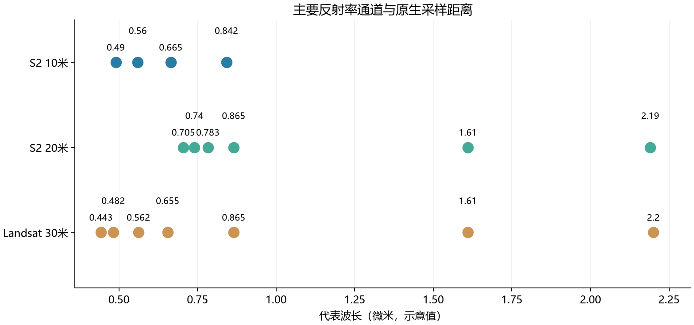
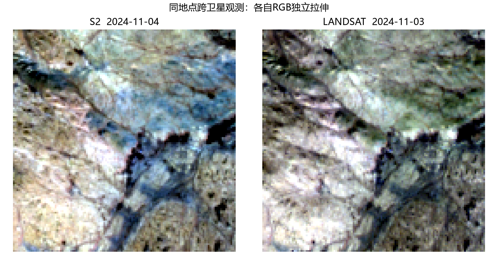

# 跨卫星表征的数据资源与输入说明

## 有哪些数据，从哪里来

本项目按传感器、产品和用途组织数据。同一资产可供多个方案使用；实验记录所选成员与处理配置。

| 数据资源 | 来源与产品 | 当前存放或入口 | 数量及主要内容 |
|---|---|---|---|
| Sentinel-2灾害区域影像 | Sen12Landslides本地归档 | ../landslide-seg/data/raw/sen12 | 原资源登记13628个图块文件，每块15次十波段观测，附SCL、标注与地形信息 |
| Sentinel-2额外观测 | 官方L2A产品，Earth Search／COG窗口读取 | 集成入口中的s2及data下原始缓存 | 可见、近红外、短波红外；完整来源与scale/offset逐资产记录 |
| Landsat 8/9 | Landsat Collection 2 L2与已整理缓存 | data/optical/landsat/native及集成入口 | 原资源登记2892份原生窗口；另有6309份共同网格缓存，二者可能重叠，不相加 |
| HLS | NASA Harmonized Landsat Sentinel-2 | data/optical/hls、data/optical/counterparts | S30/L30共同网格产品，作为跨源协调参照 |
| EnMAP | 本地高光谱L2A场景与窗口 | data/optical/enmap/reference_scene、data/optical/enmap/paired_windows | 已核验2景原生影像及1689份旧派生窗口；其中47个可追溯窗口已重建为原生30m观测并准入原生光学训练池，来自1个场景 |
| SAR与高分辨率影像 | 同地点四源包，原产品来源逐资产保留 | 集成入口中的s1与hr | SAR为VV/VH线性gamma0；HR为四通道摄影DN，均不冒充光学反射率 |
| 地表与灾害标签 | Sen12Landslides人工滑坡标注、ESA WorldCover地图 | 滑坡工程及对应评价清单 | 只在相应下游监督/评价中使用；地图一致性不等同独立人工真值 |
| 传感器资料 | 传感器SRF及物理属性目录 | data/physics | 波长、原生GSD、SRF/PSF资料及其来源；缺失项不伪装为实测响应 |

来源追溯入口：[资源目录](../data/datasets.json)、[物理属性](../data/physics/sensor_physics.json)、[集成入口清单](../../landslide-seg/outputs/use_data_integration/active_release/manifest.jsonl)。目录中的文件数不等于独立地点数，派生窗口也不等于新增卫星采集。

## 当前集成入口包含多少观测

下表直接摘自当前入口的release.json；计数单位是观测记录，训练、无标签验证和隔离分开。它描述现有资源，不是模型版本列表。

| 类型 | 训练观测 | 无标签验证观测 | 隔离观测 |
|---|---:|---:|---:|
| Sentinel-2光学 | 10808 | 577 | 321 |
| Landsat光学 | 1897 | 91 | 0 |
| Sentinel-1 SAR | 275 | 13 | 0 |
| 高分辨率影像 | 275 | 13 | 0 |

严格配对另计：训练460对，验证13对。配对数不能与观测数相加。动态入口数量以[入口统计](../../landslide-seg/outputs/use_data_integration/active_release/release.json)为准；正式运行保存自己冻结的成员清单，避免后台补充改变比较对象。

图中按传感器分别显示训练、验证与隔离观测；各柱使用相同的观测记录单位，HR和SAR没有混算成光学样本。

## 正式原生光学训练采用的冻结子集

上表是更广的资源集成登记口径；本段已完成训练使用另一份原生光学冻结清单，来源、质量门槛与处理缓存不同，数量不相加，也不由上表直接推算。以下按资源列出实际成员：

| 资源 | TRAIN观测 | VAL观测 | 输入通道记录 |
|---|---:|---:|---|
| Sentinel-2 | 5349 | 335 | TRAIN：四波段4755、十波段594；VAL：四波段237、十波段98 |
| Landsat 8/9 | 2046 | 48 | TRAIN：L8六波段1351、七波段171，L9六波段524；VAL：L8七波段48 |
| EnMAP | 47 | 0 | 每窗口224个波段位置，其中219个有有效观测；来自1个原始场景 |
| 合计 | 7442 | 383 | 观测数，不等于独立地点或卫星整景数 |

角色、成员、QA、定标和TRAIN-only统计在首段10轮中保持冻结。L=128m与内部8×8布局属于模型配置，不改变本表的原生像元和分辨率，也不产生额外真值。SAR、HR及HLS未作为本段新增训练观测；配对资源数量不计入这个单观测训练池。

实际成员、统计与物理目录身份见[正式运行身份](../outputs/encoder_v3/shared_mae/release_L128_v4/formal_run/identity.json)；[全成员几何与通道计数](../outputs/encoder_v3/shared_mae/scales_global_v2/census.json)可核对上述数量。[可视化图集](../outputs/encoder_v3/shared_mae/reconstruction_best_v2/index.html)是从原生数组生成的预测展示，光谱图中的EnMAP为TRAIN示例，不是新增验证成员。

## 波段、单位和空间配置

| 输入 | 原生采样及通道 | 数值与质量配置 |
|---|---|---|
| S2 L2A | 主光学波段原生10/20米；完整产品部分波段60米 | 使用产品scale/offset，结合SCL和有效掩膜；已有缓存若是物理反射率，不再重复定标 |
| Landsat L2 | 可见、近红外与短波红外原生30米 | 按产品元数据定标，QA_PIXEL与QA_RADSAT检查云和饱和；ST_B10温度不能当反射率 |
| HLS | 共同30米产品网格 | 已包含产品协调处理，仍保留Fmask、日期与产品身份 |
| EnMAP | 高光谱产品网格与逐波段身份 | 有效波段、单位及坏波段依据本地产品元数据，不按通道索引猜测 |
| SAR／HR | 保留原始几何、极化或摄影通道身份 | 各自定义单位与质量规则，不套用S2归一化 |

此图展示主要光学反射率通道及其原生采样距离。它是输入配置示意，不是SRF曲线；插值到更细网格不会增加真实细节。

## 共享描述器的物理元数据输入

当前共享MAE训练使用7442个TRAIN、383个VAL，沿用既有角色、原生像元、QA、定标与TRAIN统计。元数据解析已覆盖50199条通道记录，无缺失关键物理身份；这不是对新架构训练有效性的验收。

光学需要GSD与波长，FWHM可缺失且有独立缺失标志。优先使用显式产品channel_metadata；EnMAP必须使用本产品XML目录及其哈希，不从其他场景全局表借用；S2和Landsat可由波段身份查询data/physics/sensor_physics.json。图像不必自带波长，但必须有可追溯的外部物理身份，不用整数波段序号冒充波长。

SAR接口使用物理量、频率、极化及可用入射角；高分辨率光学仍需明确波段物理身份。当前S1与高分影像尚未纳入本轮新训练池，不把接口单元测试视为数据准入。

## 真实观测示例

左右来自同一条已准入配对记录，日期分别写在图上。各自RGB独立做分位拉伸，仅用于观察地表覆盖和成像差异，不能据显示亮度比较定量反射率；同地点也不等于同日期逐像素真值。

## 使用和审核约定

每个样本必须能找到产品身份、采集时间、波段身份、单位、scale/offset、网格变换、有效掩膜和角色。原生网格与派生共同网格分别记录，几何参考不能随遮盖改变。不同日期的同地点组合，只有满足质量、共同有效支持和相应任务条件时才用于配对目标。

训练、验证和保留集合按地点与事件隔离；同一地点换日期或传感器不能改变角色。统计只由训练成员拟合。读取新任务时只核对实际清单、统计和处理配置与已有审核是否相符；资产或规则改变时才检查受影响部分。文件存在或能前向，不代表物理来源和标签用途合格。

S2 L1C曾有质量资产被误登记为波段的情况，该资产不能当光学输入。旧缓存目录中保留的候选不等于现有可训练观测；本页只给资源和使用方式，下载进度与单次排障保留在运行记录。

### EnMAP当前准入结果

已补齐官方QA与XML，并根据用户确认，将可追溯原窗口按30m原生网格重建为47个完整观测窗口，不插值到10m；来源为1个原始场景，全部TRAIN，无独立EnMAP VAL。224通道原始顺位保留，B131–B135无有效观测，不产生内容或目标、也不拟造均值/标准差；其余219通道使用窗口TRAIN-only统计。反射率按产品XML的GainOfBand及OffsetOfBand转换。

逐像元QA与逐波段缺陷掩码均检查；新版本为outputs/encoder_v3/latent_response/training_preparation/enmap_native_windows_v1。旧冻结release及原像元不改。旧1689个重采样窗口没有整体准入，其余缺来源或不完整覆盖的记录仍待修。新训练池共7442个观测。47个窗口不能当作47个独立场景，也没有EnMAP独立验证成绩。

### EnMAP训练输入的实验级暂停

用户授权的原架构随机重训对照在配置exclude_enmap=true时，仅从TRAIN视图移除既有47条EnMAP观测，剩7395条（S2 5349、L8 1522、L9 524）；固定383条VAL不变。本操作不删除或重写EnMAP原始资源、准入记录、统计、缓存或旧训练发布，也不重新估计其余来源的TRAIN统计。原资源总量与原7442成员发布保留历史含义；新训练成员身份和配置另外绑定，不把资源暂停输入误写成数据不存在。

### 简洁Decoder训练恢复EnMAP与L9核对

本轮用户要求保留EnMAP：config_v3_h_simple_decoder_v1.json设置exclude_enmap=false，恢复原7442 TRAIN（S2 5349/L8 1522/L9 524/EnMAP 47），383 VAL不变。不更改任何原始像元、QA、产品定标、窗口、成员角色或冻结TRAIN统计；47 EnMAP来自一个原始场景，无独立高光谱VAL。L9的524条与L8的1522条缓存/统计复核未发现重复定标、波段索引或μ/σ错配；L9为SR_B2—B7、30m/128×128。其示例主要问题定位在旧band读出条件，详见RESULTS，不能把少量TRAIN示例视作L9独立泛化成绩。

## PD-HERE V1 历史固定多光谱子集

早期 PD-HERE V1 从本地冻结的 `research_dataset_v2` 派生清单，使用原生地表反射率和 QA。原发布的 VAL 与 TEST 存在 16 个采集场景重合。保留 TEST 全部 300 条，剔除 VAL 中 L8 的 12 条和 L9 的 13 条。派生后 TRAIN／VAL／TEST 为 **1,200／275／300**，VAL 的 S2／L8／L9 计数为 **100／88／87**。

按统一采集键复核后，采集场景、发布地理组、样本 ID 与内容哈希在各角色间无交叉。VAL 与 TEST 的遮盖在运行前固定。历史 Patch Latent 结果使用原 383 条 VAL 面板和原归一化协议。

[发布与原生遮盖身份](../reports/pd_here_v1/members_identity.json) · [历史复算](../reports/pd_here_v1/historical_replay.json)

## PD-HERE 全量光学训练数据 v4

发行标识为 `pd_here_full_optical_v4`。本地发布记录 `release.json` 的 SHA-256 为 `6a7fb668d2a780f49bed27bcde3475c27c193cfc14d3ee7704436736bc7a79cd`。以下数量按独立观测窗口统计。原始产品、辅助资料、重复缓存以及同一观测的补齐和重采样版本均可追溯到原观测。

| 来源 | 全量 TRAIN | 固定 VAL | 固定 TEST | 旧 PD-HERE 实际训练 | 本轮工程实际训练 |
|---|---:|---:|---:|---:|---:|
| Sentinel-2 | 5,340 | 100 | 98 | 400 | 0 |
| Landsat 8 | 2,044 | 88 | 100 | 400 | 16 |
| Landsat 9 | 524 | 87 | 100 | 400 | 0 |
| **合计** | **7,908** | **275** | **298** | **1,200** | **16** |

全量发布比旧 PD-HERE 的独立观测增加 6,710 条合格训练观测。旧的每来源 400 条固定子集保留用于历史对照。全量零更新扫描确认所有 TRAIN 均支持 A（空间遮盖重建）和 B1（波段遮盖重建）。工程验收共 24 次优化器更新，含恢复重放。去重后实际训练了 16 条 L8，其中 15 条首次进入 PD-HERE 训练。最终 v4 的正式优化器更新数为 0。EnMAP 在本轮保留，排除于训练、验证、测试和统计。

### 准入、隔离与采样

1. 核对观测的产品、采集、波段范围及顺序、定标、原生几何与逐像元有效支持。模型读取已经定标的物理地表反射率。基础逐波段有效覆盖门槛为 50%。专门采集的留出样本采用 95% 门槛。适用的上游获取合同另有跨波段 80% 联合有效率要求。
2. 依据原始 QA 重建或核对有效掩码。对使用历史源掩码的成员，复核上游采集合同、源缓存哈希和补齐原件。合并重复观测并保留血缘。逐条记录未使用原因和用途。
3. 在发布层按采集身份、派生血缘、内容哈希、地理组和原生足迹隔离角色。同采集冲突涉及 16 个 Landsat 场景，移出 25 条 VAL。对照历史训练足迹后移出 2 条 S2 TEST。TRAIN 历史曝光成员及关联观测不迁入留出。
4. 训练入口校验发布 schema、成员、角色、质量和哈希。按工作网格、波段数和有效目标数分桶，在桶内轮转相关场景并保留尾批。每个完整周期对每条合格观测执行其可用任务，记录实际曝光、有效目标、拒绝和未曝光成员。超大观测沿原生网格分块，先定整景遮盖，再以核心区域分配目标，边缘提供局部上下文。
5. 正式运行绑定新的 Run ID、发布及配置哈希和适用预算。批量 32 时一轮包含 257 批、514 个 A/B1 更新位置。工程测得峰值显存 12.22 GiB，完整 VAL 耗时 40.57 秒。按成本桶外推单卡一轮约 89 分钟，优化器和检查点序列化开销未单独计入。

### 扩展数据的用途与接入条件

| 资源 | 用途及当前条件 |
|---|---|
| BigEarthNet-S2 和 BigEarthNet-L | 官方划分及清洁名单用于候选筛查。当前缺覆盖重建目标的像元质量证据，BEN-L 还缺与 TIFF 绑定的实际 Landsat 采集身份。 |
| Sentinel-1 | VV/VH 线性 RTC gamma0，保留后向散射资料。训练接入需 SAR 描述、原生几何和独立后向散射目标与损失。 |
| GF-2 | 四波段 DN 与 RPC 几何参考。接入需产品级绝对定标、经验证的米制几何及用途许可。 |
| WorldView / SpaceNet | DN、几何和道路评价参考。缺产品级定标附属资料。度制及融合版本按各自几何与处理域评估。 |
| WorldStrat SPOT | 本地恢复了 21 个带 DIMAP 证据的产品，可得到 Rayleigh 校正反射率和正射几何。用作有许可条件的科研参考。重建接入仍需对应物理域及质量协议。 |
| SEN2VENµS | 本地 FGMANAUS 归档有 129 个配准对，作为超分辨率配准参考。S2 经双三次配准，VENµS 侧经跨传感器辐射拟合，适用各自许可。 |
| HLS、标签、地形及物理资料 | 用于跨源参照、下游评价、质量或条件输入。下游验证标签与预训练隔离。 |

逐资产和逐观测清单、冻结成员与遮盖、影像、运行权重及日志按本机发布路径保存。此页提供公开的方案、汇总和发布身份。

[BigEarthNet 官方资料](https://bigearth.net/) · [BigEarthNet-L 数据卡](https://huggingface.co/datasets/isaaccorley/bigearthnet-l) · [SEN2VENµS 发布说明](https://zenodo.org/records/14603764)
