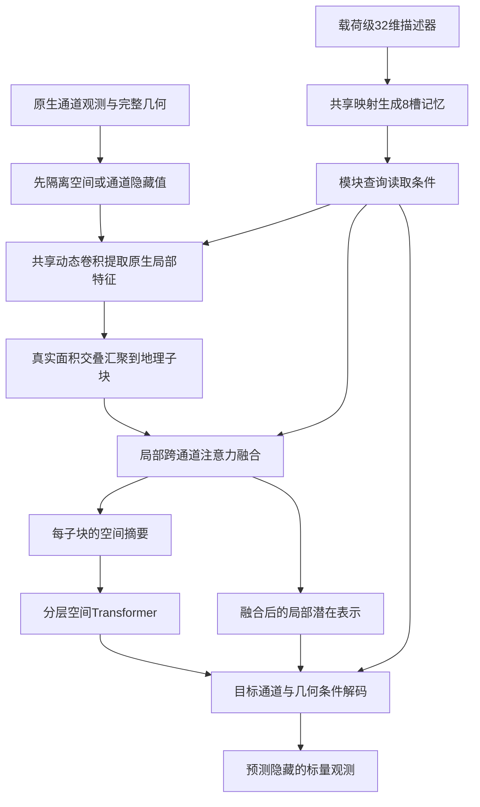

# 跨卫星地表表征的研究方案与设计演变

## 研究目标与阅读导览

本项目希望用一套共享模型处理不同卫星、波段组合和原生空间网格，学习能够迁移到地表识别任务的表示。研究对象是“观测条件不同，但仍可以共同理解的地表信息”，而不是某颗卫星固定通道格式。滑坡分割是检验表示的一项下游任务，不是编码器本身的研究目标。

主要方案按下面六部分阅读。USE 的早期恢复、注意力和空间交互尝试合并为 **USE V1**；原 USE v4 及其视觉入口保留对照统一称为 **USE V2**。Encoder V3 的参与率聚合和 latent-response 是同一代方案中的前后设计，不再列成两个版本。下面是设计演变的组织顺序，不意味着各分支严格串行开展。

| 方案 | 这一阶段做了什么 | 相比前面的主要变化 |
|---|---|---|
| [USE V1 通用光谱编码](#use-v1-通用光谱编码) | 用共享参数读取可变波段集合，分离局部细节与空间上下文，并用恢复任务预训练 | 从固定十波段输入转为带波段身份的集合输入 |
| [USE V2 光谱编码接入视觉主干](#use-v2-光谱编码接入视觉主干) | 复用成熟视觉编码器，比较光谱特征注入和视觉入口保留 | 保留通用光谱前端，替换自建空间主干及其下游连接 |
| [共享单波段 CNN 与跨源自蒸馏](#共享单波段-cnn-与跨源自蒸馏) | 用共享单波段特征提取器比较尺度增强、尺度一致性和同地点跨源正视图 | 用表示一致性代替单纯数值恢复，显式考察配对观测 |
| [Encoder V1 条件观测预测](#encoder-v1-条件观测预测) | 给定可见观测及目标波段条件，预测隐藏观测 | 从通用特征对齐转为可解释的观测条件与预测接口 |
| [Encoder V2 原生网格与局部信息保留](#encoder-v2-原生网格与局部信息保留) | 保留原生空间支持，增加局部特征库，联合空间隐藏和波段隐藏 | 减少固定网格压缩和局部读出路径不足的问题 |
| [Encoder V3 潜在响应与传感器记忆](#encoder-v3-潜在响应与传感器记忆) | 用载荷级潜在描述器控制共享网络，先融合局部光谱，再建模远距离空间关系 | 将原来的逐波段聚合重组为传感器记忆、地理子块与融合后表示 |

## USE V1 通用光谱编码

### 目的与最初想法

固定通道的分割网络把输入位置与某一组波段绑定，缺少波段或换成另一颗卫星就需要重新适配。USE V1 的出发点是把“波段身份”和“这个波段观测到了什么”分开表达：每个可见波段都经过共享的数值编码，再结合波长、分辨率等描述，让同一套参数接收不同数量、不同组合的光学波段。

局部区域既需要保留像素位置差异，又需要汇总其光谱信息。因此，前端不是直接把所有通道平均成一幅图，而是在局部区域构造波段特征，通过集合聚合或查询读取形成两类表示：细节表示保留局部位置，上下文表示进一步进入空间主干，组织更大范围的地物关系。训练时隐藏部分波段或空间位置，让模型利用剩余观测恢复目标；之后固定编码器，用恢复探针及完整分割网络检查表示是否有用。

### 这一代内部怎样调整

最初先比较均值聚合、波段注意力和物理描述，目的是判断共享输入接口本身是否可学。随后把无标签预训练与有标签下游分开，防止把消费者网络的学习能力误认为通用编码器已经有效。再增加局部波段注意力、细节与上下文查询、层次空间传播和两者的交互，尝试让表示同时承担光谱恢复与空间理解。

这些调整保留了“共享波段前端、可变集合输入、细节与上下文分工”的核心。被替换的是集合聚合方式、空间传播方式和下游消费者的容量；它们是 USE V1 的内部对照，不再各占一个主版本。轻量头接近零的结果也推动了完整 U-Net、SegFormer 消费者对照，避免只凭一个很小的任务头判断编码器。

### 最重要的发现与下一步问题

首轮联合预训练后滑坡 IoU 为 0.2370，同轮十波段直入参照为 0.2985。后续恢复目标有所改善，却没有形成一致的分割迁移改善。这一代说明了通用输入和恢复学习可以运行，但“能恢复观测”没有直接转化为“能提供更好的地表表示”。

由此需要重新考虑空间能力来自哪里，以及通用光谱特征应怎样连接已有视觉网络。逐项成绩留在 [正式研究结果](RESULTS.md)，设计中只保留这一结论。

## USE V2 光谱编码接入视觉主干

### 为什么改变，以及保留什么

USE V1 同时学习通用光谱编码和空间结构，存在重复学习空间能力、消费者难以使用表示的问题。USE V2 保留局部光谱输入、细节与上下文查询，尝试复用成熟的 MiT／SegFormer 空间编码能力，而不再把改进全部寄托于自建空间主干。

第一条连接方式把光谱查询输出经适配器送入预训练 MiT 的各级空间处理，跳过原来的 RGB 首层。其想法是：波段接口由 USE 解决，空间关系由成熟视觉主干解决。下游读取层次特征，并用细节残差补充局部信息。

### 为什么又比较视觉入口保留

跳过 RGB 首层虽然解决了通道形状问题，却也改变了预训练主干实际接收的特征分布。接口能连接不等于原有视觉能力完整保留。因此同一代进一步比较两条路线：一条保留视觉输入和既有局部细节路径，再加入光谱补充；另一条用教师对齐约束光谱表示，希望获得已有视觉表示的组织方式。这里改变的是连接和学习约束，通用光谱输入的目标没有改变。

### 最重要的发现与后续方向

直接注入方案的冻结轻量头 IoU 为 0.0600，没有超过其历史消费者系统。之后保留视觉入口的参照为 0.2419，关闭空间残差、保留训练后细节的追加方案为 0.2409，未显示明确增益。这些是各自条件下的结果，不能互相当作严格同预算的单因素比较。

关键发现是：接口和原有视觉信息的保留非常重要，增加光谱分支本身没有保证收益。研究因此继续考察表示学习目标、真实观测尺度和跨源关系，而不把一个可运行的适配器当成统一表征问题已经解决。旧路径中的 `use_v4` 仍用于追溯，正文名称统一为 USE V2。

## 共享单波段 CNN 与跨源自蒸馏

### 为什么引入这条路线

恢复任务可能主要奖励数值拟合。为了直接考察地表表示和跨源关系，这条路线采用较简单的共享单波段 CNN：每个实际可见波段单独提取空间特征，波长和原生地面采样距离参与条件调制，再把可见集合汇聚，交给共享视觉网络。仍保留“同一套参数处理不同波段”的目标，但把学习重点移到多视图表示的一致性。

学生网络预测教师产生的视图表示，教师以移动平均更新。先比较普通裁剪缩放、低通后采样和尺度一致性约束，检验空间退化应如何进入学习；随后在同一批地点上比较 S2 双组视图、S2／Landsat 独立视图、同地点配对正视图，区分“多读一个传感器”与“明确建立跨传感器正样本关系”。

### 保留与替换

保留共享波段处理和显式观测条件，替换以隐藏数值恢复为中心的预训练目标。空间增强不是为了把低分辨率观测伪装成高分辨率，而是让模型学习哪些信息在真实退化后仍可比较。同地点配对也不是逐像素真值，其时间差和质量仍由数据规则约束。

### 发现了什么

配对正视图在该地理开发检索上的 R@10 为 0.7778，但其滑坡冻结头 IoU 为 0.0744，未同步改善语义任务。这个结果把“跨源位置识别”和“可迁移地表语义”分开了：二者可能需要不同的信息，不能只优化一个对齐分数。

下一问题因此是如何让模型明确知道观测条件和预测目标，并保留有用的局部内容，而不只学习视图间的相似关系。

## Encoder V1 条件观测预测

### 研究问题与模型想法

同一个地表区域在不同传感器下产生不同观测。与其要求所有输入得到完全相同的特征，不如让共享编码器理解可见观测，再由带目标条件的解码器回答：“如果读取指定波段、指定空间区域，应该得到什么观测？”目标波段的数值被隐藏，身份和几何可以作为查询条件。

这一代用固定物理区域组织观测，局部波段块投影成 Token，依次学习光谱与空间关系；目标查询读取上下文并预测标量反射率。空间隐藏用于学习邻域信息，波段隐藏用于学习跨波段关系。条件线性回归作为参照，检查任务是否主要由简单光谱关系即可解释。

### 相比前面的保留与变化

保留共享网络、波段区分和多源输入，替换“视图表示应该相近”的单一要求：模型现在必须在明确目标条件下输出可检验的观测。物理单位、可见性和目标来源成为接口的一部分，而不是把不同传感器都压成同样的通道数组。

### 为什么还需要下一代

已有完整训练中，Transformer 的多波段恢复仍落后于条件线性回归参照。不能据此断言注意力无效，但它提示：投影后的表示可能没有给局部预测提供足够直接的路径，训练目标的尺度和目标轮换也会影响优化。因此下一代重点改变原生几何和局部读出，而不是继续增加模型宽度。

## Encoder V2 原生网格与局部信息保留

### 目的与具体思路

把不同分辨率波段统一到一个细网格，容易混淆实际采样支持；仅用压缩 Token 解码，又要求网络重新学会局部路由。Encoder V2 保留原生 10／20／30 米观测，使用带光谱响应条件的共享局部投影、空间 Transformer 和原生局部特征库。解码器既读取空间上下文，也能在合法的可见支持上读取局部信息。

学习任务联合空间遮盖恢复和整组波段缺失恢复，预测目标只来自真实存在的观测。隐藏值必须先隔离，再执行特征提取。目标用训练成员统计标准化，训练与验证按相同的目标含义解释，减少尺度不一致造成的混淆。

### 保留什么，替换什么

保留 Encoder V1 的目标条件查询和数值可检验性，替换过早统一网格和局部读出不足的接口。局部库的作用是为预测提供可访问的信息，并不意味着特征就是原始影像，也不证明已经得到通用地表表示。

### 关键结果怎样推动后续设计

G5 在用户结束前，固定主验证最佳综合分数为 0.039777；完整末态权重位于 8550 步，该末态未单独评价。恢复能力有明显学习过程，但部分固定波段案例仍落后于线性参照，跨卫星与语义迁移没有得到统一证明。

接下来的问题是：如何让条件真正表达“传感器怎样观测”，同时避免每个波段长期保留大量局部特征。这个问题连接到 Encoder V3 的条件表达与表示组织重构。

## Encoder V3 潜在响应与传感器记忆

### 从逐波段聚合到载荷级潜在条件

本代的前期思路让每个波段先在原生网格提取特征，再按地面采样距离控制局部聚合，保留原生位置和合并区域两个尺度。它延后了跨波段压缩，但也增加 Token 数量、支持对齐和局部特征保存的成本。参与率聚合与 latent-response 在这里是同一代的探索与重构，不是两个独立版本。

进一步的物理讨论澄清了条件的含义。SRF 描述波段对波长的响应，不是地物光谱；PSF 描述空间扩散，不等于 CNN 卷积核；GSD 是采样间距，不等于真实可分辨细节。一个波段值不能唯一反演完整光谱，插值也不能创造没有采集到的信息。

因此，本代从“让某种物理描述生成一层参数”，转向“观测条件应该怎样约束表示与交互”。SRF 更直接关联波段关系和目标查询，PSF／GSD 更直接关联空间支持与尺度；这是一种设计先验，不是二者严格独立的物理定律。

### 为什么首版不要求完整 SRF／PSF

不同数据的完整响应资料并不齐全，模态之间也没有完全相同的物理字段。首版采用每个稳定载荷一个可学习的 32 维潜在描述器：载荷身份由平台与仪器共同确定，同一载荷的所有波段、场景和输入子集复用这一份描述器。它不是每波段一套参数，也不被解释为恢复出的真实 SRF 或 PSF。

描述器经共享映射生成 8 个 Key／Value 槽位。空间卷积、通道融合、目标解码分别用共享查询种子和通道元数据读取同一份记忆。多个槽位使查询可以选择不同条件内容；固定通道顺位与 GSD 则让同一载荷的不同波段可被区分。这样保留条件化能力，又避免把网络扩展成每颗卫星或每个波段一个独立模型。

### 当前完整信息流

**原生空间处理。** 空间模块查询读取载荷记忆，动态组合共享卷积基，在各自原生网格上进行带有效掩膜的局部计算。动态核是学习算子，不冒充真实成像 PSF。

**共同地理子块。** 不同通道通过真实地理交叠面积汇聚到同一 Sub-Patch。参考采样距离来自遮盖前的完整观测几何，取各轴最小值；子块边长为参考值的 8 倍，每块划为 4×4 微格。隐藏一个通道不能改变几何参考。

**先光谱、后长距离空间。** 在每个子块内，以可见通道内容为 Key／Value，结合载荷条件进行跨通道融合。输出一个主要空间摘要和若干融合后的局部潜在表示；局部表示数量为 `min(16, ceil(sqrt(C)))`，其中 C 是有效可见通道数。空间摘要进入分层主干，局部表示参与邻域关系和解码，不长期保留逐通道高维旁路。

**目标读出。** 解码器用目标通道自己的查询读取载荷记忆，结合目标相对位置、支持尺寸、局部融合表示和全局上下文预测观测。完全隐藏区域仍有合法目标，但不向编码器塞入可学习空白内容 Token。被隐藏通道的身份和几何可用于查询，其数值和特征不得进入编码器。

### 学习目标与继承关系

首版包含空间矩形隐藏与完整通道隐藏两类任务。只监督真实存在的目标，使用训练成员统计标准化后的标量，标准化域 MSE 不重复除以原始方差。目标先在通道、观测和来源层次归约，再组合任务。

本代继承了前面的共享网络、原生几何、目标条件查询和严格隐藏隔离；替换了完整物理响应的必需输入、逐波段持久特征和过重的原生旁路。当前首版不增加独立逐像元或微格高维 skip，也不把抽象 Token 直接套入 SRF／PSF 公式后称为物理成像。

跨源表示需要对共同可观测的稳定属性可比，同时保留真实地表变化与互补细节，而不是无条件完全一致。本代尚无正式训练结果。需要验证的核心是：载荷描述器是否有效、融合后的摘要与局部表示是否足够，以及其表示能否真正迁移。设计确认和工程实现验收分别记录；本次文档重写不启动训练。

## 参考做法与采用理由

| 参考 | 本项目借鉴的具体问题与做法 |
|---|---|
| [DOFA](https://arxiv.org/abs/2403.15356) | 波长条件化动态输入投影，启发可变波段共享入口；代表波长不等于完整响应 |
| [STARS](https://arxiv.org/abs/2411.05714) | 将传感器元数据用于通用光谱表示，启发观测条件与内容的区分 |
| [UniverSat](https://arxiv.org/abs/2606.23503) | 通用Patch编码和异构输入的共享表示；本项目进一步明确原生支持及局部融合的组织方式 |
| [NASA HLS算法](https://hls.gsfc.nasa.gov/algorithms/) | 波段调整、质量掩膜、BRDF与共同网格说明跨源差异不止中心波长；产品协调与学习统一编码器是不同任务 |

Encoder V3 的研究脉络和完整物理讨论来自本次提供的[研究演变参考](assets/references/encoder_v3_research_evolution.md)。工程定位只保留两个入口：[正式结果](RESULTS.md)用于核对关键发现，[职责与执行约束](AGENT_ROLES.md)用于Agent开工；不在本页堆叠测试文件和短程运行记录。

## 后续维护方式

新增设计只更新对应代的目的、机制、保留与替换、关键发现及下一问题。只有改变研究问题或主要表示组织方式时才增加主版本；预算、任务头、短程检查和修复不单列版本。正式结果写 RESULTS，数据资源写 DATA，代码发布和测试详情留机器记录。旧目录代号保持追溯兼容，不反向支配正文命名。

### Encoder V3 latent-response 已确认接口

本轮确认将目标附近fine summary与融合后R(C)局部谱latent合并为一次局部注意力，配合独立全局读出，Decoder输入为309维。局部latent因此具有通向重建损失的实际路径；不增加逐通道或micro-cell高维旁路。静态通道Query共用8→64→32元数据投影，仅模块seed独立。空间位置使用完整已加载通道定义的统一场景相对米制参考，加全景比例坐标；其语义不等同于地球绝对位置。原生前端分块保持完整场景，窗口主干先形成全部粗尺度信息，再计算全局latent并回注，目标损失通过等价分块反向累积。

当前执行范围为合成工程测试与真实E1无更新，不能把随机初始化重建误差视作正式模型成绩。工程证据见outputs/encoder_v3/latent_response/plan_execution；真实训练授权保持关闭。
