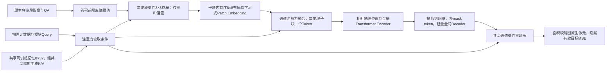

# 跨卫星地表表征的研究方案与设计演变

## 研究目标与阅读导览

本项目希望用一套共享模型处理不同卫星、波段组合和原生空间网格，学习能够迁移到地表识别任务的表示。研究对象是“观测条件不同，但仍可以共同理解的地表信息”，而不是某颗卫星固定通道格式。滑坡分割是检验表示的一项下游任务，不是编码器本身的研究目标。

主要方案按下面六部分阅读。USE 的早期恢复、注意力和空间交互尝试合并为 **USE V1**；原 USE v4 及其视觉入口保留对照统一称为 **USE V2**。Encoder V3 的参与率聚合、latent-response 与共享描述器MAE属于同一代内的设计演变。下面是设计演变的组织顺序，不意味着各分支严格串行开展。

| 方案 | 这一阶段做了什么 | 相比前面的主要变化 |
|---|---|---|
| [USE V1 通用光谱编码](#use-v1-通用光谱编码) | 用共享参数读取可变波段集合，分离局部细节与空间上下文，并用恢复任务预训练 | 从固定十波段输入转为带波段身份的集合输入 |
| [USE V2 光谱编码接入视觉主干](#use-v2-光谱编码接入视觉主干) | 复用成熟视觉编码器，比较光谱特征注入和视觉入口保留 | 保留通用光谱前端，替换自建空间主干及其下游连接 |
| [共享单波段 CNN 与跨源自蒸馏](#共享单波段-cnn-与跨源自蒸馏) | 用共享单波段特征提取器比较尺度增强、尺度一致性和同地点跨源正视图 | 用表示一致性代替单纯数值恢复，显式考察配对观测 |
| [Encoder V1 条件观测预测](#encoder-v1-条件观测预测) | 给定可见观测及目标波段条件，预测隐藏观测 | 从通用特征对齐转为可解释的观测条件与预测接口 |
| [Encoder V2 原生网格与局部信息保留](#encoder-v2-原生网格与局部信息保留) | 保留原生空间支持，增加局部特征库，联合空间隐藏和波段隐藏 | 减少固定网格压缩和局部读出路径不足的问题 |
| [Encoder V3 共享描述器与地理 Patch MAE](#encoder-v3-共享描述器与地理-patch-mae) | 用物理Query读取全卫星共享的可训练记忆，条件卷积和通道融合后形成地理Token，再做全局MAE | 从载荷级参数和逐像元局部/全局读出，收敛为共享前端、单空间Token及轻量Decoder |

## USE V1 通用光谱编码

### 目的与最初想法

固定通道的分割网络把输入位置与某一组波段绑定，缺少波段或换成另一颗卫星就需要重新适配。USE V1 的出发点是把“波段身份”和“这个波段观测到了什么”分开表达：每个可见波段都经过共享的数值编码，再结合波长、分辨率等描述，让同一套参数接收不同数量、不同组合的光学波段。

局部区域既需要保留像素位置差异，又需要汇总其光谱信息。因此，前端不是直接把所有通道平均成一幅图，而是在局部区域构造波段特征，通过集合聚合或查询读取形成两类表示：细节表示保留局部位置，上下文表示进一步进入空间主干，组织更大范围的地物关系。训练时隐藏部分波段或空间位置，让模型利用剩余观测恢复目标；之后固定编码器，用恢复探针及完整分割网络检查表示是否有用。

### 这一代内部怎样调整

最初先比较均值聚合、波段注意力和物理描述，目的是判断共享输入接口本身是否可学。随后把无标签预训练与有标签下游分开，防止把消费者网络的学习能力误认为通用编码器已经有效。再增加局部波段注意力、细节与上下文查询、层次空间传播和两者的交互，尝试让表示同时承担光谱恢复与空间理解。

这些调整保留了“共享波段前端、可变集合输入、细节与上下文分工”的核心。被替换的是集合聚合方式、空间传播方式和下游消费者的容量；它们是 USE V1 的内部对照，不再各占一个主版本。轻量头接近零的结果也推动了完整 U-Net、SegFormer 消费者对照，避免只凭一个很小的任务头判断编码器。

### 最重要的发现与下一步问题

首轮联合预训练后滑坡 IoU 为 0.2370，同轮十波段直入参照为 0.2985。后续恢复目标有所改善，却没有形成一致的分割迁移改善。这一代说明了通用输入和恢复学习可以运行，但“能恢复观测”没有直接转化为“能提供更好的地表表示”。

由此需要重新考虑空间能力来自哪里，以及通用光谱特征应怎样连接已有视觉网络。逐项成绩留在 [正式研究结果](RESULTS.md)，设计中只保留这一结论。

## USE V2 光谱编码接入视觉主干

### 为什么改变，以及保留什么

USE V1 同时学习通用光谱编码和空间结构，存在重复学习空间能力、消费者难以使用表示的问题。USE V2 保留局部光谱输入、细节与上下文查询，尝试复用成熟的 MiT／SegFormer 空间编码能力，而不再把改进全部寄托于自建空间主干。

第一条连接方式把光谱查询输出经适配器送入预训练 MiT 的各级空间处理，跳过原来的 RGB 首层。其想法是：波段接口由 USE 解决，空间关系由成熟视觉主干解决。下游读取层次特征，并用细节残差补充局部信息。

### 为什么又比较视觉入口保留

跳过 RGB 首层虽然解决了通道形状问题，却也改变了预训练主干实际接收的特征分布。接口能连接不等于原有视觉能力完整保留。因此同一代进一步比较两条路线：一条保留视觉输入和既有局部细节路径，再加入光谱补充；另一条用教师对齐约束光谱表示，希望获得已有视觉表示的组织方式。这里改变的是连接和学习约束，通用光谱输入的目标没有改变。

### 最重要的发现与后续方向

直接注入方案的冻结轻量头 IoU 为 0.0600，没有超过其历史消费者系统。之后保留视觉入口的参照为 0.2419，关闭空间残差、保留训练后细节的追加方案为 0.2409，未显示明确增益。这些是各自条件下的结果，不能互相当作严格同预算的单因素比较。

关键发现是：接口和原有视觉信息的保留非常重要，增加光谱分支本身没有保证收益。研究因此继续考察表示学习目标、真实观测尺度和跨源关系，而不把一个可运行的适配器当成统一表征问题已经解决。旧路径中的 `use_v4` 仍用于追溯，正文名称统一为 USE V2。

## 共享单波段 CNN 与跨源自蒸馏

### 为什么引入这条路线

恢复任务可能主要奖励数值拟合。为了直接考察地表表示和跨源关系，这条路线采用较简单的共享单波段 CNN：每个实际可见波段单独提取空间特征，波长和原生地面采样距离参与条件调制，再把可见集合汇聚，交给共享视觉网络。仍保留“同一套参数处理不同波段”的目标，但把学习重点移到多视图表示的一致性。

学生网络预测教师产生的视图表示，教师以移动平均更新。先比较普通裁剪缩放、低通后采样和尺度一致性约束，检验空间退化应如何进入学习；随后在同一批地点上比较 S2 双组视图、S2／Landsat 独立视图、同地点配对正视图，区分“多读一个传感器”与“明确建立跨传感器正样本关系”。

### 保留与替换

保留共享波段处理和显式观测条件，替换以隐藏数值恢复为中心的预训练目标。空间增强不是为了把低分辨率观测伪装成高分辨率，而是让模型学习哪些信息在真实退化后仍可比较。同地点配对也不是逐像素真值，其时间差和质量仍由数据规则约束。

### 发现了什么

配对正视图在该地理开发检索上的 R@10 为 0.7778，但其滑坡冻结头 IoU 为 0.0744，未同步改善语义任务。这个结果把“跨源位置识别”和“可迁移地表语义”分开了：二者可能需要不同的信息，不能只优化一个对齐分数。

下一问题因此是如何让模型明确知道观测条件和预测目标，并保留有用的局部内容，而不只学习视图间的相似关系。

## Encoder V1 条件观测预测

### 研究问题与模型想法

同一个地表区域在不同传感器下产生不同观测。与其要求所有输入得到完全相同的特征，不如让共享编码器理解可见观测，再由带目标条件的解码器回答：“如果读取指定波段、指定空间区域，应该得到什么观测？”目标波段的数值被隐藏，身份和几何可以作为查询条件。

这一代用固定物理区域组织观测，局部波段块投影成 Token，依次学习光谱与空间关系；目标查询读取上下文并预测标量反射率。空间隐藏用于学习邻域信息，波段隐藏用于学习跨波段关系。条件线性回归作为参照，检查任务是否主要由简单光谱关系即可解释。

### 相比前面的保留与变化

保留共享网络、波段区分和多源输入，替换“视图表示应该相近”的单一要求：模型现在必须在明确目标条件下输出可检验的观测。物理单位、可见性和目标来源成为接口的一部分，而不是把不同传感器都压成同样的通道数组。

### 为什么还需要下一代

已有完整训练中，Transformer 的多波段恢复仍落后于条件线性回归参照。不能据此断言注意力无效，但它提示：投影后的表示可能没有给局部预测提供足够直接的路径，训练目标的尺度和目标轮换也会影响优化。因此下一代重点改变原生几何和局部读出，而不是继续增加模型宽度。

## Encoder V2 原生网格与局部信息保留

### 目的与具体思路

把不同分辨率波段统一到一个细网格，容易混淆实际采样支持；仅用压缩 Token 解码，又要求网络重新学会局部路由。Encoder V2 保留原生 10／20／30 米观测，使用带光谱响应条件的共享局部投影、空间 Transformer 和原生局部特征库。解码器既读取空间上下文，也能在合法的可见支持上读取局部信息。

学习任务联合空间遮盖恢复和整组波段缺失恢复，预测目标只来自真实存在的观测。隐藏值必须先隔离，再执行特征提取。目标用训练成员统计标准化，训练与验证按相同的目标含义解释，减少尺度不一致造成的混淆。

### 保留什么，替换什么

保留 Encoder V1 的目标条件查询和数值可检验性，替换过早统一网格和局部读出不足的接口。局部库的作用是为预测提供可访问的信息，并不意味着特征就是原始影像，也不证明已经得到通用地表表示。

### 关键结果怎样推动后续设计

G5 在用户结束前，固定主验证最佳综合分数为 0.039777；完整末态权重位于 8550 步，该末态未单独评价。恢复能力有明显学习过程，但部分固定波段案例仍落后于线性参照，跨卫星与语义迁移没有得到统一证明。

接下来的问题是：如何让条件真正表达“传感器怎样观测”，同时避免每个波段长期保留大量局部特征。这个问题连接到 Encoder V3 的条件表达与表示组织重构。

## Encoder V3 共享描述器与地理 Patch MAE

### 设计演变与当前主路径

历史 latent-response 采用载荷级潜在描述器、摘要与局部潜变量，以及逐目标位置的近邻局部读出和全局读出。它在原生网格上实现了条件重建，但逐像元检索、投影与读出增加计算，通道顺位也不适合作为未知卫星的物理身份。该运行保持暂停，冻结源码与曲线只作历史证据。

当前方案改为一份全卫星共享、可训练的8×32描述器记忆。每通道物理元数据经共享Query映射并加入模块种子，分别读取共享Key/Value；空间卷积、融合、输出均读取同一份记忆，不按卫星增加可训练参数。光学条件包括GSD、波长和可用的FWHM；SAR条件包括GSD、频率、极化及可用入射角，配合物理量类别和缺失标志。波长来自产品附属文件或可追溯的物理目录，不要求每幅TIFF自带，也不按波段序号推断。

记忆读取与通道融合使用不同层次的Query。前者将每通道物理信息映射为32维Query，加上卷积、融合或输出模块各自的种子，再读取8槽共享记忆。后者使用共享可学习的128维融合Query；每通道的128维Patch表示与32维融合条件拼接后投影为K/V，在同一地理子块内对可见通道做注意力。空间Encoder/Decoder的Q/K/V来自各自Token，输出头则把64维Decoder特征与32维目标通道条件拼接，直接预测布局值。

每通道条件生成3×3、stride=1卷积权重和偏置，提取32维特征。地理sub-patch内按固定、有序的8×8布局进行面积聚合，保留支持率，再以学习式Patch Embedding投影到128维；描述器条件的通道注意力融合得到每个地理sub-patch唯一的空间Token。8×8是内部布局，压缩有损，不能声称保留了所有原生细节。

条件卷积采用共享底座与8组共享基核、偏置基的加权组合；组合系数由32维条件经线性层与softmax生成。由此得到每个波段本次使用的权重和偏置，无需为各卫星或波段单独保存卷积参数。

共享的是描述器记忆及读取、卷积生成、融合与主干参数；通道物理条件随输入改变，输入通道数不决定可训练参数表大小。当前模型共1,309,056个可训练参数，计算成本还取决于原生像素数、波段数和空间Token数。首段训练以单个观测组织输入，多来源通过共享参数共同学习；同时输入多颗卫星的跨源联合观测任务尚未评价。

地理边长L显式配置，原生像素边长p_x=L/g_x、p_y=L/g_y；遮盖前网格数N=ceil(W*g_x/L)ceil(H*g_y/L)。L不是固定80m，也不从目标Token数反推。32/64/128/256m仅用于工程尺度对比；用户已根据尺度对比确认首轮L=128m。非整除边界按面积交叠处理，原始像元、QA与标签不重采样存储。

### Encoder与重建任务

空间Token加入完整场景参考下的相对米制位置编码，进入4层、4头、128维全局自注意力Encoder。每个观测的注意力独立，合批padding不能让场景互相读取。模型不再持有局部光谱latent旁支，也不进行逐像元KNN或额外局部/全局读出。

A随机遮盖约75%的地理patch。凡原生像元与隐藏patch相交，就在卷积前隔离该像元，防止跨边界泄露；隐藏Token不进入Encoder。B随机隐藏整波段，依据实际有效通道数抽样并至少留一个可见通道；单通道只执行A。训练每轮重新抽样，验证固定遮盖以比较检查点。

Encoder输出投影到64维，补入仅属于Decoder的mask token与地理位置。2层、4头的全局MAE Decoder经共享通道条件重建头输出每patch的8×8预测，再按面积平均回原生像元足迹。输出表示具有分辨率限制，尺度检查须量化布局往返损失，不能用扩大L掩盖细节损失。

设C为输入通道数，P为完整地理网格数，P_v为含有效观测的子块数，P_o为当前遮盖下含可见内容的子块数。QA与原生像元边界保护会影响P_o，因此A的可见Token数不要求严格等于P_v的25%。

| 阶段 | 实际表示 | 空间信息或监督含义 |
|---|---|---|
| 每通道原生输入 | H_c×W_c，附QA、网格及物理元数据 | 不先统一不同分辨率的真实像元 |
| 条件卷积 | H_c×W_c×32 | 3×3邻域；隐藏值在此之前隔离 |
| 子块内布局 | 每通道、每子块8×8×32，另有8×8支持率 | 有序布局保留相对空间排列；面积聚合有损 |
| 学习式Patch Embedding | 每通道、每子块2112→128维 | 2112=64×32特征+64支持率 |
| 通道融合与Encoder | P_o×128 | 通道数不增加融合后的空间Token数；全局注意力仅在本观测内计算 |
| MAE Decoder | P_v×64 | 用可见Encoder表示与mask token构成完整有效网格 |
| 通道条件输出 | 每目标通道、每子块8×8 | L=128m时内部布局间距16m；并非16m原生真值 |
| 损失 | 原生有效隐藏像元上的标量MSE | 预测按面积平均到原生足迹，再按像元、通道、任务、观测归约 |

### 学习目标与证据边界

损失为TRAIN统计标准化后的原生有效目标MSE：目标像元平均、通道平均、可用A/B任务平均、最后观测等权。不按来源重加权或重采样；每Epoch全部7,442个TRAIN无放回遍历，Batch32，末批18。383个VAL保留原角色；EnMAP47窗口属于同一独立场景，没有独立EnMAP VAL。

首段正式训练已正常完成10个Epoch。当前证据支持重建目标可学习：固定验证持续改善，最佳点为最后一轮；完整指标、配置、曲线、实测成本和最佳/末态归属见[正式结果](RESULTS.md#encoder-v3-共享描述器与地理patch-mae)。工程检查与短程更新保留为独立证据，不计入正式模型成绩。

### 本轮发现与下一步设计问题

重建图显示，所示Landsat隐藏波段能恢复部分区域结构，但边缘和细节偏平滑；所示S2隐藏近红外仍有明显反射率偏差。后段验证曲线变平的同时，余弦调度已使学习率接近零。这些证据支持“当前训练进入平台”，尚不能确认已经充分收敛或具有可迁移表征。

后续设计需要区分三类问题：子块面积聚合和2112→128压缩保留了多少细节；共享物理Query与通道条件是否提供了超出TRAIN均值先验的光谱区分；Encoder与Decoder各自对低频拟合及细节不足承担什么作用。现有可视化不能单独确定原因。L=128m、内部8×8布局的空间表示上限也需与原生10/20/30m目标分别核对，不能将输出网格更细解释为增加了真实监督信息。

下游冻结Encoder评价、独立EnMAP场景及多卫星联合输入均未验证。以后若开展对照，应固定成员、QA、统计和评价遮盖，再逐项改变布局、解码或优化设置；这些是待验证问题，不是已批准的新训练安排。

### 执行优化与设计含义

保留同一地理网格、隐藏隔离和损失归约，复用仅依赖相对几何的面积映射，同网格卷积与重建头合批，并合并逐通道有效性判断以减少CPU/GPU同步。模型的跨样本缓存只保存几何；数据层可缓存已校验的原生观测，每次构造视图仍重新执行隐藏隔离，学习特征不跨视图复用。原生文件采用顺序读取，定标、QA与身份校验继续执行。实际首轮采用FP32，BF16在本机同批检查中没有更快。性能对比、冷启动和完整Epoch耗时分别报告，不用参数量或小样本吞吐直接代表整轮成本。

## 参考做法与采用理由

| 参考 | 本项目借鉴的具体问题与做法 |
|---|---|
| [DOFA](https://arxiv.org/abs/2403.15356) | 波长条件化动态输入投影，启发可变波段共享入口；代表波长不等于完整响应 |
| [STARS](https://arxiv.org/abs/2411.05714) | 将传感器元数据用于通用光谱表示，启发观测条件与内容的区分 |
| [UniverSat](https://arxiv.org/abs/2606.23503) | 通用Patch编码和异构输入的共享表示；本项目进一步明确原生支持及局部融合的组织方式 |
| [NASA HLS算法](https://hls.gsfc.nasa.gov/algorithms/) | 波段调整、质量掩膜、BRDF与共同网格说明跨源差异不止中心波长；产品协调与学习统一编码器是不同任务 |

Encoder V3 的研究脉络和完整物理讨论来自本次提供的[研究演变参考](assets/references/encoder_v3_research_evolution.md)。工程定位只保留两个入口：[正式结果](RESULTS.md)用于核对关键发现，[职责与执行约束](AGENT_ROLES.md)用于Agent开工；不在本页堆叠测试文件和短程运行记录。

## 后续维护方式

新增设计只更新对应代的目的、机制、保留与替换、关键发现及下一问题。只有改变研究问题或主要表示组织方式时才增加主版本；预算、任务头、短程检查和修复不单列版本。正式结果写 RESULTS，数据资源写 DATA，代码发布和测试详情留机器记录。旧目录代号保持追溯兼容，不反向支配正文命名。

### Encoder V3 latent-response 历史接口（已被共享MAE主路径替代）

历史接口曾将目标附近fine summary与融合后R(C)局部谱latent合并为一次局部注意力，配合独立全局读出，Decoder输入为309维。局部latent因此具有通向重建损失的实际路径；不增加逐通道或micro-cell高维旁路。静态通道Query共用8→64→32元数据投影，仅模块seed独立。空间位置使用完整已加载通道定义的统一场景相对米制参考，加全景比例坐标；其语义不等同于地球绝对位置。原生前端分块保持完整场景，窗口主干先形成全部粗尺度信息，再计算全局latent并回注，目标损失通过等价分块反向累积。

旧分支的执行优化保持当时的信息流、任务归约与目标像元不变：同格网通道合批，复用纯几何交叠及精确近邻索引，通道条件只计算一次，空间分块仅保存有效核心输出。解码局部内容与全局记忆的Key/Value投影按视图共享；利用线性可分性分别投影内容和相对位置，跨目标通道合批并保留逐通道归一化权重。反向梯度先累积到共享投影，再一次传回编码器。近邻检索使用精确编译实现，并对等距点按原始索引排序。缓存不跨视图保存学习特征，不把隐藏值带入内容；内存缓存有容量上限。该调整属于Encoder V3实现修复，不另立架构版本。

旧实现完成20步工程更新检查，随后E3已停止；修复版完成真实数据无更新等价性和最大S2完整前后向检查。工程证据见outputs/encoder_v3/latent_response/correctness_speed；这些检查不证明收敛、跨卫星迁移或灾害识别效果，正式成绩仍须独立实验与评价。
