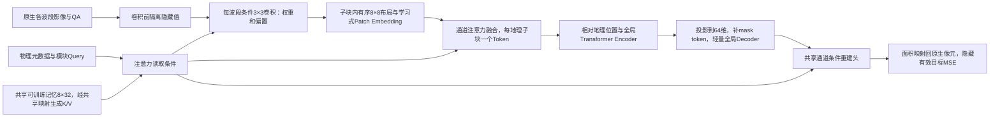

# 跨卫星地表表征的研究方案与设计演变

## 研究目标与阅读导览

本项目希望用一套共享模型处理不同卫星、波段组合和原生空间网格，学习能够迁移到地表识别任务的表示。研究对象是“观测条件不同，但仍可以共同理解的地表信息”，而不是某颗卫星固定通道格式。滑坡分割是检验表示的一项下游任务，不是编码器本身的研究目标。

主要方案按下面六部分阅读。USE 的早期恢复、注意力和空间交互尝试合并为 **USE V1**；原 USE v4 及其视觉入口保留对照统一称为 **USE V2**。Encoder V3 的参与率聚合、latent-response 与共享描述器MAE属于同一代内的设计演变。下面是设计演变的组织顺序，不意味着各分支严格串行开展。

| 方案 | 这一阶段做了什么 | 相比前面的主要变化 |
|---|---|---|
| [USE V1 通用光谱编码](#use-v1-通用光谱编码) | 用共享参数读取可变波段集合，分离局部细节与空间上下文，并用恢复任务预训练 | 从固定十波段输入转为带波段身份的集合输入 |
| [USE V2 光谱编码接入视觉主干](#use-v2-光谱编码接入视觉主干) | 复用成熟视觉编码器，比较光谱特征注入和视觉入口保留 | 保留通用光谱前端，替换自建空间主干及其下游连接 |
| [共享单波段 CNN 与跨源自蒸馏](#共享单波段-cnn-与跨源自蒸馏) | 用共享单波段特征提取器比较尺度增强、尺度一致性和同地点跨源正视图 | 用表示一致性代替单纯数值恢复，显式考察配对观测 |
| [Encoder V1 条件观测预测](#encoder-v1-条件观测预测) | 给定可见观测及目标波段条件，预测隐藏观测 | 从通用特征对齐转为可解释的观测条件与预测接口 |
| [Encoder V2 原生网格与局部信息保留](#encoder-v2-原生网格与局部信息保留) | 保留原生空间支持，增加局部特征库，联合空间隐藏和波段隐藏 | 减少固定网格压缩和局部读出路径不足的问题 |
| [Encoder V3 共享描述器与地理 Patch MAE](#encoder-v3-共享描述器与地理-patch-mae) | 用物理Query读取全卫星共享的可训练记忆，条件卷积和通道融合后形成地理Token，再做全局MAE | 从载荷级参数和逐像元局部/全局读出，收敛为共享前端、单空间Token及轻量Decoder |

## USE V1 通用光谱编码

### 目的与最初想法

固定通道的分割网络把输入位置与某一组波段绑定，缺少波段或换成另一颗卫星就需要重新适配。USE V1 的出发点是把“波段身份”和“这个波段观测到了什么”分开表达：每个可见波段都经过共享的数值编码，再结合波长、分辨率等描述，让同一套参数接收不同数量、不同组合的光学波段。

局部区域既需要保留像素位置差异，又需要汇总其光谱信息。因此，前端不是直接把所有通道平均成一幅图，而是在局部区域构造波段特征，通过集合聚合或查询读取形成两类表示：细节表示保留局部位置，上下文表示进一步进入空间主干，组织更大范围的地物关系。训练时隐藏部分波段或空间位置，让模型利用剩余观测恢复目标；之后固定编码器，用恢复探针及完整分割网络检查表示是否有用。

### 这一代内部怎样调整

最初先比较均值聚合、波段注意力和物理描述，目的是判断共享输入接口本身是否可学。随后把无标签预训练与有标签下游分开，防止把消费者网络的学习能力误认为通用编码器已经有效。再增加局部波段注意力、细节与上下文查询、层次空间传播和两者的交互，尝试让表示同时承担光谱恢复与空间理解。

这些调整保留了“共享波段前端、可变集合输入、细节与上下文分工”的核心。被替换的是集合聚合方式、空间传播方式和下游消费者的容量；它们是 USE V1 的内部对照，不再各占一个主版本。轻量头接近零的结果也推动了完整 U-Net、SegFormer 消费者对照，避免只凭一个很小的任务头判断编码器。

### 最重要的发现与下一步问题

首轮联合预训练后滑坡 IoU 为 0.2370，同轮十波段直入参照为 0.2985。后续恢复目标有所改善，却没有形成一致的分割迁移改善。这一代说明了通用输入和恢复学习可以运行，但“能恢复观测”没有直接转化为“能提供更好的地表表示”。

由此需要重新考虑空间能力来自哪里，以及通用光谱特征应怎样连接已有视觉网络。逐项成绩留在 [正式研究结果](RESULTS.md)，设计中只保留这一结论。

## USE V2 光谱编码接入视觉主干

### 为什么改变，以及保留什么

USE V1 同时学习通用光谱编码和空间结构，存在重复学习空间能力、消费者难以使用表示的问题。USE V2 保留局部光谱输入、细节与上下文查询，尝试复用成熟的 MiT／SegFormer 空间编码能力，而不再把改进全部寄托于自建空间主干。

第一条连接方式把光谱查询输出经适配器送入预训练 MiT 的各级空间处理，跳过原来的 RGB 首层。其想法是：波段接口由 USE 解决，空间关系由成熟视觉主干解决。下游读取层次特征，并用细节残差补充局部信息。

### 为什么又比较视觉入口保留

跳过 RGB 首层虽然解决了通道形状问题，却也改变了预训练主干实际接收的特征分布。接口能连接不等于原有视觉能力完整保留。因此同一代进一步比较两条路线：一条保留视觉输入和既有局部细节路径，再加入光谱补充；另一条用教师对齐约束光谱表示，希望获得已有视觉表示的组织方式。这里改变的是连接和学习约束，通用光谱输入的目标没有改变。

### 最重要的发现与后续方向

直接注入方案的冻结轻量头 IoU 为 0.0600，没有超过其历史消费者系统。之后保留视觉入口的参照为 0.2419，关闭空间残差、保留训练后细节的追加方案为 0.2409，未显示明确增益。这些是各自条件下的结果，不能互相当作严格同预算的单因素比较。

关键发现是：接口和原有视觉信息的保留非常重要，增加光谱分支本身没有保证收益。研究因此继续考察表示学习目标、真实观测尺度和跨源关系，而不把一个可运行的适配器当成统一表征问题已经解决。旧路径中的 `use_v4` 仍用于追溯，正文名称统一为 USE V2。

## 共享单波段 CNN 与跨源自蒸馏

### 为什么引入这条路线

恢复任务可能主要奖励数值拟合。为了直接考察地表表示和跨源关系，这条路线采用较简单的共享单波段 CNN：每个实际可见波段单独提取空间特征，波长和原生地面采样距离参与条件调制，再把可见集合汇聚，交给共享视觉网络。仍保留“同一套参数处理不同波段”的目标，但把学习重点移到多视图表示的一致性。

学生网络预测教师产生的视图表示，教师以移动平均更新。先比较普通裁剪缩放、低通后采样和尺度一致性约束，检验空间退化应如何进入学习；随后在同一批地点上比较 S2 双组视图、S2／Landsat 独立视图、同地点配对正视图，区分“多读一个传感器”与“明确建立跨传感器正样本关系”。

### 保留与替换

保留共享波段处理和显式观测条件，替换以隐藏数值恢复为中心的预训练目标。空间增强不是为了把低分辨率观测伪装成高分辨率，而是让模型学习哪些信息在真实退化后仍可比较。同地点配对也不是逐像素真值，其时间差和质量仍由数据规则约束。

### 发现了什么

配对正视图在该地理开发检索上的 R@10 为 0.7778，但其滑坡冻结头 IoU 为 0.0744，未同步改善语义任务。这个结果把“跨源位置识别”和“可迁移地表语义”分开了：二者可能需要不同的信息，不能只优化一个对齐分数。

下一问题因此是如何让模型明确知道观测条件和预测目标，并保留有用的局部内容，而不只学习视图间的相似关系。

## Encoder V1 条件观测预测

### 研究问题与模型想法

同一个地表区域在不同传感器下产生不同观测。与其要求所有输入得到完全相同的特征，不如让共享编码器理解可见观测，再由带目标条件的解码器回答：“如果读取指定波段、指定空间区域，应该得到什么观测？”目标波段的数值被隐藏，身份和几何可以作为查询条件。

这一代用固定物理区域组织观测，局部波段块投影成 Token，依次学习光谱与空间关系；目标查询读取上下文并预测标量反射率。空间隐藏用于学习邻域信息，波段隐藏用于学习跨波段关系。条件线性回归作为参照，检查任务是否主要由简单光谱关系即可解释。

### 相比前面的保留与变化

保留共享网络、波段区分和多源输入，替换“视图表示应该相近”的单一要求：模型现在必须在明确目标条件下输出可检验的观测。物理单位、可见性和目标来源成为接口的一部分，而不是把不同传感器都压成同样的通道数组。

### 为什么还需要下一代

已有完整训练中，Transformer 的多波段恢复仍落后于条件线性回归参照。不能据此断言注意力无效，但它提示：投影后的表示可能没有给局部预测提供足够直接的路径，训练目标的尺度和目标轮换也会影响优化。因此下一代重点改变原生几何和局部读出，而不是继续增加模型宽度。

## Encoder V2 原生网格与局部信息保留

### 目的与具体思路

把不同分辨率波段统一到一个细网格，容易混淆实际采样支持；仅用压缩 Token 解码，又要求网络重新学会局部路由。Encoder V2 保留原生 10／20／30 米观测，使用带光谱响应条件的共享局部投影、空间 Transformer 和原生局部特征库。解码器既读取空间上下文，也能在合法的可见支持上读取局部信息。

学习任务联合空间遮盖恢复和整组波段缺失恢复，预测目标只来自真实存在的观测。隐藏值必须先隔离，再执行特征提取。目标用训练成员统计标准化，训练与验证按相同的目标含义解释，减少尺度不一致造成的混淆。

### 保留什么，替换什么

保留 Encoder V1 的目标条件查询和数值可检验性，替换过早统一网格和局部读出不足的接口。局部库的作用是为预测提供可访问的信息，并不意味着特征就是原始影像，也不证明已经得到通用地表表示。

### 关键结果怎样推动后续设计

G5 在用户结束前，固定主验证最佳综合分数为 0.039777；完整末态权重位于 8550 步，该末态未单独评价。恢复能力有明显学习过程，但部分固定波段案例仍落后于线性参照，跨卫星与语义迁移没有得到统一证明。

接下来的问题是：如何让条件真正表达“传感器怎样观测”，同时避免每个波段长期保留大量局部特征。这个问题连接到 Encoder V3 的条件表达与表示组织重构。

## Encoder V3 共享描述器与地理 Patch MAE

### 设计演变与当前主路径

历史 latent-response 采用载荷级潜在描述器、摘要与局部潜变量，以及逐目标位置的近邻局部读出和全局读出。它在原生网格上实现了条件重建，但逐像元检索、投影与读出增加计算，通道顺位也不适合作为未知卫星的物理身份。该运行保持暂停，冻结源码与曲线只作历史证据。

当前方案改为一份全卫星共享、可训练的8×32描述器记忆。每通道物理元数据经共享Query映射并加入模块种子，分别读取共享Key/Value；空间卷积、融合、输出均读取同一份记忆，不按卫星增加可训练参数。光学条件包括GSD、波长和可用的FWHM；SAR条件包括GSD、频率、极化及可用入射角，配合物理量类别和缺失标志。波长来自产品附属文件或可追溯的物理目录，不要求每幅TIFF自带，也不按波段序号推断。

记忆读取与通道融合使用不同层次的Query。前者将每通道物理信息映射为32维Query，加上卷积、融合或输出模块各自的种子，再读取8槽共享记忆。后者使用共享可学习的128维融合Query；每通道的128维Patch表示与32维融合条件拼接后投影为K/V，在同一地理子块内对可见通道做注意力。空间Encoder/Decoder的Q/K/V来自各自Token，输出头则把64维Decoder特征与32维目标通道条件拼接，直接预测布局值。

每通道条件生成3×3、stride=1卷积权重和偏置，提取32维特征。地理sub-patch内按固定、有序的8×8布局进行面积聚合，保留支持率，再以学习式Patch Embedding投影到128维；描述器条件的通道注意力融合得到每个地理sub-patch唯一的空间Token。8×8是内部布局，压缩有损，不能声称保留了所有原生细节。

条件卷积采用共享底座与8组共享基核、偏置基的加权组合；组合系数由32维条件经线性层与softmax生成。由此得到每个波段本次使用的权重和偏置，无需为各卫星或波段单独保存卷积参数。

共享的是描述器记忆及读取、卷积生成、融合与主干参数；通道物理条件随输入改变，输入通道数不决定可训练参数表大小。当前模型共1,309,056个可训练参数，计算成本还取决于原生像素数、波段数和空间Token数。首段训练以单个观测组织输入，多来源通过共享参数共同学习；同时输入多颗卫星的跨源联合观测任务尚未评价。

地理边长L显式配置，原生像素边长p_x=L/g_x、p_y=L/g_y；遮盖前网格数N=ceil(W*g_x/L)ceil(H*g_y/L)。L不是固定80m，也不从目标Token数反推。32/64/128/256m仅用于工程尺度对比；用户已根据尺度对比确认首轮L=128m。非整除边界按面积交叠处理，原始像元、QA与标签不重采样存储。

### Encoder与重建任务

空间Token加入完整场景参考下的相对米制位置编码，进入4层、4头、128维全局自注意力Encoder。每个观测的注意力独立，合批padding不能让场景互相读取。模型不再持有局部光谱latent旁支，也不进行逐像元KNN或额外局部/全局读出。

A随机遮盖约75%的地理patch。凡原生像元与隐藏patch相交，就在卷积前隔离该像元，防止跨边界泄露；隐藏Token不进入Encoder。B随机隐藏整波段，依据实际有效通道数抽样并至少留一个可见通道；单通道只执行A。训练每轮重新抽样，验证固定遮盖以比较检查点。

Encoder输出投影到64维，补入仅属于Decoder的mask token与地理位置。2层、4头的全局MAE Decoder经共享通道条件重建头输出每patch的8×8预测，再按面积平均回原生像元足迹。输出表示具有分辨率限制，尺度检查须量化布局往返损失，不能用扩大L掩盖细节损失。

设C为输入通道数，P为完整地理网格数，P_v为含有效观测的子块数，P_o为当前遮盖下含可见内容的子块数。QA与原生像元边界保护会影响P_o，因此A的可见Token数不要求严格等于P_v的25%。

| 阶段 | 实际表示 | 空间信息或监督含义 |
|---|---|---|
| 每通道原生输入 | H_c×W_c，附QA、网格及物理元数据 | 不先统一不同分辨率的真实像元 |
| 条件卷积 | H_c×W_c×32 | 3×3邻域；隐藏值在此之前隔离 |
| 子块内布局 | 每通道、每子块8×8×32，另有8×8支持率 | 有序布局保留相对空间排列；面积聚合有损 |
| 学习式Patch Embedding | 每通道、每子块2112→128维 | 2112=64×32特征+64支持率 |
| 通道融合与Encoder | P_o×128 | 通道数不增加融合后的空间Token数；全局注意力仅在本观测内计算 |
| MAE Decoder | P_v×64 | 用可见Encoder表示与mask token构成完整有效网格 |
| 通道条件输出 | 每目标通道、每子块8×8 | L=128m时内部布局间距16m；并非16m原生真值 |
| 损失 | 原生有效隐藏像元上的标量MSE | 预测按面积平均到原生足迹，再按像元、通道、任务、观测归约 |

### 学习目标与证据边界

损失为TRAIN统计标准化后的原生有效目标MSE：目标像元平均、通道平均、可用A/B任务平均、最后观测等权。不按来源重加权或重采样；每Epoch全部7,442个TRAIN无放回遍历，Batch32，末批18。383个VAL保留原角色；EnMAP47窗口属于同一独立场景，没有独立EnMAP VAL。

首段正式训练已正常完成10个Epoch。当前证据支持重建目标可学习：固定验证持续改善，最佳点为最后一轮；完整指标、配置、曲线、实测成本和最佳/末态归属见[正式结果](RESULTS.md#encoder-v3-共享描述器与地理patch-mae)。工程检查与短程更新保留为独立证据，不计入正式模型成绩。

### 本轮发现与下一步设计问题

重建图显示，所示Landsat隐藏波段能恢复部分区域结构，但边缘和细节偏平滑；所示S2隐藏近红外仍有明显反射率偏差。后段验证曲线变平的同时，余弦调度已使学习率接近零。这些证据支持“当前训练进入平台”，尚不能确认已经充分收敛或具有可迁移表征。

后续设计需要区分三类问题：子块面积聚合和2112→128压缩保留了多少细节；共享物理Query与通道条件是否提供了超出TRAIN均值先验的光谱区分；Encoder与Decoder各自对低频拟合及细节不足承担什么作用。现有可视化不能单独确定原因。L=128m、内部8×8布局的空间表示上限也需与原生10/20/30m目标分别核对，不能将输出网格更细解释为增加了真实监督信息。

下游冻结Encoder评价、独立EnMAP场景及多卫星联合输入均未验证。以后若开展对照，应固定成员、QA、统计和评价遮盖，再逐项改变布局、解码或优化设置；这些是待验证问题，不是已批准的新训练安排。

### 执行优化与设计含义

保留同一地理网格、隐藏隔离和损失归约，复用仅依赖相对几何的面积映射，同网格卷积与重建头合批，并合并逐通道有效性判断以减少CPU/GPU同步。模型的跨样本缓存只保存几何；数据层可缓存已校验的原生观测，每次构造视图仍重新执行隐藏隔离，学习特征不跨视图复用。原生文件采用顺序读取，定标、QA与身份校验继续执行。实际首轮采用FP32，BF16在本机同批检查中没有更快。性能对比、冷启动和完整Epoch耗时分别报告，不用参数量或小样本吞吐直接代表整轮成本。

### V3-H-R 修订设计

V3-H-R 保留逐通道原生 Fine 特征，将空间压缩推迟到 Middle。Middle 的保留路径服务 Decoder，联合路径供全球锚定 Regional 读取，固定 Global Latents 建模跨区域关系。只实施 A 与光学 B1，使用独立两次读取的 Decoder。复审发现逐目标像元读取全部对应 Middle 保留信息，使高光谱 A 的 Decoder 占据大部分配对数；少量参数和两层读取不足以保证计算轻量。当前已做数值等价的共享上下文执行优化；按地理支持与目标通道共享粗尺度读出的独立候选已获授权并完成小规模配对消融；它降低计算，但未证明质量无损，未替换默认模型。见 [修订设计](V3-H_REVISED_DESIGN.md) 与 [实施和验收](V3-H_REVISED_IMPLEMENTATION_PLAN.md)。

### V3-H 下一阶段设计入口

V3-H是Encoder V3内的下一阶段：保留共享物理Memory、32维原生条件前端、QA与面积映射，从同一原生特征并行生成Fine/Middle/Coarse，使用三个独立主干、Fine邻窗注意力、Fine↔Middle与Middle↔Coarse双向稀疏交互，以及Coarse→Middle→Fine层次Decoder；预训练拟采用MAE+同观测内JEPA。

完整规范见[V3-H_DESIGN.md](V3-H_DESIGN.md)，阶段依赖、Agent职责、验收与逐项代码映射见[V3-H_IMPLEMENTATION_PLAN.md](V3-H_IMPLEMENTATION_PLAN.md)。两份专用MD为用户本次明确指定的维护例外，本页保留演变导览，不重复维护第二份详细规格。

既有共享MAE的固定8×8布局与10轮成绩保持历史含义。V3-H不能固定8×8或16+4+1：三尺度分区由显式L、GSD、原生足迹及P0冻结的尺度策略计算，Coarse可每地理Patch一个Token。L/GSD本身不能唯一给出Fine/Middle分区，具体策略、邻域、交互调度和损失契约需先完成P0；不得用固定池化自行填空。

独立实现位于`src/encoder_v3/hierarchical`，实施候选细则见专用设计§14。首段165次更新后补齐实际加速、分项梯度、完整状态恢复和实现偏差审查，同批183批前缀证明约1.35倍加速，不预设Epoch耗时门槛。单卡续段完成208更新后发生CUDA非法访存，last200/best175及来源保留；用户要求再次训练并优先双卡，新增单进程两副本的观测级分工与全局梯度求和，保持原Batch32、损失、样本顺序、模型及10 Epoch覆盖。两卡真实配对和完整状态恢复已通过，短段中位加速约1.94倍；初期沿用同步CUDA模式，每批保存，异步错误根因仍未确定。工程验收与表征有效分开，历史latent-response停止预算不恢复，旧共享MAE成绩不归给V3-H。

本段现按用户要求暂停于1312更新、5.632 Epoch；最佳932更新/第4轮末，固定383VAL0.4444412768。只读复算和原生重建图见[RESULTS](RESULTS.md#encoder-v3-h-层次化mae暂停实验)。训练均值下降而验证进入平台，少数高亮S2观测对MSE影响很大；典型重建仍存在平滑、块状与波段偏置，不能以平台或综合loss代替表征有效性。当前不修改成员、归一化或损失来美化曲线，下一步方案需先核实高影响样本与执行成本；原暂停预算不自动续跑。

用户下一步选择随机初始化A-only独立10 Epoch，用于检查去掉波段任务后空间重建本身是否学会。保持同一架构、L128、mask0.55、全局Batch32、原生MSE与数据/统计，权重A1/B0且JEPA关闭；这是独立任务消融，不是沿用旧权重后继续，也不预先认定B1是色差根因。工程优化只改变等价邻接构造、验证分工与通过门禁的CUDA执行模式；几何边/目标/损失与梯度对照通过。新A-only VAL应与同任务参照比较，不能直接和旧综合0.4444比较。旧best932在相同固定VAL上的A单项均值0.4156507235，仅作开发参照，不作为独立测试集结论。

### 无物理描述器的诊断对照

原A-only虽下降但完整VAL仍差于可见通道均值；所选525步S2/L8典型观测的归一化跨波段预测RMS约1.6e-7/1.9e-7，真实目标约0.327/0.472，提示波段条件在输出端几乎失去区分。该观测不能独自确认所有模块未训练或全部根因。

用户授权暂时移除描述器并检查效率。本对照使用共享普通3×3卷积，同原生网格波段批量执行；融合/输出直接使用TRAIN登记的instrument/band可学习Embedding，不再经过物理查询或共享Memory。波段融合仍是每级区域中内容与身份条件的注意力加权汇总，缺失/QA无效/被遮盖且无可见支持的通道不参与。解码使用目标波段Embedding；删除全部波段身份会使同网格输出无法指定目标通道。

保留几何、遮盖、目标、损失归约和层次主干；这是物理条件卷积、融合和输出的整体替换，不是单独卷积因果对照。普通共享卷积与各波段独立卷积不同，本段优先共享以合批计算；267身份表仅覆盖TRAIN已登记仪器/波段，未知键明确拒绝，不能宣称未见传感器泛化。首段随机初始化只跑一个完整Epoch并检查可见均值基线、波段区分、光谱/RGB及真实时间；小样本检查不能代替完整验证。

### 固定原物理Encoder的Decoder排查

用户进一步限定保留原带物理描述器的Encoder，只排查和调整Decoder。工程候选从原A-only最佳641步读取权重，物理Memory、条件卷积、波段融合和全部Encoder主干均冻结；没有切换成无物理描述器Encoder。原Decoder的Fine/Middle/Coarse路由与权重初始化保留，只在共享Fine空间特征进入输出MLP前增加目标波段64维缩放/偏移，初始化为恒等，避免把初始预测变化混入学习对照。新增34176参数位于Decoder，Encoder哈希与梯度检查独立验证。

匹配的两个固定TRAIN样本表明：该输出条件能显著降低均匀样本的波段校准误差，但纹理样本改善不足2%，不足以作为正式重建修复。原先的细尺度标量读出上限仍存在，Decoder空间特征和输出头如何表达每个波段的空间差异需继续拆分验证。不要由融合摘要的数学碰撞直接判定真实图像的信息必然已丢失；也不要由非零梯度、亮度响应或可见纹理敏感性宣称表征已训练充分。

受控诊断使用固定TRAIN缓存是为了隔离Decoder；这不能外推完整数据训练耗时或验证泛化。工程候选、完整源权重和所有正式预算保持分离，未经新的实际验收不扩展Token、邻域或训练时长。

### EnMAP输入的原架构消融

用户提出EnMAP可能影响共享参数的学习方向，并明确选择原含描述器架构随机重训、训练输入排除EnMAP。本次回到完整原架构和原Decoder，不引入前述Decoder工程候选，也不冻结或续用旧Encoder，以免保留已经训练过的EnMAP影响。只为本次数据视图移除47个EnMAP观测，保留其余7395个TRAIN、383个VAL和既有逐仪器通道归一化统计。

EnMAP原占47/7442约0.63%观测，损失先通道平均再观测平均，不能由224波段推断其具有224倍目标权重。梯度幅度、方向及跨源优化影响仍可能不同，排除试验不预设它必然主导。首段一完整Epoch；初始参数与原实验逐字哈希一致，模型路径不变。成员减少同时改变洗牌批次和每轮步数，因此只把结果解释为该排除方案的单次短段对照，不直接归因为特定源破坏Encoder或证明全程收敛。

### 重建失败的信息路径与修正方向

本节结合原生可见信号基线、源码和一手论文，区分已证实限制与待检验解释。当前正式训练保持停止；20步预热与输出残差仅为工程候选，不将接入基线后的初值下降称为表征修复。

**先明确任务。** 当前A在同一地理Patch遮住所有波段，能利用邻近空间和可见区域的光谱结构，但不能读取隐藏位置其他波段。B1遮住整条目标波段，其他波段同位置可能可见，适合另做仅用TRAIN拟合的跨波段线性回归。两者不能混用基线或把光谱补全效果解释为空间大空洞已恢复。跨原生分辨率回归需要物理足迹交叠与QA，不能先强行插值到共同像素再声称原生监督不变。

**当前模型未有效利用可见信息，已由完整面板证实。** 排除EnMAP的原架构232步检查点在383个固定VAL的A-MSE为0.496161，可见均值0.207968，最近邻0.172334，8邻点逆距离平方加权0.144189，382/383例模型更差。插值是固定几何权重对同波段可见有效值的线性映射，不训练、不读隐藏truth、不调整归一化；仍不足以证明所有Token信息已丢失。局部平面外推0.783204反而更差，不能泛称任意线性法都更好。方法见[RESULTS](RESULTS.md#可见信号基线与信息路径诊断)。

此前失败实现的信息流：原生波段3×3特征 → 每级区域面积均值 → 各波段标量注意力加权汇总 → F/M/C主干 → C→M→F Decoder → 每Fine、每目标波段一个标量 → 面积回填原生像元。重点问题如下。

- 区域平均不显式保留区域内部的有序空间配置；波段汇总也不保证逐波段可逆。当前融合身份条件以线性加性项参与打分/Value，不能等同保留完整光谱向量。摘要映射的数学碰撞不等于已构造真实原生图像的全部信息碰撞。
- 输出场位于Fine区域常数基函数的张成空间。同Fine内没有独立像元查询，无法自由表达逐波段局部变化；面积混合也不增加独立自由度。但已有少量样本中，目标已知的Fine拟合误差很低，不能把现有大误差全部归咎于这个空间上限，也不能把拟合结果外推全部383例。
- 隐藏F/M没有合法观测内容，深处查询依赖Coarse上下文和逐级传播。存在信息通路不等于能方便读出邻近可见细节；移除单个Coarse端口也不是完整粗尺度隔离。
- 固定原Encoder的两个TRAIN工程样本中，Decoder波段调制主要修正均值，纹理仅改善1.85%。同一纹理留出Patch的线性读出0.27482优于候选输出头0.36181，支持还有信息未被读好，不能外推独立VAL或证明Encoder充分。

#### 一手文献中的可迁移做法

| 文献与位置 | 针对当前问题的做法 | 采用边界 |
|---|---|---|
| [MAE，§3](https://arxiv.org/abs/2111.06377) | Patch展平投影为Token，末层输出一整组像素值；Token不等于区域均值，也不等于只能输出一个数 | 不复制固定像素Patch；不把隐藏目标局部均值/方差作为输入 |
| [MultiMAE，§3.1–3.2](https://arxiv.org/abs/2204.01678) | 模态入口保留差异，带位置与模态的输出查询cross-attend编码内容 | 使用波段物理条件与原生几何，不照搬等尺寸模态网格 |
| [CrossMAE，§3.2–3.4](https://arxiv.org/abs/2401.14391) | 隐藏查询直接读取可见Encoder K/V，可用不同深度特征；不必做隐藏查询间全局注意力 | 本地候选限制邻居数并分块；论文加速倍数不是本项目保证，全部Q×全部K仍有乘积成本 |
| [AnySat，§3.1、§3.3](https://arxiv.org/abs/2412.14123) | 物理尺度组织Patch；密集分割保留局部sub-patch投影特征并结合融合Patch表示 | 语义JEPA与分割不证明仅用汇总Token就能精确恢复原生光谱纹理 |
| [SatMAE，§4.2](https://arxiv.org/abs/2207.08051) | 多光谱分组投影与光谱身份编码，避免最早阶段丢掉全部通道区分 | 固定光谱组不是任意传感器响应通用方案 |
| [SpectralMAE，§2](https://doi.org/10.3390/s23073728) | 波段与空间块联合组织、光谱位置编码及窗口光谱交互，针对缺波段重建 | 不把光谱遮盖等同A空间遮盖，不复制固定窗口、输出范围或训练规模 |
| [LIIF，§3](https://arxiv.org/abs/2012.09161) | 局部特征、相对坐标和查询像元尺寸进入解码；同一局部Token支持不同位置输出 | 超分经验不是补全可辨识性证明；像元中心加尺寸不自动等于严格面积积分 |

#### 简洁原生残差Decoder

用户要求解码与参数保持简单，恢复EnMAP并在合格后训练30 Epoch、预热50更新。当前实现以固定几何插值代替Decoder注意力：原物理Encoder的F/M/C各投影到16维，按已有父索引相加；隐藏Fine读取最近8个合法可见Fine特征的逆距离平方加权值。没有每原生像元的高维Token，没有新增学习Query/KV或解码端全局注意力。保留动态L/GSD分区、both/neighbor/parallel及Coarse每Patch一个Token。

目标波段条件为原Memory输出32维、可追溯物理numeric12维、同波段合法可见均值与log(1+标准差)共46维。两层小MLP生成16维缩放/偏移，调制共享空间特征后输出4个系数，表示Fine内的`a+b·dx+c·dy+d·dx·dy`。全部Decoder共7316参数；按真实矩形交叠计算双线性函数的精确面积均值，再汇合到原生像元，不以中心点值冒充足迹均值。同grid且keep/target相同才合批，按目标区域/波段分块，不物化全场Fine×band高维上下文。

预测为`原生可见IDW8 + gain(σ_visible) × 学习残差`。IDW只读取同波段合法可见原生值，跨全场找最近8点，不设固定256m半径；该原生值旁路是新增输入，不能据此证明旧Encoder已经保留全部信息。非空支持时gain=σ²/(1+σ)，用于抑制平坦场景被大幅修改，不改变MSE目标或归约；σ=0/仅一个可见值时修正为0。若整个band无可见支持，基线为标准化0、gain=1，使用其他合法上下文预测。输入统计严格keep-only，不用隐藏目标；此处退化到基线的表达限制明确保留。

L9排查提供了具体改动理由：旧输出条件在各band间近乎相同，使共用Fine特征只能生成几乎同一张z图。直接物理条件及可见统计绕开这一输出瓶颈，不删除原Encoder或物理描述器。已有5个固定TRAIN工程样本中，学习残差改善纹理/EnMAP/L8，平坦场景不再显著退化，真实L9系数也能区分band。工程成绩与完整训练分开，细节及失败候选保留于RESULTS。首个反向因零末层而上游梯度为0，后续非零梯度与实际Encoder参数变化均需核验。

等价优化只改变执行：同grid QA先union再判断占据；按shape合批掩膜统计；大图只对valid行投影/融合/FF；同mask的多band合批解码/归约；Sparse保留外层与内部Query分块的显存边界，Global去重复外层并独立checkpoint其Query/FF。试过全部移除外层会令最大峰值升至27.5GB且更慢，未采用。TF32仅用于通过门禁的矩阵乘，状态/原生值/面积运算保持FP32、卷积TF32关闭。BF16最大场景梯度偏差约57.7%，拒绝使用。

新配置config_v3_h_simple_decoder_v1.json从seed17重新初始化整个原Encoder及新Decoder，A1/B0/JEPA0，恢复全部7442 TRAIN（包括47 EnMAP）、383 VAL不变。30×233=6990更新、前50更新预热，之后余弦；不带resume，不加载工程权重，旧预算保持停止。冻结Encoder仅用于工程前半段定位Decoder，不等于正式训练冻结Encoder。正式质量须持续比较IDW增量、物理/光谱与隐藏边界，重建改进仍不证明Encoder的下游迁移能力。

效率依据实际像元/Token/边与前后向，不依据参数量：同一Batch32热态约2.49→2.14秒（1.164倍），非零头两个最大观测并发约44.60秒、峰值15.37/16.45GB。四来源算子采样仍以稀疏索引写入为主要CUDA开销；替代index_select/embedding小基准反而更慢，未替换。不预设Epoch门槛，不把短批速度外推为整轮实测，不声称已消除所有优化空间。

## 参考做法与采用理由

| 参考 | 本项目借鉴的具体问题与做法 |
|---|---|
| [DOFA](https://arxiv.org/abs/2403.15356) | 波长条件化动态输入投影，启发可变波段共享入口；代表波长不等于完整响应 |
| [STARS](https://arxiv.org/abs/2411.05714) | 将传感器元数据用于通用光谱表示，启发观测条件与内容的区分 |
| [UniverSat](https://arxiv.org/abs/2606.23503) | 通用Patch编码和异构输入的共享表示；本项目进一步明确原生支持及局部融合的组织方式 |
| [NASA HLS算法](https://hls.gsfc.nasa.gov/algorithms/) | 波段调整、质量掩膜、BRDF与共同网格说明跨源差异不止中心波长；产品协调与学习统一编码器是不同任务 |

Encoder V3 的研究脉络和完整物理讨论来自本次提供的[研究演变参考](assets/references/encoder_v3_research_evolution.md)。工程定位只保留两个入口：[正式结果](RESULTS.md)用于核对关键发现，[职责与执行约束](AGENT_ROLES.md)用于Agent开工；不在本页堆叠测试文件和短程运行记录。

## 后续维护方式

新增设计只更新对应代的目的、机制、保留与替换、关键发现及下一问题。只有改变研究问题或主要表示组织方式时才增加主版本；预算、任务头、短程检查和修复不单列版本。正式结果写 RESULTS，数据资源写 DATA，代码发布和测试详情留机器记录。旧目录代号保持追溯兼容，不反向支配正文命名。

### Encoder V3 latent-response 历史接口（已被共享MAE主路径替代）

历史接口曾将目标附近fine summary与融合后R(C)局部谱latent合并为一次局部注意力，配合独立全局读出，Decoder输入为309维。局部latent因此具有通向重建损失的实际路径；不增加逐通道或micro-cell高维旁路。静态通道Query共用8→64→32元数据投影，仅模块seed独立。空间位置使用完整已加载通道定义的统一场景相对米制参考，加全景比例坐标；其语义不等同于地球绝对位置。原生前端分块保持完整场景，窗口主干先形成全部粗尺度信息，再计算全局latent并回注，目标损失通过等价分块反向累积。

旧分支的执行优化保持当时的信息流、任务归约与目标像元不变：同格网通道合批，复用纯几何交叠及精确近邻索引，通道条件只计算一次，空间分块仅保存有效核心输出。解码局部内容与全局记忆的Key/Value投影按视图共享；利用线性可分性分别投影内容和相对位置，跨目标通道合批并保留逐通道归一化权重。反向梯度先累积到共享投影，再一次传回编码器。近邻检索使用精确编译实现，并对等距点按原始索引排序。缓存不跨视图保存学习特征，不把隐藏值带入内容；内存缓存有容量上限。该调整属于Encoder V3实现修复，不另立架构版本。

旧实现完成20步工程更新检查，随后E3已停止；修复版完成真实数据无更新等价性和最大S2完整前后向检查。工程证据见outputs/encoder_v3/latent_response/correctness_speed；这些检查不证明收敛、跨卫星迁移或灾害识别效果，正式成绩仍须独立实验与评价。
