# 跨卫星表征正式研究结果

方案名称与DESIGN一致。只收录正式实验及其完整评价，工程smoke、少量更新、恢复与性能测试不作为方案成绩。IoU、观测恢复分数和检索召回回答不同问题，按各自集合解释；下列数值均为既有记录，没有因文档整理重新训练。

## 阅读与维护约定

每个比较保留具体中文方案名、输入与消费者、训练/评价集合、初始化、选模和预算；best与last分列。同一方案更换消费者属于对照，不自动增加主版本。单seed与研发验证反复使用的限制沿用原实验。

## USE V1 通用光谱编码

### 通用光谱编码与外部预训练首轮：统一监督与外部预训练验收

#### 阅读约定与实验设置

本阶段沿用[共同数据与指标口径](#阅读约定与实验设置)：单期、无地形、seed1234。USE按SCL及有限值建立输入质量掩膜，标签可用性只控制监督。

各组物理批量8、FP32、无梯度累积，冻结BatchNorm运行统计且训练仿射参数；2000次成功更新、日程3600次、预热180次。AdamW编码器/其他组件学习率6e-5/6e-4、权重衰减0.01，损失0.5 BCE＋0.5 Dice。官方MiT/解码器初始化及随机细节分支相同；100步冒烟权重不续入正式实验。

完整模型在127×129奇数尺寸的3/4/6/10/13波段前后向、集合置换及混批补齐通过atol=1e-5、rtol=1e-4验收。初次补充验收漏关TF32曾失败；使用与正式训练一致的严格FP32后通过，不修改模型与旧权重，失败日志保留。13波段仅为合成接口证据。

当前完成10/10组监督及独立评价。外部样本S2 5000、Landsat 1700，状态`paused_by_user`；用户已授权以冻结样本及原有无标注S2联合预训练，下载暂停；全部样本须通过物理量、质量、空间排除与SHA审查，保留两传感器1:1曝光和10000更新。每批8个样本为2个已下载S2、2个原有无标注S2及4个Landsat。原有无标注影像仅取九TRAIN事件中annotated=False的位置，每位置选一期，绝不读取MASK。已验收原有无标注位置3062个，其中重建训练2894、空间留出168；空间留出只衡量已知TRAIN事件内的重建，不是未见事件滑坡验证。实际阶段状态以[台账](../../landslide-seg/docs/assets/research/stage_ledger.json)与[队列](../../landslide-seg/outputs/use/completion_status.json)为准。

#### 主表（合并）

IoU主列为两事件等权；Dice、Precision、Recall、像素AP、边界F1按669块合并计数。每组均选完整十波段事件平均IoU最高的权重，不能与末态混称。历史0.3081训练设置不同，仅作背景。

| 模型连接与训练方式（均为SegFormer B0＋原网格细节） | best更新 | 事件平均IoU | 广岛IoU | 特里苏尔IoU | Dice | Precision | Recall | 像素AP | 边界F1 |
|---|---:|---:|---:|---:|---:|---:|---:|---:|---:|
| 十波段直入＋原网格细节 | 1600 | 0.2985 | 0.2776 | 0.3195 | 0.4482 | 0.4070 | 0.4988 | 0.3981 | 0.4603 |
| USE共享编码＋均值汇聚 | 1600 | 0.1519 | 0.0916 | 0.2122 | 0.2133 | 0.1703 | 0.2851 | 0.1429 | 0.2104 |
| USE波段自注意力＋均值汇聚 | 1000 | 0.1609 | 0.0821 | 0.2397 | 0.2133 | 0.1604 | 0.3182 | 0.1492 | 0.2079 |
| USE自注意力＋查询汇聚 | 1000 | 0.1631 | 0.0968 | 0.2293 | 0.2327 | 0.1761 | 0.3431 | 0.1625 | 0.2289 |
| USE注意力＋物理描述 | 1400 | 0.1955 | 0.1356 | 0.2554 | 0.2856 | 0.2618 | 0.3142 | 0.2165 | 0.2926 |
| USE注意力＋固定随机描述 | 1500 | 0.1987 | 0.1406 | 0.2568 | 0.2879 | 0.2336 | 0.3751 | 0.2210 | 0.2924 |
| USE扩宽无注意力编码 | 1600 | 0.1580 | 0.0985 | 0.2176 | 0.2295 | 0.1907 | 0.2882 | 0.1614 | 0.2274 |
| 无注意力USE＋混合波段训练 | 1600 | 0.1758 | 0.1295 | 0.2220 | 0.2661 | 0.2243 | 0.3271 | 0.1852 | 0.2684 |
| 物理USE＋混合波段训练 | 1200 | 0.1895 | 0.1460 | 0.2331 | 0.2830 | 0.2281 | 0.3729 | 0.2081 | 0.2934 |
| 物理USE＋联合无标签预训练后微调 | 1800 | 0.2370 | 0.1731 | 0.3010 | 0.3366 | 0.2737 | 0.4368 | 0.2652 | 0.3419 |

逐事件补充口径：对象为8连通真值，排除触及边界或未知标签邻域的截断对象，一对一贪心匹配IoU≥0.25；每个召回值后括号为该面积段可评价对象数。Thrissur没有1–4像素可评价对象，该格无定义。

| 模型／开发验证事件 | IoU | Dice | Precision | Recall | 像素AP | 边界F1 | 1–4像素对象召回（数量） | 5–25像素对象召回（数量） | 26+像素对象召回（数量） |
|---|---:|---:|---:|---:|---:|---:|---:|---:|---:|
| 十波段直入＋原网格细节／广岛 | 0.2776 | 0.4345 | 0.3514 | 0.5692 | 0.3700 | 0.4886 | 0.1429 (77) | 0.4554 (404) | 0.6559 (933) |
| 十波段直入＋原网格细节／特里苏尔 | 0.3195 | 0.4842 | 0.6488 | 0.3863 | 0.5288 | 0.3681 | 无定义 (0) | 0.2857 (14) | 0.5578 (251) |
| USE共享编码＋均值汇聚／广岛 | 0.0916 | 0.1678 | 0.1210 | 0.2735 | 0.0956 | 0.1979 | 0.0260 (77) | 0.1114 (404) | 0.3226 (933) |
| USE共享编码＋均值汇聚／特里苏尔 | 0.2122 | 0.3501 | 0.4131 | 0.3037 | 0.3070 | 0.2557 | 无定义 (0) | 0.0000 (14) | 0.3466 (251) |
| USE波段自注意力＋均值汇聚／广岛 | 0.0821 | 0.1518 | 0.1053 | 0.2714 | 0.0882 | 0.1824 | 0.0000 (77) | 0.1262 (404) | 0.3119 (933) |
| USE波段自注意力＋均值汇聚／特里苏尔 | 0.2397 | 0.3867 | 0.3806 | 0.3930 | 0.3297 | 0.2887 | 无定义 (0) | 0.2143 (14) | 0.5100 (251) |
| USE自注意力＋查询汇聚／广岛 | 0.0968 | 0.1765 | 0.1247 | 0.3021 | 0.1016 | 0.2098 | 0.0390 (77) | 0.1114 (404) | 0.3494 (933) |
| USE自注意力＋查询汇聚／特里苏尔 | 0.2293 | 0.3731 | 0.3432 | 0.4086 | 0.3102 | 0.2848 | 无定义 (0) | 0.1429 (14) | 0.5179 (251) |
| USE注意力＋物理描述／广岛 | 0.1356 | 0.2387 | 0.1950 | 0.3077 | 0.1578 | 0.2804 | 0.0000 (77) | 0.1337 (404) | 0.4084 (933) |
| USE注意力＋物理描述／特里苏尔 | 0.2554 | 0.4068 | 0.5445 | 0.3247 | 0.3995 | 0.3304 | 无定义 (0) | 0.0714 (14) | 0.4143 (251) |
| USE注意力＋固定随机描述／广岛 | 0.1406 | 0.2466 | 0.1805 | 0.3889 | 0.1661 | 0.2863 | 0.0519 (77) | 0.2203 (404) | 0.5005 (933) |
| USE注意力＋固定随机描述／特里苏尔 | 0.2568 | 0.4087 | 0.4851 | 0.3531 | 0.3744 | 0.3128 | 无定义 (0) | 0.2143 (14) | 0.5259 (251) |
| USE扩宽无注意力编码／广岛 | 0.0985 | 0.1793 | 0.1361 | 0.2626 | 0.1065 | 0.2128 | 0.0000 (77) | 0.1411 (404) | 0.3119 (933) |
| USE扩宽无注意力编码／特里苏尔 | 0.2176 | 0.3574 | 0.3912 | 0.3290 | 0.3122 | 0.2714 | 无定义 (0) | 0.1429 (14) | 0.3904 (251) |
| 无注意力USE＋混合波段训练／广岛 | 0.1295 | 0.2293 | 0.1751 | 0.3323 | 0.1390 | 0.2647 | 0.0519 (77) | 0.1856 (404) | 0.4427 (933) |
| 无注意力USE＋混合波段训练／特里苏尔 | 0.2220 | 0.3634 | 0.4226 | 0.3187 | 0.3249 | 0.2803 | 无定义 (0) | 0.0714 (14) | 0.4104 (251) |
| 物理USE＋混合波段训练／广岛 | 0.1460 | 0.2548 | 0.1828 | 0.4205 | 0.1758 | 0.2924 | 0.0519 (77) | 0.2203 (404) | 0.4909 (933) |
| 物理USE＋混合波段训练／特里苏尔 | 0.2331 | 0.3780 | 0.5210 | 0.2966 | 0.3595 | 0.2962 | 无定义 (0) | 0.0714 (14) | 0.3705 (251) |
| 物理USE＋联合无标签预训练后微调／广岛 | 0.1731 | 0.2950 | 0.2154 | 0.4682 | 0.2168 | 0.3317 | 0.0519 (77) | 0.2228 (404) | 0.4802 (933) |
| 物理USE＋联合无标签预训练后微调／特里苏尔 | 0.3010 | 0.4628 | 0.5765 | 0.3865 | 0.4612 | 0.3775 | 无定义 (0) | 0.2143 (14) | 0.4861 (251) |

所有输入组合复用同一个最佳完整十波段权重。3=RGB，4=RGB+B08，6=RGB+B08/B11/B12；未见5=B02/B03/B04/B8A/B11，身份和数量同时不同，因此曲线不是纯波段数量效应。

| 模型与训练方式 | 3波段IoU | 4波段IoU | 未见5波段IoU | 6波段IoU | 10波段IoU |
|---|---:|---:|---:|---:|---:|
| 十波段直入＋原网格细节 | — | — | — | — | 0.2985 |
| USE共享编码＋均值汇聚 | 0.1226 | 0.1484 | 0.1488 | 0.1544 | 0.1519 |
| USE波段自注意力＋均值汇聚 | 0.1612 | 0.1518 | 0.1740 | 0.1689 | 0.1609 |
| USE自注意力＋查询汇聚 | 0.1498 | 0.1699 | 0.1778 | 0.1683 | 0.1631 |
| USE注意力＋物理描述 | 0.0385 | 0.0813 | 0.1771 | 0.1800 | 0.1955 |
| USE注意力＋固定随机描述 | 0.0262 | 0.1410 | 0.1407 | 0.1673 | 0.1987 |
| USE扩宽无注意力编码 | 0.1277 | 0.1426 | 0.1523 | 0.1556 | 0.1580 |
| 无注意力USE＋混合波段训练 | 0.1705 | 0.1823 | 0.1761 | 0.1755 | 0.1758 |
| 物理USE＋混合波段训练 | 0.1992 | 0.1859 | 0.2099 | 0.2185 | 0.1895 |
| 物理USE＋联合无标签预训练后微调 | 0.2252 | 0.2328 | 0.2170 | 0.2358 | 0.2370 |

#### 图与解释

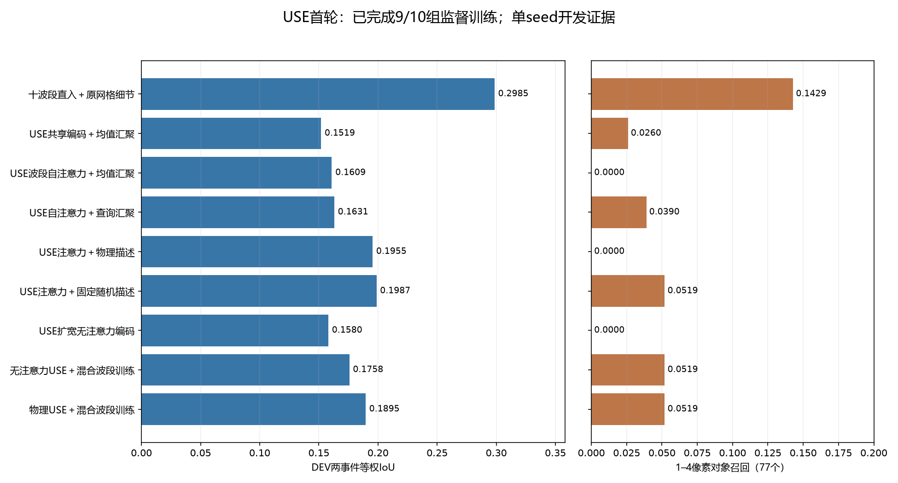

每行是一种模型或训练方式；左侧比较完整十波段的两事件等权IoU，右侧比较77个最小可评价对象的召回。工程上能接收不同波段，不等于保留分割性能。

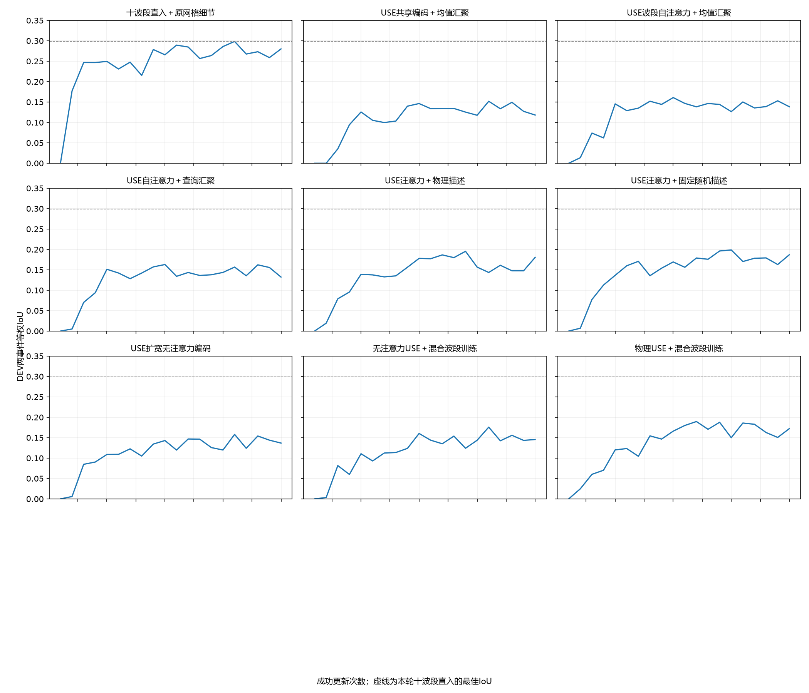

每个子图对应一组正式训练，共用坐标；下轴是成功更新次数，上轴是累计样本曝光除以2223得到的等效epoch，纵轴是每100次更新评价的两事件等权IoU。虚线仅表示本轮直入参照的最佳值，不是每一步的参照轨迹。前九组只保留100更新窗口的平均训练损失，无法补造逐次损失；第十组另保留per_update.jsonl逐次记录。

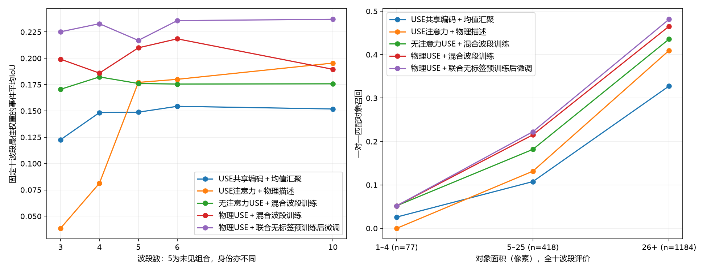

左图是相同权重接受不同组合，右图是在完整十波段下按对象面积比较召回；只展示均值与物理USE的完整/混合训练及可用的预训练组以保持可读性，全部数值见上表和原始评价。

#### 展开结论

共享逐波段编码、掩膜汇聚及关系路径通过可变输入和集合置换验收；它们将十条原始反射率变成十维内部特征再进入主干和细节分支，改变了原参照的输入分布。所有已完成的随机初始化USE组均低于本轮直入参照，且最小对象召回下降超过0.02，须登记退化警报。分布干预和梯度连通只证明模块参与计算，不能说明退化原因。

物理描述组没有超过同结构固定随机身份描述组，无法支持本轮波长与原生分辨率带来收益的结论。带宽未知字段保持缺失；本地S2使用公开名义中心波长，并非逐产品实测响应。局部路径的描述项可能仅形成空间常量，是否影响小目标仍未验证，不据此临时改结构或损失。

混合波段训练的完整十波段IoU为0.1895，比同结构完整训练0.1955低0.0059；这是本seed的数值下降，低于预设0.01报警门槛，不能据此断言稳定退化。比较固定同一最佳十波段权重；RGB或未见组合可运行也不能推导真实Landsat滑坡分割有效。联合预训练与同结构混合训练比较，缺少单来源或S2单传感器预训练对照，不能归因于Landsat。

联合预训练通过遮挡波段重建学习输入表示；在同一结构和混合采样下，完整十波段事件平均IoU由0.1895提高至0.2370（+0.0475），但相对十波段直入0.2985仍低0.0615。最小对象召回仍为4/77，与随机USE混合训练相同，低于直入11/77；5–25像素对象由90/418到93/418，26+像素由551/1184到570/1184，均未达到直入188/418及752/1184。两个验证事件IoU均提高，固定同一权重的3/4/5/6/10波段IoU也均高于随机USE混合训练；这些是本seed的整体观察，不说明某个数据来源单独有效。

#### 限制与下一步

本轮停止训练与自动接续，下载保持暂停。保留十波段直入作为当前参照；后续仅提出输入适配和小目标诊断，不自动启动扩量、蒸馏或新增实验。

单seed、同一开发集合反复选模；工程退化阈值不是显著性阈值。外部排除范围是项目影像图块包络加10公里，不是对所有灾害真实影响边界的独立地理核实。外部采样均匀轮转5°网格不保证全球地表分布代表性，重建误差降低不等于灾害语义有效。

#### 附录：逐seed、成本与产物索引

本轮只有seed1234，每组16000次样本曝光；实际配置、命令、各步权重、逐更新/逐epoch曲线和曝光记录保留在各run目录。下表训练秒数含训练期间验证；推理吞吐为同一RTX5090上真实十波段批量8、FP32、预热10次后30次完整前向，不含文件读取和CPU到GPU搬运；不能换算未测下载耗时。

| 模型与训练方式 | 参数数 | 训练及验证秒数 | 测量吞吐（图块/秒） | 推理峰值显存MiB |
|---|---:|---:|---:|---:|
| 十波段直入＋原网格细节 | 3753602 | 235.6917 | 1020.8526 | 389.0093 |
| USE共享编码＋均值汇聚 | 3764620 | 530.4763 | 675.3137 | 534.1812 |
| USE波段自注意力＋均值汇聚 | 3768844 | 606.0624 | 640.8694 | 566.1758 |
| USE自注意力＋查询汇聚 | 3777324 | 637.7681 | 505.4545 | 588.9058 |
| USE注意力＋物理描述 | 3778604 | 696.7529 | 499.5162 | 544.0200 |
| USE注意力＋固定随机描述 | 3778604 | 689.6328 | 379.7546 | 566.2183 |
| USE扩宽无注意力编码 | 3778606 | 659.8513 | 399.7660 | 3740.9404 |
| 无注意力USE＋混合波段训练 | 3764620 | 567.9838 | 721.1389 | 534.1812 |
| 物理USE＋混合波段训练 | 3778604 | 689.8219 | 498.6946 | 566.2168 |
| 物理USE＋联合无标签预训练后微调 | 3778604 | 1080.0664 | 503.9644 | 588.9136 |

证据：[监督独立评价](../../landslide-seg/outputs/use/supervised_evaluations.json)、[预算及退化警报](../../landslide-seg/outputs/use/supervised_acceptance.json)、[成本测量方法及原始值](../../landslide-seg/outputs/use/costs.json)、[初始化回溯审查](../../landslide-seg/outputs/use/initialization_audit.json)、[外部试取验收](../../landslide-seg/outputs/use/external/pilot_acceptance.json)、[图表来源哈希](../../landslide-seg/docs/assets/research/use/figure_provenance.json)。早期USE run_meta缺少官方权重事前SHA，回溯当前目录与基线事前记录相符，但不能伪称每组都保留了事前指纹；后续记录已修复。

已完成监督训练及验证单卡墙时合计1.776小时（冒烟与工程测试另计，不是GPU实际利用小时）；已接受外部NPZ存储1.493GiB。网络实际传输字节未记录，不能用本地文件大小替代。

联合预训练训练及验证单卡墙时为11.20分钟，10000次更新、80000次曝光；十组监督共20000更新、160000次曝光，另有十组100步冒烟共1000更新。第2000步保存在last.pt中。混合组的band_views.jsonl由已保存的样本身份与累计曝光按确定性规则重建，并非逐批原始观测日志；三组均为十波段8015、RGB2644、RGB+B08 2669、六波段2672次曝光。

最终核查命令为`python -X utf8 scripts/audit_use.py --final-acceptance`；核对十组预算、样本曝光、固定采样规则、全部步权重及严格重载、独立评价与权重身份、两事件成员数及对象分母、预训练来源和迁移。验收通过表示工程与产物完整，所有USE组相对直入的退化警报仍保留。证据：[最终核查](../../landslide-seg/outputs/use/final_acceptance.json)、[配置/权重/清单/文档SHA256](../../landslide-seg/outputs/use/artifacts.sha256)、[仅USE迁移](../../landslide-seg/outputs/use/transfer_acceptance.json)。

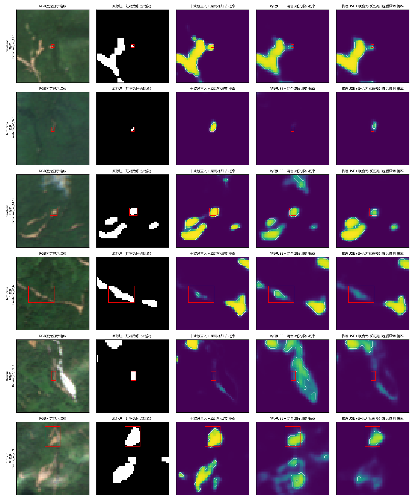

每行是一处按事件、面积及seed哈希选出的对象邻域；从左到右为RGB、原标注及各模型前景概率，红框定位同一真值对象，白线是0.5预测阈值。每窗48×48原始像素，放大不增加10米原生空间分辨率；案例选择不依据预测，不能替代完整669块定量评价。详情见[案例清单与权重SHA](../../landslide-seg/docs/assets/research/use/case_provenance.json)。

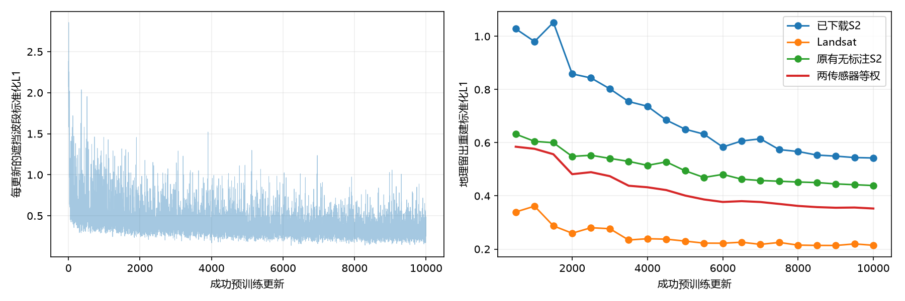

左侧每个点是一成功更新的训练L1；右侧每500更新评价一次，分别展示已下载S2、原有无标注S2、Landsat空间留出的重建误差。红线权重为前两者各1/4、Landsat为1/2，与批量配比一致。目标是训练统计标准化的反射率，数值不是原始反射率绝对误差，不能直接比较物理难度；第500步首次评价0.5849至10000步0.3526下降39.7%，并非相对未训练模型的变化。重建降低本身不证明滑坡分割收益。

### 通用光谱编码独立预训练的10000步收敛核对

下表只纳入完成10000次更新并通过正式产物验收的组；未完成组仅以虚线显示已保存的真实验证点，不补齐曲线或预算。这里的MAE是标准化反射率重建误差：先对隐藏波段有效像素求平均，再对波段与样本平均，越低越好。它不是滑坡IoU。S2单传感器组选模只使用521份S2验证；多传感器与空间组使用同一521份S2和78份Landsat验证，并对两个传感器MAE等权平均。跨这两种验证域的总指标不可直接排列优劣；应先比较相同传感器、相同验证成员的曲线。

| 架构描述 | 无标签训练观测／目标 | S2末态MAE | Landsat末态MAE | 7500步选模指标 | 10000步选模指标 | 末2500步相对下降 | 最佳指标／步数 |
|---|---|---:|---:|---:|---:|---:|---:|
| 共享卷积＋均值汇聚 | S2／波段重建 | 0.6134 | 未评价 | 0.6338 | 0.6134 | +3.2% | 0.6134／10000 |
| 波段注意力（无物理描述） | S2／波段重建 | 0.5201 | 未评价 | 0.5426 | 0.5201 | +4.2% | 0.5201／10000 |
| 波段注意力＋物理描述 | S2／波段重建 | 0.4905 | 未评价 | 0.5085 | 0.4905 | +3.5% | 0.4905／10000 |
| 波段注意力＋随机身份（含源命名混杂） | S2／波段重建 | 0.4861 | 未评价 | 0.5286 | 0.4861 | +8.0% | 0.4861／10000 |
| 波段注意力＋物理描述 | S2＋Landsat／波段重建 | 0.5350 | 0.2176 | 0.4108 | 0.3763 | +8.4% | 0.3763／10000 |
| 波段注意力＋物理描述 | S2＋Landsat／波段＋空间重建 | 0.5832 | 0.2237 | 0.4320 | 0.4035 | +6.6% | 0.4035／10000 |

当前已显示的组均已完成正式产物验收。

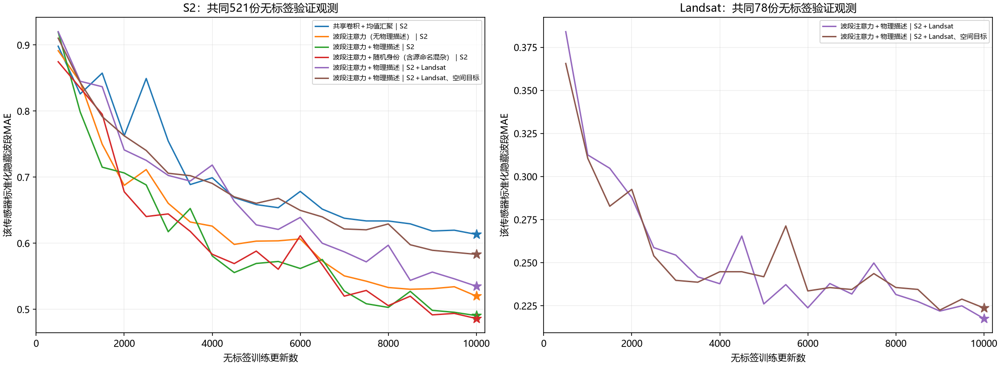

左图各线共用521份S2验证，右图只展示有真实Landsat重建验证的组；实线为已完成并验收，虚线为训练中。星号对应该组预先固定的无标签选模指标选出的最佳步数，不一定是某一个传感器MAE单独最低的位置。表中末态明确为10000步，末段相对下降为负表示误差升高，最佳权重与末态分开保存。

目前没有预先登记的平台阈值，跑满预算不能自动认定充分收敛。末段变化只是描述性证据，不能替代正式收敛判据；学习率在10000步降至0，是否需要更长日程仍未验证，也未追加训练预算。重建改善不等于滑坡迁移成功。逐步曲线、指标定义和源哈希见[收敛核对证据](../../landslide-seg/outputs/use_independent_frozen/convergence_review.json)。

#### 正式权重接口与统一探针验收

5组正式最佳USE权重已在真实S2的3/4/5/6/10波段、Landsat六波段及奇数网格检查置换、无效补齐、NaN隔离、未知字段和混批一致性，USE哈希不变。接口通过不等于真实跨传感器迁移；五波段可能已出现在随机遮挡预训练中。证据在各组`pretraining/<variant>/interface_acceptance.json`，复现见[audit_use_frozen_interface.py](../../landslide-seg/scripts/audit_use_frozen_interface.py)。

统一探针冻结USE，只训练线性或浅层头；同类头共用初始化，2000更新、batch8、3600步学习率日程。随机参照best/last：线性头0.058269（100步）/0，浅层头0.010482（2000步）/0.010482。全部候选结果集中在下方统一主表，不再保留“尚待完成”的中途状态。

历史状态文件替换曾被Windows拒绝；只为权限错误增加有界重试并在核对进程、命令和权重后接续，没有重训已完成的随机两组。见[原故障](../../landslide-seg/outputs/use_independent_frozen/s2_probe_status_write_failure.json)、[接续验收](../../landslide-seg/outputs/use_independent_frozen/probe_queue_recovery_acceptance.json)；底层原因未确认。

原始十波段SegFormer参照复用已有2000更新训练，未新增训练或改写权重。隔离环境重新推理同一669块开发验证集，两事件等权IoU复现为0.298531，最佳步数1600；best/last的BatchNorm运行统计与实际ADE预训练初始化一致。[参照验收](../../landslide-seg/outputs/use_independent_frozen/reference_acceptance.json)保存命令、哈希及独立评价。该参照沿用原图像预处理，USE入口额外按影像质量屏蔽无效输入，因此两者比较包含输入质量处理差异，不能将全部差异归因为架构。验收器初版误假设所有BatchNorm初值为零/一；已修正为与实际预训练初值比较，失败原因另存，未修改模型或训练。

#### 统一冻结探针的同权重多波段评价（阶段结果）

14项统一探针及五种波段评价均已完成正式验收，下表保留原十波段参照。全部使用我们的数据划分（留事件验证）、seed1234、2223训练及669开发验证、stats_core25；任务训练均2000更新、batch8、FP32、3600步学习率日程。主表均为十波段最佳任务权重；IoU选模按广岛与特里苏尔等权平均，Dice、Precision、Recall及边界F1按669块合并计数。对象召回列依次写三档命中数/可评价总数，排除边缘截断对象，匹配IoU阈值0.25；边界F1容差为1像素。线性头为1×1卷积，浅层头为3×3卷积＋GELU＋1×1卷积，均只读取冻结USE特征，没有MiT主干。

| 结构 | 训练初始化 | 广岛IoU | 特里苏尔IoU | 两事件等权IoU | Dice | Precision | Recall | 边界F1 | 对象召回（1–4／5–25／≥26像素） |
|---|---|---:|---:|---:|---:|---:|---:|---:|---|
| SegFormer B0＋原网格细节分支 | MiT通用RGB预训练 | 0.2776 | 0.3195 | 0.2985 | 0.4482 | 0.4070 | 0.4988 | 0.4603 | 11/77；188/418；752/1184 |
| 波段注意力＋物理描述USE＋线性头 | USE随机；任务头随机 | 0.0685 | 0.0480 | 0.0583 | 0.1163 | 0.1229 | 0.1103 | 0.1584 | 10/77；41/418；107/1184 |
| 波段注意力＋物理描述USE＋浅层头 | USE随机；任务头随机 | 0.0169 | 0.0040 | 0.0105 | 0.0242 | 0.1066 | 0.0137 | 0.0435 | 0/77；3/418；9/1184 |
| 共享卷积均值USE＋线性头 | USE独立无标签预训练；任务头随机 | 0.0034 | 0.0028 | 0.0031 | 0.0064 | 0.0280 | 0.0036 | 0.0061 | 0/77；0/418；0/1184 |
| 共享卷积均值USE＋浅层头 | USE独立无标签预训练；任务头随机 | 0.0840 | 0.0280 | 0.0560 | 0.1264 | 0.1925 | 0.0941 | 0.1605 | 2/77；31/418；149/1184 |
| 波段注意力USE（无物理描述）＋线性头 | USE独立无标签预训练；任务头随机 | 0.0750 | 0.0356 | 0.0553 | 0.1008 | 0.0576 | 0.4032 | 0.1321 | 8/77；101/418；422/1184 |
| 波段注意力USE（无物理描述）＋浅层头 | USE独立无标签预训练；任务头随机 | 0.0096 | 0.0009 | 0.0053 | 0.0125 | 0.3408 | 0.0064 | 0.0256 | 0/77；0/418；1/1184 |
| 波段注意力＋物理描述USE＋线性头 | USE独立无标签预训练；任务头随机 | 0.1010 | 0.0233 | 0.0622 | 0.1366 | 0.1085 | 0.1844 | 0.1847 | 3/77；72/418；312/1184 |
| 波段注意力＋物理描述USE＋浅层头 | USE独立无标签预训练；任务头随机 | 0.0399 | 0.0036 | 0.0217 | 0.0524 | 0.2396 | 0.0294 | 0.0867 | 0/77；5/418；43/1184 |
| 波段注意力＋随机身份USE（含命名混杂）＋线性头 | USE独立无标签预训练；任务头随机 | 0.0185 | 0.0191 | 0.0188 | 0.0367 | 0.0188 | 0.8214 | 0.0741 | 0/77；0/418；0/1184 |
| 波段注意力＋随机身份USE（含命名混杂）＋浅层头 | USE独立无标签预训练；任务头随机 | 0.0206 | 0.0080 | 0.0143 | 0.0320 | 0.1174 | 0.0185 | 0.0614 | 0/77；3/418；11/1184 |
| 波段注意力＋物理描述USE＋线性头 | USE多传感器MBM预训练；任务头随机 | 0.0494 | 0.0063 | 0.0278 | 0.0655 | 0.2265 | 0.0383 | 0.1108 | 1/77；9/418；20/1184 |
| 波段注意力＋物理描述USE＋浅层头 | USE多传感器MBM预训练；任务头随机 | 0.0178 | 0.0037 | 0.0108 | 0.0248 | 0.1809 | 0.0133 | 0.0476 | 0/77；2/418；4/1184 |
| 波段注意力＋物理描述USE＋线性头 | USE多传感器MBM＋空间预训练；任务头随机 | 0.0256 | 0.0239 | 0.0248 | 0.0474 | 0.0271 | 0.1924 | 0.0873 | 0/77；2/418；39/1184 |
| 波段注意力＋物理描述USE＋浅层头 | USE多传感器MBM＋空间预训练；任务头随机 | 0.0013 | 0.0003 | 0.0008 | 0.0019 | 0.1759 | 0.0009 | 0.0023 | 0/77；0/418；0/1184 |

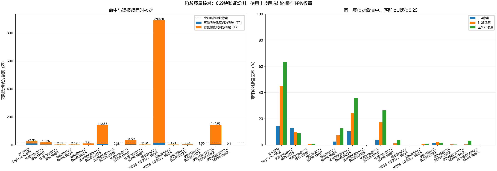

每组横坐标与主表结构/初始化对应。左图蓝色与橙色分别为命中和误报像素，虚线为共同真值滑坡像素总数；右图分别展示三种尺寸对象的命中比例，三档总数固定为77、418、1184。应同时看误报、漏检与对象召回，不只取一个较高指标。

同结构、同类头初始化下，S2预训练相对随机USE：线性头IoU 0.0583→0.0622（+0.0039），浅层头0.0105→0.0217（+0.0112）。这是单seed开发集差异，不能据此声明显著性、完整系统性能或跨传感器成功。

固定任务预算，将每步8份S2替换为4份S2＋4份Landsat后，线性头IoU 0.0622→0.0278（-0.0343），浅层头0.0217→0.0108（-0.0110）。没有S2曝光匹配对照，不能将变化单独归因于传感器种类；两域等权MAE也不能与S2单域MAE直接排名。

无物理描述的注意力USE＋线性头在独立预训练后命中82,069个滑坡像素，同时把1,343,511个背景像素判为滑坡；Recall为0.4032，Precision仅0.0576。较多对象命中伴随大量误报，不能单独用对象召回宣布迁移改善。

同一类预训练USE改用浅层头时，Precision为0.3408，但Recall仅0.0064；它只命中1,300个真实滑坡像素，不能只看Precision而忽略漏检。

这些是固定阈值、既定预算下的实际输出差异。参照具有MiT主干和细节分支，且输入质量屏蔽处理有差异；当前随机与部分预训练组的USE结构也不同，因此不能将差异全部归因于预训练或单个组件。14项探针均已齐备，但特征分布、任务头容量及训练动态的具体归因均未验证。

下图每一行的前五列均使用十波段开发验证选出的同一最佳任务权重，不因波段组合重新训练、重新选checkpoint或调整阈值；白线右侧最后一列单独报告2000步十波段训练末态。最佳步数和末态原值见合并进度证据；参照复用原训练，仅重新推理最佳十波段权重，未补做其末态或删波段评价。

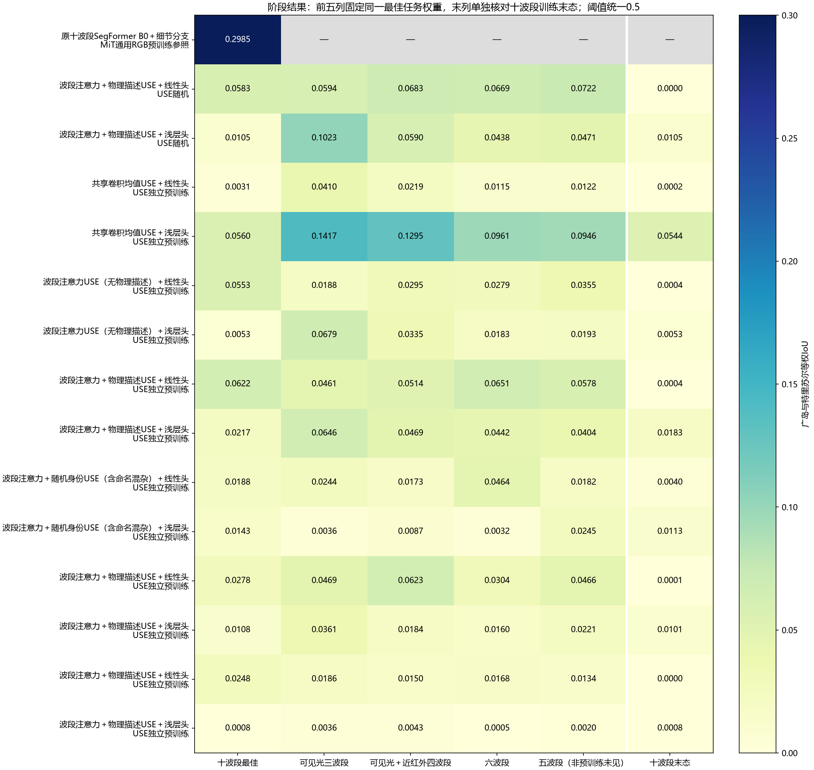

每行是一种已验收结构及初始化，前五列是同一S2观测的波段子集，最后一列为另一任务头状态的末态核对；灰色表示未执行。部分子集IoU高于十波段是固定权重与阈值下的实测现象，不能解释为少波段信息量更多；输入变化引起特征分布及阈值响应差异是可能解释，尚未验证。随机USE与均值预训练USE还改变了汇聚结构，不能将它们的全部差异归因为预训练。五波段可能已在MBM中出现；这些S2子集不是独立真实RGB或Landsat任务。单seed、有限研发事件和不完整候选限制保留。

逐事件、对象召回、边界F1与逐块计数保存在各run的`eval/`，对应`subset_acceptance.json`锁定同一任务权重和源哈希；图表来源见[合并进度证据](../../landslide-seg/outputs/use_independent_frozen/probe_progress.json)。

##### 已完成部分成本与产物核查

本阶段正式98000更新：无标签60000、探针28000、四适配8000、U-Net2000；对应样本呈现480000/224000/64000/16000，空间遮挡另有80000视图，不当作新地点。恢复未增加正式更新；真实数据工程14次（含恢复2次）、smoke18次另列，不含所有合成测试和启动失败成本。50个本轮best/last与52个旧checkpoint均保持哈希；中断时的20文件是前者子集，不相加。记录计时15231.06秒，边界不同且未汇总独立推理/恢复，不能称纯GPU时间。详见[预算与曝光核对](../../landslide-seg/outputs/use_independent_frozen/completed_budget_acceptance.json)。

#### 固定同一USE权重的下游适配结果

以下全部USE行使用同一份、仅由无标签指标选出的USE权重；两个探针行复用该编码器的已验收探针，不新增训练。四种完整适配先全部通过真实数据工程验收，再分别从冻结初始化训练2000次更新。训练集2223块，开发验证为广岛448块与特里苏尔221块；seed1234、stats_core25、batch8、FP32、3600步学习率日程、0.5 BCE＋0.5 Dice保持一致。任务最佳权重按两个事件等权IoU选择。Dice、Precision、Recall、边界F1按669块合并统计；边界容差1像素，对象匹配IoU阈值0.25，三档可评价对象数固定为77、418、1184。原参照的最佳值已独立复评，末态IoU复用原2000步验证记录，未新增末态推理；其余各行最佳与末态均已独立复评，不能混淆证据来源。

| 结构 | 初始化 | 广岛IoU | 特里苏尔IoU | 最佳两事件等权IoU | 末态IoU | Dice | Precision | Recall | 边界F1 | 对象命中/可评价总数（1–4／5–25／≥26像素） |
|---|---|---:|---:|---:|---:|---:|---:|---:|---:|---|
| SegFormer B0＋原网格细节分支 | MiT通用RGB预训练 | 0.2776 | 0.3195 | 0.2985 | 0.2802 | 0.4482 | 0.4070 | 0.4988 | 0.4603 | 11/77；188/418；752/1184 |
| 冻结USE→线性头 | USE独立预训练；任务头随机 | 0.0494 | 0.0063 | 0.0278 | 0.0001 | 0.0655 | 0.2265 | 0.0383 | 0.1108 | 1/77；9/418；20/1184 |
| 冻结USE→浅层头 | USE独立预训练；任务头随机 | 0.0178 | 0.0037 | 0.0108 | 0.0101 | 0.0248 | 0.1809 | 0.0133 | 0.0476 | 0/77；2/418；4/1184 |
| 冻结USE→32→10桥接→SegFormer B0＋细节分支 | USE独立预训练；MiT继承RGB预训练；适配/预测分支随机 | 0.1036 | 0.1778 | 0.1407 | 0.1036 | 0.2205 | 0.1915 | 0.2600 | 0.2119 | 0/77；31/418；366/1184 |
| 冻结USE→32→3适配→RGB规格SegFormer B0＋细节分支 | USE独立预训练；MiT继承RGB预训练；适配/预测分支随机 | 0.0974 | 0.1660 | 0.1317 | 0.1056 | 0.2111 | 0.1820 | 0.2513 | 0.2124 | 1/77；36/418；365/1184 |
| 冻结USE→32输入新首层→SegFormer B0＋细节分支 | USE独立预训练；MiT继承RGB预训练；适配/预测分支随机 | 0.1211 | 0.1531 | 0.1371 | 0.1048 | 0.2295 | 0.2006 | 0.2680 | 0.2326 | 0/77；56/418；385/1184 |
| 冻结USE→多尺度适配→新FPN解码器 | USE独立预训练；多尺度适配与FPN随机 | 0.0990 | 0.1081 | 0.1035 | 0.0876 | 0.1834 | 0.1396 | 0.2673 | 0.1930 | 0/77；43/418；354/1184 |
| 冻结USE→可训练U-Net | USE独立预训练；U-Net全部随机 | 0.0850 | 0.1944 | 0.1397 | 0.1397 | 0.2066 | 0.1850 | 0.2339 | 0.1820 | 0/77；21/418；290/1184 |

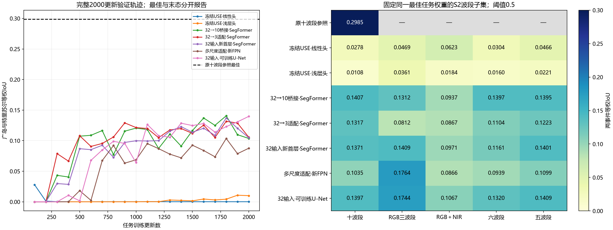

左图每条实线是一种适配或任务头在相同USE上的完整验证轨迹，虚线只表示原参照最佳值；右图每行固定该行十波段选出的同一最佳任务权重，五列是同一S2观测的波段子集，灰色为未执行。不能把五波段称为预训练未见组合，也不能把S2 RGB子集称为真实RGB任务。

四种完整下游适配中，冻结USE→32→10桥接→SegFormer B0＋细节分支的开发验证最佳IoU为0.1407，相对原十波段参照变化-0.1578。本轮未超过原十波段参照。用户补充的可训练U-Net沿用同一共同USE，其最佳IoU为0.1397、末态为0.1397；相对原十波段参照变化-0.1588。1–4像素可评价对象命中0/77，原参照为11/77。U-Net最佳点位于第2000次更新；正处预算末端，未证明充分收敛，延长训练是否改善尚未验证。U-Net全部随机初始化且参数容量不同，该结果反映此完整系统，不单独证明USE特征优劣。本轮没有另训直接十波段U-Net，因此不能从与SegFormer参照的差异单独测得USE对U-Net的增益。

新增U-Net直接接收冻结USE的32维特征，四级下采样/上采样与跳接全部可训练，共7,771,393个随机初始化任务参数；没有绕过USE直接读取原十波段的任务分支。沿用共同USE的无标签选模结果；独立完成真实数据2次工程更新后，重新初始化正式训练2000次，未继承工程权重。其配置、初始化和工程门禁见[独立U-Net契约](../../landslide-seg/outputs/use_independent_frozen/unet_contract/acceptance.json)与[工程验收](../../landslide-seg/outputs/use_independent_frozen/unet_contract/engineering_acceptance.json)。

USE的全参数与buffer在各次验证及best/last重载中哈希一致，优化器未包含USE，BN统计与初始化一致。这些证据确认冻结边界和适配执行；适配器、MiT或FPN的容量和初始化存在明确差异，不能把完整系统差异全部归因于预训练。原十波段参照还存在输入质量屏蔽处理差异，因此它提供实际系统参照，不构成仅改变USE的因果对照。

本轮仍只有S2滑坡这一类有标签任务。真实Landsat只参与无标签预训练与接口/重建诊断；缺少第二独立任务、真实非S2 RGB任务、合格跨传感器配对和新的盲测地域，未证明通用迁移。随机波段身份对照含源命名混杂，纠正追加预算尚未获授权；原结果保留，物理描述优势的结论受限。

配置、共同USE选择规则与初始化见[冻结契约](../../landslide-seg/outputs/use_independent_frozen/adapter_contracts/acceptance.json)，全组工程门禁见[工程验收](../../landslide-seg/outputs/use_independent_frozen/adapter_contracts/engineering_acceptance.json)，图表与各run验收源哈希见[适配报告证据](../../landslide-seg/outputs/use_independent_frozen/common_use_adapter_publication.json)。

#### 同一冻结USE的完整下游固定案例

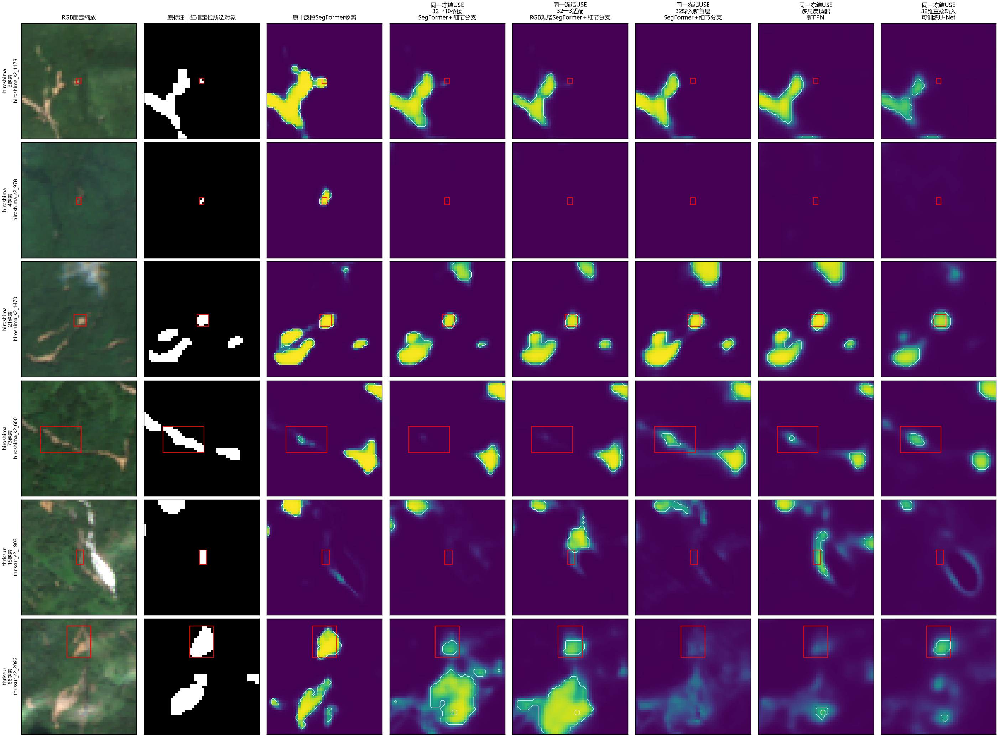

六行沿用旧阶段已经固定的案例清单：前四行来自广岛，后两行来自特里苏尔；不是根据本轮预测重新挑选。从左到右为固定缩放RGB、原标注，以及原十波段SegFormer参照、同一冻结USE 32→10桥接 SegFormer＋细节分支、同一冻结USE 32→3适配 RGB规格SegFormer＋细节分支、同一冻结USE 32输入新首层 SegFormer＋细节分支、同一冻结USE 多尺度适配 新FPN、同一冻结USE 32维直接输入 可训练U-Net的前景概率。紫色对应接近0，黄色对应接近1；红框定位同一个真值对象，白线标示0.5预测边界。每窗48×48原始像素，放大不增加10米原生细节。

案例选择与真值/有效区核验见[固定案例证据](../../landslide-seg/outputs/use_independent_frozen/common_use_case_provenance.json)。本图只读最佳概率。

#### 无标签跨波段诊断与随机身份对照的限制

本阶段已经结束：用户选择保留随机身份命名混杂限制，不追加14000更新纠正对照，不恢复下载。以下诊断只解释已有结果，不是待续队列。

在同一521份S2无标签验证观测上，将前三个可见光波段与其余七个波段分别输入各组冻结最佳USE，按影像质量有效像元对特征图取全局平均。同地点的两个视图构成正例；固定顺序中前一个不同缓存构成非配对负例，同时全部521个缓存作为检索候选。Recall@1表示前三波段特征能否在521份其余七波段特征中把对应地点排到第一。该诊断没有更新参数，也没有重新选择checkpoint。

| 架构描述 | 无标签训练观测／目标 | 同地点余弦相似度 | 不同缓存余弦相似度 | Recall@1 | Recall@5 | Recall@10 |
|---|---|---:|---:|---:|---:|---:|
| 共享卷积＋均值汇聚 | S2／波段重建 | 0.9411 | 0.9094 | 1.92% | 5.18% | 9.79% |
| 波段注意力，无物理描述 | S2／波段重建 | 0.7556 | 0.7093 | 1.73% | 5.57% | 8.83% |
| 波段注意力＋物理描述 | S2／波段重建 | 0.4609 | 0.4160 | 2.50% | 5.57% | 8.45% |
| 波段注意力＋随机身份（含源命名混杂） | S2／波段重建 | 0.8023 | 0.7532 | 0.96% | 4.22% | 6.33% |
| 波段注意力＋物理描述 | S2＋Landsat／波段重建 | 0.7506 | 0.7129 | 1.54% | 5.95% | 10.75% |
| 波段注意力＋物理描述 | S2＋Landsat／波段＋空间重建 | 0.8489 | 0.7652 | 1.34% | 4.99% | 8.25% |

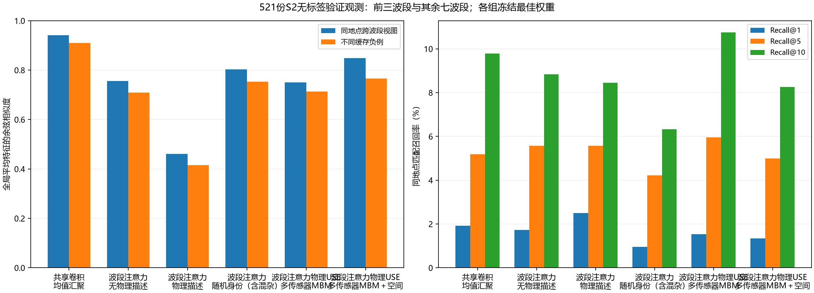

每组横坐标是一种结构，使用该组无标签验证选出的最佳权重。左图应同时看正例与负例，不能把较高正例相似度直接当作更好表征；右图是同地点检索的前1、5、10名召回率。各组正例平均相似度高于非配对负例，但当前全局平均特征检索结果不足以证明空间细节可迁移。这是同传感器不同波段的匹配，不能称为真实跨传感器检索；不同缓存可能地理相邻，也没有随机初始化的同项诊断，不能据此归因于预训练收益或宣称独立地域泛化。完整指标与逐波段物理反射率域、标准化域MAE/RMSE见各组`pretraining/<variant>/ssl_diagnostics.json`及[合并索引](../../landslide-seg/outputs/use_independent_frozen/ssl_diagnostic_summary.json)。逐波段误差按有效目标像素汇总，与选模所用先波段/样本平均的权重不同，已分别标注。

真实S2三/四/六/十波段与Landsat六波段的batch1 FP32效率也已测量，5次预热、20次正式计时，包含生产冻结哈希检查和Python开销。四组十波段平均延时为2.71–5.88毫秒，峰值已分配显存为62.86–102.14 MiB，仅为本机RTX5090单次会话的描述。各输入的延时、吞吐、显存、关系位置数、波段Token数及注意力矩阵乘法量见同目录`efficiency.json`；注意力QK/AV乘加数不等于全模型FLOPs，未混称。当前是声明网格上的对齐输入，没有实现多原生分辨率Token模式。

**随机身份对照的唯一限制说明。** TRAIN中4763份S2用blue/green等名称，4747份用B02/B03等名称；字面哈希把同一物理波段分成两种身份、共20种，下游使用B02命名。这暴露来源信息，不能单独检验物理描述是否优于等价十波段身份。[别名审计](../../landslide-seg/outputs/use_independent_frozen/band_identity_alias_audit.json)保留计数/哈希；用户已选择保留限制结束本轮，不再把旧授权询问或“其余组继续”写成当前状态。

### 局部波段注意力编码（早期局部注意力对照）两个预算条件的无标签与下游结果

#### 阅读约定与实验设置

本节比较20000步与续尾至30000步的v2。数据沿用共同口径，无标签池11132训练／599验证／239隔离；两段日程和单seed限制保留。

两个条件：
- **20k 条件**：`engineering_v2`，两组各 20000 步、22 个冻结探针、6 组下游。
- **30k 续尾条件**：`engineering_v3`，从各自的 `u20000.pt` 继续 10000 步（新 AdamW、100 步预热后余弦到 0，全局步号 20001–30000，采样流不回放），再跑 4 个探针与 6 组下游。**这是两段日程，不是单次 30000 步余弦**，学习率轨迹不同，不能当作“30k 预算”的直接证据。

两个指标口径（都越低越好）：
- **冻结选模分数**：三任务（光谱／Fine／Context）标准化 MAE 各除以训练集固定校准系数，先任务等权、再传感器等权；只用于选模。
- **探针分数**：同一冻结编码器＋同容量任务头，单任务 1000 次更新，只有第 1000 步一次验证。

#### 主表一：预训练与探针

| 指标 | 无局部波段自注意力 20k | 无局部波段自注意力 30k | 一层4头局部波段自注意力 20k | 一层4头局部波段自注意力 30k |
|---|---:|---:|---:|---:|
| 冻结选模分数 | 0.6218 | **0.6208** | 0.6209 | **0.6141** |
| Fine 探针 | 2.2813 | **2.2320** | 2.2964 | 2.2932 |
| Context 探针 | 0.2524 | **0.2462** | 0.2524 | 0.2538 |

对照：同结构随机初始化的 Fine 探针为 2.3481（无局部波段自注意力）与 2.3361（一层4头），Context 探针均为 0.2966；旧 USE 参照为 2.3612／0.2897。

#### 主表二：冻结下游（六组，统一轻量头：Context为4257参数，增加Fine后为5313参数）

| 冻结输入条件 | 20k 条件 | 30k 续尾条件 |
|---|---:|---:|
| 一层4头局部波段自注意力 ＋Context＋Fine | 0.0022 | **0.0049** |
| 一层4头局部波段自注意力 ＋Context | 0.0018 | 0.0035 |
| 无局部波段自注意力 ＋Context＋Fine | 0.0038 | 0.0029 |
| 无局部波段自注意力 ＋Context | 0.0017 | 0.0016 |
| 旧 USE ＋Context＋Fine | 0.0000 | 0.0000 |
| 旧 USE ＋Context | 0.0001 | 0.0001 |

表中为事件平均 IoU（两开发事件等权），阈值 0.5。

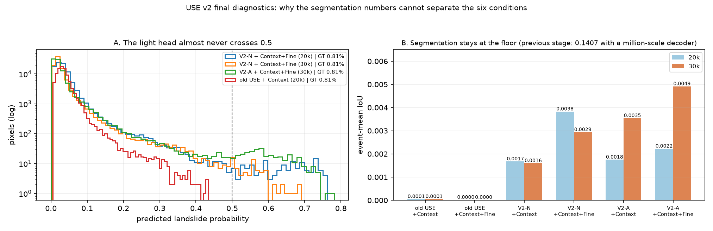

左栏是四组最佳权重在同一批验证图块上输出的滑坡概率分布（纵轴为像素数的对数），虚线是 0.5 阈值：所有条件的主体都挤在 0–0.1，只有很少像素跨过阈值，旧 USE 组一个都没有。右栏是 12 个下游运行的事件平均 IoU，纵轴上限只有 0.0065——这正是“地板效应”，六组之间 0.0000–0.0049 的差别不足以支撑任何排名。

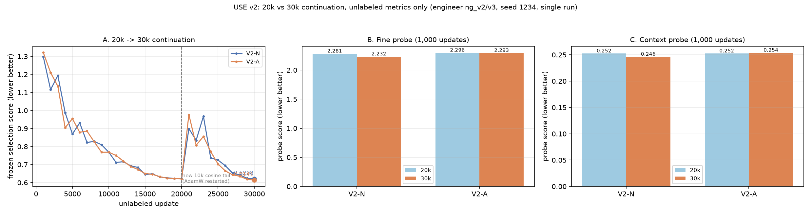

左栏把 20k 与续尾连成一条曲线（虚线处换了新余弦与优化器），中、右两栏是 Fine 与 Context 探针在 20k 与 30k 的配对。应看虚线之后的终点与两栏的配对差，而不是中段抖动。

#### 展开结论

**延长到 30k 确实让无标签指标继续变好，但幅度小且两组不对称。** 选模分数上，一层4头局部波段自注意力由 0.6209 降到 0.6141（−0.0068，约 1.1%），无局部波段自注意力只由 0.6218 降到 0.6208（−0.0010，0.16%）。探针上方向相反：无局部波段自注意力两项都变好（Fine −0.049 约 2.2%、Context −0.0062），一层4头组 Fine 几乎不动（−0.0032）、Context 反而略升（+0.0014）。**机制**上，续尾换了新的余弦与新优化器，是在20k预算终点重新提高学习率；该终点未证明收敛；**边界**是单 seed、没有第三次运行，也没有做“单次 30k”对照，所以只能说“再训 10k 有轻微收益”，不能说“30k 已收敛”。

**预训练相对随机初始化是有用的。** 两组 30k 的 Fine 探针（2.2320／2.2932）都低于各自的随机参照（2.3481／2.3361），Context 探针（0.2462／0.2538）也都低于 0.2966；但改善幅度在 2%–17% 之间，且这个参照只共享结构、不共享任何训练，属于“有/无预训练”的粗对照。

**下游的 12 个数字全部在地板上，不能用来区分六组。** 最高是续尾注意力组＋Fine 的 0.0049，旧 USE 两组是 0.0000–0.0001。复核证据：抽样的开发验证图块上正类像素占 0.40%–0.81%（3 块与 6 块两批），四组最佳权重在这 6 块共 91,049 个有效像素里超过 0.5 的分别只有 149（无局部波段 20k）、69（无局部波段 30k）、316（一层4头 30k）、0（旧 USE 20k）；训练损失停在 0.55（接近完全无重叠时的 Dice 量级）。Context-only头有4257个、加入Fine后有5313个可训练参数（各尺度 32 维投影＋Fine 32→32＋1×1 输出），而上一阶段 0.1407 用的是 32→10 桥接接 SegFormer B0 的百万级解码器。**因此只能确认当前完整系统迁移失败；头容量、特征表达、损失、优化与阈值响应都是待检验因素，现有证据不能确定主因**，需要固定权重换更大头的对照才能定论。

**局部波段自注意力是否值得，仍然没有确定答案。** 20k 与 30k 的选模分数都是一层4头组略低（−0.0009、−0.0067），但 30k 的两个探针都是无局部波段组更低（Fine 2.2320 对 2.2932、Context 0.2462 对 0.2538）。方向矛盾、差额在 0.1%–2.7%、单 seed，不能宣称哪一组更好；只能说在这两个预算下没有看到稳定的额外价值。

#### 限制与下一步

- 单 seed、每组一次运行、两个反复用于研发的验证事件；没有独立地域盲测。
- 两段日程（20k＋10k）不等于单次 30k 预算；要回答“30k 是否更好”需要从零重训的单日程对照（成本 60000 更新，当时未选）。
- 下游结果接近零，不能据此作稳健架构排名。下一步先检查已有完整概率与标签、损失实现和训练动态；增加头容量是候选受控实验之一，并非唯一诊断方法，尚未执行。
- 预算：计划 146000 全部执行；另有 6985（v1 均值组控制台中止）与 83（注意力组第 20000 步 Fine 探针冻结哈希中止）单列，累计消耗 153068。两次中止都没有拼接进正式成绩。
- 30m 只做派生评价；第二有标签任务未核实，不能宣称跨任务通用。

#### 附录：复现与产物

- 核验汇总：`outputs/use_v2/audit/final_acceptance_v1.json`（42 项 complete、每项 device_gate 实际卡、预算与冻结哈希检查）。
- 验收：20k 条件 `outputs/use_v2/audit/release_audit_v2.json`；续尾条件 `outputs/use_v2/audit/release_audit_v3.json`。
- 逐 run 曲线、validation、best/last：`outputs/use_v2/runs/<job>/`；两组续尾分别 `pretrain_mean_tail`、`pretrain_attention_tail`。
- 图来源与数值哈希：`docs/assets/research/use_v2/provenance.json`。

#### 本次独立产物验收与解释修正

重新读取42项summary与训练曲线，核对146000次正式更新，并对summary登记的268个checkpoint文件重新计算SHA256，全部一致；已记录的冻结哈希在各条曲线内未变化。证据见[独立核查](../../landslide-seg/outputs/use_v2/closeout_review/acceptance.json)。本次未重新执行全量推理、优化器成员回放或新增训练，产物完整性通过不等于研究目标全部实现。

Context-only任务头为4257参数，加入Fine后为5313参数，不应写为全部同一参数量。抽样六块的过阈值像素数不能推广成全验证集比例；容量不足只是未验证假设。无标签探针误差下降支持此任务下的可解码性改善，不能单独证明语义通用性。旧训练认领仍为active但已无写入范围，实际双卡执行任务已完成；原负责人需关闭旧登记，本次未冒用其身份。

### 同一冻结局部波段注意力编码（早期局部注意力对照）接完整下游网络：U-Net与SegFormer B0

#### 阅读约定与实验设置

**要回答什么。** 上一节12个下游结果全在0.0000–0.0049，主因未定；本轮固定同一USE v2权重，把任务网络换成可训练的完整网络，检验“轻量头容量”是否是主要限制之一。

**数据角色不变。** 九事件2223块训练、广岛448＋特里苏尔221块开发验证、seed1234；单期十波段；`stats_core25`（仍由559块训练核心拟合，未因训练集为2223块重算）；既有影像质量掩膜。验证事件只用于选模，是反复使用的研发集合，不是盲测。

**输入固定。** 四层Context各按`canonical32`规则压到32通道、上采样回原图尺寸、四层平均，再加原网格Fine特征；该加和没有可训练参数，两组完全一致，且不使用未经USE的原始影像旁路。

**训练条件。** 每组5000次更新（合计10000）；FP32；有效batch 8（微批量2×累积4）；AdamW 6e-4、weight decay 0.01、梯度裁剪1.0；前250步预热后余弦；每500步按两事件等权IoU选模，保存best与last。

**两组差别。** 下游网络、参数量与初始化来源同时不同：U-Net全部随机初始化；SegFormer B0为32通道新首层随机、其余卷积与解码器沿用本地通用预训练权重，并保留原网格细节分支。因此结果属完整系统比较，不能把全部差异归因于网络架构。

#### 主表（best与last，669块，阈值0.5）

| 组 | 权重 | 事件等权IoU | 像素IoU | Dice | Precision | Recall | AP | 边界F1 | 小／中／大对象召回 |
|---|---|---|---|---|---|---|---|---|---|
| 冻结USE v2＋U-Net | best（第2500步） | 0.1344 | 0.1190 | 0.2127 | 0.1807 | 0.2585 | 0.1360 | 0.2036 | 0.137／0.353／0.404 |
| 冻结USE v2＋U-Net | last（第5000步） | 0.1275 | 0.1181 | 0.2113 | 0.1925 | 0.2342 | 0.1288 | 0.2094 | 0.133／0.328／0.394 |
| 冻结USE v2＋SegFormer B0 | best（第3000步） | 0.1250 | 0.1087 | 0.1960 | 0.1771 | 0.2196 | 0.1202 | 0.1745 | 0.100／0.278／0.343 |
| 冻结USE v2＋SegFormer B0 | last（第5000步） | 0.1227 | 0.1123 | 0.2020 | 0.1822 | 0.2266 | 0.1196 | 0.1876 | 0.101／0.283／0.343 |

逐事件（best）：U-Net 广岛0.1014／特里苏尔0.1674；SegFormer B0 广岛0.0915／特里苏尔0.1586。末态逐事件为0.1083／0.1467与0.1017／0.1436。事件等权IoU为两事件像素IoU的算术平均（与选模一致）；对象召回按真值面积<50像素／50–200／>200分档，只计未截断对象。

#### 图与解释

左图纵轴是训练损失（滑动50步平均），右图纵轴是每500步的验证事件等权IoU，横轴都是更新次数，空心圈是各组最佳。看两点：两条损失曲线几乎重合且持续下降，验证IoU却在2500–3000步见顶；两组完整网络的验证曲线彼此靠得很近，远高于轻量头，但离十波段参照仍有明显距离。

两组各六个固定验证案例在[U-Net案例](../../landslide-seg/outputs/use_v2_full_decoders/runs/unet/cases/segmentation_cases_use.png)与[SegFormer案例](../../landslide-seg/outputs/use_v2_full_decoders/runs/segformer/cases/segmentation_cases_use.png)；五列依次为RGB、**USE编码**、真值、概率、0.5阈值掩膜。USE编码列是两组共用融合32通道输入的三个主成分（六案例统一PCA基、2–98百分位拉伸，颜色只表示编码相似、不代表地物类别），两组的这一列逐像素完全相同，已用数组相等核验。案例来自既有[固定清单](../../landslide-seg/docs/assets/research/use/case_provenance.json)，未按预测效果重新挑选。

冻结USE的两路输出另有面板图：[U-Net](../../landslide-seg/outputs/use_v2_full_decoders/runs/unet/cases/segmentation_cases_fine.png)与[SegFormer](../../landslide-seg/outputs/use_v2_full_decoders/runs/segformer/cases/segmentation_cases_fine.png)，六列为RGB、细节头Fine（32×128×128，保留patch内位置）、Context（四层32×32/16×16/8×8/4×4压32后上采样平均）、真值、概率、掩膜；两组的Fine与Context逐像素相同，Fine是细纹理、Context是大块结构（最粗一层每格32像素）。

#### 展开结论

- **轻量头容量是先前近零结果的重要限制之一。** 证据：同一USE、同一融合输入，5313参数头的最佳事件平均IoU约0.0049，两组完整网络为0.1250–0.1344，约26–27倍。边界：这只说明"加容量能出信号"，不说明特征是够好的；两组仍比历史十波段端到端0.2985低0.164以上。
- **两个完整网络彼此差别小。** 证据：事件等权IoU差0.0094（best）／0.0048（last），损失曲线几乎重合；U-Net在小对象召回（0.137对0.100）、AP（0.136对0.120）与边界F1（0.204对0.175）上略高，SegFormer显存更低（417对765 MiB）但每步慢46%（0.526对0.359秒）。边界：结构、参数量与初始化来源同时不同，不能把差别归因于架构。
- **小对象几乎没有被解决。** 小于50像素对象的召回只有0.10–0.14，而大对象0.34–0.40；这与历史十波段模型的薄弱环节一致，但本轮没有做尺寸分层或后处理对照。
- **验证在训练中途见顶。** 最佳在第2500／3000步，末态更低（0.1275／0.1227）；训练损失继续下降。没有早停或正则化扫描，故仅作为观察。

#### 限制与下一步

- 单seed、每组一次运行、两个反复用于研发的验证事件；没有独立地域盲测，也没有把结果当显著性结论。
- 两组是完整系统比较（结构＋参数量＋初始化来源同时改变），不能分离架构效应；这轮也没有做"同初始化、只换架构"的对照。
- 冻结编码器＋无参数融合这两件事本身就是与端到端十波段参照的差异来源；本轮无法判断剩余差距主要来自冻结特征、融合方式还是5000步预算。
- 结果文件：[comparison.json](../../landslide-seg/outputs/use_v2_full_decoders/comparison.json)；逐run证据：[unet](../../landslide-seg/outputs/use_v2_full_decoders/runs/unet)、[segformer](../../landslide-seg/outputs/use_v2_full_decoders/runs/segformer)。

### 空间交互与恢复编码（早期空间交互对照）：统一探针、完整分割网络与最终执行核对

#### 阅读约定与实验设置

当前研究参照仍是 **SegFormer B0｜十波段直入｜原始网格细节分支**，既有事件等权IoU为0.3081，未被本轮模型取代。下面“原生金字塔编码器”对应既有USE v2；“双向空间交互编码器”对应本轮USE v3。前者固定采用事先指定的无标签选模权重，不按本轮分割成绩更换。后者连续训练30000步，仅在10000、20000、30000步之间按统一无标签探针总分选择，实际选中 **20000步**；30000步是训练末态，不是选定权重。初始化和5k权重不参加选模，5k未运行探针。

本阶段使用共同无标签池11132训练、599验证（521 S2＋78 Landsat）、239隔离，以及共同分割成员与统计。输入为单期反射率、质量掩膜和物理元数据（波长/带宽μm、像元尺寸m）；未知字段有known_mask。未增加日期、地形或去云数据，来源与成员绑定release。

正式成功更新62000＝v3预训练30000＋12项冻结探针各1000＋4项分割各5000。FP32、seed1234，有效batch8＝微批2×累积4（无标签每步6份S2＋2份Landsat，分割每步8份十波段样本）；AdamW峰值6e-4、weight decay0.01、裁剪1.0，预热分别1500／50／250步后余弦。头seed1235，同类头与消费者初始张量独立核对一致；U-Net全随机，SegFormer B0新32通道首层随机，其余采用本地通用预训练规则。每卡一个计算进程，无DDP。工程500步不续入正式。

Fine指原始像素网格的32通道细节特征，Context指四层原生上下文特征，main指学习投影后自顶向下融合的1/4尺度特征。

监督目标举例：遮去输入中的一个32×32空间块，恢复该块原先的反射率，不是预测滑坡标签。三个视图为光谱遮挡、25%像素遮挡和16/32/64空间块循环；空间恢复另计原尺度及2/4倍有效池化误差，邻接梯度只计原始有效且至少一端被遮挡的像元对，一致性只约束两个视图共同有效的Context。五项经固定TRAIN校准后权重1:1:1:0.1:0.1并归一化。Fine探针只读32通道细节特征做像素恢复；Context探针对四个原生尺度学习投影，做光谱与空间恢复。它们训练1000步后评价末态，不按验证提前停止。校准分母、有效目标数、逐步原始／归一化／加权损失和初始化／500步的梯度贡献诊断均保留；梯度贡献不是每步独立分解。本轮v3及统一探针视图保留缓存原有物理字段，不额外随机删除元数据；部分／全未知模式只作固定诊断，不能把这些模式当作已经充分训练覆盖。

表1越低越好：先对每个传感器的固定验证样本取均值，再让两传感器等权；空间块16/32/64等权，三类恢复等权。表2事件等权IoU为两事件IoU均值，其余像素指标汇总669块有效像素，AP为有效像素按连续概率排序计算的平均精确率，不使用0.5阈值；其余阈值指标用0.5；边界容差1像素。对象召回以IoU≥0.25匹配，剔除截断对象，小／中／大为<50、50–199、≥200像素。开发验证被多次用于研发和选模，不是盲测；单seed不作显著性结论。

#### 三张合并主表

| 编码器条件 | Fine像素恢复 | Context光谱恢复 | Context空间恢复 | 三项等权总分↓ |
| --- | --- | --- | --- | --- |
| 原生金字塔编码器：随机冻结 | 2.2668 | 0.8076 | 0.3617 | 1.1454 |
| 原生金字塔编码器：既有无标签选定权重 | 2.1166 | 0.7163 | 0.3123 | 1.0484 |
| 双向空间交互编码器：初始化 | 2.2682 | 0.8064 | 0.3634 | 1.1460 |
| 双向空间交互编码器：10000步 | 1.7006 | 0.7778 | 0.2923 | 0.9236 |
| 双向空间交互编码器：20000步（入选） | 1.7117 | 0.7593 | 0.2921 | 0.9210 |
| 双向空间交互编码器：30000步末态 | 1.7377 | 0.7342 | 0.2951 | 0.9223 |

该表全部使用同类头相同容量和初始张量。原训练头损失另见下图，不与统一探针分数混排。

| 模型结构与入口 | 权重 | 事件等权IoU | 像素IoU | Dice | AP | Precision | Recall | 边界F1 | 对象召回：小/中/大 |
| --- | --- | --- | --- | --- | --- | --- | --- | --- | --- |
| SegFormer B0｜十波段直入＋原始网格细节（当前参照） | 既有最佳 | 0.3081 | 0.3095 | 0.4425 | — | 0.4680 | 0.4775 | 0.4806 | 见既有参照表 |
| U-Net｜十波段经冻结原生金字塔编码器｜学习投影＋Fine | 最佳@5000 | 0.1263 | 0.1126 | 0.2023 | 0.1224 | 0.2021 | 0.2026 | 0.1828 | 0.0884/0.2862/0.3333 |
| U-Net｜十波段经冻结原生金字塔编码器｜学习投影＋Fine | 末态@5000 | 0.1263 | 0.1126 | 0.2023 | 0.1224 | 0.2021 | 0.2026 | 0.1828 | 0.0884/0.2862/0.3333 |
| SegFormer B0｜十波段经冻结原生金字塔编码器｜学习投影＋Fine | 最佳@3500 | 0.1285 | 0.1209 | 0.2157 | 0.1361 | 0.2075 | 0.2245 | 0.2066 | 0.1341/0.3403/0.3737 |
| SegFormer B0｜十波段经冻结原生金字塔编码器｜学习投影＋Fine | 末态@5000 | 0.1125 | 0.0994 | 0.1808 | 0.1118 | 0.1670 | 0.1971 | 0.1700 | 0.0953/0.2775/0.3434 |
| U-Net｜十波段经冻结双向空间交互编码器｜学习投影＋Fine | 最佳@5000 | 0.1305 | 0.1146 | 0.2057 | 0.1231 | 0.1698 | 0.2609 | 0.1988 | 0.0904/0.3281/0.4747 |
| U-Net｜十波段经冻结双向空间交互编码器｜学习投影＋Fine | 末态@5000 | 0.1305 | 0.1146 | 0.2057 | 0.1231 | 0.1698 | 0.2609 | 0.1988 | 0.0904/0.3281/0.4747 |
| SegFormer B0｜十波段经冻结双向空间交互编码器｜学习投影＋Fine | 最佳@4500 | 0.1258 | 0.1066 | 0.1926 | 0.1215 | 0.1612 | 0.2394 | 0.1779 | 0.1311/0.3159/0.3838 |
| SegFormer B0｜十波段经冻结双向空间交互编码器｜学习投影＋Fine | 末态@5000 | 0.1238 | 0.1043 | 0.1889 | 0.1189 | 0.1581 | 0.2347 | 0.1745 | 0.1271/0.3072/0.3737 |

当前参照行来自本文件既有参照表，验证成员相同，但端到端训练方式和预算不同，只用于说明现有性能位置。v3相对本轮v2：U-Net最佳IoU提高0.0042，SegFormer B0降低0.0027。两组U-Net最佳恰为末态；两组SegFormer最佳分别在3500与4500步，不能用末态代替最佳。全部四项的最小1–4像素对象可评价数均77，最佳检出依次为0、0、0、1个。

| 任务 | 成功更新数 | 物理设备 | 作业墙钟秒之和 | 可训练参数 | 冻结参数 |
| --- | --- | --- | --- | --- | --- |
| 双向空间交互编码器：连续预训练 | 30000 | GPU1 | 23864.5 | 1,891,203 | 0 |
| 原生金字塔编码器：冻结探针 | 4000 | GPU0 | 1027.3 | Fine 11,681／Context 27,169 | 1,025,560 |
| 双向空间交互编码器：冻结探针 | 8000 | GPU0／GPU1 | 2940.8 | Fine 11,681／Context 27,169 | 1,879,522 |
| U-Net｜十波段经冻结原生金字塔编码器｜学习投影＋Fine | 5000 | GPU0 | 1005.7 | 7,786,881 | 1,025,560 |
| SegFormer B0｜十波段经冻结原生金字塔编码器｜学习投影＋Fine | 5000 | GPU0 | 1451.3 | 3,804,290 | 1,025,560 |
| U-Net｜十波段经冻结双向空间交互编码器｜学习投影＋Fine | 5000 | GPU0 | 1402.9 | 7,786,881 | 1,879,522 |
| SegFormer B0｜十波段经冻结双向空间交互编码器｜学习投影＋Fine | 5000 | GPU1 | 1925.1 | 3,804,290 | 1,879,522 |
| 工程试训（不续入正式） | 500，非正式 | GPU1 | 387.8839 | 与预训练相同 | 0 |
| A既有可丢弃完整步测速 | 2，非正式 | GPU1 | 完整墙钟未登记 | 副本参数 | 正式权重未改 |
| 旧CLI两项启动失败（均在更新前） | 0 | GPU0／GPU1 | 13.2 | 未更新 | 未更新 |

两张物理卡均为RTX5090，GPU0 UUID尾部63e4、GPU1尾部09ec，逐作业完整UUID见device_gate.json。表中正式作业墙钟包括加载、IO和该作业内开发验证；各作业并行时区间重叠，不能把时长之和当整批历时或硬件忙碌GPU小时。整批启动至训练结束 **7.923小时**；36项只读探针评价时长之和 **3023.1秒**，另列于成本账本。每个分割适配器15,488参数，已包含在可训练参数数目中。

完整成本门禁**未通过验收，也未补测**：早期冻结封装条件曾超过2倍门槛，A作等价打包传输优化后保留了相同SHA256字节流和前后校验次数；v4独立24项测试已通过。随后用户明确要求“开始后台训练 不做测试了”，B停止剩余测速并按覆盖启动v5。v5只修CLI路径边界，未追加测试。已完成的v4纯编码器32条件、以及中止的冻结封装部分条件仅是局部参考；不宣称完整消费者、完整训练步、BF16或峰值显存门禁通过。正式逐进程峰值显存未采集。旧CLI两项失败均为0更新；另一次独立后台启动未落盘、0更新且耗时缺失。报告脚本首次无梯度上下文与资源检查冲突，0参数更新，改为只读卡锁后完成；这些均未从记录中删除。

#### 图与解释

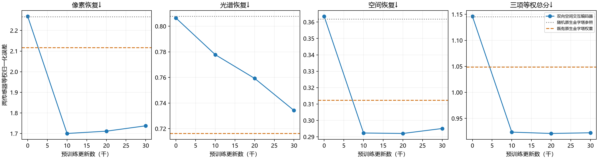

四列依次为像素恢复、光谱恢复、空间恢复及三项等权总分；横轴是v3预训练更新数，两条水平线是固定v2随机与既有权重参照。应看改善是否跨任务一致，而不只看总分。总分选中20k，但30k并非每项都优于20k。

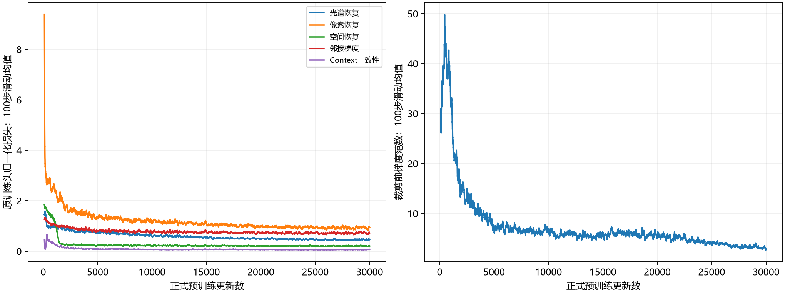

左图五条线是原训练头归一化损失的100步均值，右图是裁剪前梯度范数的100步均值。它们描述训练过程，不是上表统一探针的验证分数，也不能据曲线下降宣称迁移已改善。

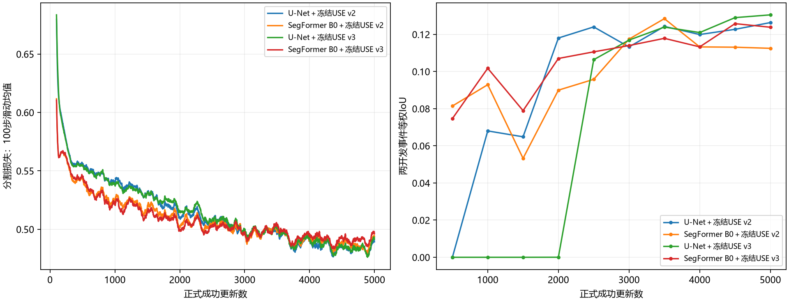

左图四种“冻结编码器＋完整消费者”的分割损失，右图是每500步的事件等权IoU。应注意损失相近而开发验证不同：空间交互编码器接U-Net前2000步IoU仍为0，后续才升起；不能把训练初期或末态单独当成模型最终表现。

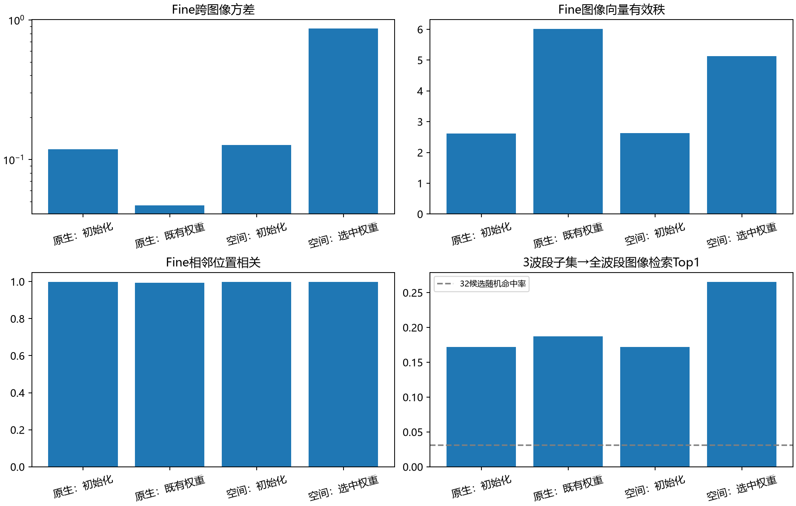

每组四柱分别是两种编码器的初始化与选定权重。四幅图依次是Fine跨图像方差、有效秩、相邻位置相关、3波段子集检索Top1；每传感器固定32份无标签验证样本，两传感器等权汇总。Fine图像向量是每通道在有效像素上的均值；有效秩由中心化向量的奇异值熵计算。子集检索用同一图像的前缀波段向量，从同传感器32份全波段图像中找回自身，随机命中率1/32；1/6波段及各原生Context层结果在原始诊断JSON中，满波段本身不作为子集。相关值先把全部通道与有效邻接位置展开，再计算Pearson相关，各通道均值差异也会抬高它。图像相似、光谱均值和通道相对尺度都能影响这些统计，不能把检索命中直接当滑坡语义。

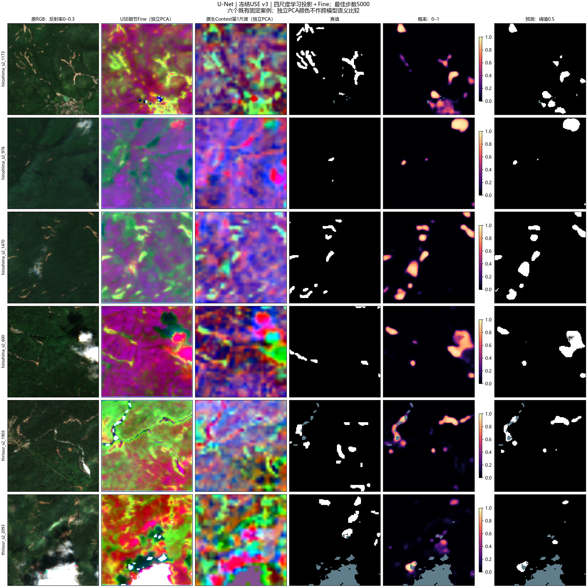

每行是原先登记的一个固定样本，六列依次为RGB、Fine编码、原生Context第1尺度编码、真值、概率和0.5掩膜。应看漏检和误报相对于真值的位置；例如第2行右上区域存在明显误报。两种编码器、两种消费者均沿用相同六个ID，没有按预测重挑。每个编码列各自PCA；不根据跨模型颜色解释语义。其余完整面板：[原生金字塔＋U-Net](../../landslide-seg/docs/assets/research/use_v3/fixed_cases_seg_v2_unet.png)、[原生金字塔＋SegFormer](../../landslide-seg/docs/assets/research/use_v3/fixed_cases_seg_v2_segformer.png)、[空间交互＋SegFormer](../../landslide-seg/docs/assets/research/use_v3/fixed_cases_seg_v3_segformer.png)。同一编码器的Fine和第1尺度Context在两消费者中逐像素相同，预测差别来自适配器及消费者。

#### 展开结论：机制、证据与边界

1. **重建优势集中在Fine像素恢复，没有普遍覆盖全部目标。** 读取Fine的像素恢复误差从2.1166降到1.7117，下降约19.1%；读取原生Context的空间恢复从0.3123降到0.2921，但光谱恢复从0.7163升至0.7593。总分由1.0484降至0.9210，下降约12.1%，不能简写成“所有表征都更好”。光谱前端、空间传播、反馈与预训练目标／日程共同构成配置差异，单次对照不能确定哪个组件造成收益。
2. **更低的恢复误差没有转成一致的滑坡分割收益。** U-Net事件IoU从0.1263到0.1305，Precision从0.2021降到0.1698、Recall从0.2026升到0.2609；更多真阳性伴随更多误报。SegFormer的最佳事件IoU反而从0.1285降到0.1258。固定案例仍有区域性误报和小对象漏检；最小对象至多1/77。四组均远低于当前端到端参照0.3081，当前参照不替换。阈值、冻结特征与损失的具体因果作用未验证，不据此追加实验。
3. **方差增大不等于表征语义改善。** 选定v3的Fine跨图像方差并未消失，3波段检索也高于随机；但S2有效秩约5.85，低于既有v2的7.63，相邻位置相关约0.9995。不同诊断给出不同侧面，不支持用单一统计宣称退化解除，也不能把高相关直接判定为恒定输出。它们与分割低分一起保留，作为后续研究线索。

#### 限制与下一步

v2是历史20k＋10k两段条件，v3是连续30k；虽然本轮固定同类探针、适配器、消费者初始化和数据，编码器历史目标与日程仍不同，不能称严格同计算量／纯架构消融。旧v2完整网络采用固定通道均值压缩，既有最佳U-Net0.1344、SegFormer0.1250；本轮改成可训练原生投影，不能拿旧结果替代本轮四项或归因单一组件。无标签验证和669块开发验证反复用于研发；未做新种子、新地域盲测、官方划分或人工标注语义复核。完整资源门禁按用户指令跳过，不能用局部速度数据推广完整成本结论。本轮完成即结束，不增加预算，不因无明确迁移收益自动追加消融或官方实验。

#### 附录：逐seed、成本与产物

全部训练seed1234、头seed1235，仅一个seed。完整逐事件、AP、边界、各对象尺寸和所有最佳／末态混淆计数见[结果数据](../../landslide-seg/outputs/use_v3/audit/result_metrics_and_cases.json)；各条件三种元数据模式的每份样本误差仍在[原运行目录](../../landslide-seg/outputs/use_v3/runs)。已知模式用于选模，部分／全未知只作诊断；可识别波段比例和未测原因逐样本保留，不据缺失目标伪造评分。

执行配置与全部实际源码、环境、无标签成员和统计、初始化及固定v2来源均绑定[engineering_v5 release](../../landslide-seg/outputs/use_v3/releases/engineering_v5/manifest.json)。正式配置为[execution.yaml](../../landslide-seg/configs/use_v3/execution.yaml)，无超参命令覆盖。配置仍有继承的通用元数据字段（如eval_every_updates=100、epochs=5000），实际v5入口按identity.job规定更新预算，并硬编码每500步做分割开发验证；应以逐更新记录和十份eval_500至eval_5000为准，不能把继承字段当成实际生效日程；用户仅覆盖了剩余测试／成本门禁，见[明确执行覆盖](../../landslide-seg/outputs/use_v3/audit/user_training_override.json)。每项实际命令、PID、设备、起止时间与日志见[执行账本](../../landslide-seg/outputs/use_v3/runtime/engineering_v5)，逐更新曲线和恢复状态随各run保存。

独立[权重／预算／选模核对](../../landslide-seg/outputs/use_v3/audit/training_artifact_audit_v4.json)确认：17项62000连续成功更新；严格重载重算initial／best／last／预训练里程碑哈希；冻结参数及buffer不变，每步调用冻结检查且优化器排除USE；同类初始张量一致，分割best为十次开发验证中最大事件IoU、同分取早；选定v3别名与20k原权重SHA256一致。17项完成训练均无训练中断或恢复；另有前述两项0更新CLI启动失败。工程恢复缺陷及修复证据另存，不能把工程桩回归当正式中断经历。

完整来源：[比较与成本汇总](../../landslide-seg/outputs/use_v3/audit/comparison.json)、[成本账本](../../landslide-seg/outputs/use_v3/audit/cost_ledger.json)、[联合表征诊断](../../landslide-seg/outputs/use_v3/audit/representation_diagnostics_v4.json)、[原始恢复故障](../../landslide-seg/outputs/use_v3/audit/recovery_repro/evidence.json)。选定权重SHA256：`e20e32f9915974c570d2ad9a064af3bd46b75f0e0d78bafbf698637895533886`。表图可由[结果脚本](../../landslide-seg/outputs/use_v3/runtime/finish_report.py)、[固定案例脚本](../../landslide-seg/outputs/use_v3/runtime/render_results.py)、[只读表征脚本](../../landslide-seg/outputs/use_v3/runtime/representation_diagnostics_v4.py)复现；均不进行参数更新。

## USE V2 光谱编码接入视觉主干

### 视觉入口保留与教师对齐双路线独立验收与执行状态

原九项59000更新和唯一追加5000更新均已完成，累计64000；来源、完整重载、冻结、共同头初始化、样本流和成本核对见[原九项验收](../../landslide-seg/outputs/use_mit_dual_routes/audit/release_v2/final_training_artifact_acceptance.json)与[追加产物核对](../../landslide-seg/outputs/use_mit_dual_routes/audit/aoff/final_acceptance.json)。训练/产物完成与最终文档、视觉验收分开，后者以审阅记录为准。

原三方案分别是固定RGB入口＋初始Fine、RGB入口＋训练后的光谱残差/Fine、光谱入口＋RGB教师对齐；追加固定A的Fine并关闭空间光谱残差。任务头同初始张量、5000更新，USE冻结，编码器固定u20000。结构和外部预训练来源见[模型文档](../outputs/documentation/documentation_sources/landslide-seg/docs/MODEL_EVOLUTION.md)。

#### 主表：四个分割方案的结果与成本

数据与指标沿用[共同口径](#阅读约定与实验设置)。每组同一任务头初始张量、5000次更新、同一采样增强顺序，完整编码器冻结。编码器固定u20000，不按分割成绩反选。IoU先分别计算事件内像元交并比再等权平均；其他指标为最佳任务头在669块上的像元/对象汇总。AP不依赖固定阈值；Precision、Recall、FPR使用0.5阈值，FPR为背景像元误报比例；边界容差1像素；本表小对象为小于50像素且可评价的77个对象，召回按对象匹配计算。

| 架构方案 | 最佳/末态IoU | 最佳步数 | 广岛/特里苏尔IoU | AP | Precision | Recall | FPR | 边界F1 | 小对象召回 |
|---|---:|---:|---:|---:|---:|---:|---:|---:|---:|
| SegFormer B0｜原生RGB入口＋固定初始细节 | 0.2419/0.2335 | 1500 | 0.2009/0.2830 | 0.2934 | 0.3329 | 0.4027 | 0.0158 | 0.3561 | 0.0779 |
| SegFormer B0｜原生RGB入口＋A训练后的细节 | 0.2409/0.2323 | 1500 | 0.1975/0.2843 | 0.2907 | 0.3287 | 0.4014 | 0.0161 | 0.3533 | 0.0779 |
| SegFormer B0｜RGB入口＋训练后光谱残差及细节 | 0.0628/0.0615 | 4500 | 0.0776/0.0479 | 0.0782 | 0.1206 | 0.1484 | 0.0212 | 0.1324 | 0.0390 |
| SegFormer B0｜光谱入口＋RGB教师对齐 | 0.0517/0.0517 | 5000 | 0.0524/0.0510 | 0.0608 | 0.1014 | 0.0965 | 0.0168 | 0.0893 | 0.0260 |

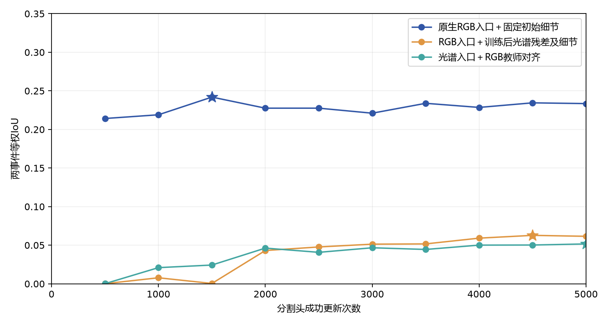

每条线为一组架构，星号为500步间隔评价中最高的两事件等权IoU。

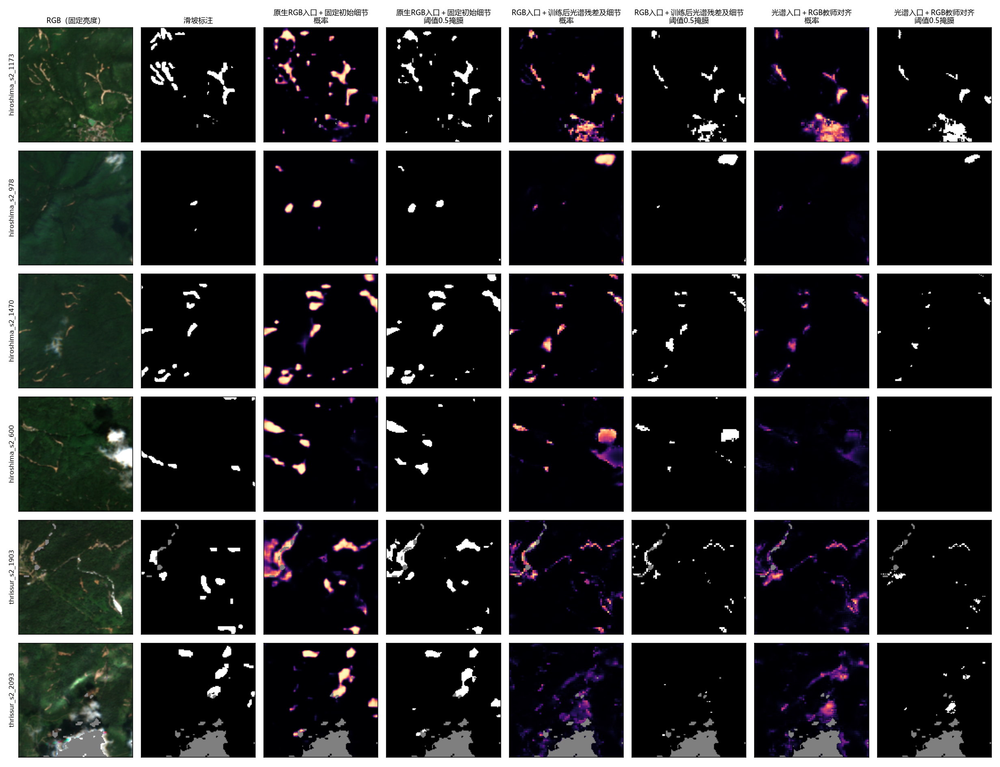

每行是同一个预先固定案例；列为RGB、标注，以及各方案的概率与阈值0.5掩膜。无效区统一显示灰色，RGB使用固定亮度。另见[四个沿用诊断案例](../../landslide-seg/docs/assets/research/use_mit_dual_routes/original_final_error_cases.png)，这些案例不估计总体误报频率。

两条完整预训练路线均低于同构视觉参照。新增A-off保留A训练后的Fine、改用纯RGB空间路径后接近参照：当前证据不支持Fine已带来净收益，差距主要与空间残差及其支持规则的组合有关，具体机制未验证。历史十波段端到端参照0.3081的训练自由度不同，不属同构消融。

同卡推理成本（仅原三组，不含追加对照）：以下为128像素输入、batch1、FP32、TF32关闭，三轮中位耗时再取中位；不含磁盘读入，哈希另计。

| 架构方案 | 初始推理ms | 最终best推理ms | 最终峰值显存MiB |
|---|---:|---:|---:|
| 原生RGB入口＋固定初始细节 | 21.94 | 22.19 | 291.4 |
| RGB入口＋训练后光谱残差及细节 | 23.06 | 23.38 | 291.2 |
| 光谱入口＋RGB教师对齐 | 22.17 | 22.00 | 289.3 |

同一物理卡UUID `GPU-9b56b860-01a3-345f-a376-2b39b50563e4`；完整128/256/512的27条件及独立开销保留原始成本JSON。1024未实测，更大尺寸仅静态估计，不能当吞吐实测。

单seed、只有两个研发验证事件且反复用于研发，不宣称显著性或新地域泛化。原始评价、初始化/冻结/预算及哈希见[可追溯比较产物](../../landslide-seg/outputs/use_mit_dual_routes/audit/original_final_comparison.json)。

#### 已授权补充：保留训练后细节，关闭空间光谱残差

新增5000步已完成并通过独立产物核对，原59000与追加5000分开记账，累计64000。A-off编码器沿用A固定u20000，任务头从原共同初始张量和新AdamW step0重新训练。Fine=A、纯RGB Context/支持=C0、禁用模块调用0及持久模式/恢复检查通过；2次工程更新和1次恢复重放另列。[追加授权/来源](../../landslide-seg/outputs/use_mit_dual_routes/audit/aoff/manifest.json)、[工程验证](../../landslide-seg/outputs/use_mit_dual_routes/audit/aoff/acceptance.json)、[最终产物核对](../../landslide-seg/outputs/use_mit_dual_routes/audit/aoff/final_acceptance.json)、[配置](../../landslide-seg/configs/use_mit_aoff.yaml)。

中途4000步快照已由最终结果取代，仅保留[历史中途曲线](../../landslide-seg/docs/assets/research/use_mit_dual_routes/aoff_interim_curves.png)追溯，不再与最终表重复叙述。

#### 保留A细节、关闭空间光谱残差的补充结果

全部数值已并入上方四方案主表，此处只说明新增对照及固定案例。

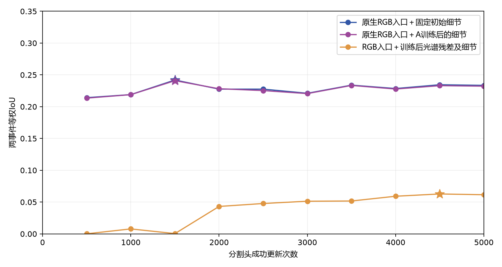

每条线为一组架构，星号为500步间隔评价中最高的两事件等权IoU。

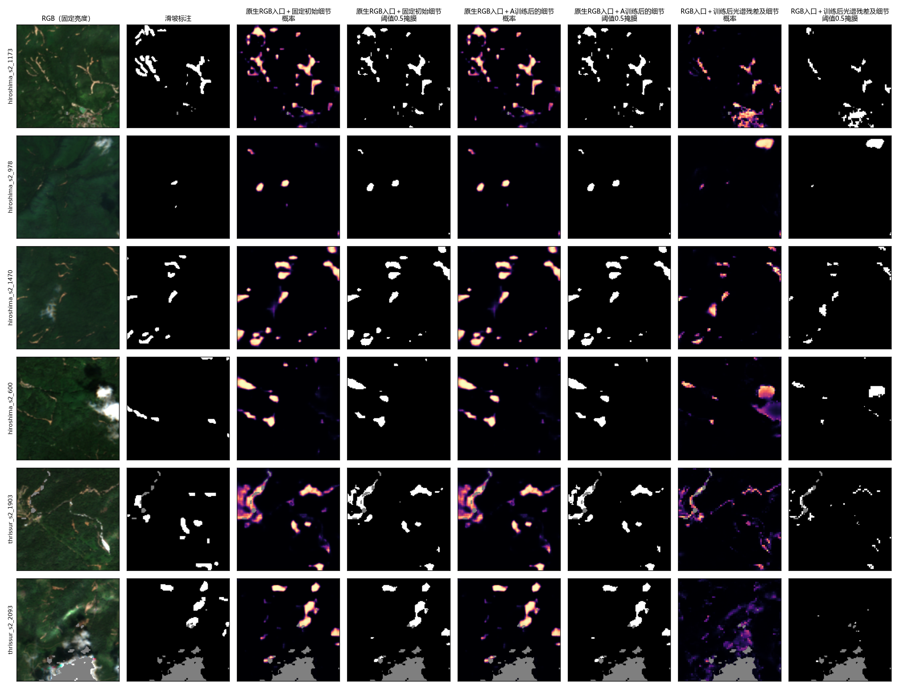

每行是同一个预先固定案例；列为RGB、标注，以及各方案的概率与阈值0.5掩膜。无效区统一显示灰色，RGB使用固定亮度。另见[四个沿用诊断案例](../../landslide-seg/docs/assets/research/use_mit_dual_routes/aoff_final_error_cases.png)，这些案例不估计总体误报频率。

A-off对参照主要检验A预训练后Fine的变化；完整A对A-off在相同Fine条件下检验额外空间残差和空间支持规则的组合影响。两者支持不同处须保留，不能宣称只改变一个加法数值。该补充不新增无标签预训练，不使用训练后的A分割头；从原共同头初始张量和新优化器开始。

单seed、只有两个研发验证事件且反复用于研发，不宣称显著性或新地域泛化。原始评价、初始化/冻结/预算及哈希见[可追溯比较产物](../../landslide-seg/outputs/use_mit_dual_routes/audit/aoff_final_comparison.json)。

### 光谱Token注入视觉编码器（原光谱注入方案）独立验收与执行状态

**本轮29000正式更新、最终权重/选模/曝光核对及图表验收完成，当前无待续训练队列。分割结果未改善，当前十波段直入参照不变。**

#### 阅读约定与实验设置

本阶段完成六作业、29000次正式更新：20000预训练、10k/20k四探针共4000、唯一分割头5000；数据与统计沿用共同口径。没有5k探针、旧编码器重训、U-Net、第二套MiT或LoRA。

输入反射率经继承的光谱前端形成早期Fine和第五Query；第五Query经适配器进入冻结MiT四阶段。遮挡影像的原数值提供无标签目标；滑坡掩膜只训练任务头。MiT带有外部ImageNet/ADE20K监督。编码器仅按无标签公共评分选择，任务头仅按两事件等权IoU选择，另报训练末态。开发验证被反复研发使用，不是盲测。

#### 三张合并主表

公共恢复误差使用固定v3分母，各传感器等权，Fine像素、Context光谱、Context空间三项等权，空间16/32/64等权；越低越好。

| 固定无标签编码器候选 | Fine像素 | Context光谱 | Context空间 | 公共总分 | 入选 |
|---|---:|---:|---:|---:|---|
| SegFormer B0｜光谱Token注入冻结MiT｜10k预训练 | 2.1769 | 0.9099 | 0.3886 | 1.1585 | 否 |
| SegFormer B0｜光谱Token注入冻结MiT｜20k预训练 | 2.1815 | 0.8863 | 0.3796 | 1.1491 | 是 |
| 历史参照：USE双向空间交互编码器｜20k入选 | 1.7117 | 0.7593 | 0.2921 | 0.9210 | 本轮不参与选模 |

Fine衡量被遮挡像素恢复，Context两项分别衡量被遮挡波段和空间块恢复。20k相对10k的总分仅降低约0.8%，来自Context两项下降，Fine误差未改善；单seed不宣称显著性。历史20k参考使用相同599观测与公共分母，但初始化、结构不同，不是严格单因素比较。

分割阈值0.5。两事件等权IoU先各算广岛和特里苏尔后平均；像素指标先合并全部合法像素。对象召回使用可评价对象IoU≥0.25，边界容差1像素；完整尺度、AP及固定Recall0.5/0.8的FPR、实际Recall、阈值见评价JSON。

| 架构与任务头状态 | 两事件等权IoU | 广岛IoU | 特里苏尔IoU | 像素IoU / Dice | Precision / Recall | AP | 对象召回 / 边界F1 |
|---|---:|---:|---:|---|---|---:|---|
| 当前参照：SegFormer B0｜十波段直入｜原网格细节 | 0.3081 | 0.3114 | 0.3049 | 0.3095 / 0.4727 | 0.4680 / 0.4775 | 0.4425 | 0.5211 / 0.4806 |
| 历史：SegFormer B0｜冻结双向空间表征｜完整消费者 | 0.1258 | 0.0895 | 0.1621 | 0.1066 / 0.1926 | 0.1612 / 0.2394 | 0.1215 | 0.2091 / 0.1779 |
| 最新：SegFormer B0｜光谱注入冻结MiT｜轻量头best | 0.0600 | 0.0825 | 0.0374 | 0.0736 / 0.1371 | 0.1167 / 0.1661 | 0.0844 | 0.1608 / 0.1382 |
| 最新：SegFormer B0｜光谱注入冻结MiT｜轻量头last | 0.0597 | 0.0820 | 0.0373 | 0.0731 / 0.1362 | 0.1167 / 0.1633 | 0.0839 | 0.1590 / 0.1368 |

共享服务器上的同步墙钟耗时全部保留三轮，每轮30预热、100测量。MiB是PyTorch峰值allocated；reserved、每次测量与算子覆盖另存。共享负载波动，不作稳定加速结论；历史消费者的哈希检查已从纯前向计时移出。

| 模型计算范围（同卡FP32、C10、B1） | 128：中位ms / p90 / MiB | 256：中位ms / p90 / MiB | 512：中位ms / p90 / MiB |
|---|---|---|---|
| 历史双向空间表征｜裸编码器 | 14.81 / 22.35 / 84.2 | 17.45 / 26.02 / 216.3 | 29.25 / 30.79 / 760.7 |
| 光谱Token注入冻结MiT｜裸编码器 | 14.66 / 24.36 / 223.5 | 15.16 / 23.04 / 221.9 | 28.51 / 31.64 / 766.2 |
| 历史双向空间表征｜完整SegFormer | 31.92 / 46.07 / 233.3 | 34.68 / 49.34 / 535.9 | 52.95 / 62.13 / 1978.9 |
| 光谱Token注入冻结MiT｜最终轻量头 | 18.80 / 26.74 / 225.1 | 20.50 / 28.82 / 527.8 | 38.90 / 43.14 / 1969.6 |
| 十波段直入｜SegFormer B0＋细节 | 10.69 / 16.97 / 220.4 | 12.27 / 19.86 / 510.8 | 18.05 / 25.71 / 1901.4 |

#### 图与解释

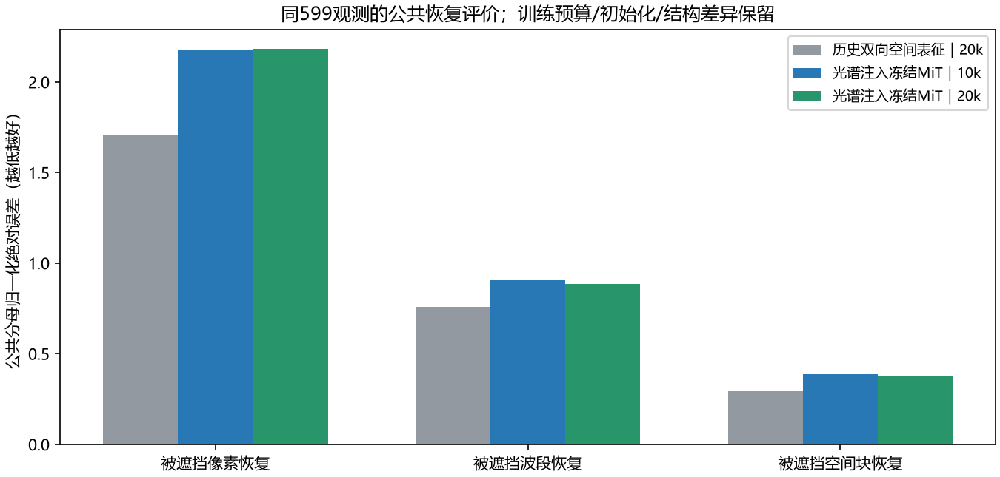

每组三根柱依次是历史20k双向空间表征、当前10k候选和当前20k候选；三组分别为像素、波段、空间块恢复。应看公共评价误差而非内部训练loss；本轮20k虽然胜过10k总分，三项仍高于历史参考，尚无恢复质量优势。

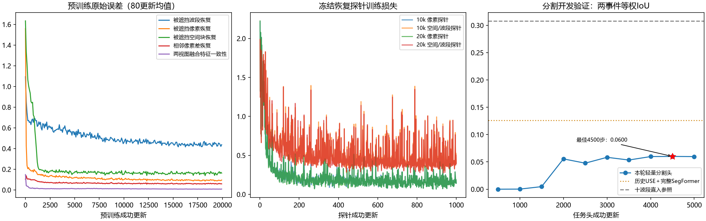

三列依次是预训练五项原始误差、四恢复探针训练损失、每500步的分割事件等权IoU；横轴各为该作业成功更新数。训练损失不能替代公共探针选模分数，最佳任务头不等于末态。

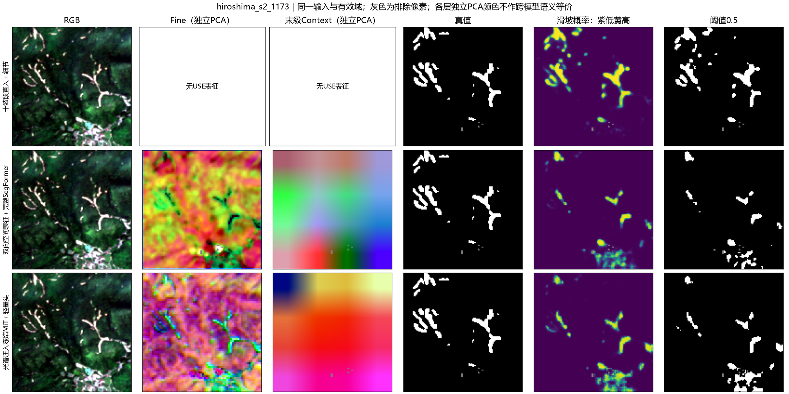

三行依次为当前十波段直入参照、历史冻结双向空间表征＋完整SegFormer、新冻结MiT＋轻量头。六列为同一RGB、Fine、末级Context、真值、概率和0.5掩膜。所有行使用同一输入和掩膜；各层独立PCA仅展示空间结构，颜色不具有跨模型语义等价。其余固定五例及按预登记规则选出的高误报案例见下方索引。所有图列的灰色区域均表示评价掩膜排除，不代表阴性或阳性；概率色标统一0–1、紫低黄高，二值图的合法白色像素才表示预测阳性。高误报案例由每事件合法像素FP数前两名确定，排除固定六例，同分按sample_id，不代表总体错误发生率。

固定案例：[hiroshima_s2_1173](../../landslide-seg/docs/assets/research/use_v4/hiroshima_s2_1173_cases.png)、[hiroshima_s2_978](../../landslide-seg/docs/assets/research/use_v4/hiroshima_s2_978_cases.png)、[hiroshima_s2_1470](../../landslide-seg/docs/assets/research/use_v4/hiroshima_s2_1470_cases.png)、[hiroshima_s2_600](../../landslide-seg/docs/assets/research/use_v4/hiroshima_s2_600_cases.png)、[thrissur_s2_1903](../../landslide-seg/docs/assets/research/use_v4/thrissur_s2_1903_cases.png)、[thrissur_s2_2093](../../landslide-seg/docs/assets/research/use_v4/thrissur_s2_2093_cases.png)。

高误报案例：[hiroshima_s2_660](../../landslide-seg/docs/assets/research/use_v4/hiroshima_s2_660_cases.png)、[hiroshima_s2_696](../../landslide-seg/docs/assets/research/use_v4/hiroshima_s2_696_cases.png)、[thrissur_s2_1070](../../landslide-seg/docs/assets/research/use_v4/thrissur_s2_1070_cases.png)、[thrissur_s2_612](../../landslide-seg/docs/assets/research/use_v4/thrissur_s2_612_cases.png)。

#### 展开结论、限制与下一步

无标签规则在10k/20k中选择20000步，总分1.1491；该选择未读取滑坡成绩。冻结字节、实际探针参数更新和非恒定表征门禁通过，但恢复误差和工程有效性不能直接证明滑坡迁移质量。

最新轻量头best事件等权IoU为0.0600，last为0.0597；历史冻结表征＋完整SegFormer为0.1258，当前直入参照为0.3081。本轮完整方案的滑坡迁移价值未得到支持；新方案在两个验证事件都低于历史USE＋完整SegFormer，当前十波段直入参照继续保留。移除重复空间编码路径后，512完整消费者前向中位值38.90ms低于历史52.95ms，但显存约1969.6/1978.9MiB接近，且共享负载下不能宣称稳定加速。质量损失不能用这一时延观察抵消。输入光谱前端、空间主干来源、早期Fine、投影容量及消费者自由度同时不同，不能把结果归因于某一个机制；原因解释仍未验证。

本轮预训练实际可训练参数52313，MiT原参数冻结；Fine/Context探针可训练参数分别11681/28193，后者比历史相同投影多1024权重；唯一分割头可训练参数413570。历史USE＋完整SegFormer消费者可训练3804290参数，当前直入参照原配置为3600步、batch64，本轮头为5000步、有效batch8，监督训练自由度和曝光预算不同。外部ImageNet/ADE20K监督、早期Fine缺少旧Context反馈及任务头自由度必须分别理解，不能用参数数目给出唯一失败原因。

用户明确允许共享GPU，覆盖附件原一卡一个计算进程约定；其他进程未被停止。共享负载计时不可信的原始记录仍保留，容量与哈希门禁继续执行。1000步探针和20000步预训练不宣称充分收敛，不自动增加预算或LoRA。

#### 附录：成本与产物

正式成功更新29000；A工程200、A可丢弃测试52、B可丢弃测试20、容量1及最后成本副本更新2单列。逐更新同步计时合计约6.443 GPU小时，仅为更新时间，不含全部验证、检查点和最终诊断，不能冒充完整占卡时间。按真实START/RESUME到EXIT分卡相加，任务进程墙钟合计约7.262卡小时（含失败进程、验证与评价，排除停机等待和最终报告/成本进程）；共享服务器下这也不是独占GPU活跃时长。完整进程墙钟、曝光、实际配置与覆盖、源/统计/成员/初始化/权重哈希见运行和审计JSON。512瓦片、64重叠、448步长：4096为81窗，10000为529窗；静态外推不含拼接/IO，也不能恢复跨窗注意力。最终完整消费者通过一次1024×1024、C10、B1、FP32合成冷前向：输出有限、冻结哈希不变，峰值allocated约7734.6MiB；只证明该次容量成功，不证明真实大图质量或稳定时延。2048/4096/10000只做静态：MiT Stage1单个FP32注意力得分矩阵分别约4GiB、64GiB、2.21TiB，另有概率矩阵与其他激活，所以仍需切片，不能宣称无限分辨率。

- [最终审计](../../landslide-seg/outputs/use_v4/audit/final_acceptance.json)
- [USE选模](C:/Users/yzh/DisaterRuns/use_v4/runs/selection.json)
- [任务头best完整评价](C:/Users/yzh/DisaterRuns/use_v4/runs/segment/evaluation_best.json)与[last评价](C:/Users/yzh/DisaterRuns/use_v4/runs/segment/evaluation_last.json)
- [表征门禁](../../landslide-seg/outputs/use_v4/audit/representation_gate.json)
- [最终权重同卡成本](../../landslide-seg/outputs/use_v4/benchmarks/final_weights_cost.json)
- [固定与误报案例索引](../../landslide-seg/outputs/use_v4/audit/final_case_selection.json)

CUDA中断另列：6300步后成功但未落盘更新的精确数量未知，范围0–99，另有1次失败的部分更新；从6300同release恢复，不把这部分隐藏在29000个持久化成功更新内。[恢复证据](../../landslide-seg/outputs/use_v4/audit/recovery_6300.json)。

分项成本补充：128/256各做一次可丢弃新模型更新，按前向、反向、优化器和IO分时，MiT哈希不变；256使用合法TRAIN的最近邻扩展副本，仅作容量检查，不产生精度结论。512训练的保守预估约43.4GiB超安全余量，未分配。训练分项只有单次冷样本，未测30预热/100测量×3的完整训练步耗时分布，不能冒充稳定benchmark；前向矩阵和IO/完整哈希分项采用30/100×3。新编码器128/256显存非单调峰值在独立新进程复测中复现，原因未验证，不按面积简单解释。

阈值诊断：最佳模型在Recall达到0.5时，最小FPR为0.1288、阈值0.04929；达到0.8时，FPR为0.2884、阈值0.00948。这只是排序诊断，主表阈值仍为0.5，不据此重选编码器或任务头。

证据补充：[初始化/曝光/进程墙钟](../../landslide-seg/outputs/use_v4/audit/exposure_and_wall_cost.json)、[参数量](../../landslide-seg/outputs/use_v4/audit/model_parameter_counts.json)、[1024单次容量与更大图静态](../../landslide-seg/outputs/use_v4/benchmarks/final_large_capacity.json)、[训练分项与512预检](../../landslide-seg/outputs/use_v4/benchmarks/final_training_components.json)、[IO与完整哈希分时](../../landslide-seg/outputs/use_v4/benchmarks/final_io_hash_components.json)、[输出迁C核验](../../landslide-seg/outputs/use_v4/audit/runs_c_migration.json)。探针逐文件曝光由锁定的无状态采样器重建，未把重建记录伪称原始逐步日志。

## 共享单波段 CNN 与跨源自蒸馏

### 共享单波段编码与跨源自蒸馏的正式结果

### 阅读约定与实验设置

本报告区分修复后新实验、历史权重和外部预训练参照。共享单波段CNN逐波段编码，以中心波长和原生地面分辨率调制特征；只编码实际可用且未被随机删除的波段，集合均值接入ResNet-18。学生预测多视图，教师由EMA更新，不使用滑坡或土地覆盖标签做自监督预训练。

自监督种子0，位置batch32，FP32，AdamW初始学习率5e-4、正则化参数weight decay0.04、梯度裁剪3。前10轮warmup，此后固定S2开发视图的无标签DINO损失（实际为32与4样本两批等权平均）连续10轮相对改善不足0.5%时减半，最低1e-6；至少100轮，30轮无改善且学习率≤初始1/16时早停，上限400轮或50000次更新。最佳checkpoint采用相对改善门槛，**不是每次记录的绝对最低损失**；另存末态。不同分支独立早停，最佳任务分数不是严格等预算消融。没有运行BF16，因而无需追加精度矩阵。

980位置队列：从九个训练事件2223个候选按实际所选时相质量筛得980块、7个事件；无标签开发验证36块来自Hiroshima。290位置队列：在980块中再按两源共同QA≥80%、日期差≤2天、共同30m NDVI相关≥0.6、差异≤0.2、零位移相对±1像元最优相关不落后超过0.05筛选，保留Chimanimani220、Indonesia29、Kyrgyzstan1 34、Kyrgyzstan2 7。后者是稳定且有纹理的子集，不代表所有地表。

S2单源双组视图、两源独立多视图、两源配对正视图均用同一290位置、8学生视图和4教师视图。第一组复制同一S2观测，不计为两次独立观测；后两组每位置包含S2和Landsat，只有DINO目标配对集合由12项改为28项。各组每批32位置，后两组实际有64个传感器观测。新companion共954个Landsat、1014个HLS，均存新版目录，旧数据未覆盖。

滑坡任务使用**我们的数据划分（留事件验证）**：九个训练事件2223块，开发评价Hiroshima448+Thrissur221=669块，保持原清单与stats_core25文件。这里输入物理反射率，不套用core25标准化；冻结特征只用训练集拟合逐通道均值方差。轻量解码头、阈值0.5、种子1234相同；按两个开发事件等权IoU选头。开发集同时用于选轮次与候选，不能叫独立测试。下表IoU为两事件等权；边界F1与小对象召回为669块合并计数，边界容差1个10m像元，小对象<50像元且符合项目可评价对象定义。原生10m标签诊断与共同30m产品比较分开。

跨卫星地理开发检索：18个Hiroshima查询，图库290训练位置+18开发位置=308。为获得足够晴空配对，从36个原开发地点的现有15时相中仅按SCL清晰度选时相，再按上述配对门槛筛到18组；实际日期写入独立清单，没有替换训练数据。精确并列相似度取随机打破并列时的期望命中率。R@10是正确位置进入前10名的比例，随机排名期望10/308=0.0325；邻近640m召回单独存JSON。该开发诊断只含一个事件，不能外推全球。

### 主表：新训练、真实滑坡标签与跨卫星检索

共同步数列仅比较固定无标签视图损失：980队列取3100步，290队列取1210步，两队列分开解读；没有这些步数的下游checkpoint，不能称为共同步数任务精度。曝光表示位置参与更新的次数，包含最后不足32的batch。

| 模型与机制 | 轮数 / 更新 | 位置曝光 | 共同步数DINO损失 | 最佳头IoU | 末态头IoU | 边界F1 | 小对象召回 | 地理开发R@10 |
|---|---|---|---|---|---|---|---|---|
| 共享单波段CNN｜标准增强 | 119 / 3689 | 116620 | 2.6879 | 0.1180 | 0.0963 | 0.1653 | 0.0516 | 0.2222 |
| 共享单波段CNN｜普通缩放 | 105 / 3255 | 102900 | 3.0212 | 0.1228 | 0.1043 | 0.1800 | 0.0914 | 0.0000 |
| 共享单波段CNN｜低通后采样 | 100 / 3100 | 98000 | 2.9722 | 0.1114 | 0.0966 | 0.1654 | 0.0725 | 0.0000 |
| 共享单波段CNN｜全区域尺度约束 | 100 / 3100 | 98000 | 2.8545 | 0.1198 | 0.1074 | 0.1745 | 0.0626 | 0.2778 |
| 共享单波段CNN｜随机区域尺度约束 | 100 / 3100 | 98000 | 2.7117 | 0.0641 | 0.0469 | 0.1070 | 0.0248 | 0.0556 |
| 共享单波段CNN｜修正选择性尺度约束 | 100 / 3100 | 98000 | 3.1418 | 0.1064 | 0.0864 | 0.1590 | 0.0457 | 0.3333 |
| 共享单波段CNN｜S2单源双组视图 | 240 / 2400 | 69600 | 1.3233 | 0.0489 | 0.0463 | 0.0643 | 0.0030 | 0.0000 |
| 共享单波段CNN｜两源独立多视图 | 121 / 1210 | 35090 | 2.0393 | 0.1044 | 0.0532 | 0.1609 | 0.0626 | 0.0000 |
| 共享单波段CNN｜两源配对正视图 | 264 / 2640 | 76560 | 1.6781 | 0.0744 | 0.0374 | 0.1170 | 0.0258 | 0.7778 |
| 随机共享单波段CNN | 外部参照 | — | — | 0.0007 | 0.0006 | 0.0018 | 0.0000 | 0.4444 |
| DOFA官方预训练ViT-B | 外部参照 | — | — | 0.1268 | 0.0643 | 0.1278 | 0.0149 | 0.1111 |

表中位置曝光按最终保留的优化轨迹计数。配对组中断前有10次更新（290次位置曝光）未进入最近checkpoint，恢复后重做；实际尝试2650次更新、76850次位置曝光，最终保留2640次更新、76560次位置曝光。成本统计包含丢弃的尝试。

### 本地WorldCover补充诊断

现有中国森林地区100块S2影像按25个地域分组，60训练/20验证/20测试（15/5/5地域）；排除已知预训练区域邻域后无样本被剔除。使用原始WorldCover地图，不用NDVI森林掩码和合成火灾标签。影像与评价网格20m，原地图10m产品被重采样，不证明原生10m细节能力。土地覆盖分类是多标签：某类别占有效区≥1%即为正例，只保留训练中至少3正3负的草地、农田、建成区、苔藓地衣；测试苔藓地衣无正例，mAP只平均前三类，测试正例17/2/2。小样本与地图模型误差都会影响结果。分类和分割来自同一地图源，不是两个独立真值数据集。

| 模型与机制 | 地图多标签分类mAP | 地图分割mIoU |
|---|---|---|
| 随机共享单波段CNN | 0.4067 | 0.1390 |
| 共享单波段CNN｜标准增强 | 0.5715 | 0.1360 |
| 共享单波段CNN｜普通缩放 | 0.3982 | 0.1265 |
| 共享单波段CNN｜低通后采样 | 0.3894 | 0.1301 |
| 共享单波段CNN｜全区域尺度约束 | 0.5142 | 0.1212 |
| 共享单波段CNN｜随机区域尺度约束 | 0.3664 | 0.1402 |
| 共享单波段CNN｜修正选择性尺度约束 | 0.6646 | 0.1195 |
| 共享单波段CNN｜S2单源双组视图 | 0.4641 | 0.1319 |
| 共享单波段CNN｜两源独立多视图 | 0.4671 | 0.1176 |
| 共享单波段CNN｜两源配对正视图 | 0.3618 | 0.1243 |
| DOFA官方预训练ViT-B | 0.5587 | 0.1701 |

## Encoder V1 条件观测预测

修正版完整同源遮盖训练采用记录中的归一化RMSE验证分数，越低越好。两模型已达到记录中的更新上限，原状态为“训练结束，待后续评价”；下面保存其验证结果，不宣称下游迁移验收完成。跨源队列没有对应完整结束记录的部分，不补造完成成绩。

| 正式方案 | 更新数 | 最佳验证分数↓ | 末态验证分数↓ |
|---|---:|---:|---:|
| 条件光谱空间Transformer | 15000 | 0.3438 | 0.3834 |
| 同任务CNN对照 | 22000 | 0.4311 | 0.4491 |
| 训练均值参照 | 不适用 | 0.8732 | 不适用 |
| 邻近波段插值参照 | 不适用 | 0.4866 | 不适用 |
| 条件线性回归参照 | 不适用 | 0.1474 | 不适用 |

Transformer优于该CNN对照，但仍落后于条件线性回归；模型预算不同，不能视为严格等预算架构排序。该结果推动原生支持和局部信息读出改进，不能推出“只需增加模型规模”。数字来自[完整训练记录](../outputs/observation_model/repair_v2/runs)与[同任务简单参照](../outputs/observation_model/repair_v2/baselines/masked_validation.json)，没有使用1000步pilot替代正式结果。

## Encoder V2 原生网格与局部信息保留

### G5 本轮结束报告

#### 阅读约定与实验设置

本轮由用户主动终止，训练及切换计划任务已禁用，监测自动化90保持暂停；不接续跨源、下载、冻结探针或其他训练。单种子seed0，6402份TRAIN原生网格观测窗口：S2四波段4292、十波段588，L8六波段1351、七波段171。主验证367，未见响应S2C验证16另列；这些数目不是独立整景或严格配对数。既有留出角色保持。

共享SRF条件局部投影、128维Transformer空间编码器、16维原生局部特征库及共享目标条件查询解码器；原生10/20/30m输入，seed0随机初始化。训练A为空间遮盖恢复，B为单/多波段缺失恢复；只监督真实存在目标、目标数值从输入移除。损失是TRAIN标准差归一化MSE；有效源batch32，S2/L8各16，BF16模型/FP32几何和损失。AdamW初始LR3e-4、weight decay0.04、clip3、warmup500。A权重前2000步由1平滑降至0.25，B始终1；固定选模分数(0.25A+B)/1.25。0.1%为等待阈值，4次未改善LR减半；早停需至少2000步、12次未改善且LR≤初始1/16。实际LR未下降。最初全状态500步保存，修复后50步保存。

#### 主表：训练结果与数值归属

| 模型及状态 | 位置 | 固定验证综合分数↓ | 说明 |
|---|---:|---:|---|
| 共享光谱空间Transformer | 500 | 0.642127 | 同一固定主验证、单波段B |
| 共享光谱空间Transformer | 1000 | 0.240895 | 同一固定主验证、单波段B |
| 共享光谱空间Transformer | 2000 | 0.134762 | 同一固定主验证、单波段B |
| 共享光谱空间Transformer | 4000 | 0.070084 | 同一固定主验证、单波段B |
| 共享光谱空间Transformer | 6500 | 0.042718 | 同一固定主验证、单波段B |
| 共享光谱空间Transformer | 7500 | 0.040165 | 同一固定主验证、单波段B |
| 共享光谱空间Transformer | 8000 | 0.041155 | 同一固定主验证、单波段B |
| 共享光谱空间Transformer | 8500 | 0.039777 | 同一固定主验证、单波段B |
| 共享光谱空间Transformer完整末态 | 8550 | 未评价 | 不把8500分数归给8550 |
| 用户停止时最后完成记录 | 8558 | 未评价 | 末尾8次更新未保存权重 |

#### 图与解释

左图是所有固定验证，右图放大后段。8500分数0.039777为最佳；7500到8500仅改善0.967%，B本身未超过7500，因此存在平台迹象，仍不能断言B整组缺失任务或表征训练已收敛。没有按Ridge成绩反选checkpoint。

#### 展开结论、限制与下一步

真实光谱信息能够通过模型并恢复部分目标，证据是固定验证持续下降、部分空间结构和SWIR案例改善；仍有明显平滑、近红外弱点及跨源不一致。改善放缓并不等于已确认充分收敛，本轮是用户主动结束。

G1验收的是已有真实波段的定标、QA、网格和SRF，不能替代完整目标覆盖验收：红边/SWIR实际只由完整S2子集直接监督。可变波段接口可运行，不证明数据充足。完整土地覆盖语义、冻结表征迁移均未验证；本轮未完成预注册冻结探针。B固定12组合独立面板仅确认500步结果，缺后续里程碑/最终best与last面板，因此不能凭单波段分数宣称混合B课程整体收敛。所有历史证据保留，不自动补做这些缺项。

后续仅作为建议：若用户另行授权，先完成跨库存原生波段关联及逐任务覆盖，再冻结新的成员和评价。不能将此结论视为下一轮训练授权。

#### 附录：成本、配置与产物

已记录成功优化更新9237次，其中历史重算679次；未达到20k上限。完整末态8550、最佳8500、停止记录8558必须区分。末尾8次权重未保存，正在执行的一步是否完成不可确认。TVLP成功容量记录9237条、累计前后向22.43小时、记录峰值显存12566MiB；这不是端到端成本，未计全部验证、保存、失败部分更新、工程对照和只读推理。

配置、原成员和统计保持原路径；[机器结果与SHA256](../outputs/observation_model/encoder_v2/G5_native_bank/final_results.json)、[实际配置](../outputs/observation_model/encoder_v2/G5_native_bank/config.json)、[最佳权重](../outputs/observation_model/encoder_v2/G5_native_bank/best.pt)、[完整末态](../outputs/observation_model/encoder_v2/G5_native_bank/last.pt)、[原始源码清单](../outputs/observation_model/encoder_v2/G5_native_bank/source_manifest.json)、[实际加速/50步保存版本](../src/observation_model/g5_detached_worker.py)及acceleration目录。单卡cuda:1，曾有控制台关闭退出、设备重启和异常减速，均影响实际成本；减速/系统故障的硬件根因未查明。Viewer保留只读： http://127.0.0.1:8766/?scheduled=1#/runs/encoder_v2_G5_scheduled_live 。关闭标记CLOSED_BY_USER.json和已禁用任务防止误续；未经新授权不得移除。

## Encoder V3 共享描述器与地理Patch MAE

### 首段10轮结果与条件

正式运行使用全局Encoder128维4层、全局MAE Decoder64维2层、共享物理描述器，L=128m、内部8×8布局、单GPU FP32、Batch32、AdamW。峰值学习率1e-4、weight decay 0.04、梯度裁剪3；预热1Epoch后余弦下降至本段末期。空间注意力均为4头，总可训练参数1,309,056。每轮全部7442个TRAIN观测一次，观测等权；A随机遮盖约75%空间patch，B随机隐藏整波段。评价固定383个VAL与固定遮盖，每轮完整验证4次，10轮共40次，另有1次初始化基线；EnMAP47个窗口只属TRAIN，来自一个场景，无独立EnMAP VAL。

10Epoch、2330次更新正常完成，最佳点为第10轮末，best与last模型权重一致。完整VAL原生标准化MSE由2.27519958降至0.65100189 z²（下降71.4%）；最终S2为0.69784390、Landsat为0.32408365。第10轮TRAIN均值0.25816144。后两轮VAL从0.65208639降至0.65100189，改善约0.17%；末次更新学习率约5.61×10⁻¹¹，平台不能独自证明充分收敛或最优性。

下表为每轮末的完整VAL快照与本轮TRAIN均值，MSE单位均为z²，越低越好。TRAIN均值来自轮内不断更新的权重和随机遮盖，VAL来自轮末固定权重与固定遮盖；TRAIN还包含EnMAP，不能将两列差值直接解释为过拟合。

| Epoch | TRAIN均值 | 完整VAL | S2 VAL | Landsat VAL | 含验证耗时/分钟 |
|---|---:|---:|---:|---:|---:|
| 1 | 1.0072 | 1.5375 | 1.6977 | 0.4191 | 26.06 |
| 2 | 0.4372 | 0.8841 | 0.9632 | 0.3316 | 17.77 |
| 3 | 0.3131 | 0.7677 | 0.8284 | 0.3448 | 14.22 |
| 4 | 0.2861 | 0.7165 | 0.7712 | 0.3347 | 19.32 |
| 5 | 0.2760 | 0.6926 | 0.7450 | 0.3275 | 22.18 |
| 6 | 0.2769 | 0.6757 | 0.7245 | 0.3351 | 19.41 |
| 7 | 0.2707 | 0.6593 | 0.7071 | 0.3259 | 16.16 |
| 8 | 0.2630 | 0.6521 | 0.6990 | 0.3244 | 14.36 |
| 9 | 0.2653 | 0.6513 | 0.6983 | 0.3228 | 12.45 |
| 10 | 0.2582 | 0.6510 | 0.6978 | 0.3241 | 12.58 |

### 原生重建可视化与限制

最佳权重无更新复核完整383成员，复现MSE=0.6510018875；模型参数前后哈希不变。各来源按观测A/B综合误差选择P25/P50/P90，不按图像外观挑选。图像从原生数组生成，不插值真实标签；RGB固定反射率0–0.3、单波段0–0.5并统一gamma显示，误差在未裁剪物理值上计算，色标统一0–0.15。第三列是仅隐藏区预测，第四列包含原图可见部分，不能将其整体当模型预测。

所示Landsat隐藏波段能恢复部分区域结构，但细节明显平滑；空间大面积遮盖的结果更接近粗略区域统计。S2所示隐藏近红外样本存在明显反射率偏差，典型样本B08物理MAE约0.0756。个别RGB样本原始动态范围很窄，分位拉伸会放大小偏差，正式展示采用固定物理范围。整体MSE下降不能代替逐波段、逐场景质量检查，也不能证明Encoder下游迁移有效。EnMAP光谱图仅是训练示例，不计作独立验证结果。

### 成本与追溯

训练含验证及保存总计约174.5分钟，平均17.45分钟/轮；首轮26.06分钟、最后一轮12.58分钟。各轮资源与缓存状态不同，不将最快一轮作为固定速度承诺。原先25–30分钟为早期部分轮次估算，以上为完整10轮实测。

本次Run ID为`5657138b41b3411c9253ddf08e8abfb5`。原配置、代码/数据/成员/统计身份在[identity.json](../outputs/encoder_v3/shared_mae/release_L128_v4/formal_run/identity.json)中，TVLP实测曲线与完成事件位于[运行日志目录](../training-runs/20261109T180047Z_cf36016d3b7a4cdc994b3ce0f268e6b1)。完整VAL改善是同一固定评价集合内相对初始化的变化；不同代方案的数据、遮盖和权重不同，不把历史分数直接用于架构排名。本次为单次正式运行，尚无重复实验显著性结论。

[原生重建图集](../outputs/encoder_v3/shared_mae/reconstruction_best_v2/index.html)、[可视化身份与样本](../outputs/encoder_v3/shared_mae/reconstruction_best_v2/report.json)、[全部VAL逐观测记录](../outputs/encoder_v3/shared_mae/reconstruction_best_v2/val_members.json)、[实际运行状态](../outputs/encoder_v3/shared_mae/release_L128_v4/formal_run/status.json)、[最佳权重](../outputs/encoder_v3/shared_mae/release_L128_v4/formal_run/best.pt)、[冻结配置](../outputs/encoder_v3/shared_mae/release_L128_v4/runtime/configs/config_shared_mae_v1.json)保留原路径；原冻结运行和历史记录不改写。

## Encoder V3-H 层次化MAE暂停实验

### 实验条件与停止边界

用户主动要求暂停，实际状态STOPPED1312、5.632088 Epoch（41,914次观测曝光），durable spent_updates1320含8次异常恢复重放；原10 Epoch/2330逻辑批次上限未完成，Hybrid未启动。本段为随机初始化独立MAE，显式L128m、动态Fine/Middle/Coarse、both/neighbor/parallel、64/96/128维各2层4头；A遮盖比例0.55，A/B1权重0.7/0.3，JEPA=0，FP32、全局Batch32、AdamW峰值lr1e-4、预热1轮后余弦。TRAIN7442（S2 5349、L8 1522、L9 524、EnMAP47），固定VAL383（S2 335、L8 48）；当前无L9/EnMAP独立VAL。

| 检查点或记录 | 更新/轮次 | 完整固定VAL MSE / z² |
|---|---:|---:|
| 初始化 | 0 | 2.1678077669 |
| best | 932 / 第4轮末 | 0.4444412768 |
| 停止前最近完整VAL | 1282 / 第6轮内 | 0.4509382418 |
| last | 1312 / 5.632088轮 | 未对末态重评，不沿用1282分数 |

第2—5轮TRAIN观测平均损失为0.2443、0.2363、0.2302、0.2221，对应轮末VAL为0.4876、0.4650、0.4444、0.4458。整体训练均值下降、验证进入平台，不据此声称充分收敛、下游有效或统计显著。个别高亮S2观测显著影响MSE；一次932→1049验证回升0.03111，单个观测贡献+0.03373，其余382观测平均反而下降0.00263。该观测归一化蓝波段中位数约15.34σ，源SCL独立检查为允许的水体类别6，尚未确认QA或辐射校准错误，不能因高loss删样本。诊断见[原始分解](../outputs/encoder_v3/hierarchical/performance/training_curve_diagnosis_v1/report.json)。

### 最佳权重原生重建

[完整图集](../outputs/encoder_v3/hierarchical/reconstruction_best_v2/index.html)从best932推理，完整383VAL复算精确得到0.44444127676559564；仅只读推理，optimizer更新0，模型及原best/last/updates哈希均不变。v1保存完整复算证据，v2复用该绑定检查点的逐观测记录，补充显示截断与验证后段放大说明。S2/L8分别按观测综合误差0.7A+0.3B1选择P25/P50/P90，分位不是单项任务排序；另含最差S2观测。L9/EnMAP按原生像元数量中位选TRAIN样本，明确不代表独立泛化。共18个重建案例、4组同一原生网格像元光谱。

图像依次为原图、可见输入、仅隐藏区域的模型预测、真值可见区域与预测的拼合、隐藏区绝对误差。拼合图的可见部分来自原图。原图/预测固定同一物理反射率显示：RGB0—0.3、单波段0—0.5、gamma2.2，误差色标0—0.15；极亮S2另用0—1范围。显示会截断高亮值（L8 A P90约27.25%目标通道值超过0.3），未裁剪误差和物理指标保留，误差色条顶部箭头表示超过0.15。

典型Landsat观测的整体色调较接近，隐藏区细节仍平滑、呈块状；典型S2可见色偏，B1隐藏近红外明显偏亮，该显示波段的隐藏区物理MAE约0.10536。极亮S2 A/B1案例的显示通道物理MAE约0.20046/0.33348，重建明显不足。EnMAP TRAIN光谱能跟随部分谱形，但NIR/SWIR仍有系统偏差，不能推断独立高光谱泛化。少数所选任务未优于相同目标上的TRAIN通道均值基线，因此不把综合损失下降概括成所有波段、场景都恢复良好。

[光谱对照](../outputs/encoder_v3/hierarchical/reconstruction_best_v2/spectral_profiles.png)、[极亮验证观测](../outputs/encoder_v3/hierarchical/reconstruction_best_v2/extreme_S2_VAL.png)、[实际训练/验证/学习率](../outputs/encoder_v3/hierarchical/reconstruction_best_v2/learning_curves.png)及[机器记录](../outputs/encoder_v3/hierarchical/reconstruction_best_v2/report.json)保留未美化的预测和失败案例。验证曲线面板为175步起的后段放大，并非初始化全轨迹。

### 成本、比较限制与产物

双卡正式段第2—4轮含训练、每轮4次完整验证及保存等开销为46.30/45.44/45.83分钟，平均45.85分钟；训练约40.53分钟/轮，均批10.44秒。仍有逐观测计算、同步CUDA、CPU梯度中转及单卡验证开销，参数少不等同于计算少（最大约188万Fine Token、4945万Middle边）；未完成精确CPU/GPU等待分解，不宣称效率优化充分。

冻结源码为`release_mae_dual_v1/runtime`，源码提交`8372d7aabf9ec25af35181fda1bb90a2689cca95`；[暂停记录](../outputs/encoder_v3/hierarchical/release_mae_dual_v1/pause_record.json)、[实时末态](../outputs/encoder_v3/hierarchical/release_mae_dual_v1/formal_run/status.json)、[best](../outputs/encoder_v3/hierarchical/release_mae_dual_v1/formal_run/best.pt)、[last](../outputs/encoder_v3/hierarchical/release_mae_dual_v1/formal_run/last.pt)保留来源谱系。旧共享MAE与本段同时改变架构、遮盖比例、任务权重和预算，不直接将0.6510与0.4444差异归因为架构单因素；尚无冻结Encoder的下游或留传感器评价。当前暂停预算不自动恢复。

## Encoder V3-H A-only运行中诊断

本段为用户授权的随机初始化、A=1/B1=0、JEPA=0独立10 Epoch上限，双卡Batch32、FP32，L128及原生像元、成员、QA、统计不变。正式Run `65525b250ad34747a6024a2cea636754`已因用户要求切换无描述器对照而安全停止704步/3.0215 Epoch，best641/0.4070717130，最近完整VAL699/0.4109829278，last704未重评；以下是第525步验证节点快照，不是完整10轮成绩，也不继承旧AB权重。固定383VAL初始2.1474302937，第233/466/525步分别0.4831257753/0.4155511077/0.4123939128，单位为归一化MSE z²。旧AB综合0.4444不是同一损失；旧best的A单项0.4156507235仅作开发面板参照，不能据此建立独立架构排名。

| 完整Epoch | 训练更新计时 / 分钟 | 验证、保存、日志等差额 / 分钟 | 总墙钟 / 分钟 |
|---|---:|---:|---:|
| 1 | 15.40 | 1.65 | 17.05 |
| 2 | 17.03 | 1.93 | 18.95 |

两轮均完整覆盖7442观测、233批，均值约18.00分钟/Epoch。总墙钟采用相邻轮末完整VAL日志时间差；更新计时包含执行路径中的CPU/GPU工作与等待，并非纯GPU算子时间。差额不是纯验证耗时。第2轮结束早于本次可视化，因此这两个完整轮次未受图集推理竞争影响。相较旧AB约45.85分钟减少约61%，同时包含取消B1和执行优化，不能全归因为等价代码加速。原始分解见[timing.json](../outputs/encoder_v3/hierarchical/a_only/reconstruction_node_525_v2/timing.json)。

参数约176万不代表少量运算：最大观测有34,491,294原生通道像元、1,878,600 Fine/613,994 Middle/38,626 Coarse，Fine/Middle邻接约2026万/4945万。Coarse仍是场景全局注意力，几何上限38,626²×4约59.68亿个分数项/块（实际按有效Token计算）；512查询分块和重计算限制显存，不消除二次计算。该数字属于最大场景，不能套用到每个观测。普通批仍有逐观测/逐通道执行、小算子、CPU中转梯度及副本同步。尚无完整算子级端到端profiling，不能断言总时长主要耗在GPU数学、I/O或Python等待，也不能称加速已经充分完成。

[图集](../outputs/encoder_v3/hierarchical/a_only/reconstruction_node_525_v2/index.html)使用第525步/2.2537 Epoch快照（SHA256 `248c4715fa73449ed41e9ea85d9ee0181974e8a3ca54feaf705a77a365058ea3`），复用对应官方完整VAL逐观测记录并核对身份、成员与指标，选中VAL案例再次推理与其记录一致。S2/L8各取A损失P25/P50/P90，L9/EnMAP为TRAIN原生像元数量中位诊断，另保留最差S2，共9案例、4组光谱、8张图。工作树可视化入口新增`--live-source --checkpoint <不可变副本> --records <对应官方验证文件> --device cuda:0`；不编辑冻结runtime，模型参数与快照SHA不变、optimizer更新0，正式训练继续。原图/预测固定RGB0—0.3、gamma2.2，误差0—0.15并标明溢出，拼合图可见部分仍是真值。

典型S2/L8隐藏RGB物理MAE约0.01900/0.01463，但预测明显偏平滑、块状，田块边界没有恢复。所选9案例A-MSE均优于同目标TRAIN均值基线，不代表整个VAL所有场景均如此；极亮S2仍有约0.19898的隐藏RGB物理MAE。所选L8近红外和EnMAP TRAIN光谱存在明显幅度偏差，因此不能称颜色、光谱或细节恢复已解决。L9/EnMAP没有独立VAL，此处不作泛化结论。

补充强基线核查揭示当前学习质量不合格：在同一固定A遮盖/QA/归一化目标上，每个波段只用该观测可见有效像元均值填充隐藏区域，完整383VAL MSE为0.2079677751；第525步模型0.4123939128，341/383个观测更差，第641步仍为0.4070717130、338/383更差。该基线不读取隐藏目标，沿用像元→通道→观测等权归约；S2/L8模型525分项0.4338678386/0.2625238057，对应可见均值0.2100780918/0.1932395235。此前固定TRAIN通道均值完整VAL为2.1986835618，是较弱基线，仅优于它不能证明模型有效利用了可见上下文。CPU复现入口为仓库.project/v3_h_a_only_diagnosis.py（--output指定新证据目录，不加载权重或执行模型forward）。原始逐观测及各节点对照见[完整可见均值基线](../outputs/encoder_v3/hierarchical/a_only/diagnosis_node_525_v3/full_val_visible_mean.json)。

实现与冻结设计相符的一项限制是：每Fine分区、每波段先输出标量，再按真实面积回填，分区内像素没有独立输出自由度。但这不足以解释当前全部误差：六个VAL分位样本在相同目标上通过精确面积映射作逐通道目标已知的Fine标量拟合，已得到远小于模型的可达误差，例如典型S2模型0.15873、拟合0.00795，典型L8模型0.24686、拟合0.00365。拟合读取隐藏truth、各波段独立自由拟合，是面积回填表达能力诊断，不是可用预测器、整个神经网络表达能力证明或泛化成绩；LSQR停止码1/2/3，不能统一称严格全局最小误差。六例中5例模型还差于不使用目标的可见均值。证据见[输出表达诊断](../outputs/encoder_v3/hierarchical/a_only/diagnosis_node_525_v3/report.json)。当前有代表性Encoder非零梯度证据，未证明可见上下文被有效利用；需用隔离的小样本过拟合、可见上下文干预及各级特征/输出梯度检查区分优化、条件化和路由瓶颈，不能只靠延长Epoch或增加损失项下结论。

[真实曲线](../outputs/encoder_v3/hierarchical/a_only/reconstruction_node_525_v2/learning_curves.png)、[光谱](../outputs/encoder_v3/hierarchical/a_only/reconstruction_node_525_v2/spectral_profiles.png)、[案例与推理核验](../outputs/encoder_v3/hierarchical/a_only/reconstruction_node_525_v2/report.json)、[快照清单](../outputs/encoder_v3/hierarchical/a_only/validation_snapshot_525_v1/manifest.json)保留本次证据；曲线VAL面板从175步起放大，训练尖峰未删除。最新进度见[实时状态](../outputs/encoder_v3/hierarchical/release_a_only_v1/formal_run/status.json)，旧AB保持暂停。

## V3-H无物理描述器短段对照

用户授权暂时训练无描述器并考虑计算效率。共享普通3×3卷积替代条件核，同原生网格波段作为batch执行；融合/输出使用TRAIN登记的267个仪器—波段身份Embedding。移除物理查询/Memory/动态卷积，保留身份条件、面积加权波段融合、L/GSD几何与层次主干，因此不是只替换卷积的单因素实验。旧描述器A-only停止704，旧AB停止1312，权重和日志保留。

正式短段配置config_v3_h_descriptor_free_v1：全新seed17、A-only、FP32、双卡Batch32、原成员/QA/归一化/目标；max_updates233仅一个Epoch预算，原2330步学习率日程和一轮预热保留，结束TRIAL_COMPLETE。不得从epochs10字段自动执行十轮，不从工程学习或旧实验继承权重。

工程验收与正式成绩分开：58项CPU测试、独立只读审查、两个最大完整原生观测的双卡容量（约82.10秒冷态）、单/双梯度（相对L2约1.41e-7）、model/optimizer/scheduler/runner/RNG/modes/EMA完整下一步恢复、383VAL状态恢复均通过。工程副本VAL2.19228不是正式初始化值。相同Batch32三次计时原描述器10.09/9.25/8.47秒、新架构5.23/7.72/7.21秒，后两次中位对照约1.187倍，仅覆盖该普通批次，不能外推完整Epoch。参数1764388可训练、3002087总量，参数增量不是速度结论。

一个额外普通批次的算子采样中，主要索引内核占所采CUDA自耗时约84%（2.705/3.220秒），说明索引与聚合需要进一步剖析；采样有开销，CUDA累积计时不是墙钟或整个Epoch时间占比，双卡工作线程采集也不能作为完整CPU等待分解。原始门禁与采样见[工程报告](../outputs/encoder_v3/hierarchical/descriptor_free/pipeline_v1/report.json)和[算子表](../outputs/encoder_v3/hierarchical/descriptor_free/pipeline_v1/operator_profile.txt)。四来源固定TRAIN学习证据另列，不冒称正式VAL、充分收敛或颜色问题已解决。正式状态将以release_descriptor_free_v1/formal_run为准。

固定四来源TRAIN、同A遮盖、64次独立工程更新的平均MSE为0.53569→0.14755，四来源跨波段预测RMS均保持非零（EnMAP/L8/L9/S2约0.115/0.196/0.061/0.209）；卷积与融合/输出Embedding均有非零梯度。S2和L9仍差于可见均值，不称颜色/光谱已解决。首版learning_v1因EnMAP含QA无效通道导致光谱交集为空，诊断FAILED保留；修正统计后learning_v2从相同随机初始化重跑，通过且损失逐步一致，原始数据/模型/目标不变。通过门禁的工程更新67次（pipeline3+learning64），含失败诊断重跑实际131次，均不进入正式权重或预算。

正式短段已从0启动：Run dde013a749f5431abb20aea2a587eb6d，源码0ff7831d07b3aebd45875a17a8d6f7356090750b、174文件冻结于release_descriptor_free_v1/runtime，identity.code=5c160ad7…。初始参数SHA cf3da97b16f48b844d5a495c90c0cf8a56eeef793bd5be1572c6a99518082ac3与工程随机初始化一致，未加载任何checkpoint；完整383VAL初始2.1762696610，前5步已核验实际更新、仅A任务与checkpoint。实际预算233更新，训练开始不等于预算完成或验证通过；第一批10.78秒为冷态单批，不能外推一轮或套用有限热态速度比较。[启动证据](../outputs/encoder_v3/hierarchical/release_descriptor_free_v1/training_started.json)、[实时状态](../outputs/encoder_v3/hierarchical/release_descriptor_free_v1/formal_run/status.json)及[原配置](../outputs/encoder_v3/hierarchical/release_descriptor_free_v1/formal_run/config.json)保留身份。

### 无物理描述器首轮短段完成结果

本次已TRIAL_COMPLETE，233/233更新、1.0 Epoch、7442唯一TRAIN观测，末批18；未自动续训，不代表完成配置所保留的十轮学习率日程。第0/59/117/175/233步完整383VAL分别为2.1762696610/1.9905551796/0.7556552930/0.5537001927/0.4689640854；最佳为233步。原描述器同一首轮233步为0.4831257753，新段约低2.9%，这是单次整体替换对照，未建立统计显著性或单模块因果结论。

同一VAL、遮盖、QA及归约的可见通道均值基线为0.2079677751，新模型358/383观测更差。S2模型0.4986466747对基线0.2100780918（316/335更差），L8模型0.2618043470对基线0.1932395235（42/48更差）。因此该首轮仍不构成有效重建质量验收；去掉物理描述器并未证明足以解决问题。首轮仅完成预热，不能据此断言最终优化已收敛，也不能把预算完成等同模型质量通过。

相邻初始/首轮末完整VAL时间差为1178.351391秒，即19分38秒（19.639分钟）；更新计时1063.615269秒（17.727分钟）、验证/保存/日志等差额114.736122秒（1.912分钟），均批4.56487秒。原描述器首轮17.050分钟，本次墙钟约增加15.2%；原第二轮18.954分钟仅作资源波动背景，不用于挑选更有利参照。有限同批前后向约1.187倍的工程速度未转化为整轮加速，两个测量回答不同问题；跨运行资源/缓存条件未完全控制，不能把全部差额直接归因于某个算子或卷积结构。

[完整覆盖、逐来源、验证节点与计时记录](../outputs/encoder_v3/hierarchical/release_descriptor_free_v1/trial_completion.json)、[best](../outputs/encoder_v3/hierarchical/release_descriptor_free_v1/formal_run/best.pt)、[last](../outputs/encoder_v3/hierarchical/release_descriptor_free_v1/formal_run/last.pt)保留本段结果。下一步需结合实际重建和上下文干预定位融合/读出与优化瓶颈，不自动增加训练预算。

### 无物理描述器短段最佳权重可视化

[图集](../outputs/encoder_v3/hierarchical/descriptor_free/reconstruction_best_v1/index.html)来自best233/第1轮末/完整VAL0.4689640854，官方完整383VAL记录绑定到相同检查点，选中VAL案例再次前向与原损失一致。9个重建案例、4组原生网格光谱、8张图；S2/L8按本段A损失P25/P50/P90选样，另保留最差S2，L9/EnMAP仅TRAIN诊断，不代表独立泛化。不同实验各自分位选样不保证是同一观测，不能直接作为成对改进证据。

原图、可见输入、纯隐藏区预测、拼合图、误差依次排列；第四列可见部分是真值。原图/预测统一RGB反射率0—0.3、gamma2.2，误差0—0.15并标明溢出；最差S2另用0—1范围，原始物理误差未裁剪。所选S2/L8典型隐藏RGB物理MAE约0.01661/0.02040；仍是明显平滑色块，S2色偏、细节缺失，不能称已恢复纹理。最差S2的隐藏RGB物理MAE约0.37602，失败案例未排除。所选L8光谱能跟随部分谱形，S2及EnMAP TRAIN仍有明显幅度偏差。

[原生光谱](../outputs/encoder_v3/hierarchical/descriptor_free/reconstruction_best_v1/spectral_profiles.png)、[训练/完整验证/学习率](../outputs/encoder_v3/hierarchical/descriptor_free/reconstruction_best_v1/learning_curves.png)、[案例指标](../outputs/encoder_v3/hierarchical/descriptor_free/reconstruction_best_v1/report.json)及[只读核验](../outputs/encoder_v3/hierarchical/descriptor_free/reconstruction_best_v1/verification.json)保留证据。光谱灰线为固定TRAIN通道均值参考，不是前节可见均值强基线。曲线展示含初始化的完整首轮验证节点，学习率本段仅完成预热。optimizer更新0、模型及原best/last/updates哈希不变，状态保持TRIAL_COMPLETE。

## 固定原物理Encoder的Decoder工程排查（非正式成绩）

用户限定固定原带物理描述器的Encoder，调整Decoder。此处使用原A-only best641/完整VAL0.4070717130作为只读初始化；物理Memory、卷积、融合与Encoder各层均冻结、eval、缓存no_grad特征。两对照仅训练Decoder/位置/mask/下传/输出；Encoder参数梯度逐步None，前后state SHA均为46b978de786223c70e536acaaa5fc80bbf5b1b72739a3365b0cd29d04b87e9be，源best/last/updates哈希不变，原运行仍STOPPED。

工程控制为同仪器S2B、同波段和形状的两个TRAIN观测：既有均匀样本obs_9166ecc6864840338e294a70，及32个固定随机候选中选择的纹理样本obs_9f912ff58940f9eb94093fd1。选择方法和全部候选见structure_diagnosis/cohort.json；诊断排除极端辐射候选只是选择控制样本，不更改正式成员、QA、统计或目标。固定A种子17/epoch0、同初始化Decoder、同128步AdamW lr1e-3、零衰减、clip3，两卡独立运行不用于速度对照。

| 工程固定TRAIN样本 | 原Decoder | 输出增加目标波段调制 |
|---|---:|---:|
| 均匀样本隐藏MSE | 0.0715352 | 0.00248327 |
| 纹理样本隐藏MSE | 0.392120 | 0.384876 |

候选在输出前对64维Fine特征使用按目标波段学习的乘法/加法调制，新增34176参数；零初始化γ/β使两组初始预测和损失一致。均匀样本误差约降28.8倍，纹理样本仅改善1.85%。该结果支持Decoder波段条件值得修正，不支持纹理/上下文已经解决或Encoder一定充分。均匀样本将空间特征替换成全图均值后误差反而为0.00153，提示其收益可能主要是波段均值校准；纹理样本同操作误差升至1.14762，说明空间特征确有作用，并非完全没有表达。γ-only/β-only是推理端移除，不是训练因果隔离。

进一步用候选Decoder特征拟合逐波段仿射探针，按固定随机地理Patch留出约20%隐藏区域、其余拟合，在同两TRAIN观测的纹理留出区域得到MSE约0.27482（拟合区域0.24693）。同一留出区域的候选原输出头误差为0.36181，逐波段线性探针为0.27482；它不是独立VAL，仅提示共享输出头仍可能未充分读取现有空间特征，不能宣称该探针已经获得泛化改进。原Decoder对应纹理探针留出0.49595、拟合0.59156；两套特征对应不同工程权重。

此前无描述器best233的六观测只读干预显示：可见输入加1z会使预测明显变化，清零Decoder直接接收的粗尺度端口会显著恶化，说明上下文路径存在；均匀场景的空间打乱效应很小，不能据此认定网络对全部纹理完全不敏感。Fine/Middle已接收过Coarse信息，单端口清零不是完整尺度隔离。其逐验证样本目标已知探针只用于表达能力诊断，不能作为合法预测成绩。融合value乘法单变量的128步对照也未优于原版，不继续扩大该路线。

[汇总与约束](../outputs/encoder_v3/hierarchical/structure_diagnosis/summary.json)、[原Decoder](../outputs/encoder_v3/hierarchical/structure_diagnosis/decoder_original_v1/report.json)、[目标波段调制](../outputs/encoder_v3/hierarchical/structure_diagnosis/decoder_band_film_v1/report.json)、[不更新权重的输出分析](../outputs/encoder_v3/hierarchical/structure_diagnosis/decoder_film_analysis_v3/report.json)及[上下文干预](../outputs/encoder_v3/hierarchical/structure_diagnosis/intervention_v1/report.json)保留证据。复现入口为.project/v3_h_frozen_encoder_decoder_probe.py和.project/v3_h_structure_probe.py。全部新增更新仅在独立工程副本，未恢复任何正式预算；当前候选尚未通过正式质量验收。首版地理Patch留出计算触发空集断言，分析在任何拟合前失败、无更新；v2改用确定性随机Patch留出后通过，失败目录保留。

## 原含描述器架构排除EnMAP的短段对照

用户明确要求暂停EnMAP训练输入并选择原架构随机重训。新配置config_v3_h_no_enmap_v1.json：原物理Memory/条件卷积/波段融合/层次Encoder/Decoder，A-only、FP32、双卡Batch32，seed17、L128、mask0.55、原统计与QA不变。新TRAIN7395仅排除47条EnMAP，S2 5349/L8 1522/L9 524，VAL383成员和身份逐项不变；一轮232批、尾3、覆盖一次。初始参数SHA0958271abbe57a2c505f3716cbdcd1291e253e61d0880d430c43396678b84057与原含描述器A-only完全一致，不加载任何checkpoint。

实际短段上限232更新，epochs10仅形成2320步LR日程/预热232步，不自动训练十轮。与原含EnMAP的233批/预热233步相比，过滤成员也改变了同种子洗牌后的批次顺序和每轮步数。对照不能由单次结果直接推断EnMAP损害Encoder；224波段经过通道平均，并不自动获得224倍权重。所有旧正式运行继续停止或完成，不混入前述Decoder工程候选权重。
