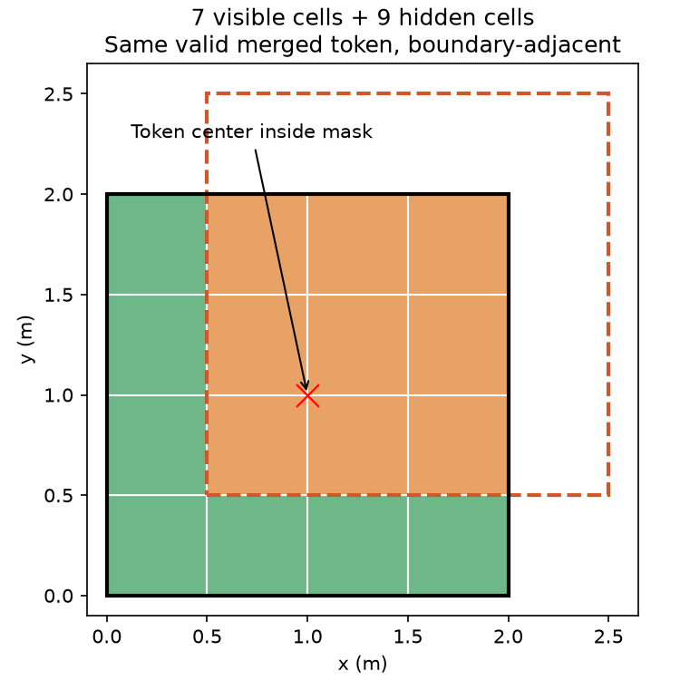

# A边界检索符合性修复

依据已确认规则：使用与遮盖区边或角邻接的有效可见Token，不设固定数量/半径，权重仍为归一化1/(1+d²)。现有实现另外要求Token中心在遮盖区外。这一限制在固定对齐块时不明显，但可变Merge跨遮盖边界后会排除仍有可见输入的相邻Token。

复现：4×4、0.5m原生格，固定r=75%仅作合成几何输入；遮盖[0.5,0.5,2.5,2.5]。绿色7个可见位置属于一个有效合并Token，橙色9个完全隐藏目标。代表区域接触遮盖边界，但中心(1,1)在遮盖区内，旧检索返回空。完整数据见A_boundary_center_reproduction.json；未使用学习式前向或优化器。

修复范围：删除未在确认规则中的中心在外限制。继续使用Token代表区域进行边/角相交检查，保持有效性过滤、相同空间支持定义、全部邻接集合和距离权重；不切换为实际可见区域检索，不添加新的阈值、损失或参数。

这是恢复已确认检索规则的符合性修复，不作为吞吐加速。修复前后的预测/梯度不应要求相同，因为漏检上下文得到补回；应在新规则下重新比较参考与矩阵/批量几何路径。当前GPU计时完成前不修改其依赖源码，避免污染版本证据。其他未冻结项保持原状态。

## 实施及验证结果

新V3使用明确的represented_boundary_v1几何协议；参考索引与批量索引均移除中心在外限制。旧固定模型保留legacy_center_outside协议及原慢参考，未改model.py或删除旧对照。协议版本进入新模型配方及检索缓存键，拒绝无声加载旧配方。首次完整回归暴露了历史慢参考差异，已保留失败JSON；通过隔离历史协议而非放宽容差/删除测试解决。

最小反例现在9个目标均有支持，参考及矩阵输出一致；隐藏反射率替换NaN不改变Encoder输出。修复后完整120项测试通过，无跳过，见A_boundary_engineering_tests.json。性能测量与修复前数据分开，尚待修复后真实完整批次核验。空间多层级与物理视场/遮盖关系的其他待审项不因此关闭。
