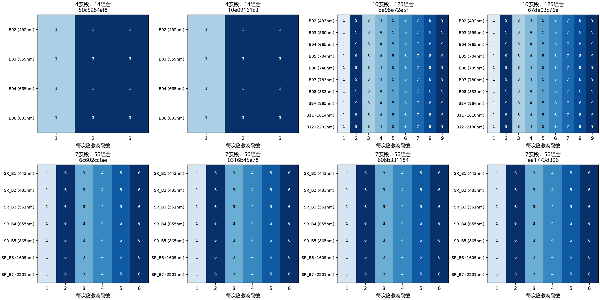

# B1扩展诊断面板：完整执行与边界

使用已确认预检曲线和单轮B、8个原已审VAL成员，沿用此前502个固定组合。覆盖每条真实波段的单隐藏、全部双隐藏；其余隐藏数量采用真实SRF响应加权中心波长顺序的循环连续组合。每次至少保留一个可见波段，不按自定光谱阈值创造输入标签。没有替换旧固定面板、训练采样、调度或选模指标。

| 原生波段数 | 观测数 | 每观测组合数 | 隐藏数量 |
|---|---:|---:|---|
| 4 | 2 | 14 | 1～3 |
| 7 | 4 | 56 | 1～6 |
| 10 | 2 | 125 | 1～9 |

每个小图对应一个观测，纵轴按真实SRF中心波长排序，横轴为隐藏数量。数字是该波段在对应隐藏数量下作为目标出现的次数；全部格子均大于0。波段名称和中心波长仅用于审计展示，不新增学习式输入。

全部502项已执行，1796份逐波段报告均保留原生目标像元集合；所有相同成员/波段跨组合的目标总数相同。结果逐项核对组合身份、目标、可见波段、损失分层均值及有限值，不能只凭502这个总数认为面板完整。原始输出见B1_expanded_gpu.jsonl；配置、源代码哈希和首尾参数哈希见B1_expanded_gpu.json。

完整作业871.43秒，控制作业876.09秒；CPU计划288.30秒、传输1.06秒、包含Encoder内部几何的前向565.50秒。支持监督像元曝光14,336,038，无支持像元曝光0；它们重复计入各组合，并非独立观测数量。峰值分配0.547GiB。

GPU利用率整卡采样10/50/90分位为0.0/1.0/66.0%，最高100%；采样包含桌面等上下文。CPU计划耗时为直接记录的等待来源，Encoder前向还包含CPU几何，不能把前向计时全部视作GPU纯计算。此次是逐组合评估流程，未把小显存或低利用率包装成训练性能改善。

所有参数首尾哈希一致，真实更新0次、无反向或EMA更新。使用固定随机初始化，没有新结构已训练检查点；NMSE、RMSE等数值只用于核验流程与数值，不证明光谱信息保留或重建质量。正式验证面板及科学评价仍须结合最终配置审阅。真实训练累计仍214，剩余186次停止。
