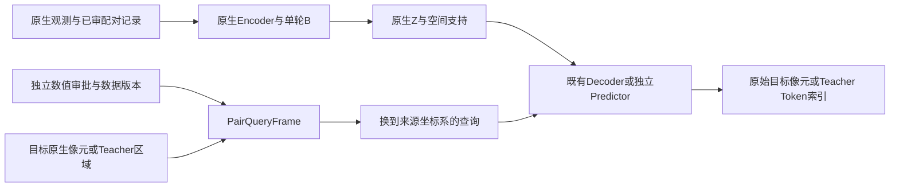

# B2与JEPA查询坐标机制：实施与严格审阅

接入机制已由用户确认，来源B2_geometry_mechanism_confirmation.json。代码只转换跨源查询支持到来源坐标系：S2→Landsat用−Δ，反向用+Δ；Encoder原始波段、原点、Merge成员与Z保持原生。真实候选Δ尚未获数值批准，代码没有将其应用于真实观测，准入仍0。

## 实际连接

- pair_geometry.py提供已审配对Task、哈希绑定的数值记录、共享PairQueryFrame及无学习参数的Decoder调用适配。机制确认文件不能替代偏移数值确认，真实候选尝试使用机制文件时被拒绝。
- Participation监督计划对转换后的查询计算真实交叠与支持数；原生目标索引和QA不变，源几何仍与Encoder输出逐项匹配。任务签名包含配对记录哈希，原生Merge缓存绑定该上下文；绕过新构造器用旧Task携带校正记录会失败，不会静默忽略校正。
- 单观测流式和微批量1/2/4/8均使用同一查询适配调用原有共享162→128→1 Decoder，保留分层损失和全部监督。适配器不拥有新参数，不改变优化器参数集合。
- JEPA仍用原生Student与Teacher前向；只换算Teacher代表区域与查询中心，Teacher Z、SRF/GSD条件及目标Token索引不变，停止梯度。原有A/B稳定、课程终点、独立Predictor、EMA和Decoder梯度隔离条件保留。

source/target原生CRS、Affine、数组与QA均未原地修改；跨投影仍要求已审的共同坐标表达，未加入旋转、缩放、非刚性或按波段分别平移。A/B1不应用配对平移，独立Encoder导出不携带逐对补偿。

## 验证

完整146项工程检查通过、无跳过，详见pair_geometry_final_tests.json和日志。新增9项配对机制检查与4项目录审计检查：

| 核验 | 证据范围 |
|---|---|
| 正反符号与原生不变 | 查询±Δ，Encoder Token与组成员逐值相同，原生目标行列和QA保持 |
| 支持、预测和梯度 | 流式B2与显式查询参考匹配；非整数GSD、分数平移、QA孔洞及无支持缺席 |
| JEPA | 同一几何适配，Teacher原生元数据不变、停止梯度，Decoder无JEPA梯度 |
| 联合执行 | A+B2+JEPA有效批量8、微批量1/2/4/8的曝光、损失、梯度一致 |
| 恢复 | 生成数据上的联合AdamW、EMA、RNG与精确下一步恢复；不计真实预检更新 |
| 标识与统计 | S2的B03/B04与Landsat的SR_B3/SR_B4分开；使用目标传感器TRAIN标准差，不从来源波段字典猜；仅改Band ID不改Token |
| 失效与审批 | 数据/角色/记录/上下文/审批哈希错配拒绝；机制批准不能充当数值批准 |
| 文件审计 | 时间上限后保存pending，不虚报完成；目录项稳定顺序、链接/junction不跟随 |

五个原始模块仍与迁移备份字节一致。固定seed0的Encoder/Decoder参数初始化哈希与先前基线完全相同，未新建学习参数或层；源哈希与数值审批拒绝检查见B2_query_geometry_final_integrity.json。此前145项报告保留，最终146项增加了异源波段标识和目标TRAIN标准差检查。

## 准入与执行边界

合成夹具在临时目录中模拟独立数值审批，仅用生成数据和生成SRF；不代表真实观测已通过QA/配准/时间/变化风险准入。真实平移数值、估计与校准隔离规则、独立验证使用方式和配对清单仍待审。没有创建真实偏移数值审批文件，没有使用VAL目标拟合规则，没有新增训练成员或删除监督。

本轮真实训练更新0，累计214、剩余预算停止；正式训练和任务头训练未启动。新机制的真实大输入B2性能、真实更新/恢复尚未验收，不能把已有A/B1加速或微型GPU夹具当作这些结论。

库存补扫另见discovery_coverage_after_leaf_followup.json：1,560,240个名称，新增1451，1053细分块完成、430块待查；仍未完成本机物理准入。两条工作线相互独立，没有因目录补扫改变训练数据版本。
