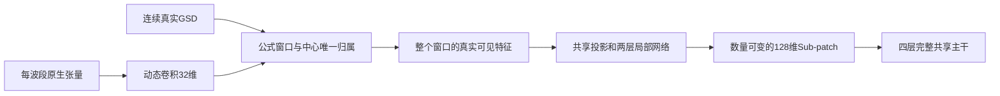
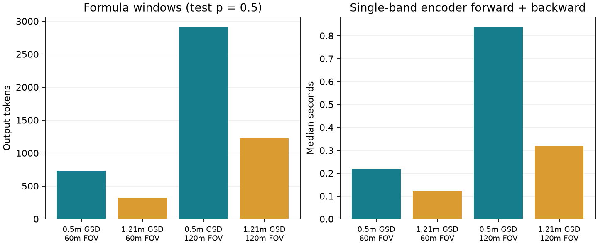
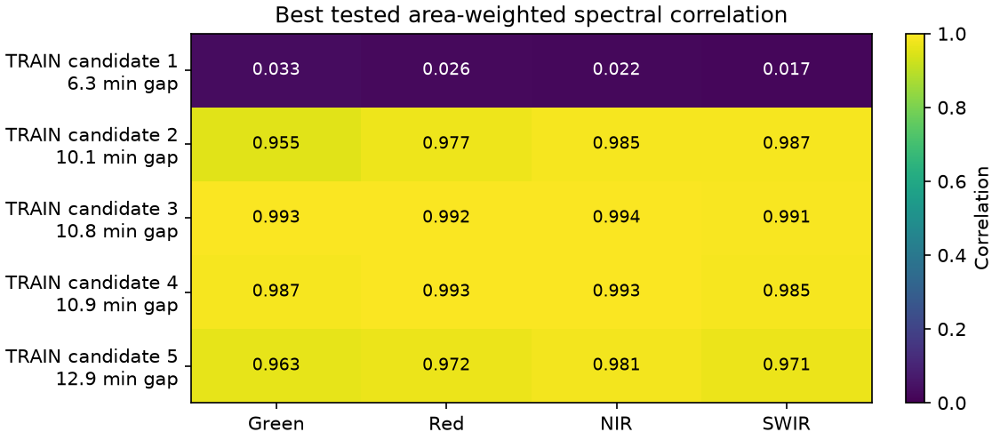

> 最新定义已更新：聚合率是参与合并的输入像元比例，不是Token减少比例。当前候选公式待替换，最新讨论以 [参与率审阅](merge_participation_review.md) 为准；下文旧公式测试仅保留历史证据。

# 连续 GSD 公式窗口：实施与严格审阅

状态：独立工程路径已实现并接入现有重建监督；原始多层级研究设计和正式训练前验收尚未完成。本文件是最新讨论的实施增量，原计划保留。此前 adaptive_merge_design_review.md 中2×2候选树、内容门控和score-function都是被后续讨论替代的候选，没有实现。

## 阅读约定与实际配置

窗口尺度不学习。横纵分别计算 s(g)=max(1,(10/g)^p)，物理窗口为 g·s(g)。按原生像元中心相对共同物理原点的 floor 结果唯一分组；不 round GSD、不重采样、不用60/120m划定Merge窗口，也不额外加入固定2×2分组。10m及以上跨度为一个原生像元。

**p=0.5没有冻结。** 它只是本次合成工程测试的显式值。adaptive_config.json中的正式候选指数为null；构造模型必须显式传入指数；正式训练入口新增Merge配置缺失阻断。

共享聚合网络读取整个实际分组。当前复用既有32→128投影、两层Transformer（128维、4头、FFN512）和CLS读出，全局保留四层完整Self-Attention。CLS只读取当前公式窗口。但两层网络不等于多级空间缩减，本次没有私自增加空间缩减规则。粗分辨率的单像元组仍经过同一个局部网络；没有新增旁路结构。

## 主表：要求与实际

| 要求 | 本次实现与证据 | 审阅结论 |
|---|---|---|
| 每波段动态卷积输出32维 | 复用原生掩码感知卷积和共享Hypernetwork，34→64→320、log-GSD不变 | 已保留 |
| 窗口来自连续GSD公式 | 横纵分别计算；原生中心唯一归属；无固定2×2规则 | 已实现，指数尚未冻结 |
| 共享可学习聚合 | 每个公式窗口全部可见位置进入同一局部网络 | 已接通；真正空间多层级仍待审 |
| 数量可变Sub-patch | 原生网格、公式、有效性决定分组数量 | 已验证；离散Token数不会连续变化 |
| 反射率Decoder和损失 | 新几何接入原检索、共享MLP、按有效目标归一化及分块反向 | A/B1合成全目标损失及梯度对比通过，无新增损失 |
| 空间支持分离 | 完整覆盖、代表区域、实际可见区域、局部/全局感受野分别保存 | 已实现并检查隐藏值隔离 |
| 观测并行 | 新forward_batch明确阻断，不回退旧固定格路径 | 尚未验收 |
| B2、B1扩展与JEPA | 未把QA交叠当合格配对，未新增未经审核成员或伪造训练集成 | 原P0/P1事项保持未完成 |

图中空间窗口来自公式，网络层数不会把窗口改成固定2×2。图中没有表示尚未确认的多级空间缩减。

## GPU高分辨率检查

RTX5090，UUID末尾09ec，FP32；每例预热一次，再测两次中位数。全部是单可见波段合成工程输入，反向目标为潜在平方均值，**零优化器更新**。60/120m仅是诊断视域，不是Merge尺寸；1.21m按完整原生像元保留，实际视域略大，表中分别列出。局部按实际长度执行，无填充。

| GSD(m) | 请求/实际视域(m) | 原生网格 | 局部序列范围，不含CLS | Token | Encoder前后向(s) | 峰值分配显存(GiB) |
|---|---|---|---|---|---|---|
| 0.5 | 60/60 | 120×120 | 16–25 | 729 | 0.217 | 0.313 |
| 1.21 | 60/60.5 | 50×50 | 1–9 | 324 | 0.123 | 0.081 |
| 0.5 | 120/120 | 240×240 | 9–25 | 2916 | 0.840 | 1.183 |
| 1.21 | 120/121 | 100×100 | 4–9 | 1225 | 0.319 | 0.257 |

左图为Token数，右图为Encoder前后向时间；两种颜色对应0.5m与1.21m。测试指数为0.5，仅用于同条件比较。更细分辨率在相近物理视域保留更多Token。该结果不能当作真实多波段有效批量8的完整训练单步时间或数据准入证据。

原始记录见adaptive_window_gpu.json。数据生成、独立几何准备、传输时间和模块CUDA时间线跨度分别记录；CUDA跨度包含启动间隙，不冒称纯算子时间。真实I/O、全监督Decoder、保存、纯算子剖析与利用率分布仍需效率验收。该记录的源码哈希对应保留的传输优化前快照。

## 元数据传输优化与数值边界

将完整覆盖、实际可见区域打包传输后拆回各Token视图，减少逐窗口小拷贝；不删除区域或监督，不缓存可学习特征。

同一个0.5m、120m合成输入、2916个Token、相同权重和510个固定诊断目标，三个计时重复的中位数：原传输0.906秒，打包传输0.764秒，约1.19倍。该目标子集只用于两路径完全匹配的诊断，未改变任何正式训练监督，不能把这个收益与旧模型加速比例相乘。

预测、损失和空间元数据逐位一致；梯度相对L2差3.47e-8。同一路径重复运行最大梯度相对差约3.48e-8和3.14e-8，说明差异与重复波动同量级；具体算子来源尚未定位，不能直接归因。首次要求梯度逐位相同的断言失败保留在adaptive_transfer_bitwise_failure.log。本轮不放宽容差，不宣称新架构的更新/恢复验收通过。完整测量见adaptive_transfer_comparison.json。

## 空间支持契约与接入

- cells：当前输出组中QA有效原生像元的精确并集，供现有Decoder使用；可含组内任务隐藏位置，不能用作输入依赖证明。
- coverage_cells：组中全部原生位置的完整覆盖，包括QA无效或隐藏位置。
- visible_cells：真正送入局部网络的有效可见位置。
- receptive_cells：经原生3×3卷积实际读取的有效可见邻域。
- full_input_cells：完整注意力后所有局部感受野的共享并集表示，每个Z都可能依赖全部输入。
- window_xy_m：连续公式窗口跨度；bounds是代表区域包围盒，均不能替代精确像元并集。

使用AdaptiveWindowEncoder，显式提供exponent和hyper_hidden；prepare_adaptive_task按同一公式生成监督几何；stream_adaptive_task执行重建前后向，不调用optimizer.step。检查点保存公式与架构版本，不同指数或旧模型不能严格加载。旧pilot_fit和task planner保持原义，没有自动切换新架构。

## 测试、保留与未完成项

最终65项工程回归全部通过，跳过0项，见adaptive_window_tests.json。覆盖非整数及横纵不同GSD、唯一归属、10m分界、Token数量响应、隐藏NaN隔离、支持元数据、无效输入、A/B1全目标分块损失与梯度、配置不匹配拒绝、检查点精确重载、正式训练缺项阻断、停止预算保护。

model.py、layout.py、streaming.py、training.py、tasks.py与迁移前备份SHA256一致。gates.py及config.json修改前已保存快照，证据见adaptive_window_audit.json。真实预检仍为214次完成更新，剩余186次不得使用；优化器为AdamW；本轮真实更新为0，正式训练未启动。既有200次拟合日志包有效，但不代表新Merge训练结果。

尚不能判定整体已符合并可正式训练：指数未冻结；真正空间多层级机制未定稿；60/120m采样角色与新A遮盖边界需复审；新架构真实多波段、全目标、有效批量8的效率、参数更新和恢复尚未验收；真实B2配对、B1扩展、跨源JEPA训练集成、全机数据准入仍未完成。没有用私自添加的树、门控、数量惩罚、稀疏注意力、额外更新或正式默认参数补齐。

## 继续推进：完整输入规模、B1面板与真实B2证据

用户重新激活“推进计划”。此前暂停的自动推进限制已解除；214次后停止的真实更新预算、AdamW选择及正式训练门禁继续保留。

**关于10m的新澄清：** 当前候选公式的确让10m及以上不合并相邻位置，但“10m以下称较细分辨率”不自动等于“10m以上必须停止聚合”。用户正在核对这一含义，指数不冻结，停止聚合边界也不作为额外的已确认要求。当前代码和统计只说明这条候选公式的行为。

已对8个TRAIN和8个VAL已审阅成员逐波段读取真实QA/SRF和原生网格，不删成员、不裁剪窗口。全可见Token范围8463–114048；这些成员全部GSD≥10m，因此仅修改p不能改变它们在当前公式下的Token数。最大114048个Token若采用显式四头FP32分数矩阵，**单层单个矩阵约193.82GiB**；这只是数学实现的矩阵估算，不是实测GPU峰值，也不意味着全部融合后端都需要这块显存。完整记录见adaptive_member_census.json。

B1补充了独立、确定性的502个诊断组合：所有单隐藏、所有双隐藏；其余隐藏数量使用按真实SRF响应加权中心波长排序的循环连续组合，去重并始终至少保留一个可见波段。每个观测覆盖1到C−1全部隐藏数量，每条波段在每个数量层次均有隐藏实例。组合顺序来自真实SRF，没有自定VIS/NIR/SWIR分界作为输入标签。旧固定验证面板、训练B1采样和调度指标没有被替换；这些组合尚未执行新模型的质量评价。

完整注意力新增可选执行方式：逐块计算查询，每块仍读取全部K/V；反向使用激活重算，保留完整交互和全部监督。它没有改变Merge窗口或模型参数，默认仍为原参考路径。CPU float64验证了全部输出、输入梯度、参数梯度、RNG、不同行查询块、远距离影响及完整Encoder接入；保存激活中未发现注意力分数块。实现依据[官方SDPA接口](https://docs.pytorch.org/docs/2.11/generated/torch.nn.functional.scaled_dot_product_attention.html)和[激活重算接口](https://docs.pytorch.org/docs/2.11/checkpoint.html)。这仍是未通过GPU数值/更新/恢复/速度验收的工程候选，不能宣称已经提速。

GPU监测出现持续高负载，共享项目登记也存在其他训练；没有启动新路径的GPU性能作业。全套回归运行73项全部通过，报告显示现有微型GPU夹具也实际执行了，不能称该整套回归为纯CPU测试。PowerShell中空CUDA_VISIBLE_DEVICES会被移除，今后隔离CPU测试使用-1；新注意力路径本身目前只有CPU数学检查。该回归不替代其GPU验收。

B2不再只有QA交叠证据：已对五个真实TRAIN候选进行原生面积加权的跨源几何偏移诊断。显式检查绿色、红色、近红外和短波红外四个真实波段对，每轴测−20/−10/0/10/20m，共25种偏移。只有诊断聚合，没有更改反射率文件或生成新的训练网格；相关性、RMSE、偏差、纹理标准差及真实支持面积均保留。队列按既有采集间隔排序，仅是本次检查顺序，不是最近源教师规则或时间准入阈值。

| S2源产品 | 时间差(分钟) | 四波段最佳测试相关范围 | 最佳测试位移集合(dx,dy,m) |
|---|---|---|---|
| S2A_39WWU_20240706_0_L2A | 6.29 | 0.017–0.033 | [(0.0, 20.0), (10.0, 10.0), (10.0, 20.0)] |
| S2B_11VPK_20240809_0_L2A | 10.06 | 0.955–0.987 | [(0.0, 0.0)] |
| S2B_53HPE_20241204_0_L2A | 10.80 | 0.991–0.994 | [(0.0, 0.0)] |
| S2A_50JNP_20241223_0_L2A | 10.95 | 0.985–0.993 | [(0.0, 0.0)] |
| S2B_31UFT_20200731_0_L2A | 12.92 | 0.963–0.981 | [(0.0, 10.0)] |

图中每行对应上表同序候选，每列对应一个光谱区域；展示的是测试偏移范围内最高的面积加权相关性。第一对即使QA空间交叠为正、时间仅相差约6分钟，相关性仍很低且纹理标准差很小，无法据此确认配准。其余三对在四波段中均以零偏移取得最高测试相关；第五对四波段均为(0,10m)。这些是进一步审阅证据，不直接等于准入、原生网格修正或无地表变化证明。常量地表测试还发现并修复了浮点均值残差导致假相关的问题，现以先减参考值再加权中心化正确处理无纹理区域。

原始候选、QA支持、处理域、S2校准修订、缓存哈希、SRF响应中心、每个偏移的结果见pair_registration_diagnostics/index.json及所链接文件。四个Landsat成员仍只有父缓存QA谱系，第五对有原生TIF/QA谱系；独立QA、处理版本、时间/变化风险及注册政策仍需复审。349个原元数据候选全部保留，**当前仍是0个V3准入配对**。

状态生成器已修正：不再建议继续两种优化器拟合；明确显示AdamW、真实214次更新、剩余186次不可用，并把历史固定物理块的加速证据与自适应架构区分。完整计划未完成，M0、Merge最终规则、GPU效率、真实B2、JEPA集成及正式配置仍是下一步工作；没有开启正式训练。
