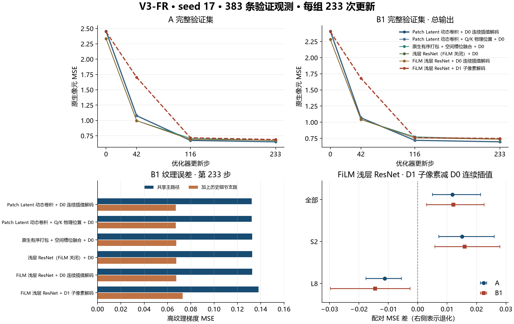
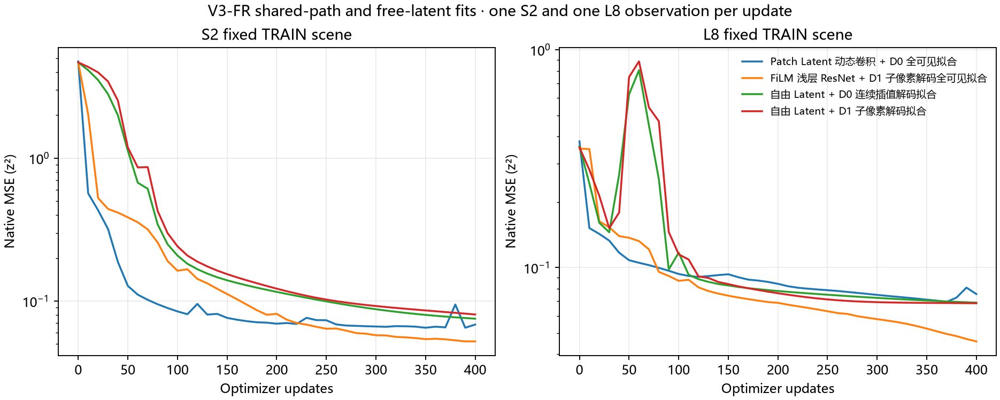

# V3-FR 实验图集

[报告](../summary/REPORT.md) · [完整 PDF](V3-FR.pdf)

B1 总输出等于共享主路径输出加上历史 B1 细节支路贡献。A 的支路贡献为零。

| 实验模型 | 完整结构 | 追溯 ID |
| --- | --- | --- |
| Patch Latent 动态卷积 + D0 历史权重复算 | 历史动态卷积与光谱 Query 融合 → 原三阶段压缩全局 Transformer → D0 连续插值解码。读取历史正式权重。 | `S1-REPLAY` |
| Patch Latent 动态卷积 + D0 全可见拟合 | 历史动态卷积与光谱 Query 融合 → 原三阶段压缩全局 Transformer → D0 连续插值解码。关闭历史 B1 细节支路。 | `AE-L` |
| FiLM 浅层 ResNet + D1 子像素解码全可见拟合 | 原生有序打包 → 两块 FiLM 浅层 ResNet → 空间槽位融合 → 原三阶段压缩全局 Transformer，Q/K 注入物理位置 → D1 子像素展开与局部残差细化。关闭历史 B1 细节支路。 | `AE-F` |
| 自由 Latent + D0 连续插值解码拟合 | 每条拟合观测独立优化多尺度 Latent，替代完整 Encoder → D0 连续插值解码。关闭历史 B1 细节支路。 | `OR-D0` |
| 自由 Latent + D1 子像素解码拟合 | 每条拟合观测独立优化多尺度 Latent，替代完整 Encoder → D1 子像素展开与局部残差细化。关闭历史 B1 细节支路。 | `OR-D1` |
| Patch Latent 动态卷积 + D0 连续插值解码 | 历史 7×7、步幅 4 的动态卷积与光谱 Query 融合 → 原三阶段压缩全局 Transformer → D0 连续插值解码。 | `B0` |
| Patch Latent 动态卷积 + Q/K 物理位置 + D0 | 历史动态卷积与光谱 Query 融合 → 原三阶段压缩全局 Transformer，Q/K 注入物理位置 → D0 连续插值解码。 | `BP` |
| 原生有序打包 + 空间槽位融合 + D0 | 原生有序打包与内容升维 → 空间槽位融合 → 原三阶段压缩全局 Transformer，Q/K 注入物理位置 → D0 连续插值解码。ResNet 块数为 0，FiLM 关闭。 | `N0` |
| 浅层 ResNet（FiLM 关闭）+ D0 | 原生有序打包 → 两块浅层 ResNet，FiLM 关闭 → 空间槽位融合 → 原三阶段压缩全局 Transformer，Q/K 注入物理位置 → D0 连续插值解码。 | `N1` |
| FiLM 浅层 ResNet + D0 连续插值解码 | 原生有序打包 → 两块 FiLM 浅层 ResNet → 空间槽位融合 → 原三阶段压缩全局 Transformer，Q/K 注入物理位置 → D0 连续插值解码。 | `N2` |
| FiLM 浅层 ResNet + D1 子像素解码 | 原生有序打包 → 两块 FiLM 浅层 ResNet → 空间槽位融合 → 原三阶段压缩全局 Transformer，Q/K 注入物理位置 → D1 子像素展开与局部残差细化。与 D0 父组仅解码末端不同。 | `C` |
| Patch Latent 动态卷积 + Q/K 物理位置 + D1 | 历史动态卷积与光谱 Query 融合 → 原三阶段压缩全局 Transformer，Q/K 注入物理位置 → D1 子像素展开与局部残差细化。已登记，未执行。 | `PD` |

## 验证与拟合曲线

## S6 固定样本

- [S6 · S2 · A · 第 233 步](S6_233_S2_A.png)
- [S6 · S2 · B1 · 第 233 步](S6_233_S2_B1.png)
- [S6 · L8 · A · 第 233 步](S6_233_L8_A.png)
- [S6 · L8 · B1 · 第 233 步](S6_233_L8_B1.png)
- [S6 · S2 · A · 第 0 步](S6_000_S2_A.png)
- [S6 · S2 · B1 · 第 0 步](S6_000_S2_B1.png)
- [S6 · L8 · A · 第 0 步](S6_000_L8_A.png)
- [S6 · L8 · B1 · 第 0 步](S6_000_L8_B1.png)

## S5 拟合与只读样本

- [S5 · S2 · 第 400 步](S5_S2.png)
- [S5 · L8 · 第 400 步](S5_L8.png)
- [S5 · S2 · 只读样本 · 第 400 步](S5_read_only_S2.png)
- [S5 · L8 · 只读样本 · 第 400 步](S5_read_only_L8.png)
- [S5 · L9 · 只读样本 · 第 400 步](S5_read_only_L9.png)
- [S5 · EnMAP · 只读样本 · 第 400 步](S5_read_only_EnMAP.png)

## 逐对照与历史复算

- [FiLM 浅层 ResNet · D1 与 D0 配对 · A](s6_D1_paired_A.png)
- [FiLM 浅层 ResNet · D1 与 D0 配对 · B1](s6_D1_paired_B1.png)
- [Patch Latent 动态卷积 + D0 历史权重复算 · obs_44339c03577562c444a1557f_A](figures/obs_44339c03577562c444a1557f_A_historical.png)
- [Patch Latent 动态卷积 + D0 历史权重复算 · obs_44339c03577562c444a1557f_B1](figures/obs_44339c03577562c444a1557f_B1_historical.png)
- [Patch Latent 动态卷积 + D0 历史权重复算 · obs_5929ceec240fa570c7a1a784_A](figures/obs_5929ceec240fa570c7a1a784_A_historical.png)
- [Patch Latent 动态卷积 + D0 历史权重复算 · obs_5929ceec240fa570c7a1a784_B1](figures/obs_5929ceec240fa570c7a1a784_B1_historical.png)
- [Patch Latent 动态卷积 + D0 历史权重复算 · obs_64d10dd286169cf55d8668ac_A](figures/obs_64d10dd286169cf55d8668ac_A_historical.png)
- [Patch Latent 动态卷积 + D0 历史权重复算 · obs_64d10dd286169cf55d8668ac_B1](figures/obs_64d10dd286169cf55d8668ac_B1_historical.png)
- [Patch Latent 动态卷积 + D0 历史权重复算 · obs_d79258948b4971ffeee52a14_A](figures/obs_d79258948b4971ffeee52a14_A_historical.png)
- [Patch Latent 动态卷积 + D0 历史权重复算 · obs_d79258948b4971ffeee52a14_B1](figures/obs_d79258948b4971ffeee52a14_B1_historical.png)
- [Patch Latent 动态卷积 + D0 历史权重复算 · obs_fc9ee76c5ea9ed0d024924be_A](figures/obs_fc9ee76c5ea9ed0d024924be_A_historical.png)
- [Patch Latent 动态卷积 + D0 历史权重复算 · obs_fc9ee76c5ea9ed0d024924be_B1](figures/obs_fc9ee76c5ea9ed0d024924be_B1_historical.png)
- [Patch Latent 动态卷积 + Q/K 物理位置 + D0 · A · obs_5929ceec240fa570c7a1a784](figures/s6_BP_obs_5929ceec240fa570c7a1a784_A.png)
- [Patch Latent 动态卷积 + Q/K 物理位置 + D0 · B1 · obs_5929ceec240fa570c7a1a784](figures/s6_BP_obs_5929ceec240fa570c7a1a784_B1.png)
- [Patch Latent 动态卷积 + Q/K 物理位置 + D0 · A · obs_64d10dd286169cf55d8668ac](figures/s6_BP_obs_64d10dd286169cf55d8668ac_A.png)
- [Patch Latent 动态卷积 + Q/K 物理位置 + D0 · B1 · obs_64d10dd286169cf55d8668ac](figures/s6_BP_obs_64d10dd286169cf55d8668ac_B1.png)
- [FiLM 浅层 ResNet + D1 子像素解码 · A · obs_5929ceec240fa570c7a1a784](figures/s6_C_obs_5929ceec240fa570c7a1a784_A.png)
- [FiLM 浅层 ResNet + D1 子像素解码 · B1 · obs_5929ceec240fa570c7a1a784](figures/s6_C_obs_5929ceec240fa570c7a1a784_B1.png)
- [FiLM 浅层 ResNet + D1 子像素解码 · A · obs_64d10dd286169cf55d8668ac](figures/s6_C_obs_64d10dd286169cf55d8668ac_A.png)
- [FiLM 浅层 ResNet + D1 子像素解码 · B1 · obs_64d10dd286169cf55d8668ac](figures/s6_C_obs_64d10dd286169cf55d8668ac_B1.png)
- [原生有序打包 + 空间槽位融合 + D0 · A · obs_5929ceec240fa570c7a1a784](figures/s6_N0_obs_5929ceec240fa570c7a1a784_A.png)
- [原生有序打包 + 空间槽位融合 + D0 · B1 · obs_5929ceec240fa570c7a1a784](figures/s6_N0_obs_5929ceec240fa570c7a1a784_B1.png)
- [原生有序打包 + 空间槽位融合 + D0 · A · obs_64d10dd286169cf55d8668ac](figures/s6_N0_obs_64d10dd286169cf55d8668ac_A.png)
- [原生有序打包 + 空间槽位融合 + D0 · B1 · obs_64d10dd286169cf55d8668ac](figures/s6_N0_obs_64d10dd286169cf55d8668ac_B1.png)
- [浅层 ResNet（FiLM 关闭）+ D0 · A · obs_5929ceec240fa570c7a1a784](figures/s6_N1_obs_5929ceec240fa570c7a1a784_A.png)
- [浅层 ResNet（FiLM 关闭）+ D0 · B1 · obs_5929ceec240fa570c7a1a784](figures/s6_N1_obs_5929ceec240fa570c7a1a784_B1.png)
- [浅层 ResNet（FiLM 关闭）+ D0 · A · obs_64d10dd286169cf55d8668ac](figures/s6_N1_obs_64d10dd286169cf55d8668ac_A.png)
- [浅层 ResNet（FiLM 关闭）+ D0 · B1 · obs_64d10dd286169cf55d8668ac](figures/s6_N1_obs_64d10dd286169cf55d8668ac_B1.png)
- [FiLM 浅层 ResNet + D0 连续插值解码 · A · obs_5929ceec240fa570c7a1a784](figures/s6_N2_obs_5929ceec240fa570c7a1a784_A.png)
- [FiLM 浅层 ResNet + D0 连续插值解码 · B1 · obs_5929ceec240fa570c7a1a784](figures/s6_N2_obs_5929ceec240fa570c7a1a784_B1.png)
- [FiLM 浅层 ResNet + D0 连续插值解码 · A · obs_64d10dd286169cf55d8668ac](figures/s6_N2_obs_64d10dd286169cf55d8668ac_A.png)
- [FiLM 浅层 ResNet + D0 连续插值解码 · B1 · obs_64d10dd286169cf55d8668ac](figures/s6_N2_obs_64d10dd286169cf55d8668ac_B1.png)
