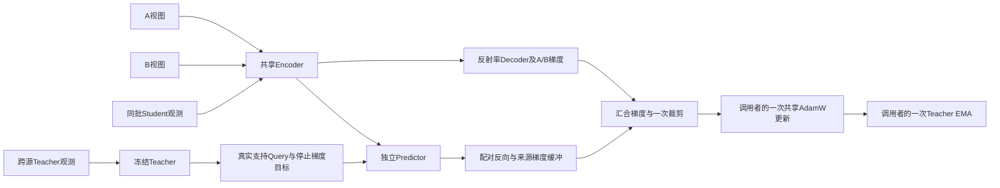

# A/B与JEPA联合梯度：有效批量8工程验收

状态：联合梯度流程及合成更新/恢复验收通过，尚未准入真实训练。实现为adaptive_joint.py，测试为test_adaptive_joint.py，原始证据为jepa_joint_integration_evidence.json。

## 实际行为

输入仍是八个不同观测，每个提供一个A和一个B视图，沿用既有任务几何与来源分层权重。A/B可见输入分别执行Encoder，不共用错误的可见特征。JEPA配对的Student只能来自同一批八个成员，Teacher目标ID另行记录，不新增Student成员或实验路线。

每次先累积A/B梯度，再逐个处理合格配对。潜在损失必须由调用者显式提供，并负责已审阅的Token/波段内部归一化；没有自动采用MSE、额外数量正则或其他科学损失。JEPA在实际有支持的观测内按来源分别累计，再对来源等权平均。无支持配对以loss=None记录，排除归一化，不记为零损失。

为了在排除无支持后仍正确归一，不同时保留八个JEPA计算图，而使用来源梯度缓冲；每个配对反向后释放图，最后将归一化JEPA梯度加回A/B梯度。Decoder的A/B梯度保持独立；公共梯度裁剪只在全部任务合并后执行一次。累积接口不调用optimizer.step或EMA，调用者在一个完整全局更新后执行一次AdamW及EMA。

图中Teacher目标反射率只进入Teacher，Predictor不读取该数组；Decoder不接收JEPA梯度。未复用A/B不同遮盖下的Encoder输出，也未跨更新缓存可学习张量。

当前接口仅接既有2000次A/B课程，且必须明确传入稳定检查通过、相同课程终点、JEPA权重和损失函数。不能仅把JEPA的结束参数改成1000就提前启用。若未来正式课程经评审更改，需要同步修改并重新验收，不作为隐含自由参数。

## 已验证范围

| 检查 | 条件与结果 |
|---|---|
| 全局批量和缺席处理 | 8个输入，合成8个配对中1个无支持，余下来源数量3/4；缺席损失为None |
| 梯度归一 | 联合结果与独立计算的来源/观测加权总梯度一致 |
| Decoder/Teacher隔离 | Decoder梯度逐位等于纯A/B路线；Teacher无梯度 |
| 共同更新与恢复 | CPU生成夹具共享AdamW、EMA；断点后下一步模块和优化器矩、RNG/成员游标一致 |
| GPU接口 | CPU监督计划配GPU源/目标张量，Encoder/Decoder/Predictor梯度均有限；GPU零优化器更新 |
| 曝光追溯 | 保存成员、A矩形、隐藏波段、可见波段、目标索引SHA256、任务和跨源配对签名 |

完整回归83项通过，0跳过。随后补充追溯字段后又执行4项定向检查，全部通过。CPU完整联合恢复夹具每次运行含3次生成数据更新；它们不属于真实预检。真实账本仍214次完成，剩余186次未授权使用，正式训练未启动。

## 不宣称完成的内容

本次使用生成张量和明确标注的合成准入字典，不能据此把任何真实配对升级为合格。正式潜在损失/波段内部归一、Query条件投影及稳定窗口仍未冻结，required_before_jepa保持缺项。

现有窗口Encoder仅充当工程夹具，未选择参与率曲线或新的相邻分组机制。最终Merge完成后，必须在其实际原生支持上重新验收联合流程和资源，不能以本次检查替代。83项回归也不代表真实有效批量8的完整吞吐或真实数据GPU更新/恢复通过。
