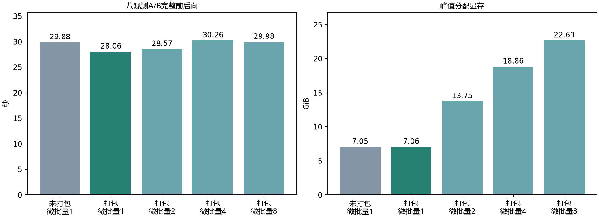
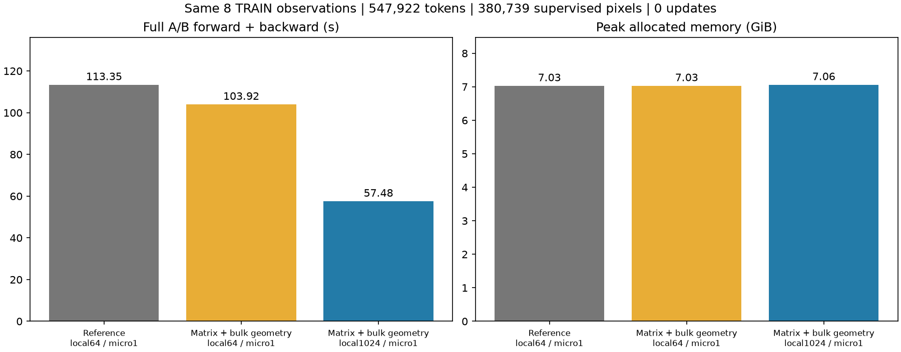

# 当前A规则下的八观测执行检查

此段为当前有效结论；下方历史结果保留原测量边界。参与率曲线已由用户冻结用于预检，全精度系数与此次实测逐项一致；原始报告的curve_frozen=false记录的是确认前的状态，未回写历史。单轮B保留原生与合并两个尺度已确认，不再把递归聚合列为缺项。

同一8个已审TRAIN观测、相同原生窗口、A矩形/B1隐藏与目标、547922个Token、380739个监督像元、FP32和完整注意力。A使用represented_boundary_v1。每次有效批量8、填充0；全部行保持局部批量1024、矩阵A、批量几何和Decoder分块16384。下表只比较打包输出与观测微批量。

| 执行方式 | 计时次数 | 前后向秒 | 峰值GiB | 观测/秒 | 监督像元/秒 | GPU利用率中位数 |
|---|---:|---:|---:|---:|---:|---:|
| 未打包，微批量1 | 2 | 29.88 | 7.05 | 0.268 | 12740 | 80.5% |
| 打包，微批量1 | 2 | 28.06 | 7.06 | 0.285 | 13569 | 79.0% |
| 打包，微批量2 | 1 | 28.57 | 13.75 | 0.280 | 13328 | 71.5% |
| 打包，微批量4 | 1 | 30.26 | 18.86 | 0.264 | 12583 | 31.0% |
| 打包，微批量8 | 1 | 29.98 | 22.69 | 0.267 | 12701 | 100.0% |

左图是前后向计时，右图为PyTorch峰值分配量。微批量1两次取中位数，其余仅一次；显存不是整卡占用。GPU利用率约每5秒采整卡，逐行样本量及10/50/90分位见participation_current_execution_evidence.json，包含桌面等上下文，不能据此独立判断具体算子瓶颈。

打包使微批量1由29.88秒降至28.06秒，约1.065倍；微批量2/4/8本次均未显示吞吐收益，显存升至13.75/18.86/22.69GiB。现有证据支持继续以微批量1作为执行候选，不因32GiB容量而填满显存。不把本组收益与旧轮次1.97倍或单观测1.18倍相乘。

预测最大绝对差3.875e-7、逐波段NMSE差2.002e-6、任务损失差1.166e-7、梯度相对差2.499e-7，均低于已有对应FP32数值，仅作为本次描述性诊断。所有参数首尾SHA256相同，真实优化器更新0次；累计真实更新仍214。尚无新结构真实参数更新及恢复对比，不宣称已通过整个加速验收。

控制作业426.78秒，包括预热与7次计时；首次CPU读取0.138秒、计划7.435秒、传输0.049秒另记。这些数字不能直接组成正式训练每步或完整实验成本。尚未测量包含优化器、验证和保存的端到端训练吞吐。默认仍局部64、微批量1、参考Decoder、打包关闭，待剩余执行验收；不启动已停止的更新预算。

现有120项全套工程测试通过、无跳过，模型/几何计算源与该测试版本一致。本次仅同步确认记录、执行报告与状态；没有改动学习参数、架构、成员、遮盖、目标或容差。B2合格配对仍0，数据准入、视场与遮盖关系、最终执行及稳定标准仍需解决。

原始测量：participation_current_rule_sweep.json；受控退出：participation_current_rule_controller.json；汇总与哈希：participation_current_execution_evidence.json。

---

## 以下为历史执行证据（不同版本，不能混作当前排名）
# 新Merge执行优化与验收边界

## 设置与变更范围

同一已审TRAIN八成员、相同完整原生窗口、相同A矩形/B1隐藏波段、相同随机初始化和FP32。每个全局批次仍为8个观测，分别执行A/B，不共用不同可见输入的Z；共547922个Token、380739个监督像元。数字为完整A/B前后向，包含内部几何及诊断记录，不含首次读取、计划、传输、优化器、日志保存或训练更新。不是正式一步耗时。

仅改变执行：按真实局部序列长度合批，观测之间保持独立注意力；A读出使用同一邻接集合和1/(1+d²)归一化权重的矩阵聚合，避免Q×K×128特征展开；物理元数据筛选可批量在CPU处理，学习式特征不搬到CPU。共享162→128→1 MLP、局部及全局Transformer和所有学习参数不增加。A几何支持计数仅在一个邻居对全部目标具有严格正权重时直接计数，否则回到原精确检索。

## 同进程已完成结果

| 配置 | 前后向秒 | 对参考倍数 | 峰值分配GiB | GPU利用率中位数 |
|---|---|---|---|---|
| 参考：局部64，单观测，Decoder分块512 | 113.35 | 1.00 | 7.03 | 8.5% |
| 矩阵A+批量几何：局部64，单观测，分块16384 | 103.92 | 1.09 | 7.03 | 8.5% |
| 矩阵A+批量几何：局部1024，单观测，分块16384 | 57.48 | 1.97 | 7.06 | 12% |

两图分别为计算时间和分配显存；所有行保持相同成员、Token及监督。对照包含Decoder分块、局部合批及几何执行方式的组合变化，不能把1.97倍全部归因于某一项。每配置只完成一次计时（此前有预热），需重复确认稳定收益。显存数值为PyTorch分配量，不是显卡全部使用量；利用率来自整卡采样，包含桌面等上下文。

最快已完成配置的预测最大绝对差1.3635e-6、最大逐波段NMSE差3.6495e-6、最大任务损失差1.0597e-7、梯度相对差1.3029e-7，低于现有对应FP32数值限制；没有放宽容差。其作用域仅为此次诊断，不据此扩展原单卡验收授权或宣称更新恢复通过。

CPU计划准备本轮16.57秒，先前含笛卡尔A支持计数的匹配集合为78.73秒。两次含文件缓存、运行轮次差异，不直接相乘为总体加速。读取0.254秒、传输0.082秒另记。

## 失败、未完成和成本

首次大分块参考在24GiB诊断上限下失败。错误栈定位A聚合：目标10080，邻接关系22196160条，展开128维特征的单个张量约10.58GiB。24GiB上限的失败不是整张32GiB卡不可运行的证据。原参考分块512能够完成；矩阵聚合保留全部邻接和监督后可运行大分块。

上一轮矩阵A但未批量处理几何的比较达到900秒上限，保存的微批量2结果为65.83秒；这是另一执行版本，不与本轮57.48秒拼接成完整微批量排名。本轮原exec句柄丢失后，实际检查确认PID47848不存在，GPU1空闲；原RUNNING文件已单独核对为INTERRUPTED_WORKER_MISSING。实际退出码、原因及总墙钟成本不可恢复，未把空档时间记作GPU运算成本。

本轮只有上述3项完整结果。微批量2/4/8没有完整本轮计时，均为未完成，不写成OOM或通过。全程没有重启GPU、重建环境、恢复旧训练队列或更新真实参数。真实更新累计214，剩余186次不使用。中断前未得到最终参数哈希，不能将其记录为首尾哈希一致验证。

## 完整回归与剩余瓶颈

完整工程回归116项通过，无跳过，见participation_batch_engineering_tests.json；覆盖合批隔离、可变长度、隐藏值隔离、支持计数、MLP预测/梯度、A/B+JEPA源平衡、合成AdamW/EMA及精确恢复。合成更新不计真实预检次数，不能替代真实GPU参数更新/恢复验收。最终全套回归明确绑定GPU1的UUID；性能检查同样绑定GPU1。

GPU利用率中位数仍仅8.5%–12%。针对导致大展开的同一个已审A观测补做CPU调度/Python剖析：52922个Token，单次带剖析执行7.66秒；记录11485次cudaLaunchKernel、159641次aten::select、431677次aten::as_strided，以及局部组遍历/拆分。Python布局函数10次累计0.772秒；Tensor遍历累计0.418秒，split_with_sizes累计0.268秒。不同剖析器的累计时间有重叠，不能相加当作总瓶颈比例。110次前后向高效注意力调用包含局部和全局，不是仅全局层数。该观测未退回数学注意力。

这提供大量细粒度调度及布局开销的直接证据，但尚不能完整解释八观测所有低利用率阶段。下一步应针对已测出的逐Token拆分/拼接及重复布局准备进行等价执行优化和匹配剖析，不通过扩大有效批量、稀疏化注意力或删减监督提高数字。

## 严格审阅与未冻结项

默认仍为参考Decoder、局部64和观测微批量1；矩阵/批量几何与更大局部批次均保留为显式候选。未增加网络层、学习式窗口、内容门控、损失或训练组。快支持计数是相同支持判定的计算化简，不修改目标集合。

参与率曲线、递归空间多层级及60/120m与遮盖的新关系仍未冻结。A检索目前继承边界相交和中心在遮盖区外的判断；新窗口跨遮盖边界时，代表区域/实际可见区域的解释仍需复审，本次数值对照沿用同一规则，不能替代该项设计验收。B2仍未准入、真实更新恢复、双卡/路线并行及完整实验成本仍不完整，因此正式训练入口继续阻断。
