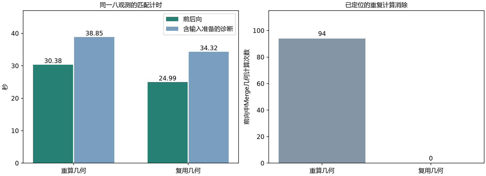

# 单任务Merge几何复用：实施、性能与严格审阅

监督计划此前已完整计算分组、有效代表区域及邻接支持，Encoder又为同一任务重算。新增retain_layouts执行候选，默认False；每份计划只保留该任务的确定性几何，前向仍运行真实SRF编码、Hypernetwork、原生动态卷积、共享局部网络、完整全局注意力和Decoder。

## 缓存边界

复用绑定完整任务签名及元数据版本、原生形状/CRS/Affine、QA与可见状态、真实SRF样本、物理原点、曲线、选组种子、A矩形/隐藏波段/目标和physical_patch_m。实际数据使用冻结清单与cache_sha256；合成夹具必须显式给出geometry_data_version。P60/P120只作为已有采样/遮盖上下文的缓存标识，不进入GSD→r→s公式；测试确认两种标识下Merge成员相同。None明确表示当前任务不适用该物理Patch字段。

不缓存可学习SRF编码、动态权重、局部输出或Z。纯几何可跨权重更新继续使用，所有学习计算及其梯度每次重新执行。A/B分开持有自己的计划，不合并可见输入或Encoder结果。数据、遮盖或上下文错配时拒绝旧计划；不序列化这些临时几何作为模型权重。

## 同进程真实八观测检查

同一8个已审TRAIN观测、相同完整原生窗口、A矩形/B1隐藏波段/目标、随机初始化、FP32、裁剪3、有效批量8、执行微批量1。两路径共同使用局部1024、打包输出、矩阵A、批量几何、Decoder分块16384；唯一比较项是几何复用。初始化与先前当前A规则测量逐参数相同。每路径一次预热、两次匹配计时，无真实优化器更新。

| 项目 | 重算几何 | 复用几何 |
|---|---:|---:|
| 前后向中位秒 | 30.38 | 24.99 |
| 含输入准备的诊断中位秒 | 38.85 | 34.32 |
| CPU规划中位秒 | 8.16 | 8.28 |
| 峰值分配GiB | 7.055 | 7.055 |
| 保留的NumPy载荷MiB | 0.00 | 253.04 |
| 前后向观测/秒 | 0.263 | 0.320 |
| 前后向监督像元/秒 | 12534 | 15236 |
| 整卡GPU利用率中位数% | 4.0 | 39.0 |

左图为两次计时的中位数，右图为前向中的实际几何函数调用数94→0。前后向提速1.216倍，含输入准备的诊断提速1.132倍。该结果只来自本轮同进程对照；不与此前打包或历史模型加速结果相乘。

两路径均547922个Token、380739个支持监督像元，填充0、成员/目标/曝光及分层归一化一致。最大预测差2.981e-7、梯度相对差3.479e-8、逐波段NMSE差9.571e-8、任务损失差1.174e-8，均低于已有对应FP32数值，仅作本次诊断，不扩展原验收范围。首尾参数SHA256相同，真实更新0。

显存保持约7.055GiB。253.04MiB为缓存所引用的唯一NumPy载荷，部分可与计划既有几何共享；既不含Python容器，也不是完整或必然等额新增的主存占用。端到端诊断包含这项载荷统计、显存清理/峰值重置和预测收集，排除优化器、验证与保存，不能当作正式训练一步或完整实验成本。

GPU利用率来自整卡约5秒采样，含桌面等上下文，参考与候选样本量16/14，完整10/50/90分位在retained_geometry_execution_evidence.json。仍有约8.28秒CPU规划，前向也含元数据和几何调度；尚未对其余算子作完整GPU耗时归因。

完整控制作业229.12秒，包括两次预热、四次计时及诊断；不据此推算正式更新步数或把CPU/GPU时间重复相加。

## 测试与符合性

完整133项工程回归通过，无跳过；新增8项覆盖CPU/GPU输出和梯度、隐藏值隔离、全无效输入、非整数与非方形GSD、164个可见波段、P/版本/网格/QA/遮盖/曲线/原点失效、微批量1/2/4/8的分层损失，以及微型合成AdamW更新、EMA和精确下一步恢复。合成夹具不是实际预检更新。旧五个核心模块保持迁移备份字节一致，未增加学习参数、层、门控、稀疏化、监督裁剪或训练组。

本轮仅落实原计划允许的几何复用。留存源快照可还原此前125项/旧性能报告的执行版本，未改写历史原始数字。完整源哈希、逐次计时和限制见participation_geometry_reuse_sweep.json、retained_geometry_engineering_tests.json。

## 尚未完成的条件

没有新架构真实参数更新/恢复对照；受用户停止预算约束，本次不补跑。故保留参考默认，几何复用仍作为执行候选。未证明所有来源、P、成员和精度的普遍收益；没有BF16、编译或多卡结论。B2校正机制仍待用户选择，配对准入0；最终数据、视场/遮盖关系、稳定与执行配置等门禁未完成。正式训练未启动，真实更新累计仍214。
