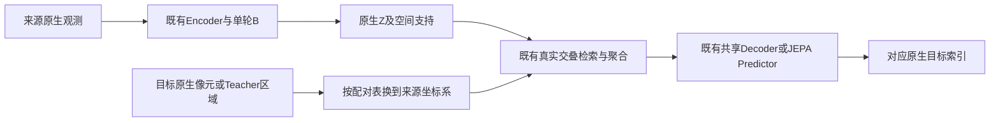

# B2配对平移：具体方案待审

用户已允许先审具体方案，确认记录见B2_geometry_proposal_confirmation.json。本文件和B2_pair_geometry_proposal.json仅为提案，不批准任何平移数值、QA/时间/配准阈值或配对准入，不启动训练。

## 1. 校正放在跨源检索，不放在Encoder前

每个观测仍以原始反射率、QA、CRS/Affine、GSD和原点进入Encoder。动态卷积、GSD→r→窗口→单轮B的组成员及原生/合并双尺度均保持原样。不能先把S2的Affine和原点一起平移后再编码：当前B的确定性选组散列包含物理原点，这样可能改变选中的组，超出本次配对几何校正范围。

**推荐仅把目标查询框换到来源坐标系。** 这样既不重算或改变Merge，也不平移任何原始数组、QA或Affine，不需要把全量Token几何复制成第二份。

## 2. 平移方向和双向等价关系

先将两端表达为同一个已审、以米为单位的投影坐标系。当前提案只涉及同CRS或既有UTM假北移的精确坐标表达；跨投影、旋转、缩放、非刚性变形不在本提案内。

定义相对平移Δ=(dx,dy)：S2原生区域R在配对参考框架中表示为R+Δ，Landsat区域保持其原生表达。dx>0向东、dy>0向北。Landsat只是定义符号的坐标锚点，不改变两方向等概率，不指定教师传感器。

- **S2→Landsat：** 来源Token区域R_S保持原生，Landsat目标框Q_L在检索时改为Q_L−Δ。
- **Landsat→S2：** 来源Token区域R_L保持原生，S2目标框Q_S在检索时改为Q_S+Δ。

这是等价坐标变换：area((R_S+Δ)∩Q_L)=area(R_S∩(Q_L−Δ))。中心差、相对位置和交叠面积在同一坐标系计算；共享MLP不变，仍按真实面积归一化。框[l,b,r,t]只加减[dx,dy,dx,dy]，GSD、边长和原生像元值不变。

输出仍写回目标原来的行列索引；平移改变空间对应，不改变预测数量、目标像元集合或原生输出网格。A和B1完全沿用原始几何，不读取该表。

## 3. 每对共享一个向量，不能逐波段各自移动

建议每对观测共用一个Δ，绿色、红色、近红外、短波红外仅用于离线配准诊断。可审的估计准则为四组波段的双向相关性等权平均：正向用Δ，反向用−Δ，沿用既有−15～15m、步长2.5m的169点诊断网格。

此准则和网格仍是候选，既不进入Encoder，也不是新训练损失；2.5m不是模型GSD档位、精度保证或统计误差界。原分波段最大相关的位置不直接作为逐波段校正表。全窗口最优与次优差很小，也不能据此声称已知精确平移。

| 已审案例 | 采集间隔 | 共享候选Δ(S2相对Landsat,m) | S2→Landsat查询偏移 | 反向查询偏移 |
|---|---:|---:|---:|---:|
| obs_57c4… / obs_8b41… | 12.92分钟 | (0,+10) | (0,−10) | (0,+10) |
| obs_973c… / obs_0691… | 20.31分钟 | (+2.5,+10) | (−2.5,−10) | (+2.5,+10) |

两向八条相关曲线的对称等权平均得到上述候选，约0.93627、0.94810；与次优的差仅约0.00100、0.00040。这只是重用已有诊断的候选估计，不是独立留出表现。完整ID、各方向各波段数值及源哈希见B2_pair_geometry_proposal.json。

23.71小时案例的聚合候选为(−2.5,+2.5)m，但已有源/目标均隔离的反向留出中4/16项变差，暂不列入首批校正提案。以上两个短间隔案例是逐对提案，不等于自动采用1小时统一准入阈值。

## 4. 监督、JEPA和防泄漏

Decoder只接收换算后的目标几何、真实SRF条件与来源Z，目标反射率依旧只用于监督。JEPA把Teacher代表区域/查询支持换到Student来源坐标系，再做真实支持对应；Teacher Z本身不变、停止梯度，独立Predictor和EMA规则不变，Decoder不接JEPA梯度。代表区域、实际可见区域和完整输入感受野不能混用，分块/泄漏检查也须明确坐标框架。

配准估计是离线数据准备，其使用反射率的范围必须另行冻结，不能把它悄悄放入每次预测。建议先只用合法TRAIN校准资料确定和冻结补偿，既有VAL目标不得用于拟合或调节该规则。当前全窗口候选来自探索诊断，不能当作已经完成独立校准隔离。

若需要另留校准区域、剔除有变化区域或新建验证配对，这会改变成员/目标暴露，必须提交具体清单和规则；本提案没有私自删监督或把探索区域改成正式校准集。单凭校正后相关性提高，不能证明地表未变化、QA合格或绝对定位正确。

## 5. 最小工程接入

1. 原生数据与Encoder不变，独立配对表记录两端ID/角色、数据与缓存版本、原生CRS/Affine摘要、共同坐标框架、Δ、估计依据和审批状态。
2. B2计划在来源原生框架中建立几何索引；目标支持计数使用上节的±Δ查询框。执行时用同一确定性查询坐标适配调用现有Decoder和损失，不复制一套损失实现，也不修改原生BandObservation。
3. JEPA支持匹配使用同一配对坐标适配。A/B1和Encoder独立导出不带配对校正；同一S2若有不同配对，各自使用对应记录，不把逐对补偿写成该影像的全局地理纠正。
4. 缓存键绑定配对表版本、两端数据版本、方向、共同CRS、Δ、原生网格、P、QA/遮盖和目标；原生Merge缓存只服务Encoder，不能把校正后的查询几何回灌为Merge输入。
5. 核验正反符号、平移等价、面积/相对位置、原生目标顺序、QA孔洞、非整数GSD、边界与无支持、缓存失效、损失/梯度和恢复。纯平移不产生学习参数，不添加Hypernetwork/Cross-Attention Decoder、内容门控或额外训练组。

原五个模块继续保留，新增几何适配位于独立的V3执行模块；只有方案确认后才开始接入。当前没有相关校正实现被训练入口使用。

## 6. 冻结前仍需你评审的数值与数据条件

- 是否采用上述双向共享向量估计准则，以及两个具体候选偏移。
- 校准资料与监督/验证目标的隔离方式，及逐对成员清单。
- 残余配准、跨波段/空间一致性、时间与变化风险、原生QA和处理域的准入标准。
- 冻结配对表、数据版本与验证使用规则。

这些项在提案JSON的required_before_applying中保持null。用户目前批准的是“先审具体方案”；没有据此填写默认阈值、平移像元、准入配对或使用已停止的训练更新预算。

纯合成几何检查：B2_query_geometry_identity.json验证两个候选平移下，查询框换算与移动来源支持的面积逐值相等，相对位置Float64最大差6.11e-16，包含QA孔洞和无交叠查询，原始查询数组不变。最初的零容差断言因浮点舍入未通过，该微型数学检查使用1e-12并记录实际差值，不改变任何正式FP32容差。同时，64×64、0.5m的B示例中，若连原点一起平移，会改变选中的合并组，尽管参与像元数相同。因此本方案明确不在Encoder前移动几何。这些是方案的数学检查，不是已实现真实校正或新配对准入。
