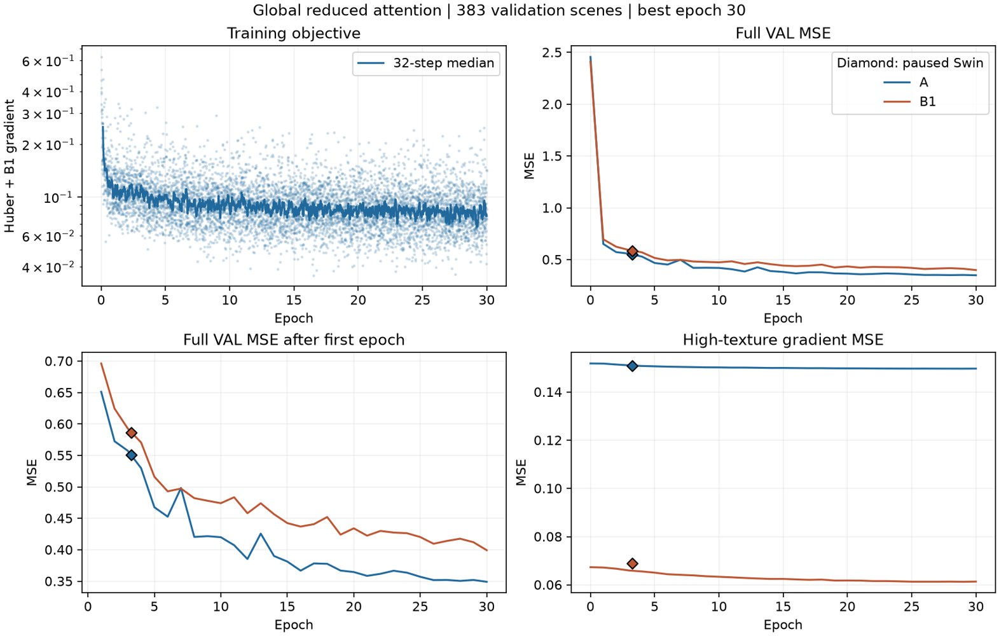
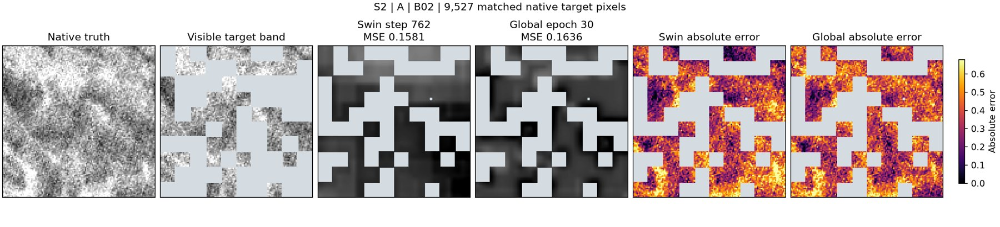
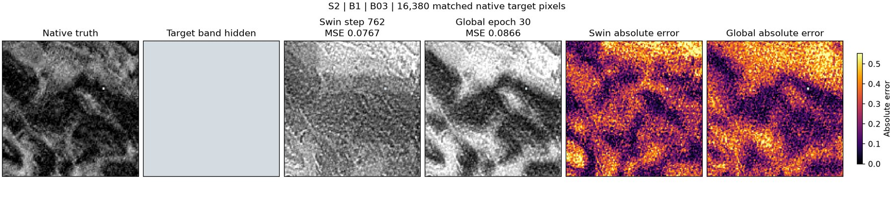
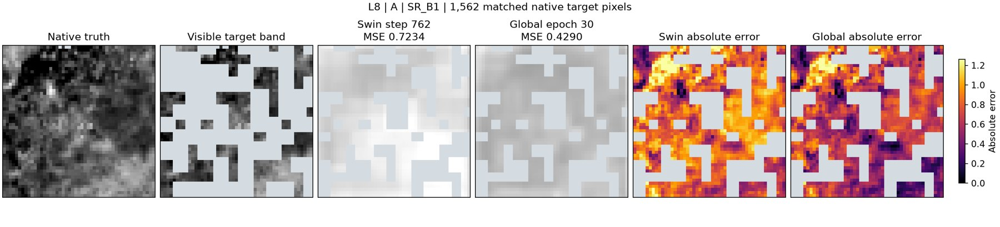
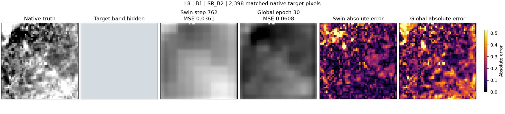

# 全图压缩注意力 A+B1 正式结果与像元恢复诊断

**像元恢复未达目标。** 第30轮平均误差下降，但原生重建仍可见局部块状纹理与过平滑。相近更新数下，全图版的 A、B1 均值均略高于 Swin。

运行 `83f833a1ef5e4515825c1457b6e4278d`，随机初始化 seed 17，双卡 FP32，716,546 个参数。每轮覆盖 7,442 TRAIN，完整 VAL 为 383 个 S2/L8 观测。A/B1 等权、Huber δ=1，B1 原生相邻梯度权重 0.2。完成 30 轮、6,990 更新，早停未触发，第30轮为最佳。训练更新累计 4.24 小时。

| 完整 VAL | A MSE | B1 MSE | A 高纹理梯度 MSE | B1 高纹理梯度 MSE |
|---|---:|---:|---:|---:|
| 旧 Swin 暂停，762步 | 0.55131 | 0.58635 | 0.15085 | 0.06894 |
| 全图第3轮，699步 | 0.55746 | 0.59277 | 0.15108 | 0.06598 |
| 全图第30轮，6990步 | 0.34914 | 0.39939 | 0.14974 | 0.06137 |

Swin 与全图版的训练策略和预算不同。第30轮结果反映这次完整训练。A 的高纹理梯度 MSE 从初始化的 0.15186 降至 0.14974，下降约 1.4%，与像元均方误差的改善幅度差异很大。

## 块状结果与固定网格

同一批 335 个 S2 B1 验证观测，两个检查点逐像元核对目标掩码，每个观测取目标像元最多的波段。以下为相邻目标像元的绝对残差差值在边界与内部的均值之比，再对观测取中位数。每尺度每观测至少有 100 个边界像元对。比值约 1 表示该尺度的固定边界未表现出普遍的额外跳变。

| 尺度 | 旧 Swin 762步 | 全图第30轮 |
|---|---:|---:|
| 40 m | 1.0034 | 1.0010 |
| 80 m | 0.9941 | 0.9888 |
| 160 m | 0.9895 | 0.9844 |
| 320 m | 0.9909 | 0.9835 |
| 320 m 半格偏移 | 0.9851 | 0.9842 |

旧 Swin 的 320 米比值已接近 1，全图版在同尺度也接近 1。该统计检验固定相位的边界跳变，对局部块状、平滑、任意相位锯齿和其他波段的伪影覆盖有限。

## 为什么改注意力后像元恢复变化有限

- **空间采样在主干之前已经变粗。** 7×7 动态卷积步长为 4，对 10 米波段每约 40 米输出一个特征位置。随后按面积汇入 40 米公共格，光谱 Query 聚合后进入 40/80/160 米主干。全图 Query 扩大了可读范围，K/V 仍由卷积压缩。改变注意力连接范围没有提供额外的原生空间采样点。
- **A 与 B1 都受共享解码场约束。** 连续 Decoder 从 40 米特征插值并卷积细化，生成 10 米子格上的共享 8 维场，再用目标描述器做线性读出并映回原生足迹。10 米输出间距只是采样间距。A 没有独立的原生细节支路。B1 的细节支路只使用同网格可见波段的局部对比度，再按目标波段缩放。跨波段纹理或反差不一致时，这条路径可能保留错误细节。以上是实现给出的约束，各自的贡献尚需隔离实验。
- **优化目标与细节验收存在差距。** 当前按完整 VAL 平均像元 MSE 选模。A 使用 Huber，额外梯度监督只在 B1 生效，且只覆盖两个相邻像元均为目标的位置。平均误差可以随低频结构和亮度恢复下降，而高频误差改善有限。A 图中的规则灰块来自目标掩码，应在有预测的区域内判断块效应。
- **早期 USE 是有价值的参照。** 历史 USE 方案中保留了原始网格 Fine 路径，较适合检验保留细尺度空间信息的收益。当前已有记录涉及不同重建或分割协议。要确认本轮弱于早期 USE 的幅度，需要在同一批观测、同一波段与掩码下重跑该检查点，并检查误差、梯度和边界。

下一次诊断应固定当前检查点和目标掩码，先用真值做 40 米汇聚到原生读出的几何往返，量化粗网格引起的误差。随后在同一评价协议下配对早期 USE，以及当前 Encoder 固定时仅更换解码器的对照。以原生目标误差、高纹理梯度误差、分尺度残差和同样本图为验收，先定位前端、Decoder 与任务约束，再决定是否更换主干。

## 同目标像元对比

从左到右依次为原生真值、目标波段可见输入、旧 Swin 预测、全图版预测、两组绝对误差。灰度列和误差列分别共用色阶。四幅沿用之前暂停复评的样本，L8 A 误差下降，另外三幅上升。

**S2 A B02**，MSE 0.1581 → 0.1636。

**S2 B1 B03**，MSE 0.0767 → 0.0866。

**L8 A SR_B1**，MSE 0.7234 → 0.4290。

**L8 B1 SR_B2**，MSE 0.0361 → 0.0608。

[指标摘要](metrics.json) · [边界诊断摘要](grid_summary.json)
