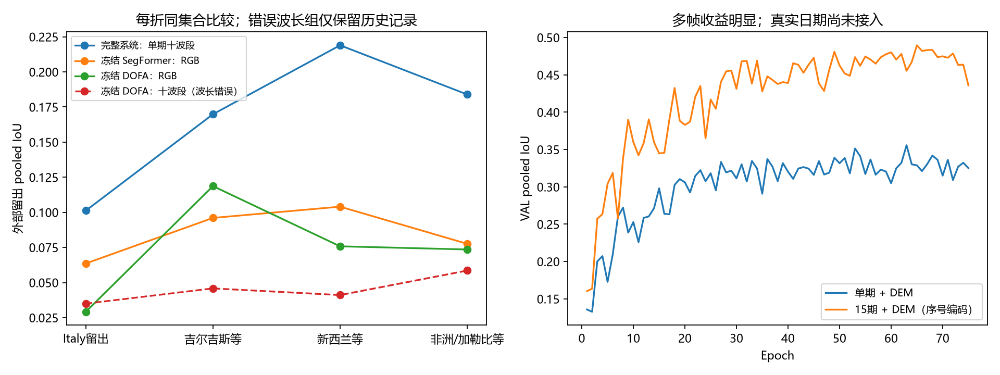
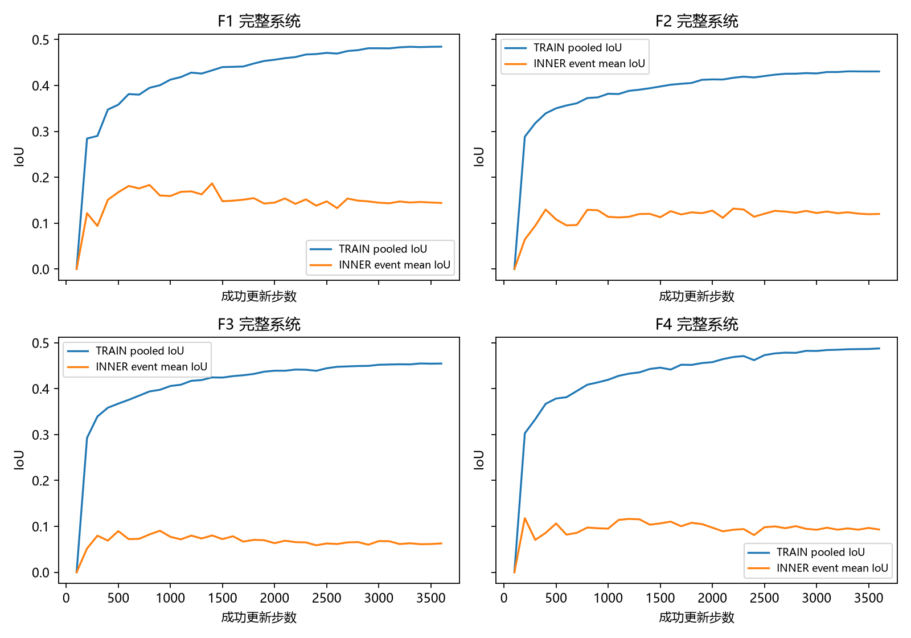

# EVENT_CV_V5 审阅与下一步执行计划（2026-10-20）

## 0. 阅读约定与实验设置

**审阅结论：18 组训练确实完成，但不能将 18 组全部视为按计划验收通过。下一步先纠正 4 组 DOFA 十波段探针与 2 组时序配对，再决定研究分支；单期 Sentinel-2 十波段仍是主任务。**

依据为用户提供的 v2 研究任务书、上一轮“跨事件表征与时间信息诊断”计划，以及本地实际源码、manifest、训练曲线、逐图块 CSV 和评测 JSON。附加文档中的方向建议作为待证实的研究提案；本次没有自动执行其中的新训练。

- EVENT_CV_V5：4,715 个可用样本，13 个事件，Kyrgyzstan 两事件联合划分。四折训练/内部验证/外部留出分别为 2486/453/1776、3283/453/979、2957/773/985、3287/453/975。四个外部留出集合互斥，合计 4,715。各折控制和探针使用相同的对应集合。
- U-TAE 配对：官方可用子集 3012/758/945，和上述四折协议不同；两组均含 DEM，75 epoch、batch16、FP32、seed1234。它是输入信息诊断，不是主任务模型替换，也不是完整官方 998 块测试复现。
- 下表 IoU 为阈值 0.5、有效像素混淆计数汇总的 pooled IoU；AP 为有效像素平均精确率。四折均值是四个 pooled IoU 的等权平均，**不是全部事件组的宏平均**。单 seed 不作统计显著性声明。
- 本次实际执行：复算逐图块混淆计数、核对成员集合/训练统计成员/best 选择/曲线完整性；调用 DOFA 预处理接口验证波长；每事件 1 块、共 13 块做时序输入 CPU 抽检；生成并查看图像。未重跑 GPU 推理或训练，未重新进行全量原始数据审计，未重新哈希全部大 checkpoint。

## 1. 主表：哪些结果可以保留

| 架构 / 策略 | Italy 留出 IoU | 吉尔吉斯等留出 IoU | 新西兰等留出 IoU | 非洲/加勒比等留出 IoU | 四折均值 | 审阅状态 |
|---|---:|---:|---:|---:|---:|---|
| SegFormer + 原网格细节分支，完整微调 | 0.1012 | 0.1698 | 0.2189 | 0.1839 | 0.1685 | 可保留 |
| 冻结 SegFormer 轻量编码器 + RGB 线性探针 | 0.0636 | 0.0960 | 0.1040 | 0.0776 | 0.0853 | 可保留，存在预算/读取能力限制 |
| 冻结 DOFA + RGB 线性探针 | 0.0292 | 0.1187 | 0.0758 | 0.0736 | 0.0743 | 可保留，跨模型预处理和特征步长不同 |
| 冻结 DOFA + 十波段线性探针 | 0.0350 | 0.0458 | 0.0411 | 0.0585 | 0.0451 | **波长输入错误，仅历史记录，不作光谱结论** |
| 冻结较大 SegFormer + RGB 线性探针 | — | — | — | — | — | 上游权重身份未闭环，4 组受阻 |

同一列中的模型评测集合相同；不同列是不同留出事件。完整微调与冻结探针同时改变编码器训练、输入和解码器，差值不能归因为其中单一因素。

| 架构 / 输入策略 | VAL IoU | TEST IoU | TEST AP | TEST 全像素 IoU | best epoch | 审阅状态 |
|---|---:|---:|---:|---:|---:|---|
| U-TAE，单期 + DEM，日期固定为 0 | 0.3557 | 0.3324 | 0.5115 | 0.3261 | 63 | 已训练；日期契约偏离计划 |
| U-TAE，15 期 + DEM，日期用帧序号 | 0.4896 | 0.4770 | 0.6832 | 0.4750 | 65 | 已训练；日期契约偏离计划 |

两行使用相同 945 块 TEST、同源 mask/valid 和同初始化摘要。TEST IoU 差为 **+0.1446**，AP 差为 **+0.1717**；13 个事件的 IoU 差均为正。这是当前实现下的多帧观测增益，不能称纯时间跨度收益、实时收益或单期性能突破。best/last 是同一次训练的两个状态，不是重复实验。

## 2. 图与解释



左图每个横坐标是一折，同一横坐标比较相同外部留出集合；红色虚线为输入波长错误的历史结果，不能参与方向淘汰。右图每条线是一种 U-TAE 输入，纵轴为每 epoch 的 VAL pooled IoU：多帧优势贯穿训练多个阶段，但两组尚未使用真实日期。



每个面板是一折，上行依次为 Italy、吉尔吉斯等留出，下行为新西兰等、非洲/加勒比等留出。蓝线为 TRAIN pooled IoU，橙线为 INNER 事件平均 IoU，聚合口径和样本域不同，不能把纵向差直接当统一泛化误差；应观察训练持续提高而内部验证不随之提高的形态。外部留出未用于逐步选模。

## 3. 审阅发现与结论修正

| 问题 | 实际证据 | 对结论的影响 / 处理 |
|---|---|---|
| DOFA 十波段波长错位 | `frozen_probe.py` 十波段列表从 0.443 开始；B04/B03/B02 从列表取到 0.560/0.490/0.443，而 RGB 分支传入 0.665/0.560/0.490。CPU 实际调用 `_prep` 验证不一致 | 4 组十波段探针不能判定多光谱无益；修正并重跑这 4 组 |
| 时序使用序号，没有真实日期 | `temporal_dataset.py` 返回 `torch.arange(T)`；缓存虽存日期，但数据集忽略。官方源代码读取真实日期或原始数值时间。13 块抽检源时间均为 datetime | 现有收益是帧集合/顺序等综合作用；真实时间跨度实验必须先修复两端 |
| 对象召回口径变了 | `evaluate_utae.py` 将 GT 连通域内任意预测像素视为命中，未执行主评测的 IoU≥0.25 对象匹配和可评对象筛选，也未输出边界 F1 | 原表只能称“GT 区域任意像素命中率”；不得与主模型对象召回直接比较，也不能据此认定小对象恢复已解决 |
| 缺失值处理验收不足 | 缓存直接 `astype(int16)`，未实现计划中的显式非有限值/nodata 均值填补和逐帧记录。13 块抽检没有非有限值，但部分帧 SCL 大面积无效 | 不据此断言全量缓存损坏；也不能声称缺失处理已通过。补针对性统计，区分 nodata、云和真实低反射率 |
| 报告存在过强或相反的表述 | DOFA RGB 在吉尔吉斯等留出折 0.1187 > SegFormer 0.0960；十波段历史结果在 Italy 0.0350 > RGB 0.0292；原报告写“四折全负” | 改为平均结果及逐折结果。撤回“必须微调编码器”“已经证明细节解码瓶颈”等排他结论 |

**跨事件泛化仍是主问题，但不能用不同测试集相减估计其纯效应。** 完整系统在四折外部集合仅 0.101–0.219，且训练曲线继续提高而内部事件验证停滞，支持跨事件泛化不足的判断。官方随机划分的 0.3275 来自另一训练/测试构成，差异包含集合组成、训练量和域覆盖，不能直接把 0.3275−0.1685 写成“纯跨事件损失”。本轮开发型事件交叉验证也不恢复历史盲测身份。

**预训练路线尚未被否定，光谱问题仍待回答。** RGB 探针只说明当前冻结编码器、预处理、步长和线性读取头的组合表现；DOFA 统一 stride16、SegFormer 多尺度最细 stride4，读取空间能力并不一致。较大 SegFormer 缺席，十波段 DOFA 存在硬输入错误；因此不能归纳为“更强表征没用”。多个探针最佳点接近预算末端，固定预算负结果也不等价于充分优化后的能力上限。

**多帧观测增益值得继续核实，但单期任务保持不变。** 增益同时出现在 VAL、TEST 和 13 个事件，且像素指标复算成立，因此比此前微小组件差异更有研究价值。一个合理但未验证的解释是：多帧提供变化线索、更清晰的观测机会以及较晚时期更明显的地表痕迹。当前实验尚不能分离这些机制，更不能要求单期模型恢复当期不可见的历史滑坡范围。两组均含 DEM 是共同条件，不是组间变化；DEM 与时间的交互仍未检验。

**未证实解码器是主要瓶颈。** 低边界 F1 可由整体漏检、错误定位或空间恢复共同造成。冻结线性探针较低并非“特征已能发现目标而仅边界失败”的证据；也不能证明非线性读取或微调必然有效。此前 U-Net 与 SegFormer 同时改变编码器，不能算相同编码器换解码器。

另：`b2_probe_blocked.md` 把 `decoder_hidden_size=768` 当作输入 768 规格的依据，这个论证不成立；它是 decoder 通道维度。B2 仍因上游 provenance 未闭环保留受阻状态，不能仅靠配置字段推断上游文件身份。

## 4. 下一步执行计划

**本批预算：6 组必要纠错复跑；通过后最多加 1 组无未来观测对照。仍只 seed1234。** 不重做已通过的四折完整系统、RGB 探针、数据量学习曲线和事件数量实验；不自动增加新 backbone、loss、LR 搜索。以下是下一批计划，本次审阅没有启动这些训练。

| 顺序 | 工作与命名 | 新训练数 | 验收 / 决策条件 |
|---|---|---:|---|
| 先锁定输入与评测 | 波长映射、日期与有效帧、统一对象/边界评测；旧结果显式标注版本 | 0 | 输入身份测试和小批前反向/重载通过；保留历史文件 |
| 恢复光谱问题的可解释性 | `DOFA-FrozenProbe-CorrectWavelengths-EventFold-{事件组}-Seed1234` | 4 | 原折、原统计、原头、原预算；只纠正波长。与各折原 DOFA RGB 配对 |
| 恢复时间对照的协议一致性 | `UTAE-SingleDate-RealDates-DEM-Seed1234` 与 `UTAE-FifteenDates-RealDates-DEM-Seed1234` | 2 | 相同初始参数、样本顺序/增强、mask/valid、统计和 75 epoch；接入真实日期并完成缺失契约 |
| 仅在修正后多帧收益仍明确时追加 | `UTAE-ThroughSelectedDate-RealDates-DEM-Seed1234` | 最多 1 | 只允许日期≤当前单期日期，包含所选帧；不补入未来帧。明确检验可用历史集合增量，不声称纯跨度或纯帧数效应 |

### 4.1 必须先改的工程契约

1. **波长按波段名建立映射，禁止手写平行数组。** 复用项目既有已记录来源的十波段映射，例如 B02/B03/B04 为 0.490/0.560/0.665；其余沿用 `configs/segformer/v4r3/dofa_base_upernet_pyramid_binary_n100_u3600_s1234.yaml` 的来源约定。测试三条：十波段顺序精确一致；RGB 抽取后波长与 RGB 分支逐项一致；联合重排影像与波长不发生身份错配。波长向量写入配置、run_meta、特征缓存 key，防止复用错误特征。
2. **日期使用同一真实时间基准。** 参考已 vendored 官方日期转换；单期输入所选帧的真实日期，不再恒为 0。排序后保留原帧身份；多期中的对应帧日期、像素和单期端必须一致。增补非等间隔日期单测，避免只检查“有 15 帧”。
3. **缺失和云分开处理。** 逐帧记录源数据非有限值、明确 nodata、SCL 分类比例。只按明确的有效性规则填补，使用 TRAIN 拟合均值；不能把所有 0 反射率一律当 nodata。固定标签与评价 valid，不按多期质量改变评价区域。现有抽检不足以判断全量缺失率，需要针对 4,715 样本的这几个字段做一次专门统计，复用缓存而非重复审计整个原始数据池。
4. **统一评测器。** 输出 pooled IoU、Dice、Precision、Recall、AP、逐事件、可评对象 IoU≥0.25 匹配召回、严格 IoU≥0.5、对象尺度和 1 像素容差边界 F1；保留原“任意像素命中率”为附加诊断。可评对象匹配必须使用已有修正版口径。保存概率和逐图块结果，避免下次为统计定义重新推理。
5. **冻结与可复现。** 新目录、新配置；旧 checkpoint、曲线、报告和错误实验不覆盖。记录训练脚本及输入处理源码哈希、预训练身份、日期/波长/缺失策略、manifest/stats 哈希、完整曲线。冻结探针确认参数和 buffer 哈希不变、实际 `.grad is None`、头参数有变化；现接口的 `encoder_has_grad` 检查的是 `requires_grad`，名称应明确。

### 4.2 不再混淆时间跨度和帧数

原执行报告建议“固定 15 帧，只改跨度，例如只用灾后 3 帧”，这个例子同时改变了帧数，不能执行为跨度控制实验。本批先用“截至单期日期”的最小对照回答是否依赖未来观测。若后续确需分解跨度，必须固定真实帧数 K，并在同一可用样本集合内选近窗口和远窗口；数量实验则固定日期端点/窗口，改变内部帧数。没有足够真实观测就明确受阻，不能重复帧伪装新增时相。

追加的截至日期组会有变长序列。优先按长度分桶，或验证 padding mask 能真正传到时间注意力；官方 vendored U-TAE 内存在将 pad mask 清零的逻辑，不能直接填零后宣称已屏蔽。与前两组保持相同样本曝光/有效 batch 及损失口径，记录无法完全对齐的归一化或批组成差异。

### 4.3 这一批结束后怎样决定主研究线

- **修正 DOFA 十波段在多数留出折同时改善 AP/IoU，且没有明显牺牲最差事件组：** 才推进多光谱表征的有限微调比较。下一轮需同一读取头/解码接口并列出预训练、分辨率与成本差异，不重新运行原先 DOFA + 大随机 UPerNet 的混杂对照；不因单折上涨就扩展到 Prithvi。
- **修正后的多期增益仍明显：** 将它作为输入充分性参考。若仅完整 15 期有效而截至单期日期组无明显收益，重点检查较晚影像中的目标可见性，不能拿回顾性成绩定义单期模型失败。若截至日期组也有效，可优先设计“多期训练教师、单期推理学生”的策略研究，但先验证教师在事件留出协议下的收益；训练教师不得见该折 outer，蒸馏不得使用 outer 图块。该策略目前未验证，不自动进入本批训练。
- **RGB/十波段探针仍无稳定优势：** 只能否定本次冻结读取方案，不宣告单期信息的绝对上限，也不据此自动堆叠解码器。保留单期主模型与跨事件基准，将失败案例归因为待验证假设。
- **空间范围与解码器实验仍未完成。** 不同输入尺寸不能等同更大地理上下文：把 128 放大到 256 只改变采样密度。后续空间实验需要真实地理邻域、同一中心目标区域、同一分辨率、邻接块不跨划分边界；先小范围证明数据支持，不能拼接任意图块。相同编码器换解码器，需控制输入、初始化和训练策略，且先有正确定位但边界恢复不足的案例证据。

采用“多数折一致、最差组、AP/对象/边界共同方向、成本”的综合决策。0.02 只作为实际收益的参考幅度，不作为统计显著性的开关；不恢复三种子，不为了越过 0.02 调 TEST 阈值。

## 5. 完成、未验证与受阻

- **完成并复核：** 4 个完整系统 + 8 个 RGB 探针，成员集合及像素指标复算通过；2 个 U-TAE 训练和所存像素统计通过复核，但仅保留现有序号编码实现的结论。
- **完成训练但研究结论暂不验收：** 4 个 DOFA 十波段探针，因波长输入错位等待纠错复跑；2 个 U-TAE 的真实日期/缺失契约、标准对象召回与边界验收尚未完成。
- **受阻：** 4 个较大 SegFormer 探针，上游权重身份未闭环。保留隔离产物，不要求它们阻塞其他工作；不沿用报告中把 decoder 通道数等同输入尺寸的解释。
- **未验证：** 修正后光谱收益、真实时间跨度作用、多期收益的跨事件迁移、教师到单期学生迁移、实际大范围上下文、相同编码器换 decoder。以上均未由本次审阅产生新训练结果。

## 附录：种子、成本和复现产物

所有已列结果均为 seed1234。控制组保存训练耗时合计约 2,876 秒；12 个探针合计约 6,720 秒（包含 4 个错误波长组）。U-TAE 单期约 2,419 秒，15 期约 10,348 秒；多期训练计算成本明显增加，所以只能说同 epoch/同样本曝光，不能说同 FLOPs 或同墙钟预算。上述训练耗时来自 run summary，不包含准备、评测、接口验收或 B2 受阻运行成本。

本次审阅命令（项目根目录，PowerShell）：

```powershell
& 'C:/Users/yzh/.workbuddy/binaries/python/envs/tm/Scripts/python.exe' scripts/review_event_cv_v5.py
```

实际退出码 0；核验 18 组保存结果、4,715 个互斥外部留出样本和 13 个事件代表输入。验证 JSON 保存本次读取配置/summary/CSV/源码的 SHA256；AP 沿用保存结果，本次未从全量概率重新计算。GT/valid 全集验证限于 ID/计数及共享数据路径，逐像素一致性本次实测为 13 样本，不表述为全量 mask bitwise 证明。

- 审阅脚本：[review_event_cv_v5.py](../scripts/review_event_cv_v5.py)
- 原始复核数据及输入抽检：[verification.json](event_cv_v5_review_2026-10-20/verification.json)
- 原执行报告：[stage_report_2026-10-20.md](../reports/event_cv_v5/stage_report_2026-10-20.md)（保留；结论订正以本审阅为准）
- 原始四折结果：[results.json](../reports/event_cv_v5/results.json)
- 原始时间配对：[utae_pair_summary.md](../reports/event_cv_v5/utae_pair_summary.md)
- 输入源码：[frozen_probe.py](../src/landslide_seg/models/frozen_probe.py)、[temporal_dataset.py](../src/landslide_seg/data/temporal_dataset.py)
- 原时序评测：[evaluate_utae.py](../scripts/evaluate_utae.py)
- B2 受阻记录：[b2_probe_blocked.md](../reports/event_cv_v5/b2_probe_blocked.md)

本次仅新增审阅脚本、验证产物和本计划，没有修改训练实现、原结果或 checkpoint。
