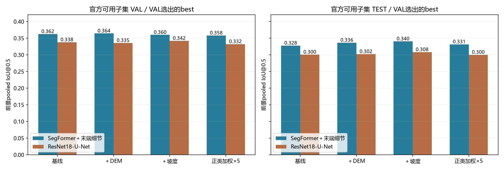
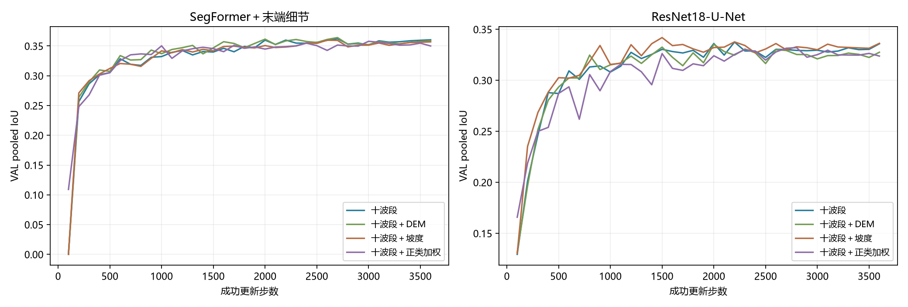
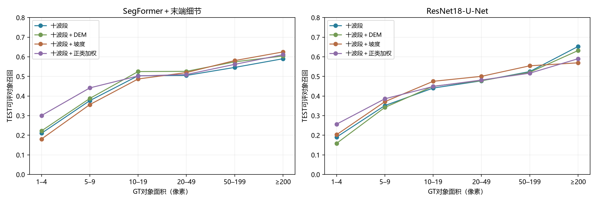

# 最新八组实验复核与三个研究问题对账（2026-10-20）

## 阅读约定与实验设置

本次核对已有训练与评测产物，重新从32份逐图块CSV累计TP/FP/FN/TN并重算IoU，检查八组VAL/TEST样本ID、事件、GT像素数及valid像素数一致。八组均完成3600成功更新，seed1234、batch64、230400曝光，best/last文件存在。本次未重训、未运行GPU推理、未重新计算checkpoint文件哈希，未逐像素核验八组掩膜；不能把产物核对称为从头复现。

当前为官方split的单期可用子集：TRAIN3012／VAL758／TEST945，完整官方成员为3192／798／998，共排除273块；官方来源commit锁定在2eb025bd76bef449d2f7cf4aaea861bc4cfeed51。输入均为128×128单期S2；地形组加一个DEM或坡度通道，正类加权组将BCE正类权重设为5。各自用VAL pooled IoU@0.5选best，正文为best。VAL与TEST为不同集合，八组各自对应的VAL相同、TEST相同。

像素IoU、Dice、Precision、Recall与AP均按有效像素合并；对象召回按可评对象一对一匹配（IoU≥0.25），边界F1容差1像素。TEST可评对象7890个，其中1–4像素409个。单seed不宣称统计显著。

根据现有DECISION_LOG，官方训练已使用New Zealand、Hiroshima、Thrissur及Italy的部分图块。新的官方模型不能把这些事件称为未见训练事件；原OOD模型与历史评测关系仍成立，但已反复查看的事件不能重新包装成历史盲测。官方TEST虽未用于每run的checkpoint选择，若其结果继续用于决定新变体，应承认后续开发对测试反馈的使用；本次无法仅凭日志证明所有变体均在首次看TEST前预注册。

## 主表（合并）

| 架构与策略 | VAL IoU | TEST IoU | TEST Dice | Precision | Recall | AP | 对象召回 | 边界F1 |
|---|---:|---:|---:|---:|---:|---:|---:|---:|
| SegFormer＋末端细节／十波段 | 0.3623 | 0.3275 | 0.4935 | 0.5404 | 0.4541 | 0.4830 | 0.4602 | 0.5139 |
| SegFormer＋末端细节／十波段＋DEM | 0.3641 | 0.3363 | 0.5033 | 0.5325 | 0.4772 | 0.4902 | 0.4790 | 0.5208 |
| SegFormer＋末端细节／十波段＋坡度 | 0.3598 | 0.3402 | 0.5077 | 0.5241 | 0.4924 | 0.4923 | 0.4577 | 0.5242 |
| SegFormer＋末端细节／十波段＋正类加权 | 0.3579 | 0.3314 | 0.4979 | 0.4652 | 0.5355 | 0.4922 | 0.4867 | 0.5126 |
| ResNet18-U-Net／十波段 | 0.3375 | 0.3004 | 0.4621 | 0.4994 | 0.4299 | 0.4339 | 0.4270 | 0.4885 |
| ResNet18-U-Net／十波段＋DEM | 0.3353 | 0.3020 | 0.4639 | 0.4988 | 0.4335 | 0.4371 | 0.4245 | 0.4888 |
| ResNet18-U-Net／十波段＋坡度 | 0.3419 | 0.3080 | 0.4709 | 0.4893 | 0.4539 | 0.4428 | 0.4504 | 0.4960 |
| ResNet18-U-Net／十波段＋正类加权 | 0.3320 | 0.3000 | 0.4616 | 0.4542 | 0.4693 | 0.4340 | 0.4411 | 0.4857 |

## 三个研究问题：完成到哪一步

| 研究问题 | 已完成的相关证据 | 尚未直接回答 | 状态 |
|---|---|---|---|
| 空间尺度／局部与大范围上下文 | 多尺度特征、细节分支、早期交换及按对象面积评测 | 相同地面分辨率、相同评价区域下改变真实观测范围的受控实验；也未找到正式输入resize尺寸对照 | 未找到直接实验 |
| 同编码器更换解码器，定位恢复瓶颈 | Stem开关、条件精分头、相加／AFF、早晚交换；早晚encoder搭配同一decoder重训 | 固定同一encoder权重／特征，比较不同成熟decoder或上采样路径 | 有局部融合消融，核心对照未完成 |
| 光谱利用效率／通道关系 | direct10与10→3投影、Stem开关，旧权重非RGB均值替换诊断 | 同协议RGB与十波段重训，以及明确通道关系机制的独立受控对照 | 部分完成，信息损失机制未验证 |

本次扫描outputs/segformer中有resolved_config且至少1000更新的记录，输入尺寸统计为{'128': 74}。此检索范围内未发现非128输入正式长训练，不声称覆盖磁盘所有可能的外部实验。旧TerraMind/AnySat接口含local/context特征，不等于完成不同物理视野的正式对照。

128×128在共同10m网格上名义覆盖约1.28km×1.28km，这仅是输入覆盖范围，不能据此推断模型需要多少上下文。将同一图块插值至256/512只改变采样与计算尺度，不增加真实地理范围；若未来拼邻块扩大范围，必须控制日期、空间划分泄漏，并在共同中心区域评价。

U-Net与SegFormer比较同时改变编码器、解码器、预训练与容量，不能替代同encoder不同decoder实验。DOFA＋UPerNet也存在相同混杂。早晚encoder probe是在比较encoder来源，不是在比较decoder架构。Spectral Stem的1×1卷积确有通道混合，后续3×3又同时引入空间处理；现有结果无法把光谱建模贡献与细节恢复独立拆开。DEM/坡度属于额外地形输入，不是S2光谱效率实验。

## 图与解释



左列为同758块VAL，右列为同945块TEST；每个策略位置分别显示两种完整架构。重点看SegFormer在四种设置下均高于对应U-Net，以及坡度在SegFormer的VAL和TEST方向不同。跨架构差值不能归因于decoder。



左列为SegFormer，右列为U-Net；横轴成功更新步数，纵轴VAL合并IoU，四条线对应四种策略。曲线包含明显波动，不能称“全程单调上升”；SegFormer基线best在2700步，last略低。



左列为SegFormer，右列为U-Net；横轴GT对象面积，纵轴TEST可评对象召回。正类加权提高部分小对象召回，但坡度在SegFormer中提升较大对象同时降低tiny召回，不能将总体IoU正差写成全面细节改善。

## 展开结论

**单期官方子集实验已完成，官方多时相参考仍未完成。** 单期SegFormer基线VAL/TEST IoU为0.3623/0.3275，best在2700步，与旧事件OOD早期见顶的曲线形态不同。训练与评测分布变化可能有助于后续训练保持收益，此机制未验证；成员、归一化与评价集合也改变，不能用两协议分数相减估计纯split效应。当前多时相＋DEM只做了可执行性与成本探测，没有正式训练或完整评测，不能据此判断单期信息已经充分或不足。

**现有地形结果是有限的增益线索。** SegFormer加入DEM、坡度后TEST IoU分别为0.3363、0.3402，相对基线增加0.0087、0.0127；VAL分别增加约0.0019、下降约0.0025。U-Net坡度组VAL/TEST均为正差，但SegFormer的VAL为负，因此“坡度在两种架构、两个split都一致改善”不成立。地形先验帮助区分部分场景是未验证解释；目前不能宣称普遍有效，也不能因差值小于0.02就断言是噪声。

**正类加权表现出召回与精确率的权衡，但未证明只改变工作点。** SegFormer TEST Recall从0.4541到0.5355，Precision从0.5404到0.4652，IoU仅增加约0.0039；U-Net TEST IoU反而下降约0.0004。SegFormer tiny对象召回从0.210到0.301，说明对象检出取舍发生变化。不同训练权重可能同时改变排序、表征和校准，单个阈值的Precision/Recall方向及相近AP不足以证明它们落在同一PR曲线上，更不足以认定没有表征变化。

**SegFormer系统在当前固定条件下整体更强，U-Net更省显存、训练更快。** 十波段基线TEST IoU为0.3275与0.3004；训练约687与544秒、显存4694与1852MiB，U-Net参数约14.35M，SegFormer约3.75M。架构和预训练差异可能影响这项取舍，但机制未隔离；不能把U-Net结果当作“上采样decoder已排除”的证据。原unet_report结论段将显存/速度优势写给SegFormer，与其自身成本表相反，本报告按原始训练摘要纠正。

## 限制与下一步

本次仅审阅，不启动新实验。三个研究问题不应标记为全部完成。下一步若选择结构诊断，先冻结要改变的因素：空间实验区分真实视野与resize；decoder实验固定encoder特征与输入并说明head初始化；光谱实验区分通道输入信息与通道融合方式。避免把三项同时组合，否则无法解释收益来源。

当前官方多时相参考的成本估计属于实施待办，不是已完成负结果，也未在本次核实其预算限制的授权来源。采用官方参考时仍需同一可用子集、全像素与valid双口径；当前945块与官方998块并非同一集合。现有全像素复算不能单独关闭成员、模态、架构、预训练与训练差异。

需纠正的报告措辞：小差值不能直接定为噪声；best/last方向一致不是独立重复；三个改动并不在所有架构和split上都Recall升（U-Net DEM的VAL Recall略降）；VAL选模对所有组采用相同规则，不能无依据称天然只偏向基线。旧报告原文保留，本复核作为补充。

## 附录（逐seed、成本、产物索引）

全部seed1234，八组均3600更新。下列时长为实际运行记录，未控制主机负载，不作严格吞吐基准。

| 架构与策略 | 参数M | best步 | 秒 | 峰值MiB | last VAL IoU | last TEST IoU |
|---|---:|---:|---:|---:|---:|---:|
| SegFormer＋末端细节／十波段 | 3.75 | 2700 | 687 | 4694 | 0.3604 | 0.3265 |
| SegFormer＋末端细节／十波段＋DEM | 3.76 | 2700 | 805 | 4698 | 0.3588 | 0.3328 |
| SegFormer＋末端细节／十波段＋坡度 | 3.76 | 2600 | 831 | 4698 | 0.3570 | 0.3350 |
| SegFormer＋末端细节／十波段＋正类加权 | 3.75 | 3000 | 720 | 4694 | 0.3500 | 0.3275 |
| ResNet18-U-Net／十波段 | 14.35 | 2200 | 544 | 1852 | 0.3358 | 0.2984 |
| ResNet18-U-Net／十波段＋DEM | 14.35 | 2000 | 602 | 1856 | 0.3275 | 0.2914 |
| ResNet18-U-Net／十波段＋坡度 | 14.35 | 1500 | 596 | 1856 | 0.3363 | 0.3035 |
| ResNet18-U-Net／十波段＋正类加权 | 14.35 | 2800 | 559 | 1852 | 0.3238 | 0.2936 |

复核命令（项目根目录PowerShell）：

```powershell
& C:/Users/yzh/.workbuddy/binaries/python/envs/tm/Scripts/python.exe scripts/review_official_latest.py
```

复核脚本：[review_official_latest.py](../scripts/review_official_latest.py)；复核计数与哈希：[verification.json](official_latest_review_2026-10-20/verification.json)。每个训练目录内resolved_config、run_meta、train_summary、metrics、sample_exposures与eval构成追溯链，checkpoint哈希本次仅引用原评测记录。

主要来源：[八组汇总](../reports/official_single/unet_vs_segformer.md)、[官方单期阶段报告](../reports/official_single/stage_report_2026-10-20.md)、[协议准备报告](../reports/official_single/prep_report_2026-10-20.md)、[决策日志](DECISION_LOG.md)、[旧光谱诊断](segformer_batch1_review_2026-10-18.md)、[历史架构对照](all_experiment_results_v2_2026-10-19.md)。

训练产物：

- `outputs/segformer/official_single/SegFormer-LateDetail-OfficialSplit-SingleDate/1234`
- `outputs/segformer/official_single_geo/SegFormer-LateDetail-OfficialSingle-DEM/1234`
- `outputs/segformer/official_single_geo/SegFormer-LateDetail-OfficialSingle-Slope/1234`
- `outputs/segformer/official_single/SegFormer-LateDetail-OfficialSingle-PW5/1234`
- `outputs/segformer/official_unet/UNet-ResNet18-OfficialSingle-Baseline/1234`
- `outputs/segformer/official_unet/UNet-ResNet18-OfficialSingle-DEM/1234`
- `outputs/segformer/official_unet/UNet-ResNet18-OfficialSingle-Slope/1234`
- `outputs/segformer/official_unet/UNet-ResNet18-OfficialSingle-PW5/1234`
