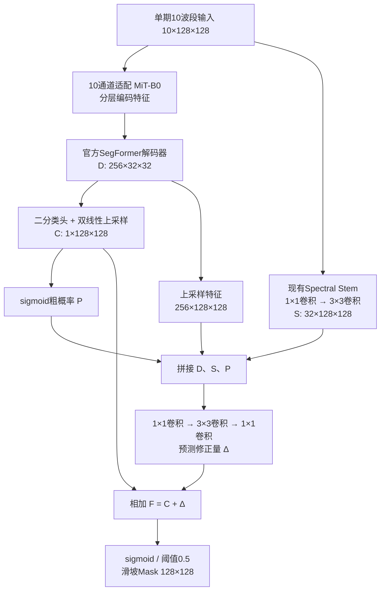

# 原始网格细节辅助 SegFormer：下一轮实验与架构

> 当前执行顺序已由 [单头分割与语义—细节注意力融合执行计划](single_head_attention_execution_plan_2026-10-19.md) 替代。本文保留为历史方案；先加深Stem及条件性残差门控不再作为本轮主线。

状态：基于已完成 CF/U0 实验的后续方案，尚未实现或启动本文件中的新训练。历史两阶段代码、配置和checkpoint保留。本轮依据见 `coarse_to_fine_review_2026-10-19.md`。

## 1. 研究假设

对1–4像素等微小目标，多尺度语义特征难以独自保证精确边界，需要输入网格上的局部特征辅助。当前证据支持细节路径有作用，但没有证明高层语义收益很低或可以删除：背景与滑坡的区分仍可能依赖上下文。

下一轮主线是“语义上下文 + 原始网格细节”的可消融融合。当前A1/CF已含32通道全网格Stem；新实验增强其表示和利用方式，不重复新建一个功能相同的分支。这里原始网格指128×128共同10m输入网格，不是对原生20m波段进行真实超分辨率。

## 2. 当前已实现的 CF1

训练：`Lseg(F) + 0.5 Lseg(C)`，其中 `Lseg=0.5 masked BCE+0.5 masked Dice`。

- CF0：P通道固定为0，其余路径与CF1一致，仍保留C基础预测和粗辅助损失。
- A1：没有P通道；融合头为1×1→1×1；仅最终监督。原始网格Stem仍然存在。
- CF1_B：CF1结构不变，精分BCE使用边界加权。
- U0：独立的ResNet18 U-Net，无Stem及上述粗细分工。

当前没有硬ROI裁剪，也没有独立的第二个视觉编码器。CF1/CF0构造但未调用的旧fusion模块属于工程冗余，不绘入实际计算流程。

## 3. 实验矩阵：先两组，门控作为有条件第三组

历史参照固定为A1、CF0和U0，其他历史组保留报告，不全部重训。

| 名称 | 相对比较对象的唯一主要变化 | 要回答的问题 | 优先级 |
|---|---|---|---|
| R0 / CF0-noAUX | 相对CF0只将粗辅助损失权重0.5改为0；P仍为0 | 当前辅助监督是否拖累已有空间精分头？ | 首先执行 |
| R1 / NativeDetail | 相对R0只增强原始网格Stem；融合头、监督和训练预算相同 | 更充分的原网格局部建模是否帮助小对象与边界？ | 其次执行 |
| R2 / GatedDetail | 在R1基础上只增加语义—细节联合门控 | 如何减少修正路径新增误检/破坏正确区域？ | R1出现收益但仍有过度修正时再启动 |

R0与CF0比较隔离辅助监督；R0与A1比较局部空间融合头差异；R1与R0比较细节分支增强。R0保留零条件通道，避免同时更改输入维度和损失。R1收益也可能来自深度/容量增加，不宣称已隔离所有因素；如后续论文要声称“原网格特有收益”，再设计匹配容量和分辨率的针对性对照。

### R1 的首版实现规格

保留现有Stem，然后添加两个32通道残差块。每块为：

`Conv3×3(32,32,stride1,pad1,bias=False) → GroupNorm(8,32) → GELU → Conv3×3(32,32,stride1,pad1,bias=False) → GroupNorm(8,32) → 残差相加`。

末个GroupNorm的缩放和偏置初始化为0，使每个新增块起始为恒等映射；不在相加后另加改变恒等性的激活。首步上游可能无梯度属于预期，需若干步后核对更新。输出仍为32×128×128，不下采样、不更换编码器和官方解码器，不加入独立边界监督。

这只是首轮预设，不是已知最优深度。新增参数、实际显存和速度必须实测；保持输出通道不变有助于复用同一个精分头。

### R2 的触发条件和边界

只有R1至少在验证小对象召回/边界等预设指标之一带来收益、且仍存在细分修正增加误检的问题时，才开展R2。若R1整体退化，先保留负结果，不直接叠加门控补救。

候选形式为 `F=C+g(up(D),S)·Δ`；门控由语义和细节共同产生，采用连续可学习权重，不以粗概率阈值硬关闭区域。实现前固定门控初始化和容量；它可能压制真正的微小目标，不能预先承诺改善。该组是条件性设计，不属于已实现结构。

## 4. 执行步骤与共同条件

1. **实现R0配置与必要回归检查。** 在现有工厂、训练器、脚本上扩展，不建新工程。检查不再计算粗辅助损失、最终损失仍能更新所有实际使用的模块；兼容历史checkpoint。
2. **正式跑R0。** 保存与CF0、A1相同口径的验证/最终评测和逐尺度结果。R0若明显退化，应先解释辅助监督和精分头的依赖，不把其当作已验证更强基线；R1即使继续也必须保留R0及历史A1参照。
3. **实现R1并通过真实运行门槛。** 检查恒等初始化、原网格尺寸、梯度更新、checkpoint重载及8图过拟合，再正式训练。
4. **根据验证结果决定R2。** 不根据Italy结果循环改变结构或超参；Italy为已多次查看的历史诊断集，冻结本轮配置后统一报告。
5. **另开训练策略对照时只改训练策略。** 日志显示早期峰值后验证退化；更早LR衰减或更保守编码器LR可在结构筛选后单独研究。本轮不同时引入这些变化。early stopping只能节省后期计算，不能自动提高已有best结果。

共同条件：seed1234、当前v3数据和统计量、相同划分与增强、MiT-B0/官方预训练、direct10适配、有效batch64、FP32、3,600次实际更新、原学习率调度、最终BCE+Dice、阈值0.5。新实验从相同官方预训练开始，不从各自历史best续训。对共享层显式对齐初始权重和数据随机流，避免添加模块改变随机数消耗造成初始化混杂；R1新增恒等块不应改变初始预测。

仅做训练正确性和针对失败案例的检查，不重新开展全量数据审阅。U-Net保留现有对照，权重加载失败时应报错而非自动随机回退；旧fusion冗余应单独处理兼容性及参数统计，不能直接删除导致历史checkpoint无法重载。

## 5. 评价与交付

### 粗定位独立评测（补充）

正式比较R0前，复用已有best checkpoint与预测流程，分别报告C和最终F，不用最终Mask指标代替粗定位质量。现有阶段分析已具备粗IoU/P/R/Dice及对象召回，下一步将其整理成独立定位评测表。

- 固定0.5阈值报告粗预测的像素IoU、Dice、Precision、Recall、预测面积比例、按尺度的对象召回，并与最终结果并列。
- 对粗概率补充验证集PR曲线，区分排序能力、阈值问题和真实辨别能力。若选定位工作阈值，只在Hiroshima确定，冻结后用于Italy；不改变最终分割主结果的0.5阈值。
- 对5%/10%/20%候选面积预算，同时报告GT覆盖、候选区域Precision、对象触及率，以及对象内部被覆盖比例。每图比例的宏平均和跨图计数汇总分开，不能将“碰到一个像素”写成定位正确或完整召回。
- 固定同图展示RGB/假彩色、GT、粗概率、粗区域及最终Mask，解释完全漏定位、区域过大、仅覆盖一部分和精分修正。沿用已有数据和案例，不重新审计数据来源。
- 分析使用最终验证IoU选出的同一checkpoint，回答当前模型内粗阶段的质量；如要比较粗任务本身最佳状态，需要单独保存粗验证指标选出的checkpoint，不与上述口径混用。

CF0-noAUX仅移除粗辅助损失，仍保留 `F=C+Δ`，C仍能通过最终损失获得梯度。它不能回答“是否应该删除C残差基础项”；删除基础项是另一项结构消融，不混入R0。

### 主评测与产物

- 以验证IoU选best，统一报告IoU/Dice/P/R、1–4像素与小/中/大对象召回、边界F1及对象数。没有对象的分档标N/A。
- 关注收益是否主要来自抑制预测：IoU提高但小对象召回下降，不视为已解决小目标任务。新增误检与找回漏检同时展示。
- 在同设备同精度下记录参数、训练显存、推理延迟；原网格卷积的成本不能忽略。
- 保存配置、best/last、曲线、固定案例和复现命令。单种子结论仅用于开发筛选，不宣称统计显著性。
- 当前已完成：计划及现状流程核对。R0/R1配置、增强Stem实现、新训练与门控效果均待执行。
