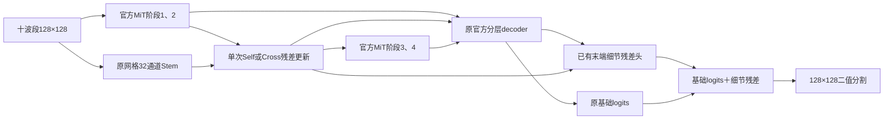

# 下一阶段执行计划：SegFormer 原网格细节的早期双向交换

日期：2026-10-20。本文是待执行计划，不是已实现或已验证的功能。本次只保存计划，不修改模型、不启动训练。

## 1. 要回答的问题

**保持 SegFormer 主干、原解码器和监督不变，让原网格细节在编码阶段参与一次双向交换，是否比只在末端融合更有效？收益是否超过新增参数本身的作用？**

依据是已完成的 v4r3：原 detailres 最佳双事件平均 IoU/AP 为0.308138/0.442504；低编码器LR降为0.282343/0.385201；DOFA整套系统降为0.196936/0.269052。三组共同漏检172/253个1–19px可评对象，其中1–4px为63/77。DOFA还改变了decoder、容量、初始化和训练精度，不能用它证明语义无效或空间粒度是唯一原因。

因此本阶段先控制信息交互发生的位置与来源。学习率、损失、采样、数据规模、骨干规模和原末端预测路径不同时改动。

## 2. 最小实验集合：历史参照＋两组新训练

| 架构名称 | 原网格Stem及原末端细节残差 | 阶段2后的新增残差模块 | 跨路径交换 | 正式训练 |
|---|---|---|---|---|
| SegFormer-B0-LateDetail | 保留 | 无 | 无 | 复用v4r1全量参照 |
| SegFormer-B0-EarlySelfResidual | 保留 | 有，两路各自处理自身特征 | 无 | 新训练1组 |
| SegFormer-B0-EarlyCrossExchange | 保留 | 与Self相同的模块及参数量 | 有，一次双向交换 | 新训练1组 |

建议配置文件名分别为 `segformer_b0_detail_early_self_residual_n100_u3600_s1234.yaml` 和 `segformer_b0_detail_early_cross_exchange_n100_u3600_s1234.yaml`，放在新的 `configs/segformer/v4r4/`。以上名称及文件尚待创建。

主比较是 **Cross对Self**，用于识别跨路径信息来源的作用；同时对历史LateDetail判断是否带来实际改进。Self不是固定零门控的空壳，新增模块必须真正训练，否则不能作为容量对照。仅比较Cross与历史主模型不足以证明交换机制有效。

历史参照仅在兼容性检查通过后复用；如果实现改变了公共模型行为、权重初始化、训练路径或数值精度且不能消除差异，应额外重跑同协议LateDetail，明确原因，不用旧结果冒充同版本对照。

## 3. 架构固定为一个交换位置

使用现有direct10的MiT-B0、原网格32通道Stem、官方SegFormer decoder和已有末端细节残差头。全部可学习参数训练，不增加粗定位头或辅助loss。

- 交换位置：**第二个encoder阶段输出之后、第三阶段输入之前**，仅此一次。
- 输入128×128时，阶段2特征 `E` 应为 `[B,64,16,16]`，Stem特征 `D` 为 `[B,32,128,128]`；实际运行必须断言这些形状，不能只依据文档假定。
- 用可训练 `P: 1×1 Conv(64,32)` 得到共同通道空间 `e=P(E)`；`D`已是32通道。
- `H_E` 为 `3×3 Conv(32,32) → GELU → 1×1 Conv(32,64)`；`H_D` 为 `3×3 Conv(32,32) → GELU → 1×1 Conv(32,32)`。两组完全同构、同bias策略，不加额外归一化/注意力/深度堆叠。
- `α_E`、`α_D` 分别是64/32通道可训练残差系数，均零初始化；其他新卷积使用同一明确初始化。

Cross组：

```text
E_new = E + α_E * H_E(adaptive_avg_pool(D, 16×16))
D_new = D + α_D * H_D(bilinear_upsample(P(E), 128×128))
```

Self容量对照：

```text
E_new = E + α_E * H_E(P(E))
D_new = D + α_D * H_D(D)
```

二者使用同一套 `P/H_E/H_D/α`，可训练参数数量精确一致。交换的上下采样方式固定，不尝试max-pool、多倍率或更多位置；这些操作作用于特征，不放大输入影像。两条更新同时由旧的E、D计算，不将更新后的某一路递归输入另一方向。

**E_new必须同时进入第三encoder阶段，并替换交给decoder的阶段2特征；D_new进入已有末端细节残差头。** 不能只改返回给decoder的hidden_states，然后把它叫编码阶段交互。其余三个阶段的decoder连接维持原逻辑。

保留原 `最终logits = 原SegFormer上采样logits + 原细节残差logits`，不额外增加分割头。本轮仍保留已有末端concat，避免同时改动输出架构；交换块内只用投影与残差加和，不增加多处concat。原残差结构是为了保持可比，不能把它再称为独立粗定位。



图中E12到decoder保留阶段1输出，阶段2输出必须用E_new替换，不允许重复传入两个阶段2特征。Q表示计算节点，不是第二个视觉骨干。

本轮不再单独增加attention模块。零初始化的通道残差系数用于稳定接入，不宣称它是内容自适应注意力。先验证早期信息交换，再决定是否有必要单独研究注意力。

## 4. 工程实施与预训练初始化

在现有工程增加一个轻量exchange模块及对应模型包装，factory增加独立可选类型/模式；原配置、类、接口和历史checkpoint继续可用。优先调用已安装Transformers的官方patch embedding、block、layer norm和decoder，不重写attention或完整基础模型。若需要stage级包装，应只处理编排和交换，避免依赖全局可变hook状态。

先实例化同一官方初始化的LateDetail，保存公共组件的初始状态，再给Self/Cross加载该状态；两组新增模块也加载同一初始状态。保存encoder、decoder、二值头、Stem、末端残差头和新增模块的初始哈希。不能仅设置相同seed后默认公共组件相同，因为构造新增层会消耗随机数。

不从历史best/last或DOFA checkpoint续训。官方RGB权重到B04/B03/B02的映射、其余波段初始化保持原实现。所有参数分组完整、不重复，新增交换参数归入6e-4组；不得因模块挂载位置被自动算入6e-5的预训练encoder组。

## 5. 接口验证门槛：通过后才正式训练

按Self、Cross顺序执行，使用真实TRAIN样本。

1. 前向检查输入、阶段2、阶段3、原网格分支、四层decoder输入及最终logits形状；确认E_new确实影响后续编码。
2. `eval()`下零系数初始输出与公共LateDetail逐像素一致，误差目标≤1e-6；Self/Cross的公共参数与新模块初始哈希相同。
3. 检查参数分组、学习率和总可训练参数，Self/Cross精确相等；无意外冻结、重复或遗漏。
4. 真实反传并检查多步后的梯度与权重变化。零残差系数及原末层零初始化可能让某些参数第一步无梯度，这是预期；应在约20步窗口内确认两方向均获得有限梯度并发生更新，不能误报首步全部非零。
5. 用诊断副本做干预：关闭某一方向后，另一方向输出遵循公式；强制非零残差系数时，改变D应影响Cross的阶段3输入；Self不应产生该跨路影响。诊断设置不带入正式训练。
6. 对相同固定8个TRAIN样本，无增强，跑100次更新；记录loss/IoU/两个门控系数及两路更新。若明显不能拟合，先查接口；100步未到某阈值本身不证明算法失效，不把它用作最佳超参搜索。
7. checkpoint保存/重载输出一致；真实batch64反传无OOM，记录显存与有限梯度；确认两组FP32、无静默AMP或batch变化。

验证产物与日志独立保存，不作为正式模型性能。若batch64不可行，先优化工程内存；确需更改有效batch或累积策略时应统一两组并记录协议差异，不能一组静默变更。

## 6. 正式训练协议：只跑两组

沿用原主模型策略，而非失败的低LR配置：

| 项目 | 固定设置 |
|---|---|
| 数据 | TRAIN2223；DEV Hiroshima448＋Thrissur221 |
| 输入 | 同十波段、同128网格、同有效区及缓存 |
| 统计 | 同TRAIN-only559统计文件 |
| seed | 1234，单种子 |
| 输入首层与其余预训练encoder LR | 6e-5 |
| decoder/二值头/Stem/原残差头/新增模块 LR | 6e-4 |
| 其他优化设置 | 同warmup/poly、weight decay、clip |
| loss | 同0.5 BCE＋0.5 Dice；无新辅助loss |
| 采样与增强 | 原natural采样、原flip/rot90 |
| 预算 | batch64，3600次成功更新，230400次曝光 |
| 数值精度 | FP32训练与评测 |
| 选模 | 每100步完整诊断，两个DEV事件平均IoU选择best |
| 保存 | best、last、配置、初始身份、曲线、源码快照、曝光记录 |

先Self，完成后Cross；不能看完Self成绩再改Cross的宽度、位置、LR或监督。接口修复可以进行，但应使两组最终使用同一版本；若修改影响已完成训练，需明确使该组失效并重跑，不能混用。

## 7. 评测与完成条件

两组best/last分别评TRAIN与DEV，阈值0.5，输出：双事件平均IoU、各事件IoU、合并IoU/Dice/Precision/Recall/AP、边界F1、六个面积档对象匹配数与分母、背景像素FPR、参数/显存/FP32推理速度。

使用原GT对象身份配对LateDetail/Self/Cross。沿用既有8个固定案例；另列v4r3共同漏检的172个1–19px对象和63个1–4px对象在新模型中的命中情况，但这些难例只用于诊断，**不能单独据它们选模或宣布整体改进**。记录新增命中、失去命中及两事件分布，不只报tiny百分比。

不推理Italy/New Zealand，不重分事件、不更改标签、不扩充未核实负样本；可靠无滑坡影像误报率继续N/A。这里只核对既定输入身份和结果一致性，不安排新一轮大规模数据质量审计。

判断顺序：

1. **工程是否正确**：门槛全部通过，精确更新/曝光和初始化可追溯。
2. **是否超过容量对照**：Cross是否优于Self，特别是IoU/AP、两事件、小对象绝对匹配数和边界；若两者一起优于原模型，只能说明增加模块有效，不能直接归因为跨路交换。
3. **是否带来实际改进**：Cross还应与历史LateDetail比较。只超过Self却仍低于原模型，不能替换主模型；只有tiny增加一两个也不足以判为成功。明确报告事件或误检权衡，不用平均分掩盖退化。
4. **若无改善就停止本结构**：不立即尝试更多交换层、更宽通道、更大骨干、不同LR或注意力组合。保留负结果，下一轮再单独检验对象/尺度监督；不能把所有因素混到同一次补救中。

这两组仍属单seed开发诊断，不声称统计显著或独立泛化验证。达到以上交付后本阶段结束，结构贡献的进一步验证另行安排。

## 8. 交付清单

- 两份新配置、轻量模块/包装与factory兼容接口，列出实际复用的官方组件。
- 接口验证报告、初始参数身份及参数组清单。
- 两组正式best/last、原日志、训练曲线、逐样本曝光、源码快照。
- 三架构对照表、对象配对CSV、固定案例与成本记录。
- 一份结论报告，明确“已运行”“未验证”“存在阻碍”，并据上述停止条件给出保留或放弃建议。

本计划没有为尚未实现的配置提供伪造可运行命令。实现完成后应补充使用现有train/eval入口的实际命令，并先完成上述验证，再交付正式结果。
