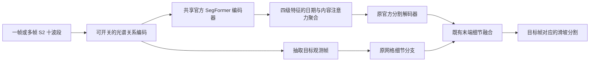

# 主模型多时相与光谱关系建模：修改计划及试验方案

状态：**仅制定方案，未获本轮执行要求；按用户最新指示停止实施与训练。**

本文件补充并更新 `event_cv_v5_review_and_next_plan_2026-10-20.md`。用户希望规划两件事：主模型开展多时相比较与更充分的光谱关系建模；复跑此前顺序方案。多时相研究与严格单期任务分开汇报，主任务仍是单期 Sentinel-2 十波段滑坡分割。

## 1. 研究问题与协议

本轮回答三个问题：同一主模型获得多帧后是否改善识别？显式建模波长位置、波段差异和非线性关系是否改善单期表现？光谱建模与多帧信息能否互补？这些问题不同于继续微调损失、学习率或增加残差小分支。

- 主模型仍复用官方 SegFormer 预训练 MiT 编码器和分割 decoder，保留原网格细节分支。
- 主模型四组统一使用官方可用子集 TRAIN/VAL/TEST = 3012/758/945、十个 S2 波段、128×128、同一归一化和 mask/valid，**不加 DEM**。U-TAE 纠错配对继续两组都加 DEM，单独成表。
- 只用 seed1234。主模型每组 3600 次成功更新、有效 batch64、230400 次目标图块曝光，原 encoder/head 学习率、warmup/poly、0.5 BCE + 0.5 Dice 和增强不变。
- 为适配多帧显存，正式训练前用最大配置确定共同微批量；例如 microbatch8 × accumulation8。四组全部采用同一微批量和累积方式，不能单期 batch64、多期 microbatch8 后直接忽略 BatchNorm 差异。这个数值待显存验收，不是已验证可运行配置。
- 梯度累积时 BCE 按全有效 batch 的有效像素总数归一化，Dice 按样本数加权；否则累积结果不等同原目标函数。
- 每100次成功更新仅按 VAL pooled IoU@0.5 选 best。TEST 已被反复查看，是开发型基准；不称新盲测，不用 TEST 决定阈值或模型超参数。
- 多期同样的目标图块曝光意味着更多影像帧和更多计算，**不是同计算预算**。记录输入帧曝光、训练时长、显存与推理成本。

## 2. 必要纠错：先恢复现有实验的可解释性

| 顺序 | 修改及试验 | 正式训练数 | 目的 |
|---|---|---:|---|
| 输入与评测契约 | 波段—波长映射；日期真正进入模型；缺失处理；统一对象/边界指标 | 0 | 修正会影响结论的实现问题 |
| DOFA 十波段冻结探针 | 保持原四折、原统计、原头、原预算，只修正波长 | 4 | 回答正确光谱身份下，多光谱是否优于同编码器 RGB |
| U-TAE 日期配对 | 单期＋DEM／15期＋DEM，启用真实日期位置编码 | 2 | 复核多帧增益，形成真实时间输入参考 |
| 截至单期日期的 U-TAE | 只用观测日期不晚于所选单期帧的真实观测 | 最多1，条件项 | 判断多帧收益是否依赖未来观测 |

**进一步核对源码后，对上轮审阅补充一项订正：** 不仅数据集输出帧序号，vendored U-TAE 的 LTAE `forward` 还注释掉了位置编码相加。因此原结果更准确地说明多帧影像集合的收益，不能归因于模型学习到了日期或时间间隔。只修复数据集而不启用位置编码，不会完成预期修正。

修改要求：

1. 波长使用按波段名称索引的同一映射表；RGB 从十波段抽取后必须得到一致的波长。保留错误波长的旧实现版本和 checkpoint 读取路径，避免旧 checkpoint 被新输入规则静默重解释。
2. U-TAE 保留原 vendored 文件；在独立适配器中启用其已有日期位置编码组件。两组从同一初始化开始，日期单位/基准一致，75 epoch、batch16、FP32、AdamW 与原配对一致。应称“官方组件的日期编码启用版”，不是未经修改的官方完整复现。
3. 日期干预测试必须证明：图像固定、改变真实日期间隔会改变日期编码/网络输出；同时重排帧和日期应保持集合聚合的一致性。仅核对张量形状不能代替实际读取验证。
4. 缺失只按明确源数据非有限值、nodata/填充值规则处理，均值仅来自 TRAIN。云、阴影、雪、未知 SCL 单独统计，不把所有零反射率或未知 SCL 当作缺失。沿用同一评价 valid，不能为多期改评价区域。
5. 统一用现有修正版对象指标：IoU≥0.25 一对一匹配、独立可评对象匹配、截断对象处理、严格 IoU≥0.5，以及同容差边界 F1。原 U-TAE“任意像素命中率”保留为附加诊断，不能冒充对象召回。
6. 截至日期组仅在日期配对修复后仍有清楚的多帧收益时进入；变长序列按长度分组或严格验证 padding。注意仅给 attention mask 还不够：归一化也可能受填充帧影响。该组只检验可用历史集合收益，不声称单独分离帧数和跨度。

## 3. 主模型修改方案

### 3.1 多时相路径：共享空间编码器，解码前聚合时间特征

每帧十波段输入共享同一个官方 SegFormer 编码器，取得四级空间特征。各级引入基于内容与真实日期间隔的时间注意力，对时间维聚合后送入原官方 decoder。原网格细节分支始终读取目标单期帧，在多帧提供背景和变化信息的同时保持输出对应的目标观测。

图中单期和多期共用空间模型与输出头，变化集中在输入帧集合及时间聚合；光谱模块独立开关，便于正交比较。

约束：

- 不把15期直接堆叠成150个通道；避免改变首层输入身份和破坏原预训练适配方式。
- 不以15张单期预测的平均作为主要时序模型；时间交互发生在特征层。
- 时间分支输入真实日期，建议用相对目标观测日期的时间间隔，记录单位与编码公式；不把帧序号当真实间隔。
- 单期和多期使用同一时间聚合接口；T=1 时应退化为原空间特征，验收同权重输出一致性。对应单期空间参数和多期空间参数须从同一初始 state_dict 出发。
- 多期新增时间聚合参数没有预训练权重，应明确随机初始化后经监督训练，不能声称整个多期模型都预训练。

### 3.2 光谱路径：位置编码＋波段交互＋可学习关系变换

目标不是简单增加通道权重，而是让模型区分波段身份、波长距离，以及局部光谱之间的差异和组合。

建议采用**局部波段 Transformer**：在同一空间小块内，将每个波段视为一个 token；初始设计为4×4像素块、10个波段token、隐藏维64、4个注意力头、2层。这里4×4是计算分块，输出重构回128×128，并非假装提高真实空间分辨率。这些规格在正式训练前固定，不做宽度/层数网格搜索。

三个部分：

1. **波长位置与波段身份。** 对真实中心波长使用连续位置编码，让 B02 与 B12 在输入身份上可区分；同一映射表服务 DOFA 修复和新模块，避免再次出现错位。
2. **波段间交互。** 复用 PyTorch 多头注意力，让10个波段token交换信息。加入可学习的关系偏置，候选输入为波长差、局部反射率差和稳定的归一化差。关系值在还原反射率后计算，不能在各波段独立 z-score 数值上直接套物理比值；近零分母、负反射率和缺失位置必须有明确处理。
3. **非线性运算与重构。** 使用 MLP 学习哪些差异/组合有用，再残差重构十波段空间特征送入原编码器和细节分支。输出投影可零初始化，使初始响应与基线一致；验收需检查若干真实更新后注意力与关系分支实际获得梯度，不能只看首步。

关系偏置的具体公式、裁剪范围及缺失处理在实现前写入配置，随后固定。波段差和归一化差是提供的候选运算，模型学习其使用方式；不能仅凭注意力热图宣称模型发现了物理规律或掌握任意算术。该模块是基于成熟组件的项目适配方案，不包装成已有官方预训练光谱网络。

## 4. 主模型正交试验：四组回答三个问题

| 架构 / 策略 | 输入 | 光谱关系模块 | 比较问题 |
|---|---|---|---|
| SegFormer＋细节分支，单期参照 | 所选1期、10波段 | 关闭 | 新共同训练实现下的基准 |
| SegFormer＋细节分支，多期时间聚合 | 同源15期、每期10波段 | 关闭 | 与单期参照比较，多帧信息收益 |
| SegFormer＋细节分支，单期光谱关系编码 | 同一所选1期、10波段 | 开启 | 与单期参照比较，光谱建模收益 |
| SegFormer＋细节分支，多期光谱关系编码 | 同一15期、每期10波段 | 开启 | 与多期组、单期光谱组比较，互补或冗余 |

四组保持同一训练样本、目标标签、评价区域、损失、预算、空间预训练权重及微批量规则。原历史单期结果仅作参考；不能以它替代本批参照，因为新的数据处理或微批量可能影响结果。

各因素的比较：

- 时间收益：多期时间聚合 − 单期参照。
- 单期光谱收益：单期光谱关系编码 − 单期参照。
- 多期光谱收益：多期光谱关系编码 − 多期时间聚合。
- 交互作用：上述多期光谱收益 − 单期光谱收益。该差值只是单seed方向证据，不宣称统计可靠的交互效应。

先完成无光谱的单期/多期两组，再完成光谱单期/多期两组。不得中途根据 TEST 修改第二对的结构；四组结构和超参数需在第一组正式训练前锁定。

## 5. 共同验收、指标与解释边界

正式训练前的必要检查：

- 同一图块的目标日期帧在单期/多期输入中逐像素和日期一致，mask/valid一致；真实排序与帧ID可追溯。
- 光谱分支的波段/波长联动重排测试、错配测试和非RGB扰动测试通过。以输入和梯度证明分支在使用额外波段；这些接口检查不等同任务收益。
- 共同空间权重初始化一致；T=1退化、光谱初始恒等、保存重载一致性通过。
- 日期编码真正进入预测路径；填充帧不影响有效帧结果；不存在标签派生的选帧规则。
- 最大配置真实前反向、峰值显存、无NaN、梯度有限、小批拟合通过；随后丢弃smoke权重，正式运行重新初始化。

指标统一为 pooled IoU、Dice、Precision、Recall、AP、逐事件指标、对象尺度召回、边界 F1 和成本。best/last均保留，但不当作独立重复。保留完整曲线、概率图、逐图块与逐对象结果，固定案例统一展示RGB、GT、预测、误报/漏检和边界。

重点检查：提升是否只来自Recall增长而大量增加误报；是否改善小对象和边界；是否由少数事件主导；较晚影像是否包含目标单期时刻不可见的痕迹。单期光谱收益与多时相收益分别报告，不能用多时相成绩替代单期任务成绩。

## 6. 执行顺序与范围边界

未来正式执行顺序为：输入/指标验收 → 4组 DOFA 波长纠错 → 2组 U-TAE 日期配对 → 主模型4组正交试验 → 按收益决定是否补1组无未来观测 U-TAE。

**固定部分共10组正式训练，条件部分最多1组。** B2来源受阻项目不自动加入，不恢复三种子，不重跑既有数据规模/事件数量实验，不同时加入新loss、decoder或学习率搜索。

若主模型光谱方案在官方开发基准有收益，下一批才用已锁定事件四折验证“单期参照 vs 单期光谱关系编码”，避免直接把随机split上的改善称为跨事件能力。若多期仅在完整回顾性窗口有效，保留为输入充分性结果，不转换任务目标。若四组仍无实质收益，按逐事件、尺度和可见性证据决策，不能继续默认叠加模块。

## 附录：本会话误启动工作的停止记录

用户已澄清只要求方案。两个运行会话（探针复跑调度、时序质量侧表构建）已中断，返回退出码1；随后GPU显存/利用率回落至启动前水平。

- 探针尚未完成，停止前日志分别到约2300和1900更新；不能列入正式结果，不以中途指标选路线。
- 时序质量侧表尚未完成；已有部分 memmap 文件，没有完整验收标记，不能作为可用数据输入。
- 本会话已产生的源码修改及新草稿保留，**没有完成集成验收，不等于本方案已经实现**。特别是草稿光谱模块尚未包含本方案明确的关系偏置；U-TAE日期适配器、数据侧表和模型组合也未完成GPU验证。
- 草稿主要涉及 `models/spectral_contract.py`、`models/spectral_temporal.py`、`models/utae_dates.py`、`data/temporal_v6.py`、探针波长版本参数，以及对应启动/缓存脚本。历史读取默认仍保留旧波长版本；正式执行前需要审核草稿与本方案的一致性。
- 不删除历史代码、数据、checkpoint、manifest或报告，不将这些中断产物标记为完成，不安排后台自动续跑。

本文件为计划交付，不报告新实验效果。
