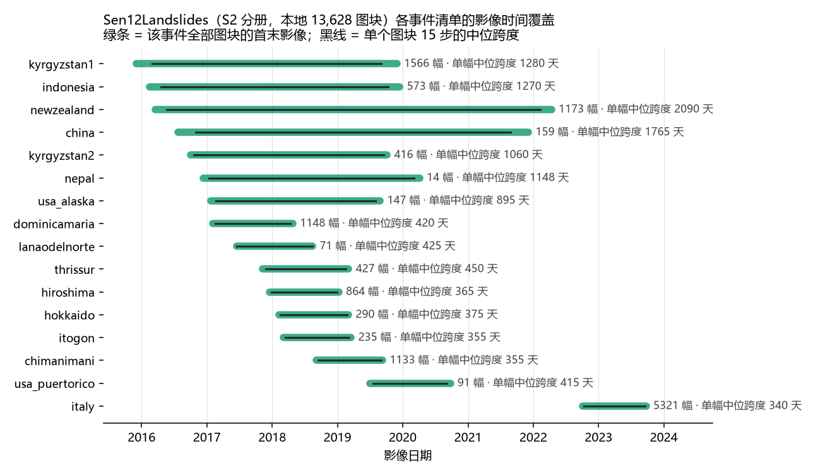
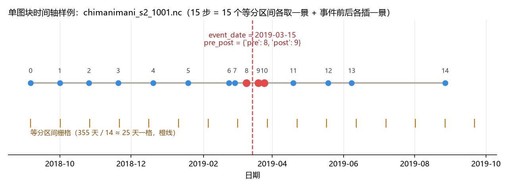

# Sen12Landslides 的多时相结构与时间跨度（2026-10-21）

用途：回答两个问题——**它是怎么做多时相的**、**时间跨度到底有多大**；并把结论落到本项目（10 m S2 十波段、128×128）能怎么用。
所有数值分两类来源：**官方口径**（Scientific Data 12:1772, 2025 与官方仓库 README）与 **本地全量实测**（本机 13,628 个 S2 图块逐文件扫描，0 失败）。

---

## 0. 阅读约定与扫描设置

| 项 | 说明 |
|---|---|
| 本地数据 | `landslide-seg/data/sen12/*.nc`，13,628 个文件，**仅 S2 分册**（S1 升轨 13,306 / 降轨 12,622 未落地本机） |
| 单文件结构 | 10 个 S2 波段 `B02 B03 B04 B05 B06 B07 B08 B8A B11 B12` + `SCL` + `DEM` + `MASK`，形状均为 **(15, 128, 128)**；`time` 为长度 15 的 int64 |
| 时间编码 | `time` 的 units 为 **`days since <该文件的参考日>`**（逐文件不同，如 `days since 2018-09-06`） |
| 元数据（根属性） | `event_date`、`date_confidence`、`pre_post_dates`（形如 `{'pre': 8, 'post': 9}`，是 15 步中的**索引**）、`annotated`、`ann_id`、`ann_bbox`、`satellite`、`crs`、`center_lat/lon` |
| 扫描脚本 | `_diag/scan_sen12_timespan.py`（只读元数据与 time；MASK 抽样 800 幅验证）；产物 `_diag/sen12_timespan.json`、`_diag/sen12_timespan_events.csv` |
| 口径提醒 | 论文的 126,086 条滑坡**记录年份**为 2016–2023；**影像**的首末日期是另一回事（见主表第 2 行） |

---

## 1. 主表 A：多时相是怎么做的（官方口径 + 本地验证）

| 环节 | 官方做法（论文/仓库） | 本地实测验证 |
|---|---|---|
| 时相数量 | 每个图块固定 **15 个时间步**；S1 升轨、S1 降轨、S2 **各做一套独立图块**，不是把三种传感器强行对齐到同一时间轴 | 13,628 个文件**全部为 15 步**（100%） |
| 选景规则 | 把该图块的**全部可用观测跨度切成 15 个等时间区间**，每区间取质量最好的一景（S2 按云量、S1 按无效像元比例） | 抽样 100 幅：`median(实际间隔) / (跨度/14)` 的中位数 = **1.00**，等分栅格性质成立 |
| 时间窗口 | 围绕滑坡触发事件**前后各 1 年**筛选；要求事件前后至少各有一景 | 单图块跨度中位 **362 天**，与"约 1 年"一致 |
| 事件日来源 | 有清单日期则直接用（前/后各 7 天窗口，`date_confidence=1`）；无日期则用 **NDVI 突降**自动推算（取突降点前后各 10 步窗口内 NDVI 最高/最低点） | 13,628 幅中 **6,739 幅（49.4%）**带 `event_date` + `pre_post_dates`，且 `annotated=True`；其余 6,889 幅无标注（AD 任务负样本） |
| 事件前后定位 | 单独记录事件前/后两景在 15 步中的**索引** | `pre` 中位 7（范围 0–13），`post` 中位 8（范围 0–14）；两景实际间隔中位 **8 天**（p25 5 / p75 10） |
| 掩膜语义 | **一次事件级二值掩膜，复制到全部 15 步**；表示"是否属于已编目的滑坡区"，**不是**逐时相的变化掩膜 | 抽样 800 幅，**MASK 跨 15 步完全相同（800/800）** |
| 辐射一致性 | 论文发布版 S1 未转 dB、S2 未做 2022-01 后的 +1000 DN 偏移修正；仓库的 harmonized 版补齐（S1 → dB 且截断到 [−50,10]；S2 修偏移并截断到 [0,10000]；DEM 截断到 [0,8800] m） | 本机文件为 int16 原值，未做 harmonize |

---

## 2. 主表 B：时间跨度（本地全量实测）

| 口径 | 数值 |
|---|---|
| **全库影像首末日期** | **2015-12-03 → 2023-09-25**（约 7.8 年） |
| 单图块 15 步跨度 | 最短 245 天 / p10 330 天 / **中位 362 天** / p90 1377 天 / 最长 2215 天 |
| 相邻两步实际间隔 | 最短 1 天 / p25 20 天 / **中位 27 天** / p75 45 天 / 最长 1858 天 |
| 事件日 → 最早一景 | p10 174 天 / **中位 213 天** / p90 290 天 |
| 事件日 → 最晚一景 | p10 117 天 / **中位 132 天** / p90 256 天 |
| 事件前后各一景的间隔 | **中位 8 天**（p25 5 / p75 10） |
| 时间步是否恒为 15 | 是（13,628/13,628） |
| MASK 是否随时间变化 | 否（抽样 800/800 完全一致） |

### 分事件清单的时间覆盖（16 个，完整表见 `_diag/sen12_timespan_events.csv`）

| 事件清单 | 图块数 | 影像覆盖 | 单图块中位跨度 |
|---|---:|---|---:|
| italy | 5,321 | 2022-10-05 → 2023-09-25 | 340 天 |
| kyrgyzstan1 | 1,566 | 2015-12-03 → 2019-11-30 | 1,280 天 |
| newzealand | 1,173 | 2016-03-17 → 2022-04-13 | **2,090 天** |
| dominicamaria | 1,148 | 2017-02-01 → 2018-04-27 | 420 天 |
| chimanimani | 1,133 | 2018-09-06 → 2019-09-11 | 355 天 |
| hiroshima | 864 | 2017-12-18 → 2019-01-09 | 365 天 |
| indonesia | 573 | 2016-02-15 → 2019-12-16 | 1,270 天 |
| thrissur | 427 | 2017-11-10 → 2019-03-05 | 450 天 |
| kyrgyzstan2 | 416 | 2016-10-01 → 2019-10-06 | 1,060 天 |
| hokkaido | 290 | 2018-02-07 → 2019-03-04 | 375 天 |
| itogon | 235 | 2018-03-04 → 2019-03-19 | 355 天 |
| china | 159 | 2016-07-24 → 2021-12-05 | 1,765 天 |
| usa_alaska | 147 | 2017-01-23 → 2019-08-28 | 895 天 |
| usa_puertorico | 91 | 2019-07-02 → 2020-09-24 | 415 天 |
| lanaodelnorte | 71 | 2017-06-16 → 2018-08-15 | 425 天 |
| nepal | 14 | 2016-12-12 → 2020-04-05 | 1,148 天 |

---

## 3. 图与解释



**怎么读图**：每行一个事件清单；绿条的长度是**该清单全部图块影像的最早—最晚日期**（不是单个图块）；条上那根细黑线是**单个图块 15 步的中位跨度**。应该看的对比是"黑线短、绿条长"的事件（newzealand、kyrgyzstan1、indonesia、china、nepal）——这些清单里有多个触发事件，序列被迫拉长，15 步被摊在数年的时间上；黑线与绿条几乎等长的（italy、chimanimani、hiroshima、hokkaido、itogon）则是单事件清单，序列紧贴"事件前一年"这个窗口。



**怎么读图**：一行 = 一个图块的 15 景（横轴是真实日期，数字是时间步索引 0–14）；红点是距事件日 10 天内的两景，红色虚线是 `event_date`；下方橙色竖线是"把 355 天切成 14 格"的等分栅格。应该看的是：大多数点几乎落在橙线上（等分区间取景），唯独事件附近挤了 4 个点（等分规则 + 事件前后各插一景被打断），这就是它既能当"演变序列"用、又能当"变化检测对照组"用的原因。

---

## 4. 展开结论

### 4.1 它的"多时相"不是连续时间序列，而是**等分稀疏采样 + 事件对齐**

**机制**：先按事件前后 1 年圈定候选影像，把这段（或更长的）可用观测跨度均分成 15 个等长区间，每区间挑一景云量最低的；再额外保证事件前后各有一景，并把它们在序列中的**索引**记进 `pre_post_dates`。所以相邻两景通常隔 20–45 天（实测中位 27 天），远大于 S2 的 5/16 天重访周期。

**证据**：全量扫描里 `median(实际间隔)/(跨度÷14)` 的中位数为 1.00；`pre`/`post` 索引中位 7/8，两景实际只隔 8 天——前者证明等分栅格，后者证明事件附近被额外加密。

**边界**："每区间取云量最低的一景"这条规则我**没有逐景验证**（需逐景云量对比 SCL 与 time 的对应关系，本次只统计了时间结构）；"灾后覆盖偏短（132 天 vs 213 天）"我推测是灾后多云雨导致近事件影像不可用、序列被推后，**未验证**。

### 4.2 掩膜是"一次事件编目广播到 15 步"，所以它**不能**直接当变化检测标签用

**机制**：官方明确 MASK 是事件级二值掩膜，15 步共用；本项目此前的判断（`experiment_log.md`）与之一致，本地抽样 800 幅 MASK 跨时间完全相同予以确认。

**证据**：800/800 幅 MASK 在 15 个时间步上逐像素相同；13,628 幅中仅 49.4% 带 `annotated=True`。

**边界**：这不等于"数据无用"——负样本（6,889 幅）本来就是无标注的"正常区"序列，可以当弱负证据；把它当"变化标签"用会得到全零的时序差分，**不能**据此说模型没学到变化。

### 4.3 对本项目的直接含义

1. **现成的变化信号是"事件对齐后的相对时间"**：`t − event_date` 与 `pre/post` 索引已经写在文件里，本项目 loader（`src/landslide_seg/data/sen12.py`）已解析 `time`/`pre_post_dates`，并已有逐帧云量与无效像元统计（`data/s2_temporal_v6_quality/`，4,715 个样本 × 15 帧）。可以直接把"事件前后"当标签来源，而不只是把 15 帧当独立样本。
2. **不要把 15 步当 15 倍数据**：掩膜不变、且相邻帧高度自相关，随机切分会让训练集和验证集共享同一事件的相邻帧，指标会被高估。切分必须**按事件清单**（本库只有 16 个）与**按 pre/post 边界**做。
3. **多事件清单（newzealand / kyrgyzstan / indonesia / china / nepal）时间跨度达 1,000–2,200 天**，其时间步间隔被拉到数月，这些清单的"时序"与单事件清单不是一回事，做时序实验时应分开统计。

---

## 5. 限制与下一步

| 限制 | 说明 |
|---|---|
| S1 未落地 | 本机只有 S2 分册；S1 升/降轨各 13,306 / 12,622 幅未下载，其时间结构**只有论文描述、没有本地实测** |
| 逐景云量未逐条复核 | "每区间取云量最低"是从论文与等分性质反推的，未逐景比对 SCL 与 time |
| 负样本含义 | 6,889 幅 `annotated=False` 的图块在 AD 任务里作负样本，但其"无滑坡"是"无编目"，不等于"无滑坡" |
| 事件日自动推算部分 | NDVI 突降推算只对无清单日期的事件生效；本地有 `event_date` 的 6,739 幅中，未区分日期来源 |

| 下一步 | 做法 | 产出 |
|---|---|---|
| P0 | 逐景核对 SCL 云量与 time 的对应，验证"等分取景 + 事件插值"规则 | 规则确认表（可写进 `data_contract.md`） |
| P1 | 用 `pre/post` 索引构造"灾前负证据—灾后正证据"的对比任务，与现有二分类主表**分开评估** | 一张对照表 + 独立指标口径 |
| P2 | 按 16 个事件清单做**分组切分**重跑当前实验，量化"随机切分高估"的幅度 | 切分口径修订建议 |
| P3 | 落地 S1 升降轨分册，做 S1+S2 融合的时序增益实验（论文已给 S1 补漏的定性结论） | 融合消融表 |

---

## 附录 A：复现命令

```bash
# 全量时间结构扫描（只读元数据，约 40 秒）
"C:/Users/yzh/.workbuddy/binaries/python/versions/3.13.12/python.exe" \
  N:/Users/yzh/Disater/_diag/scan_sen12_timespan.py

# 重绘两张图
"C:/Users/yzh/.workbuddy/binaries/python/versions/3.13.12/python.exe" \
  N:/Users/yzh/Disater/_diag/plot_sen12_temporal.py
```

## 附录 B：产物索引

| 文件 | 内容 |
|---|---|
| `_diag/scan_sen12_timespan.py` | 全量扫描脚本（h5py 直读 netCDF，无需 netCDF4 包） |
| `_diag/sen12_timespan.json` | 全库时间统计（跨度、间隔、事件相对偏移、pre/post 索引分布等） |
| `_diag/sen12_timespan_events.csv` | 16 个事件清单逐行统计 |
| `_diag/plot_sen12_temporal.py` | 绘图脚本 |
| `docs/figures/sen12_temporal_coverage.png` | 图 1：分事件影像覆盖 |
| `docs/figures/sen12_patch_timeline_example.png` | 图 2：单图块 15 步时间轴样例 |

## 附录 C：参考来源

- Høehn et al., *Sen12Landslides: A Spatio-Temporal Dataset for Satellite-Based Landslide Detection and Anomaly Detection*, Scientific Data 12:1772 (2025) — https://www.nature.com/articles/s41597-025-06167-2
- 官方仓库 README（版本、harmonized 规则、任务切分）— https://github.com/PaulH97/Sen12Landslides
- 官方仓库内嵌副本：`landslide-seg/vendor/official/Sen12Landslides`
- 本项目既有结论：`docs/experiment_log.md`（掩膜为事件编目复制）、`docs/data_source_review.md`（数组转置与波段实测）、`src/landslide_seg/data/sen12.py`（time / pre_post 解析）
