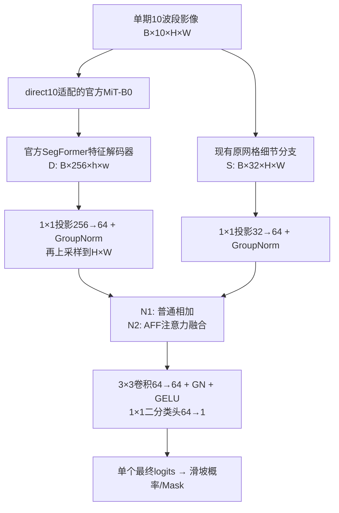

# 单头分割与语义—细节注意力融合执行计划

日期：2026-10-19。状态：执行计划，模型改动及本轮训练均待实施。

本计划替代 `native_resolution_experiment_plan_2026-10-19.md` 中先加深Stem、再有条件增加残差门控的安排。

> **2026-10-19 执行状态：已完成（seed 1234，3,600 步）。**
> 结果见 [single_head_report_2026-10-19.md](single_head_report_2026-10-19.md)：
> val IoU — **N0 0.2987 / N1 0.2692 / N2 0.2690**；test — 0.0529 / **0.0755** / 0.0727。
> N2 与 N1 持平（Δval −0.0002），AFF 无稳定增益；按 §8 保留负结果、以 N1 为简单参照。
> 单头相对 N0 呈"val 降、test 升"权衡（test 对象召回 0.029→0.067，边界 0.111→0.167）。
首轮必须完成CF0-noAUX、单头普通融合、单头注意力融合三组。历史代码、配置、数据和checkpoint保留；本轮不重建工程。

## 1. 目标与边界

研究问题：移除显式粗定位预测路径后，SegFormer语义特征与原网格细节特征能否通过一个统一预测头完成更好的分割？相较普通特征相加，注意力融合是否能改善小对象、边界及误检？

- 保留官方MiT-B0和官方SegFormer解码器的特征计算模块，复用其预训练权重。
- 区分输入适配器和细节分支：本轮沿用direct10；不同时改成10→3投影。现有Spectral Stem在文档及日志中称为“原网格细节分支”。
- 原网格细节分支仍为现有10→32的1×1/3×3卷积，不在首轮额外加深；避免把注意力收益与分支容量混淆。
- 新单头模型移除粗二分类输出、粗概率条件、粗辅助损失及 `C+Δ` logits残差路径，保留SegFormer分层语义特征。去掉粗定位不等于去掉语义上下文。
- 全部实际使用的模块均参与训练，不默认冻结编码器；参数分组、梯度及真实更新必须有记录。
- 输出是共同10m输入网格上的二值Mask，不做超分辨率，不恢复原生20m波段中不存在的10m细节。

## 2. 实验矩阵

| 标识 | 建议实验名 | 模型输出与融合 | 损失 | 主要对照 |
|---|---|---|---|---|
| 历史参照 | A1 / CF0 / CF1 / U0 | 已完成，不修改 | 原配置 | 提供旧方案效果与成本 |
| N0 | CF0_NOAUX | 原CF0结构：P=0，F=C+Δ | 仅Lseg(F) | 对CF0隔离粗辅助监督影响 |
| N1 | SINGLE_SUM | 语义与细节对齐后相加，单个最终头，无C | 仅Lseg(F) | 对N0/A1比较简化后的整体方案 |
| N2 | SINGLE_AFF | 与N1相同，仅将相加换成AFF注意力融合 | 仅Lseg(F) | 对N1检验注意力融合模块 |

N0、N1、N2均为本轮必做。N2不以N1必须先提高精度为启动条件，只需工程运行门槛通过。

解释边界：N1相对N0同时改变了最终预测路径和融合方式，是整体结构试行，不声称已纯粹隔离“删除粗头”这一个因素。N2与N1的共享结构和初始化必须匹配；N2引入额外参数，收益首先属于注意力融合模块整体，不直接宣称排除所有容量因素。

## 3. 新架构：对齐 → 融合 → 单头预测

128×128输入时，h=w=32，两路融合张量均为B×64×128×128。H/W从输入读取，不将128写死在模型层中；当前数据入口的128图块限制暂不改变。

具体定义：

- `U = up(GN8(Conv1×1(D,256→64)))`。先降通道再上采样，减少中间张量成本。
- `V = GN8(Conv1×1(S,32→64))`。
- N1：`Z=U+V`。
- N2：`Z=AFF(U,V)`。
- 两组共用相同最终头：`Conv3×3(64,64,pad1,bias=False) → GN8 → GELU → Conv1×1(64,1)`。
- 最后1×1采用标准小随机权重初始化、bias=0，不把最终单头零初始化当作沿用残差头的默认规则。

“共同特征空间”在此首先指可学习投影后的同尺寸、同通道表示。两路是否真正语义对齐由端到端监督学习，尺寸对齐本身不等于已实现语义对齐。

## 4. 注意力方案：首轮复用AFF

参考 [Attentional Feature Fusion, WACV 2021](https://openaccess.thecvf.com/content/WACV2021/html/Dai_Attentional_Feature_Fusion_WACV_2021_paper.html) 和 [作者仓库open-aff](https://github.com/YimianDai/open-aff)。已核对仓库中 `aff_pytorch/aff_net/fusion.py` 的AFF模块；实施时固定代码版本、来源和适配记录，不引入仓库中的完整分类训练框架。

采用单次AFF，通道64、缩减比例r=4。它根据两路特征的初始和，结合局部与全局分支生成通道—位置相关的连续权重W；沿用参考实现的尺度约定：

`Z = 2 W ⊙ U + 2 (1-W) ⊙ V`。

这里是特征注意力融合，不是显式Q/K/V交叉注意力，也不输入粗Mask。它可以在不同位置和通道调整两路贡献，但互补性需要实验验证，不由模块名称保证。

### 可比初始化与实现约束

- 对AFF两条注意力支路末端归一化层采用零缩放/零偏置初始化，使初始W=0.5，因此初始Z严格退化为U+V。该初始化是本项目适配，需在报告中注明。
- N1/N2共享编码器、解码器、细节分支、投影和预测头的初始张量；数据顺序与增强随机流独立控制。仅使用同一seed不足以保证这些一致。
- 保留参考AFF的单次局部/全局融合，不同时添加iAFF、多级门控或多层交叉注意力。
- 参考全局分支含池化后的BatchNorm，实际训练微批量需大于1；batch1推理使用eval模式。检查尾批及过拟合测试，不能用梯度累积的有效batch替代BN实际微批量。若需要改归一化，先记录适配并统一运行验证，禁止静默替换。
- 权重可视化不等于贡献证明；必须有N1重训对照和分支敏感性分析。

不优先使用全分辨率全局Q/K/V注意力：128×128为16,384个位置，单个头的完整位置关系规模约2.68亿。首轮先验证轻量AFF；若后续证据支持更强跨位置交互，再独立设计窗口或降采样K/V方案，不混入当前三组。

## 5. 工程改动范围

| 文件/位置 | 修改目标 |
|---|---|
| `models/segformer.py` | 保持旧类/路径兼容；新增单头模型封装或明确模式，复用官方特征解码计算 |
| `models/feature_fusion.py`（拟新增） | 对齐投影、SUM/AFF统一接口、单个最终头；记录AFF来源及初始化差异 |
| `models/spectral_stem.py` | 复用现有细节分支；首轮不加深 |
| `models/factory.py` | 按模型身份构造CF0_NOAUX/SINGLE_SUM/SINGLE_AFF，正确重载checkpoint |
| `training/segformer_trainer.py` | 支持仅final_logits的模型、参数统计、分项日志，拒绝单头模型启用coarse_loss |
| `config.py`及拟新增配置目录 | 验证fusion、输出模式、损失组合；保留旧默认行为 |
| 评测/可视化脚本 | 粗字段仅对实际具有粗输出的模型生效；新模型不伪造base_logits作为粗结果 |
| 对应测试 | 旧checkpoint兼容、AFF初始等价、注意力梯度、单头输出及保存重载 |

单头模型只加载编码器与官方解码器的特征计算权重；将最终分类操作移到融合后。不保留不参与计算的旧二分类头、fusion或refiner作为“可训练参数”。优先通过官方模块接口取解码特征；不复制Transformer和解码器算法。旧checkpoint按原模型身份加载，不能用strict=False悄悄吞掉错配。

对N0保留原CF0计算结构，避免同时清理模块改变对照；单独报告其18,561个未使用fusion参数。新模型同时报告总参数、requires_grad参数及实际收到梯度的参数。

## 6. 固定训练协议

- 单种子1234，现有`s2_10band_v3_p20`、manifest、统计量、划分、增强与valid规则。
- MiT-B0、direct10、同一官方预训练来源。新层从固定初始化开始，不分别从历史best续训。
- FP32，有效batch64，3,600次实际optimizer更新；AdamW，encoder LR=6e-5，其余6e-4，weight decay=0.01，5% warmup + poly，梯度裁剪1.0。
- `Lseg = 0.5 masked BCEWithLogits + 0.5 masked Dice`；三组均只监督最终输出。N0的粗头仍通过最终损失更新，N1/N2没有粗头。
- 所有实际使用的层均可训练；不新增冻结阶段、边界损失、Focal、输入投影变化或采样变化。
- 保持完整曲线和best选择口径。已有早期验证峰值是泛化诊断依据，本轮不同时调整训练调度；后续训练策略作为独立实验。
- 若资源不足，记录具体显存/微批量限制并采用一致的可比设置；不静默改变某组精度或训练步数。

## 7. 执行阶段与运行门槛

### P0：整理粗定位独立评价

复用已有CF0/CF1等checkpoint，对C与F分别报告IoU/Dice/P/R、预测面积和按尺度对象召回；补充粗概率PR曲线及5%/10%/20%候选预算的区域Precision、GT覆盖、对象触及率与对象内部覆盖比例。区分图块宏平均与跨图汇总。

默认分析使用按最终IoU选出的同一checkpoint；不要将它称为粗任务最优checkpoint。定位阈值如需选择，仅在Hiroshima完成再冻结；Italy仅作历史诊断集。该任务与工程开发可穿插，不变成全量数据审计或新训练的漫长前置条件。

### P1：完成N0并运行

只增加CF0_NOAUX配置，检查粗项不再进入loss、C仍有最终损失梯度。真实样本短程更新、保存重载通过后，完成3,600步正式训练。独立保存，不覆盖CF0。

### P2：实现N1/N2及必要验证

1. 从真实缓存读取样本，确认两路64通道H×W特征与单头输出正确，影像/mask/valid对齐。
2. 相同公共初始参数下，N2的W=0.5且输出与N1在浮点容差内一致；日志写入误差。
3. 检查最终损失能更新编码器、官方解码器、细节分支、投影、最终头；N2注意力在若干步后获得梯度和权重更新。零初始化末端导致首步部分梯度为0属预期，不要求每层首步都非零。
4. 空标签、部分无效及全无效batch处理正确；全无效batch跳过且不计optimizer步数。
5. batch1 eval、正常训练微批量及尾批均可运行；保存/重载输出一致，断点恢复步数和LR正确。单头模型不得被评测脚本误判成粗细两阶段。
6. 固定8张训练图关闭增强，分别做最多500步过拟合，目标前景Dice≥0.90。未达标先定位实现或优化原因，不把随机/未训练结果当性能。

### P3：正式训练与冻结评测

按N1再N2顺序完成正式训练；两组无论结果是否提升均保留。根据Hiroshima最终IoU选择best，最终阈值0.5；冻结配置后统一评测Italy，不据其反复调参。

## 8. 注意力是否真正互补：验收证据

- 主对照为N2对N1：最终IoU、Dice、Precision、Recall，以及1–4像素/小中大对象召回和边界F1。IoU提高但小对象召回下降，应明确为权衡。
- 对N2记录W的分布、饱和比例，并按前景内部、边界及背景分别汇总；检查是否长期只选择一个分支。GT仅用于事后分析，禁止输入模型生成注意力。
- 固定N2 checkpoint，将W替换为0.5、分别干预语义/细节特征，观察输出变化；标注这是分布改变下的敏感性检查，不是重训消融，不把它单独当作因果证明。
- 展示固定训练/Hiroshima/Italy案例中的找回、漏检、新误检和边界变化；注意力图仅作辅助，不替代预测证据。
- 同设备/精度记录训练显存、batch1推理延迟、吞吐、参数量，计时包含两路投影和AFF。
- 若N2没有稳定于当前单次运行的指标收益或显著增加误检，保留负结果，优先采用简单组作为后续参照，不自动堆叠更多注意力模块。单种子不支持统计显著性结论。

## 9. 交付与状态

交付三组可执行配置、实现改动清单、预训练/初始化记录、实际运行门槛结果、best/last、训练曲线、评测表、粗定位独立报告、融合敏感性分析和复现命令。

计划文件不冒充可运行配置；配置与命令在实现后实际试运行再交付。当前完成的是方案和参考实现核对，N0/N1/N2的新训练、注意力融合效果及资源实测均未完成。旧“先加深Stem，再条件性门控”的执行顺序停止作为主计划。
