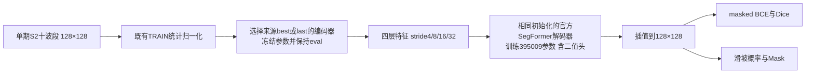

# v4r2冻结编码器诊断：复现入口

新增内容复用现有SegFormer模型、官方decoder、masked BCE+Dice、数据加载、update训练器与评测器。训练池/统计/事件划分继续使用已冻结v4r1协议；输出版本独立为 `s2_10band_v4r2_probe`。旧run与权重不覆盖。

## 两组因素

唯一核心因素是编码器来源：原全量标准SegFormer的best（1200更新）与last（3600更新）。只加载 `model.segformer.*`，不加载来源decoder。两组均从同一官方decoder及seed1234初始化的二值头开始，可训练395009参数；编码器3330368参数冻结并始终eval，含原输入卷积。

新增七通道在来源训练中已经参与学习；本轮不运行初始RGB有效输入冻结组。source checkpoint完整文件哈希、来源步数、stats/manifest身份均绑定进两个YAML。非线性decoder probe不能称linear probe，不以单seed差异作因果证明。



best/last来源分别运行独立实验，不在一个模型里融合。冻结仅用于此次机制诊断，不代表已经决定最终研究模型必须冻结主干。

## 命令

在项目根目录PowerShell运行：

```powershell
$py = 'C:/Users/yzh/.workbuddy/binaries/python/envs/tm/Scripts/python.exe'
& $py scripts/prepare_frozen_decoder_probes.py
& $py -m pytest tests/test_frozen_decoder_probe.py tests/test_update_training.py tests/test_segformer_adapter.py tests/test_segformer_model.py -q --basetemp outputs/segformer/v4r2_probe_reproduction_test_tmp
& $py scripts/run_frozen_decoder_probes.py --validate-only --device cuda:1
& $py scripts/run_frozen_decoder_probes.py --device cuda:1
& $py scripts/summarize_frozen_decoder_probes.py
```

本轮已运行的validation目录不能直接再次创建。重复独立验证时，为validation使用新的experiment；正式run中断可通过batch runner沿用last恢复，已经完成的run复用保存状态，不重复训练。不要删除旧结果来重跑。首次验证报告记录源码身份，正式batch拒绝验证后被改动的生产源码；报告/汇总脚本的编辑不改变训练源码身份。

例如再次独立验证可用 `--validate-only --validation-experiment validation_frozen_probe_reproduction_01`；该标识也必须尚未使用。

## 保存和核验

- 独立配置与注册表：`configs/segformer/v4r2_probe/`。
- 验证：`reports/v4r2_probe_integration_validation.json`，25项测试日志位于 `outputs/segformer/v4r2_probe_tests.log`。
- 状态和逐组日志：`outputs/segformer/v4r2_probe_batch/`。
- 模型：`outputs/segformer/s2_10band_v4r2_probe/<experiment>/1234/`，含best/last、配置、元数据、36个检查点的指标与完整曝光计数。
- 每次DEV检查核验编码器参数和缓冲区哈希、无梯度、eval状态，最终best/last再次核验；确认两组初始decoder哈希相同、训练后确实改变。
- 评测与图表：完成后由汇总脚本生成 `reports/v4r2_probe_results/`；原标准模型只作历史联合微调参照，旧训练随机层状态与当前冻结probe不相同。
- 固定案例来自此前标准模型的DEV选例，三组使用相同ID、GT与valid；对象对照复用v2匹配函数，对相同未截断GT对象记录命中/共同漏检。

预算均为3600成功更新、完整batch64、230400曝光，每100更新双DEV等权均值IoU选模。没有Italy/New Zealand推理。像素/对象/边界/AP保持原口径，可靠负影像FPR为N/A；保存的源图和valid不能自动证明标签时相与可见性正确。

官方方法对照：`reports/v4r2_methods/mechanism_review.md`；源码以固定commit仅作阅读归档，未执行，也没有据此声称HRNet、DOFA或SAM已在本项目接入训练。
