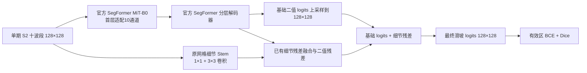
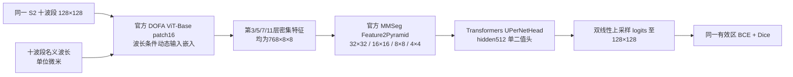

# v4r3 实际训练架构

这是两套独立训练的系统，不是两个基础模型联合运行。输入、有效区、训练样本和评测协议相同。

## SegFormer 原网格细节残差：低编码器学习率对照

该组结构与历史全量 detailres 完全相同；全部3753602参数可训练。只降低第一层之外的预训练 encoder 学习率至6e-6；首层仍6e-5，decoder/头/细节分支仍6e-4。不是新的两阶段定位分割模型。

## DOFA + 特征金字塔 + UPerNet 二值分割

只对预训练位置编码做14×14到8×8的官方插值，不放大原始影像。Feature2Pyramid 学到的特征上采样不能补回新的传感器观测细节。DOFA 组没有原网格细节旁路、粗定位、辅助分割头或文本分支；除官方固定位置编码外全部参数训练。本轮用于判断这一完整系统在现有协议下的实际效果，不用它单独证明“遥感预训练有效/无效”。

BF16仅用于 DOFA 训练前向；权重、优化器、损失以及周期/最终评测为 FP32。更多来源、配置和复现边界见 `v4r3_reproduction.md`。
