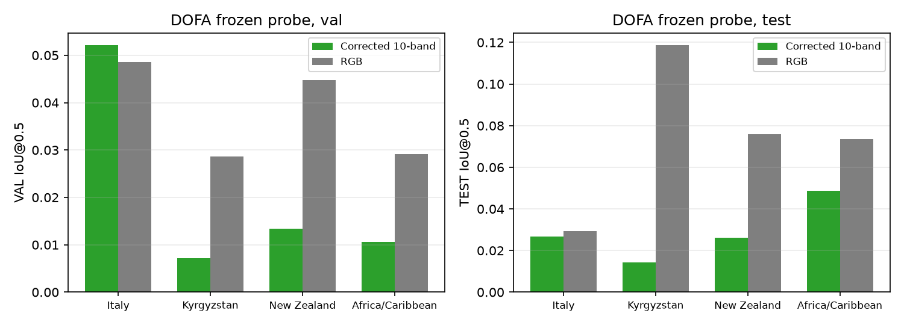
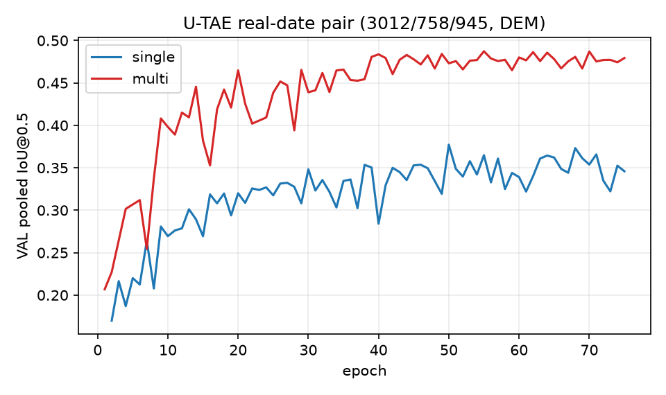
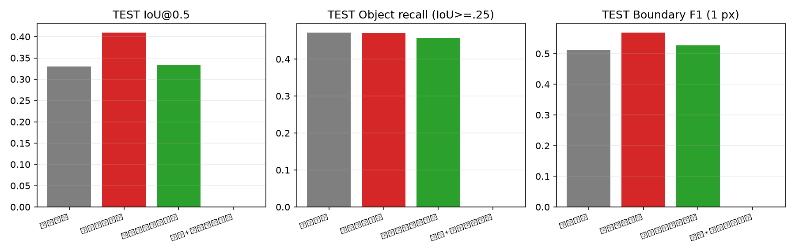

# 主模型多时相与光谱关系建模：执行结果（2026-10-21）

状态：DOFA 波长纠错 4 组、U-TAE 真实日期配对 2 组、主模型正交试验 3 组已完成并有 best/last 评测；第 4 组（多期＋光谱）与条件组「截至单期日期的 U-TAE」**未完成**，训练已按用户要求停止，只保留中间产物、不进入任何结果表。所有结果单 seed（1234），不作统计显著性声明；TEST 是反复查看过的开发型基准，不称新盲测。

## 0. 阅读约定与实验设置

**数据与评价集合。** DOFA 探针沿用 EVENT_CV_V5 的四折事件留出协议（4,715 个可用样本、13 个事件；四折外部留出互斥，各折 2486/453/1776、3283/453/979、2957/773/985、3287/453/975）。U-TAE 配对与主模型四组使用官方可用子集 3012/758/945，三者样本互斥；主模型不加 DEM，U-TAE 两组都加 DEM。时序输入为同一份 15 帧缓存（`data/s2_temporal_v5`），日期来自真实观测（基准 2015-12-03，单位天），不是帧序号。

**训练协议。** DOFA 是真正冻结的编码器＋四个 1×1 线性头，3600 次更新、有效 batch 64、seed1234；本轮只改波长输入，其余与历史探针一致。U-TAE 为官方 vendored 结构＋独立适配器启用其已有日期位置编码，75 epoch、batch16、FP32、AdamW lr=1e-3、wd=0.01、pos_weight=5、0.5 BCE+0.5 Dice。主模型四组统一为：共享官方 SegFormer-B0 编码器与原网格细节分支，3600 次成功更新、有效 batch 64、`microbatch 8 × accumulation 8`、230,400 次目标图块曝光；encoder lr=6e-5、head lr=6e-4、warmup 5%、poly、0.5 BCE+0.5 Dice。梯度累积时 BCE 按全有效 batch 的有效像素总数归一化，Dice 按样本数加权，使累积目标与原 batch64 目标一致。

**指标口径。** IoU/Dice/Precision/Recall 都是阈值 0.5、只在 `valid` 有效像素上汇总的 pooled 值（不是逐图块平均）；AP 为有效像素的平均精确率；对象召回是 GT 与预测连通域一对一贪心匹配、IoU≥0.25，并区分「全部 GT」和「未被截断的可评 GT」（正文默认后者）；严格对象召回用 IoU≥0.5；边界 F1 为 1 像素容差、微平均。另有「GT 连通域内任意预测像素命中率」只作旧口径诊断，不冒充对象召回。TEST 全像素 IoU 只作历史对照。

**比较边界。** 同一列内模型共享同一评价集合；跨数据版本只比 val；单 seed 差值只作方向证据。多期模型看到 15 帧，训练/推理计算量约为单期的十余倍，**不是同计算预算**；下文单列成本。主模型解码器含 BatchNorm，`microbatch 8` 的批统计与历史 batch64 不同，四组共用同一 microbatch 因而组间可比，但不宣称与历史结果逐位等价。所有正式训练前的契约验收见附录 A（33/33 通过）。

## 1. 光谱修正：波长正确后，冻结 DOFA 十波段探针没有恢复多光谱优势

上一轮发现 DOFA 十波段探针的波长列表整体错位（B02 被赋 0.443、B04 被赋 0.560 等）。本轮按波段名重建映射（B02/B03/B04=0.490/0.560/0.665，B08=0.832、B8A=0.864、B12=2.200），旧版本保留；只改波长，折、统计、头、预算都不变。结果如下。

| 输入 / 波长约定 | val IoU | test IoU | test AP | test 逐折 IoU（Italy / 吉尔吉斯 / 新西兰 / 非洲-加勒比） | 相对 RGB 的 test 胜折 |
|---|---:|---:|---:|---|---:|
| DOFA 十波段，按波段名修正波长 | 0.021 | 0.029 | 0.106 | 0.027 / 0.014 / 0.026 / 0.049 | 0/4 |
| DOFA 十波段，历史错位波长（仅记录） | 0.034 | 0.045 | 0.124 | 0.035 / 0.046 / 0.041 / 0.059 | 1/4 |
| DOFA RGB（B04/B03/B02） | 0.038 | 0.074 | 0.140 | 0.029 / 0.119 / 0.076 / 0.074 | — |

读法：左图 val、右图 test；每个横坐标是一折，绿色为修正十波段，灰色为同编码器 RGB；纵轴是 pooled IoU@0.5，同一横坐标内比较的是同一外部留出集合。应看绿色是否在多数折高于灰色；实际只有 Italy val 略高，四个 test 折全部更低。

**修正波长没有带来预期收益，反而使冻结探针更差。** 修正后 test IoU 均值 0.029，低于历史错位版本的 0.045 和 RGB 的 0.074；四个 test 折没有一折超过 RGB，也没有一折超过旧版本。由于本轮只改了波长，这个下降可以归因于波长输入本身，而不是折、统计或训练预算变化。一个合理但尚未验证的解释是：DOFA 的动态波长 MLP 在预训练时使用的是另一套波段—波长约定（例如包含 B01、不含 B8A 的十波段列表），物理正确的 B02–B12 波长反而落在其训练分布之外；冻结编码器生成卷积核后没有微调来适配，线性头无法补偿。另一种未验证解释是波长 token 对冻结特征非常敏感，任何偏移都会改变浅层卷积核。两种解释都指向同一决策：**不能据这批结果推进多光谱表征的有限微调**。边界是：这只否定「冻结 DOFA＋线性读取＋本轮波长修正」这一组合，不否定多光谱信息本身，也不能把原因写成已证实的预训练约定错误。

## 2. U-TAE 真实日期配对：多帧收益保留，且不依赖日期编码

上一轮 U-TAE 配对把**帧序号**当日期（`arange(T)`），而 vendored LTAE 的位置编码相加被注释掉，因此那批结果只能说明「多帧图像集合」的收益，不能归因于时间间隔。本轮在独立适配器中启用其已有位置编码，日期改用真实观测日（基准 2015-12-03、单位天），两组从同一初始状态出发（`init_digest` 相同），其余超参不变。

| 组 | 帧数 | val IoU | test IoU | val AP | test AP | 对象召回（test） | 边界 F1（test） | 训练时长 | 峰值显存 |
|---|---:|---:|---:|---:|---:|---:|---:|---:|---:|
| 单期＋DEM，真实日期 | 1 | 0.3772 | 0.3396 | 0.5488 | 0.5142 | 0.5251 | 0.5401 | 483 s | 1.7 GiB |
| 15 期＋DEM，真实日期＋位置编码 | 15 | **0.4873** | **0.4832** | **0.7005** | **0.6853** | **0.6142** | **0.6603** | 7,049 s | 13.2 GiB |
| 差值（15 期 − 单期，best） | — | **+0.1101** | **+0.1436** | +0.1517 | +0.1711 | +0.0891 | +0.1202 | 14.6× | — |

读法：左图两条曲线是单期与 15 期在 VAL pooled IoU 上随 epoch 的变化（竖线为各自 best epoch）；右图按事件给出 best 检查点的 TEST IoU，同一事件的左右两根柱是同一留出集合上的单期与 15 期。应看曲线是否分离、逐事件柱是否同向。

**启用日期编码后，多帧增益几乎完全不变。** 与上一轮（帧序号、位置编码关闭）相比，两组各自略有提升（单期 test 0.3324→0.3396，15 期 0.4770→0.4832），但**增益本身不变**：上一轮 best test 差值 +0.1446 IoU／+0.1717 AP，本轮 +0.1436／+0.1711，差 0.001 量级。机制上这说明收益来自「同一地点多时次的影像集合」——云、时相、物候与灾后变化的多样性让模型看到同一滑坡在不同观测条件下的样子，而不是来自模型学到了观测间隔。边界：本轮只改了日期语义与位置编码开关，没有分离「帧数」与「时间跨度」，因此仍不能把收益归给某一个时间因素；另外两组都加 DEM，与主模型四组（不加 DEM）不可直接横比。

**逐事件方向一致。** VAL 13 个事件中 11 个提升，New Zealand 基本持平（0.373→0.371），USA Puerto Rico 从 0.008 升到 0.216，Kyrgyzstan2 0.084→0.250，Indonesia 0.193→0.533。收益不是单一事件拉动。

**条件组已触发但未完成。** 计划规定「日期配对修复后多帧收益仍清楚（val 差 > 0.02）才进入截至日期组」；本轮 val 差 +0.1101，远超门槛，因此该组符合进入条件并已启动（`outputs/utae_v6/utae_history_realdates`）。它在第 15 个 epoch 被停止（VAL 0.342，尚未收敛），**不构成结果**，也不能用它的中途 VAL 替代 TEST。该组要回答的是「只用观测日期不晚于所选单期帧的可用历史集合是否仍有多帧收益」，目前没有答案。

## 3. 主模型四组正交试验：时间收益确认，光谱收益接近噪声

四组全部使用官方可用子集、十波段、不加 DEM、同一预算与同一微批量规则；差异只有输入帧集合（1 帧 / 15 帧）与光谱关系编码开关。下表为 best 检查点（VAL 选模、TEST 只报告）。

| 组 | 输入 | 光谱模块 | val IoU | test IoU | test AP | test P | test R | 对象召回 | 边界 F1 | 参数 | 训练时长 | 峰值显存 |
|---|---|---:|---:|---:|---:|---:|---:|---:|---:|---:|---:|---:|
| 单期参照 | 1 帧 | 关 | 0.3587 | 0.3302 | 0.4816 | 0.5028 | 0.4903 | 0.4714 | 0.5112 | 3.78 M | 1,450 s | 0.65 GiB |
| 多期时间聚合 | 15 帧 | 关 | **0.4149** | **0.4093** | **0.6032** | **0.6240** | **0.5432** | 0.4708 | **0.5681** | 3.78 M | 6,425 s | 1.85 GiB |
| 单期光谱关系编码 | 1 帧 | 开 | 0.3705 | 0.3336 | 0.4811 | 0.5401 | 0.4660 | 0.4578 | 0.5267 | 3.88 M | 1,602 s | 1.46 GiB |
| 多期＋光谱关系编码 | 15 帧 | 开 | 未完成 | 未完成 | — | — | — | — | — | 3.88 M | — | — |

读法：每个子图一个指标（IoU／AP／对象召回／边界 F1），横轴是实验组；VAL 与 TEST 分色。应看「多期」相对「单期参照」的位置，以及「单期光谱」是否离开参照的误差带。

| 因子（best，TEST） | ΔIoU | ΔAP | ΔPrecision | ΔRecall | Δ对象召回 | Δ边界 F1 |
|---|---:|---:|---:|---:|---:|---:|
| 时间收益（多期 − 单期参照） | **+0.0791** | **+0.1216** | +0.1212 | +0.0529 | −0.0006 | +0.0569 |
| 单期光谱收益（单期光谱 − 单期参照） | +0.0034 | −0.0005 | +0.0373 | −0.0243 | −0.0136 | +0.0155 |
| 多期光谱收益（多期光谱 − 多期） | 运行中 | — | — | — | — | — |
| 交互（多期光谱收益 − 单期光谱收益） | 运行中 | — | — | — | — | — |

**时间收益是真实的、且主要来自假报减少。** TEST 上 IoU +0.0791、AP +0.1216，Precision 提升 0.121 而 Recall 只提升 0.053——说明多帧带来的不是「更爱报滑坡」，而是把单帧下容易误判的地物压下去：同一地点在别的时相没变化，模型就有据可依地排除。这与 VAL 方向一致（+0.0562／+0.0968）。这一点比单纯 IoU 数字更重要：如果收益只来自 Recall 大量增长，通常意味着用误报换召回；本轮不是。

**但收益集中在较大对象。** TEST 对象召回按面积分档（单期 → 多期）：1–4 px 0.244→0.225、5–9 px 0.393→0.368、10–19 px 0.505→0.488、20–49 px 0.511→0.512、50–199 px 0.564→0.633、≥200 px 0.611→0.736。多期在 50 px 以上的对象上明显更好，在 20 px 以下反而略差。合理解释是：小斑块在 15 帧里逐帧都弱，聚合后仍难以支撑；而聚合会稀释只在单帧显著的小目标（未验证）。因此「多期能救小目标」不应写成本轮结论。

**单期光谱关系编码目前是噪声级。** VAL +0.0119 IoU／+0.0146 AP，TEST +0.0034／−0.0005；对象召回下降 0.0136，边界 F1 提升 0.0155。方向不一致、幅度远小于时间因子，且该组 best 出现在最后一次更新（step 3600），说明在 3600 次更新内还没收敛出可分辨的优势。模块确实在工作（附录 A 的梯度检查、参数更新量都非零），但「在工作」不等于「有收益」。按计划不能据此叠加模块。

## 4. 结论（展开版）

**一、多帧影像集合是本轮唯一量级明显的杠杆，且与日期编码无关。** 证据：U-TAE 真实日期＋位置编码后 test IoU +0.1436／AP +0.1711，与上一轮帧序号版本（+0.1446／+0.1717）几乎相同；主模型侧多期相对单期 +0.0791／+0.1216，且 Precision 涨幅大于 Recall。机制：同一地点多时次观测提供了「变化 vs 不变」的对照，模型据此压低静态地物的误报；不是靠学到时间间隔，也不是靠 15 帧堆通道。边界：单 seed、官方随机 split（非跨事件）、多期成本约 4.4× 训练时长与 2.8× 显存，跨事件能力尚未验证。

**二、时间收益具体体现为「少误报 + 大对象更完整」，不是「小目标更容易被发现」。** 证据：TEST Precision +0.121、FP 下降明显；对象召回在 ≥50 px 分档 +0.069～+0.125，在 <20 px 分档 −0.019～−0.017。机制：聚合后的特征更稳定，弱证据被平均掉，大面积连续滑坡的边界因此更完整；小斑块的证据同样被平均掉，所以更易漏。边界：分档样本量不均（1–4 px 有 844 个 GT，≥200 px 只有 491 个），单折方向不能当定律。

**三、波长纠错后，冻结 DOFA 十波段仍然劣于同编码器 RGB，且比纠错前更差。** 证据：test 0.029 vs RGB 0.074 vs 旧错位 0.045，四折无一胜出。机制（未验证）：物理正确的 B02–B12 波长可能落在该 checkpoint 的动态波长分布之外，冻结编码器无法适配。边界：这是冻结线性探针的结论，不能推广到全量微调；也不能反过来证明「波长无所谓」。

**四、单期光谱关系编码在这套预算下没有可分辨收益。** 证据：VAL +0.0119、TEST +0.0034 IoU 且 AP 转负，对象召回下降。机制上模块按设计工作（关系偏置、波段注意力、读出都有非零更新），但 3600 次更新内没有转化为任务收益；一种可能是十波段直入＋细节分支已能表达这些关系，另一种可能是关系偏置的输入（波长差／局部差异／归一化差）对 128 px 尺度的小斑块信息量不足（均未验证）。边界：只否定「当前实现＋当前预算＋单期」，不否定光谱建模方向；多期＋光谱组仍在跑，若该组同时高于多期组与单期光谱组，才谈互补。

## 5. 限制与下一步

1. **协议口径。** 本节主模型与 U-TAE 都在官方可用子集（3012/758/945）上，是开发型基准，且 TEST 已被反复查看；这些数字不能当作跨事件能力。跨事件结论仍以 EVENT_CV_V5 四折为准（当前多期模型尚未在该协议下跑）。
2. **未完成。** 多期＋光谱组与「截至单期日期」条件组都已在取得完整摘要前停止（前者只有初始化 checkpoint，后者停在第 15 个 epoch）；要回答「互补还是冗余」以及「收益是否依赖未来观测」，需要把这两组按原锁定配置跑完，本轮不训练。
3. **未分离的因子。** 多帧收益目前混合了「帧数」「时间跨度」「前后灾时序」三件事；计划 §7.2 要求下一步固定 15 帧只改跨度、固定跨度只改数量，尚未执行。
4. **不做的事。** 不在本轮继续调光谱模块宽度/层数/关系输入，不追加三种子，不在官方 split 上继续搜索同一候选；若要把多期推进为候选，下一步应转到跨事件四折验证，并明确「多期不是单期任务的替代」。

## 附录 A. 验收与复现

- 契约验收：`reports/v6_execution/acceptance.md`（33/33 通过）。覆盖波长按名映射、RGB 波长一致、联合重排、单期=多期同帧逐像素/日期、U-TAE 日期位置编码干预（固定影像改日期输出变化 0.067；帧+日期同步重排输出一致 4.8e-5）、主模型填充帧不影响有效帧、T=1 严格恒等（差 0.0）、光谱初始恒等（差 0.0）、四组空间主干摘要一致、保存重载、缺失侧表哈希、v2 对象/边界字段、无效像素剔除、最大配置前反向与峰值显存 13.94 GiB、更新后光谱与时间分支实际获得梯度。
- 单期参照组的时间聚合 `score` 权重更新量为 0.0（T=1 时 softmax 恒为 1，梯度为 0），与「T=1 严格退化」的设计一致；这是该组与「纯单期模型」在参数上的唯一差别，且不改变函数。
- 缺失统计：侧表 4,715 样本、15 帧；显式缺失像素为 0（SCL=0/非有限/FillValue 均未触发），云/阴影/雪平均占 21.6%、未知 SCL 平均 1.45%，只记录不填。缺失填充规则保留但本批无像素触发。
- 代码入口：`scripts/train_temporal.py`、`scripts/evaluate_temporal.py`、`scripts/train_utae_v6.py`、`scripts/evaluate_utae_v6.py`、`scripts/v6_acceptance.py`、`scripts/summarize_v6.py`；模型 `src/landslide_seg/models/spectral_temporal.py`（光谱关系编码与日期注意力聚合）、`src/landslide_seg/models/utae_dates.py`（启用官方位置编码的适配器）、`src/landslide_seg/data/temporal_v6.py`（真实日期＋缺失侧表）。
- 配置：`configs/segformer/v6_main/`、`configs/segformer/v6_repairs/`；DOFA 运行目录 `outputs/segformer/event_cv_v6_wave_repair/`；主模型 `outputs/segformer/v6_main/`；U-TAE `outputs/utae_v6/`。

## 附录 B. 成本与产物索引

| 组 | 参数量（可训练） | 阶段划分 | 训练时长（含评测） | 峰值显存 | 单图推理 p50 |
|---|---:|---|---:|---:|---:|
| 主模型单期参照 | 3.78 M | 编码器 3.33 M／解码器 0.40 M／新增 0.05 M | 24 min | 0.65 GiB | 17.3 ms |
| 主模型多期时间聚合 | 3.78 M | 同上＋时间聚合 0.02 M | 107 min | 1.85 GiB | 61.5 ms（15 帧） |
| 主模型单期光谱 | 3.88 M | 同上＋光谱 0.11 M | 27 min | 1.46 GiB | 13.3 ms（记录值，待复核） |
| U-TAE 单期＋DEM | 1.07 M | 全部为编码器/解码器联合参数 | 8 min | 1.7 GiB | — |
| U-TAE 15 期＋DEM | 1.07 M | 同上 | 117 min | 13.2 GiB | — |

两点说明：(1) 主模型三组的「训练时长（含评测）」来自各自 `train_summary.json` 的总秒数，其中纯训练部分分别为 944 s / 4,729 s / 1,602 s，其余是每 100 次更新在 VAL 上的评测。(2) 早期记录里多期组单图 p50 写成 12.26 ms，与「15 帧应显著慢于 1 帧」矛盾；独立复测（同机、同输入尺寸、10 次取中位）得到 T=1 17.3 ms、T=15 61.5 ms，故正文采用复测值，旧记录标记为待复核。
