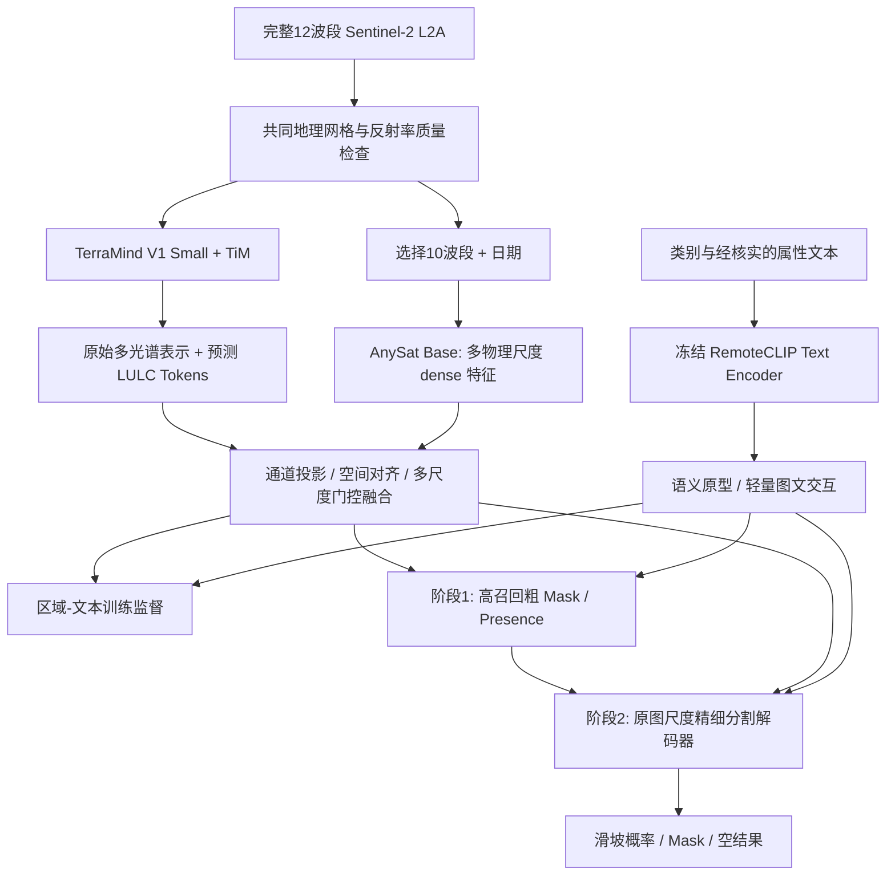

# Landslide-Seg V1：单期 Sentinel-2 滑坡语义分割研究方案与 Agent 实施规范

> **版本**：v1.0，2026-10-17  
> **性质**：研究设计 + 可交付给开发 Agent 的工程实施规范（尚未完成实验，所有提升均为待验证假设）  
> **当前唯一灾种**：滑坡（landslide）  
> **部署时唯一必需观测**：单期 Sentinel-2 L2A 多光谱影像  
> **第一阶段目标**：从第一轮就实现 **TerraMind + TiM + AnySat + 语义模块 + 粗定位 + 细分割** 的完整可运行模型，而非先做缺失分支的简化版。**完成完整框架之后才做“减法”消融**。  
> **不在范围内**：多灾种、时序变化检测、灾害发生时间推断、灾害严重程度分析、Agent/GIS 报表、从头预训练视觉基础模型。

---

## 0. 给开发 Agent 的执行指令（可直接复制）

你将协助开发 `Landslide-Seg V1`，以**单期 Sentinel-2 L2A 影像中的滑坡自动识别与像素级分割**为目标。请首先阅读完整的 `Landslide-Seg_完整双骨干研究与Agent实施规范_v1.md`，再检查当前代码仓库、Python/GPU 环境、可用数据和磁盘空间。**第一阶段的目标是搭建完整模型，不得擅自将 TerraMind TiM、AnySat、多阶段语义模块或粗细两阶段分割删掉并将删减模型称为 V1**。各分支可以先冻结，采用现有预训练权重；为降低依赖冲突，可先独立验证并缓存冻结骨干特征，但整体数据流、接口及最终输出必须接通。

先实现并验收：数据协议和波段映射 → 两个官方预训练骨干及 TiM 的真实权重加载与前向 → 特征规格适配与融合 → 冻结文本编码器及语义查询接口 → 粗 Mask 与精细 Mask → 统一损失、评估和可视化 → 使用**实际有效影像与真实滑坡 Mask**进行完整链路的微型训练与推理。之后再实施逐模块消融。

**不可绕过的阻塞条件**：TerraMind TiM 在官方实现中需要完整 12 波段 S2L2A 预训练输入（不得对缺失波段直接补零并声称是有效 TiM）。AnySat S2 分支需要对应的 10 波段和日期。若现有滑坡数据只有 10 波段，请优先从原始 Sentinel-2 L2A 源补齐同一时相的 B01/B09，严格校验时空一致性；获取受限时可以先用规范的 12 通道合成张量做**接口测试**，但必须标记为 smoke test，不能进行有效性结论、论文评测或者伪造原始观测。任何真实数据兼容性问题必须在 `docs/blockers.md` 和最终状态报告明确记录。

优先复用 TerraTorch、IBM TerraMind、AnySat、RemoteCLIP 的官方实现。自行编写的代码应集中在适配器、特征融合、语义监督、粗细分割及数据/训练/评测管线。记录版本、权重来源、参数量、输入输出张量形状、训练日志及失败事实。**请实际运行测试，不得以代码存在替代模型可以运行，也不得用真实 Mask 在推理中生成候选提示**。输出执行的命令、成功与失败结果、下一步所需数据或修复事项。

---

## 1. 研究定位、科学问题与核心假设

### 1.1 任务界定

输入一幅**已完成地理配准的单期 Sentinel-2 L2A** 多光谱图，模型自主判断滑坡是否存在并产生滑坡概率图与二值 Mask；如有多个不连通滑坡区域，可根据 Mask 的连通区域派生候选对象。当前为单类前景/背景二值分割。训练中可使用真实 Mask、灾害类别、经过核实的可观测属性描述和必要的跨模态辅助配对数据；部署时不依赖真实 SAR、DEM、LULC 或人工指定滑坡描述。

定义：

\[
F_\theta(I_{\mathrm{S2}},\,\mathcal T_{\mathrm{landslide}})\to(P_{\mathrm{coarse}}, P_{\mathrm{fine}}, p_{\mathrm{presence}})
\]

其中 `I_S2` 是完整的 L2A 观测；`T_landslide` 是模型内部固定的类别语义查询或学习到的语义原型，**不是用户预先提供的正确位置**；`P_fine` 是最终 Mask 概率图。未出现滑坡时应可输出空 Mask。只关注影像中**可观察的滑坡痕迹**，不从单期影像断言诱因、具体发生时间、滑动速度或体积。

### 1.2 重点科学问题

1. **跨场景表征**：森林、草地、裸岩等环境中，滑坡外观和背景变化显著，怎样学习共同类别概念，同时保留局部差异？
2. **跨尺度与模态**：地面尺度、原始波段和缺失辅助模态的表示是否互补？AnySat 式尺度感知与 TerraMind TiM 是否能提升单期 Sentinel-2 分割？
3. **语义多阶段使用**：真实的类别、形态及前景—背景关系语义，如何分别服务于表征学习、粗定位和精细 Mask，而不是只做文本提示词？
4. **泛化和鲁棒性**：独立地理区域/事件/地貌背景上的表现，以及云影、波段缺失、传感器风格变化时的稳定性。

### 1.3 假设（**不是已有实验结论**）

- H1：TerraMind TiM 的预测辅助模态表示，与 AnySat 的尺度感知表示相互补充，联合使用优于单独使用。
- H2：区域级真实语义属性监督能减少对具体森林颜色、土壤背景等捷径的依赖，提高未见场景中的滑坡召回与精度。
- H3：共享语义原型在三个阶段以不同方式调制，可以优于仅在初始图文对齐阶段使用文本。
- H4：粗定位提供高召回候选，精细分割保留局部空间与光谱证据，可改善小目标和边界；若粗定位漏检则整链条有召回上限。

---

## 2. 最终采用的架构（首轮就实现完整图）



**初始版本的原则**：

- TerraMind + TiM 和 AnySat 在**第一阶段**同时存在，二者均使用真实下载的官方预训练权重，冻结也算实际复用，但必须真实运行前向并提供特征；不能用随机网络伪装其输出。
- TerraMind 提供主要多光谱和 TiM 辅助模态表示；AnySat 提供尺度感知 dense 表示。两者不必强行合并 Transformer 权重，只融合输出的空间特征。
- 基于冻结 RemoteCLIP 的文本特征提供训练监督与内部类别查询；缺少可靠属性描述的样本仍可用类别语义训练，并在指标中明确标注语义标注覆盖率。
- 第一阶段粗定位和第二阶段细分割可以共享主干与空间特征；细化器首轮选轻量 FPN/U-Net 解码器，不强制依赖 SAM。SAM 2/3 保留独立评测或替换细化器的可选实验。
- 初版可固定 `landslide` 单类原型推理，未来扩展多类时才增加多类别路由。

### 2.1 模块接口（面向实现的契约）

| 模块 | 输入 | 输出 | 第一版训练策略 | 责任 |
|---|---|---|---|---|
| `S2SampleAdapter` | 原始 12 波段、日期、质量掩膜、Mask | 共享地面网格 + 两套专用标准化输入 | 无 | 波段/网格正确性 |
| `TerraMindTiMAdapter` | 完整 `S2L2A` `[B,12,H,W]` | 若干层视觉特征及 LULC TiM 影响后的表征 | 冻结预训练参数 | 领域视觉表示、缺失模态预测 |
| `AnySatScaleAdapter` | 10 波段 `[B,1,10,H,W]` + `s2_dates` `[B,1]` | 不同物理 patch size 的 `dense` 空间特征 | 冻结预训练参数 | 地面尺度信息 |
| `FeatureFusion` | 两支路特征字典 | 标准化的金字塔特征 `P2...Pn` | 可训练 | 通道、空间尺寸和自适应融合 |
| `SemanticAdapter` | 类别/可观测属性文本、视觉区域特征 | 文本原型、调制向量、对齐损失 | 文本主干冻结，投影可训练 | 表征、定位、细化时语义引导 |
| `CoarseLocator` | 金字塔特征 + 语义原型 | 粗 Mask、presence 分数 | 可训练 | 高召回定位 |
| `FineRefiner` | 特征、粗概率图、语义调制 | 细概率图、最终 Mask | 可训练 | 边界和细小目标 |

特征抽取需返回明确记录：`source, channels, height, width, physical_stride_m, dtype, normalized, frozen`。不能依赖模型名自行猜特征分辨率。

---

## 3. 最重要的工程兼容性：同一张 S2 影像服务于两套预训练模型

### 3.1 真正的输入冲突

**TerraMind V1 TiM 官方约束**：对于 `S2L2A`，TiM 要求完整的 **12 个预训练波段**，不能使用 `bands` 子集参数；其生成器被冻结，官方明确提示缺失波段时无法直接使用 TiM。官方 L2A 波段顺序为：

`B01, B02, B03, B04, B05, B06, B07, B08, B8A, B09, B11, B12`

**AnySat S2 官方接口**：

`B02, B03, B04, B05, B06, B07, B08, B8A, B11, B12`，输入 `[B,T,10,H,W]`，另需时间维度对应的 `s2_dates`（一年内日序）；第一版尝试 `T=1` 并进行真实前向检查。

**两大滑坡数据集的限制**：

| 数据集 | 实际 S2 波段 | 优点 | 本框架中的阻塞 |
|---|---|---|---|
| `Sen12Landslides` | 10 波段（AnySat 的集合） | geolocation、时间信息、Mask、S1/DEM 可用于后续验证 | **缺少 B01/B09，不能直接运行完整 TiM** |
| `Landslide4Sense` | B01–B12 但**没有 B8A**，却包含 B10 | 128×128 滑坡 Mask 和既有基线 | 既不符合 TerraMind 12 波段 S2L2A，也不符合 AnySat 所需 10 波段；原版地理/日期信息不充分 |

**结论：不能让 Agent 将二者的数据直接当成完整双骨干的最终训练输入。** 更不能把 B10 当 B8A、把缺少的 B01/B09 直接补零并报告“成功复现 TiM”。TerraMind 开发者公开说明：这种缺波段填零属于分布外输入，可能造成显著质量损失。

### 3.2 正确的数据主路线（推荐）

以 `Sen12Landslides` 的原始滑坡 Mask、地理坐标、日期为索引，在 **Copernicus Data Space / Sentinel-2 L2A 原始产品**中获取同一观测时刻、同一区域的完整 12 波段（特别补齐 B01、B09）。操作步骤：

1. 用小规模样本读取 `.nc` 的投影、`x/y`、采集日期及 `event_date`；只选择经过核实、灾后影像清晰且标签确实可用于该时相的记录；留存原始文件引用和数据来源。
2. 从原始 S2L2A 影像获取 `B01/B02/B03/B04/B05/B06/B07/B08/B8A/B09/B11/B12`，所有波段统一投影并重采样到同一个约 10m 参考网格。**B01/B09 的原生分辨率为 60m；重采样到 10m 不会增加真实观测细节**。
3. 与 dataset 原有 10 波段逐波段核验值域、日期和空间对齐（考虑 harmonized 数据的辐射 offset 纠正），明确阈值与容许误差；必要时采用全部来自同一原始 L2A 产品的 12 波段，以免混入不同处理基线。
4. 将同一份 `X12` 映射为 TerraMind 的完整 12 波段输入，并从中提取 `X10` 送 AnySat。两个骨干各自按**官方预训练统计和输入尺度**独立标准化，不能先对 12 波段统一做 z-score 再截取 10 波段直接喂 AnySat。
5. 对新的完整观测重新核查与滑坡标注的空间和时相对应；如原始景无法可靠找到或匹配，标注为不可用，不能擅自匹配邻近日期当作同一观测。
6. 仅将经过验证的数据进入正式训练/评测；任何不完整样本留在 `data/quarantine` 并记录原因。

在一开始，如果只是为了验证程序契约，允许**生成 12 通道合成测试张量**完成前向 smoke test；该测试仅证明 shape、权重加载与分支连接，不证明 TiM 对真实滑坡有效。若无法回溯完整 L2A，应报告数据阻塞，而非静默移除 TiM。也可以继续用原始 10 波段测试 AnySat 单独接口，但此结果不能代替完整 V1 验收。

### 3.3 反射率、质量和标签

- 明确使用 L2A（不是 L1C），记录 Sentinel 产品 ID、预处理基线、辐射校正；S2 原始数字量级与模型预训练标准化所需范围必须核对。
- 云/薄云/阴影、无效数据与遮挡要记录有效性掩膜；被严重遮挡的像素**不应该自动作为负样本**。
- 二值 Mask 值域为 `{0,1}`；存在未标注/不确定区域时使用 `ignore_index`，而不是把未知全部当 `0`。
- 对原始数据只做一次明确的时空配准；对 Mask 的几何变换用最近邻插值；对连续反射率用适用的重采样方案。
- 训练/验证/测试按照**灾害事件和地理空间单元互斥**组织，避免相邻图块、同一事件不同日期泄漏；将原始数据集既有 split 作为一个可对照方案。
- 训练及评测必须保存数据清单：`scene_id`, `event_id`, `date`, `bbox`, `crs`, `bands_present`, `cloud_fraction`, `mask_coverage`, `split`, `source_uri`, `label_status`。

---

## 4. 每个模块选型与实现细则

### 4.1 TerraMind V1 Small + TiM（必选）

- 官方实现：`https://github.com/IBM/terramind`；TerraTorch 文档：`https://github.com/torchgeo/terratorch/blob/main/docs/guide/terramind.md`
- 优先模型：`terramind_v1_small_tim`，模态 `S2L2A`，TiM 目标 `LULC`。**使用真实预训练权重**。
- 参考配置（只是相关字段；具体 Schema 以安装版本为准）：

```yaml
model_args:
  backbone: terramind_v1_small_tim
  backbone_pretrained: true
  backbone_modalities: [S2L2A]
  backbone_tim_modalities: [LULC]
```

- 提取中间 Token 并恢复空间图：参考 TerraTorch `SelectIndices`、`ReshapeTokensToImage`、`LearnedInterpolateToPyramidal`，先测试 Small 实际层输出，不要把 Base/Large 的层索引机械照搬到新版本。
- TiM 在 Token 空间预测辅助模态表示；**不要求生成一幅肉眼可看的 LULC 影像**，也不可将预测 Token 当真实土地覆盖图。
- 首轮冻结主干与生成器；训练融合模块和下游解码器；后续 LoRA 或局部解冻属于训练优化，不改变首轮的完整模块结构。
- 必须验证 TiM **ON/OFF 使用相同真实输入**且输出确实不同；记录内存和耗时、实际中间特征，避免配置中写了 TiM 却没有执行。

### 4.2 AnySat Base 的 Sentinel-2 单期、多物理尺度（必选）

- 官方：`https://github.com/gastruc/AnySat`，提供预训练 `base`，官方 README 标注可不装 flash-attn。使用具体 Git commit 锁版本。
- 官方基本加载示例（需要按实际环境适配设备）：

```python
import torch
model = torch.hub.load("gastruc/anysat", "anysat", pretrained=True, flash_attn=False)
```

- 其 S2 输入是 `{"s2": [B,T,10,H,W], "s2_dates": [B,T]}`；只用一景时 `T=1`，日期采用官方定义的一年内日序，务必核对具体日期的取值约定。
- **分割应优先使用 `output="dense", output_modality="s2"`**，官方提醒不要只用 `tile` 或 `patch` 输出替代 dense 空间特征。
- 初始物理 patch 候选：`40m / 80m / 160m`，要根据图块物理大小、AnySat 对 patch size 的约束与可用显存验证。以 128×128、10m 输入为例：40m 表示 32×32=1024 个 patch，80m 表示 16×16=256 个 patch；官方建议一般不超过约 1024 patch。**不要将这些参数写死为最佳值**。
- 对不同 `patch_size` 分别提取 dense 特征，并记录其实际空间尺寸、Token 数、显存和耗时；如果 40m 仍超预算，改成 80m/160m/320m 并如实标记架构差异。
- 首轮先冻结 AnySat。为控制双骨干显存，可在隔离环境预提取并缓存不可训练特征；全模型推理仍必须包含 AnySat 的实质贡献，不能用随机矩阵占位。

### 4.3 统一特征融合（新写少量代码）

- 将 TerraMind / AnySat 所有特征的通道投影到 `C=128` 或 `C=256`；统一空间网格与物理 stride 后构建金字塔；学习两支路及尺度间的自适应权重。
- 从**简单 `concat + 1×1 conv + FPN`** 开始，之后可使用门控 `F = F_base + g_tim F_tim + g_any F_any`。但如果官方 TiM 只提供“经过预测模态调制的最终特征”，不强求拆出一个并不存在的独立 `F_tim` 张量；可以用 `TiM OFF` 和 `TiM ON` 两个实际特征流进行对应消融。
- 使用分支随机屏蔽、轻量归一化降低某一路输入尺度不匹配的风险；不能在没有真实质量监督的情况下把门控数值称为“置信度”。
- 不能出现插值后的特征维度正确、实际空间位置错位的问题。增加坐标/几何一致性测试。

### 4.4 语义编码与三阶段使用（首版接通，后续加强标注）

- 优先文本编码器：RemoteCLIP 官方 `https://github.com/ChenDelong1999/RemoteCLIP`。请核对其官方权重获取方式、License 和 tokenizer。也可以设置 `OpenCLIP/SigLIP` 作为可配置对照，但首轮文本特征必须有真实预训练权重。
- 类别级原型：如 `a landslide scar on a satellite image`；仅作为内部候选类别查询，**不能事先输入正确滑坡的位置**。
- 属性级语义：对确实可见的样本，可以标注 `forest background`, `exposed soil`, `rocky scar`, `vegetation disturbance`, `surrounding vegetation contrast` 等。文字描述需对应可观察事实，避免臆测滑坡诱因、滑动深度、发生时间。
- 语义的三次用途：
  1. **训练表征**：用真实 Mask 做区域池化，与该区域**正确属性**的文本表示对齐。必须有正确的负例或对照；同类滑坡的另一个实例未必是负例。
  2. **粗定位**：以类别原型与特征图做轻量 Cross-Attention / 相似度热图，引导候选 Mask；无滑坡时要输出空结果。
  3. **精细分割**：将局部空间关系、前景—背景对比的语义调制向量或注意力图输入细化解码器，但**不能依靠文本颜色描述取代实际光谱边界**。
- 文本描述不要在推理时直接从 GT Mask 派生。可以让模型以固定滑坡类别原型自动发现，再用**视觉预测**的属性表示进行自适应调制；如果暂无可靠属性标注，语义分支必须保持真实调用和有效训练信号（类别语义），并明确标记“属性级学习未验证”。
- 应保持共享类别表示与场景特异属性同时存在，避免把所有滑坡区域特征压成一个完全相同的向量。

### 4.5 粗定位与细分割（首版全部接通）

- `CoarseLocator`：采用现有 FPN 语义分割头或轻量卷积头，输出 `[B,1,H,W]` 粗 Mask logits 和滑坡存在性分数（可由额外 head 输出）。优先保证候选**高召回**，不要在早期使用太严苛的硬阈值。
- `FineRefiner`：先复用 U-Net 式解码器；输入**完整局部多光谱/融合特征**、粗 Mask **soft logits 或概率图**以及语义调制特征，输出最终 `[B,1,H,W]`。128×128 图块初期可整图细化；大影像再用扩张 ROI + 上下文裁剪。
- 训练时既监督粗 Mask 又监督最终 Mask。细化器要逐渐适应**预测**粗 Mask 的噪声，而不是持续喂真实 GT Mask 生成的理想提示。
- SAM 2/3 不是第一版必要训练依赖。其可用相同**预测候选**作对照，但不允许用 GT 框做正式比较。

---

## 5. 开发阶段划分：第一阶段就是完整模型，不允许删减模块

### M0：数据与模型依赖侦测（配置阶段的一部分）

**目标**：确认实际数据可形成完整 `X12 + X10 + 日期 + Mask`，锁定官方模型版本、权重来源和运行成本。输出 `docs/environment_audit.md`, `docs/data_contract.md`, `docs/blockers.md`。

**阻塞处理**：若暂时没有 12 波段有效观测，先完成真实权重的**合成输入接口测试**及 10 波段 AnySat 真实数据前向；同步实现原始 12 波段获取与空间核验。**不准以合成输入训练报告代替完整真实数据验收。**

### M1：完整双骨干 + 语义 + 粗细分割贯通（第一阶段的核心验收）

必须全部完成：

1. TerraMind V1 Small `TiM=LULC`：预训练权重加载、完整 12 波段前向、输出空间特征。
2. AnySat Base：同一观测提取 10 波段、真实日期，至少两种不同物理尺度下的 dense 特征前向。
3. 双骨干特征对齐及可训练融合；有明确的张量日志。
4. RemoteCLIP 文本编码器加载；滑坡类别原型编码；语义至少真实参与粗定位调制以及训练中的区域特征监督。属性级监督视标注可用性逐步增加，但接口必须存在。
5. 粗定位输出 logits 和存在性分数；细分割输出 logits、Mask；损失和反向传播能更新允许训练的参数。
6. 一个真实有效小批量完成完整前向、反向、保存权重、重新加载与推理；若没有有效数据则必须将 M1 状态标为 **BLOCKED** 而不是已完成。
7. 输出一张完整可视化：RGB 合成图、GT Mask、粗 Mask、细 Mask、差异图；附上时间、显存、输入波段与样本标识。

**本阶段就已经是完整架构**。它不要求一开始就达到某个预设 mIoU，也不要求同时微调所有预训练参数，但不允许删掉某一支路来完成验收。

### M2：完整架构稳定训练

- 在经时空核验的滑坡样本上使用 BCEWithLogits + Dice 训练，先冻结主干、训练融合和分割/语义模块。
- 确认 train loss 合理下降，验证集与训练集划分独立；保存 best / last checkpoint。
- 固定数据版本与种子；实测 mIoU、Dice、Recall、False Positive Rate。不存在滑坡的样本不得被全部排除。
- 根据训练效果可对骨干后几层增加 LoRA/Adapter，但对比记录模型参数和资源消耗。

### M3：完整模型之后做减法消融

将完整模型定为 `FULL`，随后在**相同数据、相同训练/验证分割、尽可能相近训练预算**下关闭各路：

| 编号 | 变化 | 识别的问题 |
|---|---|---|
| FULL | TiM + AnySat + 语义三阶段 + 粗细分割 | 完整方案 |
| −TiM | 关闭预测辅助模态 | TiM 是否带来额外收益 |
| −AnySat | 关闭尺度感知骨干 | AnySat 的增益 |
| −SemAlign | 取消区域—文本辅助对齐监督 | 表征语义是否有效 |
| −SemLoc | 取消定位语义调制 | 定位阶段语义的作用 |
| −SemRef | 取消细化器语义调制 | 精细分割阶段语义的作用 |
| −CoarseFine | 用同等特征直接单阶段分割 | 两阶段是否优于单阶段 |
| ClassOnly | 只用类别名文本 | 属性文本的额外价值 |
| ShuffledText | 打乱属性描述与区域关系 | 检验语义是否真被利用 |

在相同训练预算中 FULL 可能因模块较多而更慢；应同时报告 GFLOPs/显存/延迟/可训练参数。解释时区分 **泛化**（未见区域/事件）和 **鲁棒性**（合法的成像扰动、波段缺失）。

---

## 6. 损失函数、训练约束与评价

首轮可训练目标：

\[
\mathcal L = \mathcal L_{\mathrm{fine}} + \lambda_c\mathcal L_{\mathrm{coarse}} + \lambda_p\mathcal L_{\mathrm{presence}} + \lambda_s\mathcal L_{\mathrm{region-text}} + \lambda_a\mathcal L_{\mathrm{attribute}}
\]

- `L_fine`、`L_coarse`：`BCEWithLogitsLoss + SoftDiceLoss`，使用 valid/ignore mask 排除云遮挡和未知标注。
- `L_presence`：样本级是否含有滑坡的监督，帮助空图拒检；滑坡标注不完整时慎用。
- `L_region-text`：使用真实区域与文本描述配对的监督，不能由 GT Mask 生成推理时文本；可用对比损失或匹配损失。正负文本对构造需防止“同类即负例”的错误。
- `L_attribute`：**仅对可核实属性且有标注的样本计算**；无属性标签时该项为 0 并明确标记，不可随机造描述。
- 权重 `lambda` 为待调参数；第一版先保证数值稳定和梯度实际更新，不人为指定未经验证的最佳权重。
- 任一骨干冻结时，在没有 trainable adapter 的条件下应 `eval()` 且 `no_grad`；避免 BatchNorm 等状态漂移。缓存特征仅适用于冻结骨干或严格限定的数据增强策略。

主要指标：像素级 IoU、Dice、Precision、Recall；图块级滑坡存在性 Precision/Recall；连通域/对象召回；小、中、大滑坡分组表现；Boundary IoU/F1；无滑坡图块误报率；分地区和事件分组统计。输出逐样本 CSV 与聚合 JSON，并保留预测概率用于阈值扫描。

鲁棒性：只模拟**不改变真实标签**的合理光照/噪声、S2 波段可用性变化及配准误差。在 TiM 完整波段要求下，波段缺失测试会影响 TiM 的合法性；应单独报告为“不满足 TiM 输入先验”的压力测试，不能当作原方案正常操作。

---

## 7. 环境与目录规范

建议目录：

```text
landslide-seg/
├── README.md
├── docs/
│   ├── environment_audit.md
│   ├── data_contract.md
│   ├── blockers.md
│   ├── model_shapes.md
│   └── experiment_log.md
├── configs/
│   ├── data.yaml
│   ├── model_full.yaml
│   ├── terramind.yaml
│   ├── anysat.yaml
│   ├── semantic.yaml
│   └── ablations/
├── src/landslide_seg/
│   ├── data/{loader.py,band_mapping.py,scene_selection.py,quality.py}
│   ├── encoders/{terramind_tim.py,anysat_scale.py,text_encoder.py}
│   ├── models/{fusion.py,semantic.py,coarse.py,refiner.py,full_model.py}
│   ├── training/{losses.py,trainer.py,metrics.py}
│   └── inference/{predict.py,visualize.py}
├── scripts/
│   ├── audit_environment.py
│   ├── audit_s2_bands.py
│   ├── smoke_terramind.py
│   ├── smoke_anysat.py
│   ├── smoke_full_model.py
│   ├── train_full.py
│   ├── evaluate.py
│   └── ablate.py
├── tests/
│   ├── test_band_mapping.py
│   ├── test_spatial_alignment.py
│   ├── test_no_gt_leakage.py
│   ├── test_frozen_backbones.py
│   ├── test_model_shapes.py
│   └── test_train_step.py
├── manifests/
├── outputs/{checkpoints,metrics,visualizations,logs}/
└── pyproject.toml
```

以上是**接口约定，不强迫与现有仓库完全一致**。Agent 应优先检查并复用现有项目结构，避免重复实现。数据和权重建议通过环境变量指定路径，禁止在代码中硬编码私人路径或将巨大数据提交到 Git。

环境搭建建议：

1. 检测系统、Python、CUDA、PyTorch、GPU 显存、磁盘空间，并记录实际版本。
2. 以 TerraMind 官方文档建议的 `Python >=3.11` 与 `terratorch>=1.2.5` 为**候选主环境**，先校验 TerraMind/TiM 运行；不要盲目全量安装不兼容依赖。
3. AnySat 官方开发示例使用 Python 3.9，但不代表只能运行在该版本。尝试与主环境兼容的安装；若冲突，使用独立 `anysat` 环境预提取**冻结**的多尺度特征，记录预处理和数据索引的一致性。此路径不支持实时通过 AnySat 反向传播，报告中必须明确。
4. 固定官方代码 Git commit、权重文件校验值、pip lock / Conda env；依据许可证使用/分发权重。
5. 在真实数据下载前可使用 `torch.randn` 生成张量进行形状连通性测试，但**不能声称已对滑坡数据实现了 TiM 的有效预测**。

### 推荐配置轮廓（非可直接运行的官方 YAML）

```yaml
project: Landslide-Seg-V1
input:
  product: Sentinel-2-L2A
  required_bands_terramind: [B01, B02, B03, B04, B05, B06, B07, B08, B8A, B09, B11, B12]
  bands_anysat: [B02, B03, B04, B05, B06, B07, B08, B8A, B11, B12]
  single_date: true
  reference_resolution_m: 10
model:
  terramind:
    name: terramind_v1_small_tim
    tim_modalities: [LULC]
    pretrained: true
    freeze: true
  anysat:
    name: base
    pretrained: true
    freeze: true
    output: dense
    output_modality: s2
    patch_sizes_m: [40, 80, 160]  # 仅候选；先测接口、内存及效果
  text:
    model: RemoteCLIP
    pretrained: true
    freeze: true
    class_prompt: "a landslide scar in a satellite image"
  fusion:
    method: concat_fpn_gate
    channels: 128
  coarse:
    type: fpn_binary
  fine:
    type: unet_refiner
training:
  freeze_backbones_initially: true
  use_real_coarse_prediction_in_refiner: true
  loss: [bce, dice, presence, region_text_optional, attribute_optional]
validation:
  split_by: [event_id, geography]
  metrics: [iou, dice, precision, recall, small_landslide_recall, empty_tile_fpr]
```

---

## 8. 第一阶段的验收清单（Agent 必须逐项给证据）

- [ ] 锁定完整 12 波段 Sentinel-2 L2A 的可追溯来源；生成波段/日期/地理对齐报告，明确数据可用性。
- [ ] 用 TerraMind `small_tim` 官方权重成功执行 `S2L2A 12 bands → TiM LULC → spatial features`，并记录 TiM 实际被调用的证据。
- [ ] 用 AnySat `base` 官方权重成功执行 `single-date S2 10 bands + s2_dates → dense features`，至少两种尺度；记录实际输出形状。
- [ ] 两支路在相同真实地面空间位置融合；有像素空间一致性测试。
- [ ] RemoteCLIP 模型和 tokenizer 来自真实预训练权重，类别查询实际参与至少粗定位分支，语义对齐训练链路存在。
- [ ] 高召回粗 Mask 与最终精细 Mask 均有真实可训练的预测头，且没有使用 GT 提示做推理。
- [ ] 完整模型可以 forward、loss、backward、保存和重新加载；有明确列出的可训练参数与冻结参数。
- [ ] 用至少一个真实合规的影像+Mask 小批次完成训练与推理；如数据受限应标为 `BLOCKED`，绝不以合成张量测试冒充此项。
- [ ] 输出一份 `model_shapes.md`、训练与推理日志、预测叠加图、命令行复现方法及现存问题清单。
- [ ] **上述完整模型验收通过以后**才开始 TiM/AnySat/语义各阶段的减法消融。

第一阶段的最小成功定义是：**两大预训练骨干 + TiM + 冻结语义编码器 + 融合 + 粗细两个可训练分割头，从同一份合规单期 Sentinel-2 输入到真实滑坡 Mask，完整可运行并可复现**。它不等于论文精度达标，性能提升要留待独立消融实证。

---

## 9. 参考依据及源码（Agent 必须优先核对原始仓库）

1. IBM/ESA, **TerraMind**：https://github.com/IBM/terramind ；论文 https://arxiv.org/abs/2504.11171 。官方 TiM 模型及示例。
2. **TerraTorch TerraMind Guide**：https://github.com/torchgeo/terratorch/blob/main/docs/guide/terramind.md 。12 波段 S2L2A、TiM **不支持子集输入**、多尺度 neck、模型注册和特征输出接口。
3. TerraMind 官方 TiM 示例配置：https://github.com/IBM/terramind/blob/main/configs/terramind_v1_base_tim_lulc_sen1floods11.yaml （示例使用 Base；可从 Small 适配，勿照抄其他模态的数据路径）。
4. TerraMind 开发者关于 10→12 波段补零问题的说明：https://github.com/IBM/terramind/issues/36 。补零会造成 OOD，不应直接当作有效 TiM 输入。
5. AnySat 论文 **AnySat: One Earth Observation Model for Many Resolutions, Scales, and Modalities**：https://arxiv.org/abs/2412.14123 ；官方代码 https://github.com/gastruc/AnySat 。`s2` 10 波段、单期时间维、不同 `patch_size`、分割使用 `dense`。
6. **Sen12Landslides**：https://github.com/PaulH97/Sen12Landslides ；数据 https://huggingface.co/datasets/paulhoehn/Sen12Landslides 。10 波段、事件信息、15 期、Mask 和质量信息。
7. **Landslide4Sense**：https://github.com/iarai/Landslide4Sense-2022 ；镜像 https://huggingface.co/datasets/ibm-nasa-geospatial/Landslide4sense 。**原始 12 个卫星波段包含 B10、没有 B8A**，与 TerraMind L2A 和 AnySat 的预训练波段协议不同。
8. **Copernicus Sentinel-2 L2A band specifications**：https://documentation.dataspace.copernicus.eu/APIs/SentinelHub/Data/S2L2A.html 。B01、B09 为 60m，L2A 不包含 B10。
9. **RemoteCLIP**：https://github.com/ChenDelong1999/RemoteCLIP 。用于冻结遥感文本编码及区域/属性语义对齐。
10. **RS2-SAM2**（遥感语义定位→空间提示→分割范例）：https://ojs.aaai.org/index.php/AAAI/article/view/37828 。

---

## 10. 交付要求与状态报告模板

开发 Agent 在每次交付时应说明：

| 项目 | 必须包含的内容 |
|---|---|
| 当前阶段 | M0/M1/M2/M3，明确 `DONE / PARTIAL / BLOCKED` |
| 实际跑通 | 哪些脚本、命令、数据 ID、真实权重与输出路径 |
| 数据完整性 | 是否有完整 12-band L2A；掩膜与时相是否匹配；多少合规样本 |
| 模型完整性 | TerraMind TiM、AnySat 多尺度、文本语义、粗分割、细分割各自的 ON 状态 |
| 环境 | OS、Python、torch、terratorch、AnySat commit、权重来源、CUDA、显存 |
| 测试结果 | 真实数据 forward/backward 成功与否、张量形状、耗时、显存、可视化 |
| 已知阻碍 | 错误文本、发生条件、已尝试修复、仍需条件 |
| 下一步 | 最短的有效操作、修改代码位置与验证标准 |

**研究底线**：模型复用和组合是工程起点；真实创新来自可验证的增益及原因分析。不要凭架构图宣称“提升泛化和鲁棒性”，也不要因已经复现了官方权重就声称完成了滑坡分割训练。
