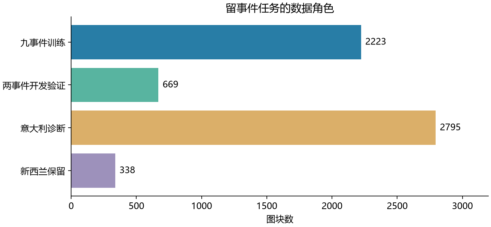
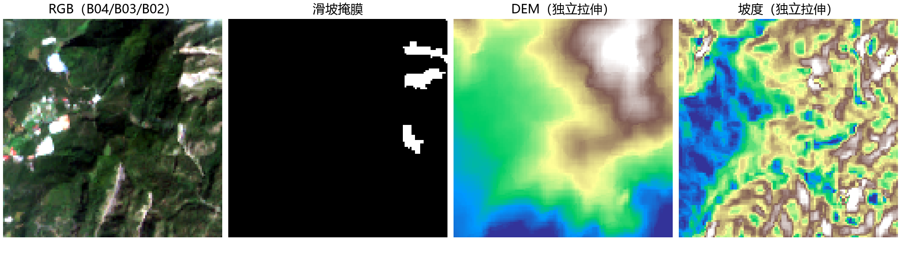

# 滑坡分割的数据资源与输入说明

## 数据来源与数量

| 数据集 | 来源与内容 | 本地数量及用途 | 存放 |
|---|---|---|---|
| Sen12Landslides | Sentinel-2多时相灾害区域、滑坡标注、SCL及地形 | 资源登记13628图块，每块15时相；监督任务成员与全库分开 | data/raw/sen12 |
| Landslide4Sense | IBM-NASA镜像中的影像与掩膜；14通道含光学、高程、坡度 | 训练3799、验证245、测试800组影像/标注；用于既有数据契约与相关实验，不混入当前Sen12协议 | data/raw/landslide4sense |
| 地形与派生输入 | 同一合法训练成员上的DEM、坡度和派生统计 | 以相应清单与统计文件为准，不与新增独立样本混算 | data/processed/terrain等派生目录 |

Sen12Landslides官方任务为 `S12LS-LD/harmonized/s2`，本地来源锁定提交 `2eb025bd76bef449d2f7cf4aaea861bc4cfeed51`。Landslide4Sense已有样本来自[IBM-NASA镜像](https://hf-mirror.com/datasets/ibm-nasa-geospatial/Landslide4sense)，不能把两套数据的通道或划分互换。

## 任务划分与评价集合

| 集合 | 数量 | 用途 |
|---|---:|---|
| 九事件训练 | 2223图块 | 更新模型及拟合合法训练统计 |
| 广岛＋特里苏尔开发验证 | 448＋221图块 | 两事件等权IoU选模，反复用于研发 |
| 意大利诊断 | 2795图块 | 指定错误分析，不作常规选模 |
| 新西兰保留评价 | 338图块 | 保留评价；有历史接触，不能称从未查看 |

官方任务的完整训练/验证/测试为3192/798/998图块；满足本地单张观测条件的子集为3012/758/945。它与当前按事件留出的2223/669协议是两种用途，不能混排数值。清单见[当前协议](assets/research/research_policy.json)和[官方成员锁](../manifests/official_single/protocol_lock.json)。

## 输入配置

共同输入为128×128网格，十波段顺序 B02、B03、B04、B05、B06、B07、B08、B8A、B11、B12。S2这些波段原生为10米或20米，共同10米存储网格不代表原生均为10米。单期读取预先选定参考影像；多期保留真实日期，并按任务选择是否允许参考日期之后的观测。

十波段归一化沿用559个训练核心图块拟合的stats_core25；不能仅因训练总数增加而重新拟合。新增高程、坡度等统计只用合法训练成员。云、无效数据及不可靠监督区域按既有质量规则排除，不当成正确背景计分。

Landslide4Sense原始14通道为B01–B12加SLOPE与DEM，缺B8A。没有完整地理、日期与质量来源时，不能猜测补出真实波段或直接套用Sen12统计。其读取入口默认为 `data/raw/landslide4sense`，原根目录10个重复样本已核对SHA256后删除。

## 数据可视化

图中训练、开发验证、指定诊断和保留评价分别计数。它说明数据角色，不是所有集合都可用于模型选择。

同一训练图块依次展示RGB、滑坡掩膜、高程与坡度；影像和连续地形独立拉伸，只用于解释字段，不能将色条或显示亮度当作原始物理量。该例不代表Sen12数据的通道配置。

## 审核与日常使用

数据说明维护来源、实际数量、波段、单位、网格和审核依据；单次实验保存所选成员与预处理配置，不按模型阶段复制数据介绍。读取前核对清单、质量规则、统计及实际输入一致即可；只有成员、资产、定标或处理规则变化时才重审受影响部分。

审核证据集中在[数据合同](assets/research/contract_acceptance.json)、[定标来源](assets/research/radiometry_provenance.json)和[外部数据审核](assets/research/external_landslide_audit.json)。它们各有覆盖范围，不替代新增数据审核。当前模型比较的指标定义、best/last与集合归属统一写入RESULTS。
