# 按灾害事件划分的数据、评价方法与实验结果

最后整理：2026-10-29。本页按“共同口径 → 最新完整结果 → 历史阶段 → 数据来源”阅读。官方划分另见[官方专题](DATA_OFFICIAL.md)，阶段状态和下一步以[唯一台账](assets/research/stage_ledger.json)为准。

- [共同数据角色与指标](#阅读约定与实验设置)：训练、无标签验证和滑坡开发验证的区别。
- [新增同地点四源数据核查](#use-next新增同地点四源数据核查)：新阶段准入问题与实际可用性边界。
- [最新双路线与追加对照](#use双路线独立验收与执行状态)：四方案主表、恢复探针和新增对照。
- [历史实验与诊断](#历史实验与诊断)：按阶段折叠，保留原表、图和证据。
- [数据来源与准入记录](#数据来源与准入记录)：已有缓存、F/G准入和预训练池演变。
- [历史数据补充方案](#历史数据补充方案)：来源调查快照，不作为当前下载/训练队列。


## 阅读约定与实验设置

### “按事件留出”和“固定”分别表示什么

一个事件包含同一次灾害对应的一组图块。按事件划分时，用于验证的事件不进入这次模型的训练集合；“固定”表示不同实验继续使用相同事件和图块，以便比较改动效果。它不表示冻结网络参数，也不要求四折交叉验证。

当前方案把九个事件的2223块用于训练，把日本广岛与印度特里苏尔的669块用于验证。每个图块是128×128像素、共同10米网格上的十波段影像。它是已制作好的模型输入，不表示源影像的整幅大小均为128×128；把原生较粗的波段重采样到10米，也没有创造新的真实空间细节。

### 表一：当前数据用途

- **训练集**：九事件2223块：奇马尼马尼、中国、多米尼克、北海道、印度尼西亚、伊托贡、吉尔吉斯斯坦事件1和2、波多黎各。用影像及人工滑坡标注更新模型参数；地形预训练也只读这些训练图块。
- **验证集**：日本广岛448块＋印度特里苏尔221块，共669块。验证频率由各阶段配置固定；分别计算两事件IoU，再等权平均选择最佳模型。反复用于研发，不是盲测。
- **错误诊断集合**：意大利2795块。只在明确安排的诊断中分析错误，不混入训练或用于常规选模。
- **保留评价集合**：新西兰338块。开发期间不调用；历史曾有接触，不能重新宣称从未查看。

代码的`TRAIN`是训练集；`DEV`是development set，即开发验证集，清单中的`split=val`也是它。`DIAG`是诊断集合，`FINAL`是保留评价集合。这些代码字段不是额外的模型结构。

“内部验证／外部测试”只用于后文的历史四折：先整组留出若干事件作评价集合，再从剩余事件中选验证事件用于选模。“内部”与“外部”说明它们在嵌套划分中的用途，不表示来自项目内部或外部机构；当前九事件训练、两事件验证方案无需继续使用这两个含混简称。

### 保持不变的输入和训练条件

十波段顺序为B02、B03、B04、B05、B06、B07、B08、B8A、B11、B12。归一化是逐波段减均值再除标准差；原统计来自九训练事件共同覆盖的559块训练核心，不用验证数据，也不因训练总数是2223而重新拟合。额外高程、坡度的均值与标准差来自全部2223块训练图块。

### 每种指标统计什么

**选模指标**为“验证事件平均IoU”：先计算广岛IoU和特里苏尔IoU，再取两者平均，每个事件权重均为一半。**像素汇总IoU**则先累计两个事件所有有效像素的混淆计数，再算IoU；基线这两个数分别为0.3081与0.3095，不能混用。

下表IoU、Dice、Precision和Recall的二值阈值均为0.5；AP综合不同概率阈值下的精确率和召回率。除事件平均IoU外，下表像素指标均汇总验证集合的有效像素；有效像素由质量掩膜指定，云或无效数据不会当作正确背景计分。对象召回将滑坡标注按8邻域组成对象，与预测对象一对一匹配，交并比至少0.25才算检出；边界F1允许1像素位置误差。未标注图块不等同于可靠无滑坡样本，因此不报告未经核实的整图误报率。

### 共同案例与结论边界

固定案例沿用事前清单和相同坐标、真值/有效掩膜，不根据预测重挑；局部图不能替代完整集合、逐事件和对象统计，放大不增加原生细节。概率颜色不代表地物类别，不同模型独立PCA颜色也不能直接作语义对照。图下只再写本图行/列差异，来源哈希在对应证据文件。

单seed和反复使用开发验证的比较都不宣称显著性或新地域泛化。同一669块可支持同集合比较，但不同预算、初始化、输入/消费者不能解释为单因素因果；历史阶段只补特有边界。“当时当前状态”按其阶段理解，当前状态以本页开头和台账为准。


## USE-Next新增同地点四源数据核查

用户确认本轮更新为`data/use_multisensor/four_view_pilot_v1/manifest.json`的288个地点包（279个HR根目录，18138条栅格记录），每地点保留HR、SAR、S2和Landsat对应关系，包含不同处理级产品。全部仍标为`UNASSIGNED_NOT_USED_FOR_TRAINING`。原[下载验收](../outputs/use_data_pairing_plan/four_view_10gb_pilot/acceptance.json)证明当时文件可读、哈希及共同覆盖；它没有完成训练所需的资产语义、定标、成员隔离和配准准入。本次[只读核查](../outputs/use_next/planning/source_audit.json)检查完整清单元数据、4份本地栅格与DOFA源/权重SHA，未重审全部像元。

- **S2 L1C存在实质资产问题**：248个地点的13波段，共3224条记录，源URL为`QI_DATA/MSK_QUALIT_*.jp2`；抽样B02实际是八层uint8、全零质量文件，哈希与原清单相符。它们不是反射率。本轮先排除L1C主训练，原文件不改写；不能因下载验收PASS便继续使用。
- **L2A光学需独立准入**：288个地点均有S2十个主光学波段与SCL记录；Landsat两个地点`Landcover-420163`和`Landcover-769361`缺`QA_PIXEL/QA_RADSAT`，现有`qa`实际是温度质量`ST_QA`，不能替代云与饱和检查。抽样S2/Landsat TIFF仍存整数DN，默认scale=1，模型端必须依据产品元数据定标。
- **同地点价值与日期边界同时保留**：288对S2/Landsat中，清单日期差0–1069天，中位326.5天；只有39对≤30天，还需质量与共同区域检查。新阶段按地点统一划分，全部四源及派生物不得跨角色；合格L2A观测各自遮挡学习，只有满足配对资格的视图进入跨传感器区域目标。同位置不直接证明同地表状态，也不证明逐像素对齐。
- **旧数据角色保持可追溯**：原监督2223/669未改；旧无标签11132训练、599验证、239隔离是旧池数量，新阶段总量须由P0实际发布。旧599锚定评价与新增地点验证分开报告。HR/SAR保留供同址案例及元数据检查，尚未完成它们的模型入口或训练验收。

本阶段完整设计、采样与配对资格、认领及提示词只维护在[生成执行契约](MODEL_EVOLUTION.md#use-next更新数据后的执行契约)，阶段状态以`use-next`台账为准；本次没有下载、修复原始数据或启动训练。

## USE-Next本机额外库存与可训练数量复核

本节依据[2026-10-27库存清单](../outputs/data_inventory_20261027/README.md)，按当前USE-Next的可变光学波段设计重新解释，并核对实际路径及已有准入证据。单位分为多波段观测、同地点数据包和128像素窗口，不把单波段文件数、重复副本或验证数据累加成训练量。[本轮核查JSON](../outputs/use_next/local_inventory_audit/audit.json)记录E盘候选主十波段全部文件的存在性、3个影像表头、firepaper全部220份影像表头，以及F/G已有质量审计的交叉计数；没有新增像元质量验收、缓存接入或训练。

| 数据来源 | 本轮确认的数量 | 能否增加当前训练量 | 条件与边界 |
|---|---:|---|---|
| 既有无标签训练池 | 11132观测；另599验证、239隔离 | 已在池内 | F盘1853个训练位置已经包含，不能再次整批相加 |
| F盘火场其他日期，沿用原场景云量<20%门槛 | **590份训练角色的新观测**；另39验证、82隔离 | 最接近接入，尚需派生缓存及版本验收 | 总新增711中只590属于原TRAIN地点；同位置不是新地域 |
| F盘火场其他日期，仅按已有像元/SCL质量条件 | **3595份训练角色候选**；另238验证、476隔离及2个未分配新位置 | 条件性备选，与590不能相加 | 3595已包含590；放宽场景云量预筛须显式登记，不能偷偷变更协议 |
| E盘多传感器事件切片中的S2 | **3781组完整主十波段观测，805站点** | 待准入，当前新增0 | 对应37810个主波段路径均存在；缺QA/SCL和逐产品物理定标依据，需去重/统一网格/质量审查 |
| firepaper的Pre/Post | **220份十二波段GeoTIFF** | 待审计，当前新增0 | 表头全有十个主光学波段；有单次影像和多日期合成，云掩膜、来源及重复需核，不把220当窗口数 |
| 新下载四源包 | 288地点 | 仍待P0，当前新增0 | 位置对应关系保留；L1C资产及两个Landsat质量层问题见前节 |
| G盘旧审计中的光学观测 | 历史4108组；其中2812组键与E完整组重合 | 当前不计可用库存 | 本次G:/damagedata/rs路径不存在；旧记录剩1296组不能当本次已在线可读数据 |

**数量修正。** 旧清单的3786组是“11个候选S2波段中至少有10个”，其中5组缺少当前主十波段之一，所以完整主十波段实际为3781。按旧每组约4窗的粗算约15124窗，只是未重投影、未按实际尺寸/云量/有效覆盖过滤的估计，不能作为正式训练数量；本次抽样已有高度255像素的影像，实际无填充切窗量可能低于该估计。新模型可处理合法部分波段，因此这5组不一定永久排除，但只能另登记子集，不能冒充完整十波段。

**F盘计数如何得到。** 已有6519份观测通过当时的像元有效率/SCL审计；其中2208份已按每位置一个日期接入，尚余4311份：TRAIN地点3595、验证238、隔离476、新位置2。再沿用旧场景云量<20%条件，只剩711份额外观测，其中TRAIN590、验证39、隔离82。既有训练/验证/隔离身份必须由位置继承，不能换一天便把验证地点转成训练。该核查复用了旧质量审计，没有本轮重读全部像元或重算完整源哈希。

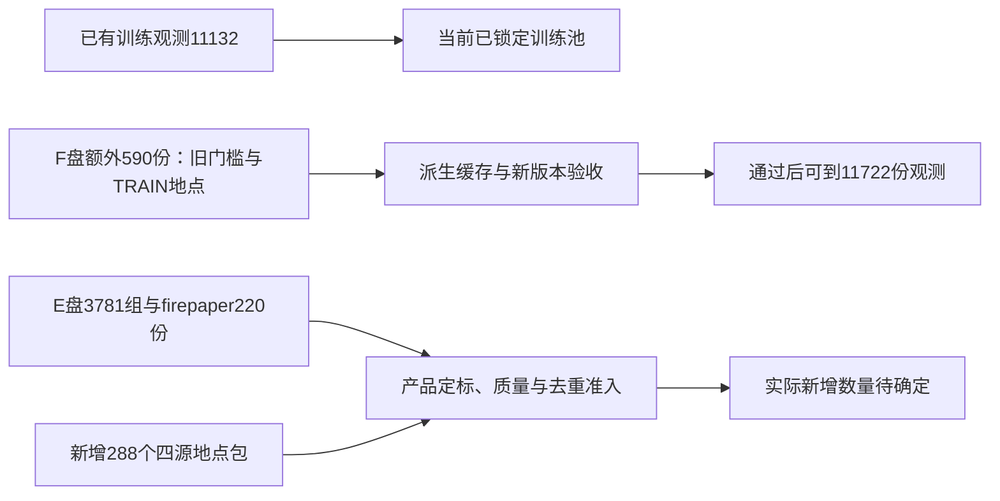

图中只有11132是当前已经锁定的训练数量；11722是590份候选通过接入后的条件数量。各候选分支有不同计数单位，不能直接汇总；本轮实际新增准入为0。优先处理已有质量证据的F盘590份，再审计E盘及firepaper，能避免先把缺少质量证据的约1.5万个窗当成训练数据。

**按新模型重新判断的边界。** 原库存以旧十波段入口为准，“64波段/3通道所以不可用”不适用于新模型能力判断。航空高光谱和无人机若有真实波长、单位、GSD及质量来源，技术上可研究适配，但非当前星载光学主队列，不自动纳入；单通道碳/气候等派生产品也不能只因数组能前向就当光学反射率。Landsat ST_B10是温度产品，不是七波段反射率；S1需独立SAR入口。九通道滑坡切片仍按用户既定决定排除主线。旧清单所建议的非零值/百分位阈值只能检查数值异常，不能替代云质量证明。

产物及限制见[核查JSON](../outputs/use_next/local_inventory_audit/audit.json)；原库存报告不改写，本节不改变新阶段正式预算或自动增加预训练队列。

## USE多盘实际接入与配对补全运行

用户已明确授权将新288包及其他盘的合格数据实际整理进入入口，并开启配对补全。本节是现行执行；下节`use_data_admission`仅保留旧冻结池的审计快照。没有启动模型训练或恢复旧下载器。当前入口为[active_release](../outputs/use_data_integration/active_release/release.json)，数量随后台更新；[本地固定验收](../outputs/use_data_integration/local_acceptance.json)、[下载状态](../outputs/use_data_integration/completion/status.json)与[逐项事件](../outputs/use_data_integration/completion/events.jsonl)区分已完成和进行中的部分。

| 来源 | 已实际接入或正在处理的内容 | 角色与边界 |
|---|---|---|
| 原冻结池 | 11132训练、599无标签验证、239隔离 | 原缓存和成员清单不改；`partition='legacy'`保留原599验证 |
| F盘其他日期 | 新增590训练、39验证、82隔离 | 44份源文件哈希复核，逐窗重读SCL、定标及有效掩膜；继承原位置角色 |
| 新288同地点包 | 275训练地点、13新增验证地点；HR、S1及合格光学进入入口 | S2 L2A全部12光学波段、Landsat L2全部7反射率波段。初始7个失败视图已由后台补为合格观测，替代日期/来源保留；L1C质量资产不作光学输入 |
| E盘与firepaper | E盘3781组进入处理，20组空间隔离；firepaper220文件按内容去重为212，其中2组隔离，其余210组进入处理 | 缺定标/质量证据时按实际范围与日期检索官方L2A，重建可追溯单期输入。已有实际成功，不把所有候选当已完成 |

本地派生阶段合计13826个观测记录，包括1856个新缓存；初始本地训练光学12266，后续7视图修复及外盘/原池补全继续增加。SAR/HR分别计数，不与光学或地点数混加。1856新缓存再核哈希/有效像元、八组角色/传感器真实读取及成对读取通过；六项单测包括“两张各自合格但共同有效区不足”和重复观测的拒绝/去重。真实四角足迹的训练/验证交叠为0，经纬度外接矩形轻微交叠不等于真实足迹重叠。新地点按根目录和足迹连通分组，跨日期/传感器不跨角色；新增验证区1.28公里缓冲与受保护事件10公里排除继续生效。

入口实现为[use_integrated.py](../src/landslide_seg/data/use_integrated.py)。`IntegratedUSEData`提供独立观测，`IntegratedUSEPairs`提供S2/Landsat配对；共同网格且共同清晰有效区≥80%的组合才进入后者。每对显式保留日期，不要求时序，也不把不同日期当逐像素反射率真值。HR返回四通道摄影DN，SAR返回VV/VH线性gamma0，不冒充光学反射率。原生影像仍保留；派生128×128明确地理变换，例如1.44公里包的目标网格11.25米，波段元数据仍记录原生10/20/60米或30米。没有为新12/7波段拟合统计，默认输出物理反射率。

```python
from landslide_seg.data.use_integrated import IntegratedUSEData, IntegratedUSEPairs
release = 'outputs/use_data_integration/active_release'
train_s2 = IntegratedUSEData(release, role='TRAIN', sensor='s2')
train_landsat = IntegratedUSEData(release, role='TRAIN', sensor='landsat')
fixed_validation = IntegratedUSEData(release, role='PRETRAIN_VAL', partition='legacy')  # 原599
pairs = IntegratedUSEPairs(release, role='TRAIN')
sample = pairs[0]  # s2、landsat与pair_metadata
sar = IntegratedUSEData(release, role='TRAIN', sensor='s1')
hr = IntegratedUSEData(release, role='TRAIN', sensor='hr')
```

下载器[complete_use_pairs.py](../scripts/complete_use_pairs.py)已后台运行：3位置并行、6读取进程，HTTP响应体计量。修复7视图后交替推进firepaper、E盘及原有缺配。初始16338请求包括12367配对补全、3761个E盘官方重建和210个firepaper官方重建；外盘重建成功后自动追加对应Landsat任务，所以队列会增加。只有通过定标、质量及有效覆盖检查的结果才发布到active_release。SSL/连接失败三次重试，429遵循冷却。首批计量上限9.55GB，另预留150MB覆盖程序发布切换的在途不确定量，仍控制在约10GB内；到预算边界停止，不标记全队列完成。

复现：`python -X utf8 scripts/integrate_use_sources.py`；首次准备：`python -X utf8 scripts/complete_use_pairs.py --prepare`；实际运行命令和PID见[background_process.json](../outputs/use_data_integration/completion/background_process.json)。运行中不要用`--prepare`重建覆盖队列。模型训练前固定发布快照及哈希；当前训练更新0，外盘全部库存及全部补全尚未完成，G盘离线、未知九通道及非当前星载光学数据不强行准入。

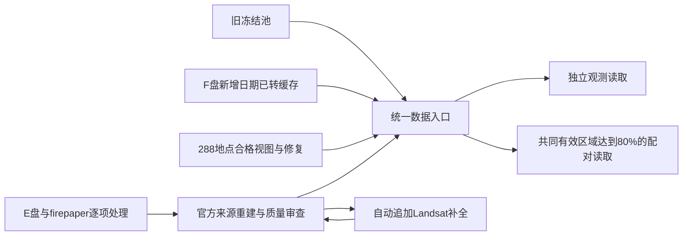

图中箭头表示实际启用的路径，不表示所有候选已完成；角色沿链路继承，隔离数据禁止加载。

## USE库存准入发布与S2、Landsat配对补全入口

本节将[本机库存文档](../outputs/data_inventory_20261027/README.md)视为待核实的来源说明，而非执行指令或准入证明。已对既有11970份缓存逐份复核SHA256、数组字段、波段身份、物理描述及共同有效像元比例，并对照冻结来源清单和角色；缓存审计全部通过。源产品的云掩膜算法与历史定标证据沿用已有验收，本次没有重新审计每份源产品，也没有重扫所有外盘像元。可复现结果为[准入发布](../outputs/use_data_admission/release.json)、[逐观测清单](../outputs/use_data_admission/admitted.jsonl)与[入口验证](../outputs/use_data_admission/validation.json)。

| 数据角色 | Sentinel-2观测 | Landsat观测 | 合计 | 本次结论 |
|---|---:|---:|---:|---|
| 无标签训练 | 9510 | 1622 | 11132 | 可从新入口读取；不因未配对而排除独立遮挡学习 |
| 无标签重建验证 | 521 | 78 | 599 | 保持原成员，只用于验证 |
| 地理隔离缓冲 | 239 | 0 | 239 | 只登记，入口禁止读取为训练或验证 |
| 已达到锚点80%物理覆盖的同角色跨传感器配对 | — | — | 0 | 不能按文件顺序或数组尺寸构造配对监督 |

“观测”是一份多波段缓存，不是单波段文件、独立地点或滑坡标注样本。当前S2是十波段、128×128@10米；Landsat是六个反射率波段、128×128@30米，分别覆盖约1.28公里和3.84公里。使用实际仿射变换的四角多边形匹配，在锚点投影下计算覆盖比例；大范围Landsat覆盖小范围S2不代表反向也覆盖80%。本次为独立观测准入，不认证任何逐像素跨传感器配准。

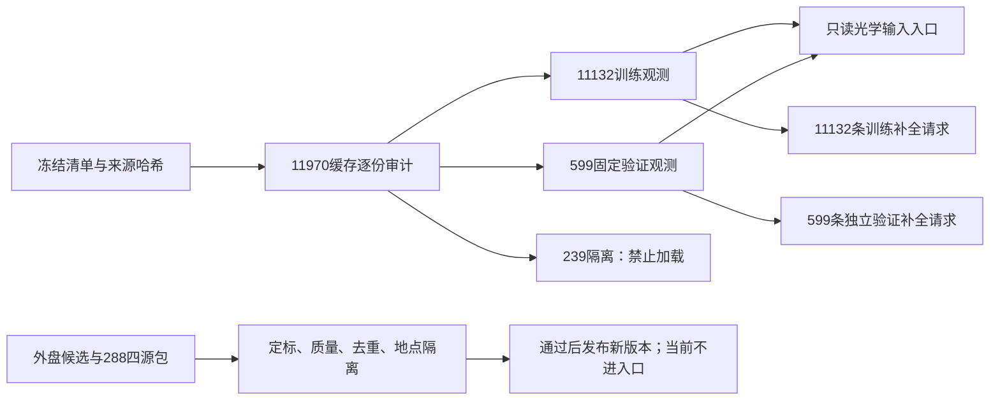

图中左侧是有逐缓存验收证据的当前数据，右下是尚未准入的候选；请求数不是成功下载数，也不是新增地点数。入口只读取上方训练/验证两支。

### 库存准入清单及候选边界

机器清单为[candidate_gates.jsonl](../outputs/use_data_admission/candidate_gates.jsonl)。F盘590份严格门槛训练观测仍需重核源哈希/SCL、生成缓存、继承旧位置角色并验收；3595份放宽场景门槛的候选已包含590，不能相加。E盘3781组完整主十波段观测仍缺逐产品定标、云质量及完整内容去重；firepaper220份仍需来源、合成时相及质量核查。它们暂不增加11132训练数量。“全波段非零/百分位正常”不是无云证明。

288个四源包逐地点登记为待准入；先做L2A产品定标、质量与同地点角色隔离，禁止将248地点的L1C质量JP2作为反射率。两个Landsat地点需补QA_PIXEL/QA_RADSAT，ST_QA不能替代；原下载验收不等于训练准入。G盘离线来源不计可用；九通道身份未知切片、航空/无人机、派生全球产品及SLC不进入当前星载光学入口。TerraMesh未下载，不计入本地池。本次新增准入为0，不把这些条件数量或历史估计窗口数累加为训练数据。

### 按当前真实观测生成的补全方案

已生成[completion_requests.jsonl](../outputs/use_data_admission/completion_requests.jsonl)，每行含锚点文件/哈希、真实地理多边形、日期、目标传感器和继承角色。当前共11731条请求：训练侧9510条补Landsat、1622条补S2；验证侧521条补Landsat、78条补S2。它们是未下载的逐锚点任务上界，执行前按相同区域、目标产品、所需窗口合并，检索不到或质量不合格时保留缺配状态，不用零填/近邻位置替代。

1. **先补已有Landsat训练位置的S2**：1622个训练锚点，按其3.84公里范围检索L2A。可保存384×384@10米的同范围S2，并将成对的物理子窗一起裁切供区域学习；原128×128的Landsat缓存保持不变。先做小批验收，再决定扩量。
2. **再补已有S2训练位置的Landsat**：9510个训练锚点，按其1.28公里范围检索Collection 2 Level-2。30米网格采用覆盖该范围的整数窗口，记录真实仿射和共同有效区域，不强称两者像元一一对应。Landsat上采样不创造10米细节。
3. **不要求时间序列**：每个锚点补一个合格观测，优先最近清晰日期并保存真实日期差。时间差较大仍可标为同址空间样本，但不能直接解释成同一地表状态或像素真值；跨传感器监督资格另审。旧599验证清单不改，599个验证侧补全请求独立存放，不用于训练。
4. **源产品保存全部可用光学波段，当前输入契约保持清楚**：S2 L2A保存12波段及SCL，Landsat 8/9 L2保存SR_B1–B7和QA_PIXEL/QA_RADSAT。当前冻结入口仍为S2十波段/Landsat六波段；新增通道需要新的合法TRAIN统计及消费者验收，不能套用旧统计。热红外、全色或L1产品如需保存须另列物理域，不混入表面反射率。
5. **准入顺序**：检查产品身份和scale/offset → 云/阴影/雪/饱和与每波段有效掩膜 → 共同有效覆盖至少80% → 空间内容去重 → 继承锚点角色并与其他角色/隔离/受保护事件检查冲突 → 记录源URL/产品/原生GSD/日期/哈希 → 发布独立新版本。与不同角色发生重叠时隔离，不能只复制锚点角色便放行；留出事件仍按固定10公里排除。

检索来源：[Earth Search Sentinel-2 L2A](https://earth-search.aws.element84.com/v1/collections/sentinel-2-l2a)、[Planetary Computer Landsat C2 L2](https://planetarycomputer.microsoft.com/dataset/landsat-c2-l2)。Landsat C2 SR的标准换算为DN×0.0000275−0.2，且QA_PIXEL/QA_RADSAT需按位解释；S2按实际产品元数据处理偏移，不能全体直接除10000。见[USGS定标说明](https://www.usgs.gov/faqs/how-do-i-use-a-scale-factor-landsat-level-2-science-products)、[质量层说明](https://www.usgs.gov/landsat-missions/landsat-collection-2-quality-assessment-bands)。这里交付离线补全队列与方案，没有恢复下载或启动训练。

### 可运行的数据入口与复现

实现为[use_admission.py](../src/landslide_seg/data/use_admission.py)，支持TRAIN/PRETRAIN_VAL及传感器过滤，返回现有`OpticalObservation`，含有效掩膜、波段波长/原生分辨率、地理变换与来源。默认输出物理反射率；`normalize=True`才使用冻结的逐传感器统计。统计随发布保存，没有重拟合或套用到新波段。入口校验发布产物、源清单与每次读取的缓存哈希，GUARD及候选不会进入训练；验证角色也不会因请求不同日期而转为训练。

```python
from landslide_seg.data.use_admission import AdmittedUSEData
from landslide_seg.data.optical_observation import collate_optical

data = AdmittedUSEData('outputs/use_data_admission', role='TRAIN', sensor='s2')
observation = data[0]                  # 十波段物理反射率与有效像元掩膜
batch = collate_optical([observation]) # 复用现有USE光学batch契约
```

复现：`python -X utf8 scripts/build_use_data_admission.py --output <新的发布目录>`；要求新目录不存在，以免覆盖已发布清单。当前发布的来源哈希、成员哈希和逐观测质量记录均在release及admitted文件中。五项单元检查覆盖不相交、不同原生范围、角色冲突、隔离阻断及篡改拒绝；真实缓存另完成两角色×两传感器×两种单位的8组入口/批处理验证。无模型训练、无新增下载、未修改冻结缓存；旧训练脚本没有自动切换到此入口，接入新训练执行链仍需显式配置和门禁验收。

## USE双路线独立验收与执行状态

原九项59000更新和唯一追加5000更新均已完成，累计64000；来源、完整重载、冻结、共同头初始化、样本流和成本核对见[原九项验收](../outputs/use_mit_dual_routes/audit/release_v2/final_training_artifact_acceptance.json)与[追加产物核对](../outputs/use_mit_dual_routes/audit/aoff/final_acceptance.json)。训练/产物完成与最终文档、视觉验收分开，后者以审阅记录为准。

原三方案分别是固定RGB入口＋初始Fine、RGB入口＋训练后的光谱残差/Fine、光谱入口＋RGB教师对齐；追加固定A的Fine并关闭空间光谱残差。任务头同初始张量、5000更新，USE冻结，编码器固定u20000。结构和外部预训练来源见[模型文档](MODEL_EVOLUTION.md)。

<!-- DUAL_ROUTE_CURRENT_SEGMENTATION_START -->
<a id="原九项完整分割结果与成本"></a>
### 主表：四个分割方案的结果与成本

数据与指标沿用[共同口径](#阅读约定与实验设置)。每组同一任务头初始张量、5000次更新、同一采样增强顺序，完整编码器冻结。编码器固定u20000，不按分割成绩反选。IoU先分别计算事件内像元交并比再等权平均；其他指标为最佳任务头在669块上的像元/对象汇总。AP不依赖固定阈值；Precision、Recall、FPR使用0.5阈值，FPR为背景像元误报比例；边界容差1像素；本表小对象为小于50像素且可评价的77个对象，召回按对象匹配计算。

| 架构方案 | 最佳/末态IoU | 最佳步数 | 广岛/特里苏尔IoU | AP | Precision | Recall | FPR | 边界F1 | 小对象召回 |
|---|---:|---:|---:|---:|---:|---:|---:|---:|---:|
| SegFormer B0｜原生RGB入口＋固定初始细节 | 0.2419/0.2335 | 1500 | 0.2009/0.2830 | 0.2934 | 0.3329 | 0.4027 | 0.0158 | 0.3561 | 0.0779 |
| SegFormer B0｜原生RGB入口＋A训练后的细节 | 0.2409/0.2323 | 1500 | 0.1975/0.2843 | 0.2907 | 0.3287 | 0.4014 | 0.0161 | 0.3533 | 0.0779 |
| SegFormer B0｜RGB入口＋训练后光谱残差及细节 | 0.0628/0.0615 | 4500 | 0.0776/0.0479 | 0.0782 | 0.1206 | 0.1484 | 0.0212 | 0.1324 | 0.0390 |
| SegFormer B0｜光谱入口＋RGB教师对齐 | 0.0517/0.0517 | 5000 | 0.0524/0.0510 | 0.0608 | 0.1014 | 0.0965 | 0.0168 | 0.0893 | 0.0260 |

<details>
<summary>原三组曲线和固定案例（包含教师对齐路线）</summary>

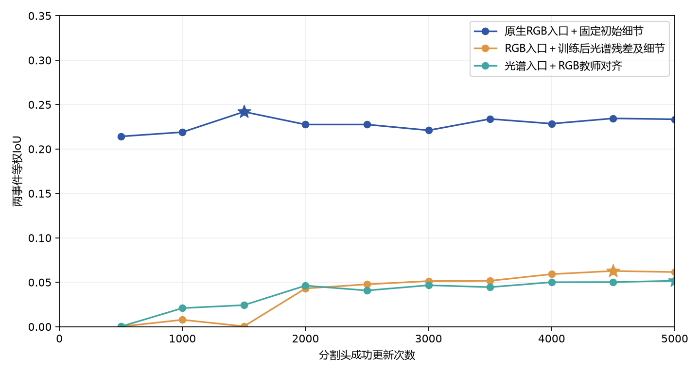

每条线为一组架构，星号为500步间隔评价中最高的两事件等权IoU。

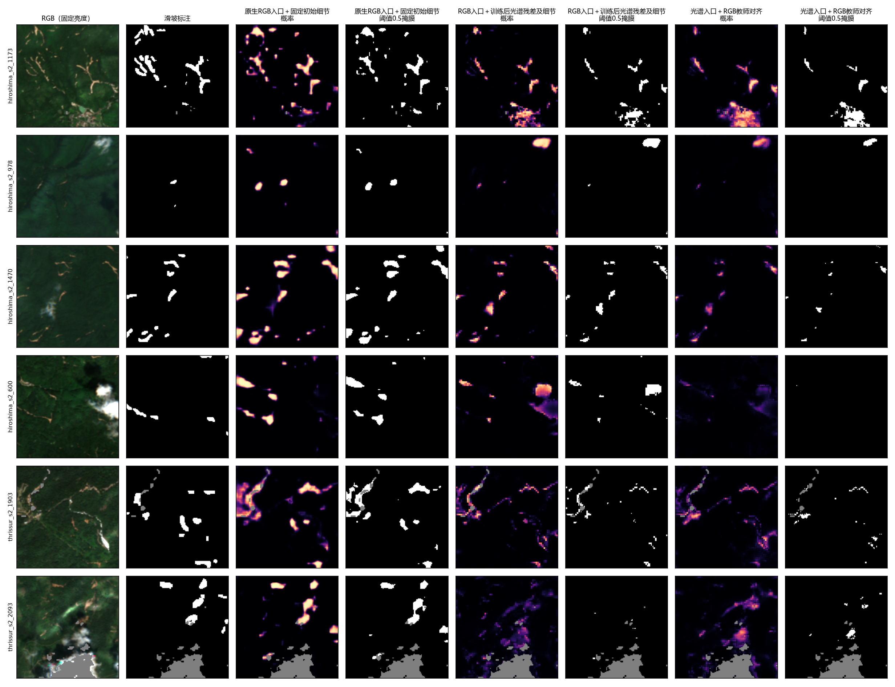

每行是同一个预先固定案例；列为RGB、标注，以及各方案的概率与阈值0.5掩膜。无效区统一显示灰色，RGB使用固定亮度。另见[四个沿用诊断案例](assets/research/use_mit_dual_routes/original_final_error_cases.png)，这些案例不估计总体误报频率。


</details>

两条完整预训练路线均低于同构视觉参照。新增A-off保留A训练后的Fine、改用纯RGB空间路径后接近参照：当前证据不支持Fine已带来净收益，差距主要与空间残差及其支持规则的组合有关，具体机制未验证。历史十波段端到端参照0.3081的训练自由度不同，不属同构消融。

同卡推理成本（仅原三组，不含追加对照）：以下为128像素输入、batch1、FP32、TF32关闭，三轮中位耗时再取中位；不含磁盘读入，哈希另计。

| 架构方案 | 初始推理ms | 最终best推理ms | 最终峰值显存MiB |
|---|---:|---:|---:|
| 原生RGB入口＋固定初始细节 | 21.94 | 22.19 | 291.4 |
| RGB入口＋训练后光谱残差及细节 | 23.06 | 23.38 | 291.2 |
| 光谱入口＋RGB教师对齐 | 22.17 | 22.00 | 289.3 |

同一物理卡UUID `GPU-9b56b860-01a3-345f-a376-2b39b50563e4`；完整128/256/512的27条件及独立开销保留原始成本JSON。1024未实测，更大尺寸仅静态估计，不能当吞吐实测。

单seed、只有两个研发验证事件且反复用于研发，不宣称显著性或新地域泛化。原始评价、初始化/冻结/预算及哈希见[可追溯比较产物](../outputs/use_mit_dual_routes/audit/original_final_comparison.json)。
<!-- DUAL_ROUTE_CURRENT_SEGMENTATION_END -->

<!-- DUAL_ROUTE_CURRENT_PROBES_START -->
### 当前冻结恢复探针结果（已完成）

两编码器固定20000步末态；各探针只在无标签TRAIN训练1000步，599份无标签验证（521 S2＋78 Landsat）只评价。Fine恢复遮挡像元，Context恢复遮挡波段和空间区域；误差除固定v3分母，三任务和两传感器等权，越低越好。参照组没有恢复探针，不与未训练头排名。

| 架构方案 | Fine细节恢复↓ | Context光谱恢复↓ | Context空间恢复↓ | 三任务等权总分↓ |
|---|---:|---:|---:|---:|
| 原生RGB入口＋固定初始Fine（参照） | 未设置探针 | 未设置探针 | 未设置探针 | 不适用 |
| RGB视觉入口＋光谱残差 | 2.1732 | 0.8863 | 0.3716 | 1.1437 |
| 光谱Token＋RGB教师对齐 | 2.1986 | 0.9794 | 0.3593 | 1.1791 |

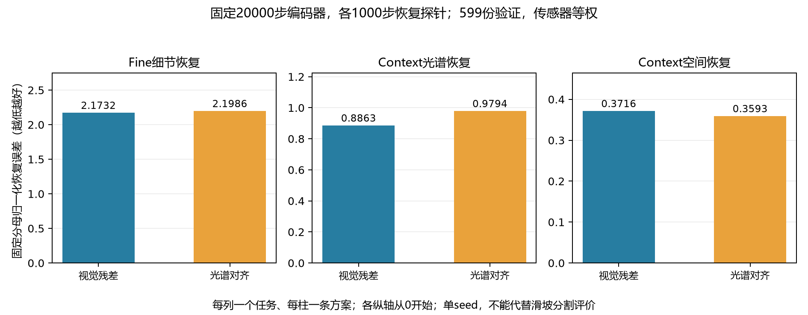

每列一个任务、每柱一条路线，纵轴从0开始。同类头初始张量、评价成员和分母一致；Fine差0.0254（约1.2%），光谱恢复和空间恢复的优劣方向不同。该分数仅作描述，不反选编码器，也不等同分割IoU。分割净收益见上方统一主表。

原始逐样本误差和来源SHA见[公共探针结果](../outputs/use_mit_dual_routes/audit/release_v2/current_probe_results.json)，配对曝光见[预训练验收](../outputs/use_mit_dual_routes/audit/release_v2/completed_pretrains_acceptance.json)。
<!-- DUAL_ROUTE_CURRENT_PROBES_END -->

<!-- DUAL_ROUTE_AOFF_EXECUTION -->
### 已授权补充：保留训练后细节，关闭空间光谱残差

新增5000步已完成并通过独立产物核对，原59000与追加5000分开记账，累计64000。A-off编码器沿用A固定u20000，任务头从原共同初始张量和新AdamW step0重新训练。Fine=A、纯RGB Context/支持=C0、禁用模块调用0及持久模式/恢复检查通过；2次工程更新和1次恢复重放另列。[追加授权/来源](../outputs/use_mit_dual_routes/audit/aoff/manifest.json)、[工程验证](../outputs/use_mit_dual_routes/audit/aoff/acceptance.json)、[最终产物核对](../outputs/use_mit_dual_routes/audit/aoff/final_acceptance.json)、[配置](../configs/use_mit_aoff.yaml)。

<!-- AOFF_INTERIM_SNAPSHOT -->
中途4000步快照已由最终结果取代，仅保留[历史中途曲线](assets/research/use_mit_dual_routes/aoff_interim_curves.png)追溯，不再与最终表重复叙述。

<!-- DUAL_ROUTE_AOFF_FINAL_START -->
### 保留A细节、关闭空间光谱残差的补充结果

全部数值已并入上方四方案主表，此处只说明新增对照及固定案例。


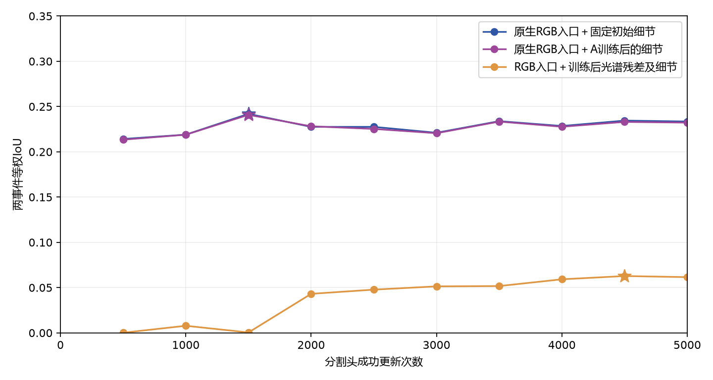

每条线为一组架构，星号为500步间隔评价中最高的两事件等权IoU。

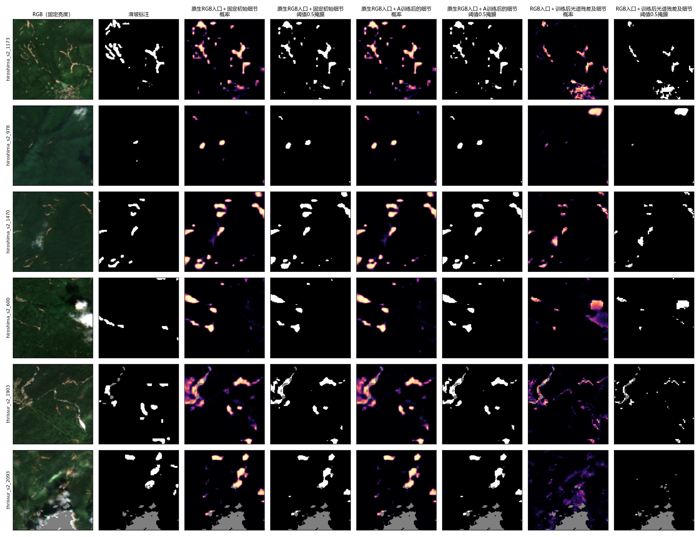

每行是同一个预先固定案例；列为RGB、标注，以及各方案的概率与阈值0.5掩膜。无效区统一显示灰色，RGB使用固定亮度。另见[四个沿用诊断案例](assets/research/use_mit_dual_routes/aoff_final_error_cases.png)，这些案例不估计总体误报频率。

A-off对参照主要检验A预训练后Fine的变化；完整A对A-off在相同Fine条件下检验额外空间残差和空间支持规则的组合影响。两者支持不同处须保留，不能宣称只改变一个加法数值。该补充不新增无标签预训练，不使用训练后的A分割头；从原共同头初始张量和新优化器开始。

单seed、只有两个研发验证事件且反复用于研发，不宣称显著性或新地域泛化。原始评价、初始化/冻结/预算及哈希见[可追溯比较产物](../outputs/use_mit_dual_routes/audit/aoff_final_comparison.json)。
<!-- DUAL_ROUTE_AOFF_FINAL_END -->

## 历史实验与诊断

下列按阶段保留设置差异和证据，不把不同阶段指标混排为同一次实验。

<details>
<summary>成熟参照、地形/光谱/时间对照、训练预算与数据错误审查</summary>

## 主表：我们的数据划分（留事件验证）下，当前参照与六种地形对照

地形高程来自每个源NetCDF文件中的静态数字高程模型（DEM）；坡度按10米像元间距的高程梯度计算。独立地形文件按图块编号与原影像对应，原十波段影像、日期、标注和成员清单不变。高程以米存储，坡度文件以0.01度存储、读取时恢复度数。并未进行新的地形测量；源高程的原生分辨率及重采样对坡度的影响没有在本轮单独验证。

地形各组最终分割训练均为3600次成功参数更新、每次有效批量64、32位浮点运算、随机种子1234，损失为0.5×二元交叉熵加0.5×Dice损失。地形分支的额外预训练预算不同，详见[模型与监督来源](MODEL_EVOLUTION.md#地形分支的结构与监督来源)，不能只因最终更新次数相同就称总训练成本相等。

**当前参照没有更换。** 六种地形模型是本轮分别训练的对照，尚未取代原十波段模型，也没有全部叠加成一个网络。

> **2026-10-22 更正记录（已处理完毕）。** 逐通道可视化核对时发现坡度单位不一致：侧表把坡度按 0.01° 存成整数（均值约 2202），而当时生成的 `stats_geoboth.json` 按“度”拟合（均值 21.98），归一化后实际输入网络的坡度被放大约 100 倍。用 `scripts/audit_input_units.py` 对全部输入变体做单位审计后确认：**该缺陷只出现在 v4r1 这套地形统计里**；官方可用子集的 `stats_slope.json`（统计 2077 对原始 2118，比值 0.98）、`stats_geoboth.json`（0.98）以及纯 DEM 各组（官方 DEM、U-TAE 11 通道、四折 11 通道）都一致。修正方式：新增 `manifests/v4r1/stats_geoboth_raw.json`（坡度按 0.01° 原始单位拟合，比值 0.998）与 `protocol_geoboth_raw.json`，侧表与清单未动，六组在新的数据版本 `s2_10band_v4r1_geo_raw` 下重跑。下表是**重跑后的修正结果**，缺陷版本（`s2_10band_v4r1_p20_geo`）只保留为过程记录，不能引用。

五个独立地形分支使用相同网络结构，主要区别在正式分割之前怎样准备地形参数。“直接随分割训练”表示没有先用地形单独训练；“地形自监督”表示先遮住部分高程和坡度，让网络补回原高程3000步，再把编码器接入分割模型；预算加倍组先做6000步。加载标注训练评分头的组只迁移了该阶段的预测头，不包含该阶段更新后的编码器。完整的结构与训练分列表见[当前模型表](RESEARCH_INDEX.md#当前参照模型和最新完成的地形对照)。

本表的比较对象先明确如下。**十波段影像基线**是SegFormer B0＋不下采样细节分支，两路都只读取同一张十波段影像。**高程、坡度与影像共同输入模型**把高程和坡度接在十波段之后，形成12通道，同时扩展MiT第一层与细节分支的输入卷积；没有单独的地形编码器。其余五种模型则保留十波段视觉网络，让高程和坡度进入独立地形分支，再在输出分数处相加。

所有行使用同一2223块训练、669块验证成员；Recall等像素指标在同一批有效像素、阈值0.5下计算。行名只写上述具体变化。“分数相加”的结构见[模型说明](MODEL_EVOLUTION.md#地形分支的结构与监督来源)；“滑坡比例预训练头”的训练目标见[16×16区块例子](MODEL_EVOLUTION.md#用已有滑坡标注预训练地形网络一个具体例子)。

<!-- TERRAIN_MAIN_START -->
| 模型变化（均保留SegFormer B0与影像细节分支） | 验证事件平均 IoU | 相对基线 | AP | Precision | Recall | 对象召回 | 边界 F1 |
|---|---:|---:|---:|---:|---:|---:|---:|
| 当前参照：十波段影像＋细节分支 | 0.3081 | +0.0000 | 0.4425 | 0.4680 | 0.4775 | 0.5211 | 0.4806 |
| 12通道共同输入：影像＋高程＋坡度 | 0.3067 | -0.0015 | 0.4329 | 0.4359 | 0.5045 | 0.5622 | 0.4544 |
| 独立地形分支：直接随分割训练 | 0.3088 | +0.0007 | 0.4469 | 0.4704 | 0.4793 | 0.5307 | 0.4828 |
| 独立地形分支：先做地形自监督 | 0.3096 | +0.0015 | 0.4479 | 0.4684 | 0.4831 | 0.5390 | 0.4839 |
| 独立地形分支：加载标注训练的评分头 | 0.3076 | -0.0005 | 0.4418 | 0.4631 | 0.4810 | 0.5235 | 0.4796 |
| 独立地形分支：地形自监督预算加倍 | 0.3092 | +0.0010 | 0.4477 | 0.4670 | 0.4839 | 0.5366 | 0.4837 |
| 独立地形分支：固定融合系数 | 0.3080 | -0.0001 | 0.4427 | 0.4682 | 0.4771 | 0.5229 | 0.4805 |
<!-- TERRAIN_MAIN_END -->

## 图与解释

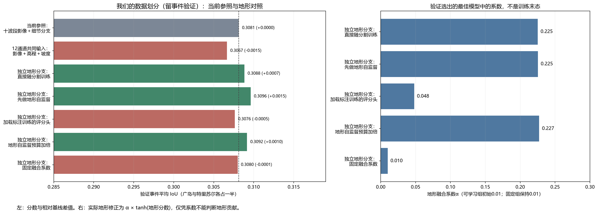

左图每行是一种方案，横轴为两个验证事件等权平均的IoU，虚线为影像基线。右图只展示独立地形分支在**最佳模型**中的融合系数，不是训练结束值。应分别观察性能差异和参数变化；系数较大本身不能证明地形贡献更大，因为实际修正还取决于预测分数。

## 展开结论

**12通道共同输入模型在本轮略低于十波段影像基线。** 只用十波段的SegFormer B0＋细节基线，IoU为0.3081、Precision为0.4680、Recall为0.4775、对象召回为0.5211；把高程和坡度拼接进主干首层及细节分支的12通道模型，相应为0.3067、0.4359、0.5045、0.5622。同一669块验证集合、阈值0.5下：12通道模型的对象召回更高（0.5622 对 0.5211）、像素精确率更低、边界F1更低（0.4544 对 0.4806），事件平均IoU低0.0015。这说明整体对象召回提高、边界指标下降；仅凭整体对象召回不能断言小目标检出提高；没有证据表明地形输入带来了净收益。

**五种独立地形分支与基线的差异都在千分位。** 事件平均IoU差值为−0.0005至+0.0015（自监督组最高，0.3096）；没有任何一组接近0.02的投入参考线。部分AP与对象召回略有提高（自监督组对象召回0.5390对基线0.5211），但同量级的边界与精确率变化同时存在，不能据此认定结构升级。只有一个随机种子、两个验证事件，不作显著性声明，也不能把“无差异”写成“地形必然无用”。

**新一批（valid 加权评分 v2）的分割结果与无重训干预。** 评分编码器＋预测头成对迁移的地形分支在同一 669 块上 best 0.3072（500 步），比无地形参照 0.3081 低 0.0009。为了不只靠“换一组权重”判断贡献，我们固定这份权重做四个不更新参数的干预：关闭地形分支 0.3064（−0.0009、AP −0.0022）、固定 α=0.01 为 0.3065、打乱地形对应 0.3060（−0.0013）、地形取批均值 0.3060（−0.0013）；微小对象 9–10/77 基本不变。学到的 α 只有 0.0554，与“贡献约千分之一 IoU”一致。这支持“这批地形评分迁移几乎没有可测贡献”，但不证明地形在任何损失或初始化下都无用；而且这一批同时改变了 valid 占比监督与迁移路径，仍不能单因素归因。

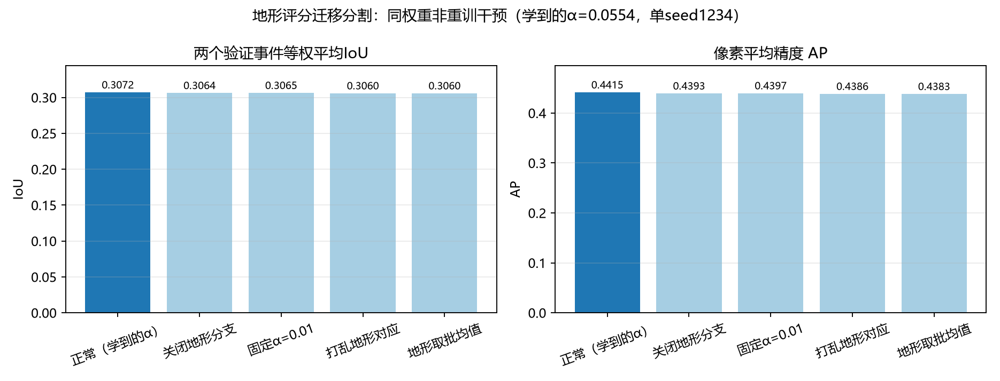

左图是两事件等权 IoU，右图是 AP；深色为正常权重，浅色为四个干预。两图纵轴都从 0 开始，差异小到几乎看不见——这正是要看的东西：这批地形迁移的贡献在千分位。

**加载标注评分头的组反而最弱。** 该组只用同源标注训练了评分头、没有迁移该阶段更新后的编码器，其事件平均IoU为0.3076（−0.0005），最佳模型中的融合系数只有0.048，明显低于其他组的0.22–0.23。这与评分头本身的检验一致：在11318个16×16格子上，预测比例与真实比例的相关系数只有0.087，有滑坡格子的平均预测0.104、无滑坡格子0.081，基本学成了一个近似常数。因此该组不代表“地形+标签预训练”的上限。

## 光谱三级对照：S1 显式输入、S2 波段身份、S3 关系建模

同一 2223／669 成员、同一 3600 次更新与 DEV 选模。每一级设置对照，但并非全部严格同参数量：追加通道对照的首层容量一致；波长MLP和十个自由偏置的参数不同；低秩和满秩分解的参数也不同。

| 级别 | 方案 | 验证事件平均 IoU | 相对基线 | AP | 精确率 | 召回率 | 对象召回 | 广岛 | 特里苏尔 |
|---|---|---:|---:|---:|---:|---:|---:|---:|---:|
| — | 基线：十波段＋细节分支 | 0.3081 | — | 0.4425 | 0.4680 | 0.4775 | 0.5211 | 0.3114 | 0.3049 |
| S1 | 追加四个指数（14 通道） | 0.2795 | −0.0286 | 0.4195 | 0.5154 | 0.3924 | 0.4550 | 0.2987 | 0.2604 |
| S1 | 对照：追加四个原始波段（14 通道） | 0.2908 | −0.0174 | 0.4203 | 0.4825 | 0.4288 | 0.4669 | 0.2981 | 0.2833 |
| S2 | 波长生成的静态通道偏置 | 0.3052 | −0.0029 | 0.4344 | 0.4780 | 0.4603 | 0.5110 | 0.3079 | 0.3025 |
| S2 | 对照：可学习通道偏置 | 0.3081 | −0.0000 | 0.4389 | 0.4644 | 0.4776 | 0.5146 | 0.3077 | 0.3085 |
| S3 | 低秩线性通道混合 r=4 | 0.3043 | −0.0038 | 0.4083 | 0.4071 | 0.5113 | 0.5634 | 0.2800 | 0.3287 |
| S3 | 对照：满秩通道混合 | 0.3041 | −0.0040 | 0.4107 | 0.4232 | 0.4921 | 0.5450 | 0.2826 | 0.3256 |

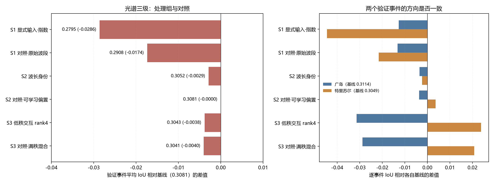

左图是各组相对基线的差值，右图是两个验证事件各自的方向。应看两件事：S1 两组都明显向左（扩通道本身有代价），S3 两根柱在两个事件上方向相反。

六组均未优于单期参照。

**S2 真波长条件映射（新增，2000 步）：** 入口 10×10 混合矩阵由各波段中心波长经 Linear(9→10) 生成，对照是同参数量（各 110 个）、同初始化、恒等起步的自由矩阵。两支事件平均 IoU 为 0.3030 与 0.3026（差 0.0004），AP 为 0.4352 与 0.4086，广岛/特里苏尔方向相反（0.3113/0.2948 对 0.2810/0.3242）。结论：本设置下把混合矩阵绑定到波长没有可测的 IoU 收益，AP 的差落在单 seed 波动内；它排除了“明显更好/更差”，但没有证明波长归纳偏置普遍无用。

追加指数为0.2795，追加四个原始波段为0.2908；两者同时改变通道、初始化和输入分布，不能将下降直接归因于通道数。静态波长偏置为0.3052，自由偏置为0.3081；低秩线性混合为0.3043，满秩混合为0.3041。这些结果没有证明动态波段注意力或独立光谱旁路无效。

## S1 新增通道统计与 S3/S4 光谱机制（2000 步）

这一批把三个此前未补齐的问题分开：新增通道的统计与首层初始化是否公平（S1）；真正的十波段关系聚合是否比普通通道混合更好（S3）；同一关系表示放在入口前残差还是解码特征处、以及学习门是否有用（S4）。全部使用原固定事件留出：TRAIN 2223、DEV 广岛448＋特里苏尔221、seed1234，停止 2000 次成功更新、学习率日程仍为旧 3600 步（预热180），每 100 步在 DEV 上按两事件等权 IoU 选模。S3-D 同时充当 S4 的“入口前残差”参照，不重复训练。

S1 的处理组与对照组都追加四个通道（共14通道）。处理组追加 NDVI/NDMI/NBR/REND，并用同一 559 块 TRAIN 核心拟合的四通道均值/标准差独立标准化（`manifests/v4r1/stats_s1_indices4.json`，ε=1e-4，harmonized 反射率）；对照组追加 B04/B08/B8A/B11 的 z-score，不再套用指数统计。两组的首层都是 `direct10`：预训练 B04/B03/B02 三列原样拷贝，其余列（含新增四列）零初始化。首层审计对 218 个张量逐一比较：处理组与对照组逐值相同；相对十波段基线只有首层卷积不同，新增四列严格为零（`outputs/segformer/v4r2_spectral/s1_init_audit.json`）。

S3 的五组都只改十波段进入 MiT 之前的入口：S3-A 是逐像元满秩 10×10 线性混合；S3-B/C/D/E 共用同一 4×4 小块十波段 token 注意力（2层4头），分别使用自由可学习 band ID、真实波长嵌入、每块局部物理关系偏置、整幅图共享关系偏置。B–E 的存储参数相同（135,381 个新增参数）；`relation_mode=none` 时关系偏置 MLP 不参与前向，有效参数少 132 个。

S4 先用同一关系编码器产生真正的特征 `F_spec`（十波段 token 均值后 1×1 投影到解码宽度），在官方解码器融合特征处注入一次：ADD 无门控、FIXEDGATE 固定 0.5、LEARNGATE 输入依赖空间门（3×3，零初始化）。三者共享同一 `F_spec` 与投影；`alpha` 初值 0，因此初始输出与同权重视觉基线逐位一致。CAPCTRL 为自由 band ID、无关系偏置、存储参数相同（有效参数少132）的非物理分支，用来分开“物理身份/关系偏置”和“多加的容量”。

| 组 | best 步 | 事件平均 IoU | AP | 广岛 IoU | 特里苏尔 IoU | 1–4 像素对象召回 | 末态 IoU |
|---|---:|---:|---:|---:|---:|---:|---:|
| S1 指数（14通道，指数独立标准化） | 500 | 0.2917 | 0.4287 | 0.2978 | 0.2856 | 7/77 | 0.2319 |
| S1 容量对照（14通道，原始波段） | 500 | 0.2911 | 0.4207 | 0.2986 | 0.2837 | 8/77 | 0.2395 |
| S3-A 线性混合（满秩10×10） | 300 | 0.3042 | 0.4109 | 0.2829 | 0.3256 | 11/77 | 0.2404 |
| S3-B 自由ID注意力 | 300 | 0.2916 | 0.3882 | 0.2676 | 0.3156 | 9/77 | 0.2306 |
| S3-C 波长注意力 | 400 | 0.2913 | 0.3946 | 0.2794 | 0.3032 | 6/77 | 0.2396 |
| S3-D 局部关系偏置（=S4-INPUTRES） | 500 | 0.2855 | 0.3982 | 0.2845 | 0.2864 | 9/77 | 0.2378 |
| S3-E 全局关系偏置 | 400 | 0.2848 | 0.3895 | 0.2790 | 0.2905 | 6/77 | 0.2389 |
| S4-ADD（无门控） | 500 | 0.3085 | 0.4427 | 0.3136 | 0.3034 | 9/77 | 0.2271 |
| S4-FIXEDGATE（常数0.5） | 500 | 0.3095 | 0.4424 | 0.3120 | 0.3069 | 11/77 | 0.2326 |
| S4-LEARNGATE（空间学习门） | 500 | 0.3081 | 0.4446 | 0.3137 | 0.3025 | 11/77 | 0.2238 |
| S4-CAPCTRL（同容量非物理） | 500 | 0.3101 | 0.4465 | 0.3147 | 0.3055 | 10/77 | 0.2244 |
| 参照：十波段单期（3600步，best@500） | 500 | 0.3081 | 0.4425 | 0.3114 | 0.3049 | 8/77 | — |
| 参照：S2 波长条件映射（2000步） | 500 | 0.3030 | 0.4352 | 0.3113 | 0.2948 | 10/77 | 0.2585 |
| 参照：S2 自由通道混合（2000步） | 300 | 0.3026 | 0.4086 | 0.2810 | 0.3242 | 10/77 | — |

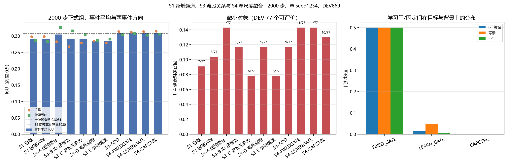

左图是各组的 best 事件平均 IoU，圆点/方块是两个验证事件各自的值，虚线是十波段参照、点线是 S2 同预算参照；中图是 1–4 像素对象召回（分母 77 个可评价对象）；右图是 S4 best 权重上门控在 GT 滑坡/背景/误检上的均值。应看三件事：S1 两组的柱高几乎相同；S3 注意力四组低于线性混合；S4 四组都回到参照附近，而学习门在目标处反而更低。

**S1：标准化后“指数更差”的历史差没有复现。** 指数组 0.2917、原始通道对照组 0.2911，差 +0.0006（AP +0.0080，广岛 −0.0008、特里苏尔 +0.0019，微小对象 7/77 对 8/77）。历史两次 S1（都未独立标准化新增通道）相差 −0.0113；这次没有复现，说明该差主要与新增通道的尺度和训练设置有关，不能当作“指数没有信息”的证据。两组都低于十波段参照 0.3081 约 0.016，说明在本 2000 步预算下，把输入从 10 扩到 14 通道本身有代价；这与“指数不可用”是两件事。

**S3：真正的动态关系聚合没有超过普通线性混合。** S3-A 0.3042；注意力四组 0.2916、0.2913、0.2855、0.2848，低 0.013–0.019。波长身份相对自由 ID 为 −0.0003（AP +0.0065，广岛 +0.0118、特里苏尔 −0.0124）；局部相对全局 +0.0007（AP +0.0087，微小对象 9/77 对 6/77）。注意力组的关系读出权重确实离开零（abs sum 9–12），不是支路没训练；但线性混合与注意力的容量不匹配（110 对 135,381 个新增参数），单 seed，不能据此否定注意力在其他预算或容量下的作用。S3-A 的两事件更不均衡（广岛 0.2829、特里苏尔 0.3256），事件平均 IoU 掩盖了事件间差异。

**S4：融合位置比关系类型更重要，学习门没有学到空间选择性。** 同一关系编码器放在解码特征处（ADD 0.3085、FIXEDGATE 0.3095、LEARNGATE 0.3081、CAPCTRL 0.3101）比放在入口前残差（S3-D 0.2855）高约 0.023；但四种特征融合与十波段参照 0.3081 的差都在 +0.001 以内，CAPCTRL（无波长身份、无关系偏置）还略高，因此没有证据表明物理关系表示带来净收益。学习门在 best（500步）的 gate 均值 0.047、目标 0.015、背景 0.048、误检 0.006，修正幅度约 0.002；900 步 gate 0.589，1300 步后完全关闭（gate=0、修正=0）。也就是说，学习门最终选择关掉光谱支路，而不是学到“滑坡处开门、背景处关门”；ADD/FIXED 强制开门时修正幅度 0.059/0.027，也只回到参照水平。门控的饱和/关闭更可能来自门控优化（门输入未归一化、门与特征共用同一学习率），这属于未验证的解释；本批不能据此断言“空间门控普遍无用”。

**限制。** 单 seed，所有差值都未做显著性检验；S1 的 14 通道相对十波段参照多 4 个输入通道，S3/S4 的新增参数也不同，不能把组间差全部归给机制；S3 的线性混合与注意力未严格同容量；学习门的饱和/关闭原因未隔离；派生结论只适用于这 669 块 DEV 和该训练预算，不外推到官方划分或独立事件。

## U-TAE（官方多时相做法）在项目数据划分上的结果

十波段、不加 DEM、真实观测日期、75 epoch、batch 16。单期与 15 期共用同一训练/验证成员与同一选模口径。

| 模型与保存状态 | 事件平均 IoU | 像素汇总 IoU | 广岛 IoU | 特里苏尔 IoU | AP | 1–4像素对象召回 |
|---|---:|---:|---:|---:|---:|---:|
| U-TAE单期，最佳第46轮 | 0.3262 | 0.3013 | 0.2755 | 0.3768 | 0.4250 | 0.1039 |
| U-TAE单期，末态第75轮 | 0.2883 | 0.2835 | 0.2784 | 0.2982 | 0.3668 | 0.1039 |
| U-TAE15期，最佳第17轮 | 0.3706 | 0.3692 | 0.3670 | 0.3741 | 0.5332 | 0.0390 |
| U-TAE15期，末态第75轮 | 0.2718 | 0.2756 | 0.2835 | 0.2600 | 0.4024 | 0.0000 |

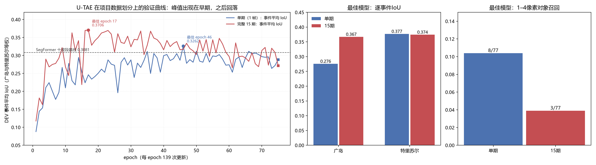

左图横轴是epoch，纵轴是两个验证事件的等权平均IoU，虚线是SegFormer历史参照（训练策略不同）。中图为最佳模型的逐事件IoU，右图为1–4像素对象召回及检出数/可评价对象数。观察收益集中在哪个事件以及小目标是否同步受益。曲线显示：15 期在 epoch 5–60 基本位于单期之上，但峰值出现在第 17 epoch（0.3706），之后在 0.30–0.34 之间震荡并回落到 0.272；单期峰值在第 46 epoch（0.3262），末态 0.288。

**本次纠正的是指标标签，不是重新训练结果。** 原表0.3013/0.3692来自像素汇总IoU；按既定的两个事件等权口径，最佳模型分别为0.3262/0.3706，差0.0444。原训练曲线与重新评价值有不足0.0001的小差异，具体原因未验证；上表统一来自保存的eval_dev_summary.json逐事件统计。单期与多期初始化摘要一致，训练均75轮、10425次更新，正类权重5；与SegFormer的3600次更新、正类权重1不同，不能把跨架构差异当作纯架构贡献。

### U-TAE 固定期数与时间开关（30 轮窗口，已完成 5 组）

为把“更多观测”和“有没有注意力/日期”分开，补了两组同架构对照，统一 30 轮、batch16、原学习率与损失；与上表 75 轮组**不是等轮数**，只与其前 30 轮及 best@17 比较。期数组用 multi 模式等秩取样（参考帧必保留），开关组只改 L-TAE：均值组把时间注意力换成均值并移除注意力头（有效参数少 16512），内容组只移除固定位置编码（0 可训练参数）。

| 组 | 事件平均IoU | 广岛 | 特里苏尔 | AP | best轮 |
|---|---:|---:|---:|---:|---:|
| 1 期 | **0.3154** | 0.2643 | 0.3664 | 0.4008 | 27 |
| 3 期 | 0.2754 | 0.2487 | 0.3020 | 0.3501 | 16 |
| 5 期 | 0.2783 | 0.1954 | 0.3613 | 0.2953 | 29 |
| 15 期（75 轮组，best@17） | 0.3706 | 0.3670 | 0.3741 | 0.5332 | 17 |
| 15 期＋均值代替注意力（30 轮） | 0.3101 | 0.2934 | 0.3268 | 0.4454 | 21 |
| 15 期＋无日期编码（30 轮） | **0.3860** | 0.4235 | 0.3486 | 0.6009 | 20 |

两点要分开读。**期数在 U-TAE 里不是越多越好**：30 轮窗口内 3/5 期都低于 1 期，5 期的广岛 IoU 掉到 0.1954，而 15 期最高——这与 SegFormer 数量组（1→5 期上升）方向不同，说明“加观测”的收益依赖模型如何聚合，不是数据本身的单调性质。**拆开看：注意力有用，固定日期编码在这批数据上反而略降。** 均值组 0.3101 明显低于保留注意力的两组，说明 L-TAE 注意力本身有收益；而**去掉日期编码**的无日期组（0.3860、AP 0.6009）比日期组（0.3706、AP 0.5332）高 0.0154/0.068，收益集中在广岛（0.4235 对 0.3670），特里苏尔反而低 0.0255。边界：无日期组 30 轮、日期组 75 轮（best@17 落在窗口内），单 seed；因此只能说“这批数据不支持启用日期编码更好”，不能宣称日期编码普遍有害。

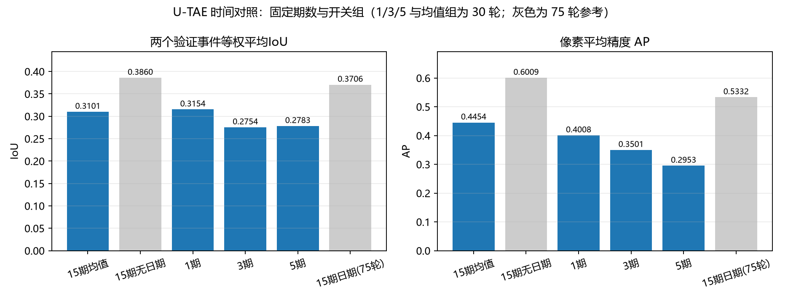

左图两事件等权 IoU，右图 AP；蓝柱是 30 轮新组（1/3/5 期与均值组），灰柱是 75 轮日期组参照，空位标“训练中”。应看两点：蓝柱里 1 期最高而不是期数最多的 5 期；均值组低于灰色参照。

**收益集中在广岛，微小对象存在退化。** 广岛IoU增加约0.0915，特里苏尔降低约0.0026；1–4像素对象召回由8/77降至3/77。15期整体AP提高0.1081，但不代表所有事件和目标尺度都改善。末态事件平均IoU为0.2883/0.2718，提示训练后期退化，需要报告完整曲线；按验证集选最佳是两组共同规则，不能仅因末态排序相反就否定已有多期信号。两个验证事件反复参与选模，因此也不能声称独立泛化显著性。

完整15期包含参考影像日期后的观测，属于回顾性识别。它不满足仅用单期影像的输入条件；需要与截止参考日期组分开解释。

## 同一SegFormer的时间控制与工程复核

### 阅读约定与实验设置

以下为磁盘已完成结果的复核，不是本次重新训练四组。四组都用我们的数据划分（留事件验证）：九事件2223块训练，广岛448＋特里苏尔221块验证，seed1234；十波段、无地形，统计沿用559块训练核心。共享MiT编码器逐帧提特征，分别采用单期恒等、有效帧均值、内容权重、内容与相对观测日期权重；参考影像另进原网格细节分支。监督来自同一人工滑坡标注，损失为0.5BCE＋0.5Dice。各组3600次更新、microbatch8×累积8，每100步按两个验证事件等权IoU选模。与历史单期0.3081的batch64训练不同，同接口单期0.2883才是本表参照。为核对这两个参照的差异，本轮另训练了一个同接口、microbatch=64的单期对照：最佳事件平均IoU 0.3075（500步，像素汇总0.3093），与历史0.3081只差0.0006；这支持微批量设置可能显著影响结果，BatchNorm是主要待检验机制；但单seed对照尚未隔离随机数/累计梯度差异，不能唯一归因BatchNorm。该对照只用于解释参照差异，不作为新候选。

### 主表

IoU是阈值0.5的前景交并比；事件平均IoU先分事件计算再等权平均；AP为有效像素的精确率—召回率曲线面积。对象召回按独立一对一IoU≥0.25匹配，括号为检出数/可评价对象数。

| SegFormer B0输入与汇聚（均保留参考影像细节） | 事件平均IoU | 相对同接口单期 | AP | 广岛IoU | 特里苏尔IoU | 1–4像素对象召回 | 最佳更新/末态IoU |
|---|---:|---:|---:|---:|---:|---:|---:|
| 单期十波段，恒等 | 0.2883 | — | 0.3874 | 0.2662 | 0.3104 | 0.1169（9/77） | 300 / 0.2396 |
| 15期十波段，均值 | 0.2984 | +0.0102 | 0.4736 | 0.2932 | 0.3037 | 0.0390（3/77） | 1400 / 0.2530 |
| 15期十波段，内容权重 | 0.3145 | +0.0262 | 0.4651 | 0.3110 | 0.3180 | 0.1039（8/77） | 600 / 0.2528 |
| 15期十波段，内容与日期权重 | 0.3245 | +0.0362 | 0.5134 | 0.3192 | 0.3298 | 0.0390（3/77） | 600 / 0.2470 |

### 图与解释

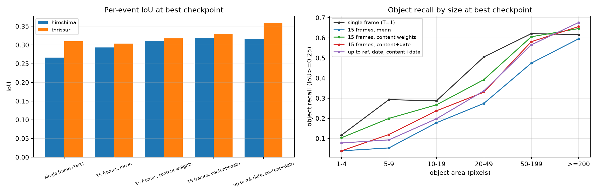

左图每组两根柱分别为广岛与特里苏尔；右图横轴为对象像素面积、每条线为一种汇聚。应同时看事件IoU与微小对象检出：日期加权组的两个事件IoU都提高，1–4像素对象却少检出6个。均值组的特里苏尔IoU低于单期。对象支持数仅77，不能作显著性声明。

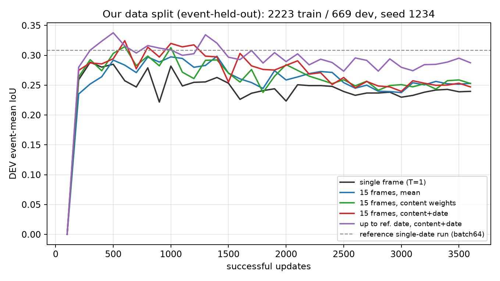

各曲线表示对应汇聚在训练更新过程中的验证表现；紫色为只保留参考日期及以前观测的截止组。应看最佳模型出现位置与训练末态，不能只汇报早期峰值。五组训练结束时的IoU均明显低于各自最佳值。

固定案例在首批训练前由参考单期run的验证错误选定（每事件漏检、误检、边界偏移、微小目标各一），不按新模型结果更换：

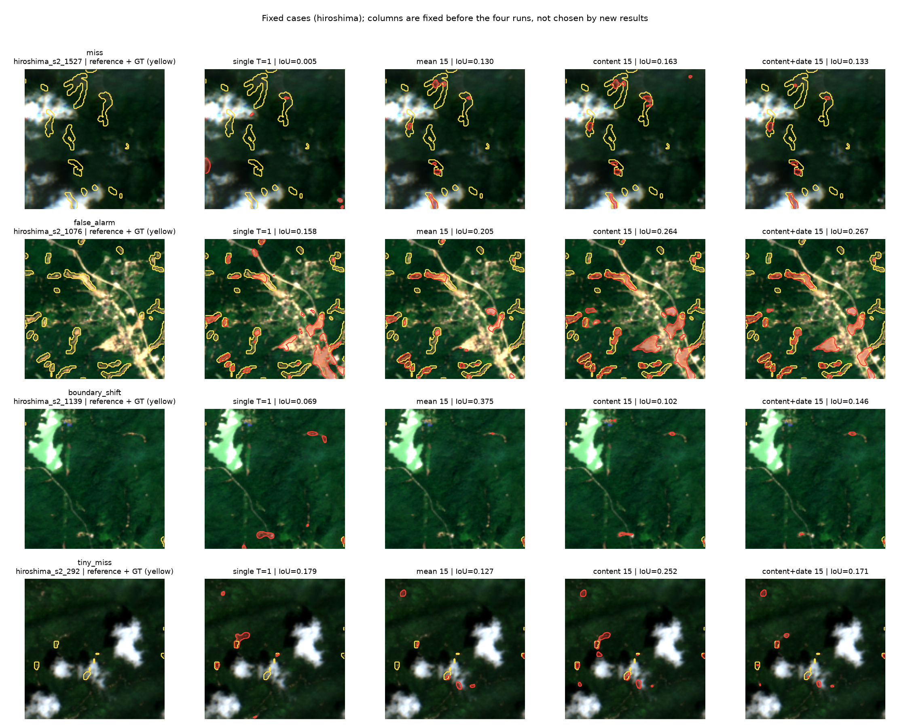

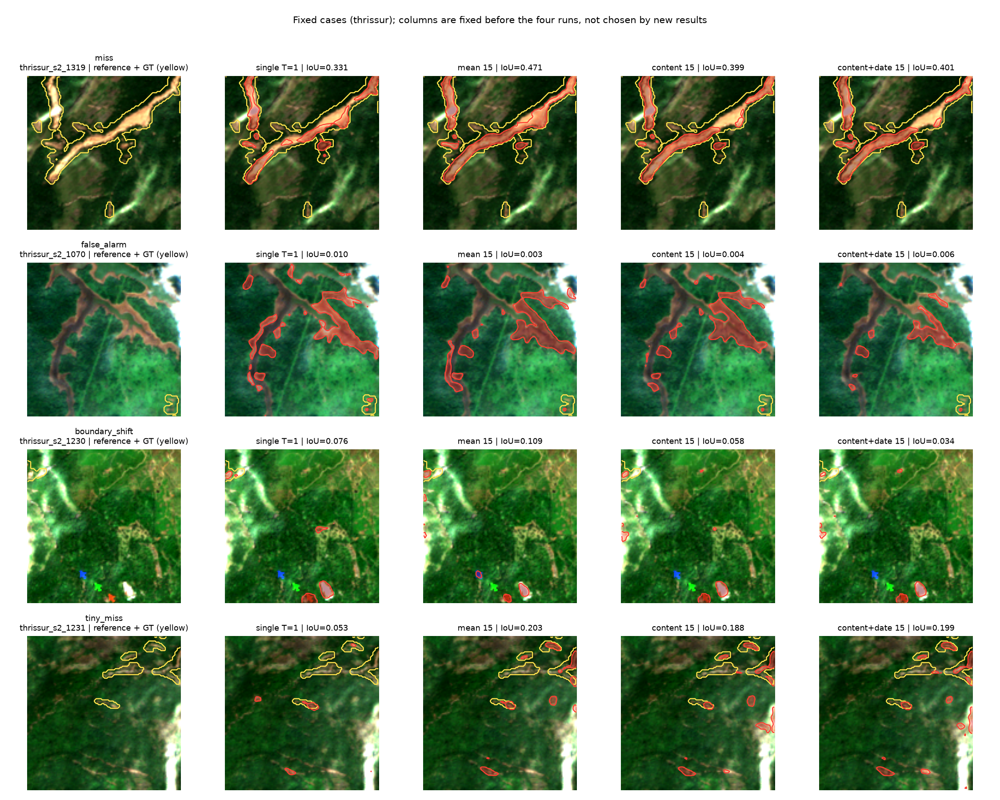

每行一个案例，第1列为参考影像与人工标注（黄线），其余列为四组best模型的概率（红=阈值0.5以上）与预测边界。多期组在部分漏检案例补回了滑坡，但在边界与微小目标上出现新的偏移；案例只用于错误诊断，不参与选模。

### 观测数量补全：3/5/7期已完成并验收

以下比较仍用原2223/669成员、统计、seed1234、3600更新和8×8批量。3期与15期的空间、时间初始化摘要一致；3/5/7期逐样本保留参考帧，其余帧按日期顺序等秩取样，不用标注或预测选帧。1期为同接口恒等参照，参数量3753602；3/5/7/15期的内容与日期汇聚参数量均3775238。含参考日期之后的观测，属于回顾性条件。

| SegFormer B0＋参考影像细节的观测输入 | 最佳事件平均IoU | AP | 广岛IoU | 特里苏尔IoU | 1–4像素对象召回 | 最佳更新 | 末态IoU | 训练耗时 |
|---|---:|---:|---:|---:|---:|---:|---:|---:|
| 单期十波段，恒等 | 0.2883 | 0.3874 | 0.2662 | 0.3104 | 9/77 | 300 | 0.2396 | 20.2分钟 |
| 3期十波段，内容与日期加权 | 0.2926 | 0.4422 | 0.2950 | 0.2901 | 6/77 | 1000 | 0.2341 | 35.0分钟 |
| 5期十波段，内容与日期加权 | 0.3055 | 0.4773 | 0.3137 | 0.2974 | 7/77 | 1000 | 0.2474 | 43.4分钟 |
| 7期十波段，内容与日期加权 | 0.3348 | 0.4972 | 0.3141 | 0.3554 | 6/77 | 1000 | 0.2812 | 55.1分钟 |
| 15期十波段，内容与日期加权 | 0.3245 | 0.5134 | 0.3192 | 0.3298 | 3/77 | 600 | 0.2470 | 114分钟 |

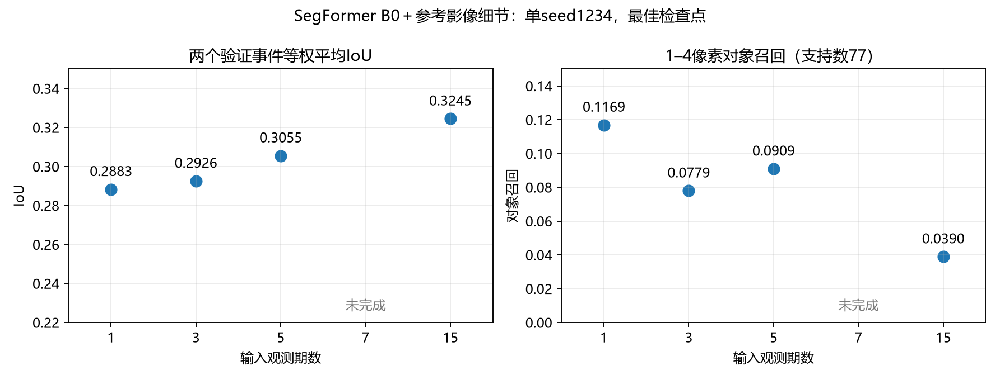

每个点是该输入期数下已完成并验收模型的最佳检查点；左图为两个事件等权IoU，右图为同77个可评价微小对象的召回。

1→7期在本设置内随期数上升（0.2883→0.3348），但15期回落到0.3245：15期帧数更多、跨度更长、等秩取样的端点也不同，不能把它读成“期数单调收益”或“7期就是上限”。7期两个事件都高于单期（广岛+0.0479、特里苏尔+0.0450），微小对象仍是6/77，少于单期9/77，且该组含参考日期之后的观测，仍未满足替换单期的条件。3期相对单期只提高0.00427，广岛提高0.02882、特里苏尔下降0.02025；5期比单期高0.01726，但特里苏尔下降约0.0130、微小对象从9/77降为7/77。只有一个seed，不能宣称显著性。

7期最佳权重出现在1000步，末态IoU 0.2812 明显低于最佳，说明"训练更久更好"在这一组不成立；这也支持把后续新批次的选模窗口定在2000步以内（依据见[训练预算复核](MODEL_EVOLUTION.md#原任务书目的与当前计算是否对应)）。

3期最佳模型的像素TP/FP/FN为81340/73699/122192，整体对象召回0.4354、边界F1为0.4552；末态整体对象召回0.2805、边界F1为0.3605。3/5/7期与1/15期的best/last及预定步均完成严格权重加载、配置一致性、评价权重哈希和669个实际验证成员核验，原始结果见[数量汇总](../outputs/segformer/v4r1_temporal_frame_count/summary_frame_count.json)。注意原评价JSON中的`efficiency.train_seconds`曾记录所选检查点产生时的累计时间；本表使用完成摘要中的训练秒数。新评价入口已把完整训练成本和所选检查点累计时间分开，保留原评价文件不覆盖。

### 新批次：2000步预算与派生共同子集（截止参考日期与跨度）

后续批次把停止步数与学习率日程分开：`train.stop_updates=2000`、`train.schedule_updates=3600`、预热180，因此用的是旧3600步poly日程的前2000步，而不是压缩后的另一条日程；不保存的步数不重要，因为每组仍存1000/1500/2000与best/last。这不是等预算比较——它比历史全程运行少44.4%更新。

截止参考日期的数量组（1/3/5/7期）要求四组同成员：只保留参考日期当日及以前至少有7个真实观测的TRAIN样本，共2007块，DEV 669块原样全保留，登记在`manifests/v4r2/subset_protocol_cutoff7.json`。跨度组（180天/365天）同样冻结共同成员：参考日期前180天内至少3个真实观测，TRAIN 2108块、DEV 669块，两组共用同一清单，唯一变化是窗口天数。两个子集都由`scripts/build_temporal_subset.py`从原清单派生，不覆盖`manifests/v4r1/pool_100.jsonl`；子集结果只与同成员配对组比较，不与2223块全体混排。

**截止参考日期固定数量（同一子集2007/669，2000步）**

| 输入 | 事件平均IoU | 广岛 | 特里苏尔 | AP | 1–4像素对象召回 | best步 | 末态IoU | 训练耗时 |
|---|---:|---:|---:|---:|---:|---:|---:|---:|
| 1期（只有参考帧） | 0.2933 | 0.2947 | 0.2918 | 0.4182 | 10/77 | 700 | 0.2431 | 11.2分钟 |
| 3期 | 0.3061 | 0.2900 | 0.3222 | 0.4376 | 8/77 | 600 | 0.2609 | 17.9分钟 |
| 5期 | 0.3432 | 0.3413 | 0.3452 | 0.4996 | 8/77 | 400 | 0.2778 | 23.1分钟 |
| 7期 | 0.3277 | 0.3115 | 0.3439 | 0.4944 | 11/77 | 400 | 0.2645 | 30.9分钟 |

去掉参考日期之后的观测后，这个子集上5期最高（0.3432），7期回落到0.3277：不是“期数越多越好”。7期的微小对象反而最多（11/77），其余三项指标却低于5期，说明多取历史帧改变的是整体覆盖与边界，而不是稳定改善小目标。四组最佳点都在400–700步，训到2000步时事件平均IoU降到0.2431–0.2778，训练更久明显变差；这也是后续统一选模窗口不超过2000步的实测依据。

**固定3期、不同历史窗口（同一子集2108/669，2000步）**

| 输入 | 事件平均IoU | 广岛 | 特里苏尔 | AP | 1–4像素对象召回 | best步 | 末态IoU | 训练耗时 |
|---|---:|---:|---:|---:|---:|---:|---:|---:|
| 参考日前180天内的3帧 | 0.3026 | 0.2951 | 0.3102 | 0.4229 | 10/77 | 300 | 0.2443 | 17.5分钟 |
| 参考日前365天内的3帧 | 0.2962 | 0.2870 | 0.3054 | 0.4151 | 13/77 | 300 | 0.2568 | 17.5分钟 |

同样3帧时缩短窗口略好（+0.0064、AP+0.0078），方向与“更近的观测更有用”一致；但差值很小、只有一个seed，且365天组微小对象反而多3个，不能据此改窗口或宣称跨度规律。

两个子集的成员不同（2007块要求参考日前≥7帧，2108块要求180天内≥3帧），因此不能互相比较，也不能与2223块全体的历史运行混排。队列状态见[截止日期批次](assets/research/v4r2_temporal_cutoff_queue.json)与[跨度批次](assets/research/v4r2_temporal_window_queue.json)；六组均通过严格权重加载、配置/成员哈希、669个验证成员与逐样本帧计划核验，原始证据在[执行核验](assets/research/execution_audit.json)与两份summary JSON。

### 灾前灾后组成：同成员、同预算，只改帧的组成（已完成并验收）

合格集要求灾害日期唯一且高置信、至少 2 张灾前与 5 张灾后、灾后含参考帧：TRAIN 只剩 6 个事件共 1141 块，DEV 669 块原样。三组共用同一批成员，帧由显式逐样本计划给出（登记在`manifests/v4r3/subset_protocol_composition.json`，含三份计划的 SHA256 与未来帧计数）；混合组的前 2 张灾前不参与另外两组的帧集合。这是**回顾性**条件：灾后帧可以晚于参考日期，本子集里最长约 865 天，所以不能当作前瞻识别能力。

| 输入（同成员1141/669，2000步） | 事件平均IoU | 广岛 | 特里苏尔 | AP | 1–4像素对象召回 | best步 | 末态IoU | 训练耗时 |
|---|---:|---:|---:|---:|---:|---:|---:|---:|
| 5 张灾后帧 | 0.2699 | 0.2813 | 0.2586 | 0.4118 | 1/77 | 500 | 0.2412 | 23.4分钟 |
| 3 张灾后帧 | 0.2789 | 0.2764 | 0.2814 | 0.3979 | 3/77 | 500 | 0.2582 | 18.9分钟 |
| 2 张灾前＋同 3 张灾后 | 0.2826 | 0.2901 | 0.2750 | 0.4122 | 3/77 | 800 | 0.2610 | 23.0分钟 |

两种对照要分开读：**相同 5 帧总数**下，混合组比 5 张灾后高 0.0127（AP 基本相同，微小对象 3/77 对 1/77）；**相同 3 张灾后帧**下，加 2 张灾前只高 0.0037（AP +0.0143，广岛 +0.0137、特里苏尔 −0.0064）。方向是“灾前信息有一点补充价值”，但差值很小、只有一个 seed、微小对象只有 1–3/77，而且这个子集只有 6 个训练事件（中国、吉尔吉斯斯坦因灾害日期不唯一被排除），不能据此升级候选或外推到 9 事件全体。

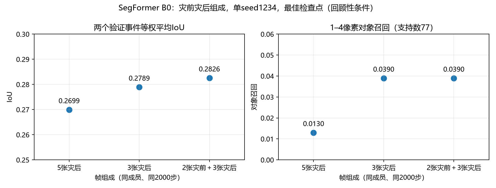

每个点是该组成下最佳检查点；横轴三组同成员、同2000步，只改帧的组成。左图看整体 IoU，右图看微小目标是否保住——5 张灾后组的微小对象只有 1/77，是这张图最该注意的地方。

三个批次的子集互不相同（2007/2108/1141 块），因此三张表之间不能横向比大小；每个结论只在各自子集内成立。组成批次的队列状态见[组成批次](assets/research/v4r3_composition_queue.json)。

### 截止参考日期组：去掉参考日期之后的观测（已完成）

条件组在15期内容与日期组达到+0.0362、且两个验证事件都高于同接口单期后触发。每个图块只保留观测日期不晚于参考日期的帧，仍包含参考影像及其细节；帧数随样本变化（训练2–15、验证7–10），因此不是同算力对照。其余成员、统计、初始化、3600次更新和8×8批量不变。

| 输入与汇聚 | 事件平均IoU | 相对同接口单期 | AP | 广岛IoU | 特里苏尔IoU | 1–4像素对象召回 | 最佳更新 | 末态IoU | 训练耗时 |
|---|---:|---:|---:|---:|---:|---:|---:|---:|---:|
| 截止参考日期，内容与日期权重 | 0.3377 | +0.0494 | 0.4998 | 0.3160 | 0.3595 | 0.0779（6/77） | 500 | 0.2874 | 71.9分钟 |
| 完整15期，内容与日期权重 | 0.3245 | +0.0362 | 0.5134 | 0.3192 | 0.3298 | 0.0390（3/77） | 600 | 0.2470 | 114分钟 |

去掉参考日期之后的观测后，事件平均IoU没有下降，反而比完整15期高0.0132：特里苏尔高0.0297，广岛低0.0032；AP低0.0136；1–4像素对象召回由3/77回到6/77，但仍低于同接口单期的9/77。像素TP/FP/FN为87167/59175/116365，整体对象召回0.4038、边界F1为0.4804。它说明这批开发集合上的多期收益不依赖未来观测，主要来自参考日期及以前的多次观测；但参考影像本身仍是灾后影像，两组帧数不同，微小目标仍退化，不能据此声称前瞻识别能力或替换单期交付。best/last与1200/2400/3600步评价、669个验证成员和权重哈希均已核验，原始评价见[该run的eval目录](../outputs/segformer/v4r1_temporal_control/SegFormer-B0-Temporal-History-Date/1234/eval)。

### 展开结论

内容权重组在相同观测帧与相同训练预算下优于均值组，说明本设置中可学习的内容加权具有开发集合上的实测收益；内容与日期组进一步提高事件平均IoU和AP，但其参数更多且使用参考日期之后的影像。它支持回顾性观测条件的开发结果，不能证明前瞻识别能力或独立跨地区泛化。日期组微小对象召回相对单期下降约67%，未通过既定候选门槛，不能替换单期交付；其与内容组的差值也不能单独证明日期编码的普遍作用。截止参考日期组在去掉未来观测后仍高于完整15期且两个事件都高于同接口单期，说明收益主要来自参考日期及以前的多次观测；但该组帧数可变、仍是单seed，微小对象召回仍低于单期，不能据此升级为候选或宣称前瞻能力。

### 限制与下一步

已严格加载基线及四组的best/last，四组另核对1200/2400/3600步权重与评价哈希，见[核验数据](assets/research/execution_audit.json)。截止参考日期组已完成：best事件平均IoU 0.3377（500步），末态0.2874，669个验证成员、权重与评价哈希已核验。3/5/7期新增配置使用同一内容与日期汇聚，参考帧必保留，其余按日期排序等秩取样；与已有1/15期组成数量对照。具体执行状态见[有限队列](../outputs/research_completion/status.json)，进程成功结束仍须复核结果，不自动代表科学验收通过。

全量[逐帧侧表](assets/research/temporal_observations.csv)覆盖2892块、43380帧，含源文件SHA256、源观测日期、灾害日期原字段、云阴影、SCL255和缺测比例；按SCL0、非有限值与显式填充值检出缺测像素0。681块含多个灾害日期，单独标为日期不明确；不将它们强行定义为某次灾害的灾前或灾后。截止参考日期时，训练中满足3/5/7帧的分别为2217/2171/2007块，验证均669块；截止日期15帧的验证覆盖为0。不减少原清单成员来制造同集合对照。

工程修复另包括：U-TAE新运行的缓存哈希改由实际路径计算；时序汇总的最佳步数改为300/1400/600/600而非全部3600。地形评分v2先在有效像素内计算16×16区块滑坡占比，空区块不参与损失，并严格核验统计/清单哈希后成对载入评分编码器与预测头。新评分训练3000步、579.5秒，验证669块42396个有效区块的相关系数0.0339，区块有无滑坡的AP0.1529、阳性区块率0.1206；这只是同源标注评分，尚无分割增益结论，也不是独立易发性概率。新分割对照同时改变目标处理与加载，不能解释成单一因素效果。

源文件十个波段均无units、scale_factor、add_offset、_FillValue元数据；后续继续追溯后，下载记录明确指向官方`data_harmonized/s2`，不能再仅凭缺少属性判断来源无法核实。[官方发布说明](https://huggingface.co/datasets/paulhoehn/Sen12Landslides/blob/main/README.md)支持该版本的偏移校正与0–10000范围约定。本地28卷已计算SHA256，并在含当前成员的分卷各抽查一个nc与本地源文件字节一致；完整时间缓存各波段实际范围为1–10000，见[来源审计](assets/research/radiometry_provenance.json)。这支持harmonized存储DN除以10000的解释，不等于独立BOA定标验证；本地上游辅助函数仅按首日期判断偏移、其数字后缀筛选未覆盖B8A，因此不能由该函数单独证明发布文件每帧偏移都正确，也不在本地重复加减1000。

组成审计只接受灾害日期唯一、发布元数据date_confidence=1的样本，固定同一合格集比较5张灾后、3张灾后、2张灾前＋同3张灾后。回顾性条件合格1810块，其中训练1141、验证669；严格截止参考日期仅训练3块、验证0块。后者明确为不合格实验条件，不补帧、不换验证集、不当算法失败。合格成员与固定帧ID见[组成侧表](assets/research/temporal_composition_eligibility.json)，尚未进行组成子集训练；其训练事件覆盖也与2223块全体不同，后续不得直接混排。

独立地形易发性路线仍缺独立标签。时相跨度控制、截止参考日期固定数量与灾前灾后组成训练已完成并验收（见上节）；U-TAE 均值/内容注意力开关已实现并在训练（30 轮，尚未验收），完整光谱门控消融仍未完成，不登记为完成。

### 附录：成本与复现

四组单期/均值/内容/内容与日期训练分别约20/114/117/114分钟，截止参考日期组约72分钟，单seed。完整best/last、预定步、对象六尺度支持数和成本在[原运行汇总](../outputs/segformer/v4r1_temporal_control/summary_temporal_control.json)。复核命令：`python scripts/audit_research_execution.py`；逐帧审计：`python scripts/audit_temporal_observations.py`；新训练与评价的准确命令保存在有限队列status.json。新地形加载的逐张量验证见[迁移核验](assets/research/terrain_transfer_validation.json)。历史原始权重与评价不改名、不覆盖，本次未提交Git，保留接手时的未提交工作树。

## 限制与下一步

当前计划见[下一步完整实验计划](RESEARCH_INDEX.md#下一步完整实验计划)，由阶段台账生成。优先开展同架构的时间信息比较，保留单期参照和小目标指标；地形及已完成线性光谱方案暂停常规调参。

## 附录一：逐事件、选模与成本

下面仍是同一组最佳模型，额外给出事件差异、像素汇总指标和选模位置。融合系数作用于分割分数，定义见模型页。

<!-- TERRAIN_DETAIL_START -->
同一最佳模型的补充数值如下（依次为广岛IoU、特里苏尔IoU、像素汇总IoU、Dice、最佳更新步、地形系数）：

- 当前参照：十波段影像＋细节分支：0.3114；0.3049；0.3095；0.4727；500；—。
- 12通道共同输入：影像＋高程＋坡度：0.3033；0.3100；0.3052；0.4677；300；—。
- 独立地形分支：直接随分割训练：0.3147；0.3029；0.3113；0.4748；500；0.225。
- 独立地形分支：先做地形自监督：0.3154；0.3038；0.3120；0.4757；500；0.225。
- 独立地形分支：加载标注训练的评分头：0.3103；0.3050；0.3088；0.4719；500；0.048。
- 独立地形分支：地形自监督预算加倍：0.3152；0.3031；0.3117；0.4753；500；0.227。
- 独立地形分支：固定融合系数：0.3113；0.3046；0.3094；0.4726；500；0.010。
<!-- TERRAIN_DETAIL_END -->

基线参数约375万，独立地形分支模型约393万；训练峰值显存分别约4694与4712 MiB，来自已有摘要，不是本次重新测速。完整逐组配置、曲线和评价文件由[地形原始汇总](../outputs/segformer/s2_10band_v4r1_geo_raw/summary_terrain.json)及各运行目录定位。该汇总的`alpha`由最佳权重读取；训练时长已订正为读取原摘要的`seconds`字段，本次没有重新测速。推理速度没有新记录时不补估计值。

## 附录二：历史四折时间输入诊断，不是默认训练队列

四折是四次不同的训练—验证—评价划分，各模型只用该次训练事件学习；评价事件在这次训练中没有出现。它们并非当前669块验证集合，不能将下表与0.3081直接比较。U-TAE是使用时间注意力的U形分割网络，本表均输入十波段影像及高程。

| 评价事件 | 单张参考影像 | 参考日期及以前的影像 | 全部15张影像 | 全部15张相对同次单张 |
|---|---:|---:|---:|---:|
| 意大利 | 0.1402 | 0.0148 | 0.0174 | −0.1228 |
| 中国、北海道、吉尔吉斯斯坦两个事件 | 0.1794 | 0.0952 | 0.1879 | +0.0085 |
| 广岛、新西兰、特里苏尔、波多黎各 | 0.1555 | 0.1021 | 0.1785 | +0.0230 |
| 奇马尼马尼、多米尼克、印度尼西亚、伊托贡 | 0.1605 | 0.0614 | 尚无完整结果 | — |

各格为该次评价集合的像素汇总IoU，三种时间输入的定义见[时间输入说明](MODEL_EVOLUTION.md#多日期影像如何进入模型)。单张与截止日期组四折均值为0.1589和0.0684；15张只有三折，均值0.1279，在相同三折与单张配对的平均差为−0.0304。未完成折不按零计，也不把三折均值直接减四折均值。

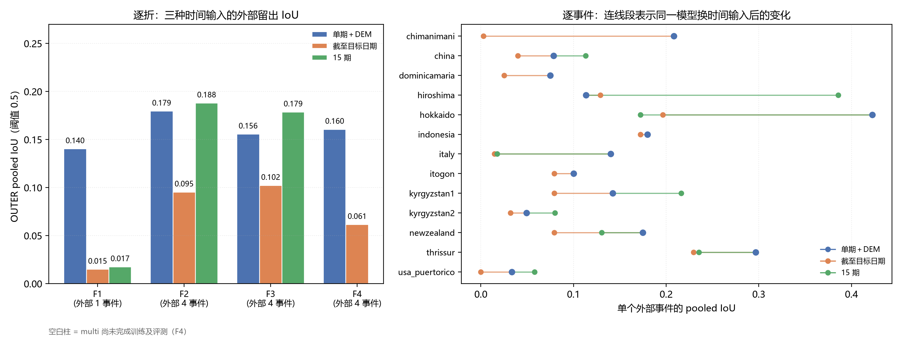

左图比较同一次划分的三种时间输入，右图显示各事件的变化。意大利的完整15张结果明显下降，另两个已完成划分为正差（+0.0085、+0.0230），因此不能写成所有事件都变差。日期置零的固定模型诊断在不同划分上方向不同，只提示日期输入敏感，尚未确定具体因果机制。

## 附录三：代码字段与原始证据

当前方案的机器标识是`event_ood_v4r1`。`TRAIN/DEV/DIAG/FINAL`分别映射本页定义的训练、验证、诊断、保留评价；历史四折标识为`EVENT_CV_V5`，`INNER/VAL`是当次选模验证集，`OUTER/TEST`是当次评价集。编号仅用于复现，不作为正文方案名。

成员、九训练事件的原始目录名、图块身份见[冻结划分](../manifests/v4r1/protocol.json)和[训练与验证清单](../manifests/v4r1/pool_100.jsonl)；归一化见[原十波段统计](../manifests/v4r1/stats_core25.json)、[加入地形的统计](../manifests/v4r1/stats_geoboth_raw.json)，后者登记于[地形协议锁](../manifests/v4r1/protocol_geoboth_raw.json)。标签比例加载限制可由[已保存配置](../outputs/segformer/s2_10band_v4r1_geo_raw/SegFormer-B0-LateDetail-OODv4-TerrainSSLSup/1234/resolved_config.json)复核。

历史数据规模、事件覆盖、较大SegFormer和早期交换结果统一在[阶段演进表](MODEL_EVOLUTION.md#阶段目标与相邻阶段变化简述)维护；具体证据由[机器索引](assets/research/experiment_registry.json)及[归档目录](../archive/README.md)定位，不另写一套阶段总结。

<!-- TRAINING_BUDGET_REVIEW_START -->

## 训练预算复核：最佳权重、末态与下一批选模窗口

阅读约定：训练集用于更新参数；广岛448块与特里苏尔221块只用于开发验证和选模。下表使用训练时每100次更新计算的两事件等权IoU，单seed1234；与最终重评小数可能有微小差异，不能在同一差值中混用。所有表中SegFormer运行均已训练至3600步；训练完成和全部评测验收是两种状态。

| SegFormer B0的观测与汇聚（均保留参考影像细节） | 最佳更新数 | 最佳IoU | 3600步IoU | 训练损失：最佳时→末态 |
|---|---:|---:|---:|---:|
| 15期内容权重 | 600 | 0.3145 | 0.2528 | 0.344→0.263 |
| 15期内容与日期权重 | 600 | 0.3245 | 0.2470 | 0.341→0.261 |
| 截止参考日期的可变期数 | 500 | 0.3377 | 0.2874 | 0.382→0.296 |
| 15期均值 | 1400 | 0.2984 | 0.2530 | 0.313→0.274 |
| 单期恒等 | 300 | 0.2883 | 0.2396 | 0.432→0.331 |
| 3期内容与日期权重 | 1000 | 0.2925 | 0.2341 | 0.348→0.295 |
| 5期内容与日期权重 | 1000 | 0.3055 | 0.2474 | 0.333→0.281 |

本次限定核查范围为成熟细节基线、修正坡度后的六组地形、已完成的七组时间实验，共14组；14组的最佳点全部在2000步以内。5期3600步训练、五份预定评价及权重验收已完成；此预算表仍统一使用训练期选模数据，正式重评成绩见前文期数表。没有把工程smoke、未完成7期或历史全仓库所有模型纳入这一统计。

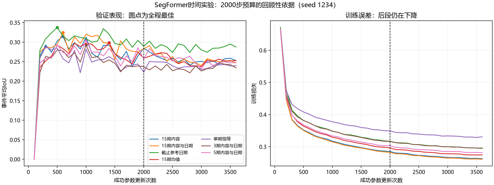

左图每条线是一种时间输入/汇聚条件，圆点是该组全程最佳验证IoU；右图同色线是该组训练损失。虚线是拟采用的2000步停止点。应看后半段训练损失下降、验证IoU总体低于早期最佳这一组合，而不是把每一步波动都称为单调退化。

**解释与边界。** 这符合训练继续适应训练区、验证表现却下降的过拟合迹象；仅凭曲线不能排除学习率、BatchNorm或事件差异的共同影响，也不能证明所有新结构都在2000步前达到最佳。继续训练不会反向破坏已保存的best，但增加成本；缩短预算主要减少后段低收益计算，并非已经验证的新正则化方法。

**U-TAE是明确例外。** 15期最佳在第17轮、实际2363次更新；单期最佳在第46轮、6394次更新，每步batch16，而时间SegFormer有效batch64。因此不把U-TAE统一截断到2000更新。下一批15期机制组以30轮为固定窗口，已有有日期组17轮best在窗口内；46轮单期best不能参与等预算的30轮对比。

**下一批预算及公平性。** 计划中SegFormer停止上限2000，保持原3600步学习率日程的前缀及180步预热，每100步验证，存best/last与1000/1500/2000。直接修改max_steps会改变当前代码的学习率曲线；停止与调度解耦、配置驱动的checkpoint验收尚待实现。既有运行只取≤2000窗口最佳作同预算对照，不能默认取任意全程最佳。当前已登记3/5/7与地形队列仍为3600步，未在运行中改写。详细顺序、样本资格和门禁见[台账生成的计划](RESEARCH_INDEX.md#下一步完整实验计划)。

**附录：复现与成本。** 在项目根目录运行 `python -X utf8 scripts/audit_training_budget.py`；源运行路径、摘要SHA256、最佳步、训练损失与成本见[机器证据](assets/research/training_budget.json)。2000/3600减少44.4%的更新；不同帧数、验证成本和设备占用影响真实耗时，不能直接当作实测加速。原配置、训练曲线和checkpoint均保留。

<!-- TRAINING_BUDGET_REVIEW_END -->

## 系统改进：把数据、训练与模型原因分开验证

阅读约定：所有下述数值是我们的数据划分（留事件验证）的开发结果，非独立测试；两个事件等权IoU，单seed1234。不同训练子集各有自己的参照，不将不同子集的分数差归因于模型。

| 配对证据与训练成员 | 当前观察 | 支持的判断及边界 |
|---|---|---|
| 原2223块，单期视觉参照与地形完整迁移 | 0.3081与0.3072；同一地形模型关闭分支约降0.0009 | 当前接法的地形贡献小；不证明所有地形特征无效 |
| 原2223块，旧光谱入口 | 指数0.2795、容量对照0.2908；静态偏置/线性混合约0.304–0.308 | 不是所有非时间改动都无下降；旧实现不能代表真正动态关系学习 |
| 共同2007块，截至参考日单期/5期/7期 | IoU 0.2933/0.3432/0.3277；微小对象10/77、8/77、11/77 | 增加观测有清楚的本集合收益，但帧数非单调，IoU与微小目标最优条件不同 |
| 共同1141块，3灾后/2灾前+3灾后 | 0.2789/0.2826，差0.0037 | 增加灾前信息尚无稳定收益证据；不是用这两个较低数值证明少数据导致退化 |
| 原2223块，同接口单期microbatch8/64 | 0.2883/0.3075，后者训练完成且已有best评价，完整预定评价验收尚未齐全 | 训练细节的影响可能超过附加模块；不能由一次实验唯一归因BN |
| 历史同1251块的3/9事件比较 | 0.2300/0.2908；同事件扩量559→2223块非单调 | 事件覆盖比单纯图块数更值得优先检验；历史单seed证据不保证新事件扩充收益 |

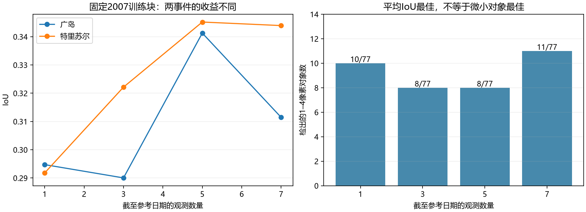

左图每条线为一个验证事件，横轴只改变截至参考日期的帧数；右图统计相同77个可评价微小对象中检出的数量。应看5期的平均IoU改善与微小目标下降并存，而7期微小目标反而更多。不能将这些结果概括为“时间只是不稳定噪声”，也不能把5期称为所有指标的最优方案。

**工作判断。** 目前更有根据的解释是：附加模块的有效信息或接入贡献有限，同时训练统计与事件/目标分布影响较大。日期与标注一致性按用户要求退出审查；本轮优先验证尺寸分布、裁块截断、采样/监督及不同尺寸的漏检。1–4像素对象在当前网格只占极少像素，需审查边界与重采样，但不能据此预先宣布不可识别。训练损失下降而验证下降支持过拟合迹象，不能单凭该现象判断一定缺数据或一定要换骨干。

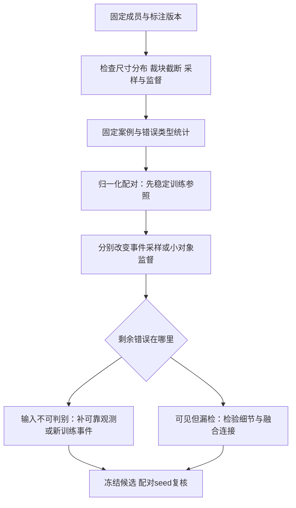

箭头表示验证顺序，不表示所有改动都要堆在同一模型里。每一阶段先形成可定位的错误证据，再决定下一项改动；完整实验身份、预算与门禁只维护在[阶段台账](assets/research/stage_ledger.json)的systematic_improvement。

**历史候选与执行边界。** 本节保留当时的配对证据；BN、采样和对象监督候选的详细预算只维护在阶段台账systematic_improvement，不能当成当前默认队列。新阶段见本页开头。

**新增用户数据的用途。** 用户明确它只有B、G、R、NIR、evaluation、slope、aspect、cerve、TPI九通道，不对应当前S2输入、没有日期，只作可能参考，不纳入主线。后两个非标准拼写保留原意未猜测其计算定义。用户认为滑坡应已标全，尚未独立确认。当前不做模型推理、不参与训练/选模，也不称独立测试集。

| 新参考数据检查 | 实际结果 |
|---|---|
| 文件配对 | 364幅影像、380份掩膜；364对齐全，16份掩膜缺影像 |
| 网格与值 | 364对形状/CRS/仿射对齐，均9通道、EPSG:4326；176714个非有限通道值，未声明nodata；需建立显式有效掩膜 |
| 标签分布 | 二值0/1，361幅含正例；像素前景约0.638%，不据此假定其余全为可靠负样本 |
| 独立性线索 | 内部61对包围盒相交；4幅与原TRAIN/DEV清单区域相交；无字节完全重复影像。包围盒相交不等于同事件或同影像，但必须保留重叠标记 |

**限制与附录。** 新集空间重叠检查只覆盖原2892块TRAIN/DEV，不包括所有历史数据或预训练来源；经纬度网格不能直接宣称每像素恰好10米。影像与掩膜的哈希、配对清单、范围及问题在[只读审计证据](assets/research/external_landslide_audit.json)；复现命令为`python -X utf8 scripts/audit_external_landslide.py`。原文件未改动。新增系统方案尚未启动训练，已有其他批次按其实际状态管理。

## 数据优先：目标尺寸与漏检来源

用户明确要求：日期与标注一致性不考虑，本轮不审查、不归因、不将它设为前置。外部9通道样本仍不进主线。以下先回答“小目标是否漏检严重，以及能解释多少低分”。

**设置与定义。** 原九事件TRAIN2223块、广岛448＋特里苏尔221块DEV，原10米网格，seed1234。模型为成熟单期十波段SegFormer B0＋原始网格细节分支best，事件平均IoU0.3081。对象按图块内8邻接标注连通域定义；可评价对象沿用metric_v2，排除边缘和无效区邻接对象，对象匹配IoU阈值0.25。像素Recall及面积/FN统计包含所有对象的有效像素，因此与可评价对象分母不同。图块内对象不等于全景独立滑坡。

| 对象面积（像素） | TRAIN可评价对象 | DEV可评价对象 | 基线对象召回 | 基线像素Recall | 占DEV前景像素 | 占全部漏检像素 |
|---|---:|---:|---:|---:|---:|---:|
| 1–4 | 240 | 77 | 8/77（10.4%） | 17.5% | 0.26% | 0.40% |
| 5–9 | 956 | 75 | 23/75（30.7%） | 26.1% | 0.49% | 0.69% |
| 10–19 | 1278 | 101 | 35/101（34.7%） | 26.7% | 1.89% | 2.65% |
| 20–49 | 2672 | 754 | 375/754（49.7%） | 40.5% | 15.95% | 18.16% |
| 50–199 | 1868 | 573 | 368/573（64.2%） | 50.2% | 42.45% | 40.47% |
| ≥200 | 296 | 99 | 66/99（66.7%） | 49.6% | 38.97% | 37.62% |

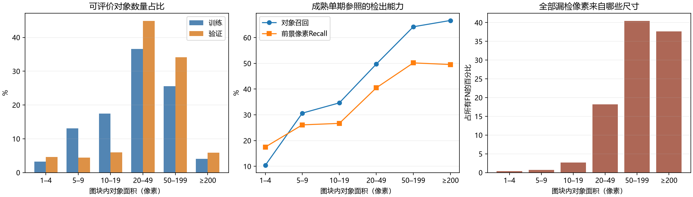

左图比较训练/验证的可评价对象数量占比；中图对比成熟单期参照的对象召回与像素Recall；右图将所有FN按真实对象尺寸分摊。应看小对象召回随面积显著变化，但像素漏检主要集中在面积较大的对象。

**结论一：小目标是确实存在的问题，但“小”的范围必须说明。** 1–4像素对象只检出8/77，20–49像素对象375/754；后者占可评价对象约44.9%，并非少数离群例。不能只盯1–4像素，也不能把所有对象召回低都解释为完全无预测，因为错位、碎片化或合并也会未达到一对一匹配阈值。

**结论二：大对象已检出并不等于分割完整。** ≥50像素对象占前景约81.4%，贡献约78.1%的FN。它们的对象召回约64–67%，但像素Recall仅约50%。这支持进一步检查较大对象内部和边界漏分，而不能仅凭对象被匹配就认定大目标已解决。像素Precision仅0.468，FP=110479，与FN=106347同量级；只补小对象漏检也不会自动消除误检。

**尺寸对IoU的算术贡献。** 保持所有FP与其他尺寸像素不变，仅把指定尺寸中的所有漏检像素改为命中：1–4像素修复后事件平均IoU为0.30923；1–19为0.31890；1–49为0.37204，原值0.30814。这是用真值做的错误分解，不是新模型成绩，也不是同时消除小目标误检的性能上限。它说明极微小对象不足以解释大部分像素IoU损失，但扩大到1–49像素时贡献已值得重视。

**首轮提出的待查问题（现已完成，见下一节）。** 首先查看各事件、各尺寸的实际训练图块数量和重复曝光，分清原生小对象与裁块边缘碎片：TRAIN的1–4像素共810个，只有240个可评价；DEV共176个，77个可评价，其余受当前边缘/无效区邻接规则排除，不能全部当作独立小滑坡。随后在固定案例上检查目标是否完整保留于裁块、增强和损失监督，读取逐对象最大概率/覆盖率，区分完全无响应、低于阈值、错位、漏边界和对象合并。再依据证据选择尺寸分层采样或对象/区域平衡监督；不先更换骨干，不删小对象抬高指标。计划唯一维护于阶段台账systematic_improvement。

**证据与限制。** 首轮实际读取全部2892份缓存的mask/valid，尺寸计数、有效像素及对象计数与成熟参照既有DEV评价逐项一致，且各尺寸FN之和与总FN一致。逐事件统计和每份mask/valid摘要见[机器证据](assets/research/size_diagnosis.json)，可用`python -X utf8 scripts/audit_target_sizes.py`复现；未启动训练或推理。图块截断可能影响全景对象解释；首轮尚未完成的逐对象概率和固定案例检查现已补齐，见下一节；仍不能断言所有漏检根因已确定。

## 数据链路与逐对象审查结果

**阅读约定与实验设置。** 本节承接上节尺寸分布，完成剩余的数据链路、实际训练曝光和模型逐对象响应审查。仍使用我们的数据划分（留事件验证）：九事件2223张训练图块，广岛448张＋特里苏尔221张开发验证图块；训练与验证成员及559张训练核心拟合的十波段统计不变。参照为**SegFormer B0｜单期十波段直接输入｜原始网格细节残差分支**，seed1234，官方预训练初始化；读取第500步选出的best，原运行末态为3600步。本次只在CPU上重新推理669张验证图块，TP、FP、FN、TN均与历史结果完全一致，事件平均IoU仍为0.308138。

对象为原标签的8邻接连通域，按原面积分档；正式预测阈值0.5，对象一对一匹配IoU≥0.25。下表仅统计可评价对象。目标内最大概率<0.1只是“低响应”的描述性分档，不能解释为严格零响应或经过校准的置信度；有像素重叠但没匹配也不等于完全漏掉。边界/内部的像素统计包含全部对象的有效像素，与对象召回分母不同。

| 对象面积（像素） | 可评价对象 | 匹配成功 | 最大概率<0.1 | 最大概率0.1至<0.5 | 有重叠但未匹配 |
|---|---:|---:|---:|---:|---:|
| 1–4 | 77 | 8 | 33 | 20 | 16 |
| 5–9 | 75 | 23 | 18 | 17 | 17 |
| 10–19 | 101 | 35 | 24 | 24 | 18 |
| 20–49 | 754 | 375 | 131 | 104 | 144 |
| 50–199 | 573 | 368 | 66 | 23 | 116 |
| ≥200 | 99 | 66 | 1 | 4 | 28 |

### 图与解释

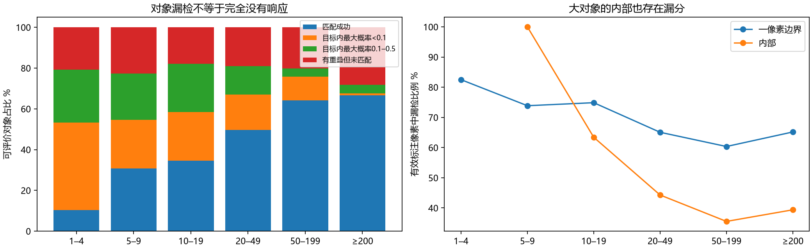

左图每根柱子是一档面积，颜色是上表互斥的四类响应；右图分别统计一像素边界和腐蚀后内部的漏检比例，不是边界F1。应看小目标既有低响应，也有部分命中但没匹配；较大目标即使边界之外，内部仍会漏分。1–4像素没有内部像素，5–9像素仅有1个内部像素，不能解释这两档的内部曲线为稳定结论。

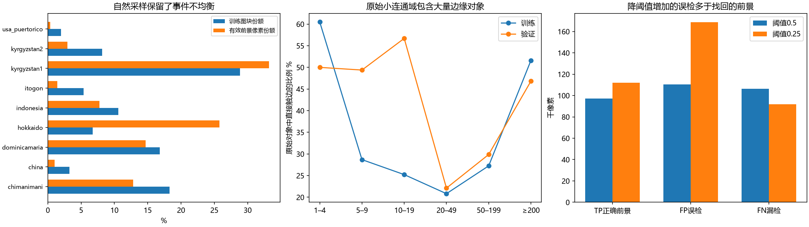

左图每行一个训练事件，对比图块份额与有效前景像素份额；中图展示直接接触图块边缘的原始对象比例，不把邻近无效区也混进“直接触边”；右图固定同一权重，只改变阈值，展示找回前景与新增误检的数量。应看自然采样不等于事件或对象均衡，直接触边的小连通域也不能全部解释为独立的小滑坡。

### 展开结论

**1. 目前没有发现缓存制作、增强或采样遗漏把小目标删掉的证据。** 全部2892张图块的原文件指定索引十波段、原标签与缓存逐值一致；按原SCL、波段有限/正值和标签已知规则重算的valid也全部一致。选定标签中未知值为0。训练路径没有额外裁剪或标签下采样，16种翻转/旋转组合逐像素核对影像坐标、标签和valid的同步关系，全部通过。第500步best的保存状态中，2223张图块每张已曝光14–15次，共32000次；第3600步末态为103–104次，共230400次，不能混用两个时点。核对的是实际数组和执行路径，不能据此宣布人工标注语义完全正确。

**2. 小目标问题真实，但并不是一种错误，而且当前证据集中在一个事件。** 1–4像素未匹配的69个对象中，53个在目标内没有达到0.5的像素，另16个有重叠。后16个中8个涉及“同一预测连通域覆盖多个真实对象”的合并标记；这只是可定位现象，不保证合并是唯一原因。无命中的53个对象中7个在两像素邻域出现预测，不能仅据此断言影像错位。全部77个1–4像素和75个5–9像素可评价对象都来自广岛，特里苏尔对应档为空，10–19像素也仅2个。因此不能把“小目标改进”写成已在两个事件得到验证，更不能给空档填0%的召回。

**3. 原始小连通域包含大量边缘对象，监督权重也没有按对象均衡。** TRAIN的810个1–4像素原始对象中490个直接触边；DEV为88/176。按历史评价规则排除边缘/无效区邻接后，分别剩240和77个可评价对象。实际代码还排除了距离图块边缘一像素的对象，旧注释只写“触边”不完整；本轮保留计算口径，未改历史指标。没有全景实例身份，不能判定每个边缘对象原本是大滑坡的一小段还是完整小滑坡。

实际损失是0.5×有效像素BCE＋0.5×逐图块Dice：BCE将有效像素损失求和再除以有效像素数，Dice每图块求前景重合后取均值。用相同零logit和实际损失检查，1像素目标有非零纠正梯度；49像素目标的正类输出梯度绝对值总和约为1像素目标的48.7倍。这个受控例子说明“保留监督”不等于“每对象等权”，并不证明训练全程中真实梯度也有固定倍数。自然采样下九事件图块数为44–642，最少与最多相差14.6倍；北海道与吉尔吉斯斯坦第一事件合计贡献约59.0%的训练有效前景。训练图块全部含有效正例，虽有大量背景像素，仍缺少可独立检验场景误报的纯负训练图块。是否因此造成当前错误尚未验证。

**4. 较大对象仍需改善完整性，并控制误检。** 50–199与≥200像素对象的边界漏检分别为60.4%、65.2%，内部仍漏35.5%、39.4%。因此不能只给边界增加权重就假定解决了主要FN，也不能因对象匹配成功便认为它已分割完整。此前分解中，≥50像素对象贡献78.1%的FN，这一结论与逐对象复算一致。

降低阈值的诊断结果如下；事件平均IoU先对两个事件各自计算再等权平均，合并像素IoU则先合并混淆计数。两者不可互换。

| 固定权重的预测阈值 | 事件平均IoU | 合并像素IoU | Precision | Recall | TP | FP | 1–4像素对象召回 |
|---|---:|---:|---:|---:|---:|---:|---:|
| 0.5（正式） | 0.30814 | 0.30950 | 0.4680 | 0.4775 | 97185 | 110479 | 8/77 |
| 0.25（只作诊断） | 0.31041 | 0.30058 | 0.3989 | 0.5495 | 111845 | 168565 | 11/77 |

降阈值找回14660个前景像素，同时新增58086个误检像素。广岛IoU从0.31135降至0.28991，特里苏尔从0.30492升至0.33092，平均值的小幅增加掩盖了事件间反向变化。这不支持把统一降阈值当作系统解决方案；正式阈值仍为0.5。

### 固定案例与解释边界

固定清单包含每事件24个、共48个可评价对象，按标注对象ID的哈希顺序选择，不依据预测效果挑例。每事件每档先取至多4个；特里苏尔缺1–9像素档，10–19像素只有2个，其余名额按相同哈希规则从剩余对象补足。清单记录了尺寸分层和补充对象，空档没有被伪造。每行依次为RGB局部、原标签、预测概率、TP/FP/FN；黄色框圈出被审查对象，周围可能包含其他对象。RGB只为查看做逐通道2%–98%拉伸；不插值放大，模型仍使用原十波段标准化输入。RGB不明显不能直接证明十波段输入不可识别。

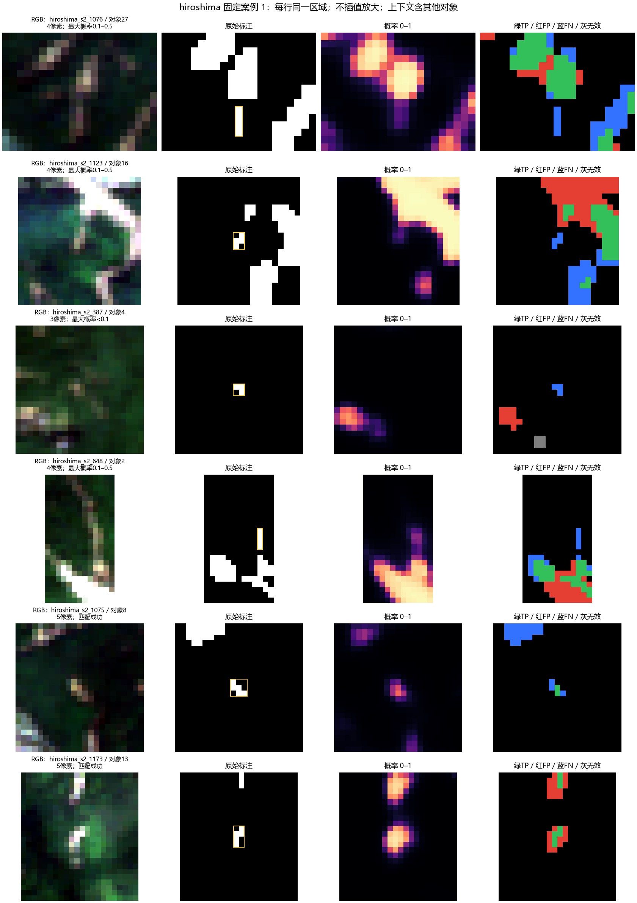

每行同一局部，重点看目标框内是否有概率响应，以及预测是否扩大到周边背景；不同局部显示尺寸不同，不能按屏幕大小判断原对象面积。全部案例页：[广岛1](assets/research/object_data_review/cases_hiroshima_1.png)、[广岛2](assets/research/object_data_review/cases_hiroshima_2.png)、[广岛3](assets/research/object_data_review/cases_hiroshima_3.png)、[广岛4](assets/research/object_data_review/cases_hiroshima_4.png)、[特里苏尔1](assets/research/object_data_review/cases_thrissur_1.png)、[特里苏尔2](assets/research/object_data_review/cases_thrissur_2.png)、[特里苏尔3](assets/research/object_data_review/cases_thrissur_3.png)、[特里苏尔4](assets/research/object_data_review/cases_thrissur_4.png)。开发案例用于解释，不是额外盲测。

### 限制与下一步

本轮数据链路和逐对象诊断已完成，尚未通过新训练证明某种损失或采样能改善。下一步应在同一冻结训练参照上，分别检验事件/对象尺寸曝光和对象辅助监督，兼顾1–49像素、较大对象内部完整性与FP；不把它们同时叠加，也不先更换骨干。完整设计与训练顺序仍以[阶段台账](assets/research/stage_ledger.json)的systematic_improvement为唯一来源。

执行前有两个明确实现缺口：现有`balanced`按**图块总前景像素**分档，不是按图块内对象尺寸分档；当前按更新次数训练的入口只允许`natural`，不能改一个配置值便宣称实现均衡采样。对象辅助监督同样尚未接入。下一项实现必须验收实际样本序列、事件/尺寸曝光及各尺寸梯度贡献。所有原缓存、标签、配置、checkpoint和训练路径保持不变。

### 附录：复现与产物

复现命令：`python -X utf8 scripts/audit_object_errors.py`；测试命令：`python -X utf8 -m unittest discover -s tests -p test_object_error_audit.py`。本轮只评估seed1234的best，不代表跨seed稳定性；CPU4线程批量32，已有概率缓存仅在权重、清单、统计和依赖源码哈希相同且缓存与清单内容核对通过时复用。没有新训练曲线，原逐步曲线仍在成熟参照运行的metrics.jsonl。

证据包括[逐尺寸/逐事件汇总与来源哈希](assets/research/object_data_review/summary.json)、[源数组/增强/曝光/梯度审查](assets/research/object_data_review/pipeline.json)、[48个固定对象清单](assets/research/object_data_review/fixed_cases.json)、[逐对象明细](../outputs/data_review/per_object.csv)与[可复现脚本](../scripts/audit_object_errors.py)。合并/碎片标记可重叠，不能相加成互斥错误总量。日期与标注一致性按用户要求不查；外部9通道数据不进主线。全景滑坡身份、独立人工标注正确性及所提改进的因果效果，均不由本次审查证明。

</details>

<details>
<summary>USE首轮监督/联合预训练及旁支工程</summary>

<!-- USE_RESULTS_START -->

## USE首轮：统一监督与外部预训练验收

### 阅读约定与实验设置

本阶段沿用[共同数据与指标口径](#阅读约定与实验设置)：单期、无地形、seed1234。USE按SCL及有限值建立输入质量掩膜，标签可用性只控制监督。

各组物理批量8、FP32、无梯度累积，冻结BatchNorm运行统计且训练仿射参数；2000次成功更新、日程3600次、预热180次。AdamW编码器/其他组件学习率6e-5/6e-4、权重衰减0.01，损失0.5 BCE＋0.5 Dice。官方MiT/解码器初始化及随机细节分支相同；100步冒烟权重不续入正式实验。

完整模型在127×129奇数尺寸的3/4/6/10/13波段前后向、集合置换及混批补齐通过atol=1e-5、rtol=1e-4验收。初次补充验收漏关TF32曾失败；使用与正式训练一致的严格FP32后通过，不修改模型与旧权重，失败日志保留。13波段仅为合成接口证据。

当前完成10/10组监督及独立评价。外部样本S2 5000、Landsat 1700，状态`paused_by_user`；用户已授权以冻结样本及原有无标注S2联合预训练，下载暂停；全部样本须通过物理量、质量、空间排除与SHA审查，保留两传感器1:1曝光和10000更新。每批8个样本为2个已下载S2、2个原有无标注S2及4个Landsat。原有无标注影像仅取九TRAIN事件中annotated=False的位置，每位置选一期，绝不读取MASK。已验收原有无标注位置3062个，其中重建训练2894、空间留出168；空间留出只衡量已知TRAIN事件内的重建，不是未见事件滑坡验证。实际阶段状态以[台账](assets/research/stage_ledger.json)与[队列](../outputs/use/completion_status.json)为准。

### 主表（合并）

IoU主列为两事件等权；Dice、Precision、Recall、像素AP、边界F1按669块合并计数。每组均选完整十波段事件平均IoU最高的权重，不能与末态混称。历史0.3081训练设置不同，仅作背景。

| 模型连接与训练方式（均为SegFormer B0＋原网格细节） | best更新 | 事件平均IoU | 广岛IoU | 特里苏尔IoU | Dice | Precision | Recall | 像素AP | 边界F1 |
|---|---:|---:|---:|---:|---:|---:|---:|---:|---:|
| 十波段直入＋原网格细节 | 1600 | 0.2985 | 0.2776 | 0.3195 | 0.4482 | 0.4070 | 0.4988 | 0.3981 | 0.4603 |
| USE共享编码＋均值汇聚 | 1600 | 0.1519 | 0.0916 | 0.2122 | 0.2133 | 0.1703 | 0.2851 | 0.1429 | 0.2104 |
| USE波段自注意力＋均值汇聚 | 1000 | 0.1609 | 0.0821 | 0.2397 | 0.2133 | 0.1604 | 0.3182 | 0.1492 | 0.2079 |
| USE自注意力＋查询汇聚 | 1000 | 0.1631 | 0.0968 | 0.2293 | 0.2327 | 0.1761 | 0.3431 | 0.1625 | 0.2289 |
| USE注意力＋物理描述 | 1400 | 0.1955 | 0.1356 | 0.2554 | 0.2856 | 0.2618 | 0.3142 | 0.2165 | 0.2926 |
| USE注意力＋固定随机描述 | 1500 | 0.1987 | 0.1406 | 0.2568 | 0.2879 | 0.2336 | 0.3751 | 0.2210 | 0.2924 |
| USE扩宽无注意力编码 | 1600 | 0.1580 | 0.0985 | 0.2176 | 0.2295 | 0.1907 | 0.2882 | 0.1614 | 0.2274 |
| 无注意力USE＋混合波段训练 | 1600 | 0.1758 | 0.1295 | 0.2220 | 0.2661 | 0.2243 | 0.3271 | 0.1852 | 0.2684 |
| 物理USE＋混合波段训练 | 1200 | 0.1895 | 0.1460 | 0.2331 | 0.2830 | 0.2281 | 0.3729 | 0.2081 | 0.2934 |
| 物理USE＋联合无标签预训练后微调 | 1800 | 0.2370 | 0.1731 | 0.3010 | 0.3366 | 0.2737 | 0.4368 | 0.2652 | 0.3419 |

逐事件补充口径：对象为8连通真值，排除触及边界或未知标签邻域的截断对象，一对一贪心匹配IoU≥0.25；每个召回值后括号为该面积段可评价对象数。Thrissur没有1–4像素可评价对象，该格无定义。

| 模型／开发验证事件 | IoU | Dice | Precision | Recall | 像素AP | 边界F1 | 1–4像素对象召回（数量） | 5–25像素对象召回（数量） | 26+像素对象召回（数量） |
|---|---:|---:|---:|---:|---:|---:|---:|---:|---:|
| 十波段直入＋原网格细节／广岛 | 0.2776 | 0.4345 | 0.3514 | 0.5692 | 0.3700 | 0.4886 | 0.1429 (77) | 0.4554 (404) | 0.6559 (933) |
| 十波段直入＋原网格细节／特里苏尔 | 0.3195 | 0.4842 | 0.6488 | 0.3863 | 0.5288 | 0.3681 | 无定义 (0) | 0.2857 (14) | 0.5578 (251) |
| USE共享编码＋均值汇聚／广岛 | 0.0916 | 0.1678 | 0.1210 | 0.2735 | 0.0956 | 0.1979 | 0.0260 (77) | 0.1114 (404) | 0.3226 (933) |
| USE共享编码＋均值汇聚／特里苏尔 | 0.2122 | 0.3501 | 0.4131 | 0.3037 | 0.3070 | 0.2557 | 无定义 (0) | 0.0000 (14) | 0.3466 (251) |
| USE波段自注意力＋均值汇聚／广岛 | 0.0821 | 0.1518 | 0.1053 | 0.2714 | 0.0882 | 0.1824 | 0.0000 (77) | 0.1262 (404) | 0.3119 (933) |
| USE波段自注意力＋均值汇聚／特里苏尔 | 0.2397 | 0.3867 | 0.3806 | 0.3930 | 0.3297 | 0.2887 | 无定义 (0) | 0.2143 (14) | 0.5100 (251) |
| USE自注意力＋查询汇聚／广岛 | 0.0968 | 0.1765 | 0.1247 | 0.3021 | 0.1016 | 0.2098 | 0.0390 (77) | 0.1114 (404) | 0.3494 (933) |
| USE自注意力＋查询汇聚／特里苏尔 | 0.2293 | 0.3731 | 0.3432 | 0.4086 | 0.3102 | 0.2848 | 无定义 (0) | 0.1429 (14) | 0.5179 (251) |
| USE注意力＋物理描述／广岛 | 0.1356 | 0.2387 | 0.1950 | 0.3077 | 0.1578 | 0.2804 | 0.0000 (77) | 0.1337 (404) | 0.4084 (933) |
| USE注意力＋物理描述／特里苏尔 | 0.2554 | 0.4068 | 0.5445 | 0.3247 | 0.3995 | 0.3304 | 无定义 (0) | 0.0714 (14) | 0.4143 (251) |
| USE注意力＋固定随机描述／广岛 | 0.1406 | 0.2466 | 0.1805 | 0.3889 | 0.1661 | 0.2863 | 0.0519 (77) | 0.2203 (404) | 0.5005 (933) |
| USE注意力＋固定随机描述／特里苏尔 | 0.2568 | 0.4087 | 0.4851 | 0.3531 | 0.3744 | 0.3128 | 无定义 (0) | 0.2143 (14) | 0.5259 (251) |
| USE扩宽无注意力编码／广岛 | 0.0985 | 0.1793 | 0.1361 | 0.2626 | 0.1065 | 0.2128 | 0.0000 (77) | 0.1411 (404) | 0.3119 (933) |
| USE扩宽无注意力编码／特里苏尔 | 0.2176 | 0.3574 | 0.3912 | 0.3290 | 0.3122 | 0.2714 | 无定义 (0) | 0.1429 (14) | 0.3904 (251) |
| 无注意力USE＋混合波段训练／广岛 | 0.1295 | 0.2293 | 0.1751 | 0.3323 | 0.1390 | 0.2647 | 0.0519 (77) | 0.1856 (404) | 0.4427 (933) |
| 无注意力USE＋混合波段训练／特里苏尔 | 0.2220 | 0.3634 | 0.4226 | 0.3187 | 0.3249 | 0.2803 | 无定义 (0) | 0.0714 (14) | 0.4104 (251) |
| 物理USE＋混合波段训练／广岛 | 0.1460 | 0.2548 | 0.1828 | 0.4205 | 0.1758 | 0.2924 | 0.0519 (77) | 0.2203 (404) | 0.4909 (933) |
| 物理USE＋混合波段训练／特里苏尔 | 0.2331 | 0.3780 | 0.5210 | 0.2966 | 0.3595 | 0.2962 | 无定义 (0) | 0.0714 (14) | 0.3705 (251) |
| 物理USE＋联合无标签预训练后微调／广岛 | 0.1731 | 0.2950 | 0.2154 | 0.4682 | 0.2168 | 0.3317 | 0.0519 (77) | 0.2228 (404) | 0.4802 (933) |
| 物理USE＋联合无标签预训练后微调／特里苏尔 | 0.3010 | 0.4628 | 0.5765 | 0.3865 | 0.4612 | 0.3775 | 无定义 (0) | 0.2143 (14) | 0.4861 (251) |

所有输入组合复用同一个最佳完整十波段权重。3=RGB，4=RGB+B08，6=RGB+B08/B11/B12；未见5=B02/B03/B04/B8A/B11，身份和数量同时不同，因此曲线不是纯波段数量效应。

| 模型与训练方式 | 3波段IoU | 4波段IoU | 未见5波段IoU | 6波段IoU | 10波段IoU |
|---|---:|---:|---:|---:|---:|
| 十波段直入＋原网格细节 | — | — | — | — | 0.2985 |
| USE共享编码＋均值汇聚 | 0.1226 | 0.1484 | 0.1488 | 0.1544 | 0.1519 |
| USE波段自注意力＋均值汇聚 | 0.1612 | 0.1518 | 0.1740 | 0.1689 | 0.1609 |
| USE自注意力＋查询汇聚 | 0.1498 | 0.1699 | 0.1778 | 0.1683 | 0.1631 |
| USE注意力＋物理描述 | 0.0385 | 0.0813 | 0.1771 | 0.1800 | 0.1955 |
| USE注意力＋固定随机描述 | 0.0262 | 0.1410 | 0.1407 | 0.1673 | 0.1987 |
| USE扩宽无注意力编码 | 0.1277 | 0.1426 | 0.1523 | 0.1556 | 0.1580 |
| 无注意力USE＋混合波段训练 | 0.1705 | 0.1823 | 0.1761 | 0.1755 | 0.1758 |
| 物理USE＋混合波段训练 | 0.1992 | 0.1859 | 0.2099 | 0.2185 | 0.1895 |
| 物理USE＋联合无标签预训练后微调 | 0.2252 | 0.2328 | 0.2170 | 0.2358 | 0.2370 |

### 图与解释

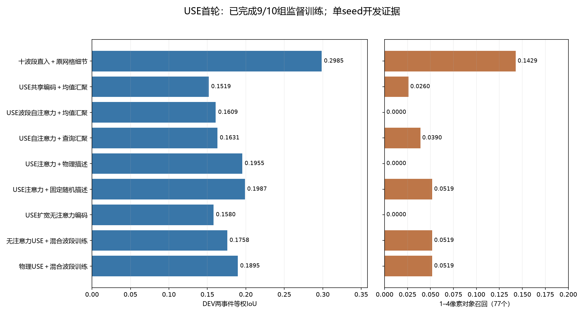

每行是一种模型或训练方式；左侧比较完整十波段的两事件等权IoU，右侧比较77个最小可评价对象的召回。工程上能接收不同波段，不等于保留分割性能。

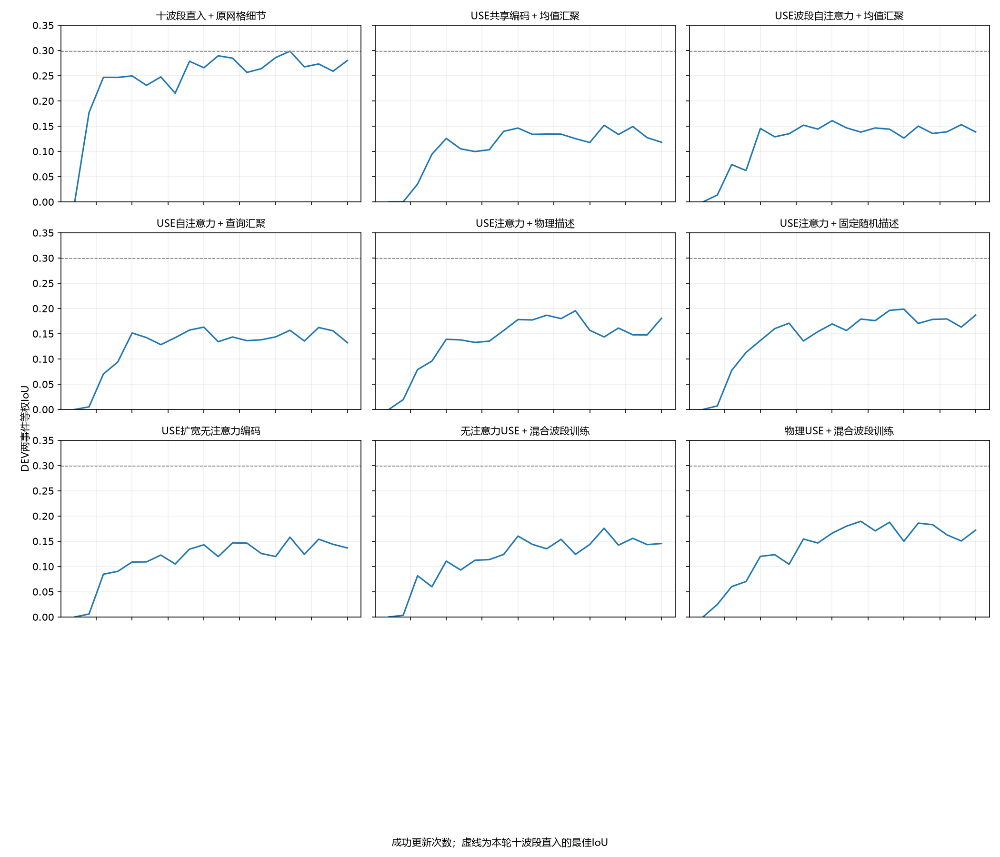

每个子图对应一组正式训练，共用坐标；下轴是成功更新次数，上轴是累计样本曝光除以2223得到的等效epoch，纵轴是每100次更新评价的两事件等权IoU。虚线仅表示本轮直入参照的最佳值，不是每一步的参照轨迹。前九组只保留100更新窗口的平均训练损失，无法补造逐次损失；第十组另保留per_update.jsonl逐次记录。

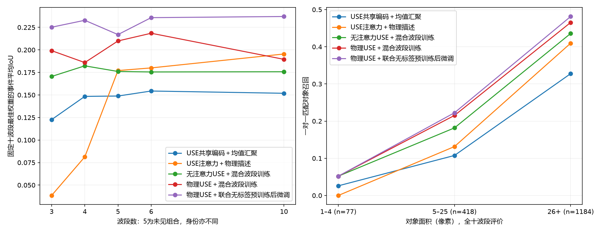

左图是相同权重接受不同组合，右图是在完整十波段下按对象面积比较召回；只展示均值与物理USE的完整/混合训练及可用的预训练组以保持可读性，全部数值见上表和原始评价。

### 展开结论

共享逐波段编码、掩膜汇聚及关系路径通过可变输入和集合置换验收；它们将十条原始反射率变成十维内部特征再进入主干和细节分支，改变了原参照的输入分布。所有已完成的随机初始化USE组均低于本轮直入参照，且最小对象召回下降超过0.02，须登记退化警报。分布干预和梯度连通只证明模块参与计算，不能说明退化原因。

物理描述组没有超过同结构固定随机身份描述组，无法支持本轮波长与原生分辨率带来收益的结论。带宽未知字段保持缺失；本地S2使用公开名义中心波长，并非逐产品实测响应。局部路径的描述项可能仅形成空间常量，是否影响小目标仍未验证，不据此临时改结构或损失。

混合波段训练的完整十波段IoU为0.1895，比同结构完整训练0.1955低0.0059；这是本seed的数值下降，低于预设0.01报警门槛，不能据此断言稳定退化。比较固定同一最佳十波段权重；RGB或未见组合可运行也不能推导真实Landsat滑坡分割有效。联合预训练与同结构混合训练比较，缺少单来源或S2单传感器预训练对照，不能归因于Landsat。

联合预训练通过遮挡波段重建学习输入表示；在同一结构和混合采样下，完整十波段事件平均IoU由0.1895提高至0.2370（+0.0475），但相对十波段直入0.2985仍低0.0615。最小对象召回仍为4/77，与随机USE混合训练相同，低于直入11/77；5–25像素对象由90/418到93/418，26+像素由551/1184到570/1184，均未达到直入188/418及752/1184。两个验证事件IoU均提高，固定同一权重的3/4/5/6/10波段IoU也均高于随机USE混合训练；这些是本seed的整体观察，不说明某个数据来源单独有效。

### 限制与下一步

本轮停止训练与自动接续，下载保持暂停。保留十波段直入作为当前参照；后续仅提出输入适配和小目标诊断，不自动启动扩量、蒸馏或新增实验。

单seed、同一开发集合反复选模；工程退化阈值不是显著性阈值。外部排除范围是项目影像图块包络加10公里，不是对所有灾害真实影响边界的独立地理核实。外部采样均匀轮转5°网格不保证全球地表分布代表性，重建误差降低不等于灾害语义有效。

### 附录：逐seed、成本与产物索引

本轮只有seed1234，每组16000次样本曝光；实际配置、命令、各步权重、逐更新/逐epoch曲线和曝光记录保留在各run目录。下表训练秒数含训练期间验证；推理吞吐为同一RTX5090上真实十波段批量8、FP32、预热10次后30次完整前向，不含文件读取和CPU到GPU搬运；不能换算未测下载耗时。

| 模型与训练方式 | 参数数 | 训练及验证秒数 | 测量吞吐（图块/秒） | 推理峰值显存MiB |
|---|---:|---:|---:|---:|
| 十波段直入＋原网格细节 | 3753602 | 235.6917 | 1020.8526 | 389.0093 |
| USE共享编码＋均值汇聚 | 3764620 | 530.4763 | 675.3137 | 534.1812 |
| USE波段自注意力＋均值汇聚 | 3768844 | 606.0624 | 640.8694 | 566.1758 |
| USE自注意力＋查询汇聚 | 3777324 | 637.7681 | 505.4545 | 588.9058 |
| USE注意力＋物理描述 | 3778604 | 696.7529 | 499.5162 | 544.0200 |
| USE注意力＋固定随机描述 | 3778604 | 689.6328 | 379.7546 | 566.2183 |
| USE扩宽无注意力编码 | 3778606 | 659.8513 | 399.7660 | 3740.9404 |
| 无注意力USE＋混合波段训练 | 3764620 | 567.9838 | 721.1389 | 534.1812 |
| 物理USE＋混合波段训练 | 3778604 | 689.8219 | 498.6946 | 566.2168 |
| 物理USE＋联合无标签预训练后微调 | 3778604 | 1080.0664 | 503.9644 | 588.9136 |

证据：[监督独立评价](../outputs/use/supervised_evaluations.json)、[预算及退化警报](../outputs/use/supervised_acceptance.json)、[成本测量方法及原始值](../outputs/use/costs.json)、[初始化回溯审查](../outputs/use/initialization_audit.json)、[外部试取验收](../outputs/use/external/pilot_acceptance.json)、[图表来源哈希](assets/research/use/figure_provenance.json)。早期USE run_meta缺少官方权重事前SHA，回溯当前目录与基线事前记录相符，但不能伪称每组都保留了事前指纹；后续记录已修复。

已完成监督训练及验证单卡墙时合计1.776小时（冒烟与工程测试另计，不是GPU实际利用小时）；已接受外部NPZ存储1.493GiB。网络实际传输字节未记录，不能用本地文件大小替代。

联合预训练训练及验证单卡墙时为11.20分钟，10000次更新、80000次曝光；十组监督共20000更新、160000次曝光，另有十组100步冒烟共1000更新。第2000步保存在last.pt中。混合组的band_views.jsonl由已保存的样本身份与累计曝光按确定性规则重建，并非逐批原始观测日志；三组均为十波段8015、RGB2644、RGB+B08 2669、六波段2672次曝光。

最终核查命令为`python -X utf8 scripts/audit_use.py --final-acceptance`；核对十组预算、样本曝光、固定采样规则、全部步权重及严格重载、独立评价与权重身份、两事件成员数及对象分母、预训练来源和迁移。验收通过表示工程与产物完整，所有USE组相对直入的退化警报仍保留。证据：[最终核查](../outputs/use/final_acceptance.json)、[配置/权重/清单/文档SHA256](../outputs/use/artifacts.sha256)、[仅USE迁移](../outputs/use/transfer_acceptance.json)。

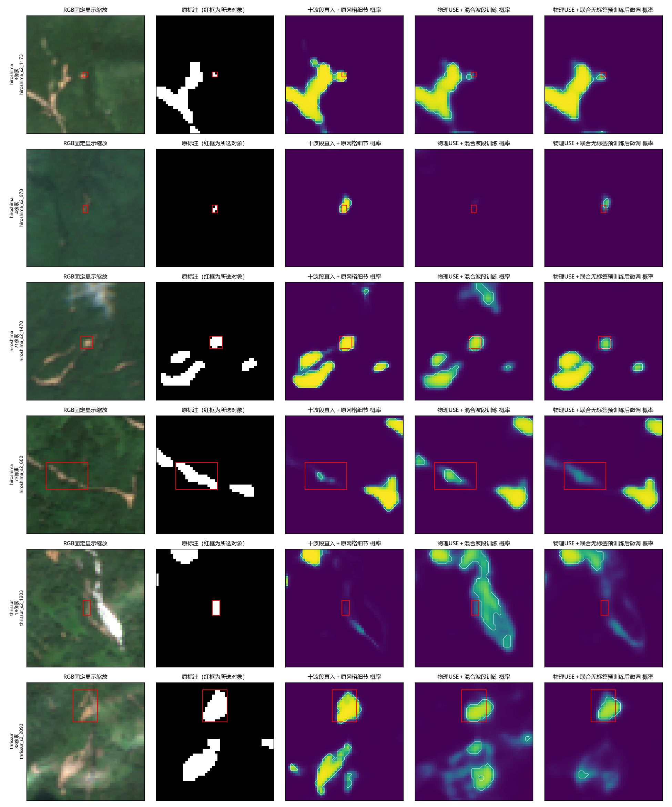

每行是一处按事件、面积及seed哈希选出的对象邻域；从左到右为RGB、原标注及各模型前景概率，红框定位同一真值对象，白线是0.5预测阈值。每窗48×48原始像素，放大不增加10米原生空间分辨率；案例选择不依据预测，不能替代完整669块定量评价。详情见[案例清单与权重SHA](assets/research/use/case_provenance.json)。

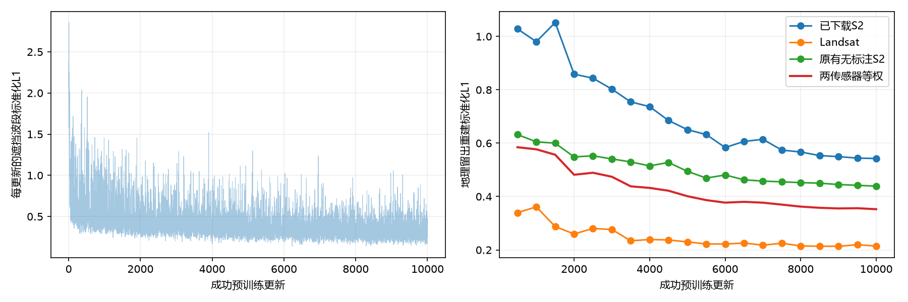

左侧每个点是一成功更新的训练L1；右侧每500更新评价一次，分别展示已下载S2、原有无标注S2、Landsat空间留出的重建误差。红线权重为前两者各1/4、Landsat为1/2，与批量配比一致。目标是训练统计标准化的反射率，数值不是原始反射率绝对误差，不能直接比较物理难度；第500步首次评价0.5849至10000步0.3526下降39.7%，并非相对未训练模型的变化。重建降低本身不证明滑坡分割收益。

<!-- USE_RESULTS_END -->

## USE旁支工程证据的接力

本节补录其他执行任务已完成的诊断复核与短程恢复探针，事实及来源SHA256统一登记在[阶段台账](assets/research/stage_ledger.json)的`use-recovery-engineering-followup`项。本项没有新增正式训练，不属于上文十组首轮比较。表示诊断使用32块训练快照；恢复探针以96块训练样本拟合、另32块训练样本检查，均不是广岛与特里苏尔669块开发验证。

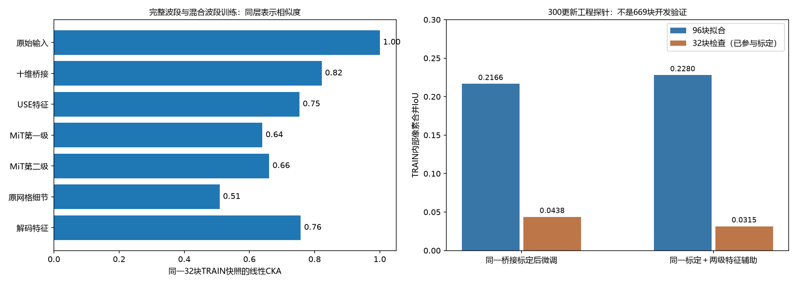

左图比较完整十波段训练与混合波段训练的同层表示相似度：CKA是同一批输入在两套权重下的线性表示相似程度，不是分割指标，也没有本项目已验证的合格阈值。右图比较从同一桥接标定状态开始的两组300次更新探针，蓝色为96块拟合样本的像素合并IoU，橙色为另32块训练检查样本的IoU；两类数值不能与上文669块的事件平均IoU混排。

恢复工程先用512块训练成员执行200次桥接标定：冻结USE和视觉网络，仅调整32→10桥接，使学生早期视觉特征接近冻结直入参照的特征。随后一组仅按原分割目标训练，另一组增加系数0.05的前两级视觉特征辅助。两组300次更新后的拟合IoU分别为0.1758和0.2351，检查IoU分别为0.0262和0.0251。拟合提高没有带来检查改善，不能据此认定特征辅助有效。教师来自本轮直入最佳模型，继承既有开发验证选模历史；这些工程权重不作为原首轮新起点。

成员交叉核对进一步发现：96块拟合样本中有91块参与过桥接标定，32块检查样本全部参与过桥接标定；教师也已经用这些训练成员的标签学习。这里的“检查”只表示未用于随后300步学生分割监督，不能理解为对标定或教师监督未见的独立集合，更不能据此评价泛化。成员证据为[标定清单](../outputs/use_recovery_probe/calibration/calibration_members.json)与[96/32探针清单](../outputs/use_interface_diagnostics/selection/diagnostic_tiles.json)。

诊断中RGB与完整输入预测之间的一致性IoU，从完整波段训练的0.085变为混合训练的0.389；它衡量两套输入产生的预测是否相似，**不是对人工标签的RGB分割IoU**。有效秩、梯度分配和表示相似度仅描述现象，尚未证明完整十波段性能下降的原因。

恢复自检的后续采样流、优化器步数和损失一致，桥接参数最大差为1.45×10⁻⁷，在该工程探针容差内，但不是逐位相同。其接口报告使用平均概率差，不能替代原首轮使用逐元素`atol=1e-5、rtol=1e-4`的完整模型验收。两组2000更新的教师旁支正式训练尚未执行，也未加入本轮预算；原首轮继续外部预训练和第十组微调。

原始证据：[诊断审计](../outputs/use_diagnostic_review/audit.json)、[表示与接口比较](../outputs/use_diagnostic_review/comparison.json)、[桥接标定](../outputs/use_recovery_probe/calibration/calibration_summary.json)、[无特征辅助的短程结果](../outputs/use_recovery_probe/short/g1/summary.json)、[有特征辅助的短程结果](../outputs/use_recovery_probe/short/g2/summary.json)、[恢复自检](../outputs/use_recovery_probe/selfcheck.json)。本节仅补齐接力与解释，保留原产物及其作者登记。

### Landsat下载吞吐优化

在保留全部已接受样本和原采样游标的前提下，远端网格并发由4改为8，并预取下一组；仍按原4个游标提交，若预取结果与此前新接受的位置冲突，则按原候选哈希顺序重扫。年份、全球5°网格顺序、每传感器5000位置上限、云与有效像素阈值、事件排除区及反射率换算不变。访问令牌改为依据实际到期时间缓存，提前120秒刷新，429仍按服务端冷却处理；质量饱和检查提前到六波段读取前。

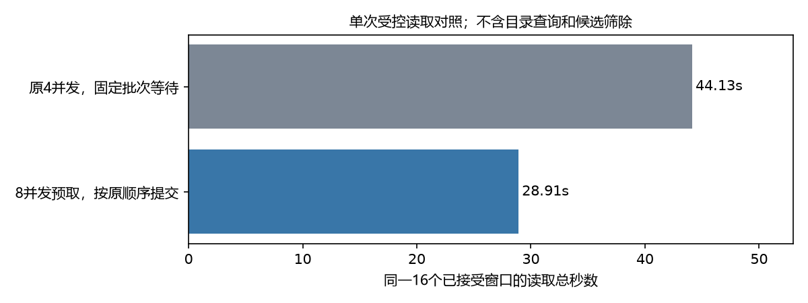

每行表示一种请求调度方式，两次均读取同一16个已接受的Landsat窗口，且影像、掩膜、物理元数据和定位均与原文件完全一致。单次测量从44.13秒降至28.91秒，对应约1.53倍读取吞吐。该对照不包含目录查询、候选筛除和整轮下载，也不是多次重复的统计结果，不能直接按此倍数推算完成时间。另测的三个单窗口显示省略重投影几乎没有收益，因此保留原重投影读取路径。

实现、源快照、精确命令、输入清单及测量结果保存在[性能测量产物](../outputs/use/download_performance/)，数值及来源SHA256统一写入阶段台账的`download_optimization`项；正式扩量已从断点按8并发恢复。

恢复后最近64个新位置的实际接收吞吐约16.4个/分钟，优化前最近64个位置约9.6个/分钟，观测比例约1.71。该统计包含实际目录查询和候选拒绝，但两段对应的地理候选不同，因此属于短段运行观察，不是与固定16窗口同口径的受控提速结论，也不用于承诺整轮完成时间。

</details>

<details>
<summary>USE独立预训练：六组、统一探针、下游适配与历史恢复</summary>

## USE独立阶段现有数据入口核查

该阶段入口确认11132训练、599验证、239隔离，11970缓存全量SHA/形状/有效性/元数据核查0失败，见[缓存验收](../outputs/use_independent_frozen/cache_audit_v1/acceptance.json)。生产工厂显式model.freeze_use、优化器排除USE及参数/buffer哈希检查已接入。73项工程测试、六组预训练、14探针、五适配的最终结果与预算在后文集中报告；原环境故障见本阶段工程接续记录，不在入口再重复流水过程。[本地验收](../outputs/use_independent_frozen/audit.json)。

### 新增冻结USE与可训练U-Net对照

用户追加一组完整U-Net消费冻结USE特征的对照。新增模块直接读取32维特征，采用四级卷积下采样、转置卷积上采样及拼接跳接，GroupNorm归一化，全部U-Net参数随机初始化并可训练；USE参数和buffer仍冻结。未复用现有将前三输入映射为RGB的U-Net首层。两项输入/尺寸与冻结反向测试通过，见[模块](../src/landslide_seg/models/use_unet.py)和[测试证据](../outputs/use_independent_frozen/unet_tests.xml)。用户已明确确认沿用最终共同USE，即与原四种适配相同、仅由无标签验证指标选出的checkpoint，不按滑坡探针IoU另选。原四种适配全部验收后才追加入口，且原四模型初始化哈希兼容性已通过；U-Net独立配置、初始化及2次真实数据工程检查通过，正式2000更新、最佳/末态独立复评及五种波段评价均已通过验收。接续程序曾因runpy缺少scripts导入路径失败，当时尚未改入口或训练；修复后重新检查前置门禁再执行，失败与零更新恢复证据见[恢复验收](../outputs/use_independent_frozen/unet_import_recovery_acceptance.json)。完整状态以阶段台账与[U-Net队列](../outputs/use_independent_frozen/added_unet_status.json)为准。

## USE首批独立预训练的10000步收敛核对

下表只纳入完成10000次更新并通过正式产物验收的组；未完成组仅以虚线显示已保存的真实验证点，不补齐曲线或预算。这里的MAE是标准化反射率重建误差：先对隐藏波段有效像素求平均，再对波段与样本平均，越低越好。它不是滑坡IoU。S2单传感器组选模只使用521份S2验证；多传感器与空间组使用同一521份S2和78份Landsat验证，并对两个传感器MAE等权平均。跨这两种验证域的总指标不可直接排列优劣；应先比较相同传感器、相同验证成员的曲线。

| 架构描述 | 无标签训练观测／目标 | S2末态MAE | Landsat末态MAE | 7500步选模指标 | 10000步选模指标 | 末2500步相对下降 | 最佳指标／步数 |
|---|---|---:|---:|---:|---:|---:|---:|
| 共享卷积＋均值汇聚 | S2／波段重建 | 0.6134 | 未评价 | 0.6338 | 0.6134 | +3.2% | 0.6134／10000 |
| 波段注意力（无物理描述） | S2／波段重建 | 0.5201 | 未评价 | 0.5426 | 0.5201 | +4.2% | 0.5201／10000 |
| 波段注意力＋物理描述 | S2／波段重建 | 0.4905 | 未评价 | 0.5085 | 0.4905 | +3.5% | 0.4905／10000 |
| 波段注意力＋随机身份（含源命名混杂） | S2／波段重建 | 0.4861 | 未评价 | 0.5286 | 0.4861 | +8.0% | 0.4861／10000 |
| 波段注意力＋物理描述 | S2＋Landsat／波段重建 | 0.5350 | 0.2176 | 0.4108 | 0.3763 | +8.4% | 0.3763／10000 |
| 波段注意力＋物理描述 | S2＋Landsat／波段＋空间重建 | 0.5832 | 0.2237 | 0.4320 | 0.4035 | +6.6% | 0.4035／10000 |

当前已显示的组均已完成正式产物验收。

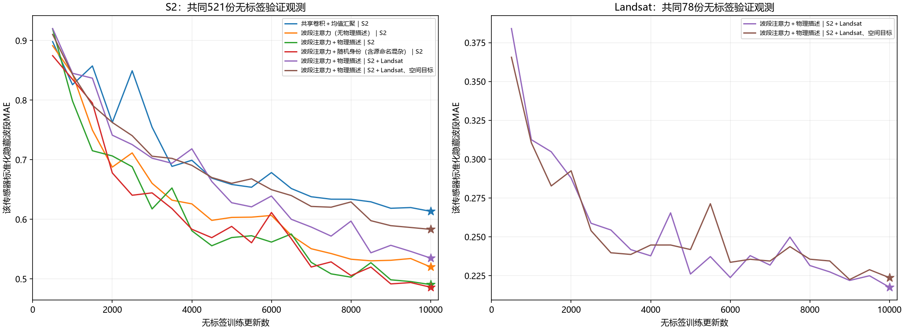

左图各线共用521份S2验证，右图只展示有真实Landsat重建验证的组；实线为已完成并验收，虚线为训练中。星号对应该组预先固定的无标签选模指标选出的最佳步数，不一定是某一个传感器MAE单独最低的位置。表中末态明确为10000步，末段相对下降为负表示误差升高，最佳权重与末态分开保存。

目前没有预先登记的平台阈值，跑满预算不能自动认定充分收敛。末段变化只是描述性证据，不能替代正式收敛判据；学习率在10000步降至0，是否需要更长日程仍未验证，也未追加训练预算。重建改善不等于滑坡迁移成功。逐步曲线、指标定义和源哈希见[收敛核对证据](../outputs/use_independent_frozen/convergence_review.json)。

### 正式权重接口与统一探针验收

5组正式最佳USE权重已在真实S2的3/4/5/6/10波段、Landsat六波段及奇数网格检查置换、无效补齐、NaN隔离、未知字段和混批一致性，USE哈希不变。接口通过不等于真实跨传感器迁移；五波段可能已出现在随机遮挡预训练中。证据在各组`pretraining/<variant>/interface_acceptance.json`，复现见[audit_use_frozen_interface.py](../scripts/audit_use_frozen_interface.py)。

统一探针冻结USE，只训练线性或浅层头；同类头共用初始化，2000更新、batch8、3600步学习率日程。随机参照best/last：线性头0.058269（100步）/0，浅层头0.010482（2000步）/0.010482。全部候选结果集中在下方统一主表，不再保留“尚待完成”的中途状态。

历史状态文件替换曾被Windows拒绝；只为权限错误增加有界重试并在核对进程、命令和权重后接续，没有重训已完成的随机两组。见[原故障](../outputs/use_independent_frozen/s2_probe_status_write_failure.json)、[接续验收](../outputs/use_independent_frozen/probe_queue_recovery_acceptance.json)；底层原因未确认。

原始十波段SegFormer参照复用已有2000更新训练，未新增训练或改写权重。隔离环境重新推理同一669块开发验证集，两事件等权IoU复现为0.298531，最佳步数1600；best/last的BatchNorm运行统计与实际ADE预训练初始化一致。[参照验收](../outputs/use_independent_frozen/reference_acceptance.json)保存命令、哈希及独立评价。该参照沿用原图像预处理，USE入口额外按影像质量屏蔽无效输入，因此两者比较包含输入质量处理差异，不能将全部差异归因为架构。验收器初版误假设所有BatchNorm初值为零/一；已修正为与实际预训练初值比较，失败原因另存，未修改模型或训练。

<a id="cuda原生异常与当前训练门禁"></a>
### 历史CUDA异常与恢复（已完成）

该阶段故障已恢复，不是本页当前训练门禁。原生异常定位到CUDA初始化/nvcuda64.dll（595.97，0xc0000005），GPU0/1隔离与cuInit均曾失败，底层原因未确认；不用CPU评价通过冒充GPU恢复。

已训练的注意力无物理描述浅层头在CPU完成669块重评，best/last IoU均0.0052757924，与GPU验证在1e-5容差内一致；FP32、四线程、阈值0.5，权重不变。[CPU重评](../outputs/use_independent_frozen/probe_inference_recovery_acceptance.json)。

此后Driver API返回0，两卡真实分配/有限梯度反向及2次真实数据工程更新、669块验证通过，USE冻结和严格重载通过，原队列跳过六条已完成命令接续。[恢复验收](../outputs/use_independent_frozen/runtime_recovery/acceptance.json)。设备重启的权限/UAC尝试没有成功，不能把恢复归因于重启；各次失败、隔离及安全接续日志集中索引在文末。

<!-- USE_INDEPENDENT_PROBES_START -->

### 统一冻结探针的同权重多波段评价（阶段结果）

14项统一探针及五种波段评价均已完成正式验收，下表保留原十波段参照。全部使用我们的数据划分（留事件验证）、seed1234、2223训练及669开发验证、stats_core25；任务训练均2000更新、batch8、FP32、3600步学习率日程。主表均为十波段最佳任务权重；IoU选模按广岛与特里苏尔等权平均，Dice、Precision、Recall及边界F1按669块合并计数。对象召回列依次写三档命中数/可评价总数，排除边缘截断对象，匹配IoU阈值0.25；边界F1容差为1像素。线性头为1×1卷积，浅层头为3×3卷积＋GELU＋1×1卷积，均只读取冻结USE特征，没有MiT主干。

| 结构 | 训练初始化 | 广岛IoU | 特里苏尔IoU | 两事件等权IoU | Dice | Precision | Recall | 边界F1 | 对象召回（1–4／5–25／≥26像素） |
|---|---|---:|---:|---:|---:|---:|---:|---:|---|
| SegFormer B0＋原网格细节分支 | MiT通用RGB预训练 | 0.2776 | 0.3195 | 0.2985 | 0.4482 | 0.4070 | 0.4988 | 0.4603 | 11/77；188/418；752/1184 |
| 波段注意力＋物理描述USE＋线性头 | USE随机；任务头随机 | 0.0685 | 0.0480 | 0.0583 | 0.1163 | 0.1229 | 0.1103 | 0.1584 | 10/77；41/418；107/1184 |
| 波段注意力＋物理描述USE＋浅层头 | USE随机；任务头随机 | 0.0169 | 0.0040 | 0.0105 | 0.0242 | 0.1066 | 0.0137 | 0.0435 | 0/77；3/418；9/1184 |
| 共享卷积均值USE＋线性头 | USE独立无标签预训练；任务头随机 | 0.0034 | 0.0028 | 0.0031 | 0.0064 | 0.0280 | 0.0036 | 0.0061 | 0/77；0/418；0/1184 |
| 共享卷积均值USE＋浅层头 | USE独立无标签预训练；任务头随机 | 0.0840 | 0.0280 | 0.0560 | 0.1264 | 0.1925 | 0.0941 | 0.1605 | 2/77；31/418；149/1184 |
| 波段注意力USE（无物理描述）＋线性头 | USE独立无标签预训练；任务头随机 | 0.0750 | 0.0356 | 0.0553 | 0.1008 | 0.0576 | 0.4032 | 0.1321 | 8/77；101/418；422/1184 |
| 波段注意力USE（无物理描述）＋浅层头 | USE独立无标签预训练；任务头随机 | 0.0096 | 0.0009 | 0.0053 | 0.0125 | 0.3408 | 0.0064 | 0.0256 | 0/77；0/418；1/1184 |
| 波段注意力＋物理描述USE＋线性头 | USE独立无标签预训练；任务头随机 | 0.1010 | 0.0233 | 0.0622 | 0.1366 | 0.1085 | 0.1844 | 0.1847 | 3/77；72/418；312/1184 |
| 波段注意力＋物理描述USE＋浅层头 | USE独立无标签预训练；任务头随机 | 0.0399 | 0.0036 | 0.0217 | 0.0524 | 0.2396 | 0.0294 | 0.0867 | 0/77；5/418；43/1184 |
| 波段注意力＋随机身份USE（含命名混杂）＋线性头 | USE独立无标签预训练；任务头随机 | 0.0185 | 0.0191 | 0.0188 | 0.0367 | 0.0188 | 0.8214 | 0.0741 | 0/77；0/418；0/1184 |
| 波段注意力＋随机身份USE（含命名混杂）＋浅层头 | USE独立无标签预训练；任务头随机 | 0.0206 | 0.0080 | 0.0143 | 0.0320 | 0.1174 | 0.0185 | 0.0614 | 0/77；3/418；11/1184 |
| 波段注意力＋物理描述USE＋线性头 | USE多传感器MBM预训练；任务头随机 | 0.0494 | 0.0063 | 0.0278 | 0.0655 | 0.2265 | 0.0383 | 0.1108 | 1/77；9/418；20/1184 |
| 波段注意力＋物理描述USE＋浅层头 | USE多传感器MBM预训练；任务头随机 | 0.0178 | 0.0037 | 0.0108 | 0.0248 | 0.1809 | 0.0133 | 0.0476 | 0/77；2/418；4/1184 |
| 波段注意力＋物理描述USE＋线性头 | USE多传感器MBM＋空间预训练；任务头随机 | 0.0256 | 0.0239 | 0.0248 | 0.0474 | 0.0271 | 0.1924 | 0.0873 | 0/77；2/418；39/1184 |
| 波段注意力＋物理描述USE＋浅层头 | USE多传感器MBM＋空间预训练；任务头随机 | 0.0013 | 0.0003 | 0.0008 | 0.0019 | 0.1759 | 0.0009 | 0.0023 | 0/77；0/418；0/1184 |

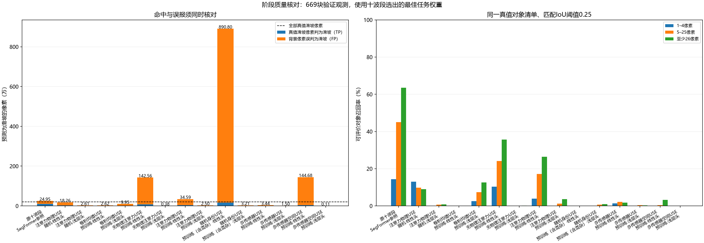

每组横坐标与主表结构/初始化对应。左图蓝色与橙色分别为命中和误报像素，虚线为共同真值滑坡像素总数；右图分别展示三种尺寸对象的命中比例，三档总数固定为77、418、1184。应同时看误报、漏检与对象召回，不只取一个较高指标。

同结构、同类头初始化下，S2预训练相对随机USE：线性头IoU 0.0583→0.0622（+0.0039），浅层头0.0105→0.0217（+0.0112）。这是单seed开发集差异，不能据此声明显著性、完整系统性能或跨传感器成功。

固定任务预算，将每步8份S2替换为4份S2＋4份Landsat后，线性头IoU 0.0622→0.0278（-0.0343），浅层头0.0217→0.0108（-0.0110）。没有S2曝光匹配对照，不能将变化单独归因于传感器种类；两域等权MAE也不能与S2单域MAE直接排名。

无物理描述的注意力USE＋线性头在独立预训练后命中82,069个滑坡像素，同时把1,343,511个背景像素判为滑坡；Recall为0.4032，Precision仅0.0576。较多对象命中伴随大量误报，不能单独用对象召回宣布迁移改善。

同一类预训练USE改用浅层头时，Precision为0.3408，但Recall仅0.0064；它只命中1,300个真实滑坡像素，不能只看Precision而忽略漏检。

这些是固定阈值、既定预算下的实际输出差异。参照具有MiT主干和细节分支，且输入质量屏蔽处理有差异；当前随机与部分预训练组的USE结构也不同，因此不能将差异全部归因于预训练或单个组件。14项探针均已齐备，但特征分布、任务头容量及训练动态的具体归因均未验证。

下图每一行的前五列均使用十波段开发验证选出的同一最佳任务权重，不因波段组合重新训练、重新选checkpoint或调整阈值；白线右侧最后一列单独报告2000步十波段训练末态。最佳步数和末态原值见合并进度证据；参照复用原训练，仅重新推理最佳十波段权重，未补做其末态或删波段评价。

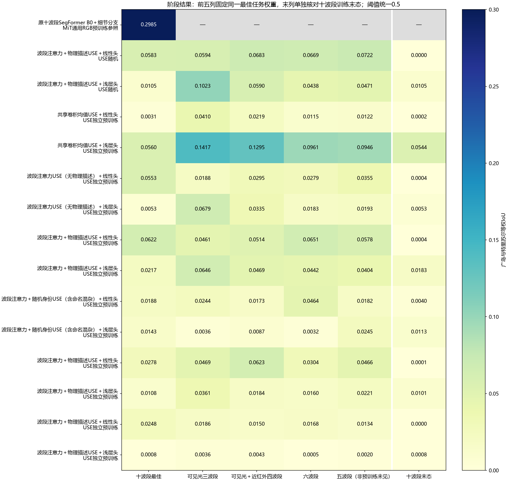

每行是一种已验收结构及初始化，前五列是同一S2观测的波段子集，最后一列为另一任务头状态的末态核对；灰色表示未执行。部分子集IoU高于十波段是固定权重与阈值下的实测现象，不能解释为少波段信息量更多；输入变化引起特征分布及阈值响应差异是可能解释，尚未验证。随机USE与均值预训练USE还改变了汇聚结构，不能将它们的全部差异归因为预训练。五波段可能已在MBM中出现；这些S2子集不是独立真实RGB或Landsat任务。单seed、有限研发事件和不完整候选限制保留。

逐事件、对象召回、边界F1与逐块计数保存在各run的`eval/`，对应`subset_acceptance.json`锁定同一任务权重和源哈希；图表来源见[合并进度证据](../outputs/use_independent_frozen/probe_progress.json)。

#### 已完成部分成本与产物核查

本阶段正式98000更新：无标签60000、探针28000、四适配8000、U-Net2000；对应样本呈现480000/224000/64000/16000，空间遮挡另有80000视图，不当作新地点。恢复未增加正式更新；真实数据工程14次（含恢复2次）、smoke18次另列，不含所有合成测试和启动失败成本。50个本轮best/last与52个旧checkpoint均保持哈希；中断时的20文件是前者子集，不相加。记录计时15231.06秒，边界不同且未汇总独立推理/恢复，不能称纯GPU时间。详见[预算与曝光核对](../outputs/use_independent_frozen/completed_budget_acceptance.json)。

<!-- USE_INDEPENDENT_PROBES_END -->

<!-- USE_INDEPENDENT_CASES_START -->

### 固定对象邻域的阶段空间预测检查

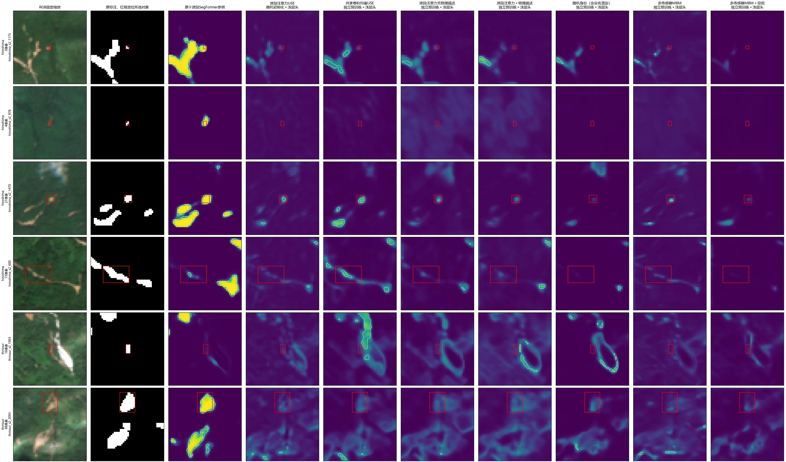

六行沿用旧阶段已经固定的案例清单：前四行来自广岛，后两行来自特里苏尔；不是根据本轮预测重新挑选。从左到右为固定缩放RGB、原标注，以及原十波段SegFormer参照、波段注意力USE 随机初始化＋浅层头、共享卷积均值USE 独立预训练＋浅层头、波段注意力无物理描述 独立预训练＋浅层头、波段注意力＋物理描述 独立预训练＋浅层头、随机身份（含命名混杂） 独立预训练＋浅层头、多传感器MBM 独立预训练＋浅层头、多传感器MBM＋空间 独立预训练＋浅层头的前景概率。紫色对应接近0，黄色对应接近1；红框定位同一个真值对象，白线标示0.5预测边界。每窗48×48原始像素，放大不增加10米原生细节。

案例规则见[共同案例与结论边界](#共同案例与结论边界)。本图只读最佳概率，真值/有效区核验通过；[案例证据](../outputs/use_independent_frozen/probe_case_provenance.json)。

<!-- USE_INDEPENDENT_CASES_END -->

<!-- USE_INDEPENDENT_SPATIAL_START -->

### 空间遮挡重建的独立只读核对

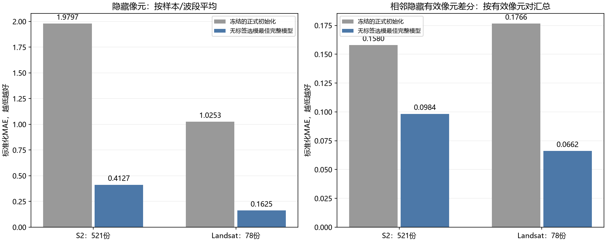

每张图的两组柱分别是同一批S2和Landsat无标签验证观测，灰柱为正式初始化，蓝柱为按既定无标签波段重建指标选出的最佳完整模型；两者使用同一遮挡规则与seed1236。左图按样本和波段平均隐藏像元误差，右图按有效相邻隐藏像元对汇总差分误差，两个平均口径不同，不混为一个选模分数。

S2隐藏像元MAE由1.9797变为0.4127，相邻隐藏像元差分MAE由0.1580变为0.0984。Landsat隐藏像元MAE由1.0253变为0.1625，相邻隐藏像元差分MAE由0.1766变为0.0662。

这些结果同时包含USE与临时空间重建解码器，后者不进入滑坡下游；因此不能把变化全部归因于USE，也不能据此声称边界、对象召回或迁移改善。差分按各自影像网格的相邻像元计算，不代表统一的每米物理导数。本图只读已验收诊断，无新增训练、推理或选模。原始逐波段MAE/RMSE、像元数、邻居数与完整模型哈希见[空间诊断](../outputs/use_independent_frozen/pretraining/spatial/spatial_reconstruction_diagnostics.json)。

<!-- USE_INDEPENDENT_SPATIAL_END -->

<!-- USE_INDEPENDENT_ADAPTERS_START -->

### 固定同一USE权重的下游适配结果

以下全部USE行使用同一份、仅由无标签指标选出的USE权重；两个探针行复用该编码器的已验收探针，不新增训练。四种完整适配先全部通过真实数据工程验收，再分别从冻结初始化训练2000次更新。训练集2223块，开发验证为广岛448块与特里苏尔221块；seed1234、stats_core25、batch8、FP32、3600步学习率日程、0.5 BCE＋0.5 Dice保持一致。任务最佳权重按两个事件等权IoU选择。Dice、Precision、Recall、边界F1按669块合并统计；边界容差1像素，对象匹配IoU阈值0.25，三档可评价对象数固定为77、418、1184。原参照的最佳值已独立复评，末态IoU复用原2000步验证记录，未新增末态推理；其余各行最佳与末态均已独立复评，不能混淆证据来源。

| 结构 | 初始化 | 广岛IoU | 特里苏尔IoU | 最佳两事件等权IoU | 末态IoU | Dice | Precision | Recall | 边界F1 | 对象命中/可评价总数（1–4／5–25／≥26像素） |
|---|---|---:|---:|---:|---:|---:|---:|---:|---:|---|
| SegFormer B0＋原网格细节分支 | MiT通用RGB预训练 | 0.2776 | 0.3195 | 0.2985 | 0.2802 | 0.4482 | 0.4070 | 0.4988 | 0.4603 | 11/77；188/418；752/1184 |
| 冻结USE→线性头 | USE独立预训练；任务头随机 | 0.0494 | 0.0063 | 0.0278 | 0.0001 | 0.0655 | 0.2265 | 0.0383 | 0.1108 | 1/77；9/418；20/1184 |
| 冻结USE→浅层头 | USE独立预训练；任务头随机 | 0.0178 | 0.0037 | 0.0108 | 0.0101 | 0.0248 | 0.1809 | 0.0133 | 0.0476 | 0/77；2/418；4/1184 |
| 冻结USE→32→10桥接→SegFormer B0＋细节分支 | USE独立预训练；MiT继承RGB预训练；适配/预测分支随机 | 0.1036 | 0.1778 | 0.1407 | 0.1036 | 0.2205 | 0.1915 | 0.2600 | 0.2119 | 0/77；31/418；366/1184 |
| 冻结USE→32→3适配→RGB规格SegFormer B0＋细节分支 | USE独立预训练；MiT继承RGB预训练；适配/预测分支随机 | 0.0974 | 0.1660 | 0.1317 | 0.1056 | 0.2111 | 0.1820 | 0.2513 | 0.2124 | 1/77；36/418；365/1184 |
| 冻结USE→32输入新首层→SegFormer B0＋细节分支 | USE独立预训练；MiT继承RGB预训练；适配/预测分支随机 | 0.1211 | 0.1531 | 0.1371 | 0.1048 | 0.2295 | 0.2006 | 0.2680 | 0.2326 | 0/77；56/418；385/1184 |
| 冻结USE→多尺度适配→新FPN解码器 | USE独立预训练；多尺度适配与FPN随机 | 0.0990 | 0.1081 | 0.1035 | 0.0876 | 0.1834 | 0.1396 | 0.2673 | 0.1930 | 0/77；43/418；354/1184 |
| 冻结USE→可训练U-Net | USE独立预训练；U-Net全部随机 | 0.0850 | 0.1944 | 0.1397 | 0.1397 | 0.2066 | 0.1850 | 0.2339 | 0.1820 | 0/77；21/418；290/1184 |

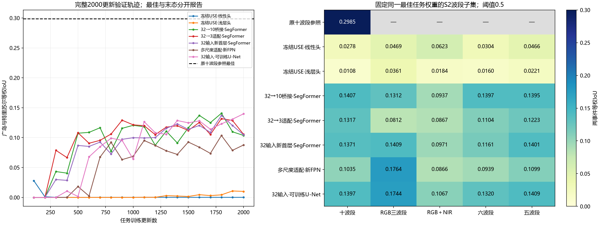

左图每条实线是一种适配或任务头在相同USE上的完整验证轨迹，虚线只表示原参照最佳值；右图每行固定该行十波段选出的同一最佳任务权重，五列是同一S2观测的波段子集，灰色为未执行。不能把五波段称为预训练未见组合，也不能把S2 RGB子集称为真实RGB任务。

四种完整下游适配中，冻结USE→32→10桥接→SegFormer B0＋细节分支的开发验证最佳IoU为0.1407，相对原十波段参照变化-0.1578。本轮未超过原十波段参照。用户补充的可训练U-Net沿用同一共同USE，其最佳IoU为0.1397、末态为0.1397；相对原十波段参照变化-0.1588。1–4像素可评价对象命中0/77，原参照为11/77。U-Net最佳点位于第2000次更新；正处预算末端，未证明充分收敛，延长训练是否改善尚未验证。U-Net全部随机初始化且参数容量不同，该结果反映此完整系统，不单独证明USE特征优劣。本轮没有另训直接十波段U-Net，因此不能从与SegFormer参照的差异单独测得USE对U-Net的增益。

新增U-Net直接接收冻结USE的32维特征，四级下采样/上采样与跳接全部可训练，共7,771,393个随机初始化任务参数；没有绕过USE直接读取原十波段的任务分支。沿用共同USE的无标签选模结果；独立完成真实数据2次工程更新后，重新初始化正式训练2000次，未继承工程权重。其配置、初始化和工程门禁见[独立U-Net契约](../outputs/use_independent_frozen/unet_contract/acceptance.json)与[工程验收](../outputs/use_independent_frozen/unet_contract/engineering_acceptance.json)。

USE的全参数与buffer在各次验证及best/last重载中哈希一致，优化器未包含USE，BN统计与初始化一致。这些证据确认冻结边界和适配执行；适配器、MiT或FPN的容量和初始化存在明确差异，不能把完整系统差异全部归因于预训练。原十波段参照还存在输入质量屏蔽处理差异，因此它提供实际系统参照，不构成仅改变USE的因果对照。

本轮仍只有S2滑坡这一类有标签任务。真实Landsat只参与无标签预训练与接口/重建诊断；缺少第二独立任务、真实非S2 RGB任务、合格跨传感器配对和新的盲测地域，未证明通用迁移。随机波段身份对照含源命名混杂，纠正追加预算尚未获授权；原结果保留，物理描述优势的结论受限。

配置、共同USE选择规则与初始化见[冻结契约](../outputs/use_independent_frozen/adapter_contracts/acceptance.json)，全组工程门禁见[工程验收](../outputs/use_independent_frozen/adapter_contracts/engineering_acceptance.json)，图表与各run验收源哈希见[适配报告证据](../outputs/use_independent_frozen/common_use_adapter_publication.json)。

<!-- USE_INDEPENDENT_ADAPTERS_END -->

<!-- USE_INDEPENDENT_COMMON_CASES_START -->

### 同一冻结USE的完整下游固定案例

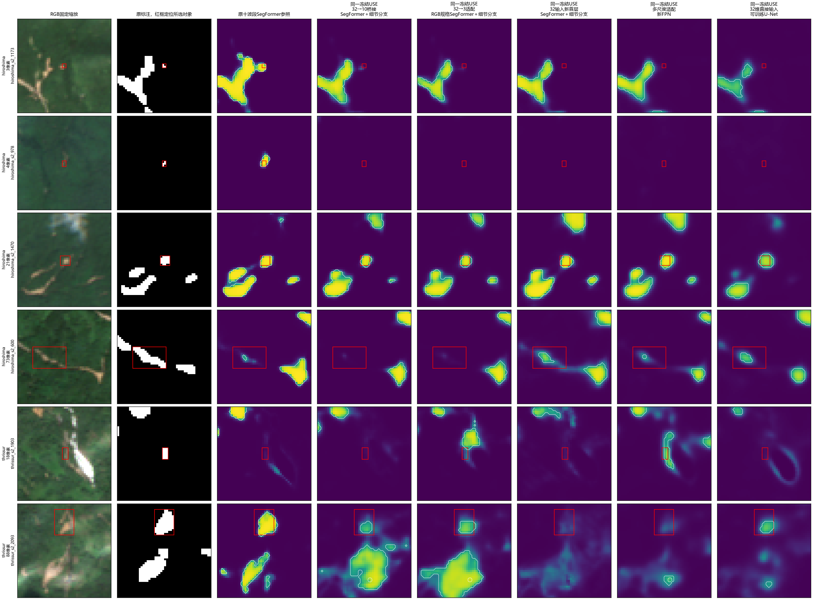

六行沿用旧阶段已经固定的案例清单：前四行来自广岛，后两行来自特里苏尔；不是根据本轮预测重新挑选。从左到右为固定缩放RGB、原标注，以及原十波段SegFormer参照、同一冻结USE 32→10桥接 SegFormer＋细节分支、同一冻结USE 32→3适配 RGB规格SegFormer＋细节分支、同一冻结USE 32输入新首层 SegFormer＋细节分支、同一冻结USE 多尺度适配 新FPN、同一冻结USE 32维直接输入 可训练U-Net的前景概率。紫色对应接近0，黄色对应接近1；红框定位同一个真值对象，白线标示0.5预测边界。每窗48×48原始像素，放大不增加10米原生细节。

案例规则见[共同案例与结论边界](#共同案例与结论边界)。本图只读最佳概率，真值/有效区核验通过；[案例证据](../outputs/use_independent_frozen/common_use_case_provenance.json)。

<!-- USE_INDEPENDENT_COMMON_CASES_END -->

### 无标签跨波段诊断与随机身份对照的限制

本阶段已经结束：用户选择保留随机身份命名混杂限制，不追加14000更新纠正对照，不恢复下载。以下诊断只解释已有结果，不是待续队列。

在同一521份S2无标签验证观测上，将前三个可见光波段与其余七个波段分别输入各组冻结最佳USE，按影像质量有效像元对特征图取全局平均。同地点的两个视图构成正例；固定顺序中前一个不同缓存构成非配对负例，同时全部521个缓存作为检索候选。Recall@1表示前三波段特征能否在521份其余七波段特征中把对应地点排到第一。该诊断没有更新参数，也没有重新选择checkpoint。

| 架构描述 | 无标签训练观测／目标 | 同地点余弦相似度 | 不同缓存余弦相似度 | Recall@1 | Recall@5 | Recall@10 |
|---|---|---:|---:|---:|---:|---:|
| 共享卷积＋均值汇聚 | S2／波段重建 | 0.9411 | 0.9094 | 1.92% | 5.18% | 9.79% |
| 波段注意力，无物理描述 | S2／波段重建 | 0.7556 | 0.7093 | 1.73% | 5.57% | 8.83% |
| 波段注意力＋物理描述 | S2／波段重建 | 0.4609 | 0.4160 | 2.50% | 5.57% | 8.45% |
| 波段注意力＋随机身份（含源命名混杂） | S2／波段重建 | 0.8023 | 0.7532 | 0.96% | 4.22% | 6.33% |
| 波段注意力＋物理描述 | S2＋Landsat／波段重建 | 0.7506 | 0.7129 | 1.54% | 5.95% | 10.75% |
| 波段注意力＋物理描述 | S2＋Landsat／波段＋空间重建 | 0.8489 | 0.7652 | 1.34% | 4.99% | 8.25% |

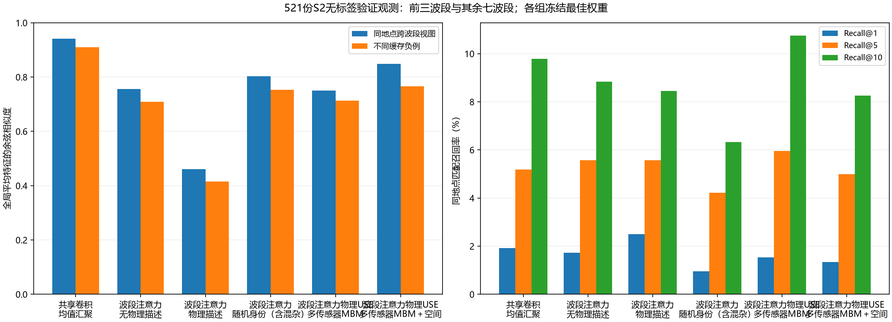

每组横坐标是一种结构，使用该组无标签验证选出的最佳权重。左图应同时看正例与负例，不能把较高正例相似度直接当作更好表征；右图是同地点检索的前1、5、10名召回率。各组正例平均相似度高于非配对负例，但当前全局平均特征检索结果不足以证明空间细节可迁移。这是同传感器不同波段的匹配，不能称为真实跨传感器检索；不同缓存可能地理相邻，也没有随机初始化的同项诊断，不能据此归因于预训练收益或宣称独立地域泛化。完整指标与逐波段物理反射率域、标准化域MAE/RMSE见各组`pretraining/<variant>/ssl_diagnostics.json`及[合并索引](../outputs/use_independent_frozen/ssl_diagnostic_summary.json)。逐波段误差按有效目标像素汇总，与选模所用先波段/样本平均的权重不同，已分别标注。

真实S2三/四/六/十波段与Landsat六波段的batch1 FP32效率也已测量，5次预热、20次正式计时，包含生产冻结哈希检查和Python开销。四组十波段平均延时为2.71–5.88毫秒，峰值已分配显存为62.86–102.14 MiB，仅为本机RTX5090单次会话的描述。各输入的延时、吞吐、显存、关系位置数、波段Token数及注意力矩阵乘法量见同目录`efficiency.json`；注意力QK/AV乘加数不等于全模型FLOPs，未混称。当前是声明网格上的对齐输入，没有实现多原生分辨率Token模式。

**随机身份对照的唯一限制说明。** TRAIN中4763份S2用blue/green等名称，4747份用B02/B03等名称；字面哈希把同一物理波段分成两种身份、共20种，下游使用B02命名。这暴露来源信息，不能单独检验物理描述是否优于等价十波段身份。[别名审计](../outputs/use_independent_frozen/band_identity_alias_audit.json)保留计数/哈希；用户已选择保留限制结束本轮，不再把旧授权询问或“其余组继续”写成当前状态。

</details>

<details>
<summary>USE v2：数据/校准、20k与续尾、完整下游网络</summary>

## USE v2预训练数据、校准与派生评价

### 阅读约定与实验设置

本节保留v2的数据准入与校准规则；42项正式运行的结果集中在[两预算条件比较](#use-v2两个预算条件的无标签与下游结果)，状态与预算以阶段台账use-v2为准。工程证据见`outputs/use_v2/audit/release_audit_v1.json`。

沿用[共同数据角色](#阅读约定与实验设置)：无标签TRAIN更新参数，PRETRAIN_VAL只评价与选模，GUARD两边均不用；它们与669块分割开发验证不是同一集合。

### 数据角色与来源（按缓存逐份复核）

| 角色 | 份数 | 传感器构成 | 用途 |
|---|---:|---|---|
| TRAIN | 11132 | S2 9510＋Landsat 1622 | 三个无标签任务更新参数 |
| PRETRAIN_VAL | 599 | S2 521＋Landsat 78 | 固定视图重建评价与无标签选模 |
| GUARD | 239 | S2 239 | 验证区1280米隔离缓冲，不学习不选模 |

全部11970份缓存由本轮验收逐份重读`x`、`pixel_valid`、`metadata`、`known`并核对SHA256、形状、dtype、已知/未知占位与共同有效像元比例，0失败；文件名不重复，角色之间没有交叉成员。来源链为三份冻结清单加对应验收文件（当前清单、本地无标注位置、F盘严格准入），重复身份与未分配成员在装配时即报错。源产品级与地理排除规则沿用既有审计结论，本轮不重做，也不把它当成新的地理盲测证据。

每批8份观测固定为6份S2＋2份Landsat。抽样由`seed1234＋update`派生，与模型参数量和Torch随机状态无关；200次抽样的实测构成为S2 1200份、Landsat 400份，全部来自TRAIN。S2池按冻结来源的训练位置数拼接，因此均匀抽样等价于按来源位置数比例抽样。增强是无状态的水平/垂直翻转与90度旋转，空间掩膜与坐标同步变换。

### 校准与损失归一化（训练集固定清单）

三个任务的MAE各自除以训练集固定校准清单上的简单参照误差后等权相加：光谱参照取可见波段的物理反射率均值，空间参照取归一化的9×9局部插值。系数取校准成员的平均误差，同一清单还拟合了只用TRAIN的线性回归供评价比较。验收中从TRAIN重算校准，得到的文件SHA256与配置登记的`29cb697f…`相同，成员为每传感器32份且与PRETRAIN_VAL、GUARD无交集。

| 传感器 | 光谱系数 | Fine系数 | Context系数 |
|---|---:|---:|---:|
| S2 | 0.9116 | 0.0944 | 1.0244 |
| Landsat | 0.4870 | 0.0598 | 0.4383 |

系数只是把三个任务的误差放到可比尺度，用于损失与选模，不是成绩；它们由标准化后的目标算出，不能跨数据版本直接比较。Landsat系数明显低于S2，说明其标准化域内的参照误差更小，不代表该传感器的迁移更容易。

### 30m派生评价的有效面积

30m对照只做派生评价：按源影像的真实地理变换与包络，以面积平均重采样到本地UTM 30米网格，每个30米单元要求有效观测面积比例不低于0.8，并记录有效面积的最小值与均值。一次真实S2验证样本的派生结果为源10米→目标30米、目标CRS为EPSG:32705、平均有效面积0.985。相同行列数不代表相同物理窗口；没有合格同地点配对时不得声称真实跨传感器检索。

### 当前能看到什么

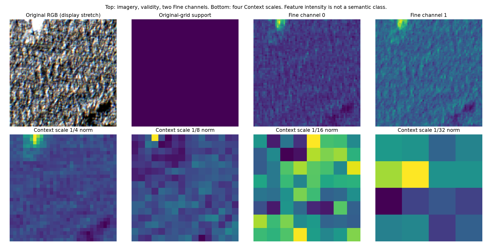

这张图来自**未训练的工程烟雾检查**：上排是原RGB显示（拉伸）、原网格支持掩膜和前两个Fine通道，下排是四个Context尺度的特征范数。它只用于确认输出形状、有效区与四尺度结构符合设计，特征强度不是语义类别，也不能作为性能证据。

### 限制与下一步

- 单期、单seed、两个反复用于选模的验证事件；没有独立地域盲测。
- 十波段统计仍是`stats_core25`，未因训练集2223块重算；Landsat统计只用合法训练部分拟合。
- 地理隔离与源产品审计沿用既有结论，本轮没有重新核验原始产品。
- 原92000更新及后续54000更新已完成，结果与验收见后文；第二有标签任务未核实数据，不能宣称跨任务通用。

## USE v2两个预算条件的无标签与下游结果

### 阅读约定与实验设置

本节比较20000步与续尾至30000步的v2。数据沿用共同口径，无标签池11132训练／599验证／239隔离；两段日程和单seed限制保留。

两个条件：
- **20k 条件**：`engineering_v2`，两组各 20000 步、22 个冻结探针、6 组下游。
- **30k 续尾条件**：`engineering_v3`，从各自的 `u20000.pt` 继续 10000 步（新 AdamW、100 步预热后余弦到 0，全局步号 20001–30000，采样流不回放），再跑 4 个探针与 6 组下游。**这是两段日程，不是单次 30000 步余弦**，学习率轨迹不同，不能当作“30k 预算”的直接证据。

两个指标口径（都越低越好）：
- **冻结选模分数**：三任务（光谱／Fine／Context）标准化 MAE 各除以训练集固定校准系数，先任务等权、再传感器等权；只用于选模。
- **探针分数**：同一冻结编码器＋同容量任务头，单任务 1000 次更新，只有第 1000 步一次验证。

### 主表一：预训练与探针

| 指标 | 无局部波段自注意力 20k | 无局部波段自注意力 30k | 一层4头局部波段自注意力 20k | 一层4头局部波段自注意力 30k |
|---|---:|---:|---:|---:|
| 冻结选模分数 | 0.6218 | **0.6208** | 0.6209 | **0.6141** |
| Fine 探针 | 2.2813 | **2.2320** | 2.2964 | 2.2932 |
| Context 探针 | 0.2524 | **0.2462** | 0.2524 | 0.2538 |

对照：同结构随机初始化的 Fine 探针为 2.3481（无局部波段自注意力）与 2.3361（一层4头），Context 探针均为 0.2966；旧 USE 参照为 2.3612／0.2897。

### 主表二：冻结下游（六组，统一轻量头：Context为4257参数，增加Fine后为5313参数）

| 冻结输入条件 | 20k 条件 | 30k 续尾条件 |
|---|---:|---:|
| 一层4头局部波段自注意力 ＋Context＋Fine | 0.0022 | **0.0049** |
| 一层4头局部波段自注意力 ＋Context | 0.0018 | 0.0035 |
| 无局部波段自注意力 ＋Context＋Fine | 0.0038 | 0.0029 |
| 无局部波段自注意力 ＋Context | 0.0017 | 0.0016 |
| 旧 USE ＋Context＋Fine | 0.0000 | 0.0000 |
| 旧 USE ＋Context | 0.0001 | 0.0001 |

表中为事件平均 IoU（两开发事件等权），阈值 0.5。

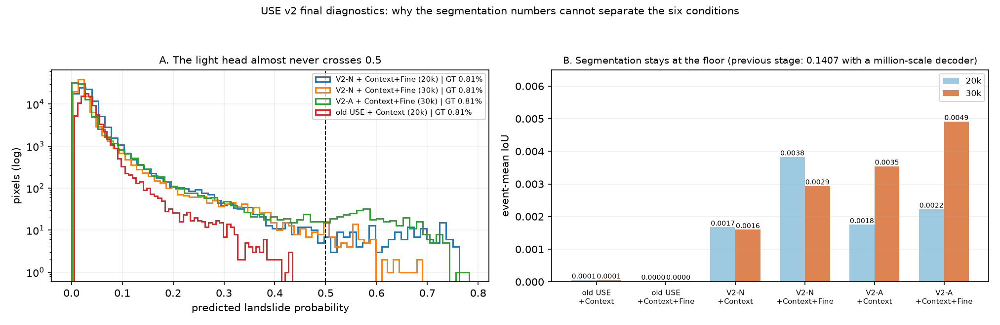

左栏是四组最佳权重在同一批验证图块上输出的滑坡概率分布（纵轴为像素数的对数），虚线是 0.5 阈值：所有条件的主体都挤在 0–0.1，只有很少像素跨过阈值，旧 USE 组一个都没有。右栏是 12 个下游运行的事件平均 IoU，纵轴上限只有 0.0065——这正是“地板效应”，六组之间 0.0000–0.0049 的差别不足以支撑任何排名。

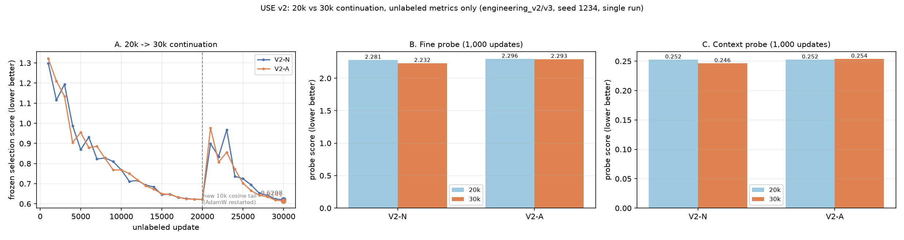

左栏把 20k 与续尾连成一条曲线（虚线处换了新余弦与优化器），中、右两栏是 Fine 与 Context 探针在 20k 与 30k 的配对。应看虚线之后的终点与两栏的配对差，而不是中段抖动。

### 展开结论

**延长到 30k 确实让无标签指标继续变好，但幅度小且两组不对称。** 选模分数上，一层4头局部波段自注意力由 0.6209 降到 0.6141（−0.0068，约 1.1%），无局部波段自注意力只由 0.6218 降到 0.6208（−0.0010，0.16%）。探针上方向相反：无局部波段自注意力两项都变好（Fine −0.049 约 2.2%、Context −0.0062），一层4头组 Fine 几乎不动（−0.0032）、Context 反而略升（+0.0014）。**机制**上，续尾换了新的余弦与新优化器，是在20k预算终点重新提高学习率；该终点未证明收敛；**边界**是单 seed、没有第三次运行，也没有做“单次 30k”对照，所以只能说“再训 10k 有轻微收益”，不能说“30k 已收敛”。

**预训练相对随机初始化是有用的。** 两组 30k 的 Fine 探针（2.2320／2.2932）都低于各自的随机参照（2.3481／2.3361），Context 探针（0.2462／0.2538）也都低于 0.2966；但改善幅度在 2%–17% 之间，且这个参照只共享结构、不共享任何训练，属于“有/无预训练”的粗对照。

**下游的 12 个数字全部在地板上，不能用来区分六组。** 最高是续尾注意力组＋Fine 的 0.0049，旧 USE 两组是 0.0000–0.0001。复核证据：抽样的开发验证图块上正类像素占 0.40%–0.81%（3 块与 6 块两批），四组最佳权重在这 6 块共 91,049 个有效像素里超过 0.5 的分别只有 149（无局部波段 20k）、69（无局部波段 30k）、316（一层4头 30k）、0（旧 USE 20k）；训练损失停在 0.55（接近完全无重叠时的 Dice 量级）。Context-only头有4257个、加入Fine后有5313个可训练参数（各尺度 32 维投影＋Fine 32→32＋1×1 输出），而上一阶段 0.1407 用的是 32→10 桥接接 SegFormer B0 的百万级解码器。**因此只能确认当前完整系统迁移失败；头容量、特征表达、损失、优化与阈值响应都是待检验因素，现有证据不能确定主因**，需要固定权重换更大头的对照才能定论。

**局部波段自注意力是否值得，仍然没有确定答案。** 20k 与 30k 的选模分数都是一层4头组略低（−0.0009、−0.0067），但 30k 的两个探针都是无局部波段组更低（Fine 2.2320 对 2.2932、Context 0.2462 对 0.2538）。方向矛盾、差额在 0.1%–2.7%、单 seed，不能宣称哪一组更好；只能说在这两个预算下没有看到稳定的额外价值。

### 限制与下一步

- 单 seed、每组一次运行、两个反复用于研发的验证事件；没有独立地域盲测。
- 两段日程（20k＋10k）不等于单次 30k 预算；要回答“30k 是否更好”需要从零重训的单日程对照（成本 60000 更新，当时未选）。
- 下游结果接近零，不能据此作稳健架构排名。下一步先检查已有完整概率与标签、损失实现和训练动态；增加头容量是候选受控实验之一，并非唯一诊断方法，尚未执行。
- 预算：计划 146000 全部执行；另有 6985（v1 均值组控制台中止）与 83（注意力组第 20000 步 Fine 探针冻结哈希中止）单列，累计消耗 153068。两次中止都没有拼接进正式成绩。
- 30m 只做派生评价；第二有标签任务未核实，不能宣称跨任务通用。

### 附录：复现与产物

- 核验汇总：`outputs/use_v2/audit/final_acceptance_v1.json`（42 项 complete、每项 device_gate 实际卡、预算与冻结哈希检查）。
- 验收：20k 条件 `outputs/use_v2/audit/release_audit_v2.json`；续尾条件 `outputs/use_v2/audit/release_audit_v3.json`。
- 逐 run 曲线、validation、best/last：`outputs/use_v2/runs/<job>/`；两组续尾分别 `pretrain_mean_tail`、`pretrain_attention_tail`。
- 图来源与数值哈希：`docs/assets/research/use_v2/provenance.json`。

### 本次独立产物验收与解释修正

重新读取42项summary与训练曲线，核对146000次正式更新，并对summary登记的268个checkpoint文件重新计算SHA256，全部一致；已记录的冻结哈希在各条曲线内未变化。证据见[独立核查](../outputs/use_v2/closeout_review/acceptance.json)。本次未重新执行全量推理、优化器成员回放或新增训练，产物完整性通过不等于研究目标全部实现。

Context-only任务头为4257参数，加入Fine后为5313参数，不应写为全部同一参数量。抽样六块的过阈值像素数不能推广成全验证集比例；容量不足只是未验证假设。无标签探针误差下降支持此任务下的可解码性改善，不能单独证明语义通用性。旧训练认领仍为active但已无写入范围，实际双卡执行任务已完成；原负责人需关闭旧登记，本次未冒用其身份。

## 同一冻结USE v2接完整下游网络：U-Net与SegFormer B0

### 阅读约定与实验设置

**要回答什么。** 上一节12个下游结果全在0.0000–0.0049，主因未定；本轮固定同一USE v2权重，把任务网络换成可训练的完整网络，检验“轻量头容量”是否是主要限制之一。

**数据角色不变。** 九事件2223块训练、广岛448＋特里苏尔221块开发验证、seed1234；单期十波段；`stats_core25`（仍由559块训练核心拟合，未因训练集为2223块重算）；既有影像质量掩膜。验证事件只用于选模，是反复使用的研发集合，不是盲测。

**输入固定。** 四层Context各按`canonical32`规则压到32通道、上采样回原图尺寸、四层平均，再加原网格Fine特征；该加和没有可训练参数，两组完全一致，且不使用未经USE的原始影像旁路。

**训练条件。** 每组5000次更新（合计10000）；FP32；有效batch 8（微批量2×累积4）；AdamW 6e-4、weight decay 0.01、梯度裁剪1.0；前250步预热后余弦；每500步按两事件等权IoU选模，保存best与last。

**两组差别。** 下游网络、参数量与初始化来源同时不同：U-Net全部随机初始化；SegFormer B0为32通道新首层随机、其余卷积与解码器沿用本地通用预训练权重，并保留原网格细节分支。因此结果属完整系统比较，不能把全部差异归因于网络架构。

### 主表（best与last，669块，阈值0.5）

| 组 | 权重 | 事件等权IoU | 像素IoU | Dice | Precision | Recall | AP | 边界F1 | 小／中／大对象召回 |
|---|---|---|---|---|---|---|---|---|---|
| 冻结USE v2＋U-Net | best（第2500步） | 0.1344 | 0.1190 | 0.2127 | 0.1807 | 0.2585 | 0.1360 | 0.2036 | 0.137／0.353／0.404 |
| 冻结USE v2＋U-Net | last（第5000步） | 0.1275 | 0.1181 | 0.2113 | 0.1925 | 0.2342 | 0.1288 | 0.2094 | 0.133／0.328／0.394 |
| 冻结USE v2＋SegFormer B0 | best（第3000步） | 0.1250 | 0.1087 | 0.1960 | 0.1771 | 0.2196 | 0.1202 | 0.1745 | 0.100／0.278／0.343 |
| 冻结USE v2＋SegFormer B0 | last（第5000步） | 0.1227 | 0.1123 | 0.2020 | 0.1822 | 0.2266 | 0.1196 | 0.1876 | 0.101／0.283／0.343 |

逐事件（best）：U-Net 广岛0.1014／特里苏尔0.1674；SegFormer B0 广岛0.0915／特里苏尔0.1586。末态逐事件为0.1083／0.1467与0.1017／0.1436。事件等权IoU为两事件像素IoU的算术平均（与选模一致）；对象召回按真值面积<50像素／50–200／>200分档，只计未截断对象。

### 图与解释


左图纵轴是训练损失（滑动50步平均），右图纵轴是每500步的验证事件等权IoU，横轴都是更新次数，空心圈是各组最佳。看两点：两条损失曲线几乎重合且持续下降，验证IoU却在2500–3000步见顶；两组完整网络的验证曲线彼此靠得很近，远高于轻量头，但离十波段参照仍有明显距离。

两组各六个固定验证案例在[U-Net案例](../outputs/use_v2_full_decoders/runs/unet/cases/segmentation_cases_use.png)与[SegFormer案例](../outputs/use_v2_full_decoders/runs/segformer/cases/segmentation_cases_use.png)；五列依次为RGB、**USE编码**、真值、概率、0.5阈值掩膜。USE编码列是两组共用融合32通道输入的三个主成分（六案例统一PCA基、2–98百分位拉伸，颜色只表示编码相似、不代表地物类别），两组的这一列逐像素完全相同，已用数组相等核验。案例来自既有[固定清单](assets/research/use/case_provenance.json)，未按预测效果重新挑选。

冻结USE的两路输出另有面板图：[U-Net](../outputs/use_v2_full_decoders/runs/unet/cases/segmentation_cases_fine.png)与[SegFormer](../outputs/use_v2_full_decoders/runs/segformer/cases/segmentation_cases_fine.png)，六列为RGB、细节头Fine（32×128×128，保留patch内位置）、Context（四层32×32/16×16/8×8/4×4压32后上采样平均）、真值、概率、掩膜；两组的Fine与Context逐像素相同，Fine是细纹理、Context是大块结构（最粗一层每格32像素）。

### 展开结论

- **轻量头容量是先前近零结果的重要限制之一。** 证据：同一USE、同一融合输入，5313参数头的最佳事件平均IoU约0.0049，两组完整网络为0.1250–0.1344，约26–27倍。边界：这只说明"加容量能出信号"，不说明特征是够好的；两组仍比历史十波段端到端0.2985低0.164以上。
- **两个完整网络彼此差别小。** 证据：事件等权IoU差0.0094（best）／0.0048（last），损失曲线几乎重合；U-Net在小对象召回（0.137对0.100）、AP（0.136对0.120）与边界F1（0.204对0.175）上略高，SegFormer显存更低（417对765 MiB）但每步慢46%（0.526对0.359秒）。边界：结构、参数量与初始化来源同时不同，不能把差别归因于架构。
- **小对象几乎没有被解决。** 小于50像素对象的召回只有0.10–0.14，而大对象0.34–0.40；这与历史十波段模型的薄弱环节一致，但本轮没有做尺寸分层或后处理对照。
- **验证在训练中途见顶。** 最佳在第2500／3000步，末态更低（0.1275／0.1227）；训练损失继续下降。没有早停或正则化扫描，故仅作为观察。

### 限制与下一步

- 单seed、每组一次运行、两个反复用于研发的验证事件；没有独立地域盲测，也没有把结果当显著性结论。
- 两组是完整系统比较（结构＋参数量＋初始化来源同时改变），不能分离架构效应；这轮也没有做"同初始化、只换架构"的对照。
- 冻结编码器＋无参数融合这两件事本身就是与端到端十波段参照的差异来源；本轮无法判断剩余差距主要来自冻结特征、融合方式还是5000步预算。
- 结果文件：[comparison.json](../outputs/use_v2_full_decoders/comparison.json)；逐run证据：[unet](../outputs/use_v2_full_decoders/runs/unet)、[segformer](../outputs/use_v2_full_decoders/runs/segformer)。

</details>

<details>
<summary>USE v3：完整结果与表征/高分辨率诊断</summary>

<!-- USE_V3_RESULTS_START -->
## USE v3：统一探针、完整分割网络与最终执行核对

### 阅读约定与实验设置

当前研究参照仍是 **SegFormer B0｜十波段直入｜原始网格细节分支**，既有事件等权IoU为0.3081，未被本轮模型取代。下面“原生金字塔编码器”对应既有USE v2；“双向空间交互编码器”对应本轮USE v3。前者固定采用事先指定的无标签选模权重，不按本轮分割成绩更换。后者连续训练30000步，仅在10000、20000、30000步之间按统一无标签探针总分选择，实际选中 **20000步**；30000步是训练末态，不是选定权重。初始化和5k权重不参加选模，5k未运行探针。

本阶段使用共同无标签池11132训练、599验证（521 S2＋78 Landsat）、239隔离，以及共同分割成员与统计。输入为单期反射率、质量掩膜和物理元数据（波长/带宽μm、像元尺寸m）；未知字段有known_mask。未增加日期、地形或去云数据，来源与成员绑定release。

正式成功更新62000＝v3预训练30000＋12项冻结探针各1000＋4项分割各5000。FP32、seed1234，有效batch8＝微批2×累积4（无标签每步6份S2＋2份Landsat，分割每步8份十波段样本）；AdamW峰值6e-4、weight decay0.01、裁剪1.0，预热分别1500／50／250步后余弦。头seed1235，同类头与消费者初始张量独立核对一致；U-Net全随机，SegFormer B0新32通道首层随机，其余采用本地通用预训练规则。每卡一个计算进程，无DDP。工程500步不续入正式。

Fine指原始像素网格的32通道细节特征，Context指四层原生上下文特征，main指学习投影后自顶向下融合的1/4尺度特征。

监督目标举例：遮去输入中的一个32×32空间块，恢复该块原先的反射率，不是预测滑坡标签。三个视图为光谱遮挡、25%像素遮挡和16/32/64空间块循环；空间恢复另计原尺度及2/4倍有效池化误差，邻接梯度只计原始有效且至少一端被遮挡的像元对，一致性只约束两个视图共同有效的Context。五项经固定TRAIN校准后权重1:1:1:0.1:0.1并归一化。Fine探针只读32通道细节特征做像素恢复；Context探针对四个原生尺度学习投影，做光谱与空间恢复。它们训练1000步后评价末态，不按验证提前停止。校准分母、有效目标数、逐步原始／归一化／加权损失和初始化／500步的梯度贡献诊断均保留；梯度贡献不是每步独立分解。本轮v3及统一探针视图保留缓存原有物理字段，不额外随机删除元数据；部分／全未知模式只作固定诊断，不能把这些模式当作已经充分训练覆盖。

表1越低越好：先对每个传感器的固定验证样本取均值，再让两传感器等权；空间块16/32/64等权，三类恢复等权。表2事件等权IoU为两事件IoU均值，其余像素指标汇总669块有效像素，AP为有效像素按连续概率排序计算的平均精确率，不使用0.5阈值；其余阈值指标用0.5；边界容差1像素。对象召回以IoU≥0.25匹配，剔除截断对象，小／中／大为<50、50–199、≥200像素。开发验证被多次用于研发和选模，不是盲测；单seed不作显著性结论。

### 三张合并主表

| 编码器条件 | Fine像素恢复 | Context光谱恢复 | Context空间恢复 | 三项等权总分↓ |
| --- | --- | --- | --- | --- |
| 原生金字塔编码器：随机冻结 | 2.2668 | 0.8076 | 0.3617 | 1.1454 |
| 原生金字塔编码器：既有无标签选定权重 | 2.1166 | 0.7163 | 0.3123 | 1.0484 |
| 双向空间交互编码器：初始化 | 2.2682 | 0.8064 | 0.3634 | 1.1460 |
| 双向空间交互编码器：10000步 | 1.7006 | 0.7778 | 0.2923 | 0.9236 |
| 双向空间交互编码器：20000步（入选） | 1.7117 | 0.7593 | 0.2921 | 0.9210 |
| 双向空间交互编码器：30000步末态 | 1.7377 | 0.7342 | 0.2951 | 0.9223 |

该表全部使用同类头相同容量和初始张量。原训练头损失另见下图，不与统一探针分数混排。

| 模型结构与入口 | 权重 | 事件等权IoU | 像素IoU | Dice | AP | Precision | Recall | 边界F1 | 对象召回：小/中/大 |
| --- | --- | --- | --- | --- | --- | --- | --- | --- | --- |
| SegFormer B0｜十波段直入＋原始网格细节（当前参照） | 既有最佳 | 0.3081 | 0.3095 | 0.4425 | — | 0.4680 | 0.4775 | 0.4806 | 见既有参照表 |
| U-Net｜十波段经冻结原生金字塔编码器｜学习投影＋Fine | 最佳@5000 | 0.1263 | 0.1126 | 0.2023 | 0.1224 | 0.2021 | 0.2026 | 0.1828 | 0.0884/0.2862/0.3333 |
| U-Net｜十波段经冻结原生金字塔编码器｜学习投影＋Fine | 末态@5000 | 0.1263 | 0.1126 | 0.2023 | 0.1224 | 0.2021 | 0.2026 | 0.1828 | 0.0884/0.2862/0.3333 |
| SegFormer B0｜十波段经冻结原生金字塔编码器｜学习投影＋Fine | 最佳@3500 | 0.1285 | 0.1209 | 0.2157 | 0.1361 | 0.2075 | 0.2245 | 0.2066 | 0.1341/0.3403/0.3737 |
| SegFormer B0｜十波段经冻结原生金字塔编码器｜学习投影＋Fine | 末态@5000 | 0.1125 | 0.0994 | 0.1808 | 0.1118 | 0.1670 | 0.1971 | 0.1700 | 0.0953/0.2775/0.3434 |
| U-Net｜十波段经冻结双向空间交互编码器｜学习投影＋Fine | 最佳@5000 | 0.1305 | 0.1146 | 0.2057 | 0.1231 | 0.1698 | 0.2609 | 0.1988 | 0.0904/0.3281/0.4747 |
| U-Net｜十波段经冻结双向空间交互编码器｜学习投影＋Fine | 末态@5000 | 0.1305 | 0.1146 | 0.2057 | 0.1231 | 0.1698 | 0.2609 | 0.1988 | 0.0904/0.3281/0.4747 |
| SegFormer B0｜十波段经冻结双向空间交互编码器｜学习投影＋Fine | 最佳@4500 | 0.1258 | 0.1066 | 0.1926 | 0.1215 | 0.1612 | 0.2394 | 0.1779 | 0.1311/0.3159/0.3838 |
| SegFormer B0｜十波段经冻结双向空间交互编码器｜学习投影＋Fine | 末态@5000 | 0.1238 | 0.1043 | 0.1889 | 0.1189 | 0.1581 | 0.2347 | 0.1745 | 0.1271/0.3072/0.3737 |

当前参照行来自本文件既有参照表，验证成员相同，但端到端训练方式和预算不同，只用于说明现有性能位置。v3相对本轮v2：U-Net最佳IoU提高0.0042，SegFormer B0降低0.0027。两组U-Net最佳恰为末态；两组SegFormer最佳分别在3500与4500步，不能用末态代替最佳。全部四项的最小1–4像素对象可评价数均77，最佳检出依次为0、0、0、1个。

| 任务 | 成功更新数 | 物理设备 | 作业墙钟秒之和 | 可训练参数 | 冻结参数 |
| --- | --- | --- | --- | --- | --- |
| 双向空间交互编码器：连续预训练 | 30000 | GPU1 | 23864.5 | 1,891,203 | 0 |
| 原生金字塔编码器：冻结探针 | 4000 | GPU0 | 1027.3 | Fine 11,681／Context 27,169 | 1,025,560 |
| 双向空间交互编码器：冻结探针 | 8000 | GPU0／GPU1 | 2940.8 | Fine 11,681／Context 27,169 | 1,879,522 |
| U-Net｜十波段经冻结原生金字塔编码器｜学习投影＋Fine | 5000 | GPU0 | 1005.7 | 7,786,881 | 1,025,560 |
| SegFormer B0｜十波段经冻结原生金字塔编码器｜学习投影＋Fine | 5000 | GPU0 | 1451.3 | 3,804,290 | 1,025,560 |
| U-Net｜十波段经冻结双向空间交互编码器｜学习投影＋Fine | 5000 | GPU0 | 1402.9 | 7,786,881 | 1,879,522 |
| SegFormer B0｜十波段经冻结双向空间交互编码器｜学习投影＋Fine | 5000 | GPU1 | 1925.1 | 3,804,290 | 1,879,522 |
| 工程试训（不续入正式） | 500，非正式 | GPU1 | 387.8839 | 与预训练相同 | 0 |
| A既有可丢弃完整步测速 | 2，非正式 | GPU1 | 完整墙钟未登记 | 副本参数 | 正式权重未改 |
| 旧CLI两项启动失败（均在更新前） | 0 | GPU0／GPU1 | 13.2 | 未更新 | 未更新 |

两张物理卡均为RTX5090，GPU0 UUID尾部63e4、GPU1尾部09ec，逐作业完整UUID见device_gate.json。表中正式作业墙钟包括加载、IO和该作业内开发验证；各作业并行时区间重叠，不能把时长之和当整批历时或硬件忙碌GPU小时。整批启动至训练结束 **7.923小时**；36项只读探针评价时长之和 **3023.1秒**，另列于成本账本。每个分割适配器15,488参数，已包含在可训练参数数目中。

完整成本门禁**未通过验收，也未补测**：早期冻结封装条件曾超过2倍门槛，A作等价打包传输优化后保留了相同SHA256字节流和前后校验次数；v4独立24项测试已通过。随后用户明确要求“开始后台训练 不做测试了”，B停止剩余测速并按覆盖启动v5。v5只修CLI路径边界，未追加测试。已完成的v4纯编码器32条件、以及中止的冻结封装部分条件仅是局部参考；不宣称完整消费者、完整训练步、BF16或峰值显存门禁通过。正式逐进程峰值显存未采集。旧CLI两项失败均为0更新；另一次独立后台启动未落盘、0更新且耗时缺失。报告脚本首次无梯度上下文与资源检查冲突，0参数更新，改为只读卡锁后完成；这些均未从记录中删除。

### 图与解释

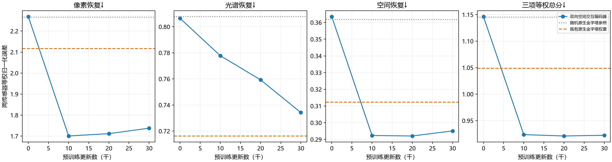

四列依次为像素恢复、光谱恢复、空间恢复及三项等权总分；横轴是v3预训练更新数，两条水平线是固定v2随机与既有权重参照。应看改善是否跨任务一致，而不只看总分。总分选中20k，但30k并非每项都优于20k。

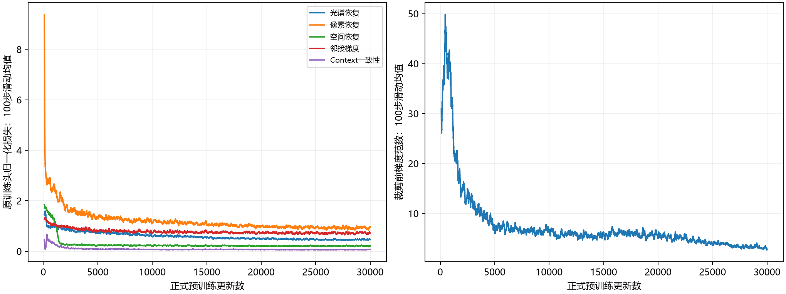

左图五条线是原训练头归一化损失的100步均值，右图是裁剪前梯度范数的100步均值。它们描述训练过程，不是上表统一探针的验证分数，也不能据曲线下降宣称迁移已改善。

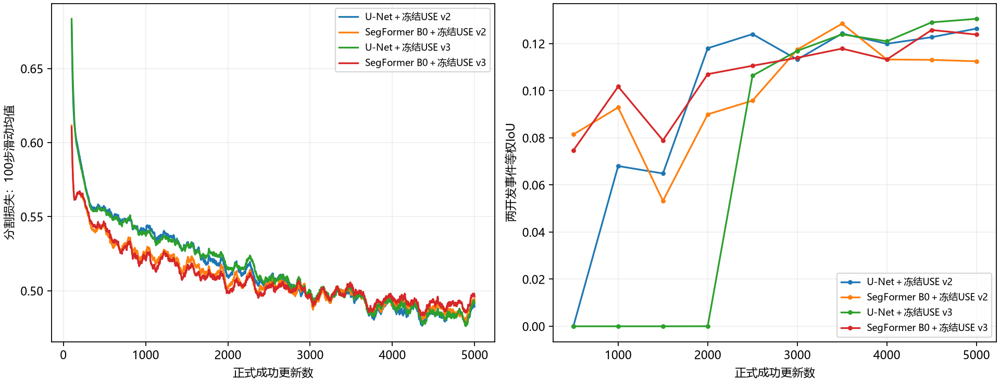

左图四种“冻结编码器＋完整消费者”的分割损失，右图是每500步的事件等权IoU。应注意损失相近而开发验证不同：空间交互编码器接U-Net前2000步IoU仍为0，后续才升起；不能把训练初期或末态单独当成模型最终表现。

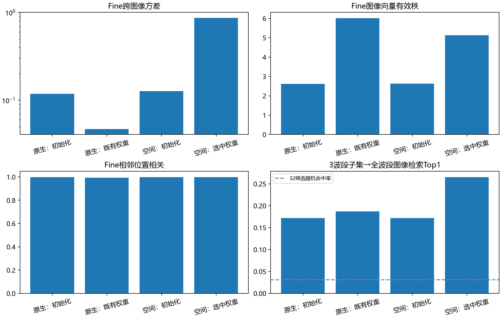

每组四柱分别是两种编码器的初始化与选定权重。四幅图依次是Fine跨图像方差、有效秩、相邻位置相关、3波段子集检索Top1；每传感器固定32份无标签验证样本，两传感器等权汇总。Fine图像向量是每通道在有效像素上的均值；有效秩由中心化向量的奇异值熵计算。子集检索用同一图像的前缀波段向量，从同传感器32份全波段图像中找回自身，随机命中率1/32；1/6波段及各原生Context层结果在原始诊断JSON中，满波段本身不作为子集。相关值先把全部通道与有效邻接位置展开，再计算Pearson相关，各通道均值差异也会抬高它。图像相似、光谱均值和通道相对尺度都能影响这些统计，不能把检索命中直接当滑坡语义。


每行是原先登记的一个固定样本，六列依次为RGB、Fine编码、原生Context第1尺度编码、真值、概率和0.5掩膜。应看漏检和误报相对于真值的位置；例如第2行右上区域存在明显误报。两种编码器、两种消费者均沿用相同六个ID，没有按预测重挑。每个编码列各自PCA；不根据跨模型颜色解释语义。其余完整面板：[原生金字塔＋U-Net](assets/research/use_v3/fixed_cases_seg_v2_unet.png)、[原生金字塔＋SegFormer](assets/research/use_v3/fixed_cases_seg_v2_segformer.png)、[空间交互＋SegFormer](assets/research/use_v3/fixed_cases_seg_v3_segformer.png)。同一编码器的Fine和第1尺度Context在两消费者中逐像素相同，预测差别来自适配器及消费者。

### 展开结论：机制、证据与边界

1. **重建优势集中在Fine像素恢复，没有普遍覆盖全部目标。** 读取Fine的像素恢复误差从2.1166降到1.7117，下降约19.1%；读取原生Context的空间恢复从0.3123降到0.2921，但光谱恢复从0.7163升至0.7593。总分由1.0484降至0.9210，下降约12.1%，不能简写成“所有表征都更好”。光谱前端、空间传播、反馈与预训练目标／日程共同构成配置差异，单次对照不能确定哪个组件造成收益。
2. **更低的恢复误差没有转成一致的滑坡分割收益。** U-Net事件IoU从0.1263到0.1305，Precision从0.2021降到0.1698、Recall从0.2026升到0.2609；更多真阳性伴随更多误报。SegFormer的最佳事件IoU反而从0.1285降到0.1258。固定案例仍有区域性误报和小对象漏检；最小对象至多1/77。四组均远低于当前端到端参照0.3081，当前参照不替换。阈值、冻结特征与损失的具体因果作用未验证，不据此追加实验。
3. **方差增大不等于表征语义改善。** 选定v3的Fine跨图像方差并未消失，3波段检索也高于随机；但S2有效秩约5.85，低于既有v2的7.63，相邻位置相关约0.9995。不同诊断给出不同侧面，不支持用单一统计宣称退化解除，也不能把高相关直接判定为恒定输出。它们与分割低分一起保留，作为后续研究线索。

### 限制与下一步

v2是历史20k＋10k两段条件，v3是连续30k；虽然本轮固定同类探针、适配器、消费者初始化和数据，编码器历史目标与日程仍不同，不能称严格同计算量／纯架构消融。旧v2完整网络采用固定通道均值压缩，既有最佳U-Net0.1344、SegFormer0.1250；本轮改成可训练原生投影，不能拿旧结果替代本轮四项或归因单一组件。无标签验证和669块开发验证反复用于研发；未做新种子、新地域盲测、官方划分或人工标注语义复核。完整资源门禁按用户指令跳过，不能用局部速度数据推广完整成本结论。本轮完成即结束，不增加预算，不因无明确迁移收益自动追加消融或官方实验。

### 附录：逐seed、成本与产物

全部训练seed1234、头seed1235，仅一个seed。完整逐事件、AP、边界、各对象尺寸和所有最佳／末态混淆计数见[结果数据](../outputs/use_v3/audit/result_metrics_and_cases.json)；各条件三种元数据模式的每份样本误差仍在[原运行目录](../outputs/use_v3/runs)。已知模式用于选模，部分／全未知只作诊断；可识别波段比例和未测原因逐样本保留，不据缺失目标伪造评分。

执行配置与全部实际源码、环境、无标签成员和统计、初始化及固定v2来源均绑定[engineering_v5 release](../outputs/use_v3/releases/engineering_v5/manifest.json)。正式配置为[execution.yaml](../configs/use_v3/execution.yaml)，无超参命令覆盖。配置仍有继承的通用元数据字段（如eval_every_updates=100、epochs=5000），实际v5入口按identity.job规定更新预算，并硬编码每500步做分割开发验证；应以逐更新记录和十份eval_500至eval_5000为准，不能把继承字段当成实际生效日程；用户仅覆盖了剩余测试／成本门禁，见[明确执行覆盖](../outputs/use_v3/audit/user_training_override.json)。每项实际命令、PID、设备、起止时间与日志见[执行账本](../outputs/use_v3/runtime/engineering_v5)，逐更新曲线和恢复状态随各run保存。

独立[权重／预算／选模核对](../outputs/use_v3/audit/training_artifact_audit_v4.json)确认：17项62000连续成功更新；严格重载重算initial／best／last／预训练里程碑哈希；冻结参数及buffer不变，每步调用冻结检查且优化器排除USE；同类初始张量一致，分割best为十次开发验证中最大事件IoU、同分取早；选定v3别名与20k原权重SHA256一致。17项完成训练均无训练中断或恢复；另有前述两项0更新CLI启动失败。工程恢复缺陷及修复证据另存，不能把工程桩回归当正式中断经历。

完整来源：[比较与成本汇总](../outputs/use_v3/audit/comparison.json)、[成本账本](../outputs/use_v3/audit/cost_ledger.json)、[联合表征诊断](../outputs/use_v3/audit/representation_diagnostics_v4.json)、[原始恢复故障](../outputs/use_v3/audit/recovery_repro/evidence.json)。选定权重SHA256：`e20e32f9915974c570d2ad9a064af3bd46b75f0e0d78bafbf698637895533886`。表图可由[结果脚本](../outputs/use_v3/runtime/finish_report.py)、[固定案例脚本](../outputs/use_v3/runtime/render_results.py)、[只读表征脚本](../outputs/use_v3/runtime/representation_diagnostics_v4.py)复现；均不进行参数更新。

<!-- USE_V3_RESULTS_END -->

<!-- USE_V3_DIAGNOSTICS_START -->

## USE v3：表征与高分辨率成本诊断

本报告回答两个问题：为什么无标签恢复更好，却没有稳定提高滑坡分割；现有实现能否承担更大图像。诊断已完成，**当前证据不足以把USE作为更好的滑坡分割方案，也不足以确定唯一失败原因**。近期精度参照继续使用十波段直接输入的SegFormer B0＋原始网格细节分支；USE保留为研究分支。建议下一轮先验证“在同一冻结编码器下，当前Context投影与加和路径是否帮助分割”，再决定是否调整预训练目标。下文行动均为建议，未启动新训练。

### 阅读约定与实验设置

本节是用户授权完成审阅稿后的**只读诊断**。基准提交`93aa16c8c9f8e0979d4bf582db28cff4e7db0944`，沿用已有选定编码器和四个最佳分割网络，不重选权重、不训练编码器、不训练探针或新消费者；没有5k检查点探针。全部优化器更新为0，正式62000步预算未增加。用户明确指定无法确认的地物区域标为`uncertain`，不据此作类别因果结论。

Fine是保留原128×128网格的32通道表征，Context是1/4、1/8、1/16、1/32四个原生尺度的空间表征，main是内部投影融合得到的1/4尺度32通道表征。无标签监督使用影像本身的数值：例如遮住10波段影像中的16×16空间块，要求从可见影像恢复该块原来的标准化反射率；像素任务随机遮住25%位置，光谱任务遮住部分可识别波段。监督分割则用独立滑坡GT产生0/1目标，GT不进入编码器输入。

数据沿用共同口径。四模型对全部669块重新推理并逐项复现原混淆计数，源数组/缓存/质量/GT/像素顺序配对通过。诊断22块含原六例和固定分层扩展，另九个训练事件各取一块；66个语义ROI均标uncertain，SCL不作地物真值。

### 主表：误报、表征与成本

FPR是假阳性占合法负像素的比例；AP是全部合法像素精确排序的平均精确率。固定召回比较采用0.001阈值网格，仅作诊断，不改原0.5结果或选模。ROI统计按同图区域并集去重；它们经误差分层采样，不能估计全体地物发生率。

| 架构与入口 | FP / 全部合法负像素 | FPR@0.5 | AP | FPR@约0.4召回 | Precision@约0.4召回 | uncertain ROI：FP / 负像素 |
| --- | --- | --- | --- | --- | --- | --- |
| U-Net｜十波段经冻结原生金字塔｜学习投影＋Fine | 162,734 / 10,370,255 | 0.0157 | 0.1224 | 0.0669 | 0.1053 | 2124 / 15013 |
| U-Net｜十波段经冻结双向空间交互｜学习投影＋Fine | 259,652 / 10,370,255 | 0.0250 | 0.1231 | 0.0654 | 0.1073 | 2554 / 15013 |
| SegFormer B0｜十波段经冻结原生金字塔｜学习投影＋Fine | 174,572 / 10,370,255 | 0.0168 | 0.1361 | 0.0524 | 0.1305 | 1651 / 15013 |
| SegFormer B0｜十波段经冻结双向空间交互｜学习投影＋Fine | 253,569 / 10,370,255 | 0.0245 | 0.1215 | 0.0690 | 0.1022 | 2270 / 15013 |

云、云影、建筑、道路、裸土、植被均**没有人工确认的类别样本**，各类别FPR为未测而非0；[逐类别表](../outputs/use_v3_diagnostics/false_positive_by_type.csv)中的0计数仅表示已确认分母为空。[逐ROI表](../outputs/use_v3_diagnostics/false_positive_by_roi.csv)另列质量排除与评价排除数及概率分位数。低GT背景不等于人工确认无灾害。

有效秩把同层同一采样像素组成行、通道作为列，先按通道跨行中心化，再对奇异值归一化后的谱熵取指数；图像级以各图合法像素均值为行。每图固定抽64个合法像素、补至多64个正像素并去重，四模型坐标相同。类中心距离除以类内RMS，只是标签条件下的几何描述，不是训练后分类评分。

| 架构与入口 | Fine有效秩：像素 / 图像 | 1/16 Context → 学习投影有效秩 | 融合输入有效秩 | 类中心距离：Fine → 融合 |
| --- | --- | --- | --- | --- |
| U-Net｜十波段经冻结原生金字塔｜学习投影＋Fine | 10.65 / 5.36 | 51.22 → 18.30 | 18.97 | 0.680 → 0.324 |
| U-Net｜十波段经冻结双向空间交互｜学习投影＋Fine | 15.09 / 6.98 | 53.67 → 15.04 | 18.09 | 0.719 → 0.667 |
| SegFormer B0｜十波段经冻结原生金字塔｜学习投影＋Fine | 10.65 / 5.36 | 51.22 → 17.88 | 18.60 | 0.680 → 0.366 |
| SegFormer B0｜十波段经冻结双向空间交互｜学习投影＋Fine | 15.09 / 6.98 | 53.67 → 17.89 | 17.97 | 0.719 → 0.719 |

Context原生宽度为128而该层学习投影输出32通道，秩降低部分由输出维数决定，不能单独判定丢掉滑坡信息。层级与投影的空间比较按消费者实际的双线性上采样对齐到128网格；[原生尺度统计](../outputs/use_v3_diagnostics/fusion_audit.json)另存，不能将上采样生成的细节视为真实原生分辨率。

同一张GPU1、FP32、关闭TF32、B=1、C=10；每条件安全单次试运行后10次预热、每轮30次同步计时、共3轮。表内依次为中位毫秒/p90毫秒/峰值allocated MiB，reserved及每次测量另存；同步主机墙钟包括模型中的Python、校验和传输。直接十波段参照采用既有SegFormer B0＋细节实现和通用初始化，只比较计算范围，不用它产生新的精度结论。

| 模型与计时范围 | 128：ms中位 / p90 / MiB | 256：ms中位 / p90 / MiB | 512：ms中位 / p90 / MiB | 参数量 |
| --- | --- | --- | --- | --- |
| 原生金字塔｜裸编码器 | 14.43 / 15.57 / 84.2 | 14.30 / 16.63 / 222.6 | 24.71 / 29.65 / 793.5 | 1,025,560 |
| 双向空间交互｜裸编码器 | 17.02 / 23.43 / 87.4 | 20.99 / 28.29 / 225.4 | 29.26 / 30.16 / 795.9 | 1,879,522 |
| 原生金字塔｜冻结包装（含两次哈希） | 14.57 / 19.66 / 84.2 | 15.45 / 19.36 / 222.6 | 29.30 / 30.67 / 793.5 | 1,025,560 |
| 双向空间交互｜冻结包装（含两次哈希） | 24.23 / 32.12 / 87.4 | 25.98 / 32.72 / 225.4 | 39.97 / 45.99 / 795.9 | 1,879,522 |
| 原生金字塔｜完整U-Net | 24.63 / 32.05 / 136.1 | 28.54 / 32.86 / 253.7 | 63.45 / 75.73 / 799.5 | 8,812,441 |
| 双向空间交互｜完整U-Net | 33.31 / 38.76 / 151.4 | 38.45 / 46.61 / 261.2 | 70.73 / 74.04 / 806.3 | 9,666,403 |
| 原生金字塔｜完整SegFormer | 33.22 / 41.17 / 243.6 | 33.69 / 41.19 / 543.2 | 52.44 / 57.11 / 1985.2 | 4,829,850 |
| 双向空间交互｜完整SegFormer | 41.53 / 51.40 / 244.3 | 46.01 / 56.52 / 550.8 | 65.47 / 78.26 / 1995.6 | 5,683,812 |
| SegFormer B0｜十波段直入＋细节（通用初始化成本参照） | 15.97 / 21.72 / 235.2 | 16.76 / 21.67 / 526.0 | 18.75 / 25.89 / 1917.6 | 3,753,602 |

### 图与解释


三列为全部开发验证、广岛、特里苏尔；同一有效像素下看曲线与AP，而不是单个阈值。U-Net的AP仅0.1224→0.1231，SegFormer为0.1361→0.1215；约0.4召回时FPR分别6.69%→6.54%和5.24%→6.90%。两消费者方向不一致，不支持统一迁移改善，单seed不作显著性结论。


左列是31块的真实残差/原分支范数；中间两列是每传感器固定2个无标签TRAIN样本的加权单损失梯度；最右是五个Query读出输出的原始余弦相似性。训练后注入门控为0.190791、反馈门控为-0.260496；注入/反馈/局部更新的范数比中位为0.240/1.120/1.096。门控初值0.01不能代表最终实际贡献，反馈幅度不可忽略；反馈门控为负，不能只凭符号判断它是否保留有效语义。

五个Query中，前四个Fine读出的输出两两RMS差异约0.0009–0.0026，第五个Context与前四个约0.228–0.230；前四个输出相近，不能把“五个Query”直接当成五种独立信息。这里原始余弦受通道均值影响，而最终Fine还叠加逐像素残差、main反馈与局部更新，因此尚不能据此认定整个编码器表示重复或有害。Query参数本身相似性、输出差异和五行梯度另存。

s2的光谱/像素/空间/梯度/一致性平均梯度范数为12.856/7.082/0.939/0.492/0.119；landsat的光谱/像素/空间/梯度/一致性平均梯度范数为9.444/2.766/1.229/0.051/0.062。各损失均重新前向、梯度清零再反向，无优化器；完整参数及buffer哈希前后一致。不同损失梯度可能方向相反，范数份额不能解释成可相加的因果贡献；[模块与Query梯度](../outputs/use_v3_diagnostics/per_loss_gradients.json)保留全部分组。此小样本不支持“Fine单独承担全部目标”，也不能由Context梯度较小直接推断它没有学习。


左为像素有效秩，中为同点类中心距离，右为分支加和范数比。双向Fine在这批开发案例的像素秩15.10，高于原生Fine的10.65，图像均值秩分别6.98与5.36；旧诊断的不同无标签样本和图像均值秩不能替代本次像素级结论。融合后类中心距离未一致提高，几何指标也没有保证SegFormer的AP提高。加和的抵消和某分支范数大都是描述，不证明其方向有害；逐图幅度、局部1像素/长程32及64像素相似性、标准化梯度响应和Query输出差异均保留。

仅在原六例把注入输出或反馈输入暂时替换为零做前向干预，24项结果见[推理敏感度](../outputs/use_v3_diagnostics/inference_interventions.json)。正式权重没有变化，误报与真阳性可能同时变化；这种分布外干预不等于重新训练的结构消融，不据此推荐删除路径。


上排为同卡延迟与实际峰值，下左为波段数扩展，下右为显式全局bias单份预测。128/256/512所有预声明条件状态及batch8门禁见[原始成本](../outputs/use_v3_diagnostics/scaling_results.json)，不从少量非单调延迟推断算法复杂度。普通桌面主机未锁频；调度和kernel启动可能影响小尺寸计时，但非单调变化的具体原因未验证，曲线只代表本机本次条件。v2：limited_measured，中位81.04ms；v3：limited_measured，中位92.12ms。2048没有实际运行：十波段token原始张量单份1280MiB，1/16全局bias单份4096MiB；masked_fill还可能同时保留旧新bias，均不是整网峰值。

v2＋unet单次哈希中位2.38ms；v2＋segformer单次哈希中位2.38ms；v3＋unet单次哈希中位4.67ms；v3＋segformer单次哈希中位4.34ms。完整网络每次前向包含两次verify，不能把这部分CPU哈希与GPU→CPU同步归到注意力算子。128真实样本解码/标准化和CPU→GPU另测；其输入来自缓存，不能推广为冷存储吞吐。卷积、线性与注意力矩阵乘的encoder MAC静态式与128/256/512 hooks逐项相符，FLOPs按2×MAC；归一化、softmax、非线性、插值、掩膜、加和、哈希和IO不计入。[算子Top10和基础计数](../outputs/use_v3_diagnostics/scaling_results.json)外，另用9次只读前向补计HuggingFace SegFormer自定义QK/AV矩阵乘，见[完整网络MAC覆盖](../outputs/use_v3_diagnostics/full_network_macs.json)；补计不改变原计时，覆盖仍不包含前述非矩阵算子。

基础剖析工具会混排CPU运行时事件，故另外为57个标准条件各补一次不计时的剖析，输出[纯CUDA Top10及独立CPU Top10](../outputs/use_v3_diagnostics/profile_cuda.json)。512输入的两代裸编码器在该单次剖析中，SDPA设备总时长约10.50/10.72ms，说明注意力是实测计算的一部分，但不能把额外墙钟延迟全归给新增全局层；嵌套包装与子kernel时间重叠，禁止重复相加或与另一轮独立计时求精确占比。512的单份全局bias只有16MiB，远小于约796MiB的双向裸编码器峰值，也不能说当前峰值主要由它造成；2048下它按N平方增长至4GiB，才构成明显的扩展约束。这区分了已测范围的计算现象与更大规模的静态风险。

三视图成本使用实际选定重建器的可丢弃内存副本、微批2×累积4、每轮6份S2＋2份Landsat，共3次描述性重复：v2的前向/反向中位为309.0/426.6ms；v3的前向/反向中位为275.2/416.0ms。没有创建优化器，也没有裁剪/step，故不是完整更新耗时；两代原始损失也不同。源文件与所有既有checkpoint哈希未改变。

业务切片以256/512窗口、32/64重叠分别外推4096和10000边长，见[切片估算](../outputs/use_v3_diagnostics/tiling_estimates.json)。例如10000边长、512窗口、64重叠需529块、处理像素为原图1.387倍；双向编码器＋SegFormer纯窗口前向约34.6秒。它不是整图实测，尚不含解码、搬运、裁片、融合与写盘。全局注意力只能看到各自窗口，重叠加权融合可以缓解接缝但不能恢复跨窗口交互；边缘补齐区域必须裁掉。


前两列每传感器固定2个无标签验证样本，比较16/32/64遮挡块的重建器、9×9可见插值、每波段可见均值；不能用4份诊断代替599份统一探针结论。右列为被选粗格内可见像素权重：空间损失用“粗格中有任何隐藏像素”选格，却对全部原始有效像素池化，所以边界混合粗格受到可见位置预测影响。这是损失计算事实，尚不能证明训练形成了捷径。遮挡内、边界、内部、低频池化、梯度和高反差误差见[原始记录](../outputs/use_v3_diagnostics/block_recovery.json)。历史30k逐步raw/normalized/weighted损失的全程、前后500及选定步附近均值见[五目标历史](../outputs/use_v3_diagnostics/historical_objectives.json)，标量份额不等于梯度份额。


上排依次为RGB、SCL代码、合法评价像素、GT；下排为四模型的同坐标概率，灰色排除区域不计误报，青框ROI身份均uncertain。应看合法位置上的概率变化，不把颜色推断成云、建筑等身份。[同例TP/FP/FN](assets/research/use_v3_diagnostics/hiroshima_s2_1173_errors.png)、[各波段原值/标准化/质量](assets/research/use_v3_diagnostics/hiroshima_s2_1173_bands.png)、[Fine/Context/main响应](assets/research/use_v3_diagnostics/hiroshima_s2_1173_features.png)采用相同像素网格；特征图按本图合法像素逐通道标准化后取RMS，不能解释为跨模型语义强度。

### 展开结论

**恢复能力改善已经成立，滑坡迁移改善没有成立。** 统一无标签探针总分从原生金字塔的1.0484降低到双向空间交互的0.9210，表示三项既定恢复任务的平均误差下降，不是滑坡判别分数。完整U-Net最佳事件等权IoU从0.1263到0.1305，完整SegFormer从0.1285到0.1258；两者方向不一致，均低于当前十波段端到端参照0.3081。参照的训练方式、初始化与预算不同，因此差距说明USE尚未替代当前方案，不是单一模块造成损失的因果证据。

**默认阈值不能单独解释当前问题。** 双向方案在0.5阈值下，两消费者都增加了假阳性；但把召回率固定在约0.4后，U-Net的FPR略降，SegFormer仍上升，AP也没有一致改善。由此优先关注表征与消费者的匹配，而不是只调阈值。若后续为了业务选择阈值，必须另设校准与评价规则，不能借本次开发验证扫描重新包装原成绩。

**“连接太弱”不是现有证据支持的修复方向。** 注入和反馈的真实范数比中位为0.240和1.120，反馈已经与原Fine同量级；像素级有效秩也从10.65增至15.09。加大门控或加深网络没有明确依据。前四个Query读出相近，是值得核查的机制线索，但最终Fine还有逐像素残差与空间反馈；既不能把Query数当独立信息数，也不能据此直接删Query或重训。

**预训练目标与融合方式都值得研究，但现在不能排出唯一主因。** 固定小样本中，光谱与像素项的加权梯度明显大于空间、一致性项；空间池化边界又确实包含可见位置预测。这提示“完成恢复任务所需要的信息”和“区分滑坡所需要的信息”可能不一致，属于未验证机制。另一方面，当前消费者把四尺度各投影到32通道、平均后加Fine，会改变幅度与方向；类中心距离和秩的变化只说明几何发生变化，并没有证明关键语义被删除。下一轮宜先固定编码器、只检验消费者这条连接，减少同时改变目标、结构和训练策略带来的解释困难。

**高分辨率问题应拆成执行开销和尺度增长两件事。** 512输入时，双向裸编码器29.26ms，接完整SegFormer后65.47ms；冻结包装自身含两次同步哈希，不能把全部耗时叫作注意力成本。此尺寸单份全局bias只有16MiB，不是约796MiB裸编码器峰值的主要证据；到了2048，它的静态单份大小变成4GiB，增长机制明确，整网是否可运行尚未测。切片是可验证的工程候选，但会截断跨窗上下文，不能直接承诺大图精度或端到端时延。

未验证假设：云/云影/人工结构是否为主要误报源；Fine是否形成重建捷径；某个投影方向是否丢失关键语义；加强或删除反馈是否提高泛化。没有语义人工确认或重新训练的因果对照，本轮不把这些假设写成结论。P1质量比较仅固定32份/传感器/无标签角色及固定监督案例，见[质量与元数据](../outputs/use_v3_diagnostics/quality_shift.json)；已知模式仅保留缓存的known_mask，不等于所有波长、带宽、原生分辨率字段都已知，尤其监督带宽仍未知。SCL代理、10m目标网格与部分20m原生波段须分开解释，土地覆盖分布尚未人工测量。

### 限制与下一步

本次单seed、研发验证已复用、诊断案例含错误分层且正像素增补；类距离、梯度、路径干预不能证明因果。完整成本是本轮新测的只读矩阵，不追溯改写原训练前“用户跳过成本门禁”的事实，也不宣称原旧门槛已事前通过。2048整网、冷IO、真实高分辨率场景、优化器完整步、多GPU吞吐和跨机器稳定性均未测。

后续候选仅供讨论：人工确认困难负样本、用固定训练范围验证目标与判别关系、分开研究投影/融合、评估避免完整全局bias的实现与切片上下文。均未实现、未训练、未追加预算；当前参照和选模不变，下载暂停。

### 你接下来要做什么

建议按下表安排。本轮只整理报告与建议，不把候选实验变成已授权训练，也不要求补人工类别后才能继续研究。

| 优先顺序与目标 | 你需要确定或交付什么 | 交给执行者的具体要求 | 用什么结果作下一步决定 |
| --- | --- | --- | --- |
| 现在：保持可用精度参照 | 近期滑坡分割继续以十波段直入SegFormer B0＋细节分支为参照，USE作为研究候选 | 保留现有权重和62000步结果；不直接续训USE，不据当前诊断改门控或损失 | USE尚无一致收益，不替换参照；现有0.3081也仅是研发验证成绩，非部署或盲测保证 |
| 研究第一步：检验当前融合是否帮助 | 把下面的单因素消费者对照要求交给A，先形成可审阅配置与预算 | 固定双向编码器20k入选权重，完整SegFormer只比较“Fine输入”与既有“Fine＋四尺度学习投影平均”；编码器全冻结，其他数据、初始状态、更新顺序和日程相同 | 若Fine输入在同口径IoU/AP及逐事件表现上有明确改善，说明当前Context使用路径值得修订；若没有，说明该路径不是唯一解释，再考虑预训练目标，均不直接判定Context无用 |
| 有大图交付需求时：验证真实业务成本 | 明确实际图幅、单图时限、显存上限，以及是否允许切片 | 先交512窗口、64重叠的方案，在一幅固定真实大图上分别记录读取、搬运、推理、融合、写盘和接缝；不先运行2048整网，不把哈希检查直接删除 | 与业务时限及质量要求比较后决定是否优化全局bias或实现；本次10000边长约34.6秒只是纯前向外推，不是交付时延 |
| 仅在需要类别解释时：补语义确认 | 对固定ROI按源影像与位置确认身份；无法确认的继续uncertain | 保持原坐标、合法掩膜与排除计数；确认标签只用于诊断，不回流本轮训练或选模 | 只有获得可靠类别分母，才能回答云、云影、建筑是否为主要误报源；这不是前述融合对照的前置条件 |

**建议交给A的下一轮研究任务，尚未执行。** 只增加一个“Fine输入完整SegFormer”的训练条件，优先复用本轮已有融合条件作为参照。A须先核对能否严格复用原始初始化checkpoint、每步图像/增强顺序、seed1234、头seed1235、十波段统计和全部优化设置；两组仍在九事件2223块训练、广岛与特里苏尔669块开发验证，编码器权重固定，不根据分割结果重选编码器。原日程为每组5000次消费者更新，每500步按两事件等权IoU选最佳，另报末态；主指标同时保留AP、逐事件IoU、Precision、Recall、小对象召回和边界F1。

若A证明参照可以精确复用，建议新增预算只计一个消费者的5000次更新；若不能复用，须在执行前解释差异，并把重新运行的两组共10000次更新单列为待确认预算，不能静默补跑。有效参与优化的参数数量、Context投影在Fine条件下是否停用都要记录，不能声称所有条件容量完全匹配。此对照回答的是“现有消费者使用Context的方式是否有帮助”，不测试无标签预训练目标本身；Fine已经含编码器内部Context反馈，所以它也不是“完全没有Context”的编码器消融。全程不重训v2或v3编码器，不做5k检查点探针、不增损失、不增加新解码器，也不把开发验证当盲测。

对照结果出来后再决定下一项：若当前加和方式不利，先研究现有表征如何接入消费者；若没有改善，再为预训练目标与滑坡判别关系设计独立对照。不同种子或预先规定的不确定性分析仍是确认稳定收益所需的后续证据，单次结果只用于缩小研究范围。当前不同时追加更深网络、更多目标与更多数据。

### 附录：逐seed、成本与产物索引

原62000步记录与最佳/末态成绩保持原文；本诊断新增正式训练步数0，优化器step0。固定seed1234用于抽样，头与权重来自已有训练；[执行清单](../outputs/use_v3_diagnostics/manifest.json)、[对应检查](../outputs/use_v3_diagnostics/matching_checks.json)、[全部统计与采样坐标](../outputs/use_v3_diagnostics/geometry.json)、[同点TP/FP/FN/TN距离](../outputs/use_v3_diagnostics/error_class_distances.csv)、[跨图相似性](../outputs/use_v3_diagnostics/cross_image_similarity.json)、[原始案例目录](../outputs/use_v3_diagnostics/figures)、[成本环境](../outputs/use_v3_diagnostics/benchmark_environment.json)、[完整验收](../outputs/use_v3_diagnostics/final_acceptance.json)保存复现依据。

复现命令按顺序使用同一Python环境运行`outputs/use_v3_diagnostics/prepare.py`、`spatial_audit.py`、`representation_audit.py`、`objective_audit.py`、`scaling.py`、`supplement.py`、`geometry_details.py`、`cost_coverage.py`、`profile_cuda.py`、`render_cases.py`、`report.py`、`verify.py`，均从项目根执行；GPU步骤串行，GPU1各时刻一个进程。各脚本SHA、环境与原始日志见验收索引。代码放在本诊断输出范围，未改生产模型和训练入口。人工类别均uncertain的用户处理决定保留在清单。

本次补写解释报告后，原始验收中的生成器SHA对应[完整原快照](../outputs/use_v3_diagnostics/report_original_snapshot.py)；当前[图表生成器](../outputs/use_v3_diagnostics/report.py)检测到台账的报告修订标记后，只重建图表，不覆盖本报告解释、用户行动与新建议。阶段生成区仍以台账刷新，不重新运行模型诊断来更新文字。

<!-- USE_V3_DIAGNOSTICS_END -->

</details>

<details>
<summary>USE v4：冻结MiT迁移与接口/BN零训练诊断</summary>

<!-- USE_V4_EXECUTION_START -->

## USE v4独立验收与执行状态

**本轮29000正式更新、最终权重/选模/曝光核对及图表验收完成，当前无待续训练队列。分割结果未改善，当前十波段直入参照不变。**

### 阅读约定与实验设置

本阶段完成六作业、29000次正式更新：20000预训练、10k/20k四探针共4000、唯一分割头5000；数据与统计沿用共同口径。没有5k探针、旧编码器重训、U-Net、第二套MiT或LoRA。

输入反射率经继承的光谱前端形成早期Fine和第五Query；第五Query经适配器进入冻结MiT四阶段。遮挡影像的原数值提供无标签目标；滑坡掩膜只训练任务头。MiT带有外部ImageNet/ADE20K监督。编码器仅按无标签公共评分选择，任务头仅按两事件等权IoU选择，另报训练末态。开发验证被反复研发使用，不是盲测。

### 三张合并主表

公共恢复误差使用固定v3分母，各传感器等权，Fine像素、Context光谱、Context空间三项等权，空间16/32/64等权；越低越好。

| 固定无标签编码器候选 | Fine像素 | Context光谱 | Context空间 | 公共总分 | 入选 |
|---|---:|---:|---:|---:|---|
| SegFormer B0｜光谱Token注入冻结MiT｜10k预训练 | 2.1769 | 0.9099 | 0.3886 | 1.1585 | 否 |
| SegFormer B0｜光谱Token注入冻结MiT｜20k预训练 | 2.1815 | 0.8863 | 0.3796 | 1.1491 | 是 |
| 历史参照：USE双向空间交互编码器｜20k入选 | 1.7117 | 0.7593 | 0.2921 | 0.9210 | 本轮不参与选模 |

Fine衡量被遮挡像素恢复，Context两项分别衡量被遮挡波段和空间块恢复。20k相对10k的总分仅降低约0.8%，来自Context两项下降，Fine误差未改善；单seed不宣称显著性。历史20k参考使用相同599观测与公共分母，但初始化、结构不同，不是严格单因素比较。

分割阈值0.5。两事件等权IoU先各算广岛和特里苏尔后平均；像素指标先合并全部合法像素。对象召回使用可评价对象IoU≥0.25，边界容差1像素；完整尺度、AP及固定Recall0.5/0.8的FPR、实际Recall、阈值见评价JSON。

| 架构与任务头状态 | 两事件等权IoU | 广岛IoU | 特里苏尔IoU | 像素IoU / Dice | Precision / Recall | AP | 对象召回 / 边界F1 |
|---|---:|---:|---:|---|---|---:|---|
| 当前参照：SegFormer B0｜十波段直入｜原网格细节 | 0.3081 | 0.3114 | 0.3049 | 0.3095 / 0.4727 | 0.4680 / 0.4775 | 0.4425 | 0.5211 / 0.4806 |
| 历史：SegFormer B0｜冻结双向空间表征｜完整消费者 | 0.1258 | 0.0895 | 0.1621 | 0.1066 / 0.1926 | 0.1612 / 0.2394 | 0.1215 | 0.2091 / 0.1779 |
| 最新：SegFormer B0｜光谱注入冻结MiT｜轻量头best | 0.0600 | 0.0825 | 0.0374 | 0.0736 / 0.1371 | 0.1167 / 0.1661 | 0.0844 | 0.1608 / 0.1382 |
| 最新：SegFormer B0｜光谱注入冻结MiT｜轻量头last | 0.0597 | 0.0820 | 0.0373 | 0.0731 / 0.1362 | 0.1167 / 0.1633 | 0.0839 | 0.1590 / 0.1368 |

共享服务器上的同步墙钟耗时全部保留三轮，每轮30预热、100测量。MiB是PyTorch峰值allocated；reserved、每次测量与算子覆盖另存。共享负载波动，不作稳定加速结论；历史消费者的哈希检查已从纯前向计时移出。

| 模型计算范围（同卡FP32、C10、B1） | 128：中位ms / p90 / MiB | 256：中位ms / p90 / MiB | 512：中位ms / p90 / MiB |
|---|---|---|---|
| 历史双向空间表征｜裸编码器 | 14.81 / 22.35 / 84.2 | 17.45 / 26.02 / 216.3 | 29.25 / 30.79 / 760.7 |
| 光谱Token注入冻结MiT｜裸编码器 | 14.66 / 24.36 / 223.5 | 15.16 / 23.04 / 221.9 | 28.51 / 31.64 / 766.2 |
| 历史双向空间表征｜完整SegFormer | 31.92 / 46.07 / 233.3 | 34.68 / 49.34 / 535.9 | 52.95 / 62.13 / 1978.9 |
| 光谱Token注入冻结MiT｜最终轻量头 | 18.80 / 26.74 / 225.1 | 20.50 / 28.82 / 527.8 | 38.90 / 43.14 / 1969.6 |
| 十波段直入｜SegFormer B0＋细节 | 10.69 / 16.97 / 220.4 | 12.27 / 19.86 / 510.8 | 18.05 / 25.71 / 1901.4 |

### 图与解释


每组三根柱依次是历史20k双向空间表征、当前10k候选和当前20k候选；三组分别为像素、波段、空间块恢复。应看公共评价误差而非内部训练loss；本轮20k虽然胜过10k总分，三项仍高于历史参考，尚无恢复质量优势。


三列依次是预训练五项原始误差、四恢复探针训练损失、每500步的分割事件等权IoU；横轴各为该作业成功更新数。训练损失不能替代公共探针选模分数，最佳任务头不等于末态。


三行依次为当前十波段直入参照、历史冻结双向空间表征＋完整SegFormer、新冻结MiT＋轻量头。六列为同一RGB、Fine、末级Context、真值、概率和0.5掩膜。所有行使用同一输入和掩膜；各层独立PCA仅展示空间结构，颜色不具有跨模型语义等价。其余固定五例及按预登记规则选出的高误报案例见下方索引。所有图列的灰色区域均表示评价掩膜排除，不代表阴性或阳性；概率色标统一0–1、紫低黄高，二值图的合法白色像素才表示预测阳性。高误报案例由每事件合法像素FP数前两名确定，排除固定六例，同分按sample_id，不代表总体错误发生率。

固定案例：[hiroshima_s2_1173](assets/research/use_v4/hiroshima_s2_1173_cases.png)、[hiroshima_s2_978](assets/research/use_v4/hiroshima_s2_978_cases.png)、[hiroshima_s2_1470](assets/research/use_v4/hiroshima_s2_1470_cases.png)、[hiroshima_s2_600](assets/research/use_v4/hiroshima_s2_600_cases.png)、[thrissur_s2_1903](assets/research/use_v4/thrissur_s2_1903_cases.png)、[thrissur_s2_2093](assets/research/use_v4/thrissur_s2_2093_cases.png)。

高误报案例：[hiroshima_s2_660](assets/research/use_v4/hiroshima_s2_660_cases.png)、[hiroshima_s2_696](assets/research/use_v4/hiroshima_s2_696_cases.png)、[thrissur_s2_1070](assets/research/use_v4/thrissur_s2_1070_cases.png)、[thrissur_s2_612](assets/research/use_v4/thrissur_s2_612_cases.png)。

### 展开结论、限制与下一步

无标签规则在10k/20k中选择20000步，总分1.1491；该选择未读取滑坡成绩。冻结字节、实际探针参数更新和非恒定表征门禁通过，但恢复误差和工程有效性不能直接证明滑坡迁移质量。

最新轻量头best事件等权IoU为0.0600，last为0.0597；历史冻结表征＋完整SegFormer为0.1258，当前直入参照为0.3081。本轮完整方案的滑坡迁移价值未得到支持；新方案在两个验证事件都低于历史USE＋完整SegFormer，当前十波段直入参照继续保留。移除重复空间编码路径后，512完整消费者前向中位值38.90ms低于历史52.95ms，但显存约1969.6/1978.9MiB接近，且共享负载下不能宣称稳定加速。质量损失不能用这一时延观察抵消。输入光谱前端、空间主干来源、早期Fine、投影容量及消费者自由度同时不同，不能把结果归因于某一个机制；原因解释仍未验证。

本轮预训练实际可训练参数52313，MiT原参数冻结；Fine/Context探针可训练参数分别11681/28193，后者比历史相同投影多1024权重；唯一分割头可训练参数413570。历史USE＋完整SegFormer消费者可训练3804290参数，当前直入参照原配置为3600步、batch64，本轮头为5000步、有效batch8，监督训练自由度和曝光预算不同。外部ImageNet/ADE20K监督、早期Fine缺少旧Context反馈及任务头自由度必须分别理解，不能用参数数目给出唯一失败原因。

用户明确允许共享GPU，覆盖附件原一卡一个计算进程约定；其他进程未被停止。共享负载计时不可信的原始记录仍保留，容量与哈希门禁继续执行。1000步探针和20000步预训练不宣称充分收敛，不自动增加预算或LoRA。

### 附录：成本与产物

正式成功更新29000；A工程200、A可丢弃测试52、B可丢弃测试20、容量1及最后成本副本更新2单列。逐更新同步计时合计约6.443 GPU小时，仅为更新时间，不含全部验证、检查点和最终诊断，不能冒充完整占卡时间。按真实START/RESUME到EXIT分卡相加，任务进程墙钟合计约7.262卡小时（含失败进程、验证与评价，排除停机等待和最终报告/成本进程）；共享服务器下这也不是独占GPU活跃时长。完整进程墙钟、曝光、实际配置与覆盖、源/统计/成员/初始化/权重哈希见运行和审计JSON。512瓦片、64重叠、448步长：4096为81窗，10000为529窗；静态外推不含拼接/IO，也不能恢复跨窗注意力。最终完整消费者通过一次1024×1024、C10、B1、FP32合成冷前向：输出有限、冻结哈希不变，峰值allocated约7734.6MiB；只证明该次容量成功，不证明真实大图质量或稳定时延。2048/4096/10000只做静态：MiT Stage1单个FP32注意力得分矩阵分别约4GiB、64GiB、2.21TiB，另有概率矩阵与其他激活，所以仍需切片，不能宣称无限分辨率。

- [最终审计](../outputs/use_v4/audit/final_acceptance.json)
- [USE选模](../outputs/use_v4/runs/selection.json)
- [任务头best完整评价](../outputs/use_v4/runs/segment/evaluation_best.json)与[last评价](../outputs/use_v4/runs/segment/evaluation_last.json)
- [表征门禁](../outputs/use_v4/audit/representation_gate.json)
- [最终权重同卡成本](../outputs/use_v4/benchmarks/final_weights_cost.json)
- [固定与误报案例索引](../outputs/use_v4/audit/final_case_selection.json)

CUDA中断另列：6300步后成功但未落盘更新的精确数量未知，范围0–99，另有1次失败的部分更新；从6300同release恢复，不把这部分隐藏在29000个持久化成功更新内。[恢复证据](../outputs/use_v4/audit/recovery_6300.json)。

分项成本补充：128/256各做一次可丢弃新模型更新，按前向、反向、优化器和IO分时，MiT哈希不变；256使用合法TRAIN的最近邻扩展副本，仅作容量检查，不产生精度结论。512训练的保守预估约43.4GiB超安全余量，未分配。训练分项只有单次冷样本，未测30预热/100测量×3的完整训练步耗时分布，不能冒充稳定benchmark；前向矩阵和IO/完整哈希分项采用30/100×3。新编码器128/256显存非单调峰值在独立新进程复测中复现，原因未验证，不按面积简单解释。

阈值诊断：最佳模型在Recall达到0.5时，最小FPR为0.1288、阈值0.04929；达到0.8时，FPR为0.2884、阈值0.00948。这只是排序诊断，主表阈值仍为0.5，不据此重选编码器或任务头。

证据补充：[初始化/曝光/进程墙钟](../outputs/use_v4/audit/exposure_and_wall_cost.json)、[参数量](../outputs/use_v4/audit/model_parameter_counts.json)、[1024单次容量与更大图静态](../outputs/use_v4/benchmarks/final_large_capacity.json)、[训练分项与512预检](../outputs/use_v4/benchmarks/final_training_components.json)、[IO与完整哈希分时](../outputs/use_v4/benchmarks/final_io_hash_components.json)、[输出迁C核验](../outputs/use_v4/audit/runs_c_migration.json)。探针逐文件曝光由锁定的无状态采样器重建，未把重建记录伪称原始逐步日志。
<!-- USE_V4_EXECUTION_END -->

<!-- USE_V4_INTERFACE_DIAGNOSTICS_START -->

## USE v4接口与冻结迁移只读诊断

阅读约定与实验设置：本节是已完成29000更新之后的只读机制检查，**本轮优化器、LoRA及探针训练更新均为0**。沿用我们的数据划分（留事件验证）：九事件2223块训练；广岛448、特里苏尔221块供研发验证。本次仅取无标签重建验证集的S2 32、Landsat 32个观测，以及旧诊断固定22个带标签案例（广岛12、特里苏尔10）。旧清单每传感器只有2例，保留其顺序，再将剩余文件名排序、用seed1234打乱补30例；实际成员、顺序、质量文件与缓存SHA均见[manifest.json](../outputs/use_v4_interface_diagnostics/manifest.json)。不新增训练成员，不按当前误差挑图。真值只参与本节只读统计，不进入编码器、选模或阈值选择。

连接和来源：v4采用既定20k USE，Q5→32通道步长2适配器→原MiT第一层Patch LayerNorm→冻结四级MiT；原RGB首卷积绕过，Fine保留早期读出。下游从原best@4500完整重载All-MLP、单通道分类器和Fine残差头。参照一从同一S2物理反射率取B04/B03/B02，使用本地processor的ImageNet均值/标准差，但保留128网格、未执行512重采样，因此称“同源RGB、非预训练标准分布”；参照二使用已监督训练的十波段直入best和实际core25标准化，不能称原始预训练权重。对无标签S2先反标准化到物理反射率，十波段参照再转回DN口径，不重复施加产品offset。Landsat单列，不构造虚假十波段参考。

指标口径：RMS表示有效特征幅度；有效秩由中心化通道协方差的奇异值熵计算，反映采样特征变化的维度，不等于任务准确率。每图最多抽256个原生位置，同一图、同一网格的不同路径采用相同坐标；跨图秩另取32幅均值向量，秩上限31。像素统计按原网格共同波段质量、标签有效区域排除像素，再取原生格点最近邻中心；有效中心不代表整个感受野无云。AP为概率排序指标；IoU、Precision、Recall、FPR均用原定0.5阈值，FPR是背景像素被判前景的比例。22例指标拼接有效像素计算，不是669例的事件等权IoU。特征RMS及Token秩则先逐图统计，再对样本等权平均。

| 假设 | 支持证据（文件与指标） | 反证或限制 | 建议下一动作 |
|---|---|---|---|
| Stage1分布失配 | [stage1_alignment.json](../outputs/use_v4_interface_diagnostics/stage1_alignment.json)：同32个S2：LN前RMS为v4 3.819、监督直入0.520、同源RGB 0.352；LN后Token有效秩分别6.37/18.96/13.54。 | Q5本身有效秩仅4.68，adapter与LN没有继续降低该统计；LN只执行一次。RGB未按512重采样，直入已监督训练；分布不同，损害未证实。 | 保留Token接口为候选；本轮不据此启动适配或LoRA。 |
| 冻结MiT深层失配 | [stage_geometry.json](../outputs/use_v4_interface_diagnostics/stage_geometry.json)：S2四级原生Token有效秩10.45→16.85→13.08→9.24；跨图均值有效秩5.08→7.77→9.95→10.07。Landsat方向相近。 | Stage4只有4×4=16个位置，中心化秩上限15；RGB/监督直入也降至11.46/10.14。未观察到空间差异完全消失，不能定位深层损害。 | 暂不优先进行无标签LoRA。 |
| Fine增强缺失 | [fine_decoder.json](../outputs/use_v4_interface_diagnostics/fine_decoder.json)：v3最终−早期范数比例：S2 2.22、Landsat 2.48。S2有效秩v3早期/最终/v4早期=5.39/9.38/5.46；初始化早期Fine逐元素差为0。 | v4早期Fine与v3早期的秩相近；DEV边界/非边界梯度比约1.64/1.78/1.64，仅描述性证据。结构、预训练日程与消费者不同，不能归因于移除反馈。 | 保留适度细节增强假设，当前不改Fine结构。 |
| Decoder BN/残差失配 | [fine_decoder.json](../outputs/use_v4_interface_diagnostics/fine_decoder.json)：BN输入/运行方差比中位数0.0439；残差/主分支RMS=5.07/0.67。固定22例base→final AP 0.0582→0.1055，FPR 0.1817→0.0281，Recall 0.3057→0.1584。 | 残差减少误报并提高IoU，不能建议直接删除；BN均值偏移RMS仅0.35且仿射已训练。22例组成干预不是训练消融，不证明BN导致完整669例低分。 | 下一轮唯一优先候选：受控比较Decoder BN统计策略；尚未授权或执行。 |

图与解释：下列三幅图只展示固定样本与原生特征，没有通过上采样制造新的原生细节。


图1左右分别是RMS和每图Token有效秩，横轴为同一Stage1 LayerNorm前后。每条线对应同源RGB、已监督十波段直入或v4注入。v4在LN前幅度更大、LN后秩更低，但它的Q5已呈较低秩，adapter和LN并未进一步降低这一统计。LN执行一次；保留的仿射参数允许LN后RMS不等于1。v4的2×2局部读出接3×3适配器，本来就不同于RGB入口的7×7首卷积；后续注意力、带深度卷积的前馈层及归一化位置沿用原MiT，没有新增绝对位置编码。原生RGB入口与分阶段实现的全有效数值等价直接复用[既有工程测试](../outputs/use_v4/engineering/repair_b1_cpu_tests.xml)，未重复测试；这不表示RGB和Q5注入彼此等价。


图2从左到右是每图Token有效秩、跨图均值有效秩、v3最终Fine相对早期Fine的变化范数。四阶段真实网格依次32×32、16×16、8×8、4×4，通道依次32/64/160/256。Stage4只有16个位置，所有参考都受到秩上限15约束；不能把9.24直接解释成深层完全丢失空间信息。v4的跨图差异随阶段增加，S2从5.08增至10.07，Landsat从3.27增至9.76。逐层临近/远距相似性、方差谱、支持率、FP32单个临时张量静态尺寸及DEV类中心描述均保存在[stage_geometry.json](../outputs/use_v4_interface_diagnostics/stage_geometry.json)，静态尺寸不是实测峰值显存。


图3每行依次是原固定广岛1173、广岛600、特里苏尔1903；每列是RGB、真值、主分支概率、最终概率、主分支差错、最终差错。概率使用固定0–1色标（紫低黄高），红为误报、蓝为漏检、绿为正确前景，灰为排除像素。特里苏尔案例说明残差会抑制大片背景前景预测；广岛案例同时显示部分真前景变低，不能只看一张图认定有益或有害。

展开结论：**优先核查Decoder统计和融合接口，但失败原因尚未确定。** BN输入相对保存运行方差的中位比值为0.0439，说明当前输入的变化范围明显较窄；标准化均值偏移RMS为0.350。BN前/BN后的融合特征RMS为8.529/0.407，主分支/残差/最终logit RMS为0.669/5.072/5.626。残差平均logit约−4.753，明显影响背景概率；这符合统计和分支幅度接口需要检查的假设，尚不证明其导致迁移失败，因为BN仿射已训练，模型也可学习补偿。

固定22例共有351186个有效像素、8821个前景像素。主分支→最终预测：AP 0.0582→0.1055，IoU 0.0380→0.0758，Precision 0.0415→0.1269，Recall 0.3057→0.1584，FPR 0.1817→0.0281。FP由62223降至9614，TP由2697降至1397；逐位置共移除55361个原误报、增加2752个新误报。输出严格满足**sigmoid(base_logit + delta_logit)**，不是概率相加。该前向组成干预说明残差同时影响误报和漏检，不能据此建议删除Fine或宣称训练消融结论。

Fine方面，未训练v4继承源权重时，S2和Landsat早期Fine与v3临时Hook提取结果逐元素最大差均为0，提取路径可信。v4早期Fine有效秩与v3早期接近，DEV边界/非边界邻接特征变化比约1.64/1.64，v3最终值约1.78。v3增强后变化确实较大，但幅度、结构、预训练日程及消费者同时不同；“缺少增强使细节不可用”仍是未验证假设。Stage1/2 centered CKA在v4与直入之间为0.767/0.487，与RGB之间为0.255/0.609；相似度不同不能直接判断预训练有效性。

限制与下一步：固定22例含历史诊断挑选案例，不能代表整个开发验证集，不能与完整669例事件等权IoU 0.0600、历史USE 0.1258、直入参照0.3081混成一列排名。RGB不是自然图像标准分布，直入已有监督，v3/v4并非单因素关系；原生参考没有USE的无效key屏蔽，虽然排除了统计中心，远处影响仍可能保留。没有进行新的类别头、反馈移除、BN重校准、LoRA或训练消融，也未发现需改变生产计算的功能错误。

唯一优先建议是下一轮只比较Decoder BN统计策略：固定同一USE、MiT、头初始化、训练成员顺序、学习率、seed与0.5阈值，两条件各5000个轻量头更新，一组保留ADE运行统计，一组仅以合法TRAIN更新BN运行统计，合计10000更新。用既定669例研发选模与误报/召回分析；不以本22例反选检查点或阈值。目前生产`train()`强制BN为eval，新的统计策略尚未实现，需要独立工程适配和门禁。**这只是待授权的受控方案，本轮不执行，效果未验证。** 当前十波段直入参照保持不变。

附录（复现、成本与产物）：实际HEAD为`578749d68a46be20bd1e60790a61c4c8798201a3`，与附件基线相同。所有6个加载对象的参数及buffer前后SHA一致，v4下游中的USE与已选20k状态一致；S2/Landsat各一例的Fine和四级Context、DEV一例的各分割中间量重复前向逐元素差均为0。全程FP32、TF32关闭、eval/inference_mode、batch1，未恢复梯度。最终完整诊断墙钟约53.3秒，含加载、I/O、CPU统计与绘图，不是独占GPU训练成本；之前[成本矩阵](../outputs/use_v4/benchmarks/final_weights_cost.json)直接复用。四次只读尝试均0更新，首次依赖错误和后续坐标/数值/图面复核版本留在输出目录，不将这些计算冒充新训练结果。

真实命令：`.venv-use-independent/Scripts/python.exe -X utf8 scripts/diagnose_use_v4_interface.py --dry-run`；`.venv-use-independent/Scripts/python.exe -X utf8 scripts/diagnose_use_v4_interface.py --device cuda:1`。完成目录拒绝覆盖，独立复现应另给`--output-dir`。命令、`--help`、配置/统计/processor/权重和逐样本SHA见[产物目录](../outputs/use_v4_interface_diagnostics)、[验收](../outputs/use_v4_interface_diagnostics/acceptance.json)、[汇总](../outputs/use_v4_interface_diagnostics/summary.json)。本轮只读检查不改变上一轮选模、预算和哈希结论。

<!-- USE_V4_BN_RESIDUAL_START -->

### TRAIN-only BN重校准与Fine残差信息分解（零训练）

本小节是前述只读诊断的增量验证，更新其“下一轮优先检查BN”的待验证假设，不重写旧训练结果。**本轮成功参数更新0，监督训练0、无标签训练0、LoRA0。** 上节的10000步BN训练方案没有实施；本次只在独立内存副本中替换两个预登记缓冲区`decoder.batch_norm.running_mean/running_var`。所有参数（含BN affine、分类器、Fine残差头）、其他buffer、原权重字节均保持相同，`num_batches_tracked`保持160000。

阅读约定与数据：固定九事件2223块TRAIN，只解压缓存`x10`和独立影像质量文件`pixel_valid`，不打开TRAIN的`mask/valid`标注键；缓存字节哈希读取的是压缩归档字节，不将标注数组用于统计。按sample_id排序、无增强、原core25十波段标准化，统计来源仍是原559块训练核心。DEV为完整广岛448＋特里苏尔221，共669块，仅用于预固定条件的只读评价。Italy、New Zealand和PRETRAIN_VAL均不参与重校准。实际HEAD `578749d68a46be20bd1e60790a61c4c8798201a3`，原best严格核对为4500步，没有重选USE或下游checkpoint。

复现门槛：669份历史概率图、真值、有效掩膜全部逐字节一致；TP/FP/FN/TN、两事件IoU与AP、像素池化AP未舍入差值均为0，总评价像素10573787。原完整模型事件等权IoU为0.059985245709，池化AP为0.084433080077，见[baseline_reproduction.json](../outputs/use_v4_bn_residual_diagnostics/baseline_reproduction.json)。首次D0缺少PyTorch全局确定性设置而停止，未开始校准；[最小复现](../outputs/use_v4_bn_residual_diagnostics/d0_numeric_check.json)定位后恢复原评价设置，保持原门槛重新通过，失败证据保留。

组成定义：均在logit空间操作，再执行sigmoid。主分支为BASE；MEAN只加每图残差均值μ；SPATIAL加残差减μ；FULL加完整残差。μ只由原像素上至少一个观测波段质量有效的位置计算，与GT或标签有效性无关。所有八条件评价均沿用原`sample.valid`，因此与上节22例采用的更严格“全波段质量交集”统计口径不同。AP表示前景概率排序，IoU/Precision/Recall/FPR使用既定0.5阈值；FPR是背景被判前景的比例。两事件AP等权仅作额外描述，不是新选模规则；逐图AP只平均667块含前景影像，另2块未定义，均保留记录。

| BN统计策略 | 输出组成 | 广岛 IoU / AP | 特里苏尔 IoU / AP | 事件等权IoU | 事件等权AP | 像素池化AP | 逐图AP均值 |
|---|---|---|---|---|---|---|---|
| 原运行统计 | 仅主分支 | 0.0764 / 0.0970 | 0.0357 / 0.0340 | 0.0561 | 0.0655 | 0.0702 | 0.1301 |
| 原运行统计 | 主分支＋逐图偏置 | 0.0000 / 0.0251 | 0.0000 / 0.0324 | 0.0000 | 0.0288 | 0.0265 | 0.1301 |
| 原运行统计 | 主分支＋中心化空间残差 | 0.0508 / 0.0984 | 0.0553 / 0.1292 | 0.0531 | 0.1138 | 0.0943 | 0.1481 |
| 原运行统计 | 完整融合 | 0.0825 / 0.0883 | 0.0374 / 0.1116 | 0.0600 | 0.1000 | 0.0844 | 0.1482 |
| TRAIN全局矩 | 仅主分支 | 0.0277 / 0.1055 | 0.0242 / 0.0341 | 0.0259 | 0.0698 | 0.0802 | 0.1263 |
| TRAIN全局矩 | 主分支＋逐图偏置 | 0.0208 / 0.0376 | 0.0231 / 0.0238 | 0.0220 | 0.0307 | 0.0318 | 0.1263 |
| TRAIN全局矩 | 主分支＋中心化空间残差 | 0.0316 / 0.1200 | 0.0318 / 0.0956 | 0.0317 | 0.1078 | 0.1090 | 0.1516 |
| TRAIN全局矩 | 完整融合 | 0.0257 / 0.0985 | 0.0327 / 0.0667 | 0.0292 | 0.0826 | 0.0787 | 0.1516 |

逐事件阈值行为如下，TP是正确前景、FP是误报、FN是漏检；上表的各事件IoU/AP与本表共用同一批有效像素。完整8行宽表含两事件等权AP、逐事件及池化计数和BN-R−BN-O差值，见[factorial_results.csv](../outputs/use_v4_bn_residual_diagnostics/factorial_results.csv)。

| BN统计策略 | 输出组成 | 事件 | Precision | Recall | FPR | TP / FP / FN | 预测前景比例 |
|---|---|---|---|---|---|---|---|
| 原运行统计 | 仅主分支 | 广岛 | 0.0832 | 0.4829 | 0.0964 | 60493 / 666282 / 64771 | 0.1033 |
| 原运行统计 | 仅主分支 | 特里苏尔 | 0.0389 | 0.3046 | 0.1702 | 23839 / 588736 / 54429 | 0.1732 |
| 原运行统计 | 主分支＋逐图偏置 | 广岛 | 0.0000 | 0.0000 | 0.0000 | 0 / 0 / 125264 | 0.0000 |
| 原运行统计 | 主分支＋逐图偏置 | 特里苏尔 | 0.0000 | 0.0000 | 0.0000 | 0 / 0 / 78268 | 0.0000 |
| 原运行统计 | 主分支＋中心化空间残差 | 广岛 | 0.0516 | 0.7798 | 0.2600 | 97687 / 1796712 / 27577 | 0.2692 |
| 原运行统计 | 主分支＋中心化空间残差 | 特里苏尔 | 0.0562 | 0.7698 | 0.2924 | 60252 / 1011602 / 18016 | 0.3030 |
| 原运行统计 | 完整融合 | 广岛 | 0.1112 | 0.2426 | 0.0352 | 30391 / 242975 / 94873 | 0.0389 |
| 原运行统计 | 完整融合 | 特里苏尔 | 0.2108 | 0.0435 | 0.0037 | 3408 / 12758 / 74860 | 0.0046 |
| TRAIN全局矩 | 仅主分支 | 广岛 | 0.0279 | 0.8120 | 0.5133 | 101718 / 3547250 / 23546 | 0.5186 |
| TRAIN全局矩 | 仅主分支 | 特里苏尔 | 0.0244 | 0.7496 | 0.6788 | 58667 / 2348070 / 19601 | 0.6803 |
| TRAIN全局矩 | 主分支＋逐图偏置 | 广岛 | 0.0210 | 0.7194 | 0.6087 | 90121 / 4206442 / 35143 | 0.6106 |
| TRAIN全局矩 | 主分支＋逐图偏置 | 特里苏尔 | 0.0237 | 0.4940 | 0.4605 | 38667 / 1592926 / 39601 | 0.4612 |
| TRAIN全局矩 | 主分支＋中心化空间残差 | 广岛 | 0.0318 | 0.8718 | 0.4819 | 109209 / 3330261 / 16055 | 0.4888 |
| TRAIN全局矩 | 主分支＋中心化空间残差 | 特里苏尔 | 0.0320 | 0.8078 | 0.5525 | 63228 / 1911281 / 15040 | 0.5581 |
| TRAIN全局矩 | 完整融合 | 广岛 | 0.0258 | 0.8438 | 0.5776 | 105703 / 3992000 / 19561 | 0.5824 |
| TRAIN全局矩 | 完整融合 | 特里苏尔 | 0.0332 | 0.7009 | 0.4619 | 54855 / 1597999 / 23413 | 0.4672 |


图1左、中、右分别为256通道均值、方差（对数轴）和TRAIN方差/原运行方差的分布。原模型始终eval，累计全部2223块的32×32原生BN输入，即每通道2276352个位置，使用FP64 count/sum/sumsq计算全局均值和无偏样本方差。完整网格主结果不筛去无效区；影像质量有效原生中心比例0.9288，原始像素至少一波段/全十波段有效比例0.9290/0.9290，不能保证整个感受野都干净。TRAIN方差相对原运行方差中位比为0.1021；与上节DEV有效中心的0.0439估计集合和分母不同。逐通道值及唯一[BN-R缓冲区快照](../outputs/use_v4_bn_residual_diagnostics/BN-R_diagnostic_buffers.npz)仅作诊断，不是新训练checkpoint。


图2两行分别是广岛、特里苏尔，四列是IoU/AP/FPR/Recall；每组柱对应一种残差组成，两根柱对应原统计与TRAIN全局矩。应同时看AP排序与0.5阈值行为，不能只凭IoU变化判断学到新语义。BN重校准下FULL的广岛IoU/AP变化为-0.0569/+0.0102，特里苏尔为-0.0047/-0.0449。池化FULL的Precision/Recall/FPR从0.1167/0.1661/0.0247变为0.0279/0.7889/0.5390。


图3仍为预登记的广岛1173、广岛600、特里苏尔1903；每例两行分别对应两种BN，列为RGB及四种组成的概率/差错对。概率共用0–1范围（紫低黄高），红误报、蓝漏检、绿正确前景、灰排除；没有按新结果挑图。完整22例的误报解除、新增误报、救回和丢失TP见[fixed22_error_transitions.csv](../outputs/use_v4_bn_residual_diagnostics/fixed22_error_transitions.csv)，所有计数相对同BN的BASE。

展开结论一（BN）：未达到两个事件IoU和AP一致改善的证据，不自动开展额外BN训练；优先级转回Q5信息保留与USE→MiT接口的受控诊断。 全局矩替换只改变现有已训练头的统计环境；它不是“训练时使用TRAIN BN”的等价实验。即使下降，也不能据此断定训练时BN适配必然无效；即使提高，也不能说模型学到新语义。当前十波段直入参照0.3081及原best选模保持不变。

展开结论二（偏置与空间）：原BN下逐图AP均值BASE/MEAN/SPATIAL/FULL为0.1301/0.1301/0.1481/0.1482；重校准下为0.1263/0.1263/0.1516/0.1516。原BN的FULL相对BASE逐图AP差均值+0.0180、中位数+0.0016。MEAN在每图内只加常数，FP64原logit平移的AP不变检查全部通过；但它可改变跨图像排序，故池化AP可以变化。主结果使用FP32 sigmoid概率，极端logit的饱和与并列会引入微小AP差异；另报逐图、逐事件和池化原logit AP，不能把数值并列当作空间信息增益。

原BN下μ均值-4.6650，中心化空间残差的逐图标准差均值1.6598。仅保留逐图偏置时，0.5阈值下TP=0、FP=0，全部203532个前景像素漏检；说明均值项能解释强烈的整体抑制，却不能独自解释完整预测。加入空间项后，逐图AP相对主分支均值提高0.0180，但中位数仅提高0.0016，667幅有前景影像中367幅改善、300幅下降。**Fine既承担图级偏置，也具有位置相关的排序修正，不能归结为纯偏置或建议删除；它也没有稳定改善每幅图。** 本轮不能为分割失败分配一个BN或偏置的因果解释百分比，更不能把无训练组成干预当成训练消融。所有5352条逐图记录、BN配对变化及AP分布保存在[per_image_diagnostics.csv](../outputs/use_v4_bn_residual_diagnostics/per_image_diagnostics.csv)与[summary.json](../outputs/use_v4_bn_residual_diagnostics/summary.json)。

限制与下一步：本阶段只有两个预固定BN条件和四种预固定组成，没有调μ系数、扫描阈值或按DEV挑统计方法。全网格统计包含部分无效感受野；两事件开发集已反复使用，只有单seed，不能宣称独立泛化或显著性。后校准不能取代训练中BN策略对照；下一步遵循上面的证据判断，**本轮不自动启动5000/10000步训练或LoRA**。

附录：全部参数逐张量`torch.equal`，只有BN-R两项运行统计不同；原BN完整状态前后相同，BN affine及`num_batches_tracked`不变。分解恒等式`MEAN+SPATIAL−BASE≈FULL`最大绝对误差3.81e-06，全部预测有限，评估掩膜相同。最终过程墙钟166.2秒，含I/O、前向、AP排序、CPU统计和绘图，不是独占GPU测速。本轮旧成本基准直接引用，没有新大图基准。

实际命令：`.venv-use-independent/Scripts/python.exe -X utf8 scripts/diagnose_use_v4_bn_residual.py --dry-run`；`.venv-use-independent/Scripts/python.exe -X utf8 scripts/diagnose_use_v4_bn_residual.py --device cuda:1`。已完成输出拒绝覆盖，复现须另给`--output-dir`。成员顺序、代码/配置/权重/统计SHA、机器、BN属性及依赖见[manifest.json](../outputs/use_v4_bn_residual_diagnostics/manifest.json)；[验收](../outputs/use_v4_bn_residual_diagnostics/acceptance.json)、[TRAIN全局矩](../outputs/use_v4_bn_residual_diagnostics/bn_train_moments.json)及逐图文件共同构成可审计产物。没有覆盖原训练输出或上轮诊断文件。

<!-- USE_V4_BN_RESIDUAL_END -->

<!-- USE_V4_INTERFACE_DIAGNOSTICS_END -->

</details>

## 数据来源与准入记录

数据角色采用本页共同口径；以下记录数据池如何形成，历史小池不能冒充后续11132训练观测。

<details>
<summary>图块尺寸、已有存量、F/G审查和F盘实际接入</summary>

## S2空间尺寸与本机USE数据盘点

### 阅读约定与设置

本节为2026-10-24本地只读盘点，不启动下载或训练。USE指项目通用光谱编码器；有标注的滑坡监督与无标签反射率重建分开计数。一个样本在这里是一处空间窗口的一次观测，不是整景卫星影像；同一位置的15期不能当作15个独立位置。可复查清单、哈希、数组与本机候选发现见[机器盘点](../outputs/use/local_inventory.json)。

### 波段与尺寸

| 波段 | 原生像元间距 | 项目NetCDF及单期输入 |
|---|---:|---|
| B02蓝、B03绿、B04红、B08近红外 | 10米 | 每波段128×128，共同10米网格 |
| B05/B06/B07红边、B8A窄近红外、B11/B12短波红外 | 20米 | 已重采样到同一128×128网格，不增加原生细节 |
| B01沿海、B09水汽、B10卷云 | 60米 | 当前十波段主线不使用；L2A不提供地表反射率B10 |

原生分辨率分组依据[Copernicus官方MSI说明](https://sentiwiki.copernicus.eu/web/s2-mission)。项目实读一个原始NetCDF，每个光学波段为15×128×128，GeoTransform像元间距为10、−10米；单期取其中一个日期，堆为10×128×128。原始文件目录有13628个nc，不能把全部文件数当作合格训练数。

128×128是现有Sen12数据图块与缓存的制作规格，对应地面约1.28×1.28公里；不是S2整景尺寸，也不是SegFormer或USE强制只能接收的尺寸。20米波段在同一覆盖范围内约对应64×64原生像元，插值后仍只保留原有空间信息。数据读取器直接读x10缓存并归一化、增强，没有把整景缩成128×128。模型对127×129等尺寸已有接口测试，但不能据此认为更换训练尺寸无需改缓存、批处理与评价。


从左到右表示数据如何形成当前模型输入；应注意网格对齐在模型输入之前完成，网格变密不代表真实分辨率提高。

本机还存在更大S2影像：F盘wildfire目录的after_clear_20230505观测，B02实际为7001×5354、10米；20米波段为3501×2677；B01为1167×893、60米。这说明本机S2并非全部128×128。该产品保存的scale=0.0001、offset=−0.1，必须按该产品元数据换算，不能套用项目已harmonized缓存的零偏移。

### 已冻结并通过现有准入审查的样本

| 用途与来源 | 合格已存量 | 真正用于参数学习 | 空间留出验证 |
|---|---:|---:|---:|
| 滑坡监督：九训练事件 | 2223 | 2223 | 另669块开发验证，不用于参数学习 |
| 无标签重建：已下载外部S2 | 5000 | 4763 | 237 |
| 无标签重建：原有TRAIN事件未标注S2 | 3062 | 2894 | 168 |
| 无标签重建：已下载Landsat | 1700 | 1622 | 78 |

预训练合计9762个窗口，其中9279个用于参数学习、483个只做空间留出重建验证；仅计S2为8062个窗口，其中7657个用于参数学习。监督与预训练分别列出，不把数据用途不同的数相加冒充独立有标注训练集。483个重建验证样本不是滑坡开发验证集。

本次重新检查9762个缓存文件的SHA256、数组/掩膜尺寸、有效区有限值、所有波段共同有效比例至少80%、物理描述数组形状，全部通过；验收清单与固定协议的哈希一致。监督2223/669条记录核查缓存存在以及质量旁文件所登记的缓存哈希、日期索引对应，未重新推理或重算全部监督影像内容。

本地无标签筛选排除了2530个非明确未标注文件、8017个非TRAIN事件文件、1个没有80%有效观测的文件、18个重叠位置，余3062个。除像素质量，还须有波段身份、波长/原生分辨率、物理量与比例/偏移来源、坐标及观测信息，并执行空间排除和去重。无标签影像只能支持重建预训练，不能自动成为有滑坡标签的监督样本。

### 其他本机候选、限制与下一步

本次按本机数据目录发现候选；具体已扫描根目录、截断和未覆盖范围保存在机器盘点中，不称全盘穷尽。大量TIF属于指数、掩膜、航片或其他产品，不凭后缀加入训练。N盘滑坡样本抽查为9通道257×289，缺波段描述，不能直接计入现有十波段主线；USE的可变波段接口也不能代替元数据与质量准入。

本次F盘实查四期影像，每期12个L2A光学波段及SCL齐备；仍需像素质量、空间隔离与去重验收。G:/damagedata/rs当前发现771个位置目录、64870个按日期/编号命名的TIF，组成13539个位置—日期文件组合，其中含Landsat热红外，不能全部视为S2观测。旧完整性报告统计的是另一种目录覆盖条件，不等于USE准入。

F盘四期和G盘rs目录已进一步核查，结果见下节“F盘与G盘逐项准入核查”。F盘已有合格源窗口清单；G盘仍受质量信息与旧产品来源限制。本节确认的是已有冻结存量，不能据此声称其他本机数据全部不合格，也没有将候选全部算入训练。本轮不恢复下载或改变已冻结训练成员。

### 附录：复查依据

预训练成员直接读取outputs/use/pretraining/resolved_config.json的train_ids与validation_ids；原有无标签筛选见scripts/prepare_use_local.py，外部窗口及物理换算见scripts/prepare_use_external.py，监督读取见src/landslide_seg/data/use_dataset.py与segformer_dataset.py。新增盘点证据见上方机器文件，未改训练权重或统计。

## F盘与G盘逐项准入核查

### 阅读约定与审查设置

本节统计的是可用于USE无标签反射率重建预训练的原料，不把烧迹候选或RGB浏览图当成滑坡人工标签。审查范围明确为F:/data/wildfire_20230420_sentinel2/imagery的四期影像，以及G:/damagedata/rs的771个位置目录，并非F/G全盘所有文件。

采用固定128×128、步长128、不补边的窗口；十个目标波段共同满足有限值、非nodata且SCL属于4/5/6/7的像素比例至少80%。光学波段以双线性重采样到蓝波段10米网格，SCL最近邻；物理反射率按各产品元数据换算。空间上复用现有外部数据脚本的全部项目事件包络加10公里缓冲排除，并排除与已冻结6700个外部窗口和3062个本地窗口相交的位置。没有读取滑坡标签参与质量判断。

### 合并主表

| 审查对象与计数单位 | 已查存量 | 当前满足准入的数量 | 证据与边界 |
|---|---:|---:|---|
| F盘四期原生S2，观测窗口 | 8856个完整窗口 | 6519次合格观测 | 同位置跨日期重复，不当作6519个独立位置 |
| F盘四期按位置合并，仅窗口质量口径 | 2214个不重叠网格位置 | **2210个不同位置** | 每位置取共同有效比例最高的一期，相同比例取最早日期；4个位置与已有预训练样本重叠，排除 |
| F盘再沿用旧外部采集整景云量<20%预筛 | 2919次通过观测 | **2208个不同位置** | 保守按既有外部来源口径可保留；另2个位置仅在较高整景云量的日期通过窗口检查 |
| G盘rs，具备十个目标光学波段的位置—日期组合 | 4108组，覆盖746个位置 | **0组当前可准入** | 缺对应SCL/QA，旧处理级别与反射率变换缺逐产品证据；零表示未获准入，不表示所有像元无用 |
| G盘额外合并TIF | 4193个 | 0个作为光谱/质量输入 | 全部实查为三通道uint8浏览图，不含独立质量通道；不当作新增原始反射率样本 |

F盘各期通过数为：2023-03-31的2208、2023-04-10的1447、2023-04-23的711、2023-05-05的2153。对应共同有效率不足80%的窗口依次为2、763、1501、57；与已有样本重叠窗口依次4、4、2、4。四期各有2214个完整窗口，影像边缘未满128像素的部分不计样本。四期6519次观测中，位置重复4309次；未因日期不同将它们重复计入独立位置数量。

### 图与解释


左图每列是一日期，绿色是通过窗口质量和空间排除的数量，橙色是共同有效率不足80%，灰色是与已有样本重叠。应看四日期的质量差异，而不是把各列相加视为独立地理位置。右侧列出G盘从十波段齐备到最终准入的缺口。

### 结论与证据边界

F盘44个实际使用文件（四期各十光学波段加SCL）逐个核对SHA256，与下载旁文件登记一致。已核查坐标、源项目身份、scale/offset以及全部窗口的共同有效比例；其光学反射率使用scale=0.0001、offset=−0.1，不能套用原harmonized零偏移。已生成逐位置和逐观测的源文件/窗口/日期/质量清单，但没有生成新的训练缓存、修改原冻结清单或启动训练。

旧外部下载的整景云量<20%属于场景候选预筛，和本地逐窗口质量不是同一个条件。4月10日与5月5日整景云量超过20%，仍可能有满足80%共同有效的局部窗口；这两类数量单列保存在审查结果中：进一步沿用整景云量<20%时，2919次通过观测合并为2208个位置；仅按本地窗口质量则为2210个位置。严格清单所选日期为3月31日2197个、4月23日11个。建议后续先用严格2208个位置作为新原料范围，不把多出的2个位置静默加入，也不把预筛条件与窗口质量混称。

G盘本次完整枚举64870个带日期/波段编号的TIF，组成13539个位置—日期文件组合；其中4108组包含项目所需十个光学波段。全部4108个对应蓝波段头信息可读：2812个描述为B2，1296个未写波段描述，均为uint16，TIFF比例/偏移为1/0。不能把这个默认声明直接当作物理反射率。通过本机下载器的sensor_specs.py追溯到F01→B2、F08→B8A等编号映射，F13/F14实际为Landsat热红外、F16/F17为雷达极化，因此不能把这些文件拼成USE当前光学输入。未发现命名的SCL/QA质量文件；额外4193个合并TIF全部是三通道uint8，不能替代SCL。不能仅凭新版导出代码宣称旧文件已按新版比例系数处理，也不能凭文件名完整就放行。

### 限制与下一步

F盘严格口径2208个位置（窗口质量口径2210个）来自同一块草原火灾区域，不能解释为2210个独立灾害事件，增加样本数也不保证提高滑坡迁移效果。现已生成独立缓存/清单和地理划分，见下节“F盘数据接入USE预训练集”；同一位置的其他日期仍须同组。它们是无标签预训练原料，不提供新增滑坡监督样本。

G盘应先从原采集记录核实产品身份、处理级别与比例/偏移，并为同一观测补齐可靠质量信息，再做像素级窗口准入与空间排除；本轮没有为此恢复下载。G盘是在质量与来源环节受阻，不声称已经完整读取全部G盘光学像元。其他F/G目录没有在本节宣称全量准入完成。

### 附录：复现与产物

- 实际审查脚本：[audit_use_fg.py](../scripts/audit_use_fg.py)；完整重算命令：`python -W ignore::DeprecationWarning -X utf8 scripts/audit_use_fg.py`。借用旧几何辅助函数的弃用提示不影响数值，项目脚本使用当前几何变换接口。
- 权威审查摘要：[summary.json](../outputs/use/fg_audit/summary.json)，保留协议与脚本哈希、44个源文件哈希、逐期排除计数。
- F盘：[严格口径2208位置清单](../outputs/use/fg_audit/f_strict_qualified_locations.jsonl)、[窗口质量口径逐位置清单](../outputs/use/fg_audit/f_qualified_locations.jsonl)、[逐观测清单](../outputs/use/fg_audit/f_qualified_observations.jsonl)。
- G盘：[编号组合](../outputs/use/fg_audit/g_groups.jsonl)、[4108个蓝波段头信息](../outputs/use/fg_audit/g_complete_headers.jsonl)、[4193个RGB浏览文件头信息](../outputs/use/fg_audit/g_rgb_headers.jsonl)。

## F盘数据接入USE预训练集

用户已授权将F盘严格准入的2208个位置加入USE无标签预训练数据。本轮实际生成了2208份10×128×128缓存，包含物理反射率、逐波段像素有效性、波长/原生分辨率及已知字段掩码，不含滑坡标签。物理换算为源scale=0.0001、offset=−0.1，影像双线性对齐、SCL最近邻，逐窗口重验共同有效率≥80%。S2归一化继续沿用原TRAIN核心统计，没有用新增验证数据重算统计。

| 数据用途 | 原有数量 | 加入F盘后 | F盘新增 |
|---|---:|---:|---:|
| 用于参数学习的预训练窗口 | 9279 | **11132** | **1853** |
| 仅用于重建验证的窗口 | 483 | **599** | **116** |
| F盘验证区周围隔离窗口，两边均不使用 | 0 | 239 | 239 |

划分按5120米地理组，seed1234固定取5%组作为重建验证；验证窗口周围1280米内及相接边界的训练候选进入隔离缓冲。因此2208=1853+116+239，不能把全部2208个位置都计成参数学习样本。这避免密集相邻裁块跨训练/验证；已经只取一期，同位置其他日期仍须同组。

已实际接入scripts/pretrain_use.py的`--f-local`开关，必须同时使用`--current-data --local-unlabeled`。F盘1853个训练窗口加入原本地S2训练池，原2894→4747；其验证池原168→284。外部S2的4763训练/237验证、Landsat的1622训练/78验证不变。每批继续2个外部S2＋2个本地S2（含F盘）＋4个Landsat，本地池内部均匀抽样，S2/Landsat总曝光保持1:1，并不是给F盘单独增加两条批量样本。

数据入口检查命令已实际通过：

```powershell
python -X utf8 scripts/pretrain_use.py --current-data --local-unlabeled --f-local --data-check-only
```

正式训练入口已可识别新数据，未来如明确开始训练时去掉`--data-check-only`，使用独立输出`outputs/use/pretraining_f_v1`；本轮没有启动训练、没有新增优化更新或checkpoint，也没有把旧完成运行当作已使用F盘。旧输出、原外部/本地冻结清单、原2223块监督训练和669块滑坡开发验证保持原样。入口若以后新训，仍按已有seed1234新初始化和10000更新设置，不自动续用旧训练末态；新的训练安排与候选判断需另登记。

15项相关测试通过；实际缓存逐个核验哈希、数组形状、有限值和有效比例，并使用真实make_batch读取器在CPU上组批检查，可见波段与重建目标各为2×5×128×128。2208份缓存合计575598608字节（约549 MiB）；完整验收以[验证记录](../outputs/use/external/f_local_v1/verification.json)为准。

清单与复现：

- [数据清单](../outputs/use/external/f_local_manifest.json)和[准入/划分记录](../outputs/use/external/f_local_acceptance.json)保存缓存及源文件哈希、日期、窗口、物理转换、训练/验证/缓冲成员。
- [制备脚本](../scripts/prepare_use_f_local.py)：`python -X utf8 scripts/prepare_use_f_local.py`；重跑时核对已有数组及冻结清单，不静默覆盖不同内容。
- [地理隔离测试](../tests/test_use_f_local.py)和既有预训练读取测试负责隔离规则、顺序稳定性及读取路径。

新增数据来自一块草原火灾区域，只提供无标签光谱重建，不代表新增滑坡事件监督，也不能保证改善滑坡分割。新的重建验证成员已增加，后续重建分数不直接与旧成员的分数排名。

</details>

## 历史数据补充方案

以下是2026-10-27来源调查与当时存量快照；不把旧“尚未下载/0完整组”当成今天的盘点。后续采集以相应清单和验收为准。

<details>
<summary>CAS及多源/配对/通用星基语料方案与来源</summary>

## CAS与多源卫星影像补充USE数据方案

> **最新范围修订：USE面向通用星基遥感无标签预训练，不要求滑坡、不要求覆盖现有滑坡地区。当前来源规模与优先顺序以本节末“通用星基USE预训练的数据规模与范围修订”为准；此前优先原TRAIN滑坡位置补齐的路线仅保留为可选专项。**

### 阅读约定与当前设置

本节交付数据补充方案；未启动数据下载或训练。计划的唯一机器来源为[阶段台账](assets/research/stage_ledger.json)中use-v3-diagnostics的next_data_proposal。USE是项目通用光谱编码器；无标签预训练遮挡影像部分内容，用原影像数值作为恢复答案；滑坡监督训练以人工滑坡掩膜作为答案，两者分别建清单。

当前预训练池为11132份训练观测（Sentinel-2 9510、Landsat 1622）、599份重建验证观测、239个隔离窗口。一个观测是一处窗口的一期影像，多期不等于多个独立位置。下游保持我们的数据划分（留事件验证）：九事件2223块训练、广岛448＋特里苏尔221块开发验证，seed1234；十波段沿用559块训练核心拟合的stats_core25。本方案不修改当前参照，也不恢复旧队列。

### 数据来源与接入主表

下表数量是下载或准入目标，不是已下载数；正式数量由空间排除、质量和去重审计决定。

| 来源与顺序 | 建议首轮规模 | 对USE的作用与进入条件 |
|---|---|---|
| CAS滑坡数据，先获取清单与范围，再分包下载 | 下载页合计约9.2 GB；论文/下载页20865张，README22049张，实际解压清点 | RGB滑坡外观及人工掩膜；先审计原始通道、值域、地理参考、日期、来源及重叠。RGB影像单独适配，掩膜仅进入独立监督试验 |
| Sentinel-2 L2A，光学扩量第一优先 | 新增10000个合格位置，首轮每位置一期 | 十波段地表反射率，匹配现有主要下游输入；按地形、气候、地表类型及地区均衡选取 |
| Landsat 8/9 Collection 2 Level-2，第二优先 | 新增5000个合格位置，首轮每位置一期 | 六光学波段，增加真实传感器差异；保留30米原生尺度，不能把插值当作分辨率提升 |
| Sentinel-1雷达，独立后续扩展 | 先500组与S2同地点、时间接近的合格配对候选 | VV/VH后向散射不是光学反射率；需独立输入描述、归一化与任务适配，首轮不计入现有光学池 |
| Copernicus DEM等高程数据，按需配套 | 仅覆盖选定影像区域，避免重复下载 | 用于地形分层采样和独立地形支路；不当成新增光学波段 |

CAS正式入口为[Zenodo发布记录](https://zenodo.org/records/10294997)，原理与制作过程见[作者论文](https://doi.org/10.1038/s41597-023-02847-z)。仓库README明确为CC BY-NC 4.0；保留署名、许可和原传感器来源，涉及商业使用须核对授权。论文与README数量不一致，不能把宣称数量直接写成训练集数量。

卫星检索优先复用本项目下载器：S2使用Earth Search公开STAC，Landsat使用[Microsoft Planetary Computer目录](https://planetarycomputer.microsoft.com/catalog)；S2备用为[Copernicus当前STAC接口](https://documentation.dataspace.copernicus.eu/APIs/STAC.html)。STAC用于按空间、日期、产品查询，COG窗口读取用于仅传输目标区域。完整产品下载和认证按[Copernicus下载说明](https://dataspace.copernicus.eu/ecosystem/services/data-download)处理。公开目录可查不等于当前机器已通过网络、签名和下载测试。

### 图与解释


从左到右为数据来源、质量与空间审查、分别进入的训练用途。上路补充光学预训练，中路CAS RGB先做专门适配，下路雷达独立扩展。注意人工滑坡掩膜不会作为无标签编码器输入，所有路径都在学习前排除评价事件。

### 具体执行顺序与准入要求

1. **先建立来源和空间清单。** CAS先取README、study areas shp及一个小压缩包，再审计TIFF头、坐标、RGB次序、值域、mask取值和标签尺寸。通过后保存全部原始分包，按包MD5及本地SHA256核验。数据下载到项目data/external/cas_landslide/raw；准入清单、转换缓存和验收另放data/use_expansion/v1，不写回旧冻结缓存。目录和下载流程均待实现。
2. **CAS分三种用途。** 可追溯地理位置的RGB可用于空间遮挡恢复；示例为遮挡RGB图像局部像素，以原RGB数值为答案。其数值可能经过显示拉伸或融合，不能直接认作地表反射率，也不能假造传感器中心波长、带宽或缺失波段。RGB统计仅训练部分拟合，未知描述用显式未知掩码。三通道的遮挡数量、重建头和现有任务兼容性必须验收，不能仅凭USE支持变通道就宣布接入完成。可靠掩膜另用于滑坡监督；加入后成为扩展监督协议，不能混写成原2223块条件。缺少足以判定评价区重叠的定位信息时，只做隔离参考。
3. **建立不依赖滑坡标签的采样框。** 新增S2/Landsat建议60%来自山地及山前过渡区、25%来自裸地/采石场/道路切坡等易混淆背景候选、15%来自其他地表。该比例是起始设计，不是已验证最优值；地表名称未人工确认时只记候选类别。按地区和地理组限制配额，避免少数灾区或重复时相主导；新池与旧池同时做空间、产品身份和图像近重复去重。
4. **先隔离再裁块。** 广岛、特里苏尔、意大利诊断区和新西兰保留评价区不得进入任何新增预训练或监督学习，包括这些地区其他日期的影像。复用已登记事件包络外扩10公里的保守规则；现有外部下载器还排除九个TRAIN事件区域，新增全球池先沿用，原TRAIN事件无标注池单独保留。CAS同一灾害、原始场景、重叠裁块及卫星/UAV版本必须归同组；仅study-area多边形不足以为无坐标小图证明独立性时不能随机拆分。
5. **再执行像素质量和物理量转换。** 初筛整景云量小于20%，逐窗口再筛云、云影、饱和、无效区，所有所需波段共同有效率至少80%；掩膜最近邻重采样。S2产品按各自scale/offset及处理版本换算，不能统一除10000后就认定完成。Landsat反射率按官方约定DN×0.0000275−0.2，并检查nodata、QA及已有自动缩放，防止重复转换。详见[USGS缩放说明](https://www.usgs.gov/faqs/how-do-i-use-a-scale-factor-landsat-level-2-science-products)。
6. **按地理组固定角色。** 延续5.12公里地理组、约5%组重建验证和至少1.28公里隔离缓冲的起始设计；缓冲须随更大窗口调整。一个位置所有日期、跨传感器配对和重叠场景同组，先作跨来源连通分组再分角色。CAS优先整地区留出；只有9地区，不能套用小图随机95:5。新增重建验证单独报告，原599份保留为固定比较集合；不能直接比较换过验证成员的重建分数。
7. **小规模验收后扩量。** 先试取S2 200、Landsat 100个位置及CAS一个小包，完成人工缩略图抽查、数据读取、质量/泄漏/哈希审计和RGB任务工程检查。随后光学扩至10000＋5000位置；可选每位置第二期须单列观测数，不能当独立位置翻倍。S1以后按同地点覆盖、暂定不超过12天间隔、轨道/极化及质量检查配对，不把近日期自动解释成同一地表状态。

### 怎么判断扩量是否有用

已有USE结果显示重建改善没有稳定转化为滑坡分割改善，因此新增数据的收益仍未验证。先用两组同初始化来源、同结构、同任务、同学习率日程与同更新预算，比较旧池与“旧池＋新增S2/Landsat”；改变的是语料及其曝光分配，不同时更换消费者结构。建议起步各10000预训练更新，并各接相同冻结编码器消费者训练5000更新，合计30000正式更新，仅为待授权预算，不是充分收敛保证。旧运行若不能逐项匹配，不能直接当严格控制组。

新旧池建议各占一半训练曝光，池内按S2:Landsat=3:1起步并记录每来源、地区、位置的实际曝光；这是新配置提案，现有脚本尚未适配。编码器按预声明无标签规则选模；在固定599份上报告逐传感器重建指标，新增地区另报，不能用下游分割成绩反选编码器。下游仍用原2223/669成员、seed1234、原统计和同消费者初始化，按两事件等权IoU选模，报告最佳/末态、Dice、Precision、Recall、对象召回和边界F1。单seed不宣称显著性；出现一致改善再考虑多seed复核。CAS后续作为第三条件单独检验；使用其滑坡掩膜必须与无标签预训练条件分开。

### 限制、预算与交付

建议先预留100 GB。CAS压缩包约9.2 GB；解压和转换大小尚未测量。新增10000份十波段S2加5000份六波段Landsat，若均存128×128 float32，仅数值数组约8.52 GB（7.93 GiB），另加掩膜、元数据、压缩包及临时文件；网络实际字节不能用缓存大小代替。Landsat同样128像素对应3.84公里，S2对应1.28公里，配对时必须另定共同地面范围。窗口级COG读取优先于整景下载。整批设置合格数量和字节上限，429按Retry-After退避，断点按清单恢复；实际速度先由试取测量，不承诺下载时长。

交付需有来源/许可、STAC产品ID和检索条件、源观测日期、原始及目标网格、波段身份和已知掩码、物理换算来源、逐像元有效掩膜、空间组、角色、剔除原因、文件哈希、实际网络字节和统计拟合成员。新增执行配置必须列出全部覆盖、初始化、停止步数/日程、选模及产物路径；当前未新增执行配置，下载、CAS适配、S1适配与30000步对照均为待实施建议。

### 附录：可复用工程与原证据

复用[scripts/prepare_use_external.py](../scripts/prepare_use_external.py)中的STAC检索、COG窗口、物理换算及10公里事件排除；现有脚本OUT固定指向旧outputs/use/external，必须先增加独立输出和清单版本，不能直接恢复旧任务。CAS RGB和S1仍需新适配。当前存量依据本文件“USE v2预训练数据、校准与派生评价”及“F盘数据接入USE预训练集”；历史权重、清单及训练结果不覆盖。

### 同一区域、多传感器、多分辨率配对的可行性

用户进一步提出Landsat、RGB、Sentinel-1/2应覆盖同一区域。此需求把上一节“不同来源扩量”细化为“以地理位置为单位补齐多个视图”。能够扩充，当前尚未生成影像配对或启动下载；高分辨率RGB通常是覆盖与日期最难补齐的一项。该细化不自动授权前述下载或训练预算。

RGB只是红绿蓝三通道，可以来自S2，也可以来自独立卫星或航片。S2的B04/B03/B02本身可组成10米RGB，这不增加新传感器或空间细节；若要独立高分辨率RGB，需明确原传感器、原生像元间距、观测日期和覆盖范围，不能用放大插值或生成图像冒充真实观测。

| 现成数据来源 | 能提供的配对 | 对本项目的边界 |
|---|---|---|
| Sen12Landslides上游 | S1升轨/降轨、S2多期及部分辅助地形 | 与本项目来源直接相关；须匹配位置和各自真实日期，不照搬官方split |
| SSL4EO-S12 v1.1 | 同位置四时相S1、S2及S2RGB等 | 适合通用预训练；S2RGB不是独立高分辨率观测，下载需锁定含时间排序修复的版本 |
| SSL4EO S12 Landsat Multi Product | 按location组织S1/S2及Landsat多产品，保存坐标日期 | 可作三传感器候选；示例日期跨年份，location目录相同不等于像元严格配准或同期，需逐图审计 |
| SEN2NAIP / SEN2NAIPv2 | S2与高分辨率NAIP航片的真实跨传感器配对 | 可补高分辨率RGB训练；同时含synthetic子集，必须区分真实S2和人工退化S2-like；主要美国覆盖，不能直接补全球滑坡事件 |

来源：[Sen12Landslides](https://huggingface.co/datasets/paulhoehn/Sen12Landslides/blob/main/README.md)、[SSL4EO-S12 v1.1](https://github.com/DLR-MF-DAS/SSL4EO-S12-v1.1)、[AWS三传感器组合目录](https://registry.opendata.aws/ssl4eo-multi-product-data/)、[组合数据README](https://github.com/sunny1401/ssl4eo_multi_satellite_products)、[SEN2NAIP](https://huggingface.co/datasets/isp-uv-es/SEN2NAIP/blob/main/README.md)。这些资源分别覆盖部分需求，尚未核验有一个集合同时满足全球滑坡区域、四类真实观测和近同期。

本地清单只读核对：2892条监督成员均有CRS、bbox及选定观测日期；data/sen12直接目录13628份nc均为s2命名，未发现s1命名文件。这仅描述该目录，不声称其他磁盘无S1。外部与F盘清单样例也保存坐标、变换和日期，可据此查询其他传感器，但现有S2/Landsat各自的样本池不能自动视为配对。

| 项目原角色 | 现有S2窗口 | 升轨S1位置匹配 | 降轨S1位置匹配 | 升降轨都有位置匹配 |
|---|---:|---:|---:|---:|
| 九事件训练 | 2223 | 1870 | 1546 | 1534 |
| 广岛与特里苏尔开发验证 | 669 | 318 | 501 | 318 |

表中匹配仅指项目sample_id去掉传感器片段后与固定vendor索引patch_id一致，且中心坐标转WGS84后经纬度最大差小于0.00001度。未核对完整影像覆盖、时间、质量或数组；未匹配项不能直接判不存在。所有索引中的上游split均不用于重划本项目角色。逐成员、输入哈希与限制见[核查记录](../outputs/use_data_pairing_plan/metadata_coverage.json)。

建议把已有合法TRAIN位置作为锚点：优先补上游S1；按同一真实地面多边形检索Landsat；最后在有可靠覆盖的区域补独立RGB。另建美国区域NAIP＋S2＋Landsat＋S1通用配对池，解决四视图工程与预训练，不把它宣称为新增滑坡标注；CAS可靠定位的区域再补其他传感器。不能定位或日期不明的CAS小图不用于严格配对。

~~~mermaid
flowchart LR
  A[已有TRAIN位置与参考观测日期] --> B[核对S1位置 升降轨 日期 质量]
  A --> C[检索Landsat共同覆盖与日期]
  A --> D[检索独立高分辨率RGB覆盖]
  B --> E[每位置保留原网格 各自日期 有效掩膜]
  C --> E
  D --> E
  E --> F[完整配对子集和缺模态子集分别登记]
~~~

从左到右展示配对过程；一个锚点对应多个真实观测，而不是把四张图强行拉成相同行列数。应观察的是地面范围、实际日期差和缺失视图，不能仅凭文件夹名称判断配对。

同一区域应先指相同地面多边形；同像素网格是后续投影/重采样选择；同期另作判定。建议先按参考S2日期检索S1前后3天、Landsat前后8天，分别单列3/8/16天内匹配率，不满足就记缺失，不能静默扩大到跨年。涉及滑坡灾害前后时，任何任务都须明确是否允许灾后或未来观测；近日期也不能证明地表状态一致。高分辨率RGB日期相差数月或数年时，可作长期地表表征对照，不能强制作为同一滑坡状态的恢复答案。

保留原生尺度，按共同地面范围输入不同大小数组。例如派生960米正方形窗口，S2为96×96，Landsat为32×32，1米RGB为960×960；S2二十米波段在原生网格为48×48。此960米方案仅作新配对工程例子，不能直接裁掉既有128×128监督窗口后沿用旧成绩。S1常见10米采样网格不代表真实分辨率就是10米，详见[官方产品表](https://sentiwiki.copernicus.eu/web/s1-products)。雷达还须审查轨道、入射角、地形阴影与叠掩；重投影一致不能证明山区像素完全对齐。

每位置清单建议记录site_id、footprint、role，以及各传感器的文件/哈希、datetime、grid、native_resolution、band_ids、valid_mask、时间差、配准误差、可用状态和缺失原因。允许S1＋S2、S2＋Landsat及完整四视图并存，避免只保留四视图齐全的少数地区造成选择偏差。USE可用这些关系开展同地点跨传感器表征对齐、缺波段/缺模态学习；光学、显示RGB、雷达物理量不同，应分别编码和定义恢复目标，不能要求SAR数值等于RGB数值。新增学习目标属于模型/训练改动，尚未适配，也没有效果证据。

下一步优先只做200个合法TRAIN锚点的目录配对与覆盖/日期统计，先不批量下载：输出S1、Landsat、独立RGB及完整组合的候选数、时间差分布、拒绝原因和预计字节。检查通过后才制备小批实际影像并验证配准；训练前保持同地点所有日期和传感器同角色，所有新增训练继续排除DEV、DIAG和FINAL。

### 通用星基USE预训练的数据规模与范围修订

用户明确USE需要大量星基数据，下载数据不必包含滑坡，也不必覆盖已有滑坡区域。当前目标是全球通用卫星表征学习：覆盖不同地表、气候、季节、传感器和原生分辨率；其中同区域的多源影像可提供跨传感器学习关系。滑坡标注只属于下游应用或可选专项，不再作为通用预训练池的选址或内容准入条件。现有评价区的隔离边界继续遵守，避免影响项目下游评价。

**当前本地数量。** 已登记训练观测11132份，包括S2 9510、Landsat 1622；另599份仅做重建验证、239份隔离。当前已下载外部5000份S2和1700份Landsat，按保存的WGS84窗口bbox求交，1700份Landsat中与任意外部S2相交的窗口数为0。旧下载器使用全来源空间去重，两来源因而不是同地点配对。当前没有验收完成的“S1＋S2＋Landsat＋独立RGB”四视图组（已验收0组）；这不代表全球不存在四视图候选，也不代表本地不能补齐。

下表为发布者公开规模，尚未在本地逐图验收。位置、位置—时相、图块、地区分别计数；不同来源可能重叠，不能求和得出独立训练规模。

| 来源 | 已公开数量 | 满足的配对关系 | 尚缺条件与准入边界 |
|---|---:|---|---|
| SSL4EO-S12 v1.1 | 246144个位置，每位置4时相；折算984576个位置—时相组 | S1＋S2及S2派生RGB | 无现成Landsat/独立高分辨率RGB；完整发布约2.3TB，可分片取用；原值缩放及时间排序版本须审计 |
| SSL4EO S12 Landsat Multi Product | 66800个候选位置 | 按位置组织S1/S2/Landsat多产品 | 每位置有多少真正完整的三传感器组合尚未逐条核验；视图/产品不等于独立传感器；S1/S2缩放至0–255、示例跨年份，不直接进入物理反射率重建 |
| SEN2VENµS v2 | 132955个配对图块，来自29个地区 | 同日S2 10/20米与VENµS 5米反射率 | 可训练真实跨分辨率光学表示；不是132955个独立地区，无S1/Landsat |
| WorldStrat | 论文数据表3449个区域实例 | SPOT6/7高分辨率光学与S2多期 | RGB/近红外原生6米，全色原生1.5米；全色融合彩色须单独标明，不写成原生1.5米RGB；S1/Landsat要补查 |

来源：[S12 v1.1原作者说明](https://github.com/DLR-MF-DAS/SSL4EO-S12-v1.1)、[三传感器组合发布说明](https://github.com/sunny1401/ssl4eo_multi_satellite_products)、[SEN2VENµS v2](https://zenodo.org/records/14603764)、[WorldStrat论文及数据表](https://arxiv.org/html/2207.06418v2)。WorldStrat计数按论文实例而非解压小图；SEN2VENµS同一地区多窗口及日期会共享环境。四类完整且近同期的严格合格总量仍未知，不能用66800或246144替代。


从上到下分别是本地已接受训练池、公开主规模来源、补充跨分辨率光学来源。图中每行单位不同，不能相加；应关注“已接受”和“发布候选”之间仍隔着空间去重、物理量、日期和读取验收。

**优先顺序修订。** 先以SSL4EO-S12 v1.1建立大规模S1/S2通用池；S2只取适用的原始物理值产品，RGB按派生视图登记，避免将L1C/L2A/RGB同源观测算成三份独立采集。再以明确的同地点关系补查Landsat，或审计组合库的缩放、格网及日期后使用。真实跨分辨率光学可加入SEN2VENµS；独立高分辨率卫星RGB候选优先WorldStrat，在其区域补查S1/Landsat，完整四视图数量待审计。CAS降为可选专项，而非通用语料规模主来源；现有不同地点的S2/Landsat仍可做各自重建训练，不因没有配对全部弃用。

[公开的SEN2NAIPv2-crosssensor](https://huggingface.co/datasets/tacofoundation/SEN2NAIPv2)声明8000份真实跨传感器样本，但NAIP来自飞机，不属于纯星基数据；可选地单列为航空辅助来源。其约6万级synthetic版本使用退化生成低分辨率图像，不能计作6万组真实S2独立配对。用户当前明确星基需求，因此不把NAIP作为主线。

现有USE的物理光学任务不能因为规模增加就直接接受SAR、显示RGB、已缩放0–255的产品。各自保留物理域、处理版本和已知字段，按任务适配后加入；同地点配对可用于表征对齐或缺模态学习，但新增目标尚未实现、没有收益结论。数据来源无需有滑坡标签，滑坡成绩也不作为下载位置筛选依据。

完整机器清单、口径与本地来源哈希见[本次盘点](../outputs/use_data_pairing_plan/general_corpus_inventory.json)。本轮仅核实来源、数量与本地清单空间关系，没有下载影像或启动训练。下一步应先审计通用公开池的小型元数据/影像分片，输出可接入数量、存储与转换方案；不再以“只选200个已有滑坡训练位置”作为通用扩量前置。

</details>

<details>
<summary>补充历史技术证据（正文合并后集中索引）</summary>

- [runtime状态](../outputs/use_mit_dual_routes/runtime/status.json)
- [修复独立验收](../outputs/use_mit_dual_routes/audit/release_v2/repair_independent_acceptance.json)
- [实际启动证据](../outputs/use_mit_dual_routes/audit/release_v2/training_launch.json)
- [工程修复要求](../outputs/use_mit_dual_routes/audit/ENGINEERING_REPAIR_REQUEST.md)
- [独立门禁决定](../outputs/use_mit_dual_routes/audit/independent_gate_decision.json)
- [容量证据](../outputs/use_mit_dual_routes/audit/capacity_independent.json)
- [初始成本原始记录](../outputs/use_mit_dual_routes/benchmarks/initial.json)
- [原论文](https://openaccess.thecvf.com/content_ECCV_2018/html/Yuxin_Wu_Group_Normalization_ECCV_2018_paper.html)
- [线性头](../outputs/use_independent_frozen/probes/s2_10band_v4r1_p20/use_independent_probe_linear_random/1234/acceptance.json)
- [浅层头](../outputs/use_independent_frozen/probes/s2_10band_v4r1_p20/use_independent_probe_shallow_random/1234/acceptance.json)
- [Windows错误事件](../outputs/use_independent_frozen/cuda_driver_events.json)
- [CUDA运行门禁](../outputs/use_independent_frozen/cuda_runtime_gate.json)
- [重启尝试收据](../outputs/use_independent_frozen/gpu_restart_attempt.json)
- [GPU0隔离](../outputs/use_independent_frozen/cuda_visible_gpu0_check.log)
- [GPU1隔离](../outputs/use_independent_frozen/cuda_visible_gpu1_check.log)
- [Driver API检查](../outputs/use_independent_frozen/cuda_driver_api_check.log)
- [安全接续准备](../outputs/use_independent_frozen/resume_preparation_acceptance.json)
- [实际状态](../outputs/use_mit_dual_routes/runtime/aoff_status.json)

</details>
