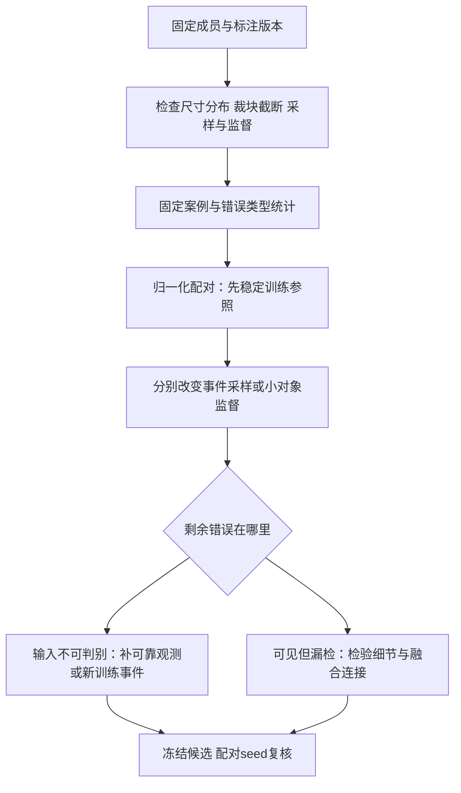

# 按灾害事件划分的数据、评价方法与实验结果

最后维护：2026-10-22。本页使用**我们的数据划分（留事件验证）**：先定义成员，再报告地形结果；历史四折单独放在后文。官方随机划分的结果见[官方专题](DATA_OFFICIAL.md)，不与本页分数排名。

## 阅读约定与实验设置

### “按事件留出”和“固定”分别表示什么

一个事件包含同一次灾害对应的一组图块。按事件划分时，用于验证的事件不进入这次模型的训练集合；“固定”表示不同实验继续使用相同事件和图块，以便比较改动效果。它不表示冻结网络参数，也不要求四折交叉验证。

当前方案把九个事件的2223块用于训练，把日本广岛与印度特里苏尔的669块用于验证。每个图块是128×128像素、共同10米网格上的十波段影像。它是已制作好的模型输入，不表示源影像的整幅大小均为128×128；把原生较粗的波段重采样到10米，也没有创造新的真实空间细节。

### 表一：当前数据用途

- **训练集**：九事件2223块：奇马尼马尼、中国、多米尼克、北海道、印度尼西亚、伊托贡、吉尔吉斯斯坦事件1和2、波多黎各。用影像及人工滑坡标注更新模型参数；地形预训练也只读这些训练图块。
- **验证集**：日本广岛448块＋印度特里苏尔221块，共669块。每100次成功更新评测一次；分别计算两事件IoU，再等权平均选择最佳模型。反复用于研发，不是盲测。
- **错误诊断集合**：意大利2795块。只在明确安排的诊断中分析错误，不混入训练或用于常规选模。
- **保留评价集合**：新西兰338块。开发期间不调用；历史曾有接触，不能重新宣称从未查看。

代码的`TRAIN`是训练集；`DEV`是development set，即开发验证集，清单中的`split=val`也是它。`DIAG`是诊断集合，`FINAL`是保留评价集合。这些代码字段不是额外的模型结构。

“内部验证／外部测试”只用于后文的历史四折：先整组留出若干事件作评价集合，再从剩余事件中选验证事件用于选模。“内部”与“外部”说明它们在嵌套划分中的用途，不表示来自项目内部或外部机构；当前九事件训练、两事件验证方案无需继续使用这两个含混简称。

### 保持不变的输入和训练条件

十波段顺序为B02、B03、B04、B05、B06、B07、B08、B8A、B11、B12。归一化是逐波段减均值再除标准差；原统计来自九训练事件共同覆盖的559块训练核心，不用验证数据，也不因训练总数是2223而重新拟合。额外高程、坡度的均值与标准差来自全部2223块训练图块。

地形高程来自每个源NetCDF文件中的静态数字高程模型（DEM）；坡度按10米像元间距的高程梯度计算。独立地形文件按图块编号与原影像对应，原十波段影像、日期、标注和成员清单不变。高程以米存储，坡度文件以0.01度存储、读取时恢复度数。并未进行新的地形测量；源高程的原生分辨率及重采样对坡度的影响没有在本轮单独验证。

地形各组最终分割训练均为3600次成功参数更新、每次有效批量64、32位浮点运算、随机种子1234，损失为0.5×二元交叉熵加0.5×Dice损失。地形分支的额外预训练预算不同，详见[模型与监督来源](MODEL_EVOLUTION.md#地形分支的结构与监督来源)，不能只因最终更新次数相同就称总训练成本相等。

### 每种指标统计什么

**选模指标**为“验证事件平均IoU”：先计算广岛IoU和特里苏尔IoU，再取两者平均，每个事件权重均为一半。**像素汇总IoU**则先累计两个事件所有有效像素的混淆计数，再算IoU；基线这两个数分别为0.3081与0.3095，不能混用。

下表IoU、Dice、Precision和Recall的二值阈值均为0.5；AP综合不同概率阈值下的精确率和召回率。除事件平均IoU外，下表像素指标均汇总验证集合的有效像素；有效像素由质量掩膜指定，云或无效数据不会当作正确背景计分。对象召回将滑坡标注按8邻域组成对象，与预测对象一对一匹配，交并比至少0.25才算检出；边界F1允许1像素位置误差。未标注图块不等同于可靠无滑坡样本，因此不报告未经核实的整图误报率。

## 主表：我们的数据划分（留事件验证）下，当前参照与六种地形对照

**当前参照没有更换。** 六种地形模型是本轮分别训练的对照，尚未取代原十波段模型，也没有全部叠加成一个网络。

> **2026-10-22 更正记录（已处理完毕）。** 逐通道可视化核对时发现坡度单位不一致：侧表把坡度按 0.01° 存成整数（均值约 2202），而当时生成的 `stats_geoboth.json` 按“度”拟合（均值 21.98），归一化后实际输入网络的坡度被放大约 100 倍。用 `scripts/audit_input_units.py` 对全部输入变体做单位审计后确认：**该缺陷只出现在 v4r1 这套地形统计里**；官方可用子集的 `stats_slope.json`（统计 2077 对原始 2118，比值 0.98）、`stats_geoboth.json`（0.98）以及纯 DEM 各组（官方 DEM、U-TAE 11 通道、四折 11 通道）都一致。修正方式：新增 `manifests/v4r1/stats_geoboth_raw.json`（坡度按 0.01° 原始单位拟合，比值 0.998）与 `protocol_geoboth_raw.json`，侧表与清单未动，六组在新的数据版本 `s2_10band_v4r1_geo_raw` 下重跑。下表是**重跑后的修正结果**，缺陷版本（`s2_10band_v4r1_p20_geo`）只保留为过程记录，不能引用。

五个独立地形分支使用相同网络结构，主要区别在正式分割之前怎样准备地形参数。“直接随分割训练”表示没有先用地形单独训练；“地形自监督”表示先遮住部分高程和坡度，让网络补回原高程3000步，再把编码器接入分割模型；预算加倍组先做6000步。加载标注训练评分头的组只迁移了该阶段的预测头，不包含该阶段更新后的编码器。完整的结构与训练分列表见[当前模型表](RESEARCH_INDEX.md#当前参照模型和最新完成的地形对照)。

本表的比较对象先明确如下。**十波段影像基线**是SegFormer B0＋不下采样细节分支，两路都只读取同一张十波段影像。**高程、坡度与影像共同输入模型**把高程和坡度接在十波段之后，形成12通道，同时扩展MiT第一层与细节分支的输入卷积；没有单独的地形编码器。其余五种模型则保留十波段视觉网络，让高程和坡度进入独立地形分支，再在输出分数处相加。

所有行使用同一2223块训练、669块验证成员；Recall等像素指标在同一批有效像素、阈值0.5下计算。行名只写上述具体变化。“分数相加”的结构见[模型说明](MODEL_EVOLUTION.md#地形分支的结构与监督来源)；“滑坡比例预训练头”的训练目标见[16×16区块例子](MODEL_EVOLUTION.md#用已有滑坡标注预训练地形网络一个具体例子)。

<!-- TERRAIN_MAIN_START -->
| 模型变化（均保留SegFormer B0与影像细节分支） | 验证事件平均 IoU | 相对基线 | AP | Precision | Recall | 对象召回 | 边界 F1 |
|---|---:|---:|---:|---:|---:|---:|---:|
| 当前参照：十波段影像＋细节分支 | 0.3081 | +0.0000 | 0.4425 | 0.4680 | 0.4775 | 0.5211 | 0.4806 |
| 12通道共同输入：影像＋高程＋坡度 | 0.3067 | -0.0015 | 0.4329 | 0.4359 | 0.5045 | 0.5622 | 0.4544 |
| 独立地形分支：直接随分割训练 | 0.3088 | +0.0007 | 0.4469 | 0.4704 | 0.4793 | 0.5307 | 0.4828 |
| 独立地形分支：先做地形自监督 | 0.3096 | +0.0015 | 0.4479 | 0.4684 | 0.4831 | 0.5390 | 0.4839 |
| 独立地形分支：加载标注训练的评分头 | 0.3076 | -0.0005 | 0.4418 | 0.4631 | 0.4810 | 0.5235 | 0.4796 |
| 独立地形分支：地形自监督预算加倍 | 0.3092 | +0.0010 | 0.4477 | 0.4670 | 0.4839 | 0.5366 | 0.4837 |
| 独立地形分支：固定融合系数 | 0.3080 | -0.0001 | 0.4427 | 0.4682 | 0.4771 | 0.5229 | 0.4805 |
<!-- TERRAIN_MAIN_END -->

## 图与解释

左图每行是一种方案，横轴为两个验证事件等权平均的IoU，虚线为影像基线。右图只展示独立地形分支在**最佳模型**中的融合系数，不是训练结束值。应分别观察性能差异和参数变化；系数较大本身不能证明地形贡献更大，因为实际修正还取决于预测分数。

## 展开结论

**12通道共同输入模型在本轮略低于十波段影像基线。** 只用十波段的SegFormer B0＋细节基线，IoU为0.3081、Precision为0.4680、Recall为0.4775、对象召回为0.5211；把高程和坡度拼接进主干首层及细节分支的12通道模型，相应为0.3067、0.4359、0.5045、0.5622。同一669块验证集合、阈值0.5下：12通道模型的对象召回更高（0.5622 对 0.5211）、像素精确率更低、边界F1更低（0.4544 对 0.4806），事件平均IoU低0.0015。这说明整体对象召回提高、边界指标下降；仅凭整体对象召回不能断言小目标检出提高；没有证据表明地形输入带来了净收益。

**五种独立地形分支与基线的差异都在千分位。** 事件平均IoU差值为−0.0005至+0.0015（自监督组最高，0.3096）；没有任何一组接近0.02的投入参考线。部分AP与对象召回略有提高（自监督组对象召回0.5390对基线0.5211），但同量级的边界与精确率变化同时存在，不能据此认定结构升级。只有一个随机种子、两个验证事件，不作显著性声明，也不能把“无差异”写成“地形必然无用”。

**新一批（valid 加权评分 v2）的分割结果与无重训干预。** 评分编码器＋预测头成对迁移的地形分支在同一 669 块上 best 0.3072（500 步），比无地形参照 0.3081 低 0.0009。为了不只靠“换一组权重”判断贡献，我们固定这份权重做四个不更新参数的干预：关闭地形分支 0.3064（−0.0009、AP −0.0022）、固定 α=0.01 为 0.3065、打乱地形对应 0.3060（−0.0013）、地形取批均值 0.3060（−0.0013）；微小对象 9–10/77 基本不变。学到的 α 只有 0.0554，与“贡献约千分之一 IoU”一致。这支持“这批地形评分迁移几乎没有可测贡献”，但不证明地形在任何损失或初始化下都无用；而且这一批同时改变了 valid 占比监督与迁移路径，仍不能单因素归因。

左图是两事件等权 IoU，右图是 AP；深色为正常权重，浅色为四个干预。两图纵轴都从 0 开始，差异小到几乎看不见——这正是要看的东西：这批地形迁移的贡献在千分位。

**加载标注评分头的组反而最弱。** 该组只用同源标注训练了评分头、没有迁移该阶段更新后的编码器，其事件平均IoU为0.3076（−0.0005），最佳模型中的融合系数只有0.048，明显低于其他组的0.22–0.23。这与评分头本身的检验一致：在11318个16×16格子上，预测比例与真实比例的相关系数只有0.087，有滑坡格子的平均预测0.104、无滑坡格子0.081，基本学成了一个近似常数。因此该组不代表“地形+标签预训练”的上限。

## 光谱三级对照：S1 显式输入、S2 波段身份、S3 关系建模

同一 2223／669 成员、同一 3600 次更新与 DEV 选模。每一级设置对照，但并非全部严格同参数量：追加通道对照的首层容量一致；波长MLP和十个自由偏置的参数不同；低秩和满秩分解的参数也不同。

| 级别 | 方案 | 验证事件平均 IoU | 相对基线 | AP | 精确率 | 召回率 | 对象召回 | 广岛 | 特里苏尔 |
|---|---|---:|---:|---:|---:|---:|---:|---:|---:|
| — | 基线：十波段＋细节分支 | 0.3081 | — | 0.4425 | 0.4680 | 0.4775 | 0.5211 | 0.3114 | 0.3049 |
| S1 | 追加四个指数（14 通道） | 0.2795 | −0.0286 | 0.4195 | 0.5154 | 0.3924 | 0.4550 | 0.2987 | 0.2604 |
| S1 | 对照：追加四个原始波段（14 通道） | 0.2908 | −0.0174 | 0.4203 | 0.4825 | 0.4288 | 0.4669 | 0.2981 | 0.2833 |
| S2 | 波长生成的静态通道偏置 | 0.3052 | −0.0029 | 0.4344 | 0.4780 | 0.4603 | 0.5110 | 0.3079 | 0.3025 |
| S2 | 对照：可学习通道偏置 | 0.3081 | −0.0000 | 0.4389 | 0.4644 | 0.4776 | 0.5146 | 0.3077 | 0.3085 |
| S3 | 低秩线性通道混合 r=4 | 0.3043 | −0.0038 | 0.4083 | 0.4071 | 0.5113 | 0.5634 | 0.2800 | 0.3287 |
| S3 | 对照：满秩通道混合 | 0.3041 | −0.0040 | 0.4107 | 0.4232 | 0.4921 | 0.5450 | 0.2826 | 0.3256 |

左图是各组相对基线的差值，右图是两个验证事件各自的方向。应看两件事：S1 两组都明显向左（扩通道本身有代价），S3 两根柱在两个事件上方向相反。

六组均未优于单期参照。

**S2 真波长条件映射（新增，2000 步）：** 入口 10×10 混合矩阵由各波段中心波长经 Linear(9→10) 生成，对照是同参数量（各 110 个）、同初始化、恒等起步的自由矩阵。两支事件平均 IoU 为 0.3030 与 0.3026（差 0.0004），AP 为 0.4352 与 0.4086，广岛/特里苏尔方向相反（0.3113/0.2948 对 0.2810/0.3242）。结论：本设置下把混合矩阵绑定到波长没有可测的 IoU 收益，AP 的差落在单 seed 波动内；它排除了“明显更好/更差”，但没有证明波长归纳偏置普遍无用。

追加指数为0.2795，追加四个原始波段为0.2908；两者同时改变通道、初始化和输入分布，不能将下降直接归因于通道数。静态波长偏置为0.3052，自由偏置为0.3081；低秩线性混合为0.3043，满秩混合为0.3041。这些结果没有证明动态波段注意力或独立光谱旁路无效。

## S1 新增通道统计与 S3/S4 光谱机制（2000 步）

这一批把三个此前未补齐的问题分开：新增通道的统计与首层初始化是否公平（S1）；真正的十波段关系聚合是否比普通通道混合更好（S3）；同一关系表示放在入口前残差还是解码特征处、以及学习门是否有用（S4）。全部使用原固定事件留出：TRAIN 2223、DEV 广岛448＋特里苏尔221、seed1234，停止 2000 次成功更新、学习率日程仍为旧 3600 步（预热180），每 100 步在 DEV 上按两事件等权 IoU 选模。S3-D 同时充当 S4 的“入口前残差”参照，不重复训练。

S1 的处理组与对照组都追加四个通道（共14通道）。处理组追加 NDVI/NDMI/NBR/REND，并用同一 559 块 TRAIN 核心拟合的四通道均值/标准差独立标准化（`manifests/v4r1/stats_s1_indices4.json`，ε=1e-4，harmonized 反射率）；对照组追加 B04/B08/B8A/B11 的 z-score，不再套用指数统计。两组的首层都是 `direct10`：预训练 B04/B03/B02 三列原样拷贝，其余列（含新增四列）零初始化。首层审计对 218 个张量逐一比较：处理组与对照组逐值相同；相对十波段基线只有首层卷积不同，新增四列严格为零（`outputs/segformer/v4r2_spectral/s1_init_audit.json`）。

S3 的五组都只改十波段进入 MiT 之前的入口：S3-A 是逐像元满秩 10×10 线性混合；S3-B/C/D/E 共用同一 4×4 小块十波段 token 注意力（2层4头），分别使用自由可学习 band ID、真实波长嵌入、每块局部物理关系偏置、整幅图共享关系偏置。B–E 的存储参数相同（135,381 个新增参数）；`relation_mode=none` 时关系偏置 MLP 不参与前向，有效参数少 132 个。

S4 先用同一关系编码器产生真正的特征 `F_spec`（十波段 token 均值后 1×1 投影到解码宽度），在官方解码器融合特征处注入一次：ADD 无门控、FIXEDGATE 固定 0.5、LEARNGATE 输入依赖空间门（3×3，零初始化）。三者共享同一 `F_spec` 与投影；`alpha` 初值 0，因此初始输出与同权重视觉基线逐位一致。CAPCTRL 为自由 band ID、无关系偏置、存储参数相同（有效参数少132）的非物理分支，用来分开“物理身份/关系偏置”和“多加的容量”。

| 组 | best 步 | 事件平均 IoU | AP | 广岛 IoU | 特里苏尔 IoU | 1–4 像素对象召回 | 末态 IoU |
|---|---:|---:|---:|---:|---:|---:|---:|
| S1 指数（14通道，指数独立标准化） | 500 | 0.2917 | 0.4287 | 0.2978 | 0.2856 | 7/77 | 0.2319 |
| S1 容量对照（14通道，原始波段） | 500 | 0.2911 | 0.4207 | 0.2986 | 0.2837 | 8/77 | 0.2395 |
| S3-A 线性混合（满秩10×10） | 300 | 0.3042 | 0.4109 | 0.2829 | 0.3256 | 11/77 | 0.2404 |
| S3-B 自由ID注意力 | 300 | 0.2916 | 0.3882 | 0.2676 | 0.3156 | 9/77 | 0.2306 |
| S3-C 波长注意力 | 400 | 0.2913 | 0.3946 | 0.2794 | 0.3032 | 6/77 | 0.2396 |
| S3-D 局部关系偏置（=S4-INPUTRES） | 500 | 0.2855 | 0.3982 | 0.2845 | 0.2864 | 9/77 | 0.2378 |
| S3-E 全局关系偏置 | 400 | 0.2848 | 0.3895 | 0.2790 | 0.2905 | 6/77 | 0.2389 |
| S4-ADD（无门控） | 500 | 0.3085 | 0.4427 | 0.3136 | 0.3034 | 9/77 | 0.2271 |
| S4-FIXEDGATE（常数0.5） | 500 | 0.3095 | 0.4424 | 0.3120 | 0.3069 | 11/77 | 0.2326 |
| S4-LEARNGATE（空间学习门） | 500 | 0.3081 | 0.4446 | 0.3137 | 0.3025 | 11/77 | 0.2238 |
| S4-CAPCTRL（同容量非物理） | 500 | 0.3101 | 0.4465 | 0.3147 | 0.3055 | 10/77 | 0.2244 |
| 参照：十波段单期（3600步，best@500） | 500 | 0.3081 | 0.4425 | 0.3114 | 0.3049 | 8/77 | — |
| 参照：S2 波长条件映射（2000步） | 500 | 0.3030 | 0.4352 | 0.3113 | 0.2948 | 10/77 | 0.2585 |
| 参照：S2 自由通道混合（2000步） | 300 | 0.3026 | 0.4086 | 0.2810 | 0.3242 | 10/77 | — |

左图是各组的 best 事件平均 IoU，圆点/方块是两个验证事件各自的值，虚线是十波段参照、点线是 S2 同预算参照；中图是 1–4 像素对象召回（分母 77 个可评价对象）；右图是 S4 best 权重上门控在 GT 滑坡/背景/误检上的均值。应看三件事：S1 两组的柱高几乎相同；S3 注意力四组低于线性混合；S4 四组都回到参照附近，而学习门在目标处反而更低。

**S1：标准化后“指数更差”的历史差没有复现。** 指数组 0.2917、原始通道对照组 0.2911，差 +0.0006（AP +0.0080，广岛 −0.0008、特里苏尔 +0.0019，微小对象 7/77 对 8/77）。历史两次 S1（都未独立标准化新增通道）相差 −0.0113；这次没有复现，说明该差主要与新增通道的尺度和训练设置有关，不能当作“指数没有信息”的证据。两组都低于十波段参照 0.3081 约 0.016，说明在本 2000 步预算下，把输入从 10 扩到 14 通道本身有代价；这与“指数不可用”是两件事。

**S3：真正的动态关系聚合没有超过普通线性混合。** S3-A 0.3042；注意力四组 0.2916、0.2913、0.2855、0.2848，低 0.013–0.019。波长身份相对自由 ID 为 −0.0003（AP +0.0065，广岛 +0.0118、特里苏尔 −0.0124）；局部相对全局 +0.0007（AP +0.0087，微小对象 9/77 对 6/77）。注意力组的关系读出权重确实离开零（abs sum 9–12），不是支路没训练；但线性混合与注意力的容量不匹配（110 对 135,381 个新增参数），单 seed，不能据此否定注意力在其他预算或容量下的作用。S3-A 的两事件更不均衡（广岛 0.2829、特里苏尔 0.3256），事件平均 IoU 掩盖了事件间差异。

**S4：融合位置比关系类型更重要，学习门没有学到空间选择性。** 同一关系编码器放在解码特征处（ADD 0.3085、FIXEDGATE 0.3095、LEARNGATE 0.3081、CAPCTRL 0.3101）比放在入口前残差（S3-D 0.2855）高约 0.023；但四种特征融合与十波段参照 0.3081 的差都在 +0.001 以内，CAPCTRL（无波长身份、无关系偏置）还略高，因此没有证据表明物理关系表示带来净收益。学习门在 best（500步）的 gate 均值 0.047、目标 0.015、背景 0.048、误检 0.006，修正幅度约 0.002；900 步 gate 0.589，1300 步后完全关闭（gate=0、修正=0）。也就是说，学习门最终选择关掉光谱支路，而不是学到“滑坡处开门、背景处关门”；ADD/FIXED 强制开门时修正幅度 0.059/0.027，也只回到参照水平。门控的饱和/关闭更可能来自门控优化（门输入未归一化、门与特征共用同一学习率），这属于未验证的解释；本批不能据此断言“空间门控普遍无用”。

**限制。** 单 seed，所有差值都未做显著性检验；S1 的 14 通道相对十波段参照多 4 个输入通道，S3/S4 的新增参数也不同，不能把组间差全部归给机制；S3 的线性混合与注意力未严格同容量；学习门的饱和/关闭原因未隔离；派生结论只适用于这 669 块 DEV 和该训练预算，不外推到官方划分或独立事件。

## U-TAE（官方多时相做法）在项目数据划分上的结果

十波段、不加 DEM、真实观测日期、75 epoch、batch 16。单期与 15 期共用同一训练/验证成员与同一选模口径。

| 模型与保存状态 | 事件平均 IoU | 像素汇总 IoU | 广岛 IoU | 特里苏尔 IoU | AP | 1–4像素对象召回 |
|---|---:|---:|---:|---:|---:|---:|
| U-TAE单期，最佳第46轮 | 0.3262 | 0.3013 | 0.2755 | 0.3768 | 0.4250 | 0.1039 |
| U-TAE单期，末态第75轮 | 0.2883 | 0.2835 | 0.2784 | 0.2982 | 0.3668 | 0.1039 |
| U-TAE15期，最佳第17轮 | 0.3706 | 0.3692 | 0.3670 | 0.3741 | 0.5332 | 0.0390 |
| U-TAE15期，末态第75轮 | 0.2718 | 0.2756 | 0.2835 | 0.2600 | 0.4024 | 0.0000 |

左图横轴是epoch，纵轴是两个验证事件的等权平均IoU，虚线是SegFormer历史参照（训练策略不同）。中图为最佳模型的逐事件IoU，右图为1–4像素对象召回及检出数/可评价对象数。观察收益集中在哪个事件以及小目标是否同步受益。曲线显示：15 期在 epoch 5–60 基本位于单期之上，但峰值出现在第 17 epoch（0.3706），之后在 0.30–0.34 之间震荡并回落到 0.272；单期峰值在第 46 epoch（0.3262），末态 0.288。

**本次纠正的是指标标签，不是重新训练结果。** 原表0.3013/0.3692来自像素汇总IoU；按既定的两个事件等权口径，最佳模型分别为0.3262/0.3706，差0.0444。原训练曲线与重新评价值有不足0.0001的小差异，具体原因未验证；上表统一来自保存的eval_dev_summary.json逐事件统计。单期与多期初始化摘要一致，训练均75轮、10425次更新，正类权重5；与SegFormer的3600次更新、正类权重1不同，不能把跨架构差异当作纯架构贡献。

### U-TAE 固定期数与时间开关（30 轮窗口，已完成 5 组）

为把“更多观测”和“有没有注意力/日期”分开，补了两组同架构对照，统一 30 轮、batch16、原学习率与损失；与上表 75 轮组**不是等轮数**，只与其前 30 轮及 best@17 比较。期数组用 multi 模式等秩取样（参考帧必保留），开关组只改 L-TAE：均值组把时间注意力换成均值并移除注意力头（有效参数少 16512），内容组只移除固定位置编码（0 可训练参数）。

| 组 | 事件平均IoU | 广岛 | 特里苏尔 | AP | best轮 |
|---|---:|---:|---:|---:|---:|
| 1 期 | **0.3154** | 0.2643 | 0.3664 | 0.4008 | 27 |
| 3 期 | 0.2754 | 0.2487 | 0.3020 | 0.3501 | 16 |
| 5 期 | 0.2783 | 0.1954 | 0.3613 | 0.2953 | 29 |
| 15 期（75 轮组，best@17） | 0.3706 | 0.3670 | 0.3741 | 0.5332 | 17 |
| 15 期＋均值代替注意力（30 轮） | 0.3101 | 0.2934 | 0.3268 | 0.4454 | 21 |
| 15 期＋无日期编码（30 轮） | **0.3860** | 0.4235 | 0.3486 | 0.6009 | 20 |

两点要分开读。**期数在 U-TAE 里不是越多越好**：30 轮窗口内 3/5 期都低于 1 期，5 期的广岛 IoU 掉到 0.1954，而 15 期最高——这与 SegFormer 数量组（1→5 期上升）方向不同，说明“加观测”的收益依赖模型如何聚合，不是数据本身的单调性质。**拆开看：注意力有用，固定日期编码在这批数据上反而略降。** 均值组 0.3101 明显低于保留注意力的两组，说明 L-TAE 注意力本身有收益；而**去掉日期编码**的无日期组（0.3860、AP 0.6009）比日期组（0.3706、AP 0.5332）高 0.0154/0.068，收益集中在广岛（0.4235 对 0.3670），特里苏尔反而低 0.0255。边界：无日期组 30 轮、日期组 75 轮（best@17 落在窗口内），单 seed；因此只能说“这批数据不支持启用日期编码更好”，不能宣称日期编码普遍有害。

左图两事件等权 IoU，右图 AP；蓝柱是 30 轮新组（1/3/5 期与均值组），灰柱是 75 轮日期组参照，空位标“训练中”。应看两点：蓝柱里 1 期最高而不是期数最多的 5 期；均值组低于灰色参照。

**收益集中在广岛，微小对象存在退化。** 广岛IoU增加约0.0915，特里苏尔降低约0.0026；1–4像素对象召回由8/77降至3/77。15期整体AP提高0.1081，但不代表所有事件和目标尺度都改善。末态事件平均IoU为0.2883/0.2718，提示训练后期退化，需要报告完整曲线；按验证集选最佳是两组共同规则，不能仅因末态排序相反就否定已有多期信号。两个验证事件反复参与选模，因此也不能声称独立泛化显著性。

完整15期包含参考影像日期后的观测，属于回顾性识别。它不满足仅用单期影像的输入条件；需要与截止参考日期组分开解释。

## 同一SegFormer的时间控制与工程复核

### 阅读约定与实验设置

以下为磁盘已完成结果的复核，不是本次重新训练四组。四组都用我们的数据划分（留事件验证）：九事件2223块训练，广岛448＋特里苏尔221块验证，seed1234；十波段、无地形，统计沿用559块训练核心。共享MiT编码器逐帧提特征，分别采用单期恒等、有效帧均值、内容权重、内容与相对观测日期权重；参考影像另进原网格细节分支。监督来自同一人工滑坡标注，损失为0.5BCE＋0.5Dice。各组3600次更新、microbatch8×累积8，每100步按两个验证事件等权IoU选模。与历史单期0.3081的batch64训练不同，同接口单期0.2883才是本表参照。为核对这两个参照的差异，本轮另训练了一个同接口、microbatch=64的单期对照：最佳事件平均IoU 0.3075（500步，像素汇总0.3093），与历史0.3081只差0.0006；这支持微批量设置可能显著影响结果，BatchNorm是主要待检验机制；但单seed对照尚未隔离随机数/累计梯度差异，不能唯一归因BatchNorm。该对照只用于解释参照差异，不作为新候选。

### 主表

IoU是阈值0.5的前景交并比；事件平均IoU先分事件计算再等权平均；AP为有效像素的精确率—召回率曲线面积。对象召回按独立一对一IoU≥0.25匹配，括号为检出数/可评价对象数。

| SegFormer B0输入与汇聚（均保留参考影像细节） | 事件平均IoU | 相对同接口单期 | AP | 广岛IoU | 特里苏尔IoU | 1–4像素对象召回 | 最佳更新/末态IoU |
|---|---:|---:|---:|---:|---:|---:|---:|
| 单期十波段，恒等 | 0.2883 | — | 0.3874 | 0.2662 | 0.3104 | 0.1169（9/77） | 300 / 0.2396 |
| 15期十波段，均值 | 0.2984 | +0.0102 | 0.4736 | 0.2932 | 0.3037 | 0.0390（3/77） | 1400 / 0.2530 |
| 15期十波段，内容权重 | 0.3145 | +0.0262 | 0.4651 | 0.3110 | 0.3180 | 0.1039（8/77） | 600 / 0.2528 |
| 15期十波段，内容与日期权重 | 0.3245 | +0.0362 | 0.5134 | 0.3192 | 0.3298 | 0.0390（3/77） | 600 / 0.2470 |

### 图与解释

左图每组两根柱分别为广岛与特里苏尔；右图横轴为对象像素面积、每条线为一种汇聚。应同时看事件IoU与微小对象检出：日期加权组的两个事件IoU都提高，1–4像素对象却少检出6个。均值组的特里苏尔IoU低于单期。对象支持数仅77，不能作显著性声明。

各曲线表示对应汇聚在训练更新过程中的验证表现；紫色为只保留参考日期及以前观测的截止组。应看最佳模型出现位置与训练末态，不能只汇报早期峰值。五组训练结束时的IoU均明显低于各自最佳值。

固定案例在首批训练前由参考单期run的验证错误选定（每事件漏检、误检、边界偏移、微小目标各一），不按新模型结果更换：

每行一个案例，第1列为参考影像与人工标注（黄线），其余列为四组best模型的概率（红=阈值0.5以上）与预测边界。多期组在部分漏检案例补回了滑坡，但在边界与微小目标上出现新的偏移；案例只用于错误诊断，不参与选模。

### 观测数量补全：3/5/7期已完成并验收

以下比较仍用原2223/669成员、统计、seed1234、3600更新和8×8批量。3期与15期的空间、时间初始化摘要一致；3/5/7期逐样本保留参考帧，其余帧按日期顺序等秩取样，不用标注或预测选帧。1期为同接口恒等参照，参数量3753602；3/5/7/15期的内容与日期汇聚参数量均3775238。含参考日期之后的观测，属于回顾性条件。

| SegFormer B0＋参考影像细节的观测输入 | 最佳事件平均IoU | AP | 广岛IoU | 特里苏尔IoU | 1–4像素对象召回 | 最佳更新 | 末态IoU | 训练耗时 |
|---|---:|---:|---:|---:|---:|---:|---:|---:|
| 单期十波段，恒等 | 0.2883 | 0.3874 | 0.2662 | 0.3104 | 9/77 | 300 | 0.2396 | 20.2分钟 |
| 3期十波段，内容与日期加权 | 0.2926 | 0.4422 | 0.2950 | 0.2901 | 6/77 | 1000 | 0.2341 | 35.0分钟 |
| 5期十波段，内容与日期加权 | 0.3055 | 0.4773 | 0.3137 | 0.2974 | 7/77 | 1000 | 0.2474 | 43.4分钟 |
| 7期十波段，内容与日期加权 | 0.3348 | 0.4972 | 0.3141 | 0.3554 | 6/77 | 1000 | 0.2812 | 55.1分钟 |
| 15期十波段，内容与日期加权 | 0.3245 | 0.5134 | 0.3192 | 0.3298 | 3/77 | 600 | 0.2470 | 114分钟 |

每个点是该输入期数下已完成并验收模型的最佳检查点；左图为两个事件等权IoU，右图为同77个可评价微小对象的召回。

1→7期在本设置内随期数上升（0.2883→0.3348），但15期回落到0.3245：15期帧数更多、跨度更长、等秩取样的端点也不同，不能把它读成“期数单调收益”或“7期就是上限”。7期两个事件都高于单期（广岛+0.0479、特里苏尔+0.0450），微小对象仍是6/77，少于单期9/77，且该组含参考日期之后的观测，仍未满足替换单期的条件。3期相对单期只提高0.00427，广岛提高0.02882、特里苏尔下降0.02025；5期比单期高0.01726，但特里苏尔下降约0.0130、微小对象从9/77降为7/77。只有一个seed，不能宣称显著性。

7期最佳权重出现在1000步，末态IoU 0.2812 明显低于最佳，说明"训练更久更好"在这一组不成立；这也支持把后续新批次的选模窗口定在2000步以内（依据见[训练预算复核](MODEL_EVOLUTION.md#原任务书目的与当前计算是否对应)）。

3期最佳模型的像素TP/FP/FN为81340/73699/122192，整体对象召回0.4354、边界F1为0.4552；末态整体对象召回0.2805、边界F1为0.3605。3/5/7期与1/15期的best/last及预定步均完成严格权重加载、配置一致性、评价权重哈希和669个实际验证成员核验，原始结果见[数量汇总](../outputs/segformer/v4r1_temporal_frame_count/summary_frame_count.json)。注意原评价JSON中的`efficiency.train_seconds`曾记录所选检查点产生时的累计时间；本表使用完成摘要中的训练秒数。新评价入口已把完整训练成本和所选检查点累计时间分开，保留原评价文件不覆盖。

### 新批次：2000步预算与派生共同子集（截止参考日期与跨度）

后续批次把停止步数与学习率日程分开：`train.stop_updates=2000`、`train.schedule_updates=3600`、预热180，因此用的是旧3600步poly日程的前2000步，而不是压缩后的另一条日程；不保存的步数不重要，因为每组仍存1000/1500/2000与best/last。这不是等预算比较——它比历史全程运行少44.4%更新。

截止参考日期的数量组（1/3/5/7期）要求四组同成员：只保留参考日期当日及以前至少有7个真实观测的TRAIN样本，共2007块，DEV 669块原样全保留，登记在`manifests/v4r2/subset_protocol_cutoff7.json`。跨度组（180天/365天）同样冻结共同成员：参考日期前180天内至少3个真实观测，TRAIN 2108块、DEV 669块，两组共用同一清单，唯一变化是窗口天数。两个子集都由`scripts/build_temporal_subset.py`从原清单派生，不覆盖`manifests/v4r1/pool_100.jsonl`；子集结果只与同成员配对组比较，不与2223块全体混排。

**截止参考日期固定数量（同一子集2007/669，2000步）**

| 输入 | 事件平均IoU | 广岛 | 特里苏尔 | AP | 1–4像素对象召回 | best步 | 末态IoU | 训练耗时 |
|---|---:|---:|---:|---:|---:|---:|---:|---:|
| 1期（只有参考帧） | 0.2933 | 0.2947 | 0.2918 | 0.4182 | 10/77 | 700 | 0.2431 | 11.2分钟 |
| 3期 | 0.3061 | 0.2900 | 0.3222 | 0.4376 | 8/77 | 600 | 0.2609 | 17.9分钟 |
| 5期 | 0.3432 | 0.3413 | 0.3452 | 0.4996 | 8/77 | 400 | 0.2778 | 23.1分钟 |
| 7期 | 0.3277 | 0.3115 | 0.3439 | 0.4944 | 11/77 | 400 | 0.2645 | 30.9分钟 |

去掉参考日期之后的观测后，这个子集上5期最高（0.3432），7期回落到0.3277：不是“期数越多越好”。7期的微小对象反而最多（11/77），其余三项指标却低于5期，说明多取历史帧改变的是整体覆盖与边界，而不是稳定改善小目标。四组最佳点都在400–700步，训到2000步时事件平均IoU降到0.2431–0.2778，训练更久明显变差；这也是后续统一选模窗口不超过2000步的实测依据。

**固定3期、不同历史窗口（同一子集2108/669，2000步）**

| 输入 | 事件平均IoU | 广岛 | 特里苏尔 | AP | 1–4像素对象召回 | best步 | 末态IoU | 训练耗时 |
|---|---:|---:|---:|---:|---:|---:|---:|---:|
| 参考日前180天内的3帧 | 0.3026 | 0.2951 | 0.3102 | 0.4229 | 10/77 | 300 | 0.2443 | 17.5分钟 |
| 参考日前365天内的3帧 | 0.2962 | 0.2870 | 0.3054 | 0.4151 | 13/77 | 300 | 0.2568 | 17.5分钟 |

同样3帧时缩短窗口略好（+0.0064、AP+0.0078），方向与“更近的观测更有用”一致；但差值很小、只有一个seed，且365天组微小对象反而多3个，不能据此改窗口或宣称跨度规律。

两个子集的成员不同（2007块要求参考日前≥7帧，2108块要求180天内≥3帧），因此不能互相比较，也不能与2223块全体的历史运行混排。队列状态见[截止日期批次](assets/research/v4r2_temporal_cutoff_queue.json)与[跨度批次](assets/research/v4r2_temporal_window_queue.json)；六组均通过严格权重加载、配置/成员哈希、669个验证成员与逐样本帧计划核验，原始证据在[执行核验](assets/research/execution_audit.json)与两份summary JSON。

### 灾前灾后组成：同成员、同预算，只改帧的组成（已完成并验收）

合格集要求灾害日期唯一且高置信、至少 2 张灾前与 5 张灾后、灾后含参考帧：TRAIN 只剩 6 个事件共 1141 块，DEV 669 块原样。三组共用同一批成员，帧由显式逐样本计划给出（登记在`manifests/v4r3/subset_protocol_composition.json`，含三份计划的 SHA256 与未来帧计数）；混合组的前 2 张灾前不参与另外两组的帧集合。这是**回顾性**条件：灾后帧可以晚于参考日期，本子集里最长约 865 天，所以不能当作前瞻识别能力。

| 输入（同成员1141/669，2000步） | 事件平均IoU | 广岛 | 特里苏尔 | AP | 1–4像素对象召回 | best步 | 末态IoU | 训练耗时 |
|---|---:|---:|---:|---:|---:|---:|---:|---:|
| 5 张灾后帧 | 0.2699 | 0.2813 | 0.2586 | 0.4118 | 1/77 | 500 | 0.2412 | 23.4分钟 |
| 3 张灾后帧 | 0.2789 | 0.2764 | 0.2814 | 0.3979 | 3/77 | 500 | 0.2582 | 18.9分钟 |
| 2 张灾前＋同 3 张灾后 | 0.2826 | 0.2901 | 0.2750 | 0.4122 | 3/77 | 800 | 0.2610 | 23.0分钟 |

两种对照要分开读：**相同 5 帧总数**下，混合组比 5 张灾后高 0.0127（AP 基本相同，微小对象 3/77 对 1/77）；**相同 3 张灾后帧**下，加 2 张灾前只高 0.0037（AP +0.0143，广岛 +0.0137、特里苏尔 −0.0064）。方向是“灾前信息有一点补充价值”，但差值很小、只有一个 seed、微小对象只有 1–3/77，而且这个子集只有 6 个训练事件（中国、吉尔吉斯斯坦因灾害日期不唯一被排除），不能据此升级候选或外推到 9 事件全体。

每个点是该组成下最佳检查点；横轴三组同成员、同2000步，只改帧的组成。左图看整体 IoU，右图看微小目标是否保住——5 张灾后组的微小对象只有 1/77，是这张图最该注意的地方。

三个批次的子集互不相同（2007/2108/1141 块），因此三张表之间不能横向比大小；每个结论只在各自子集内成立。组成批次的队列状态见[组成批次](assets/research/v4r3_composition_queue.json)。

### 截止参考日期组：去掉参考日期之后的观测（已完成）

条件组在15期内容与日期组达到+0.0362、且两个验证事件都高于同接口单期后触发。每个图块只保留观测日期不晚于参考日期的帧，仍包含参考影像及其细节；帧数随样本变化（训练2–15、验证7–10），因此不是同算力对照。其余成员、统计、初始化、3600次更新和8×8批量不变。

| 输入与汇聚 | 事件平均IoU | 相对同接口单期 | AP | 广岛IoU | 特里苏尔IoU | 1–4像素对象召回 | 最佳更新 | 末态IoU | 训练耗时 |
|---|---:|---:|---:|---:|---:|---:|---:|---:|---:|
| 截止参考日期，内容与日期权重 | 0.3377 | +0.0494 | 0.4998 | 0.3160 | 0.3595 | 0.0779（6/77） | 500 | 0.2874 | 71.9分钟 |
| 完整15期，内容与日期权重 | 0.3245 | +0.0362 | 0.5134 | 0.3192 | 0.3298 | 0.0390（3/77） | 600 | 0.2470 | 114分钟 |

去掉参考日期之后的观测后，事件平均IoU没有下降，反而比完整15期高0.0132：特里苏尔高0.0297，广岛低0.0032；AP低0.0136；1–4像素对象召回由3/77回到6/77，但仍低于同接口单期的9/77。像素TP/FP/FN为87167/59175/116365，整体对象召回0.4038、边界F1为0.4804。它说明这批开发集合上的多期收益不依赖未来观测，主要来自参考日期及以前的多次观测；但参考影像本身仍是灾后影像，两组帧数不同，微小目标仍退化，不能据此声称前瞻识别能力或替换单期交付。best/last与1200/2400/3600步评价、669个验证成员和权重哈希均已核验，原始评价见[该run的eval目录](../outputs/segformer/v4r1_temporal_control/SegFormer-B0-Temporal-History-Date/1234/eval)。

### 展开结论

内容权重组在相同观测帧与相同训练预算下优于均值组，说明本设置中可学习的内容加权具有开发集合上的实测收益；内容与日期组进一步提高事件平均IoU和AP，但其参数更多且使用参考日期之后的影像。它支持回顾性观测条件的开发结果，不能证明前瞻识别能力或独立跨地区泛化。日期组微小对象召回相对单期下降约67%，未通过既定候选门槛，不能替换单期交付；其与内容组的差值也不能单独证明日期编码的普遍作用。截止参考日期组在去掉未来观测后仍高于完整15期且两个事件都高于同接口单期，说明收益主要来自参考日期及以前的多次观测；但该组帧数可变、仍是单seed，微小对象召回仍低于单期，不能据此升级为候选或宣称前瞻能力。

### 限制与下一步

已严格加载基线及四组的best/last，四组另核对1200/2400/3600步权重与评价哈希，见[核验数据](assets/research/execution_audit.json)。截止参考日期组已完成：best事件平均IoU 0.3377（500步），末态0.2874，669个验证成员、权重与评价哈希已核验。3/5/7期新增配置使用同一内容与日期汇聚，参考帧必保留，其余按日期排序等秩取样；与已有1/15期组成数量对照。具体执行状态见[有限队列](../outputs/research_completion/status.json)，进程成功结束仍须复核结果，不自动代表科学验收通过。

全量[逐帧侧表](assets/research/temporal_observations.csv)覆盖2892块、43380帧，含源文件SHA256、源观测日期、灾害日期原字段、云阴影、SCL255和缺测比例；按SCL0、非有限值与显式填充值检出缺测像素0。681块含多个灾害日期，单独标为日期不明确；不将它们强行定义为某次灾害的灾前或灾后。截止参考日期时，训练中满足3/5/7帧的分别为2217/2171/2007块，验证均669块；截止日期15帧的验证覆盖为0。不减少原清单成员来制造同集合对照。

工程修复另包括：U-TAE新运行的缓存哈希改由实际路径计算；时序汇总的最佳步数改为300/1400/600/600而非全部3600。地形评分v2先在有效像素内计算16×16区块滑坡占比，空区块不参与损失，并严格核验统计/清单哈希后成对载入评分编码器与预测头。新评分训练3000步、579.5秒，验证669块42396个有效区块的相关系数0.0339，区块有无滑坡的AP0.1529、阳性区块率0.1206；这只是同源标注评分，尚无分割增益结论，也不是独立易发性概率。新分割对照同时改变目标处理与加载，不能解释成单一因素效果。

源文件十个波段均无units、scale_factor、add_offset、_FillValue元数据；后续继续追溯后，下载记录明确指向官方`data_harmonized/s2`，不能再仅凭缺少属性判断来源无法核实。[官方发布说明](https://huggingface.co/datasets/paulhoehn/Sen12Landslides/blob/main/README.md)支持该版本的偏移校正与0–10000范围约定。本地28卷已计算SHA256，并在含当前成员的分卷各抽查一个nc与本地源文件字节一致；完整时间缓存各波段实际范围为1–10000，见[来源审计](assets/research/radiometry_provenance.json)。这支持harmonized存储DN除以10000的解释，不等于独立BOA定标验证；本地上游辅助函数仅按首日期判断偏移、其数字后缀筛选未覆盖B8A，因此不能由该函数单独证明发布文件每帧偏移都正确，也不在本地重复加减1000。

组成审计只接受灾害日期唯一、发布元数据date_confidence=1的样本，固定同一合格集比较5张灾后、3张灾后、2张灾前＋同3张灾后。回顾性条件合格1810块，其中训练1141、验证669；严格截止参考日期仅训练3块、验证0块。后者明确为不合格实验条件，不补帧、不换验证集、不当算法失败。合格成员与固定帧ID见[组成侧表](assets/research/temporal_composition_eligibility.json)，尚未进行组成子集训练；其训练事件覆盖也与2223块全体不同，后续不得直接混排。

独立地形易发性路线仍缺独立标签。时相跨度控制、截止参考日期固定数量与灾前灾后组成训练已完成并验收（见上节）；U-TAE 均值/内容注意力开关已实现并在训练（30 轮，尚未验收），完整光谱门控消融仍未完成，不登记为完成。

### 附录：成本与复现

四组单期/均值/内容/内容与日期训练分别约20/114/117/114分钟，截止参考日期组约72分钟，单seed。完整best/last、预定步、对象六尺度支持数和成本在[原运行汇总](../outputs/segformer/v4r1_temporal_control/summary_temporal_control.json)。复核命令：`python scripts/audit_research_execution.py`；逐帧审计：`python scripts/audit_temporal_observations.py`；新训练与评价的准确命令保存在有限队列status.json。新地形加载的逐张量验证见[迁移核验](assets/research/terrain_transfer_validation.json)。历史原始权重与评价不改名、不覆盖，本次未提交Git，保留接手时的未提交工作树。

## 限制与下一步

当前计划见[下一步完整实验计划](RESEARCH_INDEX.md#下一步完整实验计划)，由阶段台账生成。优先开展同架构的时间信息比较，保留单期参照和小目标指标；地形及已完成线性光谱方案暂停常规调参。

## 附录一：逐事件、选模与成本

下面仍是同一组最佳模型，额外给出事件差异、像素汇总指标和选模位置。融合系数作用于分割分数，定义见模型页。

<!-- TERRAIN_DETAIL_START -->
同一最佳模型的补充数值如下（依次为广岛IoU、特里苏尔IoU、像素汇总IoU、Dice、最佳更新步、地形系数）：

- 当前参照：十波段影像＋细节分支：0.3114；0.3049；0.3095；0.4727；500；—。
- 12通道共同输入：影像＋高程＋坡度：0.3033；0.3100；0.3052；0.4677；300；—。
- 独立地形分支：直接随分割训练：0.3147；0.3029；0.3113；0.4748；500；0.225。
- 独立地形分支：先做地形自监督：0.3154；0.3038；0.3120；0.4757；500；0.225。
- 独立地形分支：加载标注训练的评分头：0.3103；0.3050；0.3088；0.4719；500；0.048。
- 独立地形分支：地形自监督预算加倍：0.3152；0.3031；0.3117；0.4753；500；0.227。
- 独立地形分支：固定融合系数：0.3113；0.3046；0.3094；0.4726；500；0.010。
<!-- TERRAIN_DETAIL_END -->

基线参数约375万，独立地形分支模型约393万；训练峰值显存分别约4694与4712 MiB，来自已有摘要，不是本次重新测速。完整逐组配置、曲线和评价文件由[地形原始汇总](../outputs/segformer/s2_10band_v4r1_geo_raw/summary_terrain.json)及各运行目录定位。该汇总的`alpha`由最佳权重读取；训练时长已订正为读取原摘要的`seconds`字段，本次没有重新测速。推理速度没有新记录时不补估计值。

## 附录二：历史四折时间输入诊断，不是默认训练队列

四折是四次不同的训练—验证—评价划分，各模型只用该次训练事件学习；评价事件在这次训练中没有出现。它们并非当前669块验证集合，不能将下表与0.3081直接比较。U-TAE是使用时间注意力的U形分割网络，本表均输入十波段影像及高程。

| 评价事件 | 单张参考影像 | 参考日期及以前的影像 | 全部15张影像 | 全部15张相对同次单张 |
|---|---:|---:|---:|---:|
| 意大利 | 0.1402 | 0.0148 | 0.0174 | −0.1228 |
| 中国、北海道、吉尔吉斯斯坦两个事件 | 0.1794 | 0.0952 | 0.1879 | +0.0085 |
| 广岛、新西兰、特里苏尔、波多黎各 | 0.1555 | 0.1021 | 0.1785 | +0.0230 |
| 奇马尼马尼、多米尼克、印度尼西亚、伊托贡 | 0.1605 | 0.0614 | 尚无完整结果 | — |

各格为该次评价集合的像素汇总IoU，三种时间输入的定义见[时间输入说明](MODEL_EVOLUTION.md#多日期影像如何进入模型)。单张与截止日期组四折均值为0.1589和0.0684；15张只有三折，均值0.1279，在相同三折与单张配对的平均差为−0.0304。未完成折不按零计，也不把三折均值直接减四折均值。

左图比较同一次划分的三种时间输入，右图显示各事件的变化。意大利的完整15张结果明显下降，另两个已完成划分为正差（+0.0085、+0.0230），因此不能写成所有事件都变差。日期置零的固定模型诊断在不同划分上方向不同，只提示日期输入敏感，尚未确定具体因果机制。

## 附录三：代码字段与原始证据

当前方案的机器标识是`event_ood_v4r1`。`TRAIN/DEV/DIAG/FINAL`分别映射本页定义的训练、验证、诊断、保留评价；历史四折标识为`EVENT_CV_V5`，`INNER/VAL`是当次选模验证集，`OUTER/TEST`是当次评价集。编号仅用于复现，不作为正文方案名。

成员、九训练事件的原始目录名、图块身份见[冻结划分](../manifests/v4r1/protocol.json)和[训练与验证清单](../manifests/v4r1/pool_100.jsonl)；归一化见[原十波段统计](../manifests/v4r1/stats_core25.json)、[加入地形的统计](../manifests/v4r1/stats_geoboth_raw.json)，后者登记于[地形协议锁](../manifests/v4r1/protocol_geoboth_raw.json)。标签比例加载限制可由[已保存配置](../outputs/segformer/s2_10band_v4r1_geo_raw/SegFormer-B0-LateDetail-OODv4-TerrainSSLSup/1234/resolved_config.json)复核。

历史数据规模、事件覆盖、较大SegFormer和早期交换结果统一在[阶段演进表](MODEL_EVOLUTION.md#阶段目标与相邻阶段变化简述)维护；具体证据由[机器索引](assets/research/experiment_registry.json)及[归档目录](../archive/README.md)定位，不另写一套阶段总结。

<!-- TRAINING_BUDGET_REVIEW_START -->

## 训练预算复核：最佳权重、末态与下一批选模窗口

阅读约定：训练集用于更新参数；广岛448块与特里苏尔221块只用于开发验证和选模。下表使用训练时每100次更新计算的两事件等权IoU，单seed1234；与最终重评小数可能有微小差异，不能在同一差值中混用。所有表中SegFormer运行均已训练至3600步；训练完成和全部评测验收是两种状态。

| SegFormer B0的观测与汇聚（均保留参考影像细节） | 最佳更新数 | 最佳IoU | 3600步IoU | 训练损失：最佳时→末态 |
|---|---:|---:|---:|---:|
| 15期内容权重 | 600 | 0.3145 | 0.2528 | 0.344→0.263 |
| 15期内容与日期权重 | 600 | 0.3245 | 0.2470 | 0.341→0.261 |
| 截止参考日期的可变期数 | 500 | 0.3377 | 0.2874 | 0.382→0.296 |
| 15期均值 | 1400 | 0.2984 | 0.2530 | 0.313→0.274 |
| 单期恒等 | 300 | 0.2883 | 0.2396 | 0.432→0.331 |
| 3期内容与日期权重 | 1000 | 0.2925 | 0.2341 | 0.348→0.295 |
| 5期内容与日期权重 | 1000 | 0.3055 | 0.2474 | 0.333→0.281 |

本次限定核查范围为成熟细节基线、修正坡度后的六组地形、已完成的七组时间实验，共14组；14组的最佳点全部在2000步以内。5期3600步训练、五份预定评价及权重验收已完成；此预算表仍统一使用训练期选模数据，正式重评成绩见前文期数表。没有把工程smoke、未完成7期或历史全仓库所有模型纳入这一统计。

左图每条线是一种时间输入/汇聚条件，圆点是该组全程最佳验证IoU；右图同色线是该组训练损失。虚线是拟采用的2000步停止点。应看后半段训练损失下降、验证IoU总体低于早期最佳这一组合，而不是把每一步波动都称为单调退化。

**解释与边界。** 这符合训练继续适应训练区、验证表现却下降的过拟合迹象；仅凭曲线不能排除学习率、BatchNorm或事件差异的共同影响，也不能证明所有新结构都在2000步前达到最佳。继续训练不会反向破坏已保存的best，但增加成本；缩短预算主要减少后段低收益计算，并非已经验证的新正则化方法。

**U-TAE是明确例外。** 15期最佳在第17轮、实际2363次更新；单期最佳在第46轮、6394次更新，每步batch16，而时间SegFormer有效batch64。因此不把U-TAE统一截断到2000更新。下一批15期机制组以30轮为固定窗口，已有有日期组17轮best在窗口内；46轮单期best不能参与等预算的30轮对比。

**下一批预算及公平性。** 计划中SegFormer停止上限2000，保持原3600步学习率日程的前缀及180步预热，每100步验证，存best/last与1000/1500/2000。直接修改max_steps会改变当前代码的学习率曲线；停止与调度解耦、配置驱动的checkpoint验收尚待实现。既有运行只取≤2000窗口最佳作同预算对照，不能默认取任意全程最佳。当前已登记3/5/7与地形队列仍为3600步，未在运行中改写。详细顺序、样本资格和门禁见[台账生成的计划](RESEARCH_INDEX.md#下一步完整实验计划)。

**附录：复现与成本。** 在项目根目录运行 `python -X utf8 scripts/audit_training_budget.py`；源运行路径、摘要SHA256、最佳步、训练损失与成本见[机器证据](assets/research/training_budget.json)。2000/3600减少44.4%的更新；不同帧数、验证成本和设备占用影响真实耗时，不能直接当作实测加速。原配置、训练曲线和checkpoint均保留。

<!-- TRAINING_BUDGET_REVIEW_END -->

## 系统改进：把数据、训练与模型原因分开验证

阅读约定：所有下述数值是我们的数据划分（留事件验证）的开发结果，非独立测试；两个事件等权IoU，单seed1234。不同训练子集各有自己的参照，不将不同子集的分数差归因于模型。

| 配对证据与训练成员 | 当前观察 | 支持的判断及边界 |
|---|---|---|
| 原2223块，单期视觉参照与地形完整迁移 | 0.3081与0.3072；同一地形模型关闭分支约降0.0009 | 当前接法的地形贡献小；不证明所有地形特征无效 |
| 原2223块，旧光谱入口 | 指数0.2795、容量对照0.2908；静态偏置/线性混合约0.304–0.308 | 不是所有非时间改动都无下降；旧实现不能代表真正动态关系学习 |
| 共同2007块，截至参考日单期/5期/7期 | IoU 0.2933/0.3432/0.3277；微小对象10/77、8/77、11/77 | 增加观测有清楚的本集合收益，但帧数非单调，IoU与微小目标最优条件不同 |
| 共同1141块，3灾后/2灾前+3灾后 | 0.2789/0.2826，差0.0037 | 增加灾前信息尚无稳定收益证据；不是用这两个较低数值证明少数据导致退化 |
| 原2223块，同接口单期microbatch8/64 | 0.2883/0.3075，后者训练完成且已有best评价，完整预定评价验收尚未齐全 | 训练细节的影响可能超过附加模块；不能由一次实验唯一归因BN |
| 历史同1251块的3/9事件比较 | 0.2300/0.2908；同事件扩量559→2223块非单调 | 事件覆盖比单纯图块数更值得优先检验；历史单seed证据不保证新事件扩充收益 |

左图每条线为一个验证事件，横轴只改变截至参考日期的帧数；右图统计相同77个可评价微小对象中检出的数量。应看5期的平均IoU改善与微小目标下降并存，而7期微小目标反而更多。不能将这些结果概括为“时间只是不稳定噪声”，也不能把5期称为所有指标的最优方案。

**工作判断。** 目前更有根据的解释是：附加模块的有效信息或接入贡献有限，同时训练统计与事件/目标分布影响较大。日期与标注一致性按用户要求退出审查；本轮优先验证尺寸分布、裁块截断、采样/监督及不同尺寸的漏检。1–4像素对象在当前网格只占极少像素，需审查边界与重采样，但不能据此预先宣布不可识别。训练损失下降而验证下降支持过拟合迹象，不能单凭该现象判断一定缺数据或一定要换骨干。

箭头表示验证顺序，不表示所有改动都要堆在同一模型里。每一阶段先形成可定位的错误证据，再决定下一项改动；完整实验身份、预算与门禁只维护在[阶段台账](assets/research/stage_ledger.json)的systematic_improvement。

**执行重点。** 首先审查TRAIN/DEV尺寸分布、前景面积、裁块截断和训练曝光，不检查日期与标注一致性；两个验证事件各固定24个开发解释案例，不依据新模型结果换案例。随后只比较当前BN、TRAIN校准后冻结BN统计、解码器GroupNorm三个条件；后两者是否提高本项目结果尚未验证。GroupNorm不依赖批维度统计是选择这个对照的依据，并非保证提升：[原论文](https://openaccess.thecvf.com/content_ECCV_2018/html/Yuxin_Wu_Group_Normalization_ECCV_2018_paper.html)。

选定并冻结训练设置后，分别测试事件均衡采样和按对象归一的辅助监督，最多再新增两个2000步运行，不同时更改损失、输入和骨干。事件均衡是先均匀抽训练事件，再抽该事件图块；对象监督是让一个小滑坡的贡献不完全被大面积对象淹没，具体权重须先登记，不能从验证结果反复搜索。只有剩余错误指向多期融合时，才安排参考影像路径加有界时间残差的成对试验。当前最优条件来自已反复查看的两个开发事件，最终只对冻结候选和参照补预定seed，不能把图块bootstrap当事件独立泛化证据。

**新增用户数据的用途。** 用户明确它只有B、G、R、NIR、evaluation、slope、aspect、cerve、TPI九通道，不对应当前S2输入、没有日期，只作可能参考，不纳入主线。后两个非标准拼写保留原意未猜测其计算定义。用户认为滑坡应已标全，尚未独立确认。当前不做模型推理、不参与训练/选模，也不称独立测试集。

| 新参考数据检查 | 实际结果 |
|---|---|
| 文件配对 | 364幅影像、380份掩膜；364对齐全，16份掩膜缺影像 |
| 网格与值 | 364对形状/CRS/仿射对齐，均9通道、EPSG:4326；176714个非有限通道值，未声明nodata；需建立显式有效掩膜 |
| 标签分布 | 二值0/1，361幅含正例；像素前景约0.638%，不据此假定其余全为可靠负样本 |
| 独立性线索 | 内部61对包围盒相交；4幅与原TRAIN/DEV清单区域相交；无字节完全重复影像。包围盒相交不等于同事件或同影像，但必须保留重叠标记 |

**限制与附录。** 新集空间重叠检查只覆盖原2892块TRAIN/DEV，不包括所有历史数据或预训练来源；经纬度网格不能直接宣称每像素恰好10米。影像与掩膜的哈希、配对清单、范围及问题在[只读审计证据](assets/research/external_landslide_audit.json)；复现命令为`python -X utf8 scripts/audit_external_landslide.py`。原文件未改动。新增系统方案尚未启动训练，已有其他批次按其实际状态管理。

## 数据优先：目标尺寸与漏检来源

用户明确要求：日期与标注一致性不考虑，本轮不审查、不归因、不将它设为前置。外部9通道样本仍不进主线。以下先回答“小目标是否漏检严重，以及能解释多少低分”。

**设置与定义。** 原九事件TRAIN2223块、广岛448＋特里苏尔221块DEV，原10米网格，seed1234。模型为成熟单期十波段SegFormer B0＋原始网格细节分支best，事件平均IoU0.3081。对象按图块内8邻接标注连通域定义；可评价对象沿用metric_v2，排除边缘和无效区邻接对象，对象匹配IoU阈值0.25。像素Recall及面积/FN统计包含所有对象的有效像素，因此与可评价对象分母不同。图块内对象不等于全景独立滑坡。

| 对象面积（像素） | TRAIN可评价对象 | DEV可评价对象 | 基线对象召回 | 基线像素Recall | 占DEV前景像素 | 占全部漏检像素 |
|---|---:|---:|---:|---:|---:|---:|
| 1–4 | 240 | 77 | 8/77（10.4%） | 17.5% | 0.26% | 0.40% |
| 5–9 | 956 | 75 | 23/75（30.7%） | 26.1% | 0.49% | 0.69% |
| 10–19 | 1278 | 101 | 35/101（34.7%） | 26.7% | 1.89% | 2.65% |
| 20–49 | 2672 | 754 | 375/754（49.7%） | 40.5% | 15.95% | 18.16% |
| 50–199 | 1868 | 573 | 368/573（64.2%） | 50.2% | 42.45% | 40.47% |
| ≥200 | 296 | 99 | 66/99（66.7%） | 49.6% | 38.97% | 37.62% |

左图比较训练/验证的可评价对象数量占比；中图对比成熟单期参照的对象召回与像素Recall；右图将所有FN按真实对象尺寸分摊。应看小对象召回随面积显著变化，但像素漏检主要集中在面积较大的对象。

**结论一：小目标是确实存在的问题，但“小”的范围必须说明。** 1–4像素对象只检出8/77，20–49像素对象375/754；后者占可评价对象约44.9%，并非少数离群例。不能只盯1–4像素，也不能把所有对象召回低都解释为完全无预测，因为错位、碎片化或合并也会未达到一对一匹配阈值。

**结论二：大对象已检出并不等于分割完整。** ≥50像素对象占前景约81.4%，贡献约78.1%的FN。它们的对象召回约64–67%，但像素Recall仅约50%。这支持进一步检查较大对象内部和边界漏分，而不能仅凭对象被匹配就认定大目标已解决。像素Precision仅0.468，FP=110479，与FN=106347同量级；只补小对象漏检也不会自动消除误检。

**尺寸对IoU的算术贡献。** 保持所有FP与其他尺寸像素不变，仅把指定尺寸中的所有漏检像素改为命中：1–4像素修复后事件平均IoU为0.30923；1–19为0.31890；1–49为0.37204，原值0.30814。这是用真值做的错误分解，不是新模型成绩，也不是同时消除小目标误检的性能上限。它说明极微小对象不足以解释大部分像素IoU损失，但扩大到1–49像素时贡献已值得重视。

**首轮提出的待查问题（现已完成，见下一节）。** 首先查看各事件、各尺寸的实际训练图块数量和重复曝光，分清原生小对象与裁块边缘碎片：TRAIN的1–4像素共810个，只有240个可评价；DEV共176个，77个可评价，其余受当前边缘/无效区邻接规则排除，不能全部当作独立小滑坡。随后在固定案例上检查目标是否完整保留于裁块、增强和损失监督，读取逐对象最大概率/覆盖率，区分完全无响应、低于阈值、错位、漏边界和对象合并。再依据证据选择尺寸分层采样或对象/区域平衡监督；不先更换骨干，不删小对象抬高指标。计划唯一维护于阶段台账systematic_improvement。

**证据与限制。** 首轮实际读取全部2892份缓存的mask/valid，尺寸计数、有效像素及对象计数与成熟参照既有DEV评价逐项一致，且各尺寸FN之和与总FN一致。逐事件统计和每份mask/valid摘要见[机器证据](assets/research/size_diagnosis.json)，可用`python -X utf8 scripts/audit_target_sizes.py`复现；未启动训练或推理。图块截断可能影响全景对象解释；首轮尚未完成的逐对象概率和固定案例检查现已补齐，见下一节；仍不能断言所有漏检根因已确定。

## 数据链路与逐对象审查结果

**阅读约定与实验设置。** 本节承接上节尺寸分布，完成剩余的数据链路、实际训练曝光和模型逐对象响应审查。仍使用我们的数据划分（留事件验证）：九事件2223张训练图块，广岛448张＋特里苏尔221张开发验证图块；训练与验证成员及559张训练核心拟合的十波段统计不变。参照为**SegFormer B0｜单期十波段直接输入｜原始网格细节残差分支**，seed1234，官方预训练初始化；读取第500步选出的best，原运行末态为3600步。本次只在CPU上重新推理669张验证图块，TP、FP、FN、TN均与历史结果完全一致，事件平均IoU仍为0.308138。

对象为原标签的8邻接连通域，按原面积分档；正式预测阈值0.5，对象一对一匹配IoU≥0.25。下表仅统计可评价对象。目标内最大概率<0.1只是“低响应”的描述性分档，不能解释为严格零响应或经过校准的置信度；有像素重叠但没匹配也不等于完全漏掉。边界/内部的像素统计包含全部对象的有效像素，与对象召回分母不同。

| 对象面积（像素） | 可评价对象 | 匹配成功 | 最大概率<0.1 | 最大概率0.1至<0.5 | 有重叠但未匹配 |
|---|---:|---:|---:|---:|---:|
| 1–4 | 77 | 8 | 33 | 20 | 16 |
| 5–9 | 75 | 23 | 18 | 17 | 17 |
| 10–19 | 101 | 35 | 24 | 24 | 18 |
| 20–49 | 754 | 375 | 131 | 104 | 144 |
| 50–199 | 573 | 368 | 66 | 23 | 116 |
| ≥200 | 99 | 66 | 1 | 4 | 28 |

### 图与解释

左图每根柱子是一档面积，颜色是上表互斥的四类响应；右图分别统计一像素边界和腐蚀后内部的漏检比例，不是边界F1。应看小目标既有低响应，也有部分命中但没匹配；较大目标即使边界之外，内部仍会漏分。1–4像素没有内部像素，5–9像素仅有1个内部像素，不能解释这两档的内部曲线为稳定结论。

左图每行一个训练事件，对比图块份额与有效前景像素份额；中图展示直接接触图块边缘的原始对象比例，不把邻近无效区也混进“直接触边”；右图固定同一权重，只改变阈值，展示找回前景与新增误检的数量。应看自然采样不等于事件或对象均衡，直接触边的小连通域也不能全部解释为独立的小滑坡。

### 展开结论

**1. 目前没有发现缓存制作、增强或采样遗漏把小目标删掉的证据。** 全部2892张图块的原文件指定索引十波段、原标签与缓存逐值一致；按原SCL、波段有限/正值和标签已知规则重算的valid也全部一致。选定标签中未知值为0。训练路径没有额外裁剪或标签下采样，16种翻转/旋转组合逐像素核对影像坐标、标签和valid的同步关系，全部通过。第500步best的保存状态中，2223张图块每张已曝光14–15次，共32000次；第3600步末态为103–104次，共230400次，不能混用两个时点。核对的是实际数组和执行路径，不能据此宣布人工标注语义完全正确。

**2. 小目标问题真实，但并不是一种错误，而且当前证据集中在一个事件。** 1–4像素未匹配的69个对象中，53个在目标内没有达到0.5的像素，另16个有重叠。后16个中8个涉及“同一预测连通域覆盖多个真实对象”的合并标记；这只是可定位现象，不保证合并是唯一原因。无命中的53个对象中7个在两像素邻域出现预测，不能仅据此断言影像错位。全部77个1–4像素和75个5–9像素可评价对象都来自广岛，特里苏尔对应档为空，10–19像素也仅2个。因此不能把“小目标改进”写成已在两个事件得到验证，更不能给空档填0%的召回。

**3. 原始小连通域包含大量边缘对象，监督权重也没有按对象均衡。** TRAIN的810个1–4像素原始对象中490个直接触边；DEV为88/176。按历史评价规则排除边缘/无效区邻接后，分别剩240和77个可评价对象。实际代码还排除了距离图块边缘一像素的对象，旧注释只写“触边”不完整；本轮保留计算口径，未改历史指标。没有全景实例身份，不能判定每个边缘对象原本是大滑坡的一小段还是完整小滑坡。

实际损失是0.5×有效像素BCE＋0.5×逐图块Dice：BCE将有效像素损失求和再除以有效像素数，Dice每图块求前景重合后取均值。用相同零logit和实际损失检查，1像素目标有非零纠正梯度；49像素目标的正类输出梯度绝对值总和约为1像素目标的48.7倍。这个受控例子说明“保留监督”不等于“每对象等权”，并不证明训练全程中真实梯度也有固定倍数。自然采样下九事件图块数为44–642，最少与最多相差14.6倍；北海道与吉尔吉斯斯坦第一事件合计贡献约59.0%的训练有效前景。训练图块全部含有效正例，虽有大量背景像素，仍缺少可独立检验场景误报的纯负训练图块。是否因此造成当前错误尚未验证。

**4. 较大对象仍需改善完整性，并控制误检。** 50–199与≥200像素对象的边界漏检分别为60.4%、65.2%，内部仍漏35.5%、39.4%。因此不能只给边界增加权重就假定解决了主要FN，也不能因对象匹配成功便认为它已分割完整。此前分解中，≥50像素对象贡献78.1%的FN，这一结论与逐对象复算一致。

降低阈值的诊断结果如下；事件平均IoU先对两个事件各自计算再等权平均，合并像素IoU则先合并混淆计数。两者不可互换。

| 固定权重的预测阈值 | 事件平均IoU | 合并像素IoU | Precision | Recall | TP | FP | 1–4像素对象召回 |
|---|---:|---:|---:|---:|---:|---:|---:|
| 0.5（正式） | 0.30814 | 0.30950 | 0.4680 | 0.4775 | 97185 | 110479 | 8/77 |
| 0.25（只作诊断） | 0.31041 | 0.30058 | 0.3989 | 0.5495 | 111845 | 168565 | 11/77 |

降阈值找回14660个前景像素，同时新增58086个误检像素。广岛IoU从0.31135降至0.28991，特里苏尔从0.30492升至0.33092，平均值的小幅增加掩盖了事件间反向变化。这不支持把统一降阈值当作系统解决方案；正式阈值仍为0.5。

### 固定案例与解释边界

固定清单包含每事件24个、共48个可评价对象，按标注对象ID的哈希顺序选择，不依据预测效果挑例。每事件每档先取至多4个；特里苏尔缺1–9像素档，10–19像素只有2个，其余名额按相同哈希规则从剩余对象补足。清单记录了尺寸分层和补充对象，空档没有被伪造。每行依次为RGB局部、原标签、预测概率、TP/FP/FN；黄色框圈出被审查对象，周围可能包含其他对象。RGB只为查看做逐通道2%–98%拉伸；不插值放大，模型仍使用原十波段标准化输入。RGB不明显不能直接证明十波段输入不可识别。

每行同一局部，重点看目标框内是否有概率响应，以及预测是否扩大到周边背景；不同局部显示尺寸不同，不能按屏幕大小判断原对象面积。全部案例页：[广岛1](assets/research/object_data_review/cases_hiroshima_1.png)、[广岛2](assets/research/object_data_review/cases_hiroshima_2.png)、[广岛3](assets/research/object_data_review/cases_hiroshima_3.png)、[广岛4](assets/research/object_data_review/cases_hiroshima_4.png)、[特里苏尔1](assets/research/object_data_review/cases_thrissur_1.png)、[特里苏尔2](assets/research/object_data_review/cases_thrissur_2.png)、[特里苏尔3](assets/research/object_data_review/cases_thrissur_3.png)、[特里苏尔4](assets/research/object_data_review/cases_thrissur_4.png)。开发案例用于解释，不是额外盲测。

### 限制与下一步

本轮数据链路和逐对象诊断已完成，尚未通过新训练证明某种损失或采样能改善。下一步应在同一冻结训练参照上，分别检验事件/对象尺寸曝光和对象辅助监督，兼顾1–49像素、较大对象内部完整性与FP；不把它们同时叠加，也不先更换骨干。完整设计与训练顺序仍以[阶段台账](assets/research/stage_ledger.json)的systematic_improvement为唯一来源。

执行前有两个明确实现缺口：现有`balanced`按**图块总前景像素**分档，不是按图块内对象尺寸分档；当前按更新次数训练的入口只允许`natural`，不能改一个配置值便宣称实现均衡采样。对象辅助监督同样尚未接入。下一项实现必须验收实际样本序列、事件/尺寸曝光及各尺寸梯度贡献。所有原缓存、标签、配置、checkpoint和训练路径保持不变。

### 附录：复现与产物

复现命令：`python -X utf8 scripts/audit_object_errors.py`；测试命令：`python -X utf8 -m unittest discover -s tests -p test_object_error_audit.py`。本轮只评估seed1234的best，不代表跨seed稳定性；CPU4线程批量32，已有概率缓存仅在权重、清单、统计和依赖源码哈希相同且缓存与清单内容核对通过时复用。没有新训练曲线，原逐步曲线仍在成熟参照运行的metrics.jsonl。

证据包括[逐尺寸/逐事件汇总与来源哈希](assets/research/object_data_review/summary.json)、[源数组/增强/曝光/梯度审查](assets/research/object_data_review/pipeline.json)、[48个固定对象清单](assets/research/object_data_review/fixed_cases.json)、[逐对象明细](../outputs/data_review/per_object.csv)与[可复现脚本](../scripts/audit_object_errors.py)。合并/碎片标记可重叠，不能相加成互斥错误总量。日期与标注一致性按用户要求不查；外部9通道数据不进主线。全景滑坡身份、独立人工标注正确性及所提改进的因果效果，均不由本次审查证明。

<!-- USE_RESULTS_START -->

## USE首轮：统一监督与外部预训练验收

### 阅读约定与实验设置

使用**我们的数据划分（留事件验证）**：九事件2223块训练，广岛448块与特里苏尔221块开发验证，反复用于研发选模，不能当作盲测。单期、无地形，seed1234。十波段统计由559块训练核心拟合；USE输入质量掩膜由源SCL和有限值检查建立，标签可用性只控制监督。

各组物理批量8、FP32、无梯度累积，冻结BatchNorm运行统计且训练仿射参数；2000次成功更新、日程3600次、预热180次。AdamW编码器/其他组件学习率6e-5/6e-4、权重衰减0.01，损失0.5 BCE＋0.5 Dice。官方MiT/解码器初始化及随机细节分支相同；100步冒烟权重不续入正式实验。

完整模型在127×129奇数尺寸的3/4/6/10/13波段前后向、集合置换及混批补齐通过atol=1e-5、rtol=1e-4验收。初次补充验收漏关TF32曾失败；使用与正式训练一致的严格FP32后通过，不修改模型与旧权重，失败日志保留。13波段仅为合成接口证据。

当前完成9/10组监督及独立评价。外部样本S2 4518、Landsat 32，状态`running`；不足各5000并通过完整审查时不能启动正式预训练。实际阶段状态以[台账](assets/research/stage_ledger.json)与[队列](../outputs/use/completion_status.json)为准。

### 主表（合并）

IoU主列为两事件等权；Dice、Precision、Recall、像素AP、边界F1按669块合并计数。每组均选完整十波段事件平均IoU最高的权重，不能与末态混称。历史0.3081训练设置不同，仅作背景。

| 模型连接与训练方式（均为SegFormer B0＋原网格细节） | best更新 | 事件平均IoU | 广岛IoU | 特里苏尔IoU | Dice | Precision | Recall | 像素AP | 边界F1 |
|---|---:|---:|---:|---:|---:|---:|---:|---:|---:|
| 十波段直入＋原网格细节 | 1600 | 0.2985 | 0.2776 | 0.3195 | 0.4482 | 0.4070 | 0.4988 | 0.3981 | 0.4603 |
| USE共享编码＋均值汇聚 | 1600 | 0.1519 | 0.0916 | 0.2122 | 0.2133 | 0.1703 | 0.2851 | 0.1429 | 0.2104 |
| USE波段自注意力＋均值汇聚 | 1000 | 0.1609 | 0.0821 | 0.2397 | 0.2133 | 0.1604 | 0.3182 | 0.1492 | 0.2079 |
| USE自注意力＋查询汇聚 | 1000 | 0.1631 | 0.0968 | 0.2293 | 0.2327 | 0.1761 | 0.3431 | 0.1625 | 0.2289 |
| USE注意力＋物理描述 | 1400 | 0.1955 | 0.1356 | 0.2554 | 0.2856 | 0.2618 | 0.3142 | 0.2165 | 0.2926 |
| USE注意力＋固定随机描述 | 1500 | 0.1987 | 0.1406 | 0.2568 | 0.2879 | 0.2336 | 0.3751 | 0.2210 | 0.2924 |
| USE扩宽无注意力编码 | 1600 | 0.1580 | 0.0985 | 0.2176 | 0.2295 | 0.1907 | 0.2882 | 0.1614 | 0.2274 |
| 无注意力USE＋混合波段训练 | 1600 | 0.1758 | 0.1295 | 0.2220 | 0.2661 | 0.2243 | 0.3271 | 0.1852 | 0.2684 |
| 物理USE＋混合波段训练 | 1200 | 0.1895 | 0.1460 | 0.2331 | 0.2830 | 0.2281 | 0.3729 | 0.2081 | 0.2934 |

逐事件补充口径：对象为8连通真值，排除触及边界或未知标签邻域的截断对象，一对一贪心匹配IoU≥0.25；每个召回值后括号为该面积段可评价对象数。Thrissur没有1–4像素可评价对象，该格无定义。

| 模型／开发验证事件 | IoU | Dice | Precision | Recall | 像素AP | 边界F1 | 1–4像素对象召回（数量） | 5–25像素对象召回（数量） | 26+像素对象召回（数量） |
|---|---:|---:|---:|---:|---:|---:|---:|---:|---:|
| 十波段直入＋原网格细节／广岛 | 0.2776 | 0.4345 | 0.3514 | 0.5692 | 0.3700 | 0.4886 | 0.1429 (77) | 0.4554 (404) | 0.6559 (933) |
| 十波段直入＋原网格细节／特里苏尔 | 0.3195 | 0.4842 | 0.6488 | 0.3863 | 0.5288 | 0.3681 | 无定义 (0) | 0.2857 (14) | 0.5578 (251) |
| USE共享编码＋均值汇聚／广岛 | 0.0916 | 0.1678 | 0.1210 | 0.2735 | 0.0956 | 0.1979 | 0.0260 (77) | 0.1114 (404) | 0.3226 (933) |
| USE共享编码＋均值汇聚／特里苏尔 | 0.2122 | 0.3501 | 0.4131 | 0.3037 | 0.3070 | 0.2557 | 无定义 (0) | 0.0000 (14) | 0.3466 (251) |
| USE波段自注意力＋均值汇聚／广岛 | 0.0821 | 0.1518 | 0.1053 | 0.2714 | 0.0882 | 0.1824 | 0.0000 (77) | 0.1262 (404) | 0.3119 (933) |
| USE波段自注意力＋均值汇聚／特里苏尔 | 0.2397 | 0.3867 | 0.3806 | 0.3930 | 0.3297 | 0.2887 | 无定义 (0) | 0.2143 (14) | 0.5100 (251) |
| USE自注意力＋查询汇聚／广岛 | 0.0968 | 0.1765 | 0.1247 | 0.3021 | 0.1016 | 0.2098 | 0.0390 (77) | 0.1114 (404) | 0.3494 (933) |
| USE自注意力＋查询汇聚／特里苏尔 | 0.2293 | 0.3731 | 0.3432 | 0.4086 | 0.3102 | 0.2848 | 无定义 (0) | 0.1429 (14) | 0.5179 (251) |
| USE注意力＋物理描述／广岛 | 0.1356 | 0.2387 | 0.1950 | 0.3077 | 0.1578 | 0.2804 | 0.0000 (77) | 0.1337 (404) | 0.4084 (933) |
| USE注意力＋物理描述／特里苏尔 | 0.2554 | 0.4068 | 0.5445 | 0.3247 | 0.3995 | 0.3304 | 无定义 (0) | 0.0714 (14) | 0.4143 (251) |
| USE注意力＋固定随机描述／广岛 | 0.1406 | 0.2466 | 0.1805 | 0.3889 | 0.1661 | 0.2863 | 0.0519 (77) | 0.2203 (404) | 0.5005 (933) |
| USE注意力＋固定随机描述／特里苏尔 | 0.2568 | 0.4087 | 0.4851 | 0.3531 | 0.3744 | 0.3128 | 无定义 (0) | 0.2143 (14) | 0.5259 (251) |
| USE扩宽无注意力编码／广岛 | 0.0985 | 0.1793 | 0.1361 | 0.2626 | 0.1065 | 0.2128 | 0.0000 (77) | 0.1411 (404) | 0.3119 (933) |
| USE扩宽无注意力编码／特里苏尔 | 0.2176 | 0.3574 | 0.3912 | 0.3290 | 0.3122 | 0.2714 | 无定义 (0) | 0.1429 (14) | 0.3904 (251) |
| 无注意力USE＋混合波段训练／广岛 | 0.1295 | 0.2293 | 0.1751 | 0.3323 | 0.1390 | 0.2647 | 0.0519 (77) | 0.1856 (404) | 0.4427 (933) |
| 无注意力USE＋混合波段训练／特里苏尔 | 0.2220 | 0.3634 | 0.4226 | 0.3187 | 0.3249 | 0.2803 | 无定义 (0) | 0.0714 (14) | 0.4104 (251) |
| 物理USE＋混合波段训练／广岛 | 0.1460 | 0.2548 | 0.1828 | 0.4205 | 0.1758 | 0.2924 | 0.0519 (77) | 0.2203 (404) | 0.4909 (933) |
| 物理USE＋混合波段训练／特里苏尔 | 0.2331 | 0.3780 | 0.5210 | 0.2966 | 0.3595 | 0.2962 | 无定义 (0) | 0.0714 (14) | 0.3705 (251) |

所有输入组合复用同一个最佳完整十波段权重。3=RGB，4=RGB+B08，6=RGB+B08/B11/B12；未见5=B02/B03/B04/B8A/B11，身份和数量同时不同，因此曲线不是纯波段数量效应。

| 模型与训练方式 | 3波段IoU | 4波段IoU | 未见5波段IoU | 6波段IoU | 10波段IoU |
|---|---:|---:|---:|---:|---:|
| 十波段直入＋原网格细节 | — | — | — | — | 0.2985 |
| USE共享编码＋均值汇聚 | 0.1226 | 0.1484 | 0.1488 | 0.1544 | 0.1519 |
| USE波段自注意力＋均值汇聚 | 0.1612 | 0.1518 | 0.1740 | 0.1689 | 0.1609 |
| USE自注意力＋查询汇聚 | 0.1498 | 0.1699 | 0.1778 | 0.1683 | 0.1631 |
| USE注意力＋物理描述 | 0.0385 | 0.0813 | 0.1771 | 0.1800 | 0.1955 |
| USE注意力＋固定随机描述 | 0.0262 | 0.1410 | 0.1407 | 0.1673 | 0.1987 |
| USE扩宽无注意力编码 | 0.1277 | 0.1426 | 0.1523 | 0.1556 | 0.1580 |
| 无注意力USE＋混合波段训练 | 0.1705 | 0.1823 | 0.1761 | 0.1755 | 0.1758 |
| 物理USE＋混合波段训练 | 0.1992 | 0.1859 | 0.2099 | 0.2185 | 0.1895 |

### 图与解释

每行是一种模型或训练方式；左侧比较完整十波段的两事件等权IoU，右侧比较77个最小可评价对象的召回。工程上能接收不同波段，不等于保留分割性能。

每个子图对应一组正式训练，共用坐标；横轴是成功更新次数，纵轴是两事件等权IoU。虚线仅表示本轮直入参照的最佳值，不是每一步的参照轨迹。

左图是相同权重接受不同组合，右图是在完整十波段下按对象面积比较召回；只展示均值与物理USE的完整/混合训练及可用的预训练组以保持可读性，全部数值见上表和原始评价。

### 展开结论

共享逐波段编码、掩膜汇聚及关系路径通过可变输入和集合置换验收；它们将十条原始反射率变成十维内部特征再进入主干和细节分支，改变了原参照的输入分布。所有已完成的随机初始化USE组均低于本轮直入参照，且最小对象召回下降超过0.02，须登记退化警报。分布干预和梯度连通只证明模块参与计算，不能说明退化原因。

物理描述组没有超过同结构固定随机身份描述组，无法支持本轮波长与原生分辨率带来收益的结论。带宽未知字段保持缺失；本地S2使用公开名义中心波长，并非逐产品实测响应。局部路径的描述项可能仅形成空间常量，是否影响小目标仍未验证，不据此临时改结构或损失。

混合波段训练没有完整保留物理USE的十波段能力。比较必须固定同一最佳十波段权重；RGB或未见组合可运行也不能推导真实Landsat滑坡分割有效。外部预训练的整体收益需与同结构混合训练比较，且缺少S2单传感器预训练对照，不能归因于Landsat。

### 限制与下一步

沿completion_status.json继续完整数据验收→10000更新预训练→第10组100步smoke与重新初始化2000步正式微调→固定五组合评价；不重复前九组。

单seed、同一开发集合反复选模；工程退化阈值不是显著性阈值。外部排除范围是项目影像图块包络加10公里，不是对所有灾害真实影响边界的独立地理核实。外部采样均匀轮转5°网格不保证全球地表分布代表性，重建误差降低不等于灾害语义有效。

### 附录：逐seed、成本与产物索引

本轮只有seed1234，每组16000次样本曝光；实际配置、命令、各步权重、逐更新/逐epoch曲线和曝光记录保留在各run目录。下表训练秒数含训练期间验证；推理吞吐为同一RTX5090上真实十波段批量8、FP32、预热10次后30次完整前向，不含文件读取和CPU到GPU搬运；不能换算未测下载耗时。

| 模型与训练方式 | 参数数 | 训练及验证秒数 | 测量吞吐（图块/秒） | 推理峰值显存MiB |
|---|---:|---:|---:|---:|
| 十波段直入＋原网格细节 | 3753602 | 235.6917 | 1090.1287 | 389.0093 |
| USE共享编码＋均值汇聚 | 3764620 | 530.4763 | 665.9543 | 534.1812 |
| USE波段自注意力＋均值汇聚 | 3768844 | 606.0624 | 542.9223 | 566.1758 |
| USE自注意力＋查询汇聚 | 3777324 | 637.7681 | 459.4580 | 588.9058 |
| USE注意力＋物理描述 | 3778604 | 696.7529 | 441.2336 | 544.0200 |
| USE注意力＋固定随机描述 | 3778604 | 689.6328 | 358.6732 | 566.2183 |
| USE扩宽无注意力编码 | 3778606 | 659.8513 | 368.4813 | 3740.9404 |
| 无注意力USE＋混合波段训练 | 3764620 | 567.9838 | 579.0993 | 534.1812 |
| 物理USE＋混合波段训练 | 3778604 | 689.8219 | 457.4381 | 566.2168 |

证据：[监督独立评价](../outputs/use/supervised_evaluations.json)、[预算及退化警报](../outputs/use/supervised_acceptance.json)、[成本测量方法及原始值](../outputs/use/costs.json)、[初始化回溯审查](../outputs/use/initialization_audit.json)、[外部试取验收](../outputs/use/external/pilot_acceptance.json)、[图表来源哈希](assets/research/use/figure_provenance.json)。早期USE run_meta缺少官方权重事前SHA，回溯当前目录与基线事前记录相符，但不能伪称每组都保留了事前指纹；后续记录已修复。

每行是一处按事件、面积及seed哈希选出的对象邻域；从左到右为RGB、原标注及各模型前景概率，红框定位同一真值对象，白线是0.5预测阈值。每窗48×48原始像素，放大不增加10米原生空间分辨率；案例选择不依据预测，不能替代完整669块定量评价。详情见[案例清单与权重SHA](assets/research/use/case_provenance.json)。

<!-- USE_RESULTS_END -->
