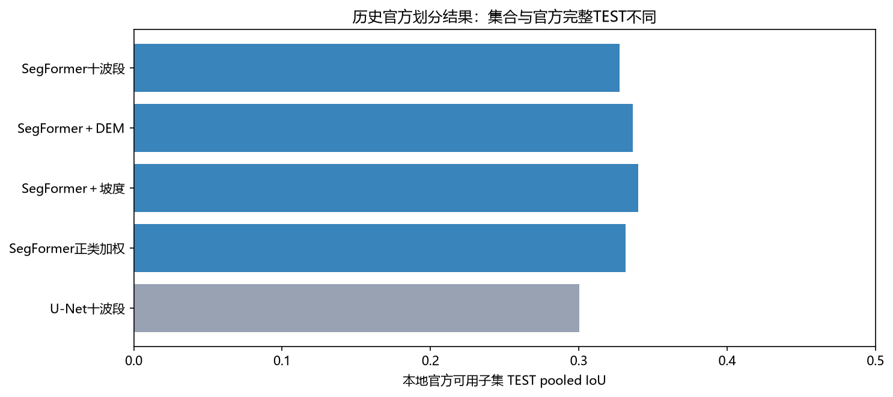
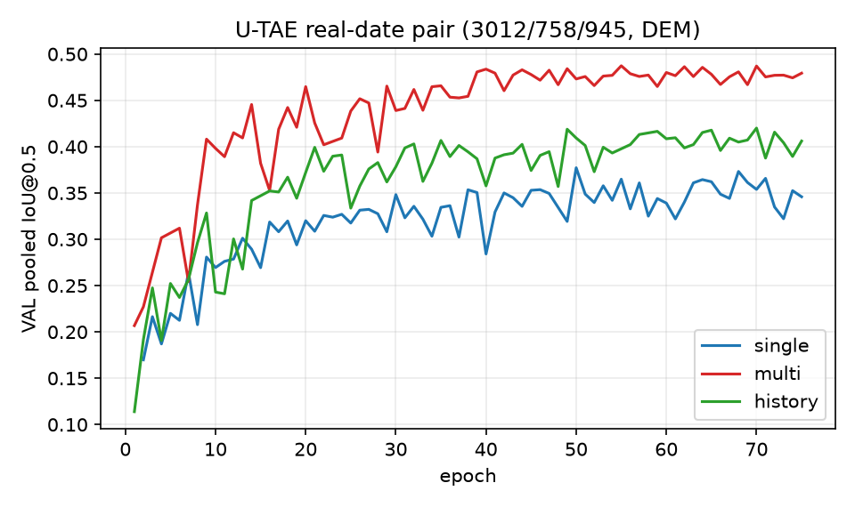
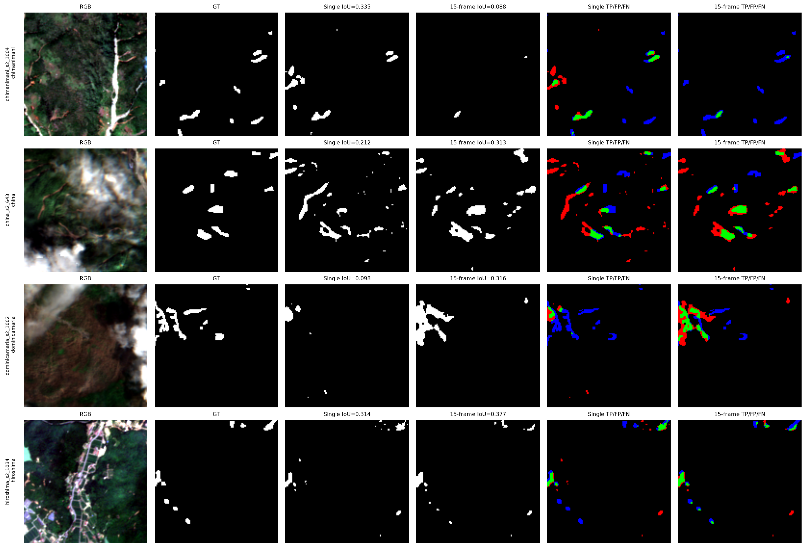

# 官方数据划分（未按事件隔离）：数据条件与历史模型结果

最后维护：2026-10-22。本页只保存按照Sen12Landslides官方成员划分完成的历史结果。后续仍在九事件训练、广岛与特里苏尔验证的[项目方案](DATA_EVENT_PROTOCOL.md)下研发；候选取得明确改善并定型后，才安排新的官方对照。

## 阅读约定与实验设置

### 官方划分与当前方案有什么不同

**官方数据划分（未按事件隔离）**以图块为单位安排训练、验证和测试，因此同一个灾害事件可同时出现在三类集合中。这里“没有区分事件”指划分时未隔离事件，不是源数据缺少事件名称。当前项目方案以整个事件分组，广岛与特里苏尔不参加本轮训练。两者的问题分别接近“同一组事件中未用于训练的图块表现如何”和“模型能否迁移到未参与本轮训练的事件”，不能把它们的分数直接排名。

**训练集**用来更新参数；**验证集**用来选择训练过程中保存的最佳模型；**测试集**原本用于模型定型后的评价。本项目官方测试集合已有反复查看历史，因此不称新的盲测。文件中的`split`只表示成员划分，`TRAIN/VAL/TEST`分别是这三类用途。

### 表一：官方完整集合与本地可用子集

| 数据用途 | 官方完整图块数 | 满足本地单张观测条件 | 排除数 | 当前表格使用哪一种 |
|---|---:|---:|---:|---|
| 训练 | 3192 | 3012 | 180 | 本地可用子集 |
| 验证 | 798 | 758 | 40 | 本地可用子集 |
| 测试 | 998 | 945 | 53 | 本地可用子集 |
| 合计 | 4988 | 4715 | 273 | 不等于整个数据归档的所有图块 |

完整Sentinel-2归档有13628图块，但并非全部属于上述4988个监督任务成员。未标注图块不能自动当成可靠无滑坡样本。273块排除依据观测质量、有效像素比例、日期解析和监督可观测性等固定规则；不是把低预测分数样本事后删除。

每图块含15次十波段观测、场景质量信息、静态高程和滑坡标注。单张实验按预先记录的规则选择参考影像：优先灾后120天内最早满足云量和有效比例条件的一张；无解时使用清单记录的回退并执行最终准入。不看验证或测试成绩挑日期。

每张输入网格为128×128，十波段身份与[项目方案](DATA_EVENT_PROTOCOL.md)一致。本文以有效像素计分，云或无效像素按质量掩膜排除；归一化只由这里的3012块训练集合拟合，不与项目方案的559块核心统计混用。

### 时间与模型术语

参考影像是单张实验已选定的那张，参考日期是它的观测日期。“参考影像细节”表示原始网格细节分支只读取它；“15张特征加权”表示各观测共享空间编码器，然后将日期维特征按权重融合。日期数值来自源观测日期：SegFormer使用相对参考日期的间隔，U-TAE使用观测日期位置编码。具体输入、预测头与旧日期接口区别见[模型解释](MODEL_EVOLUTION.md#多日期影像如何进入模型)。

## 主表二：数据集仓库归档的完整集合参考

| 官方完整系统 | 输入条件 | 滑坡 IoU | Dice/F1 | AP |
|---|---|---:|---:|---:|
| U-ConvLSTM | 多日期影像＋高程 | 0.4488 | 0.6195 | 0.6513 |
| U-Net3D | 多日期影像＋高程 | 0.4166 | 0.5882 | 0.6208 |
| ConvGRU | 多日期影像＋高程 | 0.4191 | 0.5931 | 0.6000 |
| U-TAE | 多日期影像＋高程 | 0.4474 | 0.6180 | 0.6775 |

这些是归档官方文档中的滑坡前景类别数值，不是本次复训：训练75轮、三个随机种子。系统分别使用卷积循环、三维卷积或时间注意力等方式处理多日期输入。完整998块测试、官方全像素统计与本地945块有效像素统计不同，不能据表中高低宣称本项目超过官方。

## 主表三：本地历史结果

下表所有验证与测试分别使用同758、945块。IoU由该集合有效像素的混淆计数汇总后计算，不是按事件等权平均；AP使用像素概率。各行随机种子均为1234，最佳模型由验证成绩选定。不同结构或训练接口的行不是单变量对照。

| 模型与输入变化 | 验证 IoU | 测试 IoU | 测试 AP | 比较条件与限制 |
|---|---:|---:|---:|---|
| SegFormer B0：单张十波段＋原始网格细节修正 | 0.3623 | 0.3275 | 0.4830 | 历史单期主参照 |
| SegFormer B0：单张影像＋高程共同输入＋原始网格细节修正 | 0.3641 | 0.3363 | 0.4902 | 输入卷积、细节分支入口及统计维度均改变 |
| SegFormer B0：单张影像＋坡度共同输入＋原始网格细节修正 | 0.3598 | 0.3402 | 0.4923 | 地形派生输入，不是S2光谱改进 |
| SegFormer B0：单张十波段＋原始网格细节修正，正类加权 | 0.3579 | 0.3314 | 0.4922 | 交叉熵的滑坡像素权重为5，架构未变 |
| ResNet18 U-Net：单张十波段 | 0.3375 | 0.3004 | 0.4339 | 完整系统对照 |
| ResNet18 U-Net：单张影像＋高程 | 0.3353 | 0.3020 | 0.4371 | 额外输入 |
| ResNet18 U-Net：单张影像＋坡度 | 0.3419 | 0.3080 | 0.4428 | 额外输入 |
| ResNet18 U-Net：单张十波段，正类加权 | 0.3320 | 0.3000 | 0.4340 | 损失处理 |
| U-TAE：单张影像＋高程，旧日期接口 | 0.3557 | 0.3324 | 0.5115 | 旧接口未正确使用观测日期编码 |
| U-TAE：全部15张＋高程，旧日期接口 | 0.4896 | 0.4770 | 0.6832 | 比较多张观测，不能单独归因时间间隔 |
| U-TAE：单张影像＋高程，启用观测日期编码 | 0.3772 | 0.3396 | 0.5142 | 完成；与下行同初始状态、同超参 |
| U-TAE：全部15张＋高程，启用观测日期编码 | 0.4873 | 0.4832 | 0.6853 | 由验证集选择最佳模型；测试比单张高0.1436 IoU、0.1711 AP |
| U-TAE：参考日期及以前的影像＋高程 | 0.4200 | 0.4046 | 0.6032 | 不读取参考日期之后影像；比同组单张参照IoU高0.0650 |
| SegFormer B0：单张十波段＋参考影像细节，使用统一时间接口 | 0.3587 | 0.3302 | 0.4816 | 单次显存批量8，以累积方式实现有效批量；训练实现与旧参照不同 |
| SegFormer B0：全部15张特征加权＋参考影像细节 | 0.4149 | 0.4093 | 0.6032 | 完成；Precision涨0.121、Recall涨0.053 |
| SegFormer B0：单张光谱关系编码＋参考影像细节 | 0.3705 | 0.3336 | 0.4811 | 相对统一接口单张参照，IoU +0.0034、AP −0.0005；单种子小差异 |
| SegFormer B0：15张光谱关系编码＋参考影像细节 | 未完成 | 未完成 | — | 中断于 step 2200/3600（val 0.4297）；无共享预算的 test 评测，不进入正交表 |

时序与光谱联合比较只有三组完成；剩余组在3600次计划更新中的第2200次中断，验证IoU为0.4297，没有相同完整预算下的测试结果，不称四组正交实验全部完成。联合高程和坡度的其他运行保留在机器索引，未列出不表示未训练。

## 图与解释

每行是一个历史模型，横轴为同945块测试集合的像素汇总IoU。只在这些相同成员内比较；图中没有官方完整998块的值。地形和类别权重的差异较小，不能仅凭最高的一行称方法取得突破。

横轴是训练轮数，纵轴是758块验证集合的像素汇总IoU；两条线分别为单张与全部15张影像。图中的VAL就是本页验证集合。应看整个训练过程的差异，不只看最后一轮。

每行一块测试影像；列依次为可见光合成、人工标注、单张预测、15张预测及各自错误图。绿、红、蓝分别表示正确检出、误报、漏检。示例不能替代全体统计，也不表示多日期对每个图块都有收益。

## 展开结论

**在本地官方可用子集，多日期输入的改善较大。** 使用观测日期编码的U-TAE从单张0.3396提高到15张0.4832，差0.1436；同样保留参考影像细节分支的SegFormer B0，单张输入测试IoU为0.3302，全部15张特征加权输入为0.4093，两者差0.0791。但这些差值同时改变观测张数、时间跨度和参考日期后的信息，不能解释成时间编码单独造成收益。

**限制参考日期以后的观测后，U-TAE的改善缩小。** 只用参考日期及以前影像的测试IoU为0.4046，比单张高0.0650；完整15张相对单张的改善是0.1436。较晚观测可能提供更清晰的地表变化，这是待验证解释；序列长度与训练曝光也不同，因此不能将全部差值归为未来观测。

**本轮没有观察到单张光谱关系模块的明确改善。** 相同时间接口下，IoU增加0.0034而AP减少0.0005；只有一个种子，不能断言这是随机噪声，也不能宣称模块有效。历史四折中多日期未显示一致迁移收益，见[独立历史诊断](DATA_EVENT_PROTOCOL.md#附录二历史四折时间输入诊断不是默认训练队列)，不与本页测试分数混排。

## 限制与下一步

本页数值不直接减当前项目验证0.3081；成员、观测条件、统计与选模不同，已有结果不能确定哪一个差异因素贡献了多少。官方测试已被历史查看，不以它继续搜索同一候选。下一步光谱对照仍用既有九事件训练、两事件验证方案，只有候选明显改善并冻结后才登记新的官方比较。

## 附录：实现、成本与证据

官方任务目录标识为`S12LS-LD/harmonized/s2`，仓库版本锁定在提交`2eb025bd76bef449d2f7cf4aaea861bc4cfeed51`，不是对上游最新状态的声明。完整成员见[官方划分文件](../vendor/official/Sen12Landslides/tasks/S12LS-LD/harmonized/s2/splits.json)，可用子集见[协议锁](../manifests/official_single/protocol_lock.json)和[成员协议](../manifests/official_single/protocol.json)。

官方参考来源见[归档协议对照](../archive/experiment_history/reports/P0_official_benchmark_protocol.md)，原本地对照见[历史审阅](../archive/experiment_history/docs/latest_experiments_review_2026-10-20.md)。历史SegFormer约375万参数、训练687秒、峰值4694 MiB；U-Net约1435万、544秒、1852 MiB。这些是已有运行记录，不是本次重新测速。

时序证据由[历史执行结果](../archive/experiment_history/docs/v6_temporal_spectral_2026-10-21.md)及原运行目录追溯；配置、权重身份与评价文件索引见[机器索引](assets/research/experiment_registry.json)。旧实验路径与配置字段保持兼容，只更正展示名称和解释。
