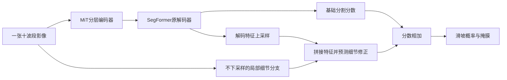

# 模型结构、监督目标与实验演变

最后维护：2026-10-22。本页回答“每一路输入什么、用什么网络、学习什么、与哪一路相连”。**当前仍以十波段SegFormer B0＋细节分支为参照；本轮地形对照未替换它，历史官方模型与多日期模型也不是当前主模型。**成绩见[项目数据与结果](DATA_EVENT_PROTOCOL.md)及[官方划分结果](DATA_OFFICIAL.md)；阶段计划不表示后一模型一定继承前一模型权重。

## 阅读约定与实验设置

**SegFormer**是本项目复用的图像分割模型：编码器从影像提取不同尺度的特征，解码器把这些特征组合成分割预测。实现来自Hugging Face Transformers，空间预训练权重来自NVIDIA发布的ADE20K分割模型。**MiT**是它的分层Transformer编码器；B0与B2表示同一模型族的不同规模，B2更大，不表示输入波段更多。

**分割分数（logit）**是输出概率前的实数，每个像素一个。经过sigmoid函数变成0到1的滑坡概率，再以0.5阈值生成二值掩膜。本文的“分数相加”发生在sigmoid之前，不是把两张二值掩膜叠加。

**细节分支（代码名SpectralStem）**与**输入投影**不同：前者保留输入网格提局部特征，后者把十波段转换为三个可学习通道。旧名称容易混淆，正文不再都简称Stem。

## 当前影像基线：原始网格细节怎样进入SegFormer

### 表一：组件、作用和权重来源

| 组件 | 输入、输出与作用 | 当前训练方式 |
|---|---|---|
| 十波段输入层 | 接收同一日期的十波段，进入MiT第一层 | RGB预训练卷积对应B04/B03/B02；其余七波段初始权重为零但可以训练。 |
| MiT-B0编码器 | 逐级降低特征网格尺寸，提取四个层次的空间特征 | 加载预训练权重，当前基线全部微调。 |
| SegFormer原解码器 | 融合四级特征，生成基础分割分数和解码特征 | 保留成熟解码结构；原多类别输出改为二分类输出。 |
| 原始网格细节分支 | 直接读取同一十波段影像，依次做1×1、3×3卷积，不下采样 | 新建且随机初始化，由训练集滑坡标注学习，不属于官方预训练权重。 |
| 细节修正头 | 将解码特征上采样，与细节特征拼接，预测一张分数修正图 | 最后一层零初始化；训练后允许改变基础预测。 |
| 结果输出 | 基础分数＋细节修正，恢复到输入尺寸 | sigmoid生成概率，阈值生成滑坡掩膜。 |

上路负责分层空间特征，下路直接保留输入网格上的局部特征。应看细节分支从**原影像并行出发**，不是串接在SegFormer之后，也不是新增超分辨率模型；最后只输出一张滑坡掩膜。当前影像基线约375万参数，均可训练。

十波段直入的对照方案是先用可训练1×1卷积将十波段投影到三个通道，再进入原三通道SegFormer。若细节分支开启，它仍读原十波段；投影与细节分支可以分别消融。图像128×128对应已有图块网格，权重名字中的512不要求将其放大到512。

## 地形分支的结构与监督来源

### 先区分研究方向、模型结构和训练方法

原研究方向是**地形信息辅助单期滑坡分割**。本轮先检验把高程和坡度直接加入影像是否有效，再检验独立地形分支及其提前训练是否有效；没有把这些方案全部累加成一个当前模型。

独立地形分支的五种实验使用同样的编码器与评分头结构。所谓“随机地形编码器”实际指**不先预训练该分支，从初始参数开始参与滑坡分割训练**；“随机”描述参数的起点，不是随机修改高程，也不是另一种地形编码算法。

所谓“高程重建预训练”是**地形自监督的一种具体实现**：先遮住部分高程和坡度，训练网络补回未遮挡前的高程，再将编码器用于滑坡分割。“重建”在这里是训练任务，不是新增影像源，也不是最终滑坡分割的输出。完整表格把结构与提前训练方式分别列出，避免把“先训练什么”混成“采用什么模型”。

### 独立地形分支的输入、网络和输出

地形输入是**数字高程模型（DEM，表示地表海拔）与由高程计算的坡度**。它们沿两个通道进入地形编码器，不是文本、灾种标签或新拍摄的卫星影像。

编码器复用Torchvision ResNet18的**初始卷积、池化及第一组残差块**，没有增加完整ResNet18骨干。它将128×128地形图转为32×32特征。当前工厂函数明确禁用ImageNet初始化；随机组从随机参数开始，其他组加载本项目训练出的地形权重。

预测头由3×3卷积、归一化与激活、1×1卷积组成，把地形特征变成一张分数图，再双线性上采样回输入网格。原报告的“读出头”“软评分预测”均指这个**卷积分数预测头**，不是随机森林、逻辑回归或独立易发性数据集。

融合公式为：

`最终分割分数 = 影像分割分数 + α × tanh(地形预测分数)`。

其中α控制地形修正幅度，tanh将地形分数限制在−1到1之间。因此地形既可提高某像素的滑坡分数，也可降低它。它不是“先定位、再裁剪精分”的两个阶段，也没有硬门槛先删除低分区域；地形输出不能直接解释成经过校准的滑坡发生概率。

上部蓝色两路共同组成原影像基线；下部绿色是独立地形输入与编码器，最终只在分割分数处相加。影像网络结构保留，但参数仍参与共同训练；“结构不变”不表示冻结。高程与坡度直接输入的另一组则把输入层和细节分支均扩为12通道，不使用这条独立地形支路。

### 表二：“监督”由什么数据提供

“监督目标”是计算误差时的参考答案，不一定来自教师模型。当前自监督来自高程自身；人工标签监督来自已有训练滑坡标注。两者都通过损失函数反向传播更新参数。

| 训练阶段 | 网络看到什么 | 希望预测什么、怎样计算误差 | 是否需要人工滑坡标注 |
|---|---|---|---|
| 分割前先做地形自监督（具体任务为遮挡后补回高程） | 训练区高程与坡度；按16×16像素块随机同时遮挡约一半位置 | 临时重建解码器恢复原高程，仅在被遮位置计算归一化高程的绝对误差；3000次更新 | 不需要。原始高程就是参考答案。 |
| 滑坡面积比例预训练（旧称同源监督） | 未遮挡的训练区高程与坡度 | 将已有二值滑坡标注按16×16块求均值，再插值回输入网格；预测这一局部滑坡面积比例，使用二元交叉熵，3000次更新 | 需要，复用最终分割任务的同一套训练标注，没有新增独立历史调查数据。 |
| 最终分割训练 | 十波段影像与地形信息，按具体方案连接 | 最终融合预测与原逐像素滑坡标注比较，使用BCE＋Dice；3600次更新 | 需要。训练区人工滑坡标注监督影像、地形和融合参数。 |

### 用已有滑坡标注预训练地形网络：一个具体例子

下面是说明算法的数字示例，不是新增实验样本。假设某张训练影像的一个16×16像素区域全部有效，其中64个像素在人工掩膜里标为1（滑坡），剩余192个标为0（背景）。这个区域的已标注滑坡面积比例为：

`64 ÷ (16 × 16) = 0.25`。

这次预训练要让网络完成的任务是：**只看高程和坡度，预测人工标注中这个区域的滑坡像素约占25%**。人工滑坡掩膜只用于提供参考答案，不输入地形编码器；不是让模型自己生成一份更可靠的新标签。

代码的完整流程是：

1. 网络输入仍是整张128×128的高程与坡度图，不是单独裁剪的16×16小图。
2. 128×128人工二值掩膜按16×16区域求均值，变成8×8比例图；上例的0.25是其中一个位置的目标值。
3. 用双线性插值将8×8比例图恢复到128×128，区域交界处的比例随插值平滑，得到训练参考图。
4. 地形编码器和卷积预测头输出分数图，用二元交叉熵使预测接近参考图；损失通过反向传播更新编码器与预测头。仅使用2223块训练图块及其标注，不使用669块验证图块的标注。

所以它是一种**由原滑坡标注派生的粗尺度监督**。它舍弃了一部分精确轮廓，尝试学习地形与已标注滑坡分布的关联；能否帮助后续逐像素分割是需要实验回答的问题，不是这段训练定义本身能保证的。

0.25表示“这张已有标注里滑坡像素的占比”，**不表示该位置未来发生滑坡的概率**。由于参考答案与最终分割来自同一套人工标注，也不能称新增了一套独立地形易发性调查数据。旧称“同源监督”不再单独充当方法解释。

高程重建“6000步”组是在3000步基础上再重建3000步，用来检查额外预训练预算；它没有新增标注。直接输入和随机地形编码器组没有这段预训练。各组最终分割更新次数相同，不代表总训练次数相同。

三行依次是高程重建、局部滑坡面积比例预测、最终分割。应看右侧参考答案分别来自原始高程、人工滑坡标注的区块平均、原逐像素人工标注。高程重建的临时解码器在分割阶段被移除；地形分数预测头则进入最终融合。

### 现有实现的准确边界

随机、高程重建预训练、6000步重建及固定α四个独立分支方案，新分数头的输出层从零开始；因此刚初始化时地形修正为零。α初始0.01，避免它与输出层同时为零导致分支无法开始学习。输出层先得到梯度，前面的编码器随后才能得到非零梯度；不能写成所有地形参数在第一步均有梯度。

**滑坡比例预训练组是例外。** 它加载已经训练过且不为零的分数头，不能套用“初始预测逐位等于视觉基线”的说法。保存配置指定：编码器来自`v4r1_ssl.pt`，预测头来自`v4r1_scoring.pt`；当前加载函数分别读取两个文件，未迁移后者更新过的编码器。CPU核对确认，滑坡比例训练后编码器状态确实与重建阶段不同。因此该结果只能称“重建编码器＋标签比例预训练头”，不能称完整联合预训练已验证；本次没有更改训练实现或重训。

另外，当前高程重建损失只按遮挡位置计算，未额外乘有效像素掩膜；局部滑坡比例的区块平均也先于有效像素加权，交叉熵损失阶段才使用有效像素掩膜。这些实现限制需要保留，不能描述成已完成所有无效像素排除。α数值来自最佳模型；真正的修正是α与tanh输出的乘积，仅看α不够判断地形是否有效。

## 多日期影像如何进入模型

### 参考影像、参考日期和细节输入

每个图块先按质量及灾后时间窗口规则选出一张影像，原单期实验只用它。本文称其为**参考影像**，其观测日期为**参考日期**；旧报告的“目标单期”“目标帧”是同一个意思。它不是灾害发生日，也不意味着人工标注与该日期完全同步。

“参考影像细节”表示不下采样的细节分支只读取这一张影像。多日期信息进入共享空间编码器与时间特征融合，而非把全部日期影像都堆入细节分支。若光谱模块开启，细节分支读取的是该参考影像经过光谱模块后的十波段输出。

### 表三：三种时间输入条件

| 人类可读名称 | 进入模型的影像 | 评价时应说明什么 |
|---|---|---|
| 仅参考影像 | 原先选定的一张十波段影像 | 单期信息条件。 |
| 参考日期及以前的观测 | 序列开头至参考影像，包含参考影像 | 每图块张数可能不同；不读取参考日期以后的影像。当前实现按序列索引截取，日期来自源序列。 |
| 完整15次观测 | 数据集中该图块的全部15张影像 | 回顾性条件，可能包含参考日期以后的信息，不能称即时可用。 |

所有组预测同一张滑坡标注；没有为每个日期补造一张独立标签。参考日期以后信息带来的收益，不能要求单期模型凭空恢复。

### “日期聚合”如何计算

SegFormer的每张影像经过**同一套共享编码器**，得到四级空间特征。在每一级、每个位置，网络根据影像特征与距参考日期的时间差，产生各观测的权重；权重经softmax归一化后，对日期维度的特征加权求和。融合后的四级特征进入原SegFormer解码器，细节分支仍只读取参考影像。

这是“影像内容和日期间隔参与的时间特征加权”，不是对日期求平均。只有一张影像时，日期维度权重恒为1，这个时间融合环节不改变特征；不表示整套模型训练过程与所有旧单期实验都相同。

### 为什么不再笼统称“真实日期”

数据加载器把源数据记录的观测日期转换为相对2015-12-03的天数。**SegFormer**再减去参考影像的天数，用相对间隔及其周期函数参与权重预测；**U-TAE**则将这一天数传给原有时间位置编码，并在注意力前实际加入编码。

旧接口的问题是用第0、1、2…张的序号代替日期，以及U-TAE导入实现中日期位置编码未实际加入前向计算。修正的是日期信息的表示与调用，不是换成了“更真实的图像”、验证了标签时刻，或获得了无误差的灾害日期。多帧差值同时受张数、时间跨度和未来观测影响，不能全归因于日期编码。

U-TAE是另一套带时间注意力的U形分割网络，本项目复用数据集仓库实现并重新训练；它接收每期十波段及重复广播的静态高程。它没有本项目SegFormer的独立原始网格细节支路，不能把两者写成同一结构。

## 历史组件名称的解释

“辅助监督”是对同一人工标注增加一个损失，例如同时约束基础输出和最终输出，不是新增标签提供者。“粗概率条件精分”将基础概率作为另一个特征输入，仍在整图像素网格计算，没有候选区域裁剪，不等同真正定位后再分割。

“注意力融合”表示根据特征预测融合权重，不能仅因存在可学习权重就称有用；“冻结探针”表示固定编码器、只训练读取头，不能代表完整微调模型。DOFA是可根据输入波长适配的遥感预训练编码器，历史冻结结果不等于全部光谱方案的结论。

U-Net是另一种编码—解码分割结构；本项目使用的SMP是`segmentation_models_pytorch`库的简称，用它复用成熟U-Net实现，并非一种新损失或新增监督来源。TerraMind/TiM、AnySat及文本语义接口属于早期工程，当前主训练不使用，保留源码与历史证据。

## 阶段目标与相邻阶段变化（简述）

本表由[阶段台账](assets/research/stage_ledger.json)生成，记录每阶段目标、改变和结果；不在别处另建平行总结。上一行的结果不意味着下一行一定继承它的模型。

展开历史阶段与后续计划：各阶段目标、变化和结果

<!-- STAGE_TABLE_START -->

| 阶段 | 数据划分 | 实验目标 | 相对上一阶段改变了什么 | 结果与状态 |
|---|---|---|---|---|
| 早期完整系统的工程验证 | 我们的数据划分（留事件验证） | 检查影像、预训练模型、文本语义和粗细分割接口能否共同运行。 | 建立最初的数据读入与多模块训练接口；这些模块不属于当前SegFormer主训练。 | 前向、反向和小样本训练已运行；训练样本少，不能据此比较各基础模型能力。 **历史完成** |
| 十波段输入适配与影像细节对照 | 我们的数据划分（留事件验证） | 比较直接读取十波段和投影为三通道，并检查不下采样细节分支的作用。 | 改用成熟SegFormer编码器和解码器，分别开启两种输入适配与细节分支。 | 四种组合已训练，输入方式的排序随数据版本变化；没有一种方式在所有版本持续领先。 **完成** |
| 观测日期清理与数据扩展 | 我们的数据划分（留事件验证） | 减少影像日期选择风险，增加符合要求的训练图块。 | 重新选择部分训练影像日期或隔离样本；仍使用十波段，同时测试集合成员增加。 | 合法训练样本增加有限，主要扩展了意大利评价图块；不同评价成员的分数不能直接相减。 **完成** |
| 基础预测引导与不同融合结构 | 我们的数据划分（留事件验证） | 检查基础概率、附加损失和特征融合是否帮助细节分割。 | 在影像细节基线上比较概率条件、移除基础输出附加损失、边界加权和单头注意力融合。 | 没有形成候选区域裁剪后的真正两阶段流程；本批注意力融合未显示稳定改善。 **完成** |
| 同一批训练事件内增加图块 | 我们的数据划分（留事件验证） | 判断增加现有事件的训练图块能否持续改善验证结果。 | 九训练事件和广岛、特里苏尔验证事件保持相同；训练量为559、1113、1671、2223，模型与更新预算相同。 | 验证事件平均IoU依次为0.2870、0.3112、0.3143、0.3081，不随数据量单调增加；后期训练改善未同步转为验证改善。 **完成** |
| 比较较早与较晚的编码器状态 | 我们的数据划分（留事件验证） | 检查训练后期的编码器变化是否与验证下降有关。 | 分别固定同一模型训练较早和结束时的编码器，训练相同初始化的解码器，不使用影像细节分支。 | 固定较早编码器组验证IoU约0.2731，固定较晚编码器组约0.2463；不能单独证明遗忘或解码器是唯一原因。 **完成** |
| 编码器学习率与遥感预训练对照 | 我们的数据划分（留事件验证） | 检查降低编码器更新速度或更换预训练编码器能否改善当前基线。 | 一组降低首层以外编码器学习率；另一组改用DOFA遥感编码器及匹配的特征金字塔解码结构。 | B0＋细节参照IoU 0.3081；低编码器学习率B0为0.2823，DOFA完整系统为0.1969；后者并非纯编码器对照。 **完成** |
| 在编码过程中交换影像细节 | 我们的数据划分（留事件验证） | 检查不下采样特征更早影响编码器是否有帮助。 | 在编码器第二阶段后比较分支各自残差处理与双向特征交换，保留末端细节修正。 | B0末端细节参照IoU 0.3081；增加分支内残差为0.2969，双向交换为0.3034；本批未提高IoU。 **完成并停止扩展** |
| 训练事件覆盖与较大模型对照 | 我们的数据划分（留事件验证） | 区分训练事件组成与模型规模的影响。 | 同1251块比较三事件与九事件；同2223块比较SegFormer B0与B2。 | 同1251训练块，三事件/九事件IoU为0.2300/0.2908；同2223块B0/B2为0.3082/0.2698。B2上游权重身份仍有限制。 **完成** |
| 官方图块划分下的单张影像参照 | 官方数据划分（未按事件隔离） | 记录官方成员划分条件下的单期模型表现。 | 使用3012训练、758验证、945测试图块，按验证像素汇总IoU选模，同一灾害事件可出现在不同集合。 | 单期细节SegFormer测试IoU约0.3275；与整事件划分结果及完整998块官方测试结果均不可直接排名。 **完成（历史协议）** |
| 官方划分下的高程与模型结构对照 | 官方数据划分（未按事件隔离） | 检查增加地形信息、增加滑坡像素损失权重及使用U-Net的影响。 | 保持本地官方子集不变；加入高程或坡度、改变交叉熵权重，并比较U-Net完整系统。 | 多数改变量不足0.02；该批SegFormer优于U-Net，但不是单独验证光谱或解码器作用的实验。 **完成** |
| 历史四次事件划分与多日期参考 | 我们的数据划分（留事件验证） | 评估不同未参与训练事件的迁移表现，并检查多日期输入。 | 建立四次整事件训练、选模验证和评价划分；分别拟合训练统计，比较完整微调和固定编码器读取。 | 完整B0四次评价IoU均值0.1685；发现波长映射、日期使用及对象匹配问题，错误输入结果不用于机制结论。 **完成但发现需修正项** |
| 修正观测日期编码与波段波长映射 | 两类均有：波长纠错用我们的事件划分；时间与光谱对照用官方划分 | 复核多日期结果，比较时间特征加权和光谱关系模块。 | 按波段名修正波长；启用源观测日期编码；每日期共享编码器、解码前融合特征，光谱模块独立开启。 | 官方可用子集U-TAE单张、15张、截止参考日期分别为0.3396、0.4832、0.4046；SegFormer对应完成的单张、15张、单张光谱组为0.3302、0.4093、0.3336；联合组中断。 **完成（15期光谱中断）** |
| 历史多日期输入的跨事件复验 | 我们的数据划分（留事件验证） | 检查官方子集的多日期改善是否迁移到未参与训练的事件。 | U-TAE在四次事件划分中分别比较单张、参考日期及以前、完整15张，保持各次训练成员与批次顺序。 | 前两组四折均值0.1589和0.0684；15张仅三折均值0.1279，同三折配对差−0.0304。不同事件方向不一致，日期干预只提示敏感性。 **历史诊断；本次核对11/12完成，非默认续跑队列** |
| 高程、坡度与地形预训练对照 | 我们的数据划分（留事件验证） | 区分地形输入、额外参数、高程重建及标签比例预训练的作用。 | 协议 event_ood_v4r1（TRAIN 2223 / DEV 669，seed1234）；缓存与清单冻结，地形以侧表加入；六组共用同一 TRAIN、3600 更新与 DEV 事件平均 IoU 选模；坡度按 0.01° 原始单位归一化（修正旧版 100 倍尺度错误），α 可学习、读出头零初始化。 | 修正坡度单位后六组重跑：验证事件平均 IoU 0.3067–0.3096（基线 0.3081），全部落在 −0.0015～+0.0015；12 通道直入 0.3067（对象召回 0.5622 高于基线 0.5211，但边界 F1 0.4544 低于 0.4806）；地形自监督组最高 0.3096（+0.0015），同源评分头组最低 0.3076（融合系数仅 0.048）。评分头自身在 11318 个 16×16 格子上与真实滑坡比例的相关系数只有 0.087，基本是常数输出。 **完成（六组，单seed；坡度单位修正后重跑）** |
| 计划中的单张影像光谱独立对照 | 我们的数据划分（留事件验证） | 区分光谱指数、波段物理信息、轻量交互和可学习融合权重的贡献。 | 继续使用九事件训练、两事件验证及原影像基线，不叠加地形或多日期模块，只增加一个独立光谱信息条件。 | 本轮正式光谱实验尚未开始；旧官方单张光谱IoU增加0.0034、AP减少0.0005不能作为新方案有效的证据。 **计划已落项目；正式配置待实现** |

<!-- STAGE_TABLE_END -->

## 限制与下一步

当前地形结果没有支持把该分支加入后续候选；标签比例预训练加载限制也未修复重训。下一步独立光谱实验仍使用九事件训练、广岛与特里苏尔验证的同一成员；不默认四折，不叠加地形或多日期网络。尚未运行的光谱六种方案不能在图或名称中写成已有收益。

正文展示名由“模型规格＋实际输入＋连接方式”组成，初始化与损失作为训练处理另列，例如“SegFormer B0｜单张十波段｜原始网格细节修正”，再注明“地形高程重建预训练”。历史实验字符串、目录与权重不重命名，保留恢复兼容；代码字段只放配置索引。

## 附录：源码和产物

- 成熟空间模型与输入适配：[segformer.py](../src/landslide_seg/models/segformer.py)；原始网格细节与修正头：[spectral_stem.py](../src/landslide_seg/models/spectral_stem.py)。
- 地形编码器与预测头：[terrain.py](../src/landslide_seg/models/terrain.py)；实际加载入口：[factory.py](../src/landslide_seg/models/factory.py)；高程重建与标签比例训练：[pretrain_terrain.py](../scripts/pretrain_terrain.py)。
- 时间特征权重：[spectral_temporal.py](../src/landslide_seg/models/spectral_temporal.py)；日期与参考影像索引：[temporal_v6.py](../src/landslide_seg/data/temporal_v6.py)；U-TAE日期位置编码适配：[utae_dates.py](../src/landslide_seg/models/utae_dates.py)。
- 当前基线、地形结果及完整原运行身份见[数据专题](DATA_EVENT_PROTOCOL.md)和[机器索引](assets/research/experiment_registry.json)。
