# 模型结构、监督目标与实验演变

最后维护：2026-10-22。本页回答“每一路输入什么、用什么网络、学习什么、与哪一路相连”。**当前仍以十波段SegFormer B0＋细节分支为参照；本轮地形对照未替换它，历史官方模型与多日期模型也不是当前主模型。**成绩见[项目数据与结果](DATA_EVENT_PROTOCOL.md)及[官方划分结果](DATA_OFFICIAL.md)；阶段计划不表示后一模型一定继承前一模型权重。

## USE双路线已实现连接与正式执行

本轮是三组独立运行的SegFormer B0同构对照：原生RGB视觉入口参照、RGB视觉入口加光谱残差、光谱Token直接生成并接受RGB教师对齐。三组采用同样的MiT空间编码结构和分割头，各自保留独立权重；下面不标张量尺寸或中间通道。

共同光谱前端接收多光谱影像、波段物理信息（如波长、带宽、分辨率）以及有效/可见掩膜。它把局部影像片段的各波段编码成Token，结合物理信息做波段注意力，再由学习查询读出两类特征：早期Fine由细节查询和像元残差构成，作为原始网格细节旁路；另一份光谱查询特征用于构造MiT入口。Fine在MiT之前产生，空间处理由后续MiT承担。

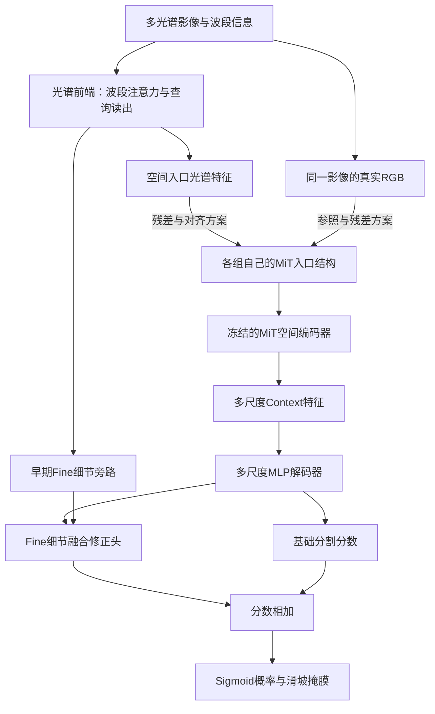

图中条件箭头对应三种替代入口，表示各组实际使用的连接；三组分别运行。Fine与解码特征在细节修正头中融合，输出一张分数修正图，与基础分割分数相加后再转为概率。

| 架构方案 | MiT入口的实际构造 | Fine来源与本轮训练方式 | 推理入口要求 |
|---|---|---|---|
| SegFormer B0｜原生RGB入口＋固定初始Fine（同构参照） | 真实RGB→原Patch投影→原LayerNorm→MiT | 共同v3光谱前端产生，保持固定，不做本轮新增无标签更新 | 需要可核验的真实RGB；也运行产生Fine所需的光谱前端 |
| SegFormer B0｜RGB入口＋光谱残差 | RGB原投影＋光谱查询经适配器及零起点输出投影的残差，再过一次原LayerNorm→MiT | 光谱前端参与本轮无标签预训练，Fine随其变化 | 需要真实RGB及多光谱观测；RGB来自相同学生可见输入 |
| SegFormer B0｜光谱Token＋RGB教师对齐 | 光谱查询→适配器→原LayerNorm→MiT | 光谱前端参与恢复及入口对齐目标，Fine随其变化 | 部署保留学生光谱入口，不携带教师或独立RGB视觉入口 |

视觉残差方案的末端输出投影从零开始；相同RGB与空间支持条件下，初始入口数值等同原视觉入口，之后学习光谱补充。它不把随机光谱输出直接替换到原视觉投影上。人工遮挡的RGB在学生视觉入口同步隐藏，不能读取隐藏真值。

光谱对齐方案的教师只在无标签预训练任务模块中出现：同一训练样本、同一几何增强的原始RGB，经冻结的原Patch投影和LayerNorm生成停止梯度的目标。对齐位置是MiT第一空间阶段之前的入口Token；教师只包含这一段入口模块。学生与教师在合法支持位置计算余弦差异，以固定0.20系数加到共享恢复目标。教师不进入学生特征、公共验证或分割部署。

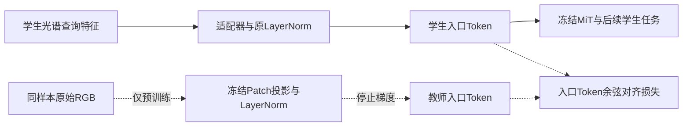

虚线只用于预训练监督，教师目标不作为学生前向输入。本轮分割仍使用同一多光谱观测；光谱对齐方案的区别是没有独立RGB视觉主入口，而不是本轮数据删除了RGB波段。

初始化与更新边界单独说明：光谱前端共同起点为固定v3无标签入选权重；MiT及原多尺度解码器来自本地ADE20K SegFormer B0，带有ImageNet/ADE20K外部监督历史。适配器、二分类输出层和细节修正头采用约定的新初始化，末端残差输出从零开始；三组分割任务头使用同一份初始张量。

无标签预训练期间，光谱前端、入口适配器和恢复头更新，MiT原参数与视觉投影保持冻结，梯度仍可穿过MiT到达上游。恢复目标包括补回被遮波段、像元细节、空间区域以及梯度与视图一致性，光谱对齐方案额外增加上述教师目标。随后恢复探针冻结完整编码器、仅训练各自恢复头；正式分割同样冻结完整编码器，只训练多尺度MLP解码器、二分类输出和Fine细节修正头，BN运行统计保持固定。恢复头不进入最终分割前向。

两条预训练方案的Fine也被训练改变，而同构参照Fine保持共同起点，因此将来即使视觉残差方案优于参照，也不能把收益全部归于Context残差。实际代码见[编码器及教师](../src/landslide_seg/models/use_mit_dual_routes.py)、[原生尺度恢复与分割消费者](../src/landslide_seg/models/use_v4_reconstruction.py)、[细节分数修正](../src/landslide_seg/models/spectral_stem.py)。实时结果见[固定数据文档](DATA_EVENT_PROTOCOL.md#use双路线独立验收与执行状态)；工程门禁已通过，正式运行状态不等于最终研究结论。

## 阅读约定与实验设置

**SegFormer**是本项目复用的图像分割模型：编码器从影像提取不同尺度的特征，解码器把这些特征组合成分割预测。实现来自Hugging Face Transformers，空间预训练权重来自NVIDIA发布的ADE20K分割模型。**MiT**是它的分层Transformer编码器；B0与B2表示同一模型族的不同规模，B2更大，不表示输入波段更多。

**分割分数（logit）**是输出概率前的实数，每个像素一个。经过sigmoid函数变成0到1的滑坡概率，再以0.5阈值生成二值掩膜。本文的“分数相加”发生在sigmoid之前，不是把两张二值掩膜叠加。

**细节分支（代码名SpectralStem）**与**输入投影**不同：前者保留输入网格提局部特征，后者把十波段转换为三个可学习通道。旧名称容易混淆，正文不再都简称Stem。

## 当前影像基线：原始网格细节怎样进入SegFormer

### 表一：组件、作用和权重来源

| 组件 | 输入、输出与作用 | 当前训练方式 |
|---|---|---|
| 十波段输入层 | 接收同一日期的十波段，进入MiT第一层 | RGB预训练卷积对应B04/B03/B02；其余七波段初始权重为零但可以训练。 |
| MiT-B0编码器 | 逐级降低特征网格尺寸，提取四个层次的空间特征 | 加载预训练权重，当前基线全部微调。 |
| SegFormer原解码器 | 融合四级特征，生成基础分割分数和解码特征 | 保留成熟解码结构；原多类别输出改为二分类输出。 |
| 原始网格细节分支 | 直接读取同一十波段影像，依次做1×1、3×3卷积，不下采样 | 新建且随机初始化，由训练集滑坡标注学习，不属于官方预训练权重。 |
| 细节修正头 | 将解码特征上采样，与细节特征拼接，预测一张分数修正图 | 最后一层零初始化；训练后允许改变基础预测。 |
| 结果输出 | 基础分数＋细节修正，恢复到输入尺寸 | sigmoid生成概率，阈值生成滑坡掩膜。 |

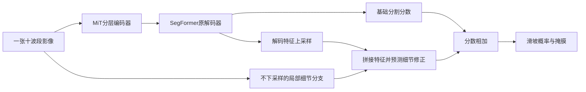

上路负责分层空间特征，下路直接保留输入网格上的局部特征。应看细节分支从**原影像并行出发**，不是串接在SegFormer之后，也不是新增超分辨率模型；最后只输出一张滑坡掩膜。当前影像基线约375万参数，均可训练。

十波段直入的对照方案是先用可训练1×1卷积将十波段投影到三个通道，再进入原三通道SegFormer。若细节分支开启，它仍读原十波段；投影与细节分支可以分别消融。图像128×128对应已有图块网格，权重名字中的512不要求将其放大到512。

## 地形分支的结构与监督来源

### 先区分研究方向、模型结构和训练方法

原研究方向是**地形信息辅助单期滑坡分割**。本轮先检验把高程和坡度直接加入影像是否有效，再检验独立地形分支及其提前训练是否有效；没有把这些方案全部累加成一个当前模型。

独立地形分支的五种实验使用同样的编码器与评分头结构。所谓“随机地形编码器”实际指**不先预训练该分支，从初始参数开始参与滑坡分割训练**；“随机”描述参数的起点，不是随机修改高程，也不是另一种地形编码算法。

所谓“高程重建预训练”是**地形自监督的一种具体实现**：先遮住部分高程和坡度，训练网络补回未遮挡前的高程，再将编码器用于滑坡分割。“重建”在这里是训练任务，不是新增影像源，也不是最终滑坡分割的输出。完整表格把结构与提前训练方式分别列出，避免把“先训练什么”混成“采用什么模型”。

### 独立地形分支的输入、网络和输出

地形输入是**数字高程模型（DEM，表示地表海拔）与由高程计算的坡度**。它们沿两个通道进入地形编码器，不是文本、灾种标签或新拍摄的卫星影像。

编码器复用Torchvision ResNet18的**初始卷积、池化及第一组残差块**，没有增加完整ResNet18骨干。它将128×128地形图转为32×32特征。当前工厂函数明确禁用ImageNet初始化；随机组从随机参数开始，其他组加载本项目训练出的地形权重。

预测头由3×3卷积、归一化与激活、1×1卷积组成，把地形特征变成一张分数图，再双线性上采样回输入网格。原报告的“读出头”“软评分预测”均指这个**卷积分数预测头**，不是随机森林、逻辑回归或独立易发性数据集。

融合公式为：

`最终分割分数 = 影像分割分数 + α × tanh(地形预测分数)`。

其中α控制地形修正幅度，tanh将地形分数限制在−1到1之间。因此地形既可提高某像素的滑坡分数，也可降低它。它不是“先定位、再裁剪精分”的两个阶段，也没有硬门槛先删除低分区域；地形输出不能直接解释成经过校准的滑坡发生概率。

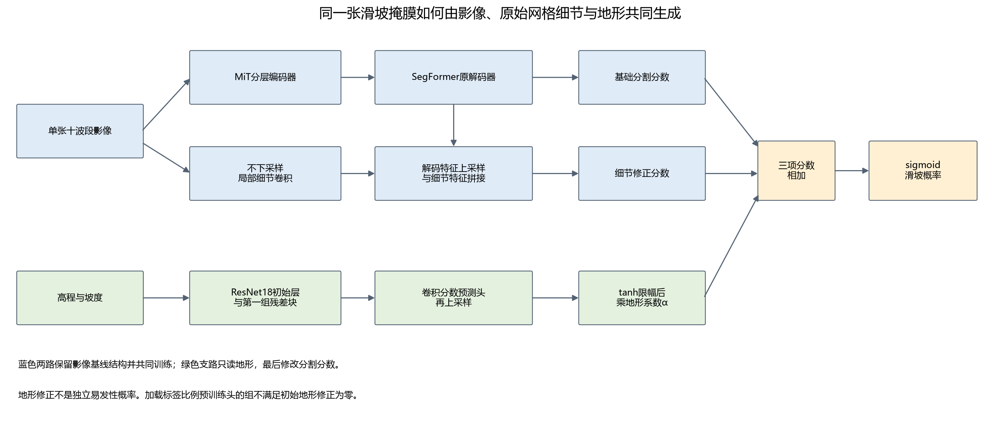

上部蓝色两路共同组成原影像基线；下部绿色是独立地形输入与编码器，最终只在分割分数处相加。影像网络结构保留，但参数仍参与共同训练；“结构不变”不表示冻结。高程与坡度直接输入的另一组则把输入层和细节分支均扩为12通道，不使用这条独立地形支路。

### 表二：“监督”由什么数据提供

“监督目标”是计算误差时的参考答案，不一定来自教师模型。当前自监督来自高程自身；人工标签监督来自已有训练滑坡标注。两者都通过损失函数反向传播更新参数。

| 训练阶段 | 网络看到什么 | 希望预测什么、怎样计算误差 | 是否需要人工滑坡标注 |
|---|---|---|---|
| 分割前先做地形自监督（具体任务为遮挡后补回高程） | 训练区高程与坡度；按16×16像素块随机同时遮挡约一半位置 | 临时重建解码器恢复原高程，仅在被遮位置计算归一化高程的绝对误差；3000次更新 | 不需要。原始高程就是参考答案。 |
| 滑坡面积比例预训练（旧称同源监督） | 未遮挡的训练区高程与坡度 | 将已有二值滑坡标注按16×16块求均值，再插值回输入网格；预测这一局部滑坡面积比例，使用二元交叉熵，3000次更新 | 需要，复用最终分割任务的同一套训练标注，没有新增独立历史调查数据。 |
| 最终分割训练 | 十波段影像与地形信息，按具体方案连接 | 最终融合预测与原逐像素滑坡标注比较，使用BCE＋Dice；3600次更新 | 需要。训练区人工滑坡标注监督影像、地形和融合参数。 |

### 用已有滑坡标注预训练地形网络：一个具体例子

下面是说明算法的数字示例，不是新增实验样本。假设某张训练影像的一个16×16像素区域全部有效，其中64个像素在人工掩膜里标为1（滑坡），剩余192个标为0（背景）。这个区域的已标注滑坡面积比例为：

`64 ÷ (16 × 16) = 0.25`。

这次预训练要让网络完成的任务是：**只看高程和坡度，预测人工标注中这个区域的滑坡像素约占25%**。人工滑坡掩膜只用于提供参考答案，不输入地形编码器；不是让模型自己生成一份更可靠的新标签。

代码的完整流程是：

1. 网络输入仍是整张128×128的高程与坡度图，不是单独裁剪的16×16小图。
2. 128×128人工二值掩膜按16×16区域求均值，变成8×8比例图；上例的0.25是其中一个位置的目标值。
3. 用双线性插值将8×8比例图恢复到128×128，区域交界处的比例随插值平滑，得到训练参考图。
4. 地形编码器和卷积预测头输出分数图，用二元交叉熵使预测接近参考图；损失通过反向传播更新编码器与预测头。仅使用2223块训练图块及其标注，不使用669块验证图块的标注。

所以它是一种**由原滑坡标注派生的粗尺度监督**。它舍弃了一部分精确轮廓，尝试学习地形与已标注滑坡分布的关联；能否帮助后续逐像素分割是需要实验回答的问题，不是这段训练定义本身能保证的。

0.25表示“这张已有标注里滑坡像素的占比”，**不表示该位置未来发生滑坡的概率**。由于参考答案与最终分割来自同一套人工标注，也不能称新增了一套独立地形易发性调查数据。旧称“同源监督”不再单独充当方法解释。

高程重建“6000步”组是在3000步基础上再重建3000步，用来检查额外预训练预算；它没有新增标注。直接输入和随机地形编码器组没有这段预训练。各组最终分割更新次数相同，不代表总训练次数相同。

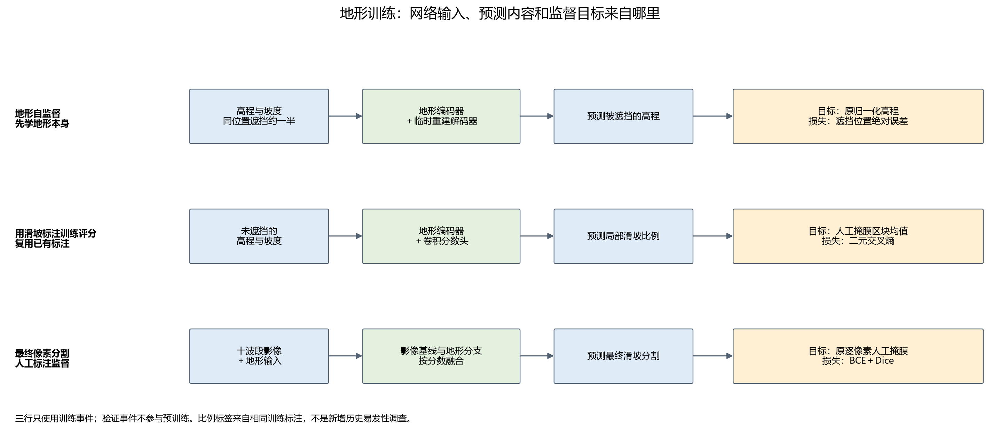

三行依次是高程重建、局部滑坡面积比例预测、最终分割。应看右侧参考答案分别来自原始高程、人工滑坡标注的区块平均、原逐像素人工标注。高程重建的临时解码器在分割阶段被移除；地形分数预测头则进入最终融合。

### 现有实现的准确边界

随机、高程重建预训练、6000步重建及固定α四个独立分支方案，新分数头的输出层从零开始；因此刚初始化时地形修正为零。α初始0.01，避免它与输出层同时为零导致分支无法开始学习。输出层先得到梯度，前面的编码器随后才能得到非零梯度；不能写成所有地形参数在第一步均有梯度。

**滑坡比例预训练组是例外。** 它加载已经训练过且不为零的分数头，不能套用“初始预测逐位等于视觉基线”的说法。保存配置指定：编码器来自`v4r1_ssl.pt`，预测头来自`v4r1_scoring.pt`；当前加载函数分别读取两个文件，未迁移后者更新过的编码器。CPU核对确认，滑坡比例训练后编码器状态确实与重建阶段不同。因此该结果只能称“重建编码器＋标签比例预训练头”，不能称完整联合预训练已验证；本次没有更改训练实现或重训。

另外，当前高程重建损失只按遮挡位置计算，未额外乘有效像素掩膜；局部滑坡比例的区块平均也先于有效像素加权，交叉熵损失阶段才使用有效像素掩膜。这些实现限制需要保留，不能描述成已完成所有无效像素排除。α数值来自最佳模型；真正的修正是α与tanh输出的乘积，仅看α不够判断地形是否有效。

## 多日期影像如何进入模型

### 参考影像、参考日期和细节输入

每个图块先按质量及灾后时间窗口规则选出一张影像，原单期实验只用它。本文称其为**参考影像**，其观测日期为**参考日期**；旧报告的“目标单期”“目标帧”是同一个意思。它不是灾害发生日，也不意味着人工标注与该日期完全同步。

“参考影像细节”表示不下采样的细节分支只读取这一张影像。多日期信息进入共享空间编码器与时间特征融合，而非把全部日期影像都堆入细节分支。若光谱模块开启，细节分支读取的是该参考影像经过光谱模块后的十波段输出。

### 表三：三种时间输入条件

| 人类可读名称 | 进入模型的影像 | 评价时应说明什么 |
|---|---|---|
| 仅参考影像 | 原先选定的一张十波段影像 | 单期信息条件。 |
| 参考日期及以前的观测 | 序列开头至参考影像，包含参考影像 | 每图块张数可能不同；不读取参考日期以后的影像。当前实现按序列索引截取，日期来自源序列。 |
| 完整15次观测 | 数据集中该图块的全部15张影像 | 回顾性条件，可能包含参考日期以后的信息，不能称即时可用。 |

所有组预测同一张滑坡标注；没有为每个日期补造一张独立标签。参考日期以后信息带来的收益，不能要求单期模型凭空恢复。

### “日期聚合”如何计算

SegFormer的每张影像经过**同一套共享编码器**，得到四级空间特征。在每一级、每个位置，网络根据影像特征与距参考日期的时间差，产生各观测的权重；权重经softmax归一化后，对日期维度的特征加权求和。融合后的四级特征进入原SegFormer解码器，细节分支仍只读取参考影像。

这是“影像内容和日期间隔参与的时间特征加权”，不是对日期求平均。只有一张影像时，日期维度权重恒为1，这个时间融合环节不改变特征；不表示整套模型训练过程与所有旧单期实验都相同。

### 为什么不再笼统称“真实日期”

数据加载器把源数据记录的观测日期转换为相对2015-12-03的天数。**SegFormer**再减去参考影像的天数，用相对间隔及其周期函数参与权重预测；**U-TAE**则将这一天数传给原有时间位置编码，并在注意力前实际加入编码。

旧接口的问题是用第0、1、2…张的序号代替日期，以及U-TAE导入实现中日期位置编码未实际加入前向计算。修正的是日期信息的表示与调用，不是换成了“更真实的图像”、验证了标签时刻，或获得了无误差的灾害日期。多帧差值同时受张数、时间跨度和未来观测影响，不能全归因于日期编码。

U-TAE是另一套带时间注意力的U形分割网络，本项目复用数据集仓库实现并重新训练；它接收每期十波段及重复广播的静态高程。它没有本项目SegFormer的独立原始网格细节支路，不能把两者写成同一结构。

## 历史组件名称的解释

“辅助监督”是对同一人工标注增加一个损失，例如同时约束基础输出和最终输出，不是新增标签提供者。“粗概率条件精分”将基础概率作为另一个特征输入，仍在整图像素网格计算，没有候选区域裁剪，不等同真正定位后再分割。

“注意力融合”表示根据特征预测融合权重，不能仅因存在可学习权重就称有用；“冻结探针”表示固定编码器、只训练读取头，不能代表完整微调模型。DOFA是可根据输入波长适配的遥感预训练编码器，历史冻结结果不等于全部光谱方案的结论。

U-Net是另一种编码—解码分割结构；本项目使用的SMP是`segmentation_models_pytorch`库的简称，用它复用成熟U-Net实现，并非一种新损失或新增监督来源。TerraMind/TiM、AnySat及文本语义接口属于早期工程，当前主训练不使用，保留源码与历史证据。

## 阶段目标与相邻阶段变化（简述）

本表由[阶段台账](assets/research/stage_ledger.json)生成，记录每阶段目标、改变和结果；不在别处另建平行总结。上一行的结果不意味着下一行一定继承它的模型。

展开历史阶段与后续计划：各阶段目标、变化和结果

<!-- STAGE_TABLE_START -->

| 阶段 | 数据划分 | 实验目标 | 相对上一阶段改变了什么 | 结果与状态 |
|---|---|---|---|---|
| 早期完整系统的工程验证 | 我们的数据划分（留事件验证） | 检查影像、预训练模型、文本语义和粗细分割接口能否共同运行。 | 建立最初的数据读入与多模块训练接口；这些模块不属于当前SegFormer主训练。 | 前向、反向和小样本训练已运行；训练样本少，不能据此比较各基础模型能力。 **历史完成** |
| 十波段输入适配与影像细节对照 | 我们的数据划分（留事件验证） | 比较直接读取十波段和投影为三通道，并检查不下采样细节分支的作用。 | 改用成熟SegFormer编码器和解码器，分别开启两种输入适配与细节分支。 | 四种组合已训练，输入方式的排序随数据版本变化；没有一种方式在所有版本持续领先。 **完成** |
| 观测日期清理与数据扩展 | 我们的数据划分（留事件验证） | 减少影像日期选择风险，增加符合要求的训练图块。 | 重新选择部分训练影像日期或隔离样本；仍使用十波段，同时测试集合成员增加。 | 合法训练样本增加有限，主要扩展了意大利评价图块；不同评价成员的分数不能直接相减。 **完成** |
| 基础预测引导与不同融合结构 | 我们的数据划分（留事件验证） | 检查基础概率、附加损失和特征融合是否帮助细节分割。 | 在影像细节基线上比较概率条件、移除基础输出附加损失、边界加权和单头注意力融合。 | 没有形成候选区域裁剪后的真正两阶段流程；本批注意力融合未显示稳定改善。 **完成** |
| 同一批训练事件内增加图块 | 我们的数据划分（留事件验证） | 判断增加现有事件的训练图块能否持续改善验证结果。 | 九训练事件和广岛、特里苏尔验证事件保持相同；训练量为559、1113、1671、2223，模型与更新预算相同。 | 验证事件平均IoU依次为0.2870、0.3112、0.3143、0.3081，不随数据量单调增加；后期训练改善未同步转为验证改善。 **完成** |
| 比较较早与较晚的编码器状态 | 我们的数据划分（留事件验证） | 检查训练后期的编码器变化是否与验证下降有关。 | 分别固定同一模型训练较早和结束时的编码器，训练相同初始化的解码器，不使用影像细节分支。 | 固定较早编码器组验证IoU约0.2731，固定较晚编码器组约0.2463；不能单独证明遗忘或解码器是唯一原因。 **完成** |
| 编码器学习率与遥感预训练对照 | 我们的数据划分（留事件验证） | 检查降低编码器更新速度或更换预训练编码器能否改善当前基线。 | 一组降低首层以外编码器学习率；另一组改用DOFA遥感编码器及匹配的特征金字塔解码结构。 | B0＋细节参照IoU 0.3081；低编码器学习率B0为0.2823，DOFA完整系统为0.1969；后者并非纯编码器对照。 **完成** |
| 在编码过程中交换影像细节 | 我们的数据划分（留事件验证） | 检查不下采样特征更早影响编码器是否有帮助。 | 在编码器第二阶段后比较分支各自残差处理与双向特征交换，保留末端细节修正。 | B0末端细节参照IoU 0.3081；增加分支内残差为0.2969，双向交换为0.3034；本批未提高IoU。 **完成并停止扩展** |
| 训练事件覆盖与较大模型对照 | 我们的数据划分（留事件验证） | 区分训练事件组成与模型规模的影响。 | 同1251块比较三事件与九事件；同2223块比较SegFormer B0与B2。 | 同1251训练块，三事件/九事件IoU为0.2300/0.2908；同2223块B0/B2为0.3082/0.2698。B2上游权重身份仍有限制。 **完成** |
| 官方图块划分下的单张影像参照 | 官方数据划分（未按事件隔离） | 记录官方成员划分条件下的单期模型表现。 | 使用3012训练、758验证、945测试图块，按验证像素汇总IoU选模，同一灾害事件可出现在不同集合。 | 单期细节SegFormer测试IoU约0.3275；与整事件划分结果及完整998块官方测试结果均不可直接排名。 **完成（历史协议）** |
| 官方划分下的高程与模型结构对照 | 官方数据划分（未按事件隔离） | 检查增加地形信息、增加滑坡像素损失权重及使用U-Net的影响。 | 保持本地官方子集不变；加入高程或坡度、改变交叉熵权重，并比较U-Net完整系统。 | 多数改变量不足0.02；该批SegFormer优于U-Net，但不是单独验证光谱或解码器作用的实验。 **完成** |
| 历史四次事件划分与多日期参考 | 我们的数据划分（留事件验证） | 评估不同未参与训练事件的迁移表现，并检查多日期输入。 | 建立四次整事件训练、选模验证和评价划分；分别拟合训练统计，比较完整微调和固定编码器读取。 | 完整B0四次评价IoU均值0.1685；发现波长映射、日期使用及对象匹配问题，错误输入结果不用于机制结论。 **完成但发现需修正项** |
| 修正观测日期编码与波段波长映射 | 两类均有：波长纠错用我们的事件划分；时间与光谱对照用官方划分 | 复核多日期结果，比较时间特征加权和光谱关系模块。 | 按波段名修正波长；启用源观测日期编码；每日期共享编码器、解码前融合特征，光谱模块独立开启。 | 官方可用子集U-TAE单张、15张、截止参考日期分别为0.3396、0.4832、0.4046；SegFormer对应完成的单张、15张、单张光谱组为0.3302、0.4093、0.3336；联合组中断。 **完成（15期光谱中断）** |
| 历史多日期输入的跨事件复验 | 我们的数据划分（留事件验证） | 检查官方子集的多日期改善是否迁移到未参与训练的事件。 | U-TAE在四次事件划分中分别比较单张、参考日期及以前、完整15张，保持各次训练成员与批次顺序。 | 前两组四折均值0.1589和0.0684；15张仅三折均值0.1279，同三折配对差−0.0304。不同事件方向不一致，日期干预只提示敏感性。 **历史诊断；本次核对11/12完成，非默认续跑队列** |
| 高程、坡度与地形预训练对照 | 我们的数据划分（留事件验证） | 区分地形输入、额外参数、高程重建及标签比例预训练的作用。 | 协议 event_ood_v4r1（TRAIN 2223 / DEV 669，seed1234）；缓存与清单冻结，地形以侧表加入；六组共用同一 TRAIN、3600 更新与 DEV 事件平均 IoU 选模；坡度按 0.01° 原始单位归一化（修正旧版 100 倍尺度错误），α 可学习、读出头零初始化。 | 修正坡度单位后六组重跑：验证事件平均 IoU 0.3067–0.3096（基线 0.3081），全部落在 −0.0015～+0.0015；12 通道直入 0.3067（对象召回 0.5622 高于基线 0.5211，但边界 F1 0.4544 低于 0.4806）；地形自监督组最高 0.3096（+0.0015），同源评分头组最低 0.3076（融合系数仅 0.048）。评分头自身在 11318 个 16×16 格子上与真实滑坡比例的相关系数只有 0.087，基本是常数输出。 **完成（六组，单seed；坡度单位修正后重跑）** |
| 单期光谱入口变换对照 | 我们的数据划分（留事件验证） | 检查增加指数、静态波段偏置及线性通道混合是否有收益。 | 分别比较追加四指数/四原始波段、波长生成静态偏置/十个自由偏置、低秩/满秩线性混合；只有第一对输入扩为14通道。各对并非全部严格同参数量。 | S1 指数 0.2795（−0.0286）、S1 对照 0.2908（−0.0174）；S2 波长 0.3052（−0.0029）、S2 对照 0.3081（0.0000）；S3 低秩 0.3043（−0.0038）、S3 满秩 0.3041（−0.0040）。三级均未超过基线 0.3081。 **完成（六组，单seed）** |
| U-TAE 在项目数据划分上的复现 | 我们的数据划分（留事件验证） | 把官方 U-TAE 的多时相做法放到我们的数据划分上，报告单期与 15 期的差别。 | 新建 15 期缓存 data/s2_temporal_v4r1（2892 块，其中 502 块从源 NetCDF 补齐）；十波段、不加 DEM、真实观测日期、75 epoch；单期与 15 期共用同一训练/验证成员与 DEV 选模。 | 事件平均IoU：单期0.3262、15期0.3706（+0.0444）；对应像素汇总IoU为0.3013/0.3692。广岛0.2755→0.3670，特里苏尔0.3768→0.3741；1–4像素对象召回0.1039→0.0390。末态事件平均IoU为0.2883/0.2718。 **完成（单期与 15 期各一次，单seed）** |
| 时间信息与原始网格细节的受控比较 | 我们的数据划分（留事件验证） | 解释多期观测的增益来源，验证SegFormer保留参考影像细节时能否同时改善事件平均IoU与小目标检出。 | 从单期入口微调转向观测信息与融合机制；保持单期研究参照，另设明确标注的多期回顾性比较，不把多期效果当成单期任务完成。 | 四组时间控制已核验：同接口单期/15期均值/内容/内容与日期事件平均IoU=0.2883/0.2984/0.3145/0.3245；日期组微小对象3/77（单期9/77）。截止参考日期组已完成：0.3377（广岛0.3160、特里苏尔0.3595），微小对象6/77，去掉未来观测后仍高于完整15期。新增3期完成3600更新，最佳0.2926、广岛0.2950、特里苏尔0.2901、微小对象6/77；5期已验收：最佳0.3055（1000步）、广岛0.3137、特里苏尔0.2974、微小对象7/77；7期已验收：最佳0.3348（1000步）、广岛0.3141、特里苏尔0.3554、AP0.4972、微小对象6/77，末态0.2812；地形v2分割在旧队列完成：best 0.3072（500步，参照0.3081）；另完成截止参考日期固定数量组（派生同子集2007/669、2000步）：1/3/5/7期=0.2933/0.3061/0.3432/0.3277，5期最高、7期回落；固定3期180/365天窗口=0.3026/0.2962，短窗口略高0.0064；组成组（同子集1141/669、2000步）：5灾后0.2699、3灾后0.2789、2灾前+3灾后0.2826，混合组在相同总帧数与相同灾后帧两种比较下都略高，但微小对象仅1–3/77；地形v2同权重干预：关闭分支−0.0009 IoU、打乱−0.0013，学到的α=0.0554。各方案均未满足替换单期条件。 另以同接口microbatch64单期对照0.3075（500步）与历史0.3081差0.0006；提示微批量设置影响明显，BatchNorm为主要待核验机制，但单seed未隔离随机数和累计梯度计算差异。；U-TAE同架构：期数1/3/5=0.3154/0.2754/0.2783（15期0.3706）、均值控制0.3101，均30轮窗口内与日期组best@17比较；U-TAE开关：均值0.3101、无日期0.3860、日期0.3706（30轮窗口），无日期组最高；S2波长映射0.3030对自由混合0.3026（同2000步、同110参数）；S1 新增四指数通道用559块TRAIN统计独立标准化并完成首层同初始化审计（2000步：指数0.2917对原始通道对照0.2911，差+0.0006，历史−0.0113差未复现，两组均低于十波段参照约0.016–0.017）；S3 五组2000步：线性混合0.3042、自由ID注意力0.2916、波长注意力0.2913、局部偏置0.2855、全局偏置0.2848；S4 同关系表示的四种融合：ADD 0.3085、FIXEDGATE 0.3095、LEARNGATE 0.3081、CAPCTRL 0.3101，入口前残差(S3-D)0.2855；学习门best(500步)均值0.047、目标0.015/背景0.048，末段完全关闭，未学到空间选择性；S4各融合与十波段参照的差都在单seed噪声范围内 **同接口四组、截止日期组、3/5/7期、截止日期固定数量组、跨度组与组成组已完成并验收；地形v2分割完成（0.3072）；U-TAE均值/内容开关已实现并训练；S1新增通道统计与首层审计、S3五组、S4五种融合已完成2000步训练与统一验收；光谱机制未显示可升级为候选的收益** |
| USE通用光谱输入与外部预训练 | 我们的数据划分（留事件验证） | 同权重接收可变波段，区分注意力、物理描述、混合训练及外部预训练的作用。 | 已接通独立观测、共享逐波段空间编码、2×2波段关系、查询汇聚、32→10内部桥接及原网格细节分支；十维内部接口不限制输入波段数。 | 10/10组2000更新监督实验完成，独立评价669块；本轮直入参照IoU=0.2985。USE共享编码＋均值汇聚=0.1519; USE波段自注意力＋均值汇聚=0.1609; USE自注意力＋查询汇聚=0.1631; USE注意力＋物理描述=0.1955; USE注意力＋固定随机描述=0.1987; USE扩宽无注意力编码=0.1580; 无注意力USE＋混合波段训练=0.1758; 物理USE＋混合波段训练=0.1895; 物理USE＋联合无标签预训练后微调=0.2370。外部已接受S2 5000、Landsat 1700位置；下载状态paused_by_user。单seed，不宣称显著性或跨传感器分割有效。 **USE完整首轮完成并交接；工程通过，研究退化警报保留** |
| USE旁支诊断复核与桥接恢复工程探针 | 我们的数据划分（留事件验证）；本项仅用TRAIN内部工程子集 | 核对既有诊断证据，检验桥接标定及早期特征辅助是否值得进一步研究。 | 复核完整/混合物理USE的表示与接口；另有教师桥接标定后同起点的两组300更新工程探针，不修改原十组首轮。 | 诊断复核无审计问题；混合与完整训练的第一级/第二级/细节CKA约0.64/0.66/0.51。桥接标定200更新、512个TRAIN成员，USE与visual未变且教师零梯度。300更新探针的96块拟合IoU为0.1758/0.2351，另32块TRAIN检查为0.0262/0.0251；两组起点相同，检查集未改善。 成员复核：标定包含91/96拟合成员和全部32/32检查成员；教师也见过检查成员的训练标签，检查不是独立验证。 **诊断与短程工程已完成，固定文档已回写；两组正式2000更新未执行，未纳入原首轮** |
| USE独立预训练与冻结下游 | 我们的数据划分（留事件验证） | USE仅通过无标签目标更新，固定权重评价表征与下游适配。 | 新增完整参数/buffer哈希冻结边界，并通过显式model.freeze_use接入生产工厂、参数分组与现有验证完整性检查；旧配置保持历史语义。 | 六组独立无标签预训练各10000更新、14项冻结探针各2000更新及其五组合评价全部验收；共同USE按无标签指标取multisensor，原四适配与用户新增U-Net均固定这一权重，各2000更新并完成最佳/末态与五组合验收。原四适配中冻结USE→32→10桥接→SegFormer B0＋细节分支最佳IoU0.140685；新增可训练U-Net最佳IoU0.139715、末态0.139715，原十波段SegFormer参照0.298531。累计新增正式98000更新，原权重保留；工程后重新初始化、全USE参数/buffer冻结哈希、优化器排除、成员与日程均验收。没有预先登记的收敛平台阈值，跑满预算不等于充分收敛。随机身份对照含源命名混杂；单seed、研发验证复用、S2单一任务及完整网络容量/初始化差异限制结论，不宣称通用迁移成功。 **本轮已完成并验收；用户接受对照限制，明确结束本轮** |
| USE v2：局部波段自注意力与冻结恢复探针 | 我们的数据划分（留事件验证） | 回答局部波段自注意力相对均值汇聚是否有额外价值、Fine是否保留原网格位置差异、Context是否提供多尺度空间信息、物理描述缺失时怎样退化，并比较性能与成本；不以超过历史滑坡IoU作为唯一成功定义。 | 按2×2 Patch把4个有序值与4个有效标记拼为8维→Linear(8→32)＋LayerNorm得到波段Token；两组分别为跳过（V2-N）与加入（V2-A）一层4头局部波段MHSA，其余逐Token FFN、Fine/Context Query、空间主干与任务目标完全相同。Fine由4个位置Query加逐位置有效观测残差；Context用1个Query汇聚后学习型合并到1/4尺度，窗口4、通道32/64/128/256、深度1/1/2/1，第三尺度第二个模块用移位窗口。无标签任务改为光谱隐藏约50%波长已知的波段、Fine各波段同步隐藏25%位置、Context隐藏一块32×32；元数据视图为保留50%／删一半／全未知。冻结恢复探针与六组冻结滑坡头沿用统一容量与同一初始化规则。 | 42个正式运行全部完成、无失败：20k条件30项（两组各20000预训练、22探针、6下游）＋续尾条件12项（两组各10000续尾、4探针、6下游），预算146000更新全部执行，另有6985与83次中止单列，累计消耗153068。无标签指标：预训练选模分数20k→30k，无局部波段自注意力0.6218→0.6208，一层4头局部波段自注意力0.6209→0.6141；探针20k→30k，前者Fine 2.2813→2.2320、Context 0.2524→0.2462（两项都改善），后者Fine 2.2964→2.2932、Context 0.2524→0.2538（Context略差）；随机初始化参照Fine 2.3481/2.3361、Context 0.2966，说明预训练确实降低了恢复误差。下游12项事件平均IoU全部落在0.0000–0.0049（最好为续尾注意力组＋Fine 0.0049），与上一阶段百万级桥接解码器的0.1407、直入参照0.2985差两个数量级；复核显示抽样图块正类像素0.4%–0.8%，四组最佳权重在6块共91049个有效像素中超过0.5阈值的只有149/69/316/0个，Context头4257参数、加入Fine后5313参数；当前系统迁移效果很差，容量、特征、损失与优化的贡献未验证，不能据此作稳健架构排名。波段自注意力仍无确定证据：选模分数V2-A略低，但30k探针两项都是V2-N更低，方向矛盾且单seed。 **本轮执行完成：42项正式运行、预算146000已执行；下游受轻量头限制，研究结论以无标签指标为主** |
| 冻结USE v2接完整U-Net与SegFormer B0 | 我们的数据划分（留事件验证） | 上一阶段12个冻结下游结果全在0.0000–0.0049，主因未定。本轮固定同一USE v2权重，把任务头换成可训练的完整网络，检验“轻量头容量（4257／5313参数）”是否为主要限制之一，并给出两组完整系统的逐事件指标。 | 两组读同一份冻结USE v2输出：四层Context各按既有canonical32规则压到32通道、上采样回原图尺寸、四层平均，再与原网格Fine特征相加，该加和无可训练参数、不使用未经USE的原始影像旁路。下游分别为完整四级U-Net（全部随机初始化、GroupNorm）与SegFormer B0（32通道新首层随机、MiT与解码器沿用本地通用预训练、保留原网格细节分支）。统一条件：seed1234、单期十波段、stats_core25、既有质量掩膜、每组5000更新（合计10000）、FP32、有效batch8（微批量2×累积4）、AdamW 6e-4／wd 0.01／裁剪1.0、前250步预热后余弦、每500步按两事件等权IoU选模、USE全程eval且不在优化器内。 | 两组各5000次正式更新完成（合计10000，无中止、无异常），同一USE在全部更新内哈希不变且两组相同（e3af4763…）；DEV 669块、阈值0.5：U-Net最佳事件等权IoU 0.1344（第2500步；像素IoU 0.1190、Dice 0.2127、P 0.1807、R 0.2585、AP 0.1360、边界F1 0.2036、小/中/大对象召回0.137/0.353/0.404），末态0.1275；SegFormer B0最佳0.1250（第3000步；像素IoU 0.1087、Dice 0.1960、P 0.1771、R 0.2196、AP 0.1202、边界F1 0.1745、对象召回0.100/0.278/0.343），末态0.1227。逐事件best：U-Net 广岛0.1014/特里苏尔0.1674，SegFormer 0.0915/0.1586。同一USE的既有5313参数轻量头参照0.0049，本轮提高约26–27倍，说明任务头容量是先前近零结果的重要限制之一；但仍低于历史十波段端到端SegFormer B0的0.2985约0.164–0.174。两组损失曲线几乎重合、彼此IoU差0.0094（best）/0.0048（last），U-Net在小对象召回、AP与边界F1上略高，SegFormer显存更低但每步慢46%。成本：U-Net 1797秒/765 MiB（cuda:1），SegFormer 2629秒/417 MiB（cuda:0）。六个固定案例图另加一列USE编码（两组共用融合32通道的前三个主成分，六案例统一PCA基；两组的该列逐像素相同，已用数组相等核验）。另出Fine/Context面板图：Fine保持32×128×128原网格分辨，Context四层为32×32/16×16/8×8/4×4（输入的1/4–1/32）压32后上采样平均，两者PCA面板逐像素跨组相同。 **两组正式训练、best/last评价与六固定案例已完成并验收；单seed、完整系统比较，未解冻USE** |
| USE v3：空间交互、无标签恢复与成本验证 | 我们的数据划分（留事件验证） | 在现有冻结v2参照下验证完整v3表示、迁移和成本；只训练v3编码器。 | 原生通道学习投影、移位/全局空间传播、Fine与Context双向交互和五项无标签目标；统一原生特征探针和现有完整分割消费者。 | 17项62000成功更新完成，训练中无中止或恢复；另2次CLI启动失败均0更新。统一无标签探针选中20k（总分0.9210，10k0.9236/30k0.9223；既有v2为1.0484），Fine像素恢复改善而Context光谱恢复变差。分割best/last：原生金字塔＋U-Net0.1263/0.1263，原生金字塔＋SegFormer0.1285/0.1125；双向空间交互＋U-Net0.1305/0.1305，双向空间交互＋SegFormer0.1258/0.1238。两USE的参数和buffer冻结、同类初始化及预算选模核对通过；没有一致的分割迁移改善，当前十波段端到端参照0.3081不变。 **17项正式训练与结果核对完成；完整成本门禁按用户要求跳过** |
| USE v3：冻结表征与高分辨率成本诊断 | 我们的数据划分（留事件验证） | 区分误报口径、表征/投影/融合现象与高分辨率计算成本。 | 已有选定权重只读诊断；全DEV配对复算、固定ROI和像素几何、逐损失反向、同卡FP32与切片估算。 | 669块四模型计数精确复现；66语义ROI均uncertain。U-Net AP0.1224→0.1231，SegFormer AP0.1361→0.1215，没有一致改善。注入/反馈残差比中位0.240/1.120，不支持连接几乎未使用；固定DEV像素Fine秩10.65→15.10。完成有界成本矩阵与三视图前后向成本，2048仅静态4GiB单份全局bias。 **诊断完成；语义类别未确认；无新增训练或优化器更新** |
| USE v4：光谱Token注入预训练MiT-B0 | 我们的数据划分（留事件验证） | 验证继承v3光谱前端后直接注入预训练MiT-B0，能否形成更有用的冻结光谱—空间表示并减少重复空间编码成本。 | 保留Patch2和五Query的早期Fine，Q5经新stride2适配器接冻结MiT Stage1–4；跳过RGB首卷积，舍弃v3空间主干与反馈；下游只训练既有All-MLP和Fine残差头。 | 正式29000更新完成：公共探针入选20k，总分1.1491（10k为1.1585，历史USE v3入选20k为0.9210）；轻量头best/last事件等权IoU 0.0600/0.0597，历史USE＋完整SegFormer0.1258、当前直入参照0.3081。release/继承/冻结/初始化/选模/曝光/预算与图表核验通过；共享成本与未测项单列，当前参照不变。 **执行与产物验收完成；迁移结果未改善** |
| USE v4：MiT接口与冻结分割组成只读诊断 | 我们的数据划分（留事件验证） | 在不更新权重下定位注入、四级空间表示、早期Fine与Decoder统计的具体证据及限制。 | 固定64个PRETRAIN_VAL和历史22个DEV，同坐标前向、特征统计、logit组成和BN统计；无新增训练或模型。 | 0更新、参数与buffer SHA不变。Stage1分布不同但损害未证实；四级未完全失去差异；Fine增强的因果贡献未验证。BN方差比中位0.0439，残差在22例将AP0.0582升至0.1055、FPR0.1817降至0.0281，Recall0.3057降至0.1584；优先受控检查Decoder统计。 **只读诊断与证据验收完成；失败因果未确认** |
| USE v4：TRAIN-only BN重校准与残差均值/空间分解 | 我们的数据划分（留事件验证） | 不更新参数，检验TRAIN全局BN统计与逐图偏置/空间残差对现有best预测的作用。 | TRAIN2223仅影像和质量统计，DEV669先逐字节复现，再比较两个BN×四种logit组成；仅副本的BN运行均值/方差可变。 | 0参数更新。原BN/FULL逐像素复现，后校准FULL事件IoU 0.0600→0.0292，池化AP 0.0844→0.0787。原BN逐图AP均值BASE/MEAN/SPATIAL/FULL=0.1301/0.1301/0.1481/0.1482。 **零训练干预完成并验收；不作为训练消融或新模型选模** |
| USE双路线：保留视觉入口与光谱Token教师对齐 | 我们的数据划分（留事件验证） | 通过视觉入口残差、光谱Token教师对齐两个完整方案及同构视觉参照，比较多光谱补充、独立Token生成、冻结分割迁移和实际成本。 | A保留冻结RGB首投影并加零起点光谱残差；B仅训练期用原RGB Patch Token余弦教师对齐，固定0.20；C0原视觉入口加固定初始Fine。三者同构MiT与All-MLP/Fine任务头，主评价固定20k末态。 | 两路固定u20000与四项1000步冻结恢复探针及599评价已完成，Fine头8张量、Context头16张量逐一相同，编码器冻结核查通过。公共恢复三任务均分1.1437对1.1791，视觉残差方案Fine和光谱误差较低，光谱对齐方案空间误差较低；方向不完全一致，不反选编码器，不推断分割收益。GPU0另存27项初始成本，原GPU1记录保留。现已进入原三组同构分割，尚无最终分割成绩；正式总上限59000及10次恢复重放分别记账。 **两路预训练和四探针共44000完成；GPU0初始成本重测完成，三同构分割头按空闲卡串行启动** |

<!-- STAGE_TABLE_END -->

## 本轮时间组件的连接关系（已训练）

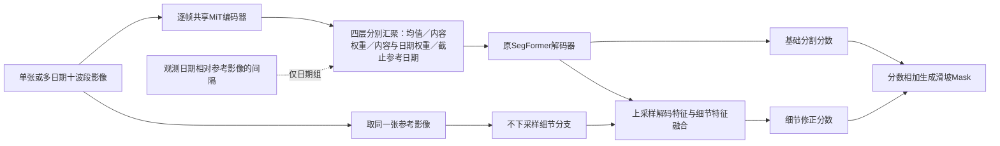

观测数量与汇聚方式在上方分支改变，参考影像始终从同一张影像进入细节分支。单期、15期均值、15期内容权重、15期内容与日期权重、截止参考日期五组都保留同一细节路径，因此本轮检验时间信息及汇聚方式，不能单独声称细节分支对时间模型的贡献。截止参考日期组只改变可用帧集合，不改变汇聚公式。

五组的最佳事件平均IoU依次为0.2883、0.2984、0.3145、0.3245、0.3377；但1–4像素对象召回依次为9/77、3/77、8/77、3/77、6/77，均未超过同接口单期或恢复小目标。多期组的提升主要来自减少误检（FP 121871→44540/75729/49322/59175），代价是漏检增加（FN 112717→129875/116036/121882/116365）。因此这是“更保守的回顾性多期条件”，不是全面优于单期的替换模型。

历史光谱“波长身份”实际是固定十波段的静态加性偏置；“低秩交互”是两个连续线性1×1卷积，不是乘性关系或注意力。真正的BandRelationBlock在4×4空间块内建立十波段注意力，并把输出残差加回输入。它与解码特征处的独立门控旁路是两种不同连接，不能混合归因。

## 限制与下一步

地形与六组光谱入口变换已完成；时间控制的四组与截止参考日期组已完成，结果见[数据与结果](DATA_EVENT_PROTOCOL.md)。当前单期参照仍保留，多期模型属于额外观测条件；本轮各组1–4像素对象召回均未超过同接口单期，下一阶段优先检验多期语义与参考影像细节的选择性融合，而不是继续增加时间模块或叠加地形。

正文展示名由“模型规格＋实际输入＋连接方式”组成，初始化与损失作为训练处理另列，例如“SegFormer B0｜单张十波段｜原始网格细节修正”，再注明“地形高程重建预训练”。历史实验字符串、目录与权重不重命名，保留恢复兼容；代码字段只放配置索引。

## 附录：源码和产物

- 成熟空间模型与输入适配：[segformer.py](../src/landslide_seg/models/segformer.py)；原始网格细节与修正头：[spectral_stem.py](../src/landslide_seg/models/spectral_stem.py)。
- 地形编码器与预测头：[terrain.py](../src/landslide_seg/models/terrain.py)；实际加载入口：[factory.py](../src/landslide_seg/models/factory.py)；高程重建与标签比例训练：[pretrain_terrain.py](../scripts/pretrain_terrain.py)。
- 时间特征权重：[spectral_temporal.py](../src/landslide_seg/models/spectral_temporal.py)；日期与参考影像索引：[temporal_v6.py](../src/landslide_seg/data/temporal_v6.py)；U-TAE日期位置编码适配：[utae_dates.py](../src/landslide_seg/models/utae_dates.py)。
- 当前基线、地形结果及完整原运行身份见[数据专题](DATA_EVENT_PROTOCOL.md)和[机器索引](assets/research/experiment_registry.json)。

## 地形比例监督与加载契约的修订

新配置`scoring_full_v2.yaml`仍是影像分数加上α·tanh(地形分数)，结构不变。地形评分目标改为每16×16区块中有效像素的滑坡占比；例如区块仅128个有效像素、其中32个标为滑坡，目标为32/128=0.25，不是32/256。没有有效像素的区块不产生负标签。评分训练使用区块有效覆盖加权，遮挡补高程只在有效且被遮挡的像素计损失。

新增初始化方式`ssl_scoring_full_v2`从同一个valid评分v2 checkpoint严格加载encoder与head，核对当前统计及完整成员清单哈希；原`ssl_supervised`仍保留其历史头部加载语义，历史结果未改。此修复同时改变监督目标处理与迁移权重，不能当成单因素消融。新3000步权重已按实际工厂入口逐张量核对，分割新训练仍在有限队列中。

## 光谱旁路的显式接口与物理数值版本

新增`implementation=explicit`时，特征作为局部变量经过官方解码器的线性投影、尺度对齐、融合、归一化、激活和dropout，再接受光谱修正并进入原分类器。原十波段仍直接进入MiT，细节头仍读取修正前的解码特征，保持历史连接语义。旧配置默认`legacy_hook`，原权重键不变。显式版本不注册分类器捕获或注入钩子，不使用前向共享特征缓存；同权重且非零旁路下，与旧版本的输出兼容测试及新路径梯度检查通过，并检查了并发前向。尚未验收torch.compile或多卡训练，不据CPU接口测试声称这些环境已通过。

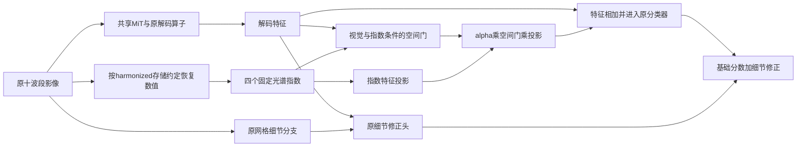

箭头说明实际计算连接：指数支路只在分类器前融合一次，原视觉输入不变。这是四指数旁路的接口修复，尚不是已完成训练的十波段注意力特征融合，也没有证明其研究收益。

新增`radiometry=harmonized_dn_v1`显式使用共享的反归一化、除以10000及负舍入误差截零规则；四指数分母ε=1e-4，关系注意力的ε仍为1e-3，两种用途分别记录。未指定的新旧配置仍默认历史DN指数，不静默改变历史checkpoint。实际工厂配置在8个TRAIN样本上检查：alpha=0时与同权重单期基线输出最大差为0；新旧指数最大差0.00146246、平均绝对差0.00012796。这是数值与接口验收，不是正式训练结果，证据见[显式接口核验](assets/research/spectral_explicit_validation.json)与[统一契约验收](assets/research/contract_acceptance.json)。

<!-- IMPLEMENTATION_ALIGNMENT_START -->

## 原任务书目的与当前计算是否对应

以下是实际实现核查，不代表正式实验全部完成。新实验顺序只维护在阶段台账并生成到总入口。

| 原任务书要检验的机制 | 当前实际实现与证据 | 尚有的差距及其含义 |
|---|---|---|
| 同一SegFormer内区分均值、内容、日期 | `TemporalPool`三种模式，日期经MLP后在tanh前加入内容；同接口训练和行为测试已完成 | 这项已对应；不能称为U-TAE的L-TAE同构移植，也不能称标准年周期 |
| 固定帧数、截止日期、灾前灾后与跨度分别控制 | 固定N选择器、按日期过滤、窗口过滤（history+`window_days`）与派生共同子集预检均已实现；截止日期固定数量1/3/5/7期、180/365天窗口与灾前灾后组成三组均已训练并验收 | 可变长度history不是固定N实验；组成组只有6个训练事件，结果单列；派生共同子集不能与2223块全体混排 |
| U-TAE在同一架构中比较均值/无PE/有PE | `utae_seg.py`/`utae_dates.py`提供均值、内容注意力（无日期编码）、日期编码三组配置；30轮窗口内已训练并验收 | 三组权重/成员/轮数已核验；15期日期组是75轮、best@17，不能与其他组宣称同预算；日期位置编码的作用仍受轮数与单seed限制 |
| S1新增指数通道的统计与首层初始化 | 处理组追加NDVI/NDMI/NBR/REND，四个通道用同一559块TRAIN核心的均值/标准差独立标准化（`manifests/v4r1/stats_s1_indices4.json`）；对照组追加四个原始波段（dataset z-score）。两组首层都零初始化新增四列、保留预训练三列；审计脚本逐张量比较218键 | 统计只拟合TRAIN、DEV未参与；两组都相对十波段参照多4个输入通道，不能把与十波段参照的差归给指数语义；历史未归一化配置只作兼容保留，新正式配置由预检强制登记统计 |
| S2真正波长条件变换、S3动态十波段关系 | S2：入口10×10混合矩阵由各波段中心波长经Linear(9→10)生成，对照为同110参数自由矩阵（2000步，0.3030对0.3026）。S3：`BandRelationBlock`在4×4块内对10个band token做2层自注意力；五组分别改band身份（自由ID/波长）与关系偏置（无/局部/全局），2000步已验收 | S2的IoU差在噪声内。S3五组的线性混合与注意力未严格同容量（110对135,381新增参数）；波长身份、局部/全局偏置都没有可测独立收益，不能据此否定其他容量/预算 |
| S4保持原输入的独立关系特征门控 | 新增`SpectralGateSeg`：同一关系编码器输出真正的`F_spec`（十波段token均值→1×1投影），在官方解码器融合特征处单尺度注入；ADD、固定门0.5、学习门与同容量非物理控制（CAPCTRL）均已训练并验收 | 视觉主路仍读原始十波段，图像细节分支仍读融合前解码特征；学习门在best后逐步关闭支路，未学到空间选择性；门控优化原因未隔离，不能把关闭解释成“关系无用”的干净证据 |
| 同容量/同计算的光谱对照 | S2两支各110个可训练参数、逐位同初始化。S3-B–E存储参数相同（135,381）；`relation_mode=none`时关系偏置MLP不参与前向，有效参数少132。S4-LEARNGATE与CAPCTRL存储参数相同（156,631），CAPCTRL有效参数少132（约0.08%） | 仍是“同存储/近似有效容量”，不是逐参数严格匹配；四指数老支路（加法1281、门控3622）与十波段关系块不可混作同容量；固定门/加法没有门参数 |
| 地形比例监督与成对迁移 | valid有效占比、空块处理、评分encoder+head完整加载和哈希/张量检查通过 | 新组同时改变有效像素监督和迁移路径，只能证明完整修复方案；不能单独归因编码器迁移，且不是独立易发性监督 |
| 缩短训练仍保留可比日程和完整验收 | `train.stop_updates`与`train.schedule_updates`已分开：预热与poly进度都按日程长度算，停止只看`stop_updates`；预检校验预算键并输出warmup/report_steps；验收改读`resolved_config`的`report_steps`与停止步数；子集清单与`subset_protocol`纳入预检 | 新一批11个2000步正式运行已通过权重/配置/成员与评价哈希核验；新2000步运行与历史3600步全程运行不是等预算比较，旧运行只复用前2000步内的最佳 |

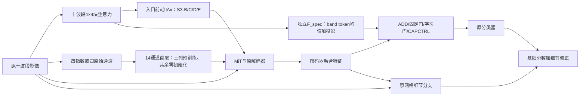

实线是已实现并可运行的路径。S1、S3、S4 是三条分别训练的对照，图中并列不代表叠加：S1 改输入通道，S3 在入口前加残差并同时影响主路与细节分支，S4 只在解码特征处注入 `F_spec`、视觉主路仍读原十波段。真实10波段token以4×4空间块建模，不是每像素独立注意力；CAPCTRL 使用自由band ID、无关系偏置，用来分开物理身份与新增容量。

本次新增 S1 统计/首层、S3 五组与 S4 四种融合的 9 项行为测试（`tests/test_spectral_s1_s3_s4.py`，另复跑 3 项既有波段关系契约测试），全量套件另含时间、地形、光谱、组成与预算测试。新一批 11 个 2000 步运行均通过统一 `execution_audit` 的权重/配置/成员/评价哈希核验；S1 首层审计、S4 门控与修正幅度分别见 `outputs/segformer/v4r2_spectral/{s1_init_audit,gate_diagnostics}.json`。仍未验证：学习门饱和/关闭的优化原因、S3 线性混合与注意力的严格同容量、torch.compile 与多卡。具体文件：`src/landslide_seg/models/{spectral_temporal,spectral_relation,spectral_gate,spectral_ladder,spectral_fusion,utae_dates,terrain}.py`、`src/landslide_seg/training/{budget,temporal_trainer,update_training}.py`、`src/landslide_seg/data/temporal_v6.py`、`scripts/{build_s1_extra_stats,audit_spectral_init,audit_spectral_gate,summarize_spectral_s2s4,run_v4r2_spectral}.py`。

<!-- IMPLEMENTATION_ALIGNMENT_END -->

## 下一步完整实验计划

此区由阶段台账生成。当前执行与负责人查[协作登记](assets/research/agent_work.json)和[队列状态](../outputs/research_completion/status.json)；计划不表示已实施。

<!-- NEXT_PLAN_START -->

依据用户双路线附件和当前v4失败/BN零更新诊断制定下一阶段。两名Agent仍按工程/训练分工，避免与模型路线A/B混淆。当前仅计划归档，细则由本条handoff_sections生成分发快照；不恢复旧队列或启动训练。

**共同实验条件。** 无标签TRAIN11132=9510 S2+1622 Landsat，验证599=521+78，隔离239；每更新6 S2+2 Landsat。下游九事件2223训练、广岛448+特里苏尔221开发验证，seed1234/stats_core25。无新数据/下载/日期/GSD/地形/四折/官方/保留集。

物理反射率RGB独立于USE z-score；S2 red/green/blue或B04/B03/B02，Landsat依实际语义ID/波长核验。RGB不resize/rescale，ImageNet均值/标准差，保留物理值；A读取同遮挡学生RGB，B教师原始同源RGB仅stop-gradient目标，部署无教师。探针只在TRAIN更新。

**统一训练与初始化。** 正式59000=两预训练×20000+四探针×1000+三同构分割×5000，共9作业；工程A/B各≤200、失败重放另列。FP32/TF32关、micro2×accum4、AdamW WD0.01/clip1；前端LR1e-4、新模块6e-4，预热1000后余弦。探针/分割LR6e-4，预热50/250。固定u20000，不按探针或DEV选USE，无5k/10k探针。

A/B从同一固定v3前端和本地ADE MiT开始，禁止续用训练后v4。C0 Fine固定共同初始；A/B Fine可更新。MiT原权重冻结eval但训练期保留输入梯度；B教师只冻结Patch Conv+Norm。模型/采样seed1234、头seed1235，保存共同任务头初始state逐张量核对；A末端1×1零初始化。

| 顺序 | 模型或工作 | 相对参照改变什么 | 实验可能回答什么 | 执行状态 |
|---|---|---|---|---|
| 1 | 工程Agent：RGB准入与三组实现 | 全成员映射/单位/支持审计；新入口组合A/B/C0及既有masked MiT/任务头；两路线各≤200工程试训 | 视觉入口不泄漏、A零起点等价、B教师边界与学生梯度是否可靠 | 待实现与复核 |
| 2 | 训练Agent：独立release和资源验收 | 复核关键测试、哈希、共同初始化、128真实更新与静态容量，封装门禁 | 实际配置和来源是否可比且可运行 | 待执行 |
| 3 | 双卡：视觉残差与光谱对齐各20000 | GPU0 A、GPU1 B；固定五项MAE和共同分母，B仅额外0.20 Token余弦 | 两个整体目标如何学习，残差/对齐覆盖和成本如何 | 待执行；40000更新 |
| 4 | 双卡：最终编码器四项公共探针 | 仅u20000，A/B各Fine/Context1000；TRAIN训练，599验证评价 | 公共恢复是否改善；弱分数不阻断分割 | 待执行；4000更新 |
| 5 | 同构视觉参照与两路线各5000分割 | 三组同一ADE All-MLP/classifier/Fine残差初始化、BN策略与监督规则；USE全冻结 | A/C0、B/C0及B/A的净收益和RGB依赖成本是什么 | 待执行；15000更新 |
| 6 | 训练Agent：结果与固定文档 | 三张主表、曲线/固定案例、原始评价、哈希和完整预算/成本账本，同源回写 | 证据和限制是否足够，下一步是否值得另行研究 | 待执行 |

**进入训练前的有限验收。**

1. 原成员与RGB合法性/单位/质量核验；不能静默改子集或让A/B成员不同；固定教师质量≥80%及学生可见≥50%感受野支持。
2. A零残差与同支持视觉路径对齐；B教师detach且部署不载教师；MiT原权重冻结、梯度到上游，遮挡RGB无泄漏，无第二套空间主干。
3. 200+200工程、确定性/微批与恢复、全部来源/初始张量/配置覆盖和128真实更新通过；训练Agent门禁绑定release，代码变更重验。

**继续、停止与后续条件。**

1. 主编码器直接用u20000，不按10k趋势、探针或DEV换权重；四探针仅TRAIN更新，599验证评价。
2. 公共恢复弱仍执行规定分割；非有限/冻结破坏/加载错误/泄漏/实际断梯度/全常量等工程错误才阻断，不改0.20/学习率/预算补偿。
3. 三组分割同构、同初始化/BN/预算，best只选任务头；历史v4/v3/十波段另标历史，不代替C0。
4. 单seed/开发集复用、外部监督、A依赖RGB、Fine变化及适配容量不同明确披露，不把净收益全部归因一个模块；无收益不自动追加实验。

**交给执行 Agent。** 仅工程Agent use-mit-dual-routes-engineering与训练Agent use-mit-dual-routes-training。工程精确认领新增文件/配置/engineering/releases；训练认领runs/runtime/audit/benchmarks及固定文档。训练不改代码，故障交工程；详细路径/提示词在同源快照。

**结果交付。** 九作业完整曲线/checkpoint/原始指标/概率/有效掩膜、教师覆盖和A残差只读干预、三张合并表/固定六例及同卡128/256/512成本；来源/种子/命令/恢复重放与GPU账本，唯一台账和固定模型/数据/入口回写。

<!-- NEXT_PLAN_END -->

## USE：同一套参数接收不同光学波段集合

本项完整首轮已完成，工程接口通过，分割结果未超过本轮十波段直入参照。输入是单张光学观测及其波段身份、波长、已知带宽、原生分辨率和影像质量；输入质量只来自源SCL、有限值与非缺测检查。标签是否已知只控制分割损失与评价，不作为模型输入。原有十波段统计保持不变，仍由559块训练核心拟合。当前本地S2带宽缺失被显式标记为未知；名义波长沿用项目已有波段契约，不冒充逐产品实测响应曲线。

共享逐波段卷积在所有真实通道上复用，LayerNorm按token计算。原网格路径保留局部响应，关系路径按2×2网格的有效计数池化；波段自注意力和固定查询汇聚分别由独立对照检验。补齐通道在汇聚中屏蔽；局部全缺测处输出零特征和无效标记，整幅没有有效观测时拒绝前向。

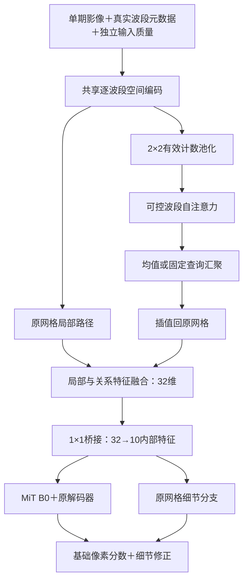

箭头表示实际连接。MiT和细节分支均读取同一桥接特征，没有绕行读取原十波段的入口；桥接十维不表示重建真实S2十波段。MiT与解码器复用官方预训练，细节、USE和桥接按固定种子随机初始化；不加载已有滑坡基线作为USE训练起点。BN运行统计冻结，仿射参数继续训练。

当前原网格路径先编码每个波段，再加上波段物理描述，最后对波段求平均。因此，在十波段全部有效的像素处，描述项是相同的空间常数；这一条路径没有在汇聚前对“哪个波段的内容”与物理身份做非线性结合。内容与物理身份的交互主要在2×2关系路径中完成。它可能限制细小对象利用波段身份，但尚未通过对照证明这是性能下降的原因。本轮不据此临时修改结构。

工程证据保存在`outputs/use/engineering_acceptance.json`、`gpu_invariance.json`及`mechanism_acceptance.json`。它们分别记录梯度/过拟合/恢复、GPU数值不变性和内容/元数据干预响应；这些检查不证明注意力或物理信息带来分割增益。训练结果、停止预算、外部数据准入与剩余工作从上方阶段台账生成，避免在正文维护另一套阶段结果。

### 旁支诊断与桥接标定的边界

已完成的后续诊断复核进一步确认：桥接输出是十维内部特征，不能把它当成按原始波段身份排列的反射率，也不能用输入的`band_valid`直接索引其十个通道。它与原始十波段的低对角相关、较低有效秩或梯度分配变化，都不能单独证明模型发生了某种失效；混合训练后表示改变，也不能自动解释完整十波段IoU的变化。

另一个已完成的工程探针冻结USE与视觉网络，仅训练桥接，让学生早期视觉特征接近冻结直入参照；其后从同一标定状态比较原分割目标与额外前两级特征辅助。该探针包含教师监督，使用训练集合内部的小规模检查，不属于本轮已经固定的十组首轮，既有短程权重不续入原首轮。原始初始化、教师来源、预算和数值归属见[数据正文的旁支工程接力](DATA_EVENT_PROTOCOL.md#use旁支工程证据的接力)及唯一阶段台账；两组新增正式训练尚未实施。

### USE当前样本学习范围

用户已要求暂停下载，并将原有大量无标注影像纳入学习。联合预训练读取三种来源：原有九个训练事件中明确未标注（annotated=False）的Sentinel-2影像、已下载的5000个S2位置，以及1700个Landsat位置。原始13628个S2文件包含验证与保留事件，不能全量混入。原有未标注数据每位置选一期有效像素不少于80%的观测，使用SCL、有限值和非NoData建立输入质量，不读MASK。留出事件及10公里缓冲不参与学习。

每个batch8固定为2个原有未标注S2、2个已下载S2和4个Landsat，保持S2/Landsat两传感器等权曝光；预训练10000次成功更新。外部按5°地理组留出5%，原有数据跨事件名称按CRS/5.12公里空间组留出5%，S2沿用核心训练统计、Landsat统计仅由外部重建训练部分拟合。遮挡一半波段后由可见波段重建标准化反射率，无滑坡标签参与此阶段。原有日期如实记录，不强制套用外部2020—2024年的筛选范围。

只迁移USE至原滑坡数据集的2223块训练样本；669块开发验证不参与训练。九组监督不重跑，第十组仍先100步冒烟、重新初始化后2000次正式更新。这一比较回答联合无标签预训练的整体作用，不能分离各数据来源的贡献，也不能把Landsat重建当作跨传感器滑坡分割证据。授权、冻结清单与哈希以阶段台账和[暂停记录](../outputs/use/external/acquisition_paused.json)为准。

原有无标注数据的首次完整检查发现18对跨事件完全重叠的位置（Kyrgyzstan不同事件目录），因此当次预训练前置被停止，尚无训练更新。处理方式是按seed1234与文件身份哈希排序保留一个位置，不删除原文件或重复计数；同一地理分组跨事件名称合并后再划分重建训练/留出。诊断证据见[重复位置核查](../outputs/use/local_overlap_diagnosis.json)。

完整首轮交接结论：同一USE权重接收多种波段集合的工程目标已验收；联合无标签预训练后完整十波段事件平均IoU为0.2370，相对随机USE混合训练0.1895提高0.0475，但仍低于直入参照0.2985。物理描述0.1955未超过同结构固定随机身份0.1987，不能支持物理描述已带来收益。最小对象预训练前后均为4/77，低于直入11/77，保留退化警报。首轮输出和逐事件/分波段/对象尺度指标以[固定结果正文](DATA_EVENT_PROTOCOL.md#use首轮统一监督与外部预训练验收)和[最终核查](../outputs/use/final_acceptance.json)为准。后续只保留输入适配及小目标问题作为待讨论诊断，不自行增加实验、恢复下载或启动旁支教师训练。

## USE独立预训练与冻结边界验收

USE独立阶段已完成并交接：六组无标签预训练各10000更新、14项冻结探针各2000更新及五组合评价、同一无标签选模USE的原四适配与新增U-Net各2000更新（正式共98000更新）全部验收；USE参数与buffer哈希冻结通过，旧权重保留。生产工厂的显式model.freeze_use开关、优化器参数分组和参数/buffer哈希校验已成为后续阶段沿用的边界实现。逐事件、逐组合与限制见[固定同一USE权重的下游适配结果](DATA_EVENT_PROTOCOL.md#固定同一use权重的下游适配结果)与[最终验收](../outputs/use_independent_frozen/final_acceptance.json)；阶段事实以阶段台账`use_independent`为准。

## USE v2：两组输入编码与冻结恢复探针

本节描述当前已实现并通过独立验收的输入编码与评价边界。正式训练尚未开始，因此本节没有任何训练成绩；阶段事实与执行状态只写阶段台账`use-v2`。

### 两组只差一层局部波段自注意力

输入是单期定标反射率及其显式质量掩膜：`x`、`pixel_valid`、`band_valid`，加上中心波长、带宽、原生GSD三个物理字段和对应的`known_mask`。未知字段必须为零占位且标记为未知；`band_ids`只用于读取与索引，传感器与来源只用于审计和统计，不进入可学习身份查表；任务标签在编码器入口被拒绝。全未知物理描述时的分支贡献严格为零（把该分支权重整体平移后输出逐位不变）。

Tokenizer不做2×2均值：每个波段、每个2×2 Patch的4个有序值与4个有效标记拼成8维，先按质量掩膜清零无效值，再经Linear(8→32)与LayerNorm得到一个波段Token。两组模型此后完全共用：逐Token FFN（扩展比2）、5个Query的交叉注意力读出（前4个对应Patch内4个位置，第5个是Patch级Context）、空间主干与任务目标。V2-N跳过一层4头局部波段MHSA，V2-A加入这一层；与之对应，两组差异只有该层的4个张量、4224个参数，其余109个张量在验收中逐位相同。两组都含Query交叉注意力，因此V2-N不能称为“无注意力模型”。

Fine路径：4个位置Query从波段Token读出特征，同时把每个具体位置的有效观测经共享低维投影（值与有效标记→8维）、按有效波段汇聚、再8→32映射成该位置残差；两路相加后重排回原网格。实测改动某一像素的值，只有它所在2×2 Patch的4个Fine位置变化，其余位置逐位不变，说明原网格位置差异没有被波段池化抹掉。

Context路径：1个Query汇聚Patch特征后学习型合并到1/4尺度；主干窗口4、通道32/64/128/256、深度1/1/2/1，第三尺度的第二个模块使用移位窗口（以偏移填充实现，不循环回绕）。无效Key/Value与填充窗口被显式屏蔽，全掩膜窗口输出零而不是NaN；整幅没有有效观测时拒绝前向。奇数宽高只在右、下补无效位置，各尺度向上取整，Fine恢复原尺寸。

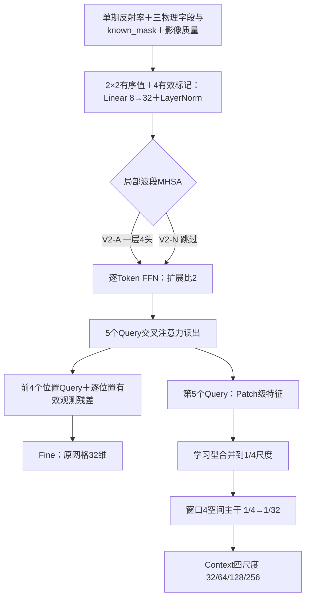

输入128×128时的输出与掩膜：

| 输出 | 形状 | 含义 |
|---|---|---|
| `fine` | B×32×128×128 | 原网格位置特征 |
| `context[0]` | B×32×32×32 | 1/4尺度 |
| `context[1]` | B×64×16×16 | 1/8尺度 |
| `context[2]` | B×128×8×8 | 1/16尺度 |
| `context[3]` | B×256×4×4 | 1/32尺度 |
| `valid.fine` / `valid.context` | 与Fine及四层Context对应的布尔掩膜 | 输出支持范围（与质量掩膜、遮挡掩膜分开保存） |
| `metadata_used` | 每波段每字段 | 实际参与计算的字段掩膜，用于审计 |

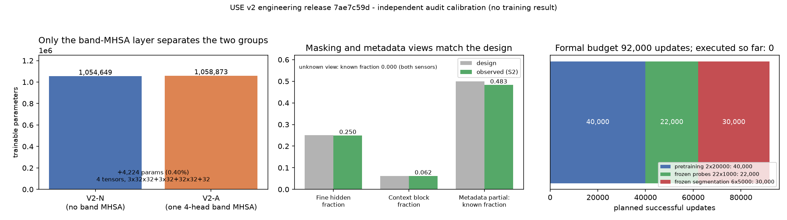

左栏是两组完整模型的实测参数量：差异只有一层4头波段MHSA的4个张量与4224个参数（0.40%）。中栏是遮挡与元数据视图的实测值对设计值：Fine隐藏比例0.250对0.25，Context遮挡块1024/16384=0.062对0.0625，元数据“删一半”后已知字段比例0.483对0.50，全未知视图为0。右栏是正式预算构成（40000＋22000＋30000＝92000更新）与已执行更新数0。三栏都只说明对照口径与预算，不是成绩；数值与来源哈希见[图来源](assets/research/use_v2/provenance.json)。

### 三个无标签任务与目标身份

同一批观测生成三个任务视图，额外视图与成本单列。光谱视图隐藏约50%的波段，且只隐藏中心波长已知的波段（目标物理身份可识别），至少保留一个可见波段；目标完全未知时不做整波段预测。Fine视图各波段同步隐藏25%空间位置（实测0.2499）。Context视图隐藏一块32×32连续区域，占128×128的6.25%；评价另测16、32、64像素块，不同传感器的像素块不代表相同地面面积。元数据视图按样本抽样：保留全部已知字段50%、删除约一半已知字段25%、全部未知25%；只把已知字段改为未知，不补造原本未知的字段（实测已知字段比例为1.00/0.48/0.00）。

目标条件摘要只用遮挡后可见像素的逐波段标准化均值与标准差。验收时从可见像素独立重算，与实现给出的摘要逐位一致；改动被遮挡像素的值不会改变输入视图、摘要或目标掩膜。重建损失只作用于“原本有效且被遮挡”的目标，不因输出支持掩膜而缩小（验收中该损失等于隐藏像元的平均绝对误差）。

三个任务的MAE用固定校准清单的简单参照误差归一化后等权相加，系数、成员与基线在启动前冻结：光谱参照为可见波段物理反射率均值，空间参照为归一化的9×9局部插值；每传感器32份TRAIN成员、seed1234。验收中从TRAIN重算校准，得到与`configs/use_v2/calibration.json`相同的SHA256（29cb697f…），成员与重建验证、隔离位置无交集。

### 冻结边界、恢复与正式启动

`FrozenUSE`在构造时记录编码器全部参数与buffer（含非持久buffer）的SHA256，前向强制eval与no_grad并逐次复核哈希；优化器只能包含任务头参数，任何编码器参数混入立即报错。真实一次更新后编码器哈希不变、优化器不含编码器参数，带`mask`键的输入被拒绝，标签无法进入USE。

恢复时checkpoint同时保存模型、优化器、Python/NumPy/Torch/CUDA随机状态、逐步history、USE与整模型哈希、以及身份哈希（job、配置、校准、初始化、源码、源checkpoint）；恢复要同时校验身份与模型哈希。验收中“连续2次更新”与“1步＋恢复1步”两条链的模型哈希逐位相同、优化器与RNG状态完全一致。

正式启动时每次run都从新初始化或已验收的源checkpoint构建，结束时重建同一初始化并校验哈希；缺少READY_FOR_TRAINING标记、release哈希不一致、源预训练未达20000更新或源checkpoint哈希改变时拒绝启动，工程目录权重不会被当作正式起点。工程与调试的真实数据更新共1013次，单列且不计入92000。

两张卡的启动规则（2026-10-25起，替代原单卡串行规定）：每张物理卡可各跑一个正式进程，桌面显示占用不再作为拒绝条件，其他人的计算进程只检查、不终止。启动前由门禁读取该卡空闲显存（下限4096 MiB），在目标卡上做一次真实的1024×1024前向与反向，并核对`CUDA_VISIBLE_DEVICES`到物理索引的映射；每张卡用一把进程锁，保证同一张卡不会出现第二个本项目的训练进程（锁的持有者进程已死亡时自动清理）。30个正式任务按依赖分三波（预训练、探针、下游），发布时建议V2-N在cuda:0、V2-A在cuda:1，两卡各46000次更新；每个实验仍是有效batch 8，不做跨卡DDP，也不把batch翻倍。设备指派由B按交接文件第3节统一分配并记录：因为`pretrain_mean`已在cuda:1运行，第一个并行步把V2-A改到cuda:0，每次run在`device_gate`里写实际GPU UUID、物理索引与可见设备映射。设备门禁只决定“能不能启动”，不改变模型、损失、采样或选模——工程复核中两组的初始化、冻结与恢复哈希与单卡版本逐项相同（`e86ef83a…`、`96ea016c…`、`707b917a…`）。

`pretrain_mean`由旧release启动并在cuda:1继续运行，不重启；后续探针以记录的`source_checkpoint_sha256`消费它的权重。这种跨release依赖写进批准标记与台账，而不是重跑已完成项；旧release的快照与其批准标记保持原字节，新任务一律改用新release及其自己的标记。代价是：旧release已无法从当前工作区复验（同一个源码文件被新版本替换），而身份哈希包含源码哈希，所以`pretrain_mean`若中途失败，v1与v2两条`--resume`都会被身份校验拒绝，只能重新初始化并单列中止消耗——这条限制尚未验证，需另行确认预算。

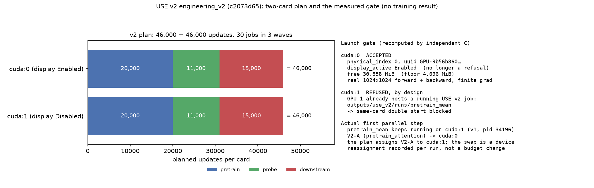

左栏是v2的计划：每卡46000次更新，按预训练20000、探针11000、下游15000分三段；右栏是独立复跑得到的门禁事实：cuda:0（显示占用）被接受并完成真实反向，cuda:1因`pretrain_mean`正在运行而被拒绝重复启动。需要看的是最后几行：计划把V2-A放在cuda:1，但那张卡已被V2-N占用，所以第一个并行步把V2-A放到cuda:0——这是设备指派互换，不是预算或配置变化，每次run都会记录实际卡。图只说明计划与门禁，没有训练成绩；来源哈希见[图来源](assets/research/use_v2/provenance.json)。

### 冻结滑坡头与探针的容量一致性

六组下游为旧USE、V2-N、V2-A各做Context与Context＋Fine。各层特征先按确定性通道分组平均到32维，再各用32→32投影，上采样到1/4尺度相加，最后上采样回原网格；有Fine组用32→32投影在原网格相加后输出分割分数。因此旧USE与v2、有/无Fine的任务头初始张量与容量一致，也不存在读取未经USE原图的旁路；冻结节点的调用方只有特征，标签有效性仍只进入损失与评价器。

冻结恢复探针的Fine组只读Fine特征，Context组只读四个尺度上采样后的均值；两者共用同一个32维投影、同一个Conv64→32→32解码器（另一半输入置零）与同一个Linear8→32→33目标条件头，目标条件对模型与简单参照相同。

### 已知边界

- 两组共用空间主干，本对照不能单独证明空间Transformer本身的因果贡献；V2-N与V2-A的差异只是一层局部波段自注意力。
- 单seed（1234）；20000更新不等于充分收敛，不自动追加种子或预算。
- 30m只做派生评价，缺少合格同地点配对时不得声称真实跨传感器检索。
- 第二个有标签任务的数据尚未核实，本轮不能宣称跨任务通用；工程验收通过不等于研究假设成立。
- 十波段统计仍是559块训练核心拟合的`stats_core25`，没有因训练集为2223块而重算。

### USE v2完成状态与下游容量口径修正

42项正式运行现已完成，原20k条件与续尾条件合计146000更新，另7068中止更新单列。前文双卡启动与旧release续训约束为当时的历史状态，不表示当前仍在训练。独立产物复核见[核查证据](../outputs/use_v2/closeout_review/acceptance.json)。Context-only头4257参数，加入Fine后5313参数；近零IoU仅说明当前完整系统迁移未成功，不能直接认定头容量是主因。预训练与探针改善不能替代跨任务、独立地域评价。

## 冻结USE v2＋完整下游网络：U-Net 与 SegFormer B0

### 两组读同一份输入

编排见`scripts/run_use_v2_full_decoders.py`的`FullDecoder.fused`，实际条件见`configs/use_v2_full_decoders/execution.yaml`：

1. 冻结的USE v2（`outputs/use_v2/runs/pretrain_attention_tail/best_unlabeled.pt`，30 000次无标签更新的权重，按无标签指标选出）在推理模式、无梯度下运行；
2. 四层Context各自按既有`canonical_context`规则压到32通道（通道维按32分组取平均），双线性上采样到原图尺寸，四层求平均；
3. 与原网格Fine特征（32通道）逐元素相加，作为唯一输入张量。

第3步的加和没有可训练参数；对照的轻量头在同样位置放了可训练的`1×1`投影（Context各一层、Fine一层）。两组共用这一融合，且都不读未经USE的原始影像旁路——本轮同时使用Fine与Context，不是只接Fine。

### 两个下游网络的结构与初始化

| 组 | 网络 | 初始化 | 总参数／可训练参数 |
|---|---|---|---|
| 冻结USE v2＋U-Net | 完整四级下采样与上采样，跳接为拼接，归一化为GroupNorm | 全部随机 | 8,796,953／7,771,393 |
| 冻结USE v2＋SegFormer B0 | 32通道新首层＋MiT B0＋分割解码器＋原网格细节分支（`SpectralStem`＋残差融合头） | 新首层随机；其余按本地通用预训练加载 | 4,814,362／3,788,802 |

差额是冻结的USE（1 025 560参数），不进入优化器。

### 实际加载与固定项

- **USE来源**：两组同一文件、同一SHA256；`outputs/use_v2/runs/pretrain_attention_tail/summary.json`中`best_unlabeled.pt`与`selected_30000.pt`同哈希，证明它由无标签指标选出，未用任何下游成绩反向挑选。入口每次构建都重算该哈希并核对，不一致即拒绝启动。
- **SegFormer初始化**：本地`weights/segformer/segformer-b0-finetuned-ade-512-512`，加载清单missing/unexpected/mismatched三项均为空；首层按既有`build_visual('patch32', …)`重建为随机32通道卷积；ADE的150类分类器替换为单logit后其余权重全部复用。U-Net不使用任何预训练权重。
- **BatchNorm**：沿用既有固定统计量策略——`train()`后把BN模块切回eval，只读固定running统计；U-Net用GroupNorm，不含BN。这是既有SegFormer协议的同一做法，不是本轮新规则。
- **训练条件**：seed1234；单期十波段；`stats_core25`；既有影像质量掩膜；每组5000次更新；FP32；有效batch 8（微批量2、累积4）；AdamW学习率6e-4、weight decay 0.01、梯度裁剪1.0；前250步线性预热后余弦；每500步在两事件（广岛448＋特里苏尔221）上按等权IoU选模，保留best与last。

### 训练前门禁

`scripts/run_use_v2_full_decoders.py`提供 `freeze`／`verify`／`accept`／`smoke`／`train`／`evaluate`／`cases` 七个动作：

- `freeze` 把源码、依赖版本、配置、成员清单、统计、USE权重与SegFormer初始化权重共92个文件的SHA256写入`outputs/use_v2_full_decoders/releases/engineering_v1/manifest.json`；`verify` 逐项重算，任一文件或依赖变化立即拒绝。修改代码后旧冻结自动失效（已在本次审查中实测触发）。
- `accept` 在真实训练批次上跑一次完整更新，检查：两组USE哈希相同、融合输入逐元素相同、每个可训练张量都有有限梯度、USE无梯度且仍在推理模式、优化器不含USE参数、保存后严格重载哈希一致；再把“连续两步”与“一步中止后续跑”的优化器、随机流、更新计数与历史逐项比较。
- 正式 `train` 要求：先通过`verify`，且同一release摘要下**GPU**验收`passed`，两组2步真实数据smoke完成。CPU验收只作工程证据；正式训练拒绝`--device cpu`。

### 结果

两组各5000次正式更新在两张卡上各跑一项（U-Net `cuda:1`、SegFormer B0 `cuda:0`）；USE在全部5000步内哈希不变、两组相同（`e3af4763…`），两次运行都从各自新初始化开始（reset哈希与起始哈希一致），都未发生中止或异常。

| 组 | 权重 | 事件等权IoU | 像素IoU | Dice | Precision | Recall | AP | 边界F1 | 小／中／大对象召回 |
|---|---|---|---|---|---|---|---|---|---|
| 冻结USE v2＋U-Net | best（第2500步） | 0.1344 | 0.1190 | 0.2127 | 0.1807 | 0.2585 | 0.1360 | 0.2036 | 0.137／0.353／0.404 |
| 冻结USE v2＋U-Net | last（第5000步） | 0.1275 | 0.1181 | 0.2113 | 0.1925 | 0.2342 | 0.1288 | 0.2094 | 0.133／0.328／0.394 |
| 冻结USE v2＋SegFormer B0 | best（第3000步） | 0.1250 | 0.1087 | 0.1960 | 0.1771 | 0.2196 | 0.1202 | 0.1745 | 0.100／0.278／0.343 |
| 冻结USE v2＋SegFormer B0 | last（第5000步） | 0.1227 | 0.1123 | 0.2020 | 0.1822 | 0.2266 | 0.1196 | 0.1876 | 0.101／0.283／0.343 |

逐事件（best权重）：U-Net 广岛0.1014／特里苏尔0.1674，AP 0.1102／0.2261，边界F1 0.1996／0.2159；SegFormer B0 广岛0.0915／特里苏尔0.1586，AP 0.0958／0.2338，边界F1 0.1710／0.1864。末态权重逐事件为 0.1083／0.1467 与 0.1017／0.1436。口径：事件等权IoU是两事件像素IoU的算术平均（与选模一致）；对象召回按真值面积分档（<50像素／50–200／>200），只计未截断对象；边界F1用1像素容差。

左图是训练损失（滑动50步平均；原始逐步值被4次微批的抽样噪声淹没，直接画不可读），右图是每500步在两事件上算出的等权IoU，空心圈标出各组最佳。读法：两条损失曲线几乎重合、都从0.82降到约0.48，而验证IoU在0.10–0.13之间波动、在2500–3000步见顶后略降，说明后半程主要是在拟合训练块，继续加预算未必提高验证成绩。

### 固定案例与USE编码列

两图各6行是既有的六个固定验证案例（未按预测效果重挑），五列依次为：原RGB（固定反射率0–0.3）、**USE编码**、滑坡真值、预测概率（固定0–1）、0.5阈值掩膜。第2列画的是两组共用的那份融合32通道输入在三个主成分上的取值（六个案例统一拟合一个PCA基、统一做2–98百分位拉伸），所以**颜色只表示"编码向量相似"，不代表地物类别**；两组的这一列逐像素完全相同（已用数组相等核验），这正是"同一冻结USE、同一融合、无可训练参数"的直接证据。编码里能看到与滑体走向一致的条带，但误报块（例如第1行右下、第4行右侧的环状块）在编码里是否有对应结构，需要逐像素相关或通道消融才能判断，本图不据此下结论。

### USE的细节头Fine与上下文Context分别是什么样

两图各6行仍是同一批固定案例，六列依次为：原RGB、**细节头Fine**、**上下文Context**、滑坡真值、预测概率、0.5阈值掩膜。两个编码面板分别对应冻结USE的两路输出（张量形状已实测核对）：

- **Fine**：每个2×2 patch的4个位置查询加逐位置有效观测残差，输出保持原图分辨率（32×128×128），因此保留patch内部的位置差异；
- **Context**：查询汇聚后经学习型合并得到四层（32×32、16×16、8×8、4×4，即输入的1/4、1/8、1/16、1/32），各自压到32通道后上采样回原图求平均，所以最细一层每格4像素、最粗一层每格32像素。

两列各自独立拟合PCA基（同样六案例统一、2–98百分位拉伸），因此**列内可比、列间不可比**。肉眼可见：Fine是细纹理，Context是大块结构，最粗一层的单格比多数小滑坡对象还大；两组的Fine与Context数组逐像素相同（已用数组相等核验），预测列的差异只能来自任务网络。至于Fine里哪些通道真正对滑坡判别有用，需要下游权重、通道遮挡或消融才能回答，本图不下结论。

### 成本与证据

| 组 | 设备 | 用时 | 秒／更新 | 峰值显存 | 可训练参数 |
|---|---|---|---|---|---|
| U-Net | cuda:1 | 1797秒（30.0分） | 0.359 | 765 MiB | 7,771,393 |
| SegFormer B0 | cuda:0 | 2629秒（43.8分） | 0.526 | 417 MiB | 3,788,802 |

汇总与逐事件数值见[comparison.json](../outputs/use_v2_full_decoders/comparison.json)；逐run曲线、best/last权重与六个固定案例在[unet](../outputs/use_v2_full_decoders/runs/unet)与[segformer](../outputs/use_v2_full_decoders/runs/segformer)目录；冻结清单见[release](../outputs/use_v2_full_decoders/releases/engineering_v1/manifest.json)，GPU验收见[acceptance_cuda](../outputs/use_v2_full_decoders/engineering/acceptance_cuda.json)。

### 当前完成状态

结构、条件与权重均已冻结并执行完毕：两组各5000次正式更新（合计10000），GPU与CPU验收均通过，best/last评价与六个固定案例已产出。本轮不追加种子、预算或其它模型，USE未解冻。

### 解释边界

- **换成完整网络后不再贴地。** 同一冻结USE、同一融合输入下，既有5313参数轻量头的完整验证最佳事件平均IoU约0.0049，两组完整网络达到0.1250–0.1344（约26–27倍）。所以"任务头容量"确实是先前近零结果的重要限制之一；但两组仍比历史十波段SegFormer B0的0.2985低0.164–0.174，差距没有消失。
- **两个完整网络之间的差别远小于它们与轻量头的差别。** 事件等权IoU差0.0094（best）／0.0048（last），损失曲线几乎重合；U-Net在IoU、AP、边界F1与小对象召回上略高，SegFormer B0用更少显存但每步慢46%。由于两组的初始化来源（随机 vs 通用预训练）和参数量同时不同，这个差别不能归因于网络架构本身。
- **小对象仍是最弱环节。** 小于50像素的真值对象召回只有0.137（U-Net）与0.100（SegFormer），大对象为0.404与0.343；这与上一阶段"下游贴地"之外的另一条线索一致，但本轮没有做尺寸分层训练或后处理，不能判断是特征分辨率、损失还是阈值造成的。
- **验证在训练中途见顶。** 最佳权重分别在第2500与第3000步，末态略差；训练损失继续下降。没有做早停、学习率重启或正则化扫描，这一点只作为观察，不作为调参依据。
- 参照口径：历史十波段SegFormer B0的0.2985用的是未经冻结编码器的端到端训练与不同的输入处理，事件平均IoU可比但预算与系统不同，不能当作"同一模型的消融差"。

## USE v3：实际结构、初始化与执行结果

本轮已完成17项62000正式成功更新。当前研究参照仍是“SegFormer B0｜十波段直入｜原始网格细节分支”，事件等权IoU0.3081；本轮冻结编码器接完整消费者没有一致迁移改善，不替换参照。完整三张合并表、指标定义、最佳与末态、成本和限制集中在[固定结果](DATA_EVENT_PROTOCOL.md#use-v3统一探针完整分割网络与最终执行核对)，阶段事实与下一步由台账生成。

### 组件如何连接

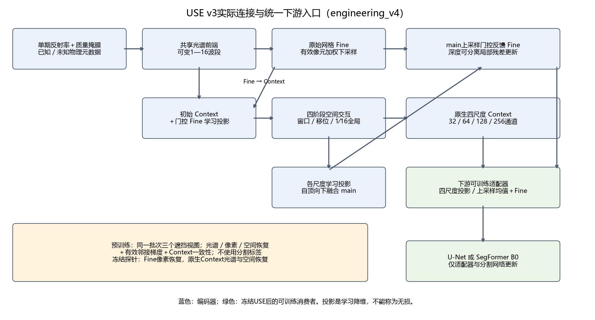

蓝色框是编码器，绿色框是下游可训练部分。图对应v4的数学计算，实际v5仅修CLI路径边界，模型计算未变。先看共享光谱前端分成原始网格Fine和初始Context，再看Fine向Context注入、四阶段空间传播、main反馈Fine；下游直接读取原生四尺度与更新后的Fine，不经过旧固定通道均值压缩。

编码器保留物理元数据、质量掩膜和1—16波段入口，不增加可学习波段身份查表。Fine按有效像元加权下采样2倍，经1×1学习投影和初值0.01的门控残差注入初始Context。四阶段宽度32/64/128/256、深度2/2/4/2；窗口4、移位2、相对位置偏置，1/16阶段最后一层为全局注意力。四个原生尺度各自学习投影到32通道，自顶向下融合形成1/4尺度main，再上采样经初值0.01门控反馈Fine，经过深度可分离3×3局部残差更新。学习投影是降维，不称无损。

三种读出必须区分：预训练临时恢复头读取Fine加上采样main；Fine冻结探针只读32通道Fine，Context冻结探针读取四个原生尺度并学习投影；分割消费者使用新的四尺度→32通道学习投影、上采样平均后加Fine，再输入U-Net或SegFormer B0。最后一项适配器属于下游可训练部分，每组15,488参数。USE全部参数及buffer始终冻结、eval，优化器排除USE；每次冻结前向前后按相同SHA256字节流校验。打包传输只减少设备同步，不减少校验内容或次数。

### 实际初始化与选模

既有原生金字塔编码器固定来自原先指定的无标签选模权重，未重训v2编码器，也未根据本轮分割成绩更换来源。v3以seed1234全新初始化，工程500步未续入正式；连续预训练30000步后仅按统一无标签探针选择10k/20k/30k，实际选中20k。选定别名与20k权重SHA256均为`e20e32f9915974c570d2ad9a064af3bd46b75f0e0d78bafbf698637895533886`，30k末态仍保留。初始化仅诊断、5k只存档，无5k探针。

U-Net全随机；SegFormer B0使用新随机32通道首层，其余沿用本地通用预训练规则。同类恢复头与同类分割消费者在两种编码器条件下的初始张量已独立逐张量核对一致，头seed1235。两种USE冻结参数分别1,025,560与1,879,522；Fine／Context探针可训练11,681／27,169参数，U-Net与SegFormer含适配器的可训练参数分别7,786,881与3,804,290。结构、初始化来源与训练方式分别记录，不能把随机初始化当成架构名。

### 结果与解释边界

四列分别是像素、光谱、空间恢复及等权总分，水平线是随机／既有原生金字塔参照。Fine像素恢复2.1166→1.7117较好，Context光谱0.7163→0.7593较差，空间0.3123→0.2921较好，总分1.0484→0.9210；应看各目标方向，不把总分当成所有表征一致改善。

左图是四项正式训练的100步均值分割损失，右图是同一669块开发验证的两事件等权IoU。读取选定v3的U-Net best/last为0.1305/0.1305，原生金字塔参照0.1263/0.1263；SegFormer则为0.1258/0.1238，对应原生金字塔0.1285/0.1125。两消费者方向不一致，单seed不足以宣称显著性；也不能因重建更好就宣称滑坡迁移更好。固定案例和联合方差／有效秩／空间相关／子集检索诊断见固定结果，保留误报与小对象漏检。

执行证据绑定[engineering_v5](../outputs/use_v3/releases/engineering_v5/manifest.json)，原始配置、全部命令、成员、统计、权重与曲线保持原路径。此前里程碑恢复与CLI路径问题已交A修复；v4独立24测试已通过，用户随后明确要求直接后台训练、不再测试，v5未追加测试、剩余完整成本门禁记用户跳过，不记通过。17项完成训练无训练中断或恢复，另有2项0更新CLI启动失败单列；没有追加预算或种子。详见[权重与预算核对](../outputs/use_v3/audit/training_artifact_audit_v4.json)和[实际成本账本](../outputs/use_v3/audit/cost_ledger.json)。本轮完成即结束，当前参照不变。

<!-- USE_V3_DIAGNOSTICS_START -->

## USE v3：诊断中的连接、监督与成本

本轮沿用已有冻结权重，未改结构、目标、选模或62000步预算。完整三张结果合并表、行动建议表及图见[诊断结果](DATA_EVENT_PROTOCOL.md#use-v3表征与高分辨率成本诊断)。源结构仍是逐波段2×2光谱前端→五Query读出→原始网格Fine与初始Context；Fine有效均值下采样经门控注入Context，原生四尺度经内部学习投影和自顶向下相加形成main，main门控反馈Fine并做局部残差。消费者另有四个独立学习投影，平均后与Fine相加，输入完整U-Net或SegFormer；内部投影与消费者投影不是同一组权重。

实际注入/反馈门控为0.190791/-0.260496，对应31块残差范数比中位0.240/1.120；不能凭初值0.01推断路径没有使用。仅推理时置零的敏感度不等于重训消融。五损失分别反向的模块和Query梯度、同点像素/图像秩、投影前后与融合抵消均已记录，没有优化器step，完整哈希保持一致；不能将幅度或秩替代分割语义。

左列读取实际残差幅度，中间两列读取固定无标签TRAIN样本的加权单项梯度，最右为五个Query读出余弦；不是损失标量占比。光谱和像素项梯度较大，但4份样本不足以证明Fine捷径或Context无用。空间粗尺度监督对“含任意隐藏像素”的粗格计算全有效像素池化误差，边界粗格包含可见位置预测；此为计算口径，不能直接判定造成迁移失败。

上排是同步主机耗时和峰值分配，下排是波段扩展和单份全局bias静态预测。FullDecoder包含两次完整哈希校验，需与裸编码器和消费者单独计时；全局bias显式构造[B,4,N,N]，2048输入时单份4GiB，masked_fill可能叠加临时副本。切片仅保留窗口内全局信息，重叠融合不能重建跨窗注意力。2048只静态估计，真实高分辨率整图和完整优化器更新未测。

语义ROI按用户决定全部uncertain，不作云/云影/建筑类别因果判断。后续结构、监督或实现优化只列候选，本轮没有实施授权；详见[完整验收](../outputs/use_v3_diagnostics/final_acceptance.json)。

报告已补充[用户行动与交给A的对照要求](DATA_EVENT_PROTOCOL.md#你接下来要做什么)：近期保留直入参照；下一轮候选固定已有双向编码器，只比较Fine输入与既有Fine＋Context投影平均输入的完整SegFormer，优先复用已完成参照，建议新增5000次消费者更新。Fine本身仍含编码器内部Context反馈，这只检验消费者额外融合路径，不是删除全部Context的编码器消融。该对照尚未实现或启动；A先核对初始化、数据顺序、预算及选模可比性，不能把本建议当训练授权。新计划事实以阶段台账为准。

<!-- USE_V3_DIAGNOSTICS_END -->

<!-- USE_V4_EXECUTION_START -->

## USE v4实际连接与验收边界

Q1–Q4加像元残差形成早期Fine；Q5经3×3 stride2适配器进入冻结MiT-B0，跳过RGB卷积且Stage1 Patch Norm仅一次。预训练更新光谱前端、适配器与重建头，MiT参数冻结但输入梯度保留；下游完整USE冻结，仅更新ADE20K All-MLP、新单通道classifier与Fine残差。原v3空间主干、第二MiT、U-Net和LoRA未运行于新方案。

正式29000更新、冻结/来源/选模/预算/曝光及图表验收已完成，USE按固定公共无标签评分选20000步。轻量任务头best/last事件等权IoU为0.0600/0.0597，完整冻结哈希核对通过，图像视觉验收通过，结果没有改善。外部监督、探针Stage3多1024权重、早期Fine与旧最终Fine及消费者自由度差异保留。本轮预训练可训练52313参数，分割消费者可训练413570参数；架构、外部监督初始化与训练自由度分别记录，不把系统差异归因于单一模块。详见[完整三表与图](DATA_EVENT_PROTOCOL.md#use-v4独立验收与执行状态)。

<!-- USE_V4_EXECUTION_END -->

<!-- USE_V4_INTERFACE_DIAGNOSTICS_START -->

## USE v4接口只读诊断的模型解释

本次使用现有已训练状态做前向统计，新增训练更新为0。当前参照仍为十波段直入SegFormer B0＋原始网格细节分支。v4接口为五Query读出中Q5→新步长2适配器→原MiT第一层Patch LayerNorm一次→冻结四级MiT；早期Fine另接下游残差，原RGB首卷积绕过。初始化来源分别为v3已选20k光谱前端、通用ADE20K MiT/All-MLP以及新增层初始化，不能把加载来源与架构名称混为一谈。

同样的32个S2和32个Landsat无标签观测表明：Q5已有较低变化维度，adapter/LN没有进一步降低这一统计；Stage1–4仍保留空间差异和跨图差异，Stage4的4×4网格限制了每图秩。v3最终Fine与早期值明显不同，但v4早期和v3早期接近，尚不能证明移除增强造成迁移失败。原始RGB参考保留128网格，因此是非标准预训练分布；监督十波段直入参考含已学习任务信息，两者均不是理想参考上限。

固定22例中，Decoder的BN输入/保存方差比中位数0.0439；残差幅度明显大于主分支，同时使AP与IoU上升、误报下降、召回下降。精确组成是先加logit再sigmoid。因而优先建议下一轮受控检查Decoder BN统计策略，不能直接删除Fine或启动LoRA。两条件各5000更新、总10000更新仅为待授权方案；本轮没有新增训练、没有改变任何参数或buffer。

全部量化证据、三幅图、唯一四假设汇总表、限制与实际复现命令见[固定数据文档](DATA_EVENT_PROTOCOL.md#use-v4接口与冻结迁移只读诊断)。阶段事实由[台账](assets/research/stage_ledger.json)生成，不另建阶段报告。

<!-- USE_V4_BN_RESIDUAL_START -->

### 现有分割头的BN与Fine残差零训练干预

新增比较保持原v4最佳编码器和best@4500完整任务头，参数、BN affine及其他buffer全部冻结；仅在独立副本上用2223块TRAIN影像的BN输入全局矩替换运行均值/方差，不读取TRAIN标签。两个BN条件分别比较主分支、仅逐图偏置、仅中心化空间残差和完整融合，共八条件；先逐字节复现原669块概率，再执行干预。

原统计/后校准完整模型的事件等权IoU为0.0600/0.0292，池化AP为0.0844/0.0787。未达到两个事件IoU和AP一致改善的证据，不自动开展额外BN训练；优先级转回Q5信息保留与USE→MiT接口的受控诊断。 该干预不是训练时更新BN的等价实验；没有新增5000或10000步预算，当前参照0.3081不变。

均值项不改变同图内部排序，空间项才可改变该排序；跨图池化AP和逐图AP须分开解释，FP32饱和/并列另以原logit AP审计。完整两表、三图、TP/FP/FN、AP分布和限制见[原诊断小节的增量结果](DATA_EVENT_PROTOCOL.md#train-only-bn重校准与fine残差信息分解零训练)。

<!-- USE_V4_BN_RESIDUAL_END -->

<!-- USE_V4_INTERFACE_DIAGNOSTICS_END -->
