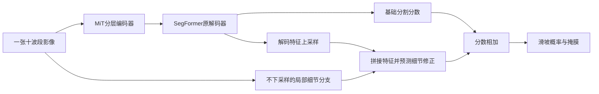
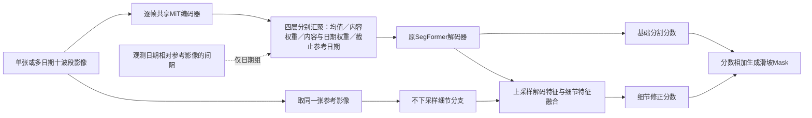
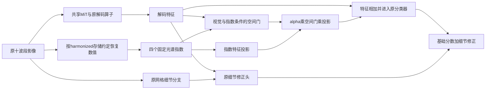
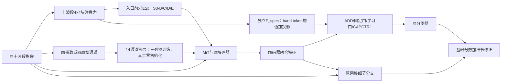
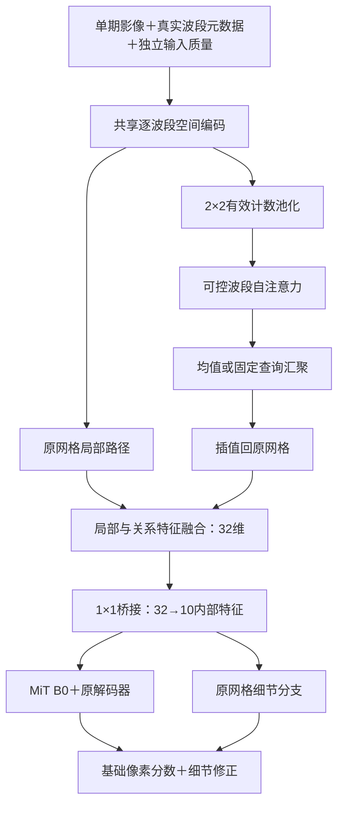

# 模型结构、监督目标与实验演变

最后维护：2026-10-22。本页回答“每一路输入什么、用什么网络、学习什么、与哪一路相连”。**当前仍以十波段SegFormer B0＋细节分支为参照；本轮地形对照未替换它，历史官方模型与多日期模型也不是当前主模型。**成绩见[项目数据与结果](DATA_EVENT_PROTOCOL.md)及[官方划分结果](DATA_OFFICIAL.md)；阶段计划不表示后一模型一定继承前一模型权重。

## 阅读约定与实验设置

**SegFormer**是本项目复用的图像分割模型：编码器从影像提取不同尺度的特征，解码器把这些特征组合成分割预测。实现来自Hugging Face Transformers，空间预训练权重来自NVIDIA发布的ADE20K分割模型。**MiT**是它的分层Transformer编码器；B0与B2表示同一模型族的不同规模，B2更大，不表示输入波段更多。

**分割分数（logit）**是输出概率前的实数，每个像素一个。经过sigmoid函数变成0到1的滑坡概率，再以0.5阈值生成二值掩膜。本文的“分数相加”发生在sigmoid之前，不是把两张二值掩膜叠加。

**细节分支（代码名SpectralStem）**与**输入投影**不同：前者保留输入网格提局部特征，后者把十波段转换为三个可学习通道。旧名称容易混淆，正文不再都简称Stem。

## 当前影像基线：原始网格细节怎样进入SegFormer

### 表一：组件、作用和权重来源

| 组件 | 输入、输出与作用 | 当前训练方式 |
|---|---|---|
| 十波段输入层 | 接收同一日期的十波段，进入MiT第一层 | RGB预训练卷积对应B04/B03/B02；其余七波段初始权重为零但可以训练。 |
| MiT-B0编码器 | 逐级降低特征网格尺寸，提取四个层次的空间特征 | 加载预训练权重，当前基线全部微调。 |
| SegFormer原解码器 | 融合四级特征，生成基础分割分数和解码特征 | 保留成熟解码结构；原多类别输出改为二分类输出。 |
| 原始网格细节分支 | 直接读取同一十波段影像，依次做1×1、3×3卷积，不下采样 | 新建且随机初始化，由训练集滑坡标注学习，不属于官方预训练权重。 |
| 细节修正头 | 将解码特征上采样，与细节特征拼接，预测一张分数修正图 | 最后一层零初始化；训练后允许改变基础预测。 |
| 结果输出 | 基础分数＋细节修正，恢复到输入尺寸 | sigmoid生成概率，阈值生成滑坡掩膜。 |

上路负责分层空间特征，下路直接保留输入网格上的局部特征。应看细节分支从**原影像并行出发**，不是串接在SegFormer之后，也不是新增超分辨率模型；最后只输出一张滑坡掩膜。当前影像基线约375万参数，均可训练。

十波段直入的对照方案是先用可训练1×1卷积将十波段投影到三个通道，再进入原三通道SegFormer。若细节分支开启，它仍读原十波段；投影与细节分支可以分别消融。图像128×128对应已有图块网格，权重名字中的512不要求将其放大到512。

## 地形分支的结构与监督来源

### 先区分研究方向、模型结构和训练方法

原研究方向是**地形信息辅助单期滑坡分割**。本轮先检验把高程和坡度直接加入影像是否有效，再检验独立地形分支及其提前训练是否有效；没有把这些方案全部累加成一个当前模型。

独立地形分支的五种实验使用同样的编码器与评分头结构。所谓“随机地形编码器”实际指**不先预训练该分支，从初始参数开始参与滑坡分割训练**；“随机”描述参数的起点，不是随机修改高程，也不是另一种地形编码算法。

所谓“高程重建预训练”是**地形自监督的一种具体实现**：先遮住部分高程和坡度，训练网络补回未遮挡前的高程，再将编码器用于滑坡分割。“重建”在这里是训练任务，不是新增影像源，也不是最终滑坡分割的输出。完整表格把结构与提前训练方式分别列出，避免把“先训练什么”混成“采用什么模型”。

### 独立地形分支的输入、网络和输出

地形输入是**数字高程模型（DEM，表示地表海拔）与由高程计算的坡度**。它们沿两个通道进入地形编码器，不是文本、灾种标签或新拍摄的卫星影像。

编码器复用Torchvision ResNet18的**初始卷积、池化及第一组残差块**，没有增加完整ResNet18骨干。它将128×128地形图转为32×32特征。当前工厂函数明确禁用ImageNet初始化；随机组从随机参数开始，其他组加载本项目训练出的地形权重。

预测头由3×3卷积、归一化与激活、1×1卷积组成，把地形特征变成一张分数图，再双线性上采样回输入网格。原报告的“读出头”“软评分预测”均指这个**卷积分数预测头**，不是随机森林、逻辑回归或独立易发性数据集。

融合公式为：

`最终分割分数 = 影像分割分数 + α × tanh(地形预测分数)`。

其中α控制地形修正幅度，tanh将地形分数限制在−1到1之间。因此地形既可提高某像素的滑坡分数，也可降低它。它不是“先定位、再裁剪精分”的两个阶段，也没有硬门槛先删除低分区域；地形输出不能直接解释成经过校准的滑坡发生概率。

上部蓝色两路共同组成原影像基线；下部绿色是独立地形输入与编码器，最终只在分割分数处相加。影像网络结构保留，但参数仍参与共同训练；“结构不变”不表示冻结。高程与坡度直接输入的另一组则把输入层和细节分支均扩为12通道，不使用这条独立地形支路。

### 表二：“监督”由什么数据提供

“监督目标”是计算误差时的参考答案，不一定来自教师模型。当前自监督来自高程自身；人工标签监督来自已有训练滑坡标注。两者都通过损失函数反向传播更新参数。

| 训练阶段 | 网络看到什么 | 希望预测什么、怎样计算误差 | 是否需要人工滑坡标注 |
|---|---|---|---|
| 分割前先做地形自监督（具体任务为遮挡后补回高程） | 训练区高程与坡度；按16×16像素块随机同时遮挡约一半位置 | 临时重建解码器恢复原高程，仅在被遮位置计算归一化高程的绝对误差；3000次更新 | 不需要。原始高程就是参考答案。 |
| 滑坡面积比例预训练（旧称同源监督） | 未遮挡的训练区高程与坡度 | 将已有二值滑坡标注按16×16块求均值，再插值回输入网格；预测这一局部滑坡面积比例，使用二元交叉熵，3000次更新 | 需要，复用最终分割任务的同一套训练标注，没有新增独立历史调查数据。 |
| 最终分割训练 | 十波段影像与地形信息，按具体方案连接 | 最终融合预测与原逐像素滑坡标注比较，使用BCE＋Dice；3600次更新 | 需要。训练区人工滑坡标注监督影像、地形和融合参数。 |

### 用已有滑坡标注预训练地形网络：一个具体例子

下面是说明算法的数字示例，不是新增实验样本。假设某张训练影像的一个16×16像素区域全部有效，其中64个像素在人工掩膜里标为1（滑坡），剩余192个标为0（背景）。这个区域的已标注滑坡面积比例为：

`64 ÷ (16 × 16) = 0.25`。

这次预训练要让网络完成的任务是：**只看高程和坡度，预测人工标注中这个区域的滑坡像素约占25%**。人工滑坡掩膜只用于提供参考答案，不输入地形编码器；不是让模型自己生成一份更可靠的新标签。

代码的完整流程是：

1. 网络输入仍是整张128×128的高程与坡度图，不是单独裁剪的16×16小图。
2. 128×128人工二值掩膜按16×16区域求均值，变成8×8比例图；上例的0.25是其中一个位置的目标值。
3. 用双线性插值将8×8比例图恢复到128×128，区域交界处的比例随插值平滑，得到训练参考图。
4. 地形编码器和卷积预测头输出分数图，用二元交叉熵使预测接近参考图；损失通过反向传播更新编码器与预测头。仅使用2223块训练图块及其标注，不使用669块验证图块的标注。

所以它是一种**由原滑坡标注派生的粗尺度监督**。它舍弃了一部分精确轮廓，尝试学习地形与已标注滑坡分布的关联；能否帮助后续逐像素分割是需要实验回答的问题，不是这段训练定义本身能保证的。

0.25表示“这张已有标注里滑坡像素的占比”，**不表示该位置未来发生滑坡的概率**。由于参考答案与最终分割来自同一套人工标注，也不能称新增了一套独立地形易发性调查数据。旧称“同源监督”不再单独充当方法解释。

高程重建“6000步”组是在3000步基础上再重建3000步，用来检查额外预训练预算；它没有新增标注。直接输入和随机地形编码器组没有这段预训练。各组最终分割更新次数相同，不代表总训练次数相同。

三行依次是高程重建、局部滑坡面积比例预测、最终分割。应看右侧参考答案分别来自原始高程、人工滑坡标注的区块平均、原逐像素人工标注。高程重建的临时解码器在分割阶段被移除；地形分数预测头则进入最终融合。

### 现有实现的准确边界

随机、高程重建预训练、6000步重建及固定α四个独立分支方案，新分数头的输出层从零开始；因此刚初始化时地形修正为零。α初始0.01，避免它与输出层同时为零导致分支无法开始学习。输出层先得到梯度，前面的编码器随后才能得到非零梯度；不能写成所有地形参数在第一步均有梯度。

**滑坡比例预训练组是例外。** 它加载已经训练过且不为零的分数头，不能套用“初始预测逐位等于视觉基线”的说法。保存配置指定：编码器来自`v4r1_ssl.pt`，预测头来自`v4r1_scoring.pt`；当前加载函数分别读取两个文件，未迁移后者更新过的编码器。CPU核对确认，滑坡比例训练后编码器状态确实与重建阶段不同。因此该结果只能称“重建编码器＋标签比例预训练头”，不能称完整联合预训练已验证；本次没有更改训练实现或重训。

另外，当前高程重建损失只按遮挡位置计算，未额外乘有效像素掩膜；局部滑坡比例的区块平均也先于有效像素加权，交叉熵损失阶段才使用有效像素掩膜。这些实现限制需要保留，不能描述成已完成所有无效像素排除。α数值来自最佳模型；真正的修正是α与tanh输出的乘积，仅看α不够判断地形是否有效。

## 多日期影像如何进入模型

### 参考影像、参考日期和细节输入

每个图块先按质量及灾后时间窗口规则选出一张影像，原单期实验只用它。本文称其为**参考影像**，其观测日期为**参考日期**；旧报告的“目标单期”“目标帧”是同一个意思。它不是灾害发生日，也不意味着人工标注与该日期完全同步。

“参考影像细节”表示不下采样的细节分支只读取这一张影像。多日期信息进入共享空间编码器与时间特征融合，而非把全部日期影像都堆入细节分支。若光谱模块开启，细节分支读取的是该参考影像经过光谱模块后的十波段输出。

### 表三：三种时间输入条件

| 人类可读名称 | 进入模型的影像 | 评价时应说明什么 |
|---|---|---|
| 仅参考影像 | 原先选定的一张十波段影像 | 单期信息条件。 |
| 参考日期及以前的观测 | 序列开头至参考影像，包含参考影像 | 每图块张数可能不同；不读取参考日期以后的影像。当前实现按序列索引截取，日期来自源序列。 |
| 完整15次观测 | 数据集中该图块的全部15张影像 | 回顾性条件，可能包含参考日期以后的信息，不能称即时可用。 |

所有组预测同一张滑坡标注；没有为每个日期补造一张独立标签。参考日期以后信息带来的收益，不能要求单期模型凭空恢复。

### “日期聚合”如何计算

SegFormer的每张影像经过**同一套共享编码器**，得到四级空间特征。在每一级、每个位置，网络根据影像特征与距参考日期的时间差，产生各观测的权重；权重经softmax归一化后，对日期维度的特征加权求和。融合后的四级特征进入原SegFormer解码器，细节分支仍只读取参考影像。

这是“影像内容和日期间隔参与的时间特征加权”，不是对日期求平均。只有一张影像时，日期维度权重恒为1，这个时间融合环节不改变特征；不表示整套模型训练过程与所有旧单期实验都相同。

### 为什么不再笼统称“真实日期”

数据加载器把源数据记录的观测日期转换为相对2015-12-03的天数。**SegFormer**再减去参考影像的天数，用相对间隔及其周期函数参与权重预测；**U-TAE**则将这一天数传给原有时间位置编码，并在注意力前实际加入编码。

旧接口的问题是用第0、1、2…张的序号代替日期，以及U-TAE导入实现中日期位置编码未实际加入前向计算。修正的是日期信息的表示与调用，不是换成了“更真实的图像”、验证了标签时刻，或获得了无误差的灾害日期。多帧差值同时受张数、时间跨度和未来观测影响，不能全归因于日期编码。

U-TAE是另一套带时间注意力的U形分割网络，本项目复用数据集仓库实现并重新训练；它接收每期十波段及重复广播的静态高程。它没有本项目SegFormer的独立原始网格细节支路，不能把两者写成同一结构。

## 历史组件名称的解释

“辅助监督”是对同一人工标注增加一个损失，例如同时约束基础输出和最终输出，不是新增标签提供者。“粗概率条件精分”将基础概率作为另一个特征输入，仍在整图像素网格计算，没有候选区域裁剪，不等同真正定位后再分割。

“注意力融合”表示根据特征预测融合权重，不能仅因存在可学习权重就称有用；“冻结探针”表示固定编码器、只训练读取头，不能代表完整微调模型。DOFA是可根据输入波长适配的遥感预训练编码器，历史冻结结果不等于全部光谱方案的结论。

U-Net是另一种编码—解码分割结构；本项目使用的SMP是`segmentation_models_pytorch`库的简称，用它复用成熟U-Net实现，并非一种新损失或新增监督来源。TerraMind/TiM、AnySat及文本语义接口属于早期工程，当前主训练不使用，保留源码与历史证据。

## 阶段目标与相邻阶段变化（简述）

本表由[阶段台账](assets/research/stage_ledger.json)生成，记录每阶段目标、改变和结果；不在别处另建平行总结。上一行的结果不意味着下一行一定继承它的模型。

展开历史阶段与后续计划：各阶段目标、变化和结果

<!-- STAGE_TABLE_START -->

| 阶段 | 数据划分 | 实验目标 | 相对上一阶段改变了什么 | 结果与状态 |
|---|---|---|---|---|
| 早期完整系统的工程验证 | 我们的数据划分（留事件验证） | 检查影像、预训练模型、文本语义和粗细分割接口能否共同运行。 | 建立最初的数据读入与多模块训练接口；这些模块不属于当前SegFormer主训练。 | 前向、反向和小样本训练已运行；训练样本少，不能据此比较各基础模型能力。 **历史完成** |
| 十波段输入适配与影像细节对照 | 我们的数据划分（留事件验证） | 比较直接读取十波段和投影为三通道，并检查不下采样细节分支的作用。 | 改用成熟SegFormer编码器和解码器，分别开启两种输入适配与细节分支。 | 四种组合已训练，输入方式的排序随数据版本变化；没有一种方式在所有版本持续领先。 **完成** |
| 观测日期清理与数据扩展 | 我们的数据划分（留事件验证） | 减少影像日期选择风险，增加符合要求的训练图块。 | 重新选择部分训练影像日期或隔离样本；仍使用十波段，同时测试集合成员增加。 | 合法训练样本增加有限，主要扩展了意大利评价图块；不同评价成员的分数不能直接相减。 **完成** |
| 基础预测引导与不同融合结构 | 我们的数据划分（留事件验证） | 检查基础概率、附加损失和特征融合是否帮助细节分割。 | 在影像细节基线上比较概率条件、移除基础输出附加损失、边界加权和单头注意力融合。 | 没有形成候选区域裁剪后的真正两阶段流程；本批注意力融合未显示稳定改善。 **完成** |
| 同一批训练事件内增加图块 | 我们的数据划分（留事件验证） | 判断增加现有事件的训练图块能否持续改善验证结果。 | 九训练事件和广岛、特里苏尔验证事件保持相同；训练量为559、1113、1671、2223，模型与更新预算相同。 | 验证事件平均IoU依次为0.2870、0.3112、0.3143、0.3081，不随数据量单调增加；后期训练改善未同步转为验证改善。 **完成** |
| 比较较早与较晚的编码器状态 | 我们的数据划分（留事件验证） | 检查训练后期的编码器变化是否与验证下降有关。 | 分别固定同一模型训练较早和结束时的编码器，训练相同初始化的解码器，不使用影像细节分支。 | 固定较早编码器组验证IoU约0.2731，固定较晚编码器组约0.2463；不能单独证明遗忘或解码器是唯一原因。 **完成** |
| 编码器学习率与遥感预训练对照 | 我们的数据划分（留事件验证） | 检查降低编码器更新速度或更换预训练编码器能否改善当前基线。 | 一组降低首层以外编码器学习率；另一组改用DOFA遥感编码器及匹配的特征金字塔解码结构。 | B0＋细节参照IoU 0.3081；低编码器学习率B0为0.2823，DOFA完整系统为0.1969；后者并非纯编码器对照。 **完成** |
| 在编码过程中交换影像细节 | 我们的数据划分（留事件验证） | 检查不下采样特征更早影响编码器是否有帮助。 | 在编码器第二阶段后比较分支各自残差处理与双向特征交换，保留末端细节修正。 | B0末端细节参照IoU 0.3081；增加分支内残差为0.2969，双向交换为0.3034；本批未提高IoU。 **完成并停止扩展** |
| 训练事件覆盖与较大模型对照 | 我们的数据划分（留事件验证） | 区分训练事件组成与模型规模的影响。 | 同1251块比较三事件与九事件；同2223块比较SegFormer B0与B2。 | 同1251训练块，三事件/九事件IoU为0.2300/0.2908；同2223块B0/B2为0.3082/0.2698。B2上游权重身份仍有限制。 **完成** |
| 官方图块划分下的单张影像参照 | 官方数据划分（未按事件隔离） | 记录官方成员划分条件下的单期模型表现。 | 使用3012训练、758验证、945测试图块，按验证像素汇总IoU选模，同一灾害事件可出现在不同集合。 | 单期细节SegFormer测试IoU约0.3275；与整事件划分结果及完整998块官方测试结果均不可直接排名。 **完成（历史协议）** |
| 官方划分下的高程与模型结构对照 | 官方数据划分（未按事件隔离） | 检查增加地形信息、增加滑坡像素损失权重及使用U-Net的影响。 | 保持本地官方子集不变；加入高程或坡度、改变交叉熵权重，并比较U-Net完整系统。 | 多数改变量不足0.02；该批SegFormer优于U-Net，但不是单独验证光谱或解码器作用的实验。 **完成** |
| 历史四次事件划分与多日期参考 | 我们的数据划分（留事件验证） | 评估不同未参与训练事件的迁移表现，并检查多日期输入。 | 建立四次整事件训练、选模验证和评价划分；分别拟合训练统计，比较完整微调和固定编码器读取。 | 完整B0四次评价IoU均值0.1685；发现波长映射、日期使用及对象匹配问题，错误输入结果不用于机制结论。 **完成但发现需修正项** |
| 修正观测日期编码与波段波长映射 | 两类均有：波长纠错用我们的事件划分；时间与光谱对照用官方划分 | 复核多日期结果，比较时间特征加权和光谱关系模块。 | 按波段名修正波长；启用源观测日期编码；每日期共享编码器、解码前融合特征，光谱模块独立开启。 | 官方可用子集U-TAE单张、15张、截止参考日期分别为0.3396、0.4832、0.4046；SegFormer对应完成的单张、15张、单张光谱组为0.3302、0.4093、0.3336；联合组中断。 **完成（15期光谱中断）** |
| 历史多日期输入的跨事件复验 | 我们的数据划分（留事件验证） | 检查官方子集的多日期改善是否迁移到未参与训练的事件。 | U-TAE在四次事件划分中分别比较单张、参考日期及以前、完整15张，保持各次训练成员与批次顺序。 | 前两组四折均值0.1589和0.0684；15张仅三折均值0.1279，同三折配对差−0.0304。不同事件方向不一致，日期干预只提示敏感性。 **历史诊断；本次核对11/12完成，非默认续跑队列** |
| 高程、坡度与地形预训练对照 | 我们的数据划分（留事件验证） | 区分地形输入、额外参数、高程重建及标签比例预训练的作用。 | 协议 event_ood_v4r1（TRAIN 2223 / DEV 669，seed1234）；缓存与清单冻结，地形以侧表加入；六组共用同一 TRAIN、3600 更新与 DEV 事件平均 IoU 选模；坡度按 0.01° 原始单位归一化（修正旧版 100 倍尺度错误），α 可学习、读出头零初始化。 | 修正坡度单位后六组重跑：验证事件平均 IoU 0.3067–0.3096（基线 0.3081），全部落在 −0.0015～+0.0015；12 通道直入 0.3067（对象召回 0.5622 高于基线 0.5211，但边界 F1 0.4544 低于 0.4806）；地形自监督组最高 0.3096（+0.0015），同源评分头组最低 0.3076（融合系数仅 0.048）。评分头自身在 11318 个 16×16 格子上与真实滑坡比例的相关系数只有 0.087，基本是常数输出。 **完成（六组，单seed；坡度单位修正后重跑）** |
| 单期光谱入口变换对照 | 我们的数据划分（留事件验证） | 检查增加指数、静态波段偏置及线性通道混合是否有收益。 | 分别比较追加四指数/四原始波段、波长生成静态偏置/十个自由偏置、低秩/满秩线性混合；只有第一对输入扩为14通道。各对并非全部严格同参数量。 | S1 指数 0.2795（−0.0286）、S1 对照 0.2908（−0.0174）；S2 波长 0.3052（−0.0029）、S2 对照 0.3081（0.0000）；S3 低秩 0.3043（−0.0038）、S3 满秩 0.3041（−0.0040）。三级均未超过基线 0.3081。 **完成（六组，单seed）** |
| U-TAE 在项目数据划分上的复现 | 我们的数据划分（留事件验证） | 把官方 U-TAE 的多时相做法放到我们的数据划分上，报告单期与 15 期的差别。 | 新建 15 期缓存 data/s2_temporal_v4r1（2892 块，其中 502 块从源 NetCDF 补齐）；十波段、不加 DEM、真实观测日期、75 epoch；单期与 15 期共用同一训练/验证成员与 DEV 选模。 | 事件平均IoU：单期0.3262、15期0.3706（+0.0444）；对应像素汇总IoU为0.3013/0.3692。广岛0.2755→0.3670，特里苏尔0.3768→0.3741；1–4像素对象召回0.1039→0.0390。末态事件平均IoU为0.2883/0.2718。 **完成（单期与 15 期各一次，单seed）** |
| 时间信息与原始网格细节的受控比较 | 我们的数据划分（留事件验证） | 解释多期观测的增益来源，验证SegFormer保留参考影像细节时能否同时改善事件平均IoU与小目标检出。 | 从单期入口微调转向观测信息与融合机制；保持单期研究参照，另设明确标注的多期回顾性比较，不把多期效果当成单期任务完成。 | 四组时间控制已核验：同接口单期/15期均值/内容/内容与日期事件平均IoU=0.2883/0.2984/0.3145/0.3245；日期组微小对象3/77（单期9/77）。截止参考日期组已完成：0.3377（广岛0.3160、特里苏尔0.3595），微小对象6/77，去掉未来观测后仍高于完整15期。新增3期完成3600更新，最佳0.2926、广岛0.2950、特里苏尔0.2901、微小对象6/77；5期已验收：最佳0.3055（1000步）、广岛0.3137、特里苏尔0.2974、微小对象7/77；7期已验收：最佳0.3348（1000步）、广岛0.3141、特里苏尔0.3554、AP0.4972、微小对象6/77，末态0.2812；地形v2分割在旧队列完成：best 0.3072（500步，参照0.3081）；另完成截止参考日期固定数量组（派生同子集2007/669、2000步）：1/3/5/7期=0.2933/0.3061/0.3432/0.3277，5期最高、7期回落；固定3期180/365天窗口=0.3026/0.2962，短窗口略高0.0064；组成组（同子集1141/669、2000步）：5灾后0.2699、3灾后0.2789、2灾前+3灾后0.2826，混合组在相同总帧数与相同灾后帧两种比较下都略高，但微小对象仅1–3/77；地形v2同权重干预：关闭分支−0.0009 IoU、打乱−0.0013，学到的α=0.0554。各方案均未满足替换单期条件。 另以同接口microbatch64单期对照0.3075（500步）与历史0.3081差0.0006；提示微批量设置影响明显，BatchNorm为主要待核验机制，但单seed未隔离随机数和累计梯度计算差异。；U-TAE同架构：期数1/3/5=0.3154/0.2754/0.2783（15期0.3706）、均值控制0.3101，均30轮窗口内与日期组best@17比较；U-TAE开关：均值0.3101、无日期0.3860、日期0.3706（30轮窗口），无日期组最高；S2波长映射0.3030对自由混合0.3026（同2000步、同110参数）；S1 新增四指数通道用559块TRAIN统计独立标准化并完成首层同初始化审计（2000步：指数0.2917对原始通道对照0.2911，差+0.0006，历史−0.0113差未复现，两组均低于十波段参照约0.016–0.017）；S3 五组2000步：线性混合0.3042、自由ID注意力0.2916、波长注意力0.2913、局部偏置0.2855、全局偏置0.2848；S4 同关系表示的四种融合：ADD 0.3085、FIXEDGATE 0.3095、LEARNGATE 0.3081、CAPCTRL 0.3101，入口前残差(S3-D)0.2855；学习门best(500步)均值0.047、目标0.015/背景0.048，末段完全关闭，未学到空间选择性；S4各融合与十波段参照的差都在单seed噪声范围内 **同接口四组、截止日期组、3/5/7期、截止日期固定数量组、跨度组与组成组已完成并验收；地形v2分割完成（0.3072）；U-TAE均值/内容开关已实现并训练；S1新增通道统计与首层审计、S3五组、S4五种融合已完成2000步训练与统一验收；光谱机制未显示可升级为候选的收益** |
| USE通用光谱输入与外部预训练 | 我们的数据划分（留事件验证） | 同权重接收可变波段，区分注意力、物理描述、混合训练及外部预训练的作用。 | 已接通独立观测、共享逐波段空间编码、2×2波段关系、查询汇聚、32→10内部桥接及原网格细节分支；十维内部接口不限制输入波段数。 | 10/10组2000更新监督实验完成，独立评价669块；本轮直入参照IoU=0.2985。USE共享编码＋均值汇聚=0.1519; USE波段自注意力＋均值汇聚=0.1609; USE自注意力＋查询汇聚=0.1631; USE注意力＋物理描述=0.1955; USE注意力＋固定随机描述=0.1987; USE扩宽无注意力编码=0.1580; 无注意力USE＋混合波段训练=0.1758; 物理USE＋混合波段训练=0.1895; 物理USE＋联合无标签预训练后微调=0.2370。外部已接受S2 5000、Landsat 1700位置；下载状态paused_by_user。单seed，不宣称显著性或跨传感器分割有效。 **USE完整首轮完成并交接；工程通过，研究退化警报保留** |
| USE旁支诊断复核与桥接恢复工程探针 | 我们的数据划分（留事件验证）；本项仅用TRAIN内部工程子集 | 核对既有诊断证据，检验桥接标定及早期特征辅助是否值得进一步研究。 | 复核完整/混合物理USE的表示与接口；另有教师桥接标定后同起点的两组300更新工程探针，不修改原十组首轮。 | 诊断复核无审计问题；混合与完整训练的第一级/第二级/细节CKA约0.64/0.66/0.51。桥接标定200更新、512个TRAIN成员，USE与visual未变且教师零梯度。300更新探针的96块拟合IoU为0.1758/0.2351，另32块TRAIN检查为0.0262/0.0251；两组起点相同，检查集未改善。 成员复核：标定包含91/96拟合成员和全部32/32检查成员；教师也见过检查成员的训练标签，检查不是独立验证。 **诊断与短程工程已完成，固定文档已回写；两组正式2000更新未执行，未纳入原首轮** |
| USE独立预训练与冻结下游 | 我们的数据划分（留事件验证） | USE仅通过无标签目标更新，固定权重评价表征与下游适配。 | 新增完整参数/buffer哈希冻结边界，并通过显式model.freeze_use接入生产工厂、参数分组与现有验证完整性检查；旧配置保持历史语义。 | 六组独立无标签预训练各10000更新、14项冻结探针各2000更新及其五组合评价全部验收；共同USE按无标签指标取multisensor，原四适配与用户新增U-Net均固定这一权重，各2000更新并完成最佳/末态与五组合验收。原四适配中冻结USE→32→10桥接→SegFormer B0＋细节分支最佳IoU0.140685；新增可训练U-Net最佳IoU0.139715、末态0.139715，原十波段SegFormer参照0.298531。累计新增正式98000更新，原权重保留；工程后重新初始化、全USE参数/buffer冻结哈希、优化器排除、成员与日程均验收。没有预先登记的收敛平台阈值，跑满预算不等于充分收敛。随机身份对照含源命名混杂；单seed、研发验证复用、S2单一任务及完整网络容量/初始化差异限制结论，不宣称通用迁移成功。 **本轮已完成并验收；用户接受对照限制，明确结束本轮** |

<!-- STAGE_TABLE_END -->

## 本轮时间组件的连接关系（已训练）

观测数量与汇聚方式在上方分支改变，参考影像始终从同一张影像进入细节分支。单期、15期均值、15期内容权重、15期内容与日期权重、截止参考日期五组都保留同一细节路径，因此本轮检验时间信息及汇聚方式，不能单独声称细节分支对时间模型的贡献。截止参考日期组只改变可用帧集合，不改变汇聚公式。

五组的最佳事件平均IoU依次为0.2883、0.2984、0.3145、0.3245、0.3377；但1–4像素对象召回依次为9/77、3/77、8/77、3/77、6/77，均未超过同接口单期或恢复小目标。多期组的提升主要来自减少误检（FP 121871→44540/75729/49322/59175），代价是漏检增加（FN 112717→129875/116036/121882/116365）。因此这是“更保守的回顾性多期条件”，不是全面优于单期的替换模型。

历史光谱“波长身份”实际是固定十波段的静态加性偏置；“低秩交互”是两个连续线性1×1卷积，不是乘性关系或注意力。真正的BandRelationBlock在4×4空间块内建立十波段注意力，并把输出残差加回输入。它与解码特征处的独立门控旁路是两种不同连接，不能混合归因。

## 限制与下一步

地形与六组光谱入口变换已完成；时间控制的四组与截止参考日期组已完成，结果见[数据与结果](DATA_EVENT_PROTOCOL.md)。当前单期参照仍保留，多期模型属于额外观测条件；本轮各组1–4像素对象召回均未超过同接口单期，下一阶段优先检验多期语义与参考影像细节的选择性融合，而不是继续增加时间模块或叠加地形。

正文展示名由“模型规格＋实际输入＋连接方式”组成，初始化与损失作为训练处理另列，例如“SegFormer B0｜单张十波段｜原始网格细节修正”，再注明“地形高程重建预训练”。历史实验字符串、目录与权重不重命名，保留恢复兼容；代码字段只放配置索引。

## 附录：源码和产物

- 成熟空间模型与输入适配：[segformer.py](../src/landslide_seg/models/segformer.py)；原始网格细节与修正头：[spectral_stem.py](../src/landslide_seg/models/spectral_stem.py)。
- 地形编码器与预测头：[terrain.py](../src/landslide_seg/models/terrain.py)；实际加载入口：[factory.py](../src/landslide_seg/models/factory.py)；高程重建与标签比例训练：[pretrain_terrain.py](../scripts/pretrain_terrain.py)。
- 时间特征权重：[spectral_temporal.py](../src/landslide_seg/models/spectral_temporal.py)；日期与参考影像索引：[temporal_v6.py](../src/landslide_seg/data/temporal_v6.py)；U-TAE日期位置编码适配：[utae_dates.py](../src/landslide_seg/models/utae_dates.py)。
- 当前基线、地形结果及完整原运行身份见[数据专题](DATA_EVENT_PROTOCOL.md)和[机器索引](assets/research/experiment_registry.json)。

## 地形比例监督与加载契约的修订

新配置`scoring_full_v2.yaml`仍是影像分数加上α·tanh(地形分数)，结构不变。地形评分目标改为每16×16区块中有效像素的滑坡占比；例如区块仅128个有效像素、其中32个标为滑坡，目标为32/128=0.25，不是32/256。没有有效像素的区块不产生负标签。评分训练使用区块有效覆盖加权，遮挡补高程只在有效且被遮挡的像素计损失。

新增初始化方式`ssl_scoring_full_v2`从同一个valid评分v2 checkpoint严格加载encoder与head，核对当前统计及完整成员清单哈希；原`ssl_supervised`仍保留其历史头部加载语义，历史结果未改。此修复同时改变监督目标处理与迁移权重，不能当成单因素消融。新3000步权重已按实际工厂入口逐张量核对，分割新训练仍在有限队列中。

## 光谱旁路的显式接口与物理数值版本

新增`implementation=explicit`时，特征作为局部变量经过官方解码器的线性投影、尺度对齐、融合、归一化、激活和dropout，再接受光谱修正并进入原分类器。原十波段仍直接进入MiT，细节头仍读取修正前的解码特征，保持历史连接语义。旧配置默认`legacy_hook`，原权重键不变。显式版本不注册分类器捕获或注入钩子，不使用前向共享特征缓存；同权重且非零旁路下，与旧版本的输出兼容测试及新路径梯度检查通过，并检查了并发前向。尚未验收torch.compile或多卡训练，不据CPU接口测试声称这些环境已通过。

箭头说明实际计算连接：指数支路只在分类器前融合一次，原视觉输入不变。这是四指数旁路的接口修复，尚不是已完成训练的十波段注意力特征融合，也没有证明其研究收益。

新增`radiometry=harmonized_dn_v1`显式使用共享的反归一化、除以10000及负舍入误差截零规则；四指数分母ε=1e-4，关系注意力的ε仍为1e-3，两种用途分别记录。未指定的新旧配置仍默认历史DN指数，不静默改变历史checkpoint。实际工厂配置在8个TRAIN样本上检查：alpha=0时与同权重单期基线输出最大差为0；新旧指数最大差0.00146246、平均绝对差0.00012796。这是数值与接口验收，不是正式训练结果，证据见[显式接口核验](assets/research/spectral_explicit_validation.json)与[统一契约验收](assets/research/contract_acceptance.json)。

<!-- IMPLEMENTATION_ALIGNMENT_START -->

## 原任务书目的与当前计算是否对应

以下是实际实现核查，不代表正式实验全部完成。新实验顺序只维护在阶段台账并生成到总入口。

| 原任务书要检验的机制 | 当前实际实现与证据 | 尚有的差距及其含义 |
|---|---|---|
| 同一SegFormer内区分均值、内容、日期 | `TemporalPool`三种模式，日期经MLP后在tanh前加入内容；同接口训练和行为测试已完成 | 这项已对应；不能称为U-TAE的L-TAE同构移植，也不能称标准年周期 |
| 固定帧数、截止日期、灾前灾后与跨度分别控制 | 固定N选择器、按日期过滤、窗口过滤（history+`window_days`）与派生共同子集预检均已实现；截止日期固定数量1/3/5/7期、180/365天窗口与灾前灾后组成三组均已训练并验收 | 可变长度history不是固定N实验；组成组只有6个训练事件，结果单列；派生共同子集不能与2223块全体混排 |
| U-TAE在同一架构中比较均值/无PE/有PE | `utae_seg.py`/`utae_dates.py`提供均值、内容注意力（无日期编码）、日期编码三组配置；30轮窗口内已训练并验收 | 三组权重/成员/轮数已核验；15期日期组是75轮、best@17，不能与其他组宣称同预算；日期位置编码的作用仍受轮数与单seed限制 |
| S1新增指数通道的统计与首层初始化 | 处理组追加NDVI/NDMI/NBR/REND，四个通道用同一559块TRAIN核心的均值/标准差独立标准化（`manifests/v4r1/stats_s1_indices4.json`）；对照组追加四个原始波段（dataset z-score）。两组首层都零初始化新增四列、保留预训练三列；审计脚本逐张量比较218键 | 统计只拟合TRAIN、DEV未参与；两组都相对十波段参照多4个输入通道，不能把与十波段参照的差归给指数语义；历史未归一化配置只作兼容保留，新正式配置由预检强制登记统计 |
| S2真正波长条件变换、S3动态十波段关系 | S2：入口10×10混合矩阵由各波段中心波长经Linear(9→10)生成，对照为同110参数自由矩阵（2000步，0.3030对0.3026）。S3：`BandRelationBlock`在4×4块内对10个band token做2层自注意力；五组分别改band身份（自由ID/波长）与关系偏置（无/局部/全局），2000步已验收 | S2的IoU差在噪声内。S3五组的线性混合与注意力未严格同容量（110对135,381新增参数）；波长身份、局部/全局偏置都没有可测独立收益，不能据此否定其他容量/预算 |
| S4保持原输入的独立关系特征门控 | 新增`SpectralGateSeg`：同一关系编码器输出真正的`F_spec`（十波段token均值→1×1投影），在官方解码器融合特征处单尺度注入；ADD、固定门0.5、学习门与同容量非物理控制（CAPCTRL）均已训练并验收 | 视觉主路仍读原始十波段，图像细节分支仍读融合前解码特征；学习门在best后逐步关闭支路，未学到空间选择性；门控优化原因未隔离，不能把关闭解释成“关系无用”的干净证据 |
| 同容量/同计算的光谱对照 | S2两支各110个可训练参数、逐位同初始化。S3-B–E存储参数相同（135,381）；`relation_mode=none`时关系偏置MLP不参与前向，有效参数少132。S4-LEARNGATE与CAPCTRL存储参数相同（156,631），CAPCTRL有效参数少132（约0.08%） | 仍是“同存储/近似有效容量”，不是逐参数严格匹配；四指数老支路（加法1281、门控3622）与十波段关系块不可混作同容量；固定门/加法没有门参数 |
| 地形比例监督与成对迁移 | valid有效占比、空块处理、评分encoder+head完整加载和哈希/张量检查通过 | 新组同时改变有效像素监督和迁移路径，只能证明完整修复方案；不能单独归因编码器迁移，且不是独立易发性监督 |
| 缩短训练仍保留可比日程和完整验收 | `train.stop_updates`与`train.schedule_updates`已分开：预热与poly进度都按日程长度算，停止只看`stop_updates`；预检校验预算键并输出warmup/report_steps；验收改读`resolved_config`的`report_steps`与停止步数；子集清单与`subset_protocol`纳入预检 | 新一批11个2000步正式运行已通过权重/配置/成员与评价哈希核验；新2000步运行与历史3600步全程运行不是等预算比较，旧运行只复用前2000步内的最佳 |

实线是已实现并可运行的路径。S1、S3、S4 是三条分别训练的对照，图中并列不代表叠加：S1 改输入通道，S3 在入口前加残差并同时影响主路与细节分支，S4 只在解码特征处注入 `F_spec`、视觉主路仍读原十波段。真实10波段token以4×4空间块建模，不是每像素独立注意力；CAPCTRL 使用自由band ID、无关系偏置，用来分开物理身份与新增容量。

本次新增 S1 统计/首层、S3 五组与 S4 四种融合的 9 项行为测试（`tests/test_spectral_s1_s3_s4.py`，另复跑 3 项既有波段关系契约测试），全量套件另含时间、地形、光谱、组成与预算测试。新一批 11 个 2000 步运行均通过统一 `execution_audit` 的权重/配置/成员/评价哈希核验；S1 首层审计、S4 门控与修正幅度分别见 `outputs/segformer/v4r2_spectral/{s1_init_audit,gate_diagnostics}.json`。仍未验证：学习门饱和/关闭的优化原因、S3 线性混合与注意力的严格同容量、torch.compile 与多卡。具体文件：`src/landslide_seg/models/{spectral_temporal,spectral_relation,spectral_gate,spectral_ladder,spectral_fusion,utae_dates,terrain}.py`、`src/landslide_seg/training/{budget,temporal_trainer,update_training}.py`、`src/landslide_seg/data/temporal_v6.py`、`scripts/{build_s1_extra_stats,audit_spectral_init,audit_spectral_gate,summarize_spectral_s2s4,run_v4r2_spectral}.py`。

<!-- IMPLEMENTATION_ALIGNMENT_END -->

## 下一步完整实验计划

此区由阶段台账生成。当前执行与负责人查[协作登记](assets/research/agent_work.json)和[队列状态](../outputs/research_completion/status.json)；计划不表示已实施。

<!-- NEXT_PLAN_START -->

依据用户提供的独立预训练v2附件执行；U5空间重建在自动审批拦截后已由用户明确确认纳入。旧联合监督结果仅作历史证据，不重复旧队列。

**共同实验条件。** 我们的数据划分（留事件验证）：九事件2223块用于下游训练；广岛448＋特里苏尔221用于下游选模，按两事件等权IoU。seed1234，十波段统计沿用559块训练核心拟合的stats_core25。下游期间USE全部参数和buffer（含非持久buffer）冻结；任何哈希变化立即失败。

无标签缓存共11970份：11132训练、599重建验证、239隔离；来自既有S2、Landsat、TRAIN事件无标注位置及已验收F盘。成员不改变，源产品与地理隔离复用已有审计；无新的地域盲测或真实RGB任务。

**统一训练与初始化。** 6组独立预训练各10000次更新、batch8、FP32、AdamW、LR6e-4、weight_decay0.01、clip1；前500步线性预热，余下线性降至0，每500步保存和验证。S2控制组每步8份S2；多传感器/空间组每步4份S2＋4份Landsat，空间组额外视图成本单列。统一探针与下游适配均计划2000更新、batch8、FP32，学习率日程3600步、预热180步；正式配置须在对应阶段启动前冻结。

预训练USE按seed1234独立初始化，不构造滑坡模型；各组共同参数及临时重建头初值相同。正式训练从工程检查前的初始化重新开始，保存全状态哈希。下游MiT仅使用既有通用RGB预训练，新首层/适配器/解码器随机初始化。

| 顺序 | 模型或工作 | 相对参照改变什么 | 实验可能回答什么 | 执行状态 |
|---|---|---|---|---|
| 1 | 数据与冻结接口 | 全缓存核查、运行环境修复、优化器隔离和完整buffer哈希 | 是否能保证无标签预训练与有标签下游参数边界 | 数据与冻结接口工程验收完成 |
| 2 | 共享卷积均值、波段注意力、物理描述、随机波段身份 | 同S2数据和预算逐项改变波段汇聚与身份信息 | 注意力及物理描述是否改善无标签重建和冻结探针 | 六组独立预训练各10000更新完成，未认定充分收敛 |
| 3 | 冻结随机与各预训练USE的线性/浅层探针 | USE固定，只训练相同初始化和容量的任务读出头 | 重建改进是否对应滑坡表征迁移；仅S2单任务不能定义通用迁移 | 14项统一探针及五组合评价全部验收 |
| 4 | S2＋Landsat，与追加空间遮挡重建 | 固定总更新与观测数；空间组仅增加无标签空间目标和临时读出 | 实际传感器替换曝光与空间目标是否带来收益 | 多传感器与空间各10000更新、无标签诊断完成；共同USE仅按无标签指标选择 |
| 5 | 同一冻结USE的十通道桥、RGB兼容桥、32输入MiT、全新FPN与探针 | 仅改变下游消费接口；USE固定为多传感器/空间两组中无标签验证MAE更低者，平局取多传感器组 | 冻结特征是否可被不同下游网络消费 | 四种适配先全部工程验收，重新初始化正式各2000更新，最佳/末态及五组合均验收 |
| 6 | 冻结USE32→可训练普通U-Net→分割 | 用户新增完整U-Net对照，并确认沿用与原四适配相同的无标签选模共同USE；仅U-Net随机初始化并训练，沿用2000更新、batch8、FP32和原事件留出 | 完整卷积编码器/解码器是否能更好消费固定USE特征 | U-Net沿用共同USE；原四组结束后追加入口并验证原初始化兼容；工程后重新初始化2000更新及完整评价验收 |

**进入训练前的有限验收。**

1. 完整门禁见outputs/use_independent_frozen/engineering_acceptance.json；失败证据另存，不抹去旧异常。
2. 正式预训练先核验smoke与冻结配置、清单、初始化及源码哈希一致，再重新初始化。下游按实际配置运行check_research_protocol。
3. 每次下游验证检查全部USE参数和buffer哈希，优化器排除USE；保存best/last、曲线、曝光、完整优化器和RNG状态。

**继续、停止与后续条件。**

1. USE每组checkpoint仅由无标签重建验证选模，不用滑坡验证反复选择同组USE权重。
2. 先完成S2初批和统一探针，再推进已授权多传感器及空间目标。重建改善不得等同迁移成功。
3. 新增数据下载、改变成员、扩大预算和额外研究分支须另行说明；保持原数据下载暂停。真实RGB、第二任务和独立地域评价尚未具备，不冒充完成。

**交给执行 Agent。** 当前认领use-independent-frozen及相关工程任务；使用.venv-use-independent/Scripts/python.exe，固定输出outputs/use_independent_frozen。六组冻结配置在pretraining/<variant>/resolved_config.json，保留初始化与source_snapshot。

**结果交付。** 阶段事实仅维护本台账；刷新固定入口和模型文档。保存配置、命令、成员与源哈希、逐步曲线、best/last、逐事件指标及冻结证据。

<!-- NEXT_PLAN_END -->

## USE：同一套参数接收不同光学波段集合

本项完整首轮已完成，工程接口通过，分割结果未超过本轮十波段直入参照。输入是单张光学观测及其波段身份、波长、已知带宽、原生分辨率和影像质量；输入质量只来自源SCL、有限值与非缺测检查。标签是否已知只控制分割损失与评价，不作为模型输入。原有十波段统计保持不变，仍由559块训练核心拟合。当前本地S2带宽缺失被显式标记为未知；名义波长沿用项目已有波段契约，不冒充逐产品实测响应曲线。

共享逐波段卷积在所有真实通道上复用，LayerNorm按token计算。原网格路径保留局部响应，关系路径按2×2网格的有效计数池化；波段自注意力和固定查询汇聚分别由独立对照检验。补齐通道在汇聚中屏蔽；局部全缺测处输出零特征和无效标记，整幅没有有效观测时拒绝前向。

箭头表示实际连接。MiT和细节分支均读取同一桥接特征，没有绕行读取原十波段的入口；桥接十维不表示重建真实S2十波段。MiT与解码器复用官方预训练，细节、USE和桥接按固定种子随机初始化；不加载已有滑坡基线作为USE训练起点。BN运行统计冻结，仿射参数继续训练。

当前原网格路径先编码每个波段，再加上波段物理描述，最后对波段求平均。因此，在十波段全部有效的像素处，描述项是相同的空间常数；这一条路径没有在汇聚前对“哪个波段的内容”与物理身份做非线性结合。内容与物理身份的交互主要在2×2关系路径中完成。它可能限制细小对象利用波段身份，但尚未通过对照证明这是性能下降的原因。本轮不据此临时修改结构。

工程证据保存在`outputs/use/engineering_acceptance.json`、`gpu_invariance.json`及`mechanism_acceptance.json`。它们分别记录梯度/过拟合/恢复、GPU数值不变性和内容/元数据干预响应；这些检查不证明注意力或物理信息带来分割增益。训练结果、停止预算、外部数据准入与剩余工作从上方阶段台账生成，避免在正文维护另一套阶段结果。

### 旁支诊断与桥接标定的边界

已完成的后续诊断复核进一步确认：桥接输出是十维内部特征，不能把它当成按原始波段身份排列的反射率，也不能用输入的`band_valid`直接索引其十个通道。它与原始十波段的低对角相关、较低有效秩或梯度分配变化，都不能单独证明模型发生了某种失效；混合训练后表示改变，也不能自动解释完整十波段IoU的变化。

另一个已完成的工程探针冻结USE与视觉网络，仅训练桥接，让学生早期视觉特征接近冻结直入参照；其后从同一标定状态比较原分割目标与额外前两级特征辅助。该探针包含教师监督，使用训练集合内部的小规模检查，不属于本轮已经固定的十组首轮，既有短程权重不续入原首轮。原始初始化、教师来源、预算和数值归属见[数据正文的旁支工程接力](DATA_EVENT_PROTOCOL.md#use旁支工程证据的接力)及唯一阶段台账；两组新增正式训练尚未实施。

### USE当前样本学习范围

用户已要求暂停下载，并将原有大量无标注影像纳入学习。联合预训练读取三种来源：原有九个训练事件中明确未标注（annotated=False）的Sentinel-2影像、已下载的5000个S2位置，以及1700个Landsat位置。原始13628个S2文件包含验证与保留事件，不能全量混入。原有未标注数据每位置选一期有效像素不少于80%的观测，使用SCL、有限值和非NoData建立输入质量，不读MASK。留出事件及10公里缓冲不参与学习。

每个batch8固定为2个原有未标注S2、2个已下载S2和4个Landsat，保持S2/Landsat两传感器等权曝光；预训练10000次成功更新。外部按5°地理组留出5%，原有数据跨事件名称按CRS/5.12公里空间组留出5%，S2沿用核心训练统计、Landsat统计仅由外部重建训练部分拟合。遮挡一半波段后由可见波段重建标准化反射率，无滑坡标签参与此阶段。原有日期如实记录，不强制套用外部2020—2024年的筛选范围。

只迁移USE至原滑坡数据集的2223块训练样本；669块开发验证不参与训练。九组监督不重跑，第十组仍先100步冒烟、重新初始化后2000次正式更新。这一比较回答联合无标签预训练的整体作用，不能分离各数据来源的贡献，也不能把Landsat重建当作跨传感器滑坡分割证据。授权、冻结清单与哈希以阶段台账和[暂停记录](../outputs/use/external/acquisition_paused.json)为准。

原有无标注数据的首次完整检查发现18对跨事件完全重叠的位置（Kyrgyzstan不同事件目录），因此当次预训练前置被停止，尚无训练更新。处理方式是按seed1234与文件身份哈希排序保留一个位置，不删除原文件或重复计数；同一地理分组跨事件名称合并后再划分重建训练/留出。诊断证据见[重复位置核查](../outputs/use/local_overlap_diagnosis.json)。

完整首轮交接结论：同一USE权重接收多种波段集合的工程目标已验收；联合无标签预训练后完整十波段事件平均IoU为0.2370，相对随机USE混合训练0.1895提高0.0475，但仍低于直入参照0.2985。物理描述0.1955未超过同结构固定随机身份0.1987，不能支持物理描述已带来收益。最小对象预训练前后均为4/77，低于直入11/77，保留退化警报。首轮输出和逐事件/分波段/对象尺度指标以[固定结果正文](DATA_EVENT_PROTOCOL.md#use首轮统一监督与外部预训练验收)和[最终核查](../outputs/use/final_acceptance.json)为准。后续只保留输入适配及小目标问题作为待讨论诊断，不自行增加实验、恢复下载或启动旁支教师训练。

## USE独立预训练与冻结边界验收

USE独立阶段当前完成现有数据入口校验和独立冻结边界实现；旧环境反向异常的失败证据保留；隔离CPython3.12环境已通过73项测试与六种入口冻结更新。生产工厂已增加显式model.freeze_use开关；参数分组排除USE，现有验证流程检查参数与buffer哈希。完整工程门禁已通过。六组正式配置及全新初始化已冻结，首批四组S2无标签控制正在正式训练；训练与迁移验收尚未完成。证据：[本地验收](../outputs/use_independent_frozen/audit.json)。
