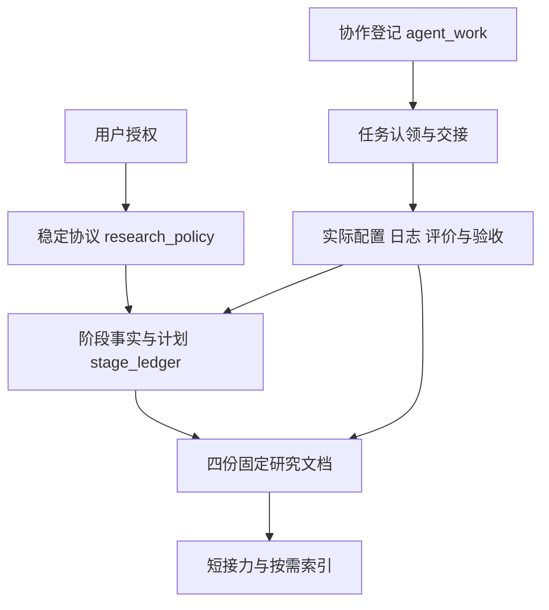
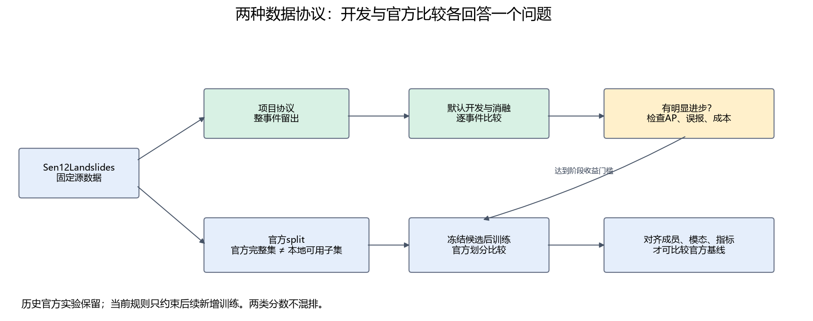

# 研究入口：先定位任务，再读取证据

## 新 Agent 最小接力

<!-- MIN_HANDOFF_START -->
- 当前项目研究 Sentinel-2 影像滑坡分割。当前单期参照是 **SegFormer B0＋原始网格细节分支，十波段输入**；多期和地形对照没有自动累加进参照。
- 默认**我们的数据划分（留事件验证）**：九事件2223块训练，广岛448＋特里苏尔221块用于研发选模，seed1234，按两事件等权IoU选模。十波段统计沿用559块训练核心拟合版本。不是默认四折，也不是官方划分；完整约束见[共享协议](assets/research/research_policy.json)。
- 阶段事实和下一步的唯一来源是[阶段台账](assets/research/stage_ledger.json)。当前阶段机器ID为 `use-v2`；用 `scripts/query_research.py --stage use-v2` 查询，不默认读全部JSON。
- **USE完整首轮已完成并交接**：十组监督各2000次更新，联合无标签预训练10000次更新，同一最佳十波段权重的五组合评价及最终预算/曝光/哈希/重载核查通过。联合预训练后IoU 0.2370，高于随机USE混合训练0.1895，仍低于本轮直入0.2985；最小对象4/77对直入11/77，退化警报保留。详见[固定结果](DATA_EVENT_PROTOCOL.md#use首轮统一监督与外部预训练验收)和[最终核查](../outputs/use/final_acceptance.json)。
- 下载按用户要求保持暂停：冻结已下载S2 5000、Landsat1700，加原有3062个未标注TRAIN事件位置共同预训练；验证和保留事件不参与学习。旧USE首轮无待续训练队列，不重复运行`--finish-stage`。旧自动接续`use`已删除；当前明确授权的独立阶段另见下条，不恢复下载。
- F盘严格准入的2208个位置已接入派生USE预训练数据：1853训练、116重建验证、239隔离缓冲；联合池为11132训练、599重建验证。旧入口使用`--f-local`，数据接入时未启动训练；当前独立阶段已使用同一批冻结缓存，旧数据及旧权重保留。验收与命令见[数据接入](DATA_EVENT_PROTOCOL.md#f盘数据接入use预训练集)。
- 谁做过、谁正在做：运行 `scripts/manage_agent_work.py list`，记录见[协作登记](assets/research/agent_work.json)。认领、交接与结束命令见[项目规则](../AGENTS.md)。已完成任务先复用证据，不重复实验。
- 实时运行先查[已登记队列状态](../outputs/research_completion/status.json)的相关命令，再核验进程、日志与产物。状态RUNNING不证明进程仍活着；完成训练也不等于通过研究验收。
- 最新计划与实际实现差异见[模型文档](MODEL_EVOLUTION.md#原任务书目的与当前计算是否对应)，完整下一步见[生成计划](MODEL_EVOLUTION.md#下一步完整实验计划)。新短预算须先适配执行链，不能把计划当成已生效设置。
- 数据审查已完成到源数组/缓存/增强/监督/曝光与逐对象概率；证据和48个固定案例见[数据审查结果](DATA_EVENT_PROTOCOL.md#数据链路与逐对象审查结果)。日期标注一致性明确不查；外部9通道不进主线。
- 下面只选一个相关主题；详细历史比较在本页下方，普通开工读到此处即可。
- **USE独立阶段本轮已授权执行完成并验收**：六组预训练各10000更新、14项冻结探针各2000更新及五组合、同一无标签选模USE的原四适配和新增U-Net各2000更新全部完成；工程后均重新初始化，USE全参数与buffer哈希冻结通过，旧权重保留。新增U-Net最佳/末态IoU为0.1397/0.1397，原十波段SegFormer参照0.2985；完整比较见[固定结果](DATA_EVENT_PROTOCOL.md#固定同一use权重的下游适配结果)与[最终验收](../outputs/use_independent_frozen/final_acceptance.json)。新增正式预算98000更新；10000更新不等于充分收敛，重建不等于迁移，单seed与研发验证复用限制保留。用户已明确接受随机身份命名混杂等限制并结束本轮，不追加纠正预算；真实RGB、第二任务及新地域盲测未完成。下载保持暂停，不恢复旧队列，不重复已完成训练。
- **USE v2 首轮执行完成（20k 与 30k 续尾两个条件，42 项正式运行）**：两组 20000 步预训练＋22 探针＋6 下游，以及用户授权的 10000 步余弦续尾＋4 探针＋6 下游全部完成，预算 146000 已执行、另有 7068 次中止单列。无标签指标：选模分数 20k→30k 为 0.6218→0.6208（无局部波段自注意力）与 0.6209→0.6141（一层4头局部波段自注意力）；探针 20k→30k 前者 Fine 2.2813→2.2320、Context 0.2524→0.2462，后者 Fine 2.2964→2.2932、Context 0.2524→0.2538；随机参照 Fine 2.3481/2.3361、Context 0.2966。**下游 12 项事件平均 IoU 全部 0.0000–0.0049**，抽样预测普遍低于阈值；Context头4257参数、加Fine后5313参数，失败主因尚未确定，不能据此作稳健架构排名。波段自注意力仍无确定证据（选模 V2-A 略低、30k 探针两项 V2-N 更低，方向矛盾，单 seed）。结果见[固定数据文档](DATA_EVENT_PROTOCOL.md#use-v2两个预算条件的无标签与下游结果)与[最终核验](../outputs/use_v2/audit/final_acceptance_v1.json)。
<!-- MIN_HANDOFF_END -->

## 文档与维护路由

| 你要解决什么 | 只读/更新哪个来源 | 谁负责、怎样维护 |
|---|---|---|
| 找入口、查证据 | 本页 | 当前任务完成者只更新短接力/链接；下方生成表不手改 |
| 改实验协议、检查成员合法性 | [共享协议](assets/research/research_policy.json)；[项目规则](../AGENTS.md) | 规划/审阅者在用户授权范围内改契约，执行者预检；稳定规则不堆运行状态 |
| 记录阶段目标、改变、结果、下一步 | [阶段台账](assets/research/stage_ledger.json) | 规划者写计划与待实现，执行者写真实完成证据，审阅者核查边界；按阶段增量编辑后刷新 |
| 查事件成员、输入、指标、曲线与结果 | [项目数据与结果](DATA_EVENT_PROTOCOL.md) | 数据/执行者解释实际成员与评价；数值由评价证据支持，不另写阶段总结 |
| 查组件连接、监督来源、实际加载、设计缺口 | [模型与训练方法](MODEL_EVOLUTION.md) | 实现者随代码改正文，审阅者核查实际路径；阶段表与计划由台账生成 |
| 查官方完整集合与本地子集历史 | [官方数据与结果](DATA_OFFICIAL.md) | 仅做官方比较的任务更新；不混排项目分数 |
| 认领任务、查贡献、交接 | [协作登记](assets/research/agent_work.json) | 每个Agent用 `manage_agent_work.py` 登记自己；只存职责、状态、证据，不存另一套结果 |
| 查run身份、配置、旧名称 | [运行索引](assets/research/experiment_registry.json)；[名称映射](assets/research/experiment_aliases.csv) | 先用 `query_research.py --runs <词> --limit 5`；新增run时用 `build_research_inventory.py --no-figures` 刷新 |
| 查历史原文、早期工程 | [归档入口](../archive/README.md)；仓库 `old/` | 按关键词查目录元数据，明确追溯才读小段；历史不改写，不作为执行授权 |
| 写报告、图表与结论 | [写作规范](reporting_style.md) | 按需读取；报告直接更新四份固定正文，不新建日期报告 |

文档关系与回写方向如下。上行是权威来源，下行是解释与入口；原始运行证据保持原路径。



## 谁干了什么与当前接力

下表从协作登记生成。负责人代码是聊天ID，用于追溯；“完成”只指该项交付。已登记的队列与历史作者之间没有充分证据的关联不作推定。历史实验结论以阶段台账为准，不能从旧聊天末句继续执行。

<!-- AGENT_WORK_START -->

| 工作 | 已确认贡献与状态 | 负责人和证据 |
|---|---|---|
| 历史时间与光谱修改方案 | 本项交付完成。最近完成回合交付修改计划，记录停止误启动任务；早期四折复跑方案已被当前协议取代。历史交付，不代表该方案已经训练完成；不继续执行旧计划。 | `01a15886-486a-71b3-97f3-0080e17eaca9` [证据1](../archive/experiment_history/docs/planned_temporal_spectral_experiments_2026-10-20.md) |
| 研究审阅、结果口径与时间机制路线修订 | 本项交付完成。最近完成回合纠正U-TAE像素汇总/事件平均混用，规划同接口SegFormer四组时间控制；该回合未启动新训练。当时四组待实施的说法已过期；实际完成情况查阶段台账。 | `01a14cc4-f0d9-7813-b6d3-4d54018be7f9` [证据1](assets/research/stage_ledger.json) [证据2](DATA_EVENT_PROTOCOL.md) [证据3](MODEL_EVOLUTION.md) |
| 训练预算复核、设计实现审查与后续计划 | 本项交付完成。最近完成回合核对14个完成运行的最佳步数、5期结果与实现缺口，将后续2000步方案写回台账；未启动新批次。2000步仍为待适配计划；现有3600步队列另查状态。 | `01a16805-4eb7-7ff3-b88e-6ef43f16b663` [证据1](assets/research/training_budget.json) [证据2](assets/research/stage_ledger.json) [证据3](MODEL_EVOLUTION.md) |
| 已登记的3/5/7期与地形修复队列 | 登记进行中，须核实实际状态。导入时登记状态RUNNING；不据此认定进程存活，也不推定原作者。先查实际命令、进程与产物；禁止重复启动。范围含保守预留，实际路径以状态中的命令为准。 | `待核实：既有执行会话/队列脚本` [证据1](../outputs/research_completion/status.json) [证据2](../scripts/run_research_completion.py) |
| 文档合并、维护路由与Agent协作登记 | 本项交付完成。已完成入口精简、规则去除过期状态、计划单一位置、贡献登记与认领冲突检查；157个链接、5份快照哈希、刷新幂等及认领测试通过。未启动或停止训练，未核验全部历史作者或后台队列存活。 | `01a16870-3035-76e0-a0be-30dff718ffc0` [证据1](RESEARCH_INDEX.md) [证据2](../AGENTS.md) [证据3](../scripts/manage_agent_work.py) [证据4](../tests/test_agent_work.py) |
| 执行 temporal-mechanism 计划：预算适配与后续批次 | 本项交付完成。实现并验证预算适配：stop_updates/schedule_updates解耦、验收读resolved_config的report_steps、派生子集subset_protocol预检、history+window_days窗口选择；新增派生共同子集2007/669与2108/669。训练并验收6个2000步正式run：截止参考日期1/3/5/7=0.2933/0.3061/0.3432/0.3277，窗口180/365=0.3026/0.2962；200步smoke不计正式成绩。旧队列3/5/7与地形v2已结束，7期best0.3348、地形v2 best0.3072。未验证：单seed无显著性、派生共同子集不能与2223块全体混排、组成训练与U-TAE开关未实现、未做多卡/编译验证。 | `dsh-agent-2026-10-23` [证据1](../manifests/v4r2/subset_protocol_cutoff7.json) [证据2](../outputs/segformer/v4r2_temporal_cutoff/summary_temporal_cutoff.json) [证据3](../outputs/segformer/v4r2_temporal_window/summary_temporal_window.json) [证据4](assets/research/execution_audit.json) [证据5](../src/landslide_seg/training/budget.py) [证据6](../tests/test_update_budget.py) |
| 执行组成对照批次：逐样本帧计划与三组2000步 | 本项交付完成。完成组成对照批次：新增逐样本帧计划入口（dataset/train/evaluate）、三份计划与1141/669共同清单、预检的计划校验（登记哈希/成员/锚帧/未来帧/期数）、三组2000步训练与验收：5灾后0.2699、3灾后0.2789、2灾前+3灾后0.2826。另在认领范围外实现U-TAE均值/内容开关（src/landslide_seg/models/utae_seg.py、utae_dates.py、scripts/train_utae_cv.py、evaluate_utae_v4r1.py、configs/utae/v4r1/{mean,content}.yaml、tests/test_utae_controls.py、docs/assets/research/utae_controls_queue.json）并修掉训练入口对缺失quality侧表的崩溃；两组30轮已排队并在训练。未验证：单seed无显著性、组成子集只有6个训练事件且为回顾性条件（灾后帧最长865天）、U-TAE新组尚未训练完成验收。 | `dsh-agent-2026-10-23` [证据1](../manifests/v4r3/subset_protocol_composition.json) [证据2](../outputs/segformer/v4r3_composition/summary_composition.json) [证据3](assets/research/execution_audit.json) [证据4](../src/landslide_seg/models/utae_dates.py) [证据5](../configs/utae/v4r1/mean.yaml) [证据6](../tests/test_composition_plans.py) |
| 最新结果诊断与系统改进路线 | 本项交付完成。核对最新截止日期/跨度/组成结果，制定数据错误审计→训练归一化→事件采样/对象监督→条件模型改动→冻结候选复核的系统路线；修正单seed噪声与BN归因过强表述。新增方案未训练，不中止已有队列。 | `01a16805-4eb7-7ff3-b88e-6ef43f16b663` [证据1](assets/research/stage_ledger.json) [证据2](DATA_EVENT_PROTOCOL.md) [证据3](assets/research/systematic_evidence.png) |
| 用户新增滑坡样本配对与输入契约审计 | 本项交付完成。只读完成364对影像标注审计，记录缺影像、非有限值与包围盒重叠；用户确认9通道不对应S2、无日期，仅参考且排除主线。未推理或改原数据。 | `01a16805-4eb7-7ff3-b88e-6ef43f16b663` [证据1](assets/research/external_landslide_audit.json) [证据2](../scripts/audit_external_landslide.py) |
| 目标尺寸分布与漏检贡献审查，排除日期标注问题 | 本项交付完成。按用户要求排除日期标注一致性，完成原2892份mask/valid全量尺寸分布、逐事件统计及成熟基线FN分解，尺寸统计与已有评价一致；更新数据优先计划。未训练/推理，逐对象概率和案例检查尚未完成。 | `01a16805-4eb7-7ff3-b88e-6ef43f16b663` [证据1](assets/research/size_diagnosis.json) [证据2](assets/research/size_diagnosis.png) [证据3](DATA_EVENT_PROTOCOL.md) |
| 逐对象概率、裁块增强监督与固定案例审查 | 本项交付完成。完成2892源数组/缓存/增强审查、best与末态曝光、实际损失梯度、669块CPU重推理、48固定对象案例及逐对象分类；历史混淆计数完全复现；6测试和223文档链接通过。未训练；日期标注一致性不查，外部九通道不纳入；未证明全景对象身份、人工标注语义正确及改进因果效果。 | `01a16805-4eb7-7ff3-b88e-6ef43f16b663` [证据1](assets/research/object_data_review/summary.json) [证据2](assets/research/object_data_review/pipeline.json) [证据3](DATA_EVENT_PROTOCOL.md) [证据4](../scripts/audit_object_errors.py) |
| 执行 S1 统计/初始化与 S3 五组、S4 五种融合 | 本项交付完成。实现并验收 S1 新增四指数通道统计与首层同初始化审计、S3 五组关系、S4 独立F_spec四种融合与同容量非物理控制；11个2000步正式run全部通过预检、训练、best/last/step1000/1500评测与execution_audit严格加载。S1指数0.2917对原始通道0.2911（+0.0006），历史-0.0113差未复现；S3-A线性0.3042对注意力0.2916/0.2913/0.2855/0.2848；S4-ADD/FIXED/LEARN/CAPCTRL=0.3085/0.3095/0.3081/0.3101，入口前残差0.2855，学习门末段关闭。未验证：单seed无显著性、门控饱和/关闭的优化原因、S3线性与注意力未严格同容量、未做编译/多卡。注：本会话同时有另一活动任务在改 factory/update_training 的 USE 分支，未覆盖其改动。 | `dsh-agent-2026-10-23` [证据1](../outputs/segformer/v4r2_spectral/summary_spectral.json) [证据2](../outputs/segformer/v4r2_spectral/s1_init_audit.json) [证据3](../manifests/v4r1/stats_s1_indices4.json) [证据4](assets/research/v4r2_spectral_queue.json) [证据5](assets/research/execution_audit.json) |
| S1/S3/S4 验收审计、图与固定文档回写 | 本项交付完成。扩展统一execution_audit纳入v4r2_spectral 11个run并核验权重/配置/成员/评价哈希与S1新增通道统计；新增S1/S3/S4汇总图、门控诊断图与队列证据JSON；回写阶段台账、DATA_EVENT_PROTOCOL、MODEL_EVOLUTION并刷新RESEARCH_INDEX。全量pytest通过。未验证：图为单seed结果，不具显著性。 | `dsh-agent-2026-10-23` [证据1](assets/research/execution_audit.json) [证据2](assets/research/v4r2_spectral.png) [证据3](assets/research/v4r2_spectral_queue.json) |
| USE完整首轮实施 | 本项交付完成。USE完整首轮完成并交接：10组各2000更新、联合预训练10000更新、曝光和五组合评价/严格重载/初始化迁移/SHA核查完成；固定文档与图已回写并视觉核验，344本地链接及生成幂等通过。下载保持暂停，退化警报与单seed/逐次损失及初始化事前哈希等记录限制保留；未启动新实验。 | `01a16a02-fcb7-7960-95a6-2e28e4ab9741` [证据1](../outputs/use/final_acceptance.json) [证据2](DATA_EVENT_PROTOCOL.md) |
| USE阶段事实生成同步 | 本项交付完成。记录USE已实现范围与接入阻塞，未将工程测试记为模型或训练完成。 | `01a16a02-fcb7-7960-95a6-2e28e4ab9741` [证据1](assets/research/stage_ledger.json) |
| USE训练和评价集成 | 本项交付完成。USE完整首轮完成并交接：10组各2000更新、联合预训练10000更新、曝光和五组合评价/严格重载/初始化迁移/SHA核查完成；固定文档与图已回写并视觉核验，344本地链接及生成幂等通过。下载保持暂停，退化警报与单seed/逐次损失及初始化事前哈希等记录限制保留；未启动新实验。 | `01a16a02-fcb7-7960-95a6-2e28e4ab9741` [证据1](../outputs/use/final_acceptance.json) [证据2](DATA_EVENT_PROTOCOL.md) |
| USE工程验收与外部数据链路 | 本项交付完成。USE完整首轮完成并交接：10组各2000更新、联合预训练10000更新、曝光和五组合评价/严格重载/初始化迁移/SHA核查完成；固定文档与图已回写并视觉核验，344本地链接及生成幂等通过。下载保持暂停，退化警报与单seed/逐次损失及初始化事前哈希等记录限制保留；未启动新实验。 | `01a16a02-fcb7-7960-95a6-2e28e4ab9741` [证据1](../outputs/use/final_acceptance.json) [证据2](DATA_EVENT_PROTOCOL.md) |
| USE外部预训练头验收 | 本项交付完成。USE完整首轮完成并交接：10组各2000更新、联合预训练10000更新、曝光和五组合评价/严格重载/初始化迁移/SHA核查完成；固定文档与图已回写并视觉核验，344本地链接及生成幂等通过。下载保持暂停，退化警报与单seed/逐次损失及初始化事前哈希等记录限制保留；未启动新实验。 | `01a16a02-fcb7-7960-95a6-2e28e4ab9741` [证据1](../outputs/use/final_acceptance.json) [证据2](DATA_EVENT_PROTOCOL.md) |
| USE精确对象尺度分档与测试 | 本项交付完成。USE完整首轮完成并交接：10组各2000更新、联合预训练10000更新、曝光和五组合评价/严格重载/初始化迁移/SHA核查完成；固定文档与图已回写并视觉核验，344本地链接及生成幂等通过。下载保持暂停，退化警报与单seed/逐次损失及初始化事前哈希等记录限制保留；未启动新实验。 | `01a16a02-fcb7-7960-95a6-2e28e4ab9741` [证据1](../outputs/use/final_acceptance.json) [证据2](DATA_EVENT_PROTOCOL.md) |
| USE固定入口与结果正文同步 | 本项交付完成。USE完整首轮完成并交接：10组各2000更新、联合预训练10000更新、曝光和五组合评价/严格重载/初始化迁移/SHA核查完成；固定文档与图已回写并视觉核验，344本地链接及生成幂等通过。下载保持暂停，退化警报与单seed/逐次损失及初始化事前哈希等记录限制保留；未启动新实验。 | `01a16a02-fcb7-7960-95a6-2e28e4ab9741` [证据1](../outputs/use/final_acceptance.json) [证据2](DATA_EVENT_PROTOCOL.md) |
| USE合并结果与科学图 | 本项交付完成。USE完整首轮完成并交接：10组各2000更新、联合预训练10000更新、曝光和五组合评价/严格重载/初始化迁移/SHA核查完成；固定文档与图已回写并视觉核验，344本地链接及生成幂等通过。下载保持暂停，退化警报与单seed/逐次损失及初始化事前哈希等记录限制保留；未启动新实验。 | `01a16a02-fcb7-7960-95a6-2e28e4ab9741` [证据1](../outputs/use/final_acceptance.json) [证据2](DATA_EVENT_PROTOCOL.md) |
| USE运行索引与结构显示名 | 本项交付完成。USE完整首轮完成并交接：10组各2000更新、联合预训练10000更新、曝光和五组合评价/严格重载/初始化迁移/SHA核查完成；固定文档与图已回写并视觉核验，344本地链接及生成幂等通过。下载保持暂停，退化警报与单seed/逐次损失及初始化事前哈希等记录限制保留；未启动新实验。 | `01a16a02-fcb7-7960-95a6-2e28e4ab9741` [证据1](../outputs/use/final_acceptance.json) [证据2](DATA_EVENT_PROTOCOL.md) |
| USE接口首批诊断与300步拟合探针 | 本项交付完成。完成固定128块TRAIN清单（96拟合/32检查；清单SHA256 c4749296…，内容SHA256 7aea825c…）；只读核验USE外部扩量running（S2 10950/Landsat 281，errors 183）与completion waiting_external，实测prepare_use_external/run_use共4个存活进程，未重启、未改配置或权重；完成直入/USE输入、桥接、MiT前两级、细节分支的激活/梯度/空间诊断，联合置换、缺波段、有效区检查；两组300步拟合探针直入0.3858/0.2345、USE 0.2019/0.0460（固定TRAIN子集，非泛化）。全量pytest通过。未完成/未验证：未启动2000步正式训练；桥接标定与细节辅助监督仅为方案（PLAN.md），未实现未训练；未做多种子/学习率/初始化/架构消融；单seed与300步短预算不能做显著性/因果结论；共享台账与固定文档仍由use-input-contract占用，待回写清单见PLAN.md第7节。 | `dsh-agent-2026-10-24-use-diag` [证据1](../outputs/use_interface_diagnostics) [证据2](../outputs/use_interface_diagnostics/selection/diagnostic_tiles.json) [证据3](../outputs/use_interface_diagnostics/summary.json) [证据4](../outputs/use_interface_diagnostics/queue_check.json) [证据5](assets/research/use_interface_diagnostics/REPORT.md) [证据6](assets/research/use_interface_diagnostics/PLAN.md) [证据7](../scripts/diagnose_use_interface.py) [证据8](../tests/test_use_interface_diagnostics.py) |
| USE诊断后任务范围与实验设计复核 | 本项交付完成。已复核完成诊断并修订原实施说明：纠正隐特征按波段屏蔽、低秩因果与教师泄漏表述，取消累加超参扫描；明确混合参照补查、两组隔离实现及正式门槛。未改活动模型/固定文档或启动训练。 | `01a16805-4eb7-7ff3-b88e-6ef43f16b663` [证据1](assets/research/use_interface_diagnostics/PLAN.md) |
| USE诊断证据复核与physical_mixed参照补查 | 本项交付完成。只读复核128块清单/旧日志/初始化/300步探针：清单SHA256 c474…、内容7aea…，96/32，direct/use init哈希与记录一致，未重跑探针；补查physical_mixed best.pt（2000步完成，best@1200 DEV 0.1895，权重SHA256 1e30fb04…）的激活/梯度/ERF/联合置换/缺波段/有效区及与physical的CKA。mixed不是physical的小扰动：CKA stage1 0.64、stage2 0.66、detail.stem 0.51、bridge 0.82；mixed有效秩更高、十波段梯度更均匀、缺波段IoU一致度更高（rgb 0.389 vs 0.085），但既有DEV 0.1895略低于physical 0.1955。未训练、未重跑300步探针、未改正式配置/权重；审计问题无。未完成：第二项两组恢复实验实现与短程验收尚未开始（另认领）；固定文档未回写。 | `dsh-agent-2026-10-24-use-followup` [证据1](../outputs/use_diagnostic_review) [证据2](../outputs/use_diagnostic_review/audit.json) [证据3](../outputs/use_diagnostic_review/comparison.json) [证据4](assets/research/use_diagnostic_review/REVIEW.md) [证据5](../scripts/review_use_diagnostics.py) [证据6](../tests/test_use_diagnostic_review.py) |
| USE两组恢复实验的隔离实现与短程验收 | 本项交付完成。实现并短程验收桥接标定与同标定状态的两组恢复：calibration 200步/512 TRAIN成员/full10，冻结USE与visual、仅bridge可训练，教师直入best冻结零梯度，学生与教师输入逐元素最大差0；g1/g2起始状态哈希相同，300步TRAIN 96/32工程探针g1拟合0.1758/检查0.0262、g2拟合0.2351/检查0.0251（g2仅加stage1+2特征项0.05；非正式成绩）。接口：联合置换3.2e-6、masked/absent 3.1e-6、无效区NaN远处0、input_valid一致；校准checkpoint恢复bridge最大差1.45e-7、stream与optimizer step一致。formal 2000步仅dry-run未执行，全量pytest通过。未完成/未验证：两组2000步正式训练与DEV结果未产生；单seed、300步、无系数扫描/多seed/结构消融；g2拟合升但TRAIN内检查未升，不能判断特征辅助有效；教师继承既有DEV选模历史；未修改生产模型/训练入口/既有USE配置/固定文档。 | `dsh-agent-2026-10-24-use-followup` [证据1](../configs/segformer/use_recovery) [证据2](../scripts/run_use_recovery_probe.py) [证据3](../tests/test_use_recovery_probe.py) [证据4](../outputs/use_recovery_probe) [证据5](../outputs/use_recovery_probe/README.md) [证据6](../outputs/use_recovery_probe/calibration/calibration.pt) [证据7](../outputs/use_recovery_probe/selfcheck.json) [证据8](../outputs/use_recovery_probe/interface_checks.json) |
| 原有无标注S2与已下载S2/Landsat联合预训练 | 本项交付完成。USE完整首轮完成并交接：10组各2000更新、联合预训练10000更新、曝光和五组合评价/严格重载/初始化迁移/SHA核查完成；固定文档与图已回写并视觉核验，344本地链接及生成幂等通过。下载保持暂停，退化警报与单seed/逐次损失及初始化事前哈希等记录限制保留；未启动新实验。 | `01a16a02-fcb7-7960-95a6-2e28e4ab9741` [证据1](../outputs/use/final_acceptance.json) [证据2](DATA_EVENT_PROTOCOL.md) |
| 恢复实验数据序列与监督checkpoint补充验收 | 本项交付完成。补齐恢复验收：g1/g2起始状态哈希相同8e17b5ac…，数据/波段stream完全一致（SHA256 394210220d79…，各2400次曝光）；300步TRAIN 96/32短程g1拟合0.2166/检查0.0438、g2拟合0.2280/检查0.0315（g2仅加stage1+2特征项0.05，非正式）。监督checkpoint恢复：模型最大差5.14e-6（<1e-4）、loss差0、stream与optimizer step一致；校准checkpoint恢复bridge最大差1.45e-7。接口联合置换3.24e-6、masked/absent 3.13e-6、无效区NaN远处0、input_valid一致。全量pytest通过。未启动两组2000步正式训练，formal仅dry-run；无DEV结果；单seed/300步/无系数扫描，g2拟合升但TRAIN内检查未升，不能判断特征辅助有效。 | `dsh-agent-2026-10-24-use-followup` [证据1](../outputs/use_recovery_probe/short_sequence_check.json) [证据2](../outputs/use_recovery_probe/selfcheck.json) [证据3](../outputs/use_recovery_probe/selfcheck_supervised.json) [证据4](../outputs/use_recovery_probe/README.md) [证据5](../scripts/run_use_recovery_probe.py) [证据6](../tests/test_use_recovery_probe.py) |
| USE最终交接状态与哈希封装 | 本项交付完成。最终文档/权重/配置/清单与源码SHA重新封装并逐项验证；344本地链接通过，自动接续use已删除，完整首轮交接结束，下载保持暂停。 | `01a16a02-fcb7-7960-95a6-2e28e4ab9741` [证据1](../outputs/use/artifacts.sha256) [证据2](../outputs/use/final_acceptance.json) |
| 本机USE数据可用量与S2空间尺寸核查 | 本项交付完成。已核验9762个既有预训练缓存SHA/尺寸/有效值与80%共同有效，冻结分配9279训练483留出；监督2223/669仅核对存在与质量索引。抽查S2原始15×128×128与F盘原生分辨率；发现F盘4期12波段+SCL及G盘771目录候选，未作新增窗口准入；本机目录搜索非全盘穷尽。不训练不下载。 | `01a16870-3035-76e0-a0be-30dff718ffc0` [证据1](../outputs/use/local_inventory.json) [证据2](DATA_EVENT_PROTOCOL.md) |
| F/G本地S2与Landsat窗口准入审查 | 本项交付完成。F盘四期8856窗口逐像元审查：6519通过观测，位置去重2210；再沿用旧外部整景云<20%时为2208位置，已生成独立严格清单。排除4个与已有样本重叠的位置。44源文件SHA通过。G盘4108完整十波段观测全部蓝波段头已查，4193额外合并TIF全为三通道uint8；缺SCL/QA及逐产品物理来源，当前0组准入。图/清单/哈希/边界已回写。不训练不下载，不变更冻结成员；未导出新npz。 | `01a16870-3035-76e0-a0be-30dff718ffc0` [证据1](../outputs/use/fg_audit/summary.json) [证据2](../outputs/use/fg_audit/f_strict_qualified_locations.jsonl) [证据3](../scripts/audit_use_fg.py) [证据4](DATA_EVENT_PROTOCOL.md) |
| F盘2208位置制备与USE预训练入口接入 | 本项交付完成。已生成2208份F盘严格准入缓存：1853预训练、116重建验证、239验证区1280m隔离缓冲；联合数据11132训练599验证。--f-local实际入口检查通过，CPU真实make_batch通过，2208缓存哈希/形状/有效值通过；15项针对测试通过。数据与台账已回写。原成员/原checkpoint保留；未启动训练、未下载、不提供新增滑坡标签。 | `01a16870-3035-76e0-a0be-30dff718ffc0` [证据1](../outputs/use/external/f_local_manifest.json) [证据2](../outputs/use/external/f_local_acceptance.json) [证据3](../outputs/use/external/f_local_v1/verification.json) [证据4](../scripts/prepare_use_f_local.py) [证据5](../scripts/pretrain_use.py) |
| USE独立预训练与冻结下游执行 | 本项交付完成。用户明确接受随机身份混杂等限制并结束本轮；98000正式更新与所有验收、图表、索引完成，不追加14000更新，不恢复下载或旧队列。 | `01a16e77-c1d4-7e23-ba80-1ae695ba5b9a` [证据1](../outputs/use_independent_frozen/user_closeout_decision.json) |
| USE独立阶段全缓存审计实现 | 本项交付完成。新增独立无标签缓存审计与单测；11970缓存全量核查通过、角色未变；物理源产品与地理隔离复用既有审计；训练门禁仍失败，不代表正式训练完成。 | `01a16e77-c1d4-7e23-ba80-1ae695ba5b9a` [证据1](../outputs/use_independent_frozen/cache_audit_v1/acceptance.json) [证据2](../scripts/audit_use_independent_data.py) |
| USE隔离运行环境修复验收 | 本项交付完成。项目隔离CPython3.12.14/torch2.11.0+cu128通过反向与CUDA以及73项工程测试；旧环境保留；原生崩溃根因未确认。 | `01a16e77-c1d4-7e23-ba80-1ae695ba5b9a` [证据1](../outputs/use_independent_frozen/repaired_runtime_check.log) [证据2](../outputs/use_independent_frozen/runtime_requirements.txt) |
| 隔离软件运行目录忽略规则 | 本项交付完成。只忽略本轮隔离软件环境与软件包缓存，避免将依赖纳入版本库。 | `01a16e77-c1d4-7e23-ba80-1ae695ba5b9a` [证据1](../.gitignore) |
| USE独立无标签预训练执行链 | 本项交付完成。独立MBM与用户明确确认U5空间重建执行链完成工程验收；6组smoke及冻结配置通过，首批四组已正式训练。代码任务交付，研究结果与统一探针/下游验收仍由主任务推进。 | `01a16e77-c1d4-7e23-ba80-1ae695ba5b9a` [证据1](../outputs/use_independent_frozen/frozen_contracts_acceptance.json) [证据2](../outputs/use_independent_frozen/engineering_acceptance.json) [证据3](../scripts/pretrain_use_independent.py) |
| USE冻结下游与统一探针接口 | 本项交付完成。实现六种冻结USE消费入口；CPU梯度测试与同USE随机权重GPU batch8单批更新通过，USE哈希不变。正式固定预训练权重的下游训练未执行。 | `01a16e77-c1d4-7e23-ba80-1ae695ba5b9a` [证据1](../outputs/use_independent_frozen/downstream_smoke.json) [证据2](../outputs/use_independent_frozen/repaired_runtime_tests.xml) |
| USE独立预训练权重来源预检 | 本项交付完成。独立SSL权重完成预算/配置/成员/冻结/数据源哈希预检实现，相关与既有协议测试通过。实际新预训练权重尚未完成，未冒充正式评价验收。 | `01a16e77-c1d4-7e23-ba80-1ae695ba5b9a` [证据1](../outputs/use_independent_frozen/repaired_runtime_tests.xml) [证据2](../scripts/check_research_protocol.py) |
| 统一冻结探针正式配置与初始化验收 | 本项交付完成。14项冻结探针配置与正式验收完成；新增U-Net预检入口在原链结束后扩展并通过真实工程与正式验收。 | `01a16e77-c1d4-7e23-ba80-1ae695ba5b9a` [证据1](../outputs/use_independent_frozen/probe_progress.json) |
| USE独立预训练正式产物验收 | 本项交付完成。六组10000更新正式产物、预算、曝光、最佳/末态及无标签选模验收完成；所有组接口/诊断/效率证据已保存。不宣称充分收敛或迁移成功。 | `01a16e77-c1d4-7e23-ba80-1ae695ba5b9a` [证据1](../outputs/use_independent_frozen/convergence_review.json) |
| USE首批10000步收敛证据核对 | 本项交付完成。核对四组20个无标签验证点及训练末态；末段仍改善，未宣称充分收敛。已配图并写回阶段台账和固定数据文档；不扩大预算。 | `01a16e77-c1d4-7e23-ba80-1ae695ba5b9a` [证据1](../outputs/use_independent_frozen/convergence_review.json) [证据2](assets/research/use_independent/convergence.png) |
| 独立预训练正式权重变波段接口验收 | 本项交付完成。首批四组正式最佳USE通过真实S2三/四/五/六/十波段与Landsat六波段的顺序/补齐/无效像元/未知元数据/奇数网格及混批验收，哈希不变；只证明工程接口，不证明跨传感器迁移。 | `01a16e77-c1d4-7e23-ba80-1ae695ba5b9a` [证据1](../outputs/use_independent_frozen/pretraining/physical/interface_acceptance.json) [证据2](../outputs/use_independent_frozen/acceptance_auditors_tests.xml) |
| 统一冻结探针正式产物与公平性验收 | 本项交付完成。14项统一探针各2000更新全部正式验收，真实成员/初始化/优化器排除/逐次USE参数与buffer哈希/严格重载和独立最佳末态评价通过；低成绩照实保留。 | `01a16e77-c1d4-7e23-ba80-1ae695ba5b9a` [证据1](../outputs/use_independent_frozen/probe_progress.json) |
| 复用原十波段参照的配置与独立重推理验收 | 本项交付完成。复用原2000更新训练，原best/last严格重载、实际预训练BN初值比较与669块独立重推理通过；未新增训练或覆盖权重，输入质量处理差异作为比较边界保留。 | `01a16e77-c1d4-7e23-ba80-1ae695ba5b9a` [证据1](../outputs/use_independent_frozen/reference_acceptance.json) |
| 固定同一USE的四种下游正式契约生成与门禁 | 本项交付完成。四种适配契约生成与前置验收门禁实现，3测试通过；默认pytest系统临时目录无写权限的失败XML保留，改用新工作区临时目录后通过。正式配置尚未生成，须等全部前置结果验收；本项是工具交付，不是下游训练完成。 | `01a16e77-c1d4-7e23-ba80-1ae695ba5b9a` [证据1](../scripts/freeze_use_adapters.py) [证据2](../outputs/use_independent_frozen/adapter_contract_tests_workspace_temp.xml) |
| 探针队列状态文件拒绝访问的安全接续修复 | 本项交付完成。保存终态故障与旧脚本；有界重试/精确命令匹配/已完成权重验收后接续通过3测试；均值线性实际日志已更新，未重训随机两组。Windows共享/权限错误根因未确认。 | `01a16e77-c1d4-7e23-ba80-1ae695ba5b9a` [证据1](../outputs/use_independent_frozen/probe_queue_recovery_acceptance.json) [证据2](../outputs/use_independent_frozen/probe_queue_repair_full_tests.xml) |
| 独立USE无标签误差、跨波段正负视图与效率诊断 | 本项交付完成。四组已完成521份S2全重建验证成员的同地点正例/非配对负例诊断与逐波段标准化/物理域MAE/RMSE，哈希不变且无训练更新。发现随机身份字面别名混杂，已询问新增纠正预算；不冒充真实跨传感器检索或迁移成功。 | `01a16e77-c1d4-7e23-ba80-1ae695ba5b9a` [证据1](../outputs/use_independent_frozen/ssl_diagnostic_summary.json) [证据2](../outputs/use_independent_frozen/ssl_diagnostic_tests.xml) |
| 正式USE变波段吞吐显存与注意力规模核验 | 本项交付完成。四组正式最佳权重完成S2三/四/六/十及Landsat六波段真实输入batch1吞吐/显存/Token与QK-AV乘加量测量；5预热20计时，含生产哈希/Python开销，不称全模型FLOPs；单次会话描述。 | `01a16e77-c1d4-7e23-ba80-1ae695ba5b9a` [证据1](../outputs/use_independent_frozen/pretraining/physical/efficiency.json) [证据2](../outputs/use_independent_frozen/efficiency_test.xml) |
| 无标签跨波段正负视图诊断图 | 本项交付完成。四组正负视图与Recall诊断图已生成并目视核对，图注区分各组最佳权重、非配对负例与真实跨传感器检索；随机身份命名混杂显式保留。 | `01a16e77-c1d4-7e23-ba80-1ae695ba5b9a` [证据1](assets/research/use_independent/ssl_diagnostics.png) [证据2](../outputs/use_independent_frozen/ssl_diagnostic_summary.json) |
| 固定同一最佳权重的多波段冻结探针评价 | 本项交付完成。14项均完成同一最佳任务权重的五种S2波段评价，未重新训练或选模；S2子集不称真实RGB任务或预训练未见组合。 | `01a16e77-c1d4-7e23-ba80-1ae695ba5b9a` [证据1](../outputs/use_independent_frozen/probe_subset_figure_provenance.json) |
| 首批探针验收后接续已授权多传感器与空间预训练 | 本项交付完成。六组10000更新均完成；接续队列已终止，不重复启动，不恢复下载。 | `01a16e77-c1d4-7e23-ba80-1ae695ba5b9a` [证据1](../outputs/use_independent_frozen/multisensor_pretraining_status.json) |
| 固定任务权重多波段阶段合并图 | 本项交付完成。已完成的4项五组合评价与原十波段参照合并成单表单图并目视核对，结构与初始化分列，区分最佳/末态；未完成候选不作排名，五波段不称预训练未见。 | `01a16e77-c1d4-7e23-ba80-1ae695ba5b9a` [证据1](assets/research/use_independent/probe_subsets.png) [证据2](../outputs/use_independent_frozen/probe_subset_figure_provenance.json) |
| 复用真值固定案例检查冻结探针空间预测 | 本项交付完成。复用6个旧真值/seed固定案例，读取参照与随机/均值浅层头已存概率，逐例核对源GT/valid；已目视核对并回写。无新推理/训练，保留误检漏检，不代替669块量化。 | `01a16e77-c1d4-7e23-ba80-1ae695ba5b9a` [证据1](assets/research/use_independent/probe_cases.png) [证据2](../outputs/use_independent_frozen/probe_case_provenance.json) |
| 将独立USE实际运行纳入原索引并校正消费者名称 | 本项交付完成。原扫描漏掉独立输出，已纳入SSL及冻结消费者；核对时12条新记录可查询，2测试通过。校正真实结构、随机USE初始化与无BN标签，保留SSL与监督指标区分；未训练、推理或重哈希大型权重。 | `01a16e77-c1d4-7e23-ba80-1ae695ba5b9a` [证据1](../outputs/use_independent_frozen/inventory_repair_acceptance.json) [证据2](../outputs/use_independent_frozen/inventory_final_tests.xml) |
| 空间重建隐藏像元与局部差分的只读评价 | 本项交付完成。隐藏像元MAE/RMSE与有效隐藏邻居差分评价工具、2项误差定义测试通过；正式空间权重尚未产出，未执行正式评价。此工具交付不等于空间预训练或迁移验收。 | `01a16e77-c1d4-7e23-ba80-1ae695ba5b9a` [证据1](../scripts/evaluate_use_spatial_reconstruction.py) [证据2](../outputs/use_independent_frozen/spatial_evaluation_tests.xml) |
| 原生评价子进程异常的只读核验与安全接续 | 本项交付完成。旧推理失败与CPU复评证据保留，CUDA真实门禁通过，后续训练全部完成；驱动重启未完成，恢复原因未确认。 | `01a16e77-c1d4-7e23-ba80-1ae695ba5b9a` [证据1](../outputs/use_independent_frozen/runtime_recovery/acceptance.json) |
| 独立阶段持续图表与运行索引回写 | 本项交付完成。当前授权运行统一表、曲线、固定案例、预算与194项原索引已回写；研究缺口保留，不冒充通用迁移。 | `01a16e77-c1d4-7e23-ba80-1ae695ba5b9a` [证据1](../outputs/use_independent_frozen/common_use_adapter_publication.json) |
| 固定同一USE下游适配的工程与正式验收 | 本项交付完成。原四适配与新增U-Net的真实工程、重新初始化正式2000更新、严格重载、冻结哈希及五组合均验收。 | `01a16e77-c1d4-7e23-ba80-1ae695ba5b9a` [证据1](../outputs/use_independent_frozen/final_acceptance.json) |
| 新增冻结最佳USE搭配可训练U-Net对照 | 本项交付完成。可训练完整U-Net已完成2000更新和独立评价，USE全状态冻结；结果与微小对象失败照实保存。 | `01a16e77-c1d4-7e23-ba80-1ae695ba5b9a` [证据1](../outputs/use_independent_frozen/unet_control/s2_10band_v4r1_p20/use_independent_unet/1234/acceptance.json) |
| 新增U-Net对照的版本隔离与正式配置冻结 | 本项交付完成。原四组结束后追加U-Net入口，旧初始化兼容通过；导入失败零更新修复留证，独立配置和真实工程/正式验收完成。 | `01a16e77-c1d4-7e23-ba80-1ae695ba5b9a` [证据1](../outputs/use_independent_frozen/unet_source_extension/acceptance.json) |
| 新增U-Net实际运行纳入原研究索引 | 本项交付完成。3项索引测试通过，实际U-Net已进入原索引，未误标MiT或BN；最终链接检查通过。 | `01a16e77-c1d4-7e23-ba80-1ae695ba5b9a` [证据1](../outputs/use_independent_frozen/unet_inventory_fixed_tests.xml) |
| 修正关闭验收checkpoint集合计数并独立核查旧轮权重 | 本项交付完成。已纠正CUDA中断20个文件属于本轮50个子集的计数；原冻结清单52个旧轮权重与本轮50个共102个独立checkpoint哈希通过；用户接受限制结束本轮，无新增训练。 | `01a16e77-c1d4-7e23-ba80-1ae695ba5b9a` [证据1](../outputs/use_independent_frozen/completed_budget_acceptance.json) [证据2](../outputs/use_independent_frozen/final_acceptance.json) |
| USE原图与32维特征可视化 | 本项交付完成。CPU只读推理两份固定排序S2重建验证观测；原RGB、共享PCA特征、范数、有效区与32通道图完成；冻结哈希不变，不训练。 | `01a16e71-e5a0-7113-a026-569964d1e29a` [证据1](../outputs/use_feature_view/provenance.json) |
| 按用户要求生成USE v2可分发执行交接文件 | 本项交付完成。按用户明确要求写入单文件分发快照，含技术方案、92000更新预算、三角色认领命令及提示词；核查文件和代码围栏。未实现v2或启动训练，未替其他Agent认领。 | `01a16e71-e5a0-7113-a026-569964d1e29a` [证据1](USE_V2_EXECUTION_HANDOFF.md) |
| USE v2工程与最小测试 | 本项交付完成。Agent A工程职责完成：两组模型、校准、无标签任务、冻结恢复探针、六组下游、评价和30m派生入口已实现；21项测试通过，最终套件含两组各100更新、六探针/六下游短程及三类真实恢复模型/优化器/RNG逐项一致。release哈希7ae7c59d3d9fa08f5df1d0e4be9d0f8a131a9f23ebf5503a2a04261a3bf0ada3，READY_FOR_AUDIT。工程与调试真实数据共1013更新单列；正式0更新。C独立验收、正式92000更新、完整数据评价及研究结论尚待对应角色执行。未恢复下载或旧队列，未改共享台账/固定正文。 | `01a172b5-006c-7ae0-8036-f96df2a01f82` [证据1](../outputs/use_v2/releases/engineering_v1/manifest.json) [证据2](../outputs/use_v2/engineering/acceptance_v2.json) |
| USE v2正式训练与恢复 | 登记进行中，须核实实际状态。门禁未通过：engineering_v1 仅 READY_FOR_AUDIT，C 独立验收未执行，outputs/use_v2/audit/READY_FOR_TRAINING.json 不存在。B 侧预检已通过（manifest seal 7ae7c59d...、工作区哈希与快照一致、TRAIN 11132/VAL 599/GUARD 239、cuda:1 空闲），正式更新 0。恢复条件：C 发布 release_sha256=7ae7c59d3d9fa08f5df1d0e4be9d0f8a131a9f23ebf5503a2a04261a3bf0ada3 的 READY_FOR_TRAINING 标记后重跑 verify 与预检。 | `session-7b859691-bdb0-40fc-a595-7f80297b072c` [证据1](../outputs/use_v2/runtime/preflight_v1.json) |
| USE v2独立验收与固定文档 | 本项交付完成。Agent C验收与回写完成：独立复跑21项测试（tests_audit_v1.xml）与15类检查全部通过，发布绑定release manifest SHA256 7ae7c59d…的READY_FOR_TRAINING；全量重读11970份缓存0失败，校准从TRAIN重算到同一SHA256，真实两更新分段恢复与整段逐位一致，冻结USE哈希不变。阶段台账新增use-v2并设为当前阶段（正式更新0、未写已完成）；回写DATA_EVENT_PROTOCOL数据角色/校准/30m、MODEL_EVOLUTION结构/监督/冻结与恢复、RESEARCH_INDEX最小接力，修正过期‘正在正式训练’表述；498个本地链接、锚点、生成幂等与陈旧状态检查通过，新增两张图及来源哈希。未新增run、未改注册索引/别名/verification（本轮无新run）；未训练、未改源码/配置/权重。未验证：正式92000更新的收敛与迁移、跨传感器配对、第二有标签任务。 | `dsh-agent-2026-10-25-use-v2-c` [证据1](../outputs/use_v2/audit/READY_FOR_TRAINING.json) |
| USE v2独立验收工具 | 本项交付完成。独立验收工具交付：scripts/audit_use_v2_release.py一次重算15类检查（release完整性、正式门禁、两组结构、Fine位置局部性、空间/质量掩膜、未知元数据零贡献、遮挡与目标身份、抽样流、校准锁、数据角色全量11970份、预算与日程、工程后重新初始化、冻结与真实恢复、预检与30m派生、重建目标定义），并只在全部通过时发布标记。未修改生产实现、配置或权重。 | `dsh-agent-2026-10-25-use-v2-c` [证据1](../outputs/use_v2/audit/release_audit_v1.json) |
| 按用户要求取消USE v2单卡串行限制 | 本项交付完成。用户取消单卡串行限制；文档允许双卡各跑独立实验，显示卡可用，预算batch不变。核查发现已有release代码仍拒绝显示GPU，已写明A修复和C重验后B启用；未改冻结源码或中断B任务。 | `01a16e71-e5a0-7113-a026-569964d1e29a` [证据1](USE_V2_EXECUTION_HANDOFF.md) |
| USE v2双卡设备门禁修复与新release | 本项交付完成。按新双卡规则用ponytail修复设备门禁并产出engineering_v2（c2073d65…，177个绑定文件，READY_FOR_AUDIT）：显示占用不再拒绝；新增4096MiB显存下限、真实1024x1024前向+反向探针、CUDA_VISIBLE_DEVICES到物理索引映射、每卡单进程锁（死进程锁自动清理）、按process.json识别在跑任务拒绝同卡重复启动；新增两张卡各46000更新的allocation与三波waves（V2-N在cuda:1、V2-A在cuda:0，不跨卡DDP、不改batch），命令按job带设备与新标记路径。测试28项（新增tests/test_use_device_gate.py，7项），工程套件在cuda:0重跑14个run+3组恢复一致+真实接口，与v1相比仅scripts/run_use_v2.py变化、其余176个绑定文件同哈希，初始化/冻结/恢复哈希与v1逐项相同。未重启或干扰cuda:1上由v1启动的pretrain_mean，未改旧快照与旧标记。 | `dsh-agent-2026-10-25-use-v2-c` [证据1](../outputs/use_v2/engineering/acceptance_gpu_v1.json) |
| USE v2双卡release独立验收 | 本项交付完成。独立复跑 engineering_v2 (manifest sha256 c2073d651cdbae71ba7baef27aba89659615bd6765f91c7722ec360da68974ea)：177 绑定文件工作区/快照双向哈希一致、environment 一致、status READY_FOR_AUDIT、formal_updates=0；30 条命令 --audit-marker/--device 与 allocation 逐项一致，两卡各 46000，三波恰好覆盖 30 job，V2-N(cuda:0)/V2-A(cuda:1) 分卡；v1 的 173 个快照哈希与 READY_FOR_TRAINING.json(387d4621…) 字节未变，与 v1 同名的 90 个文件仅 run_use_v2.py 变化，补丁只含设备门禁/记录字段/CLI/snapshot 元数据；14 个 fresh_initialization_hashes 与 v1 逐项相同，3 组整段vs1步+恢复的 model/optimizer/RNG 逐项一致，receipt source_sha256 等于当前 7 个源码文件哈希；真实 cuda:0 门禁通过(display Enabled, 1024x1024 前向+反向, physical 0)，cuda:1 因 pretrain_mean 运行被拒，gpu0.lock 已释放，单测覆盖重复启动拒绝；pytest 28/28 通过写 outputs/use_v2/audit/tests_audit_v2.xml；audit 工具 15/15 PASS 并发布 READY_FOR_TRAINING_v2.json(0815340d…)。未验证：未启动/恢复任何训练、未验证 B 的 v1 pretrain_mean 中断后的 CLI 续训路径（v1 verify 因工作区源码已变而失败，v2 identity.release 与 v1 不同）、单 seed、工程验收不等于研究结论。 | `subagent-c-use-v2-gpu` [证据1](../outputs/use_v2/audit/release_audit_v2.json) |
| USE v2双卡事实回写与固定文档 | 本项交付完成。回写双卡事实：台账use-v2补充engineering_v2（c2073d65…）验收、allocation 46000+46000、三波waves、跨release依赖（pretrain_mean由v1启动不重启）、两次被拒绝的套件尝试与单卡数值不变的证据；MODEL_EVOLUTION新增两卡启动规则与混合release说明；RESEARCH_INDEX最小接力改为‘已开始正式训练、双卡放行’；刷新生成区两次幂等，501个本地链接0失效。 | `dsh-agent-2026-10-25-use-v2-c` [证据1](assets/research/stage_ledger.json) |
| USE v2双卡正式训练执行 | 本项交付完成。42项正式运行全部完成、无失败：20k条件30项＋续尾12项；预算146000全部执行，6985与83次中止单列，累计消耗153068。无标签：选模20k→30k 0.6218→0.6208（V2-N）/0.6209→0.6141（V2-A）；探针20k→30k V2-N Fine 2.2813→2.2320、Context 0.2524→0.2462，V2-A Fine 2.2964→2.2932、Context 0.2524→0.2538。下游12项事件平均IoU全部0.0000–0.0049，复核确认5313参数轻量头只有约0.07%像素超阈值，零结果主要反映头容量/优化（未验证）。每项device_gate记录实际卡，冻结哈希在downstream曲线中恒定且与源一致。未验证：单seed、两段日程不等于30k预算、下游组间不可区分、第二任务未完成。 | `dsh-agent-2026-10-25-use-v2-c` [证据1](../outputs/use_v2/audit/final_acceptance_v1.json) |
| USE v2续尾release独立验收 | 本项交付完成。engineering_v3（manifest 61921a3a…）独立验收通过并发布 READY_FOR_TRAINING_v3（marker SHA256 306c528d…，audit d156818e…）：88绑定文件工作区=快照=manifest、env一致；v2 177文件同哈希且verify+marker通过；v1 173快照与标记387d4621…未变；v3新增仅7文件（新脚本/两契约/tail验收/tail_suite/两u20000）；u20000 use哈希加载一致；新AdamW零动量+100预热余弦10k（峰值6e-4末值0）；全局步20001–30000；4探针u30000/6下游best_unlabeled，allocation 17000/17000；30k源门禁严格且20k路径未放宽；CPU作业不占卡；32测试0失败写tests_audit_v3.xml；CPU smoke 20步start_state=6eb41c…、offset20000、u20010/u20020模型哈希与A套件逐位一致。未训练、未动GPU作业、未改源码/配置/权重/文档。风险：新tail测试与32测试XML不在88绑定内（C独立复跑并记哈希）；两段日程不等于单次30k预算；第二任务未完成；cuda0仍有v2 downstream_old_context运行，tail注意力族需等待；u25000/u30000命名与updates=30000由桩化逻辑运行验证，未跑真实10k。 | `subagent-c-use-v2-tail` [证据1](../outputs/use_v2/audit/READY_FOR_TRAINING_v3.json) [证据2](../outputs/use_v2/audit/release_audit_v3.json) |
| USE v2产物独立核验与结论修正 | 登记进行中，须核实实际状态。 | `01a16e71-e5a0-7113-a026-569964d1e29a`  |

<!-- AGENT_WORK_END -->

## 常用查询与更新

以下命令从 `landslide-seg/` 执行。Python环境：`C:/Users/yzh/.workbuddy/binaries/python/envs/tm/Scripts/python.exe`。

```powershell
python -X utf8 scripts/manage_agent_work.py list
python -X utf8 scripts/query_research.py --stage temporal-mechanism
python -X utf8 scripts/query_research.py --runs temporal --limit 5
python -X utf8 scripts/query_research.py --history v4r4 --limit 5
python -X utf8 scripts/query_research.py --history-file docs/report_M1_M2.md --lines 40
# 修改台账之后刷新；不要手改生成区
python -X utf8 scripts/query_research.py --refresh-stages
```

## 当前参照模型和最新完成的地形对照

<details>
<summary>按需展开：结构与分割前训练方式（由台账及评价生成）</summary>

以下均为九事件训练、两事件验证、单seed1234；完整指标、图与机制边界见[项目数据文档](DATA_EVENT_PROTOCOL.md)，监督与加载见[模型文档](MODEL_EVOLUTION.md#地形分支的结构与监督来源)。

<!-- CURRENT_MODELS_START -->

| 研究身份 | 数据划分 | 模型结构与输入变化 | 地形分支在分割训练之前做了什么 | 验证事件平均 IoU |
|---|---|---|---|---:|
| 当前研究参照 | 我们的数据划分（留事件验证） | 当前参照：SegFormer B0＋原始网格细节；只输入十波段影像。 | 不使用地形分支；按原滑坡标注训练影像分割。 | 0.3081（参照） |
| 本轮对照：已训练、未纳入参照 | 我们的数据划分（留事件验证） | 相对当前参照，拼接高程和坡度；主干首层与细节入口都由10通道扩为12通道。 | 不单独预训练地形网络；12通道模型直接学习滑坡分割。 | 0.3067（比当前参照-0.0015） |
| 本轮对照：已训练、未纳入参照 | 我们的数据划分（留事件验证） | 相对当前参照，另加高程＋坡度分支，在最终像素分数处相加；视觉网络仍只读十波段。 | 地形分支不先单独训练，从初始参数开始随滑坡分割一起学习。 | 0.3088（比当前参照+0.0007） |
| 本轮对照：已训练、未纳入参照 | 我们的数据划分（留事件验证） | 相对当前参照，另加高程＋坡度分支，在最终像素分数处相加；视觉网络仍只读十波段。 | 先遮挡部分高程/坡度，让地形网络补回高程3000步；再迁移地形编码器，参与滑坡分割。 | 0.3096（比当前参照+0.0015） |
| 本轮对照：已训练、未纳入参照 | 我们的数据划分（留事件验证） | 相对当前参照，另加高程＋坡度分支，在最终像素分数处相加；视觉网络仍只读十波段。 | 编码器来自地形补全训练；预测头来自已有滑坡标注的局部比例训练。实际没有迁移比例训练后的编码器。 | 0.3076（比当前参照-0.0005） |
| 本轮对照：已训练、未纳入参照 | 我们的数据划分（留事件验证） | 相对当前参照，另加高程＋坡度分支，在最终像素分数处相加；视觉网络仍只读十波段。 | 与地形补全3000步组相同，但地形补全先训练6000步；最终滑坡分割预算不变。 | 0.3092（比当前参照+0.0010） |
| 本轮对照：已训练、未纳入参照 | 我们的数据划分（留事件验证） | 相对当前参照，另加高程＋坡度分支，在最终像素分数处相加；视觉网络仍只读十波段。 | 与地形补全3000步组相同，但地形分数融合系数固定0.01，不参与学习。 | 0.3080（比当前参照-0.0001） |

<!-- CURRENT_MODELS_END -->

</details>

## 实验可能回答了什么

<details>
<summary>按需展开：从最早工程到当前的比较、观察、证据与边界</summary>

本表由阶段台账生成；地形结构表见上节。每行的集合与参照分别定义，不能跨划分排名；计划不是已完成实验，单种子不宣称显著性。图与解释沿证据链接及对应专题查阅。

<!-- EXPERIMENT_EVIDENCE_START -->

| 数据划分及当时评价集合 | 历史模型：与谁相比、改了什么 | 当时实际结果 | 证据与可能含义 |
|---|---|---|---|
| 我们的数据划分（留事件验证）<br>26块训练；广岛21块验证、意大利25块评价。 | **早期多模块系统的工程与小样本训练**：TerraMind/TiM、AnySat、文本语义与粗细分割接口共同运行；未做模块逐一移除对照。 | 训练损失从1.306到0.189；同一模型在广岛IoU为0.270、意大利为0.011。 | 链路能运行并学习，但极小样本和缺少组件消融不足以评价各模块的贡献。 [证据1](../archive/experiment_history/docs/report_M1_M2.md) |
| 我们的数据划分（留事件验证）<br>初版广岛448块验证，三随机种子均值。 | **SegFormer两种输入适配**：保持不加细节分支，比较十波段直入与可训练十转三通道投影。 | 直入IoU 0.2575；可学习投影0.2740。 | 这组投影较高，可能与输入适配有关；不同数据版本和有无细节分支的排序不同，不能宣布投影普遍更好。 [证据1](../archive/experiment_history/docs/all_experiment_results_v2_2026-10-19.md) |
| 我们的数据划分（留事件验证）<br>同初版广岛验证成员，三随机种子均值。 | **SegFormer是否保留原网格细节**：十波段直入分别关闭/开启细节；可学习投影也分别关闭/开启细节。 | 直入无/有细节IoU为0.2575/0.2938；投影无/有细节为0.2740/0.3134；扩展版直入无/有细节为0.2459/0.2996。 | 支持这些已测数据条件下细节分支有帮助；不等于证明它恢复了原生影像不存在的信息。 [证据1](../archive/experiment_history/docs/all_experiment_results_v2_2026-10-19.md) |
| 我们的数据划分（留事件验证）<br>清理版训练1237块，广岛448块验证，三随机种子均值。 | **首层学习率与均衡采样**：同一十波段直入、无细节SegFormer，比较原训练、首层独立学习率和事件/尺度均衡采样。 | 原训练IoU 0.2483；首层学习率调整0.2526；均衡采样0.2560。 | 平均差较小且逐种子方向不同；不能把单种子筛选结果当稳定机制证据。 [证据1](../archive/experiment_history/docs/all_experiment_results_v2_2026-10-19.md) |
| 我们的数据划分（留事件验证）<br>验证始终为广岛448块；意大利评价从382增到2795块。下述架构IoU为三随机种子均值。 | **日期选择清理及数据扩展**：同一SegFormer B0，分别在十转三投影＋细节、十波段直入＋细节结构中清理/重选训练日期并扩展分卷。 | 训练图块1277→1237→1480；同一验证集上，投影＋细节IoU 0.3134→0.3031→0.2930，直入＋细节0.2938→0.2947→0.2996。 | 扩量和日期选择没有令所有结构同步改善；新增主要是评价图块，不同意大利集合的结果不能直接相减。 [证据1](../archive/experiment_history/docs/segformer_input_contract.md)[证据2](../archive/experiment_history/docs/all_experiment_results_v2_2026-10-19.md) |
| 我们的数据划分（留事件验证）<br>扩展版训练1480块，广岛448块验证，随机种子1234。 | **粗概率作为精分条件**：同一精分头，比较输入基础粗概率和把该概率固定为零；原细节残差基线另列。 | 原细节残差IoU 0.3068；概率条件精分0.3158；零概率条件精分0.3135。 | 精分头可能有帮助，但这组概率条件净差只有0.0023；没有候选区域裁剪，不能称真正定位后再分割。 [证据1](../archive/experiment_history/docs/all_experiment_results_v2_2026-10-19.md) |
| 我们的数据划分（留事件验证）<br>扩展版1480块训练、广岛448块验证，随机种子1234。 | **基础输出附加损失与边界加权**：分别在普通细节残差和零概率精分结构增减基础输出附加损失；另比较条件精分的边界加权。 | 普通细节残差原/加附加损失IoU 0.3068/0.2976；零概率精分有/无附加损失0.3135/0.2987；概率精分原/边界加权0.3158/0.3143。 | 附加损失的方向依赖结构；边界加权没有提高这次IoU，不证明它对所有边界指标均无用。 [证据1](../archive/experiment_history/docs/all_experiment_results_v2_2026-10-19.md) |
| 我们的数据划分（留事件验证）<br>扩展版1480块训练、广岛448块验证，随机种子1234。 | **单头融合、注意力融合与U-Net**：影像细节残差基线，与取消基础分数残差的单头相加、单头注意力融合及ResNet18 U-Net比较。 | 基线IoU 0.3068；单头相加0.2692；单头注意力0.2690；U-Net 0.2583。 | 这批完整系统中基线较高，注意力未优于相加；多处结构同时不同，不能把全部差值归给某一组件。 [证据1](../archive/experiment_history/docs/all_experiment_results_v2_2026-10-19.md) |
| 我们的数据划分（留事件验证）<br>旧广岛验证与意大利评价；冻结已有模型做诊断。 | **粗输出候选区域是否覆盖滑坡**：保留粗概率最高的20%面积，检查其对标注滑坡像素的覆盖；并查看漏检/误检案例。 | 归档记录：广岛标注像素覆盖约88%，意大利约63%；出现粗输出漏检而最终细节输出检出的案例。 | 粗分数的候选覆盖依赖事件；该诊断没有训练新的两阶段裁剪模型，不能据此声称两阶段流程有效。 [证据1](../archive/experiment_history/docs/all_experiment_results_v2_2026-10-19.md) |
| 我们的数据划分（留事件验证）<br>广岛验证集的96图块敏感性子集；固定同一单头注意力融合模型。 | **固定模型的注意力干预**：不更新模型参数，比较原注意力、固定均匀权重、只保留深层特征或只保留细节特征。 | 在这96块上，原模型IoU 0.2404；均匀权重0.2360；只保留深层特征0.1528，只保留细节0.1512。不能与448块整集的0.2690直接比较。 | 两路信息会影响这个固定模型在该子集上的输出；这是输入干预而非重训消融，不能由此认定参数或训练机制的贡献。 [证据1](../outputs/segformer/single_head/attention_analysis.json)[证据2](../archive/experiment_history/docs/all_experiment_results_v2_2026-10-19.md) |
| 我们的数据划分（留事件验证）<br>同广岛448＋特里苏尔221验证；同3600次更新。 | **同九训练事件内增加样本**：同一SegFormer B0＋细节基线，训练559、1113、1671、2223块。 | 验证事件平均IoU依次0.2870、0.3112、0.3143、0.3081。 | 当前固定事件中收益不随图块量单调增加；不能据此否定增加其他事件或其他预算的价值。 [证据1](../archive/experiment_history/reports/v4r1_execution_report_2026-10-19.md) |
| 我们的数据划分（留事件验证）<br>九事件训练、两事件验证；两组不加细节支路。 | **较早/较晚编码器固定后重训解码器**：分别固定相同B0训练较早与结束时的编码器，重训同初始化解码器。 | 较早状态验证IoU约0.2731；较晚状态约0.2463。 | 编码器训练状态可能与后期验证下降相关；并未单独证明灾难性遗忘或解码器是唯一瓶颈。 [证据1](../archive/experiment_history/reports/v4r2_probe_execution_report_2026-10-19.md) |
| 我们的数据划分（留事件验证）<br>同九事件训练2223、两事件验证669。 | **低编码器学习率与DOFA完整系统**：B0＋细节原训练作参照，比较较低编码器学习率；另比较DOFA遥感编码器＋匹配解码结构。 | B0参照IoU 0.3081；低学习率B0 0.2823；DOFA系统0.1969。 | 这些设置未超过参照；DOFA同时改变编码器、解码器和初始化，不是纯编码器能力比较。 [证据1](../archive/experiment_history/reports/v4r3_execution_report_2026-10-19.md) |
| 我们的数据划分（留事件验证）<br>同2223/669成员与训练预算。 | **更早交换原网格细节**：B0末端细节基线，与编码器第二阶段后的分支内残差处理及双向交换比较。 | 末端细节基线IoU 0.3081；分支内残差0.2969；双向交换0.3034。 | 本批早期连接未提高IoU，不足以继续扩局部结构网格；不等于所有早期融合方式均无效。 [证据1](../archive/experiment_history/reports/v4r4_review_2026-10-20.md) |
| 我们的数据划分（留事件验证）<br>事件覆盖对照均1251训练块；规模对照均2223训练块；同两事件验证。 | **事件覆盖与SegFormer模型规模**：同一SegFormer B0＋细节结构，比较三训练事件与九训练事件；另以相同2223块数据、相同细节结构比较B0与B2。 | 三/九训练事件IoU 0.2300/0.2908；B0/B2 0.3082/0.2698。 | 事件组成在该受控数量对照中有影响；B2在本次设置未提高，上游权重身份仍有限制。 [证据1](../archive/experiment_history/reports/p13_p2m1_stage_report_2026-10-20.md) |
| 官方数据划分（未按事件隔离）<br>本地官方子集3012训练、758验证、945测试。 | **官方划分下的单张影像参照**：训练单张十波段SegFormer B0＋细节，并以该验证集选择最佳模型；不是与项目划分同成员的受控对照。 | 官方子集测试IoU约0.3275；当前项目验证基线0.3081使用另一集合与统计口径。 | 建立该条件下的参照；两数不能直接相减，不能由此判定模型跨事件能力变化。 [证据1](../archive/experiment_history/docs/DECISION_LOG.md)[证据2](../archive/experiment_history/reports/official_single/stage_report_2026-10-20.md) |
| 官方数据划分（未按事件隔离）<br>同3012/758/945成员，单随机种子。 | **官方子集的地形、损失与U-Net**：SegFormer十波段参照，分别追加高程或坡度、增加滑坡损失权重；另比较U-Net系统。 | SegFormer原/高程/坡度/正类加权测试IoU 0.3275/0.3363/0.3402/0.3314；U-Net十波段0.3004。 | 本批SegFormer高于U-Net，地形改变量较小；输入和系统不同，不单独证明光谱或某解码器机制。 [证据1](../archive/experiment_history/docs/latest_experiments_review_2026-10-20.md) |
| 我们的数据划分（留事件验证）<br>四次独立训练、选模与留出评价；不同读取方案输入/解码不同。 | **四次整事件划分与冻结表征读取**：完整微调B0＋细节；固定SegFormer RGB编码器读取；固定DOFA RGB/十波段读取。 | 完整B0四折评价IoU均值0.1685；固定SegFormer RGB 0.0853；固定DOFA RGB 0.0743；纠正波长后的十波段DOFA约0.029。 | 这些特定冻结读取设置未超过完整系统；不是同输入、同解码器的纯编码器比较，不能泛化成多光谱无用。 [证据1](../archive/experiment_history/docs/event_cv_v5_review_and_next_plan_2026-10-20.md)[证据2](../archive/experiment_history/docs/v6_temporal_spectral_2026-10-21.md) |
| 官方数据划分（未按事件隔离）<br>本地官方可用子集同945测试图块；组内比较。 | **观测日期编码、时间融合与光谱关系**：U-TAE比较单张、参考日期及以前、15张；SegFormer比较统一接口的单张、15张、单张光谱。 | U-TAE三组IoU 0.3396/0.4046/0.4832；SegFormer三组0.3302/0.4093/0.3336。15张＋光谱组2200/3600步中断。 | 该子集多日期有改善，但混合观测张数、跨度和未来影像；单张光谱尚无明确收益，四组联合对照未完成。 [证据1](../outputs/utae_v6/utae_single_realdates/1234/eval/eval_best_test.json)[证据2](../outputs/utae_v6/utae_multi_realdates/1234/eval/eval_best_test.json)[证据3](../outputs/utae_v6/utae_history_realdates/1234/eval/eval_best_test.json)[证据4](../outputs/segformer/v6_main/SegFormer-Temporal-Single-Baseline/1234/eval/eval_best.json)[证据5](../outputs/segformer/v6_main/SegFormer-Temporal-Multi15-Baseline/1234/eval/eval_best.json)[证据6](../outputs/segformer/v6_main/SegFormer-Temporal-Single-Spectral/1234/eval/eval_best.json) |
| 我们的数据划分（留事件验证）<br>四次事件划分；完整15张仅三次完成。 | **多日期收益能否迁移到留出事件**：每次保持U-TAE、训练成员、批序和损失一致，只换单张、参考日期及以前、15张输入。 | 单张/截止组四折均值0.1589/0.0684；15张三折0.1279；同三折与单张配对差−0.0304。 | 已完成事件间方向不同，不能把官方多日期收益直接推到新事件；三折不能冒充完整四折。 [证据1](../outputs/utae_cv/summary.json)[证据2](../outputs/utae_cv/F1/multi/1234/eval/date_intervention_best.json)[证据3](assets/research/utae_cv_modes.png) |
| 我们的数据划分（留事件验证）<br>九事件2223训练、两事件669验证；事件等权IoU，单seed。 | **单期光谱入口变换**：分别比较追加四指数/四原始波段、波长生成静态偏置/十个自由偏置、低秩/满秩线性混合；只有第一对输入扩为14通道。各对并非全部严格同参数量。 | S1 指数 0.2795（−0.0286）、S1 对照 0.2908（−0.0174）；S2 波长 0.3052（−0.0029）、S2 对照 0.3081（0.0000）；S3 低秩 0.3043（−0.0038）、S3 满秩 0.3041（−0.0040）。三级均未超过基线 0.3081。 | 这些具体入口变换未优于参照；不能把结果归因为通道数本身，也没有检验动态波段注意力。 [证据1](../outputs/segformer/s2_10band_v4r1_spectral_ladder/_state.json)[证据2](assets/research/v4r1_spectral_ladder.png) |
| 我们的数据划分（留事件验证）<br>我们的669块验证集合；按两个事件等权选最佳模型。 | **U-TAE单期与15期**：同一U-TAE、初始化摘要、成员、75轮训练与损失设置，仅改变观测序列。 | 事件平均IoU：单期0.3262、15期0.3706（+0.0444）；对应像素汇总IoU为0.3013/0.3692。广岛0.2755→0.3670，特里苏尔0.3768→0.3741；1–4像素对象召回0.1039→0.0390。末态事件平均IoU为0.2883/0.2718。 | 多期信息值得进一步研究，收益主要在广岛；不能宣称每个事件或小目标均改善，也不能把与SegFormer的差异归为架构独立贡献。 [证据1](../outputs/utae_v4r1/v4r1/single/1234/eval_dev_summary.json)[证据2](../outputs/utae_v4r1/v4r1/multi/1234/eval_dev_summary.json) |
| 我们的数据划分（留事件验证）<br>广岛448＋特里苏尔221，事件等权IoU；均为best，单seed1234 | **SegFormer时间汇聚的同接口比较**：共享MiT与细节分支，单期 vs 15期均值、内容权重、内容与相对观测日期权重；microbatch8×累积8、3600步 | 同接口单期0.2883；均值0.2984；内容0.3145；内容与日期0.3245。日期组1–4像素召回3/77，对照9/77；末态IoU分别0.2396/0.2530/0.2528/0.2470。 | 可学习时间加权有本开发集合收益，但含参考日期后观测，且日期组微小对象明显退化，不作为新单期参照；不能宣称独立泛化或显著性。 [证据1](../outputs/segformer/v4r1_temporal_control/summary_temporal_control.json)[证据2](assets/research/execution_audit.json) |
| 我们的数据划分（留事件验证）<br>广岛448＋特里苏尔221，seed1234，3600更新，8×8；表中为重评best | **固定观测数量的回顾性时间比较**：相同2223/669成员、统计与空间初始化；同接口单期恒等，对照3/5/7/15期内容与日期加权；相同期数组采用固定选帧规则 | 1/3/5/7/15期事件平均IoU为0.288279/0.292553/0.305538/0.334755/0.324479；微小对象9/77、6/77、7/77、6/77、3/77。7期best在1000步，广岛0.3141、特里苏尔0.3554、AP0.4972，末态0.2812；5期广岛0.3137、特里苏尔0.2974，末态0.2474。 | 1–7期在本设置内随期数上升（0.2883→0.3348），但15期回落到0.3245，且15期帧选择与跨度不同，不能当作期数单调规律；7期仍含参考日期之后的观测，微小对象反而少于单期，不能替换单期交付。 [证据1](../outputs/segformer/v4r1_temporal_frame_count/summary_frame_count.json)[证据2](assets/research/execution_audit.json) |
| 我们的数据划分（留事件验证）<br>广岛448＋特里苏尔221，事件等权IoU；均为best，单seed1234 | **截止参考日期与完整15期的同接口比较**：同一SegFormer、同一内容与日期汇聚、同成员/统计/初始化；一组只用观测日期≤参考日期的2–15帧，另一组用完整15帧；均3600次更新、8×8批量 | 截止组0.3377（广岛0.3160、特里苏尔0.3595、AP0.4998、1–4像素6/77）；完整15期0.3245（0.3192/0.3298、AP0.5134、3/77）。截止组平均高0.0132，AP低0.0136。 | 本开发集合上多期收益不依赖参考日期之后的观测；可用输入条件仍高于同接口单期，但帧数可变、单seed，微小对象召回仍低于单期，不能替换单期交付或宣称前瞻泛化。 [证据1](../outputs/segformer/v4r1_temporal_control/SegFormer-B0-Temporal-History-Date/1234/eval/eval_best.json)[证据2](../outputs/segformer/v4r1_temporal_control/SegFormer-B0-Temporal-Date15/1234/eval/eval_best.json)[证据3](../outputs/segformer/v4r1_temporal_control/summary_temporal_control.json) |
| 我们的数据划分（留事件验证）<br>广岛448＋特里苏尔221，事件等权IoU；均为best，单seed1234，2000次更新 | **截止参考日期固定数量1/3/5/7期（同成员、2000步预算）**：派生共同子集TRAIN2007/DEV669；同一SegFormer、内容与日期汇聚、同统计与初始化、同2000步且沿用旧3600步日程前缀；四组只改参考日期当日及以前取的帧数 | 1/3/5/7期事件平均IoU=0.2933（700步）/0.3061（600步）/0.3432（400步）/0.3277（400步），不是单调；5期广岛0.3413、特里苏尔0.3452、AP0.4996、1–4像素8/77；7期0.3115/0.3439、AP0.4944、11/77。末态IoU0.2431/0.2609/0.2778/0.2645，都远低于各自best。 | 去掉参考日期之后的观测后，本子集上5期最高、7期回落，说明这批数据里“更多历史帧”不是稳定收益；最佳点都在400–700步，2000步上限够用，但训到2000步会明显退化。派生共同子集不能与原2223块全体混排，单seed不能宣称显著性。 [证据1](../outputs/segformer/v4r2_temporal_cutoff/summary_temporal_cutoff.json)[证据2](../manifests/v4r2/subset_protocol_cutoff7.json)[证据3](assets/research/execution_audit.json) |
| 我们的数据划分（留事件验证）<br>广岛448＋特里苏尔221，事件等权IoU；均为best，单seed1234，2000次更新 | **固定3期：180天与365天历史窗口（同成员、2000步预算）**：同一派生共同子集TRAIN2108/DEV669（参考日期前180天内至少3帧）；同一SegFormer、内容与日期汇聚、同2000步且沿用旧日程前缀；只改窗口天数 | 180天窗口0.3026（300步，广岛0.2951、特里苏尔0.3102、AP0.4229、1–4像素10/77）；365天窗口0.2962（300步，0.2870/0.3054、AP0.4151、13/77）。180天平均高0.0064、AP高0.0078，微小对象少3个。 | 同为3帧时缩短跨度略好，方向与“更近的观测更有用”一致，但差值远小于单seed可分辨范围；两组都明显低于各自候选门槛，不能据此改窗口，也不能把窗口与期数效应混为一谈。 [证据1](../outputs/segformer/v4r2_temporal_window/summary_temporal_window.json)[证据2](../manifests/v4r2/subset_protocol_window180.json)[证据3](assets/research/execution_audit.json) |
| 我们的数据划分（留事件验证）<br>广岛448＋特里苏尔221，事件等权IoU；均为best，单seed1234，2000次更新 | **灾前灾后组成（同成员、2000步预算）**：派生共同合格集TRAIN1141/DEV669（6个训练事件）；同一SegFormer、内容与日期汇聚、同统计与初始化、同2000步与旧日程前缀；5张灾后 vs 3张灾后 vs 2张灾前＋同3张灾后 | 5灾后0.2699（500步）、3灾后0.2789（500步）、2灾前＋3灾后0.2826（800步）；AP 0.4118/0.3979/0.4122；1–4像素对象召回1/77、3/77、3/77；末态0.2412/0.2582/0.2610。 | 同3张灾后帧时加2张灾前帧只高0.0037（AP+0.0143），同5帧总数时混合组比5灾后高0.0127（AP几乎相同）；灾前信息在本子集有一点补充价值，但差值小、单seed、微小对象只有1–3/77，且只有6个训练事件，不能升级候选或外推。 [证据1](../outputs/segformer/v4r3_composition/summary_composition.json)[证据2](../manifests/v4r3/subset_protocol_composition.json)[证据3](assets/research/execution_audit.json) |
| 我们的数据划分（留事件验证）<br>广岛448＋特里苏尔221共669块DEV，单seed1234，best权重，阈值0.5 | **地形分支的无重训干预**：同一地形评分迁移分割权重（best 0.3072）；只改融合方式：关闭分支、固定α=0.01、打乱地形对应、地形取批均值；正常条件与模型forward逐元素一致后才计入 | 正常0.3072/AP0.4415；关闭分支0.3064/0.4393（−0.0009/−0.0022）；固定α=0.01 0.3065/0.4397；打乱地形0.3060/0.4386；批均值0.3060/0.4383；微小对象9–10/77基本不变。学到的α=0.0554。 | 地形分支在这批DEV上只有约千分之一IoU的贡献，破坏对应关系比关闭略差，说明信号真实但极弱；与分割0.3072略低于无地形参照0.3081一致。这只是该权重与这批数据上的贡献检查，不能否定地形在其他损失或初始化下的作用。 [证据1](../outputs/research_completion/terrain_interventions.json)[证据2](assets/research/terrain_interventions.png)[证据3](assets/research/execution_audit.json) |
| 我们的数据划分（留事件验证）<br>广岛448＋特里苏尔221共669块DEV，单seed1234；非等轮数（15期为75轮，best@17） | **U-TAE 固定期数1/3/5与15期（30轮窗口）**：同一官方U-TAE、同一真实日期编码、同成员/统计/初始化；multi模式等秩取样，参考帧必保留；1/3/5期各30轮，15期为已有75轮组 | 1/3/5期事件平均IoU=0.3154（@27）/0.2754（@16）/0.2783（@29），15期0.3706（@17）；5期广岛0.1954、特里苏尔0.3613、AP0.2953。三组权重/成员/轮数核验通过。 | U-TAE 在30轮窗口内不是期数越多越好：3/5期都低于1期，5期广岛明显退化；15期最高但它有75轮且best@17。不能把增加观测当成稳定收益，也不能把这批波动单独归因于某一机制。 [证据1](../outputs/research_completion/utae_time_summary.json)[证据2](assets/research/utae_frame_count_queue.json)[证据3](../outputs/utae_v4r1_frame_count/frames5/v4r1/multi/1234/eval_dev_summary.json) |
| 我们的数据划分（留事件验证）<br>广岛448＋特里苏尔221共669块DEV，单seed1234；均值/无日期各30轮，日期组为75轮且best@17（落在30轮窗口内） | **U-TAE 时间开关：均值 vs 无日期内容注意力 vs 日期编码（30轮窗口）**：同一官方U-TAE、同成员/统计/初始化、同15期输入；只改L-TAE：均值替代注意力（移除注意力头，少16512参数）、移除固定位置编码（0可训练参数）、保留日期编码 | 均值0.3101（@21，广岛0.2934、特里苏尔0.3268、AP0.4454）；无日期0.3860（@20，0.4235/0.3486、AP0.6009）；日期0.3706（@17，0.3670/0.3741、AP0.5332）。 | 注意力本身带来明显收益（无日期0.3860 远高于均值0.3101）；固定日期编码在本设置下反而让事件平均IoU降0.0154、AP降0.068，收益集中在广岛。单seed、轮数不完全相同，不能宣称日期编码普遍有害，但至少这批数据不支持“启用日期编码更好”。 [证据1](../outputs/research_completion/utae_time_summary.json)[证据2](assets/research/utae_controls_queue.json)[证据3](../outputs/utae_v4r1_controls/content/v4r1/multi/1234/eval_dev_summary.json) |
| 我们的数据划分（留事件验证）<br>广岛448＋特里苏尔221共669块DEV，单seed1234，best权重，阈值0.5 | **S2 波长条件映射 vs 同参数量自由通道混合（2000步）**：同一SegFormer B0＋原网格细节、同成员/统计/初始化、同2000步与旧3600步日程前缀；入口10×10混合＋偏置，两支各110个可训练参数、全零初始化恒等起步，唯一差别是矩阵是否由各波段中心波长生成 | 波长条件映射0.3030（AP0.4352、广岛0.3113、特里苏尔0.2948、末态0.2585、1000步0.2904）；自由混合0.3026（AP0.4086、0.2810/0.3242）。IoU差+0.0004，AP差+0.0266，两事件方向相反。 | 在本设置里把混合矩阵绑定到波长没有带来可测的IoU收益，AP略高但事件方向相反、单seed，不能宣称波长归纳偏置有效或无效；它至少排除了“明显更好/更差”两种强结论。 [证据1](../outputs/segformer/s2_10band_v4r2_spectral_mapping/SegFormer-B0-LateDetail-OODv4-S2WavelengthMap/1234/eval/eval_best_val.json)[证据2](../outputs/segformer/s2_10band_v4r2_spectral_mapping/SegFormer-B0-LateDetail-OODv4-S2FreeMap/1234/eval/eval_best_val.json)[证据3](assets/research/spectral_mapping_queue.json) |
| 我们的数据划分（留事件验证）<br>广岛448＋特里苏尔221共669块DEV，事件等权IoU，单seed1234，2000步（日程3600前缀），best权重，阈值0.5 | **S1 新增指数通道统计与首层同初始化（2000步）**：同一2223/669成员、同direct10首层拷贝与新增四列零初始化；处理组追加NDVI/NDMI/NBR/REND并用559块TRAIN统计独立标准化，对照组追加四个原始波段（dataset z-score）；只改新增通道内容，其余结构、初始化与预算相同 | 指数0.2917（AP0.4287、广岛0.2978、特里苏尔0.2856、1–4像素7/77）对原始通道0.2911（AP0.4207、0.2986/0.2837、8/77）；差+0.0006、AP+0.0080，两事件方向相反。首层审计：处理/对照218个张量逐值相同；相对十波段基线仅首层卷积不同，预训练三列相同、新增四列零初始化。两组都低于十波段参照0.3081约0.016。 | 新增通道独立标准化后，历史“指数比原始通道差0.0113”的差没有复现，差异缩到单seed噪声内；说明历史下降主要与新增通道尺度/训练设置有关，不能归因于指数缺乏信息。两组都低于十波段参照，说明本预算下扩到14通道本身有代价；仍不能据此说指数普遍无用。 [证据1](../outputs/segformer/v4r2_spectral/summary_spectral.json)[证据2](../outputs/segformer/v4r2_spectral/s1_init_audit.json)[证据3](../manifests/v4r1/stats_s1_indices4.json)[证据4](assets/research/v4r2_spectral_queue.json) |
| 我们的数据划分（留事件验证）<br>广岛448＋特里苏尔221共669块DEV，事件等权IoU，单seed1234，2000步，best权重，阈值0.5 | **S3 十波段关系五组（2000步）**：同2223/669成员、同入口位置（十波段进入MiT之前的残差修正）、同2000步/3600日程/初始化；S3-A为逐像元满秩10×10线性混合；S3-B/C/D/E共用同一4×4块十波段token注意力（2层4头），只改band身份与关系偏置 | 线性混合0.3042；自由ID注意力0.2916；波长注意力0.2913；局部偏置0.2855；全局偏置0.2848。注意力四组比线性混合低0.013–0.019；波长对自由ID为−0.0003（AP+0.0065，广岛+0.0118/特里苏尔−0.0124）；局部对全局+0.0007（AP+0.0087、微小对象9/77对6/77）。S3-A两事件更不均衡（0.2829/0.3256）。注意力组关系读出权重确实离开零（abs sum 9–12）。 | 本预算下真正的十波段token注意力没有超过普通线性混合；波长身份、局部/全局物理关系偏置都没有可测的独立收益。读出权重离开零说明支路在训练，但线性混合与注意力未严格同容量、单seed，不能据此否定注意力在其他预算或容量下的作用。 [证据1](../outputs/segformer/v4r2_spectral/summary_spectral.json)[证据2](../outputs/segformer/v4r2_spectral/SegFormer-B0-S3D-LocalBias/1234/eval/eval_best_val.json)[证据3](assets/research/v4r2_spectral_queue.json)[证据4](assets/research/execution_audit.json) |
| 我们的数据划分（留事件验证）<br>广岛448＋特里苏尔221共669块DEV，事件等权IoU，单seed1234，2000步，best权重，阈值0.5 | **S4 独立关系特征的四种融合（2000步）**：同一十波段关系编码器输出真正的F_spec，在官方解码器融合特征处单尺度注入；ADD、固定门0.5、学习门共用同一F_spec与投影；CAPCTRL为自由band ID、无关系偏置、存储参数相同的非物理分支；入口前残差为S3-D参照 | ADD 0.3085（AP0.4427、广岛0.3136、特里苏尔0.3034、微小9/77）、FIXEDGATE 0.3095（0.4424、0.3120/0.3069、11/77）、LEARNGATE 0.3081（0.4446、0.3137/0.3025、11/77）、CAPCTRL 0.3101（0.4465、0.3147/0.3055、10/77）；入口前残差S3-D 0.2855。学习门best(500步) gate均值0.047、目标0.015/背景0.048/FP0.006、修正幅度0.002；900步gate0.589，1300步后完全关闭（gate=0、修正=0）。ADD/FIXED修正幅度0.059/0.027；CAPCTRL gate均值0.0006、几乎全关。 | 同一关系编码器放在解码特征处（0.3081–0.3101）明显高于放在入口前残差（0.2855），融合位置比关系类型更重要；但四种特征融合与十波段参照0.3081的差都在+0.001以内，学习门最终关闭支路，CAPCTRL（无物理身份/关系偏置）还略高，因此没有证据表明物理关系表示带来净收益。学习门的空间选择性没有成立：best权重上目标处反而更低，末段完全关闭；其饱和/关闭更可能来自门控优化，而不是“关系无用”的干净证据，需归一化门控或独立学习率复核（未验证）。 [证据1](../outputs/segformer/v4r2_spectral/summary_spectral.json)[证据2](../outputs/segformer/v4r2_spectral/gate_diagnostics.json)[证据3](assets/research/v4r2_spectral.png)[证据4](assets/research/v4r2_spectral_queue.json) |
| 我们的数据划分（留事件验证）<br>同一669块开发验证，seed1234，各2000更新；按完整十波段选best | **集合编码的代价**：USE共享编码＋均值汇聚 与 十波段直入＋原网格细节 | 事件平均IoU：0.1519 与 0.2985。 | 共享编码可运行可变集合，但首轮分割结果下降，工程等价不代表保留十波段能力。 [证据1](../outputs/use/s2_10band_v4r1_p20/use_mean/1234/eval/eval_dev_full.json)[证据2](../outputs/use/s2_10band_v4r1_p20/use_baseline/1234/eval/eval_dev_full.json) |
| 我们的数据划分（留事件验证）<br>同一669块开发验证，seed1234，各2000更新；按完整十波段选best | **波段注意力**：USE波段自注意力＋均值汇聚 与 USE共享编码＋均值汇聚 | 事件平均IoU：0.1609 与 0.1519。 | 注意力组略高于均值组，仍远低于直入参照；单seed不能证明稳定收益。 [证据1](../outputs/use/s2_10band_v4r1_p20/use_self_mean/1234/eval/eval_dev_full.json)[证据2](../outputs/use/s2_10band_v4r1_p20/use_mean/1234/eval/eval_dev_full.json) |
| 我们的数据划分（留事件验证）<br>同一669块开发验证，seed1234，各2000更新；按完整十波段选best | **查询汇聚**：USE自注意力＋查询汇聚 与 USE波段自注意力＋均值汇聚 | 事件平均IoU：0.1631 与 0.1609。 | 查询相对均值的差异较小，不能当作确定改进。 [证据1](../outputs/use/s2_10band_v4r1_p20/use_self_query/1234/eval/eval_dev_full.json)[证据2](../outputs/use/s2_10band_v4r1_p20/use_self_mean/1234/eval/eval_dev_full.json) |
| 我们的数据划分（留事件验证）<br>同一669块开发验证，seed1234，各2000更新；按完整十波段选best | **物理描述与身份容量**：USE注意力＋物理描述 与 USE注意力＋固定随机描述 | 事件平均IoU：0.1955 与 0.1987。 | 物理描述未超过同结构随机身份描述；不支持本轮物理信息带来收益的结论。 [证据1](../outputs/use/s2_10band_v4r1_p20/use_physical/1234/eval/eval_dev_full.json)[证据2](../outputs/use/s2_10band_v4r1_p20/use_random/1234/eval/eval_dev_full.json) |
| 我们的数据划分（留事件验证）<br>同一669块开发验证，seed1234，各2000更新；按完整十波段选best | **参数容量控制**：USE扩宽无注意力编码 与 USE注意力＋物理描述 | 事件平均IoU：0.1580 与 0.1955。 | 扩宽无注意力编码控制USE参数量，差2个参数；结果不能排除不同优化难度。 [证据1](../outputs/use/s2_10band_v4r1_p20/use_capacity/1234/eval/eval_dev_full.json)[证据2](../outputs/use/s2_10band_v4r1_p20/use_physical/1234/eval/eval_dev_full.json) |
| 我们的数据划分（留事件验证）<br>同一669块开发验证，seed1234，各2000更新；按完整十波段选best | **混合波段训练**：物理USE＋混合波段训练 与 USE注意力＋物理描述 | 事件平均IoU：0.1895 与 0.1955。 | 完整十波段IoU下降；还须结合固定同一权重的分组合曲线，不能按组合重新选模。 [证据1](../outputs/use/s2_10band_v4r1_p20/use_physical_mixed/1234/eval/eval_dev_full.json)[证据2](../outputs/use/s2_10band_v4r1_p20/use_physical/1234/eval/eval_dev_full.json) |
| 我们的数据划分（留事件验证）<br>同一669块开发验证，seed1234，各2000更新；按完整十波段选best | **联合无标签预训练整体效果**：物理USE＋联合无标签预训练后微调 与 物理USE＋混合波段训练 | 事件平均IoU：0.2370 与 0.1895。 | 只改变USE初始化，预训练加入原有无标注S2及公开S2/Landsat；不能分离各来源或传感器多样性的作用，没有跨传感器滑坡标签验收。 [证据1](../outputs/use/s2_10band_v4r1_p20/use_pretrained_mixed/1234/eval/eval_dev_full.json)[证据2](../outputs/use/s2_10band_v4r1_p20/use_physical_mixed/1234/eval/eval_dev_full.json) |
| 我们的数据划分（留事件验证）；本项仅用TRAIN内部工程子集<br>表示比较仅32块TRAIN快照；既有669块DEV结果分别为0.1955与0.1895，口径分列 | **混合与完整物理USE的表示复核**：SegFormer B0｜物理USE完整十波段训练 与 同结构混合波段训练 | MiT前两级与原网格细节CKA为0.64/0.66/0.51；RGB子集与完整预测的一致性IoU为0.085/0.389，这不是对人工标注的分割IoU。 | 混合训练改变了表示并提高这些快照的缺波段一致性，但没有提高完整十波段DEV指标；描述性量不能证明退化原因。 [证据1](../outputs/use_diagnostic_review/audit.json)[证据2](../outputs/use_diagnostic_review/comparison.json) |
| 我们的数据划分（留事件验证）；本项仅用TRAIN内部工程子集<br>512块TRAIN用于200更新桥接标定；随后96块TRAIN拟合、另32块TRAIN检查，各300更新，非669块DEV；全部32块检查参与过标定，且教师见过其训练标签，不是独立集合 | **同桥接标定起点的特征辅助探针**：SegFormer B0｜物理USE＋桥接标定后微调 与 同起点加MiT前两级特征辅助0.05 | 拟合IoU 0.1758/0.2351；检查IoU 0.0262/0.0251。教师为本轮直入best，保留其DEV选模历史。 | 拟合提高没有转化为内部检查改善，尚不支持特征辅助有效；单seed短程结果不作正式成绩，不增加原首轮教师训练。 [证据1](../outputs/use_recovery_probe/calibration/calibration_summary.json)[证据2](../outputs/use_recovery_probe/short/g1/summary.json)[证据3](../outputs/use_recovery_probe/short/g2/summary.json)[证据4](../outputs/use_recovery_probe/interface_checks.json)[证据5](../outputs/use_recovery_probe/selfcheck.json) |
| 我们的数据划分（留事件验证）<br>广岛448＋特里苏尔221；两事件等权IoU。下列成对数值依次为线性头/浅层头的最佳checkpoint，不是末态；seed1234、stats_core25。 | **独立S2预训练与统一冻结探针**：共享卷积均值、无物理描述注意力、物理描述注意力、随机身份注意力各10000次无标签更新，再冻结USE训练线性/浅层头各2000次；复用同架构随机USE与原十波段SegFormer参照。 | 同架构随机USE 0.0583/0.0105；共享卷积＋均值汇聚 0.0031/0.0560；注意力、无物理描述 0.0553/0.0053；注意力＋物理描述 0.0622/0.0217；注意力＋随机身份（含命名混杂） 0.0188/0.0143。原十波段SegFormer参照最佳0.2985。数据与冻结接口工程验收、完整参数/buffer哈希及14项正式探针验收已保存。 | 固定头下未见一致迁移优势；物理描述相对随机USE的差异仅为单seed研发验证结果，不能宣称显著性。随机身份名称含来源混杂，物理信息的独立因果作用仍受限。 [证据1](../outputs/use_independent_frozen/probe_progress.json)[证据2](../outputs/use_independent_frozen/probe_subset_figure_provenance.json)[证据3](../outputs/use_independent_frozen/engineering_acceptance.json)[证据4](../outputs/use_independent_frozen/band_identity_alias_audit.json) |
| 我们的数据划分（留事件验证）<br>任务仍为同一广岛448＋特里苏尔221，成对IoU为线性/浅层最佳；无标签选模为同一S2 521＋Landsat78的两传感器等权MAE。 | **多传感器与空间无标签目标**：固定物理描述USE架构：每步8份S2改为4份S2＋4份Landsat；同一多传感器批次再增加空间遮挡目标。各10000更新，任务头各2000更新；空间目标另有额外遮挡视图，不是等计算量。 | S2单传感器探针0.0622/0.0217；多传感器波段重建探针0.0278/0.0108；增加空间重建探针0.0248/0.0008。两域等权MAE分别为0.3763与0.4035，共同USE按预定无标签规则取多传感器波段重建。完整空间重建的初始化/最佳误差另列，不混入滑坡IoU。 | 本预算下替换一半S2曝光未改善两个冻结探针；增加空间目标的完整重建改善也不能等同迁移。缺少S2曝光匹配对照，不能单独归因于传感器种类；S2子集、非配对检索不构成真实RGB第二任务或跨传感器配对迁移。 [证据1](../outputs/use_independent_frozen/convergence_review.json)[证据2](../outputs/use_independent_frozen/spatial_reconstruction_publication.json)[证据3](../outputs/use_independent_frozen/probe_progress.json) |
| 我们的数据划分（留事件验证）<br>广岛448＋特里苏尔221、两事件等权IoU；各对数字为该模型最佳/末态，seed1234、stats_core25。DEV反复用于研发，不是盲测。 | **共同冻结USE的完整下游适配与新增U-Net**：同一无标签选模USE分别接32→10桥接、32→3兼容适配、新32输入首层、多尺度FPN及完整可训练U-Net；复用同USE的两个探针和原十波段SegFormer参照。所有任务训练均2000更新；FPN/U-Net全随机，前三种继承MiT通用预训练。 | 冻结USE→32→10桥接→SegFormer B0＋细节分支 0.1407/0.1036；冻结USE→32→3适配→RGB规格SegFormer B0＋细节分支 0.1317/0.1056；冻结USE→32输入新首层→SegFormer B0＋细节分支 0.1371/0.1048；冻结USE→多尺度适配→新FPN解码器 0.1035/0.0876；冻结USE→可训练U-Net 0.1397/0.1397；原十波段SegFormer参照最佳0.2985。同USE线性/浅层最佳分别0.0278/0.0108。 | 四种完整下游适配中，冻结USE→32→10桥接→SegFormer B0＋细节分支的开发验证最佳IoU为0.1407，相对原十波段参照变化-0.1578。本轮未超过原十波段参照。用户补充的可训练U-Net沿用同一共同USE，其最佳IoU为0.1397、末态为0.1397；相对原十波段参照变化-0.1588。1–4像素可评价对象命中0/77，原参照为11/77。U-Net最佳点位于第2000次更新；正处预算末端，未证明充分收敛，延长训练是否改善尚未验证。U-Net全部随机初始化且参数容量不同，该结果反映此完整系统，不单独证明USE特征优劣。本轮没有另训直接十波段U-Net，因此不能从与SegFormer参照的差异单独测得USE对U-Net的增益。 所有USE参数与buffer冻结检查通过。容量、初始化及参照输入质量处理存在差异；未另训直接十波段U-Net，不能把系统差异单独归因于USE。 [证据1](../outputs/use_independent_frozen/common_use_adapter_publication.json)[证据2](../outputs/use_independent_frozen/common_use_case_provenance.json)[证据3](../outputs/use_independent_frozen/final_acceptance.json) |

<!-- EXPERIMENT_EVIDENCE_END -->

</details>

## 下一步完整实验计划

只维护台账中的 `execution_plan`，刷新后在[模型文档的完整计划](MODEL_EVOLUTION.md#下一步完整实验计划)阅读；这里不复制计划正文。

## 整理记录与历史

本次合并移除了入口与模型/数据文档重复的概念讲解，将完整计划归入模型文档，并将滚动状态从规则文件改为台账与队列链接。完整历史比较仍保留在本页。研究正文仍为四份；写作规范、机器证据与协作登记各自只承担一种用途。

整理前原文按内容哈希保存到[已有归档目录](../archive/experiment_history/docs/document_snapshots)，原路径与SHA256写入[归档目录索引](../archive/experiment_history/catalog.json)。数据、配置、运行目录和checkpoint不移动、不覆盖；`old/`、原reports及已有归档按需保留。



上行是当前留事件研发，下行是候选冻结后的官方比较；两者集合与选模不同，不能将分数直接相减。
