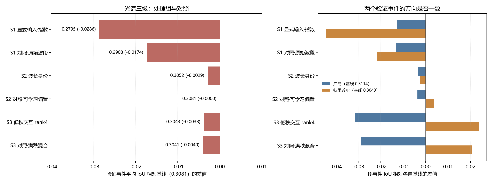
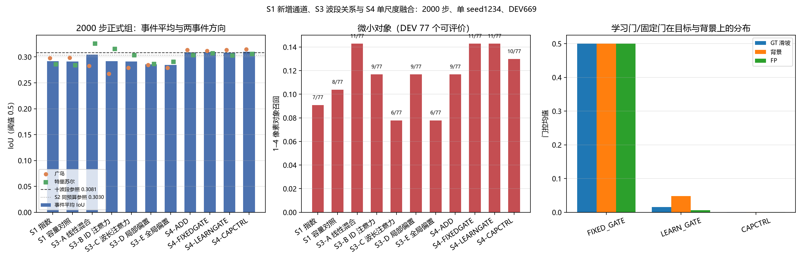
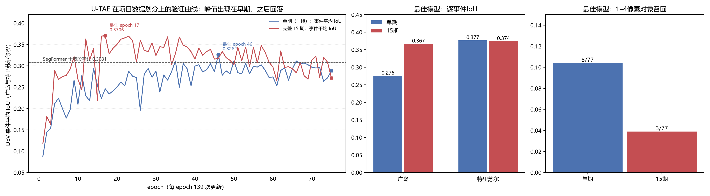
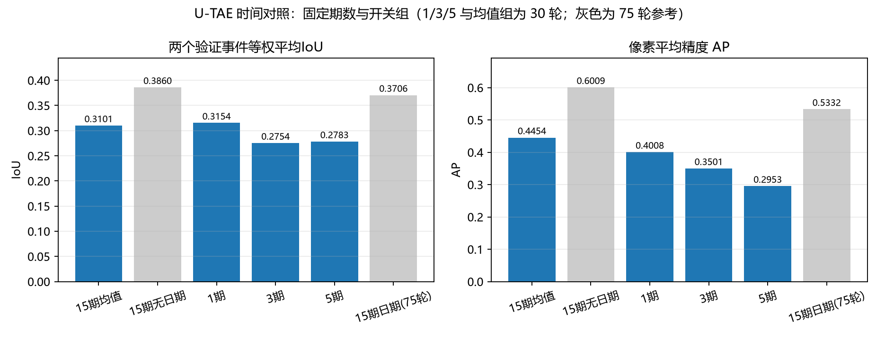
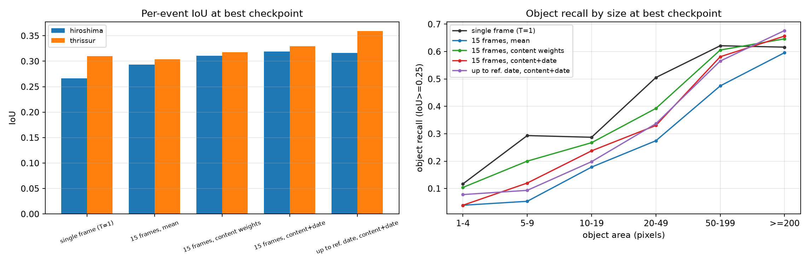
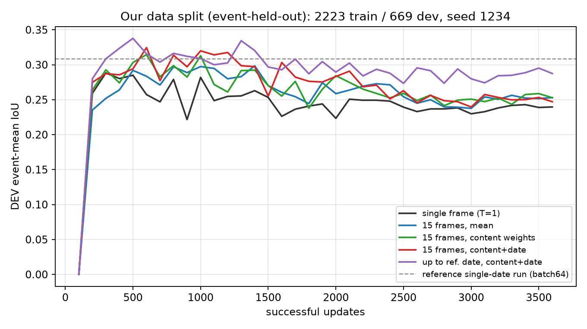
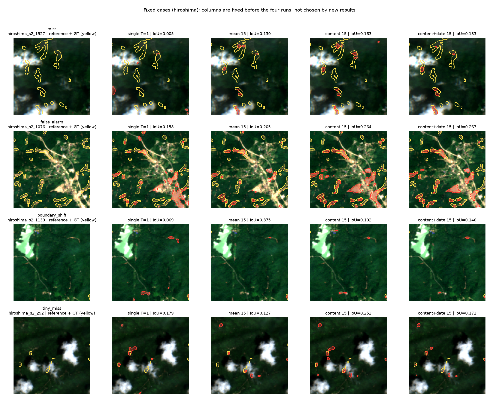
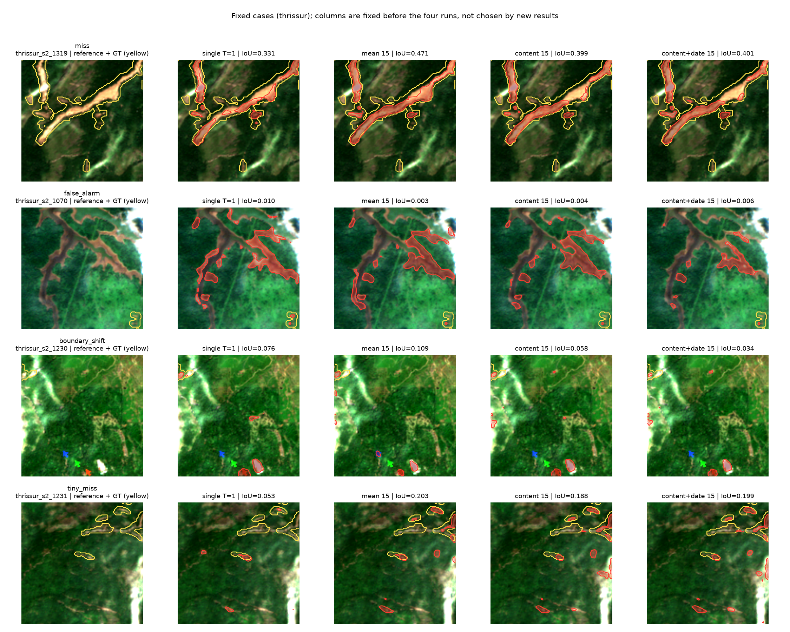
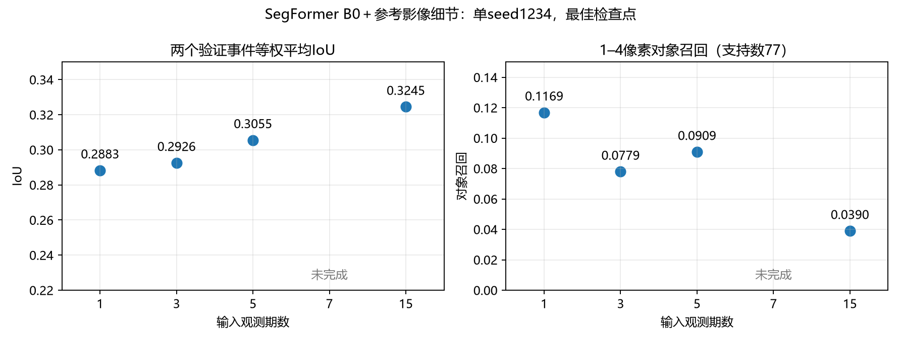
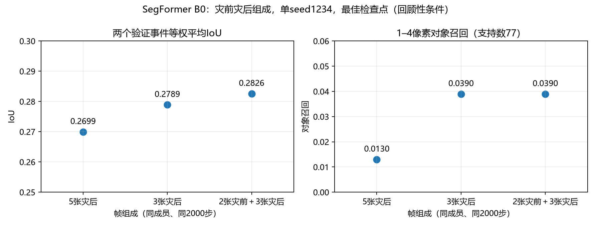

# 滑坡分割正式研究结果

本页按具体实验方案记录SegFormer、U-Net与UTAE的正式比较；数据角色与输入说明在DATA，设计原因在DESIGN。工程测试不作为正式结果，USE冻结消费者结果统一归跨卫星工程。

IoU先注明按事件等权或全有效像素汇总；官方完整任务、本地可用子集和留事件协议分开。best/last、初始化、预算和单seed限制按各表解释。

## 主表：我们的数据划分（留事件验证）下，当前参照与六种地形对照

地形高程来自每个源NetCDF文件中的静态数字高程模型（DEM）；坡度按10米像元间距的高程梯度计算。独立地形文件按图块编号与原影像对应，原十波段影像、日期、标注和成员清单不变。高程以米存储，坡度文件以0.01度存储、读取时恢复度数。并未进行新的地形测量；源高程的原生分辨率及重采样对坡度的影响没有在本轮单独验证。

地形各组最终分割训练均为3600次成功参数更新、每次有效批量64、32位浮点运算、随机种子1234，损失为0.5×二元交叉熵加0.5×Dice损失。地形分支的额外预训练预算不同，详见[模型与监督来源](../../earth-representation/outputs/documentation/documentation_sources/landslide-seg/docs/MODEL_EVOLUTION.md#地形分支的结构与监督来源)，不能只因最终更新次数相同就称总训练成本相等。

**当前参照没有更换。** 六种地形模型是本轮分别训练的对照，尚未取代原十波段模型，也没有全部叠加成一个网络。

> **2026-10-22 更正记录（已处理完毕）。** 逐通道可视化核对时发现坡度单位不一致：侧表把坡度按 0.01° 存成整数（均值约 2202），而当时生成的 `stats_geoboth.json` 按“度”拟合（均值 21.98），归一化后实际输入网络的坡度被放大约 100 倍。用 `scripts/audit_input_units.py` 对全部输入变体做单位审计后确认：**该缺陷只出现在 v4r1 这套地形统计里**；官方可用子集的 `stats_slope.json`（统计 2077 对原始 2118，比值 0.98）、`stats_geoboth.json`（0.98）以及纯 DEM 各组（官方 DEM、U-TAE 11 通道、四折 11 通道）都一致。修正方式：新增 `manifests/v4r1/stats_geoboth_raw.json`（坡度按 0.01° 原始单位拟合，比值 0.998）与 `protocol_geoboth_raw.json`，侧表与清单未动，六组在新的数据版本 `s2_10band_v4r1_geo_raw` 下重跑。下表是**重跑后的修正结果**，缺陷版本（`s2_10band_v4r1_p20_geo`）只保留为过程记录，不能引用。

五个独立地形分支使用相同网络结构，主要区别在正式分割之前怎样准备地形参数。“直接随分割训练”表示没有先用地形单独训练；“地形自监督”表示先遮住部分高程和坡度，让网络补回原高程3000步，再把编码器接入分割模型；预算加倍组先做6000步。加载标注训练评分头的组只迁移了该阶段的预测头，不包含该阶段更新后的编码器。完整的结构与训练分列表见[当前模型表](../../earth-representation/outputs/documentation/documentation_sources/landslide-seg/docs/RESEARCH_INDEX.md#当前参照模型和最新完成的地形对照)。

本表的比较对象先明确如下。**十波段影像基线**是SegFormer B0＋不下采样细节分支，两路都只读取同一张十波段影像。**高程、坡度与影像共同输入模型**把高程和坡度接在十波段之后，形成12通道，同时扩展MiT第一层与细节分支的输入卷积；没有单独的地形编码器。其余五种模型则保留十波段视觉网络，让高程和坡度进入独立地形分支，再在输出分数处相加。

所有行使用同一2223块训练、669块验证成员；Recall等像素指标在同一批有效像素、阈值0.5下计算。行名只写上述具体变化。“分数相加”的结构见[模型说明](../../earth-representation/outputs/documentation/documentation_sources/landslide-seg/docs/MODEL_EVOLUTION.md#地形分支的结构与监督来源)；“滑坡比例预训练头”的训练目标见[16×16区块例子](../../earth-representation/outputs/documentation/documentation_sources/landslide-seg/docs/MODEL_EVOLUTION.md#用已有滑坡标注预训练地形网络一个具体例子)。

| 模型变化（均保留SegFormer B0与影像细节分支） | 验证事件平均 IoU | 相对基线 | AP | Precision | Recall | 对象召回 | 边界 F1 |
|---|---:|---:|---:|---:|---:|---:|---:|
| 当前参照：十波段影像＋细节分支 | 0.3081 | +0.0000 | 0.4425 | 0.4680 | 0.4775 | 0.5211 | 0.4806 |
| 12通道共同输入：影像＋高程＋坡度 | 0.3067 | -0.0015 | 0.4329 | 0.4359 | 0.5045 | 0.5622 | 0.4544 |
| 独立地形分支：直接随分割训练 | 0.3088 | +0.0007 | 0.4469 | 0.4704 | 0.4793 | 0.5307 | 0.4828 |
| 独立地形分支：先做地形自监督 | 0.3096 | +0.0015 | 0.4479 | 0.4684 | 0.4831 | 0.5390 | 0.4839 |
| 独立地形分支：加载标注训练的评分头 | 0.3076 | -0.0005 | 0.4418 | 0.4631 | 0.4810 | 0.5235 | 0.4796 |
| 独立地形分支：地形自监督预算加倍 | 0.3092 | +0.0010 | 0.4477 | 0.4670 | 0.4839 | 0.5366 | 0.4837 |
| 独立地形分支：固定融合系数 | 0.3080 | -0.0001 | 0.4427 | 0.4682 | 0.4771 | 0.5229 | 0.4805 |

## 光谱三级对照：S1 显式输入、S2 波段身份、S3 关系建模

同一 2223／669 成员、同一 3600 次更新与 DEV 选模。每一级设置对照，但并非全部严格同参数量：追加通道对照的首层容量一致；波长MLP和十个自由偏置的参数不同；低秩和满秩分解的参数也不同。

| 级别 | 方案 | 验证事件平均 IoU | 相对基线 | AP | 精确率 | 召回率 | 对象召回 | 广岛 | 特里苏尔 |
|---|---|---:|---:|---:|---:|---:|---:|---:|---:|
| — | 基线：十波段＋细节分支 | 0.3081 | — | 0.4425 | 0.4680 | 0.4775 | 0.5211 | 0.3114 | 0.3049 |
| S1 | 追加四个指数（14 通道） | 0.2795 | −0.0286 | 0.4195 | 0.5154 | 0.3924 | 0.4550 | 0.2987 | 0.2604 |
| S1 | 对照：追加四个原始波段（14 通道） | 0.2908 | −0.0174 | 0.4203 | 0.4825 | 0.4288 | 0.4669 | 0.2981 | 0.2833 |
| S2 | 波长生成的静态通道偏置 | 0.3052 | −0.0029 | 0.4344 | 0.4780 | 0.4603 | 0.5110 | 0.3079 | 0.3025 |
| S2 | 对照：可学习通道偏置 | 0.3081 | −0.0000 | 0.4389 | 0.4644 | 0.4776 | 0.5146 | 0.3077 | 0.3085 |
| S3 | 低秩线性通道混合 r=4 | 0.3043 | −0.0038 | 0.4083 | 0.4071 | 0.5113 | 0.5634 | 0.2800 | 0.3287 |
| S3 | 对照：满秩通道混合 | 0.3041 | −0.0040 | 0.4107 | 0.4232 | 0.4921 | 0.5450 | 0.2826 | 0.3256 |

左图是各组相对基线的差值，右图是两个验证事件各自的方向。应看两件事：S1 两组都明显向左（扩通道本身有代价），S3 两根柱在两个事件上方向相反。

六组均未优于单期参照。

**S2 真波长条件映射（新增，2000 步）：** 入口 10×10 混合矩阵由各波段中心波长经 Linear(9→10) 生成，对照是同参数量（各 110 个）、同初始化、恒等起步的自由矩阵。两支事件平均 IoU 为 0.3030 与 0.3026（差 0.0004），AP 为 0.4352 与 0.4086，广岛/特里苏尔方向相反（0.3113/0.2948 对 0.2810/0.3242）。结论：本设置下把混合矩阵绑定到波长没有可测的 IoU 收益，AP 的差落在单 seed 波动内；它排除了“明显更好/更差”，但没有证明波长归纳偏置普遍无用。

追加指数为0.2795，追加四个原始波段为0.2908；两者同时改变通道、初始化和输入分布，不能将下降直接归因于通道数。静态波长偏置为0.3052，自由偏置为0.3081；低秩线性混合为0.3043，满秩混合为0.3041。这些结果没有证明动态波段注意力或独立光谱旁路无效。

## S1 新增通道统计与 S3/S4 光谱机制（2000 步）

这一批把三个此前未补齐的问题分开：新增通道的统计与首层初始化是否公平（S1）；真正的十波段关系聚合是否比普通通道混合更好（S3）；同一关系表示放在入口前残差还是解码特征处、以及学习门是否有用（S4）。全部使用原固定事件留出：TRAIN 2223、DEV 广岛448＋特里苏尔221、seed1234，停止 2000 次成功更新、学习率日程仍为旧 3600 步（预热180），每 100 步在 DEV 上按两事件等权 IoU 选模。S3-D 同时充当 S4 的“入口前残差”参照，不重复训练。

S1 的处理组与对照组都追加四个通道（共14通道）。处理组追加 NDVI/NDMI/NBR/REND，并用同一 559 块 TRAIN 核心拟合的四通道均值/标准差独立标准化（`manifests/v4r1/stats_s1_indices4.json`，ε=1e-4，harmonized 反射率）；对照组追加 B04/B08/B8A/B11 的 z-score，不再套用指数统计。两组的首层都是 `direct10`：预训练 B04/B03/B02 三列原样拷贝，其余列（含新增四列）零初始化。首层审计对 218 个张量逐一比较：处理组与对照组逐值相同；相对十波段基线只有首层卷积不同，新增四列严格为零（`outputs/segformer/v4r2_spectral/s1_init_audit.json`）。

S3 的五组都只改十波段进入 MiT 之前的入口：S3-A 是逐像元满秩 10×10 线性混合；S3-B/C/D/E 共用同一 4×4 小块十波段 token 注意力（2层4头），分别使用自由可学习 band ID、真实波长嵌入、每块局部物理关系偏置、整幅图共享关系偏置。B–E 的存储参数相同（135,381 个新增参数）；`relation_mode=none` 时关系偏置 MLP 不参与前向，有效参数少 132 个。

S4 先用同一关系编码器产生真正的特征 `F_spec`（十波段 token 均值后 1×1 投影到解码宽度），在官方解码器融合特征处注入一次：ADD 无门控、FIXEDGATE 固定 0.5、LEARNGATE 输入依赖空间门（3×3，零初始化）。三者共享同一 `F_spec` 与投影；`alpha` 初值 0，因此初始输出与同权重视觉基线逐位一致。CAPCTRL 为自由 band ID、无关系偏置、存储参数相同（有效参数少132）的非物理分支，用来分开“物理身份/关系偏置”和“多加的容量”。

| 组 | best 步 | 事件平均 IoU | AP | 广岛 IoU | 特里苏尔 IoU | 1–4 像素对象召回 | 末态 IoU |
|---|---:|---:|---:|---:|---:|---:|---:|
| S1 指数（14通道，指数独立标准化） | 500 | 0.2917 | 0.4287 | 0.2978 | 0.2856 | 7/77 | 0.2319 |
| S1 容量对照（14通道，原始波段） | 500 | 0.2911 | 0.4207 | 0.2986 | 0.2837 | 8/77 | 0.2395 |
| S3-A 线性混合（满秩10×10） | 300 | 0.3042 | 0.4109 | 0.2829 | 0.3256 | 11/77 | 0.2404 |
| S3-B 自由ID注意力 | 300 | 0.2916 | 0.3882 | 0.2676 | 0.3156 | 9/77 | 0.2306 |
| S3-C 波长注意力 | 400 | 0.2913 | 0.3946 | 0.2794 | 0.3032 | 6/77 | 0.2396 |
| S3-D 局部关系偏置（=S4-INPUTRES） | 500 | 0.2855 | 0.3982 | 0.2845 | 0.2864 | 9/77 | 0.2378 |
| S3-E 全局关系偏置 | 400 | 0.2848 | 0.3895 | 0.2790 | 0.2905 | 6/77 | 0.2389 |
| S4-ADD（无门控） | 500 | 0.3085 | 0.4427 | 0.3136 | 0.3034 | 9/77 | 0.2271 |
| S4-FIXEDGATE（常数0.5） | 500 | 0.3095 | 0.4424 | 0.3120 | 0.3069 | 11/77 | 0.2326 |
| S4-LEARNGATE（空间学习门） | 500 | 0.3081 | 0.4446 | 0.3137 | 0.3025 | 11/77 | 0.2238 |
| S4-CAPCTRL（同容量非物理） | 500 | 0.3101 | 0.4465 | 0.3147 | 0.3055 | 10/77 | 0.2244 |
| 参照：十波段单期（3600步，best@500） | 500 | 0.3081 | 0.4425 | 0.3114 | 0.3049 | 8/77 | — |
| 参照：S2 波长条件映射（2000步） | 500 | 0.3030 | 0.4352 | 0.3113 | 0.2948 | 10/77 | 0.2585 |
| 参照：S2 自由通道混合（2000步） | 300 | 0.3026 | 0.4086 | 0.2810 | 0.3242 | 10/77 | — |

左图是各组的 best 事件平均 IoU，圆点/方块是两个验证事件各自的值，虚线是十波段参照、点线是 S2 同预算参照；中图是 1–4 像素对象召回（分母 77 个可评价对象）；右图是 S4 best 权重上门控在 GT 滑坡/背景/误检上的均值。应看三件事：S1 两组的柱高几乎相同；S3 注意力四组低于线性混合；S4 四组都回到参照附近，而学习门在目标处反而更低。

**S1：标准化后“指数更差”的历史差没有复现。** 指数组 0.2917、原始通道对照组 0.2911，差 +0.0006（AP +0.0080，广岛 −0.0008、特里苏尔 +0.0019，微小对象 7/77 对 8/77）。历史两次 S1（都未独立标准化新增通道）相差 −0.0113；这次没有复现，说明该差主要与新增通道的尺度和训练设置有关，不能当作“指数没有信息”的证据。两组都低于十波段参照 0.3081 约 0.016，说明在本 2000 步预算下，把输入从 10 扩到 14 通道本身有代价；这与“指数不可用”是两件事。

**S3：真正的动态关系聚合没有超过普通线性混合。** S3-A 0.3042；注意力四组 0.2916、0.2913、0.2855、0.2848，低 0.013–0.019。波长身份相对自由 ID 为 −0.0003（AP +0.0065，广岛 +0.0118、特里苏尔 −0.0124）；局部相对全局 +0.0007（AP +0.0087，微小对象 9/77 对 6/77）。注意力组的关系读出权重确实离开零（abs sum 9–12），不是支路没训练；但线性混合与注意力的容量不匹配（110 对 135,381 个新增参数），单 seed，不能据此否定注意力在其他预算或容量下的作用。S3-A 的两事件更不均衡（广岛 0.2829、特里苏尔 0.3256），事件平均 IoU 掩盖了事件间差异。

**S4：融合位置比关系类型更重要，学习门没有学到空间选择性。** 同一关系编码器放在解码特征处（ADD 0.3085、FIXEDGATE 0.3095、LEARNGATE 0.3081、CAPCTRL 0.3101）比放在入口前残差（S3-D 0.2855）高约 0.023；但四种特征融合与十波段参照 0.3081 的差都在 +0.001 以内，CAPCTRL（无波长身份、无关系偏置）还略高，因此没有证据表明物理关系表示带来净收益。学习门在 best（500步）的 gate 均值 0.047、目标 0.015、背景 0.048、误检 0.006，修正幅度约 0.002；900 步 gate 0.589，1300 步后完全关闭（gate=0、修正=0）。也就是说，学习门最终选择关掉光谱支路，而不是学到“滑坡处开门、背景处关门”；ADD/FIXED 强制开门时修正幅度 0.059/0.027，也只回到参照水平。门控的饱和/关闭更可能来自门控优化（门输入未归一化、门与特征共用同一学习率），这属于未验证的解释；本批不能据此断言“空间门控普遍无用”。

**限制。** 单 seed，所有差值都未做显著性检验；S1 的 14 通道相对十波段参照多 4 个输入通道，S3/S4 的新增参数也不同，不能把组间差全部归给机制；S3 的线性混合与注意力未严格同容量；学习门的饱和/关闭原因未隔离；派生结论只适用于这 669 块 DEV 和该训练预算，不外推到官方划分或独立事件。

## U-TAE（官方多时相做法）在项目数据划分上的结果

十波段、不加 DEM、真实观测日期、75 epoch、batch 16。单期与 15 期共用同一训练/验证成员与同一选模口径。

| 模型与保存状态 | 事件平均 IoU | 像素汇总 IoU | 广岛 IoU | 特里苏尔 IoU | AP | 1–4像素对象召回 |
|---|---:|---:|---:|---:|---:|---:|
| U-TAE单期，最佳第46轮 | 0.3262 | 0.3013 | 0.2755 | 0.3768 | 0.4250 | 0.1039 |
| U-TAE单期，末态第75轮 | 0.2883 | 0.2835 | 0.2784 | 0.2982 | 0.3668 | 0.1039 |
| U-TAE15期，最佳第17轮 | 0.3706 | 0.3692 | 0.3670 | 0.3741 | 0.5332 | 0.0390 |
| U-TAE15期，末态第75轮 | 0.2718 | 0.2756 | 0.2835 | 0.2600 | 0.4024 | 0.0000 |

左图横轴是epoch，纵轴是两个验证事件的等权平均IoU，虚线是SegFormer历史参照（训练策略不同）。中图为最佳模型的逐事件IoU，右图为1–4像素对象召回及检出数/可评价对象数。观察收益集中在哪个事件以及小目标是否同步受益。曲线显示：15 期在 epoch 5–60 基本位于单期之上，但峰值出现在第 17 epoch（0.3706），之后在 0.30–0.34 之间震荡并回落到 0.272；单期峰值在第 46 epoch（0.3262），末态 0.288。

**本次纠正的是指标标签，不是重新训练结果。** 原表0.3013/0.3692来自像素汇总IoU；按既定的两个事件等权口径，最佳模型分别为0.3262/0.3706，差0.0444。原训练曲线与重新评价值有不足0.0001的小差异，具体原因未验证；上表统一来自保存的eval_dev_summary.json逐事件统计。单期与多期初始化摘要一致，训练均75轮、10425次更新，正类权重5；与SegFormer的3600次更新、正类权重1不同，不能把跨架构差异当作纯架构贡献。

### U-TAE 固定期数与时间开关（30 轮窗口，已完成 5 组）

为把“更多观测”和“有没有注意力/日期”分开，补了两组同架构对照，统一 30 轮、batch16、原学习率与损失；与上表 75 轮组**不是等轮数**，只与其前 30 轮及 best@17 比较。期数组用 multi 模式等秩取样（参考帧必保留），开关组只改 L-TAE：均值组把时间注意力换成均值并移除注意力头（有效参数少 16512），内容组只移除固定位置编码（0 可训练参数）。

| 组 | 事件平均IoU | 广岛 | 特里苏尔 | AP | best轮 |
|---|---:|---:|---:|---:|---:|
| 1 期 | **0.3154** | 0.2643 | 0.3664 | 0.4008 | 27 |
| 3 期 | 0.2754 | 0.2487 | 0.3020 | 0.3501 | 16 |
| 5 期 | 0.2783 | 0.1954 | 0.3613 | 0.2953 | 29 |
| 15 期（75 轮组，best@17） | 0.3706 | 0.3670 | 0.3741 | 0.5332 | 17 |
| 15 期＋均值代替注意力（30 轮） | 0.3101 | 0.2934 | 0.3268 | 0.4454 | 21 |
| 15 期＋无日期编码（30 轮） | **0.3860** | 0.4235 | 0.3486 | 0.6009 | 20 |

两点要分开读。**期数在 U-TAE 里不是越多越好**：30 轮窗口内 3/5 期都低于 1 期，5 期的广岛 IoU 掉到 0.1954，而 15 期最高——这与 SegFormer 数量组（1→5 期上升）方向不同，说明“加观测”的收益依赖模型如何聚合，不是数据本身的单调性质。**拆开看：注意力有用，固定日期编码在这批数据上反而略降。** 均值组 0.3101 明显低于保留注意力的两组，说明 L-TAE 注意力本身有收益；而**去掉日期编码**的无日期组（0.3860、AP 0.6009）比日期组（0.3706、AP 0.5332）高 0.0154/0.068，收益集中在广岛（0.4235 对 0.3670），特里苏尔反而低 0.0255。边界：无日期组 30 轮、日期组 75 轮（best@17 落在窗口内），单 seed；因此只能说“这批数据不支持启用日期编码更好”，不能宣称日期编码普遍有害。

左图两事件等权 IoU，右图 AP；蓝柱是 30 轮新组（1/3/5 期与均值组），灰柱是 75 轮日期组参照，空位标“训练中”。应看两点：蓝柱里 1 期最高而不是期数最多的 5 期；均值组低于灰色参照。

**收益集中在广岛，微小对象存在退化。** 广岛IoU增加约0.0915，特里苏尔降低约0.0026；1–4像素对象召回由8/77降至3/77。15期整体AP提高0.1081，但不代表所有事件和目标尺度都改善。末态事件平均IoU为0.2883/0.2718，提示训练后期退化，需要报告完整曲线；按验证集选最佳是两组共同规则，不能仅因末态排序相反就否定已有多期信号。两个验证事件反复参与选模，因此也不能声称独立泛化显著性。

完整15期包含参考影像日期后的观测，属于回顾性识别。它不满足仅用单期影像的输入条件；需要与截止参考日期组分开解释。

## 同一SegFormer的时间控制与工程复核

### 阅读约定与实验设置

以下为磁盘已完成结果的复核，不是本次重新训练四组。四组都用我们的数据划分（留事件验证）：九事件2223块训练，广岛448＋特里苏尔221块验证，seed1234；十波段、无地形，统计沿用559块训练核心。共享MiT编码器逐帧提特征，分别采用单期恒等、有效帧均值、内容权重、内容与相对观测日期权重；参考影像另进原网格细节分支。监督来自同一人工滑坡标注，损失为0.5BCE＋0.5Dice。各组3600次更新、microbatch8×累积8，每100步按两个验证事件等权IoU选模。与历史单期0.3081的batch64训练不同，同接口单期0.2883才是本表参照。为核对这两个参照的差异，本轮另训练了一个同接口、microbatch=64的单期对照：最佳事件平均IoU 0.3075（500步，像素汇总0.3093），与历史0.3081只差0.0006；这支持微批量设置可能显著影响结果，BatchNorm是主要待检验机制；但单seed对照尚未隔离随机数/累计梯度差异，不能唯一归因BatchNorm。该对照只用于解释参照差异，不作为新候选。

### 主表

IoU是阈值0.5的前景交并比；事件平均IoU先分事件计算再等权平均；AP为有效像素的精确率—召回率曲线面积。对象召回按独立一对一IoU≥0.25匹配，括号为检出数/可评价对象数。

| SegFormer B0输入与汇聚（均保留参考影像细节） | 事件平均IoU | 相对同接口单期 | AP | 广岛IoU | 特里苏尔IoU | 1–4像素对象召回 | 最佳更新/末态IoU |
|---|---:|---:|---:|---:|---:|---:|---:|
| 单期十波段，恒等 | 0.2883 | — | 0.3874 | 0.2662 | 0.3104 | 0.1169（9/77） | 300 / 0.2396 |
| 15期十波段，均值 | 0.2984 | +0.0102 | 0.4736 | 0.2932 | 0.3037 | 0.0390（3/77） | 1400 / 0.2530 |
| 15期十波段，内容权重 | 0.3145 | +0.0262 | 0.4651 | 0.3110 | 0.3180 | 0.1039（8/77） | 600 / 0.2528 |
| 15期十波段，内容与日期权重 | 0.3245 | +0.0362 | 0.5134 | 0.3192 | 0.3298 | 0.0390（3/77） | 600 / 0.2470 |

### 图与解释

左图每组两根柱分别为广岛与特里苏尔；右图横轴为对象像素面积、每条线为一种汇聚。应同时看事件IoU与微小对象检出：日期加权组的两个事件IoU都提高，1–4像素对象却少检出6个。均值组的特里苏尔IoU低于单期。对象支持数仅77，不能作显著性声明。

各曲线表示对应汇聚在训练更新过程中的验证表现；紫色为只保留参考日期及以前观测的截止组。应看最佳模型出现位置与训练末态，不能只汇报早期峰值。五组训练结束时的IoU均明显低于各自最佳值。

固定案例在首批训练前由参考单期run的验证错误选定（每事件漏检、误检、边界偏移、微小目标各一），不按新模型结果更换：

每行一个案例，第1列为参考影像与人工标注（黄线），其余列为四组best模型的概率（红=阈值0.5以上）与预测边界。多期组在部分漏检案例补回了滑坡，但在边界与微小目标上出现新的偏移；案例只用于错误诊断，不参与选模。

### 观测数量补全：3/5/7期已完成并验收

以下比较仍用原2223/669成员、统计、seed1234、3600更新和8×8批量。3期与15期的空间、时间初始化摘要一致；3/5/7期逐样本保留参考帧，其余帧按日期顺序等秩取样，不用标注或预测选帧。1期为同接口恒等参照，参数量3753602；3/5/7/15期的内容与日期汇聚参数量均3775238。含参考日期之后的观测，属于回顾性条件。

| SegFormer B0＋参考影像细节的观测输入 | 最佳事件平均IoU | AP | 广岛IoU | 特里苏尔IoU | 1–4像素对象召回 | 最佳更新 | 末态IoU | 训练耗时 |
|---|---:|---:|---:|---:|---:|---:|---:|---:|
| 单期十波段，恒等 | 0.2883 | 0.3874 | 0.2662 | 0.3104 | 9/77 | 300 | 0.2396 | 20.2分钟 |
| 3期十波段，内容与日期加权 | 0.2926 | 0.4422 | 0.2950 | 0.2901 | 6/77 | 1000 | 0.2341 | 35.0分钟 |
| 5期十波段，内容与日期加权 | 0.3055 | 0.4773 | 0.3137 | 0.2974 | 7/77 | 1000 | 0.2474 | 43.4分钟 |
| 7期十波段，内容与日期加权 | 0.3348 | 0.4972 | 0.3141 | 0.3554 | 6/77 | 1000 | 0.2812 | 55.1分钟 |
| 15期十波段，内容与日期加权 | 0.3245 | 0.5134 | 0.3192 | 0.3298 | 3/77 | 600 | 0.2470 | 114分钟 |

每个点是该输入期数下已完成并验收模型的最佳检查点；左图为两个事件等权IoU，右图为同77个可评价微小对象的召回。

1→7期在本设置内随期数上升（0.2883→0.3348），但15期回落到0.3245：15期帧数更多、跨度更长、等秩取样的端点也不同，不能把它读成“期数单调收益”或“7期就是上限”。7期两个事件都高于单期（广岛+0.0479、特里苏尔+0.0450），微小对象仍是6/77，少于单期9/77，且该组含参考日期之后的观测，仍未满足替换单期的条件。3期相对单期只提高0.00427，广岛提高0.02882、特里苏尔下降0.02025；5期比单期高0.01726，但特里苏尔下降约0.0130、微小对象从9/77降为7/77。只有一个seed，不能宣称显著性。

7期最佳权重出现在1000步，末态IoU 0.2812 明显低于最佳，说明"训练更久更好"在这一组不成立；这也支持把后续新批次的选模窗口定在2000步以内（依据见[训练预算复核](../../earth-representation/outputs/documentation/documentation_sources/landslide-seg/docs/MODEL_EVOLUTION.md#原任务书目的与当前计算是否对应)）。

3期最佳模型的像素TP/FP/FN为81340/73699/122192，整体对象召回0.4354、边界F1为0.4552；末态整体对象召回0.2805、边界F1为0.3605。3/5/7期与1/15期的best/last及预定步均完成严格权重加载、配置一致性、评价权重哈希和669个实际验证成员核验，原始结果见[数量汇总](../outputs/segformer/v4r1_temporal_frame_count/summary_frame_count.json)。注意原评价JSON中的`efficiency.train_seconds`曾记录所选检查点产生时的累计时间；本表使用完成摘要中的训练秒数。新评价入口已把完整训练成本和所选检查点累计时间分开，保留原评价文件不覆盖。

### 新批次：2000步预算与派生共同子集（截止参考日期与跨度）

后续批次把停止步数与学习率日程分开：`train.stop_updates=2000`、`train.schedule_updates=3600`、预热180，因此用的是旧3600步poly日程的前2000步，而不是压缩后的另一条日程；不保存的步数不重要，因为每组仍存1000/1500/2000与best/last。这不是等预算比较——它比历史全程运行少44.4%更新。

截止参考日期的数量组（1/3/5/7期）要求四组同成员：只保留参考日期当日及以前至少有7个真实观测的TRAIN样本，共2007块，DEV 669块原样全保留，登记在`manifests/v4r2/subset_protocol_cutoff7.json`。跨度组（180天/365天）同样冻结共同成员：参考日期前180天内至少3个真实观测，TRAIN 2108块、DEV 669块，两组共用同一清单，唯一变化是窗口天数。两个子集都由`scripts/build_temporal_subset.py`从原清单派生，不覆盖`manifests/v4r1/pool_100.jsonl`；子集结果只与同成员配对组比较，不与2223块全体混排。

**截止参考日期固定数量（同一子集2007/669，2000步）**

| 输入 | 事件平均IoU | 广岛 | 特里苏尔 | AP | 1–4像素对象召回 | best步 | 末态IoU | 训练耗时 |
|---|---:|---:|---:|---:|---:|---:|---:|---:|
| 1期（只有参考帧） | 0.2933 | 0.2947 | 0.2918 | 0.4182 | 10/77 | 700 | 0.2431 | 11.2分钟 |
| 3期 | 0.3061 | 0.2900 | 0.3222 | 0.4376 | 8/77 | 600 | 0.2609 | 17.9分钟 |
| 5期 | 0.3432 | 0.3413 | 0.3452 | 0.4996 | 8/77 | 400 | 0.2778 | 23.1分钟 |
| 7期 | 0.3277 | 0.3115 | 0.3439 | 0.4944 | 11/77 | 400 | 0.2645 | 30.9分钟 |

去掉参考日期之后的观测后，这个子集上5期最高（0.3432），7期回落到0.3277：不是“期数越多越好”。7期的微小对象反而最多（11/77），其余三项指标却低于5期，说明多取历史帧改变的是整体覆盖与边界，而不是稳定改善小目标。四组最佳点都在400–700步，训到2000步时事件平均IoU降到0.2431–0.2778，训练更久明显变差；这也是后续统一选模窗口不超过2000步的实测依据。

**固定3期、不同历史窗口（同一子集2108/669，2000步）**

| 输入 | 事件平均IoU | 广岛 | 特里苏尔 | AP | 1–4像素对象召回 | best步 | 末态IoU | 训练耗时 |
|---|---:|---:|---:|---:|---:|---:|---:|---:|
| 参考日前180天内的3帧 | 0.3026 | 0.2951 | 0.3102 | 0.4229 | 10/77 | 300 | 0.2443 | 17.5分钟 |
| 参考日前365天内的3帧 | 0.2962 | 0.2870 | 0.3054 | 0.4151 | 13/77 | 300 | 0.2568 | 17.5分钟 |

同样3帧时缩短窗口略好（+0.0064、AP+0.0078），方向与“更近的观测更有用”一致；但差值很小、只有一个seed，且365天组微小对象反而多3个，不能据此改窗口或宣称跨度规律。

两个子集的成员不同（2007块要求参考日前≥7帧，2108块要求180天内≥3帧），因此不能互相比较，也不能与2223块全体的历史运行混排。队列状态见[截止日期批次](assets/research/v4r2_temporal_cutoff_queue.json)与[跨度批次](assets/research/v4r2_temporal_window_queue.json)；六组均通过严格权重加载、配置/成员哈希、669个验证成员与逐样本帧计划核验，原始证据在[执行核验](assets/research/execution_audit.json)与两份summary JSON。

### 灾前灾后组成：同成员、同预算，只改帧的组成（已完成并验收）

合格集要求灾害日期唯一且高置信、至少 2 张灾前与 5 张灾后、灾后含参考帧：TRAIN 只剩 6 个事件共 1141 块，DEV 669 块原样。三组共用同一批成员，帧由显式逐样本计划给出（登记在`manifests/v4r3/subset_protocol_composition.json`，含三份计划的 SHA256 与未来帧计数）；混合组的前 2 张灾前不参与另外两组的帧集合。这是**回顾性**条件：灾后帧可以晚于参考日期，本子集里最长约 865 天，所以不能当作前瞻识别能力。

| 输入（同成员1141/669，2000步） | 事件平均IoU | 广岛 | 特里苏尔 | AP | 1–4像素对象召回 | best步 | 末态IoU | 训练耗时 |
|---|---:|---:|---:|---:|---:|---:|---:|---:|
| 5 张灾后帧 | 0.2699 | 0.2813 | 0.2586 | 0.4118 | 1/77 | 500 | 0.2412 | 23.4分钟 |
| 3 张灾后帧 | 0.2789 | 0.2764 | 0.2814 | 0.3979 | 3/77 | 500 | 0.2582 | 18.9分钟 |
| 2 张灾前＋同 3 张灾后 | 0.2826 | 0.2901 | 0.2750 | 0.4122 | 3/77 | 800 | 0.2610 | 23.0分钟 |

两种对照要分开读：**相同 5 帧总数**下，混合组比 5 张灾后高 0.0127（AP 基本相同，微小对象 3/77 对 1/77）；**相同 3 张灾后帧**下，加 2 张灾前只高 0.0037（AP +0.0143，广岛 +0.0137、特里苏尔 −0.0064）。方向是“灾前信息有一点补充价值”，但差值很小、只有一个 seed、微小对象只有 1–3/77，而且这个子集只有 6 个训练事件（中国、吉尔吉斯斯坦因灾害日期不唯一被排除），不能据此升级候选或外推到 9 事件全体。

每个点是该组成下最佳检查点；横轴三组同成员、同2000步，只改帧的组成。左图看整体 IoU，右图看微小目标是否保住——5 张灾后组的微小对象只有 1/77，是这张图最该注意的地方。

三个批次的子集互不相同（2007/2108/1141 块），因此三张表之间不能横向比大小；每个结论只在各自子集内成立。组成批次的队列状态见[组成批次](assets/research/v4r3_composition_queue.json)。

### 截止参考日期组：去掉参考日期之后的观测（已完成）

条件组在15期内容与日期组达到+0.0362、且两个验证事件都高于同接口单期后触发。每个图块只保留观测日期不晚于参考日期的帧，仍包含参考影像及其细节；帧数随样本变化（训练2–15、验证7–10），因此不是同算力对照。其余成员、统计、初始化、3600次更新和8×8批量不变。

| 输入与汇聚 | 事件平均IoU | 相对同接口单期 | AP | 广岛IoU | 特里苏尔IoU | 1–4像素对象召回 | 最佳更新 | 末态IoU | 训练耗时 |
|---|---:|---:|---:|---:|---:|---:|---:|---:|---:|
| 截止参考日期，内容与日期权重 | 0.3377 | +0.0494 | 0.4998 | 0.3160 | 0.3595 | 0.0779（6/77） | 500 | 0.2874 | 71.9分钟 |
| 完整15期，内容与日期权重 | 0.3245 | +0.0362 | 0.5134 | 0.3192 | 0.3298 | 0.0390（3/77） | 600 | 0.2470 | 114分钟 |

去掉参考日期之后的观测后，事件平均IoU没有下降，反而比完整15期高0.0132：特里苏尔高0.0297，广岛低0.0032；AP低0.0136；1–4像素对象召回由3/77回到6/77，但仍低于同接口单期的9/77。像素TP/FP/FN为87167/59175/116365，整体对象召回0.4038、边界F1为0.4804。它说明这批开发集合上的多期收益不依赖未来观测，主要来自参考日期及以前的多次观测；但参考影像本身仍是灾后影像，两组帧数不同，微小目标仍退化，不能据此声称前瞻识别能力或替换单期交付。best/last与1200/2400/3600步评价、669个验证成员和权重哈希均已核验，原始评价见[该run的eval目录](../outputs/segformer/v4r1_temporal_control/SegFormer-B0-Temporal-History-Date/1234/eval)。

### 展开结论

内容权重组在相同观测帧与相同训练预算下优于均值组，说明本设置中可学习的内容加权具有开发集合上的实测收益；内容与日期组进一步提高事件平均IoU和AP，但其参数更多且使用参考日期之后的影像。它支持回顾性观测条件的开发结果，不能证明前瞻识别能力或独立跨地区泛化。日期组微小对象召回相对单期下降约67%，未通过既定候选门槛，不能替换单期交付；其与内容组的差值也不能单独证明日期编码的普遍作用。截止参考日期组在去掉未来观测后仍高于完整15期且两个事件都高于同接口单期，说明收益主要来自参考日期及以前的多次观测；但该组帧数可变、仍是单seed，微小对象召回仍低于单期，不能据此升级为候选或宣称前瞻能力。

### 限制与下一步

已严格加载基线及四组的best/last，四组另核对1200/2400/3600步权重与评价哈希，见[核验数据](assets/research/execution_audit.json)。截止参考日期组已完成：best事件平均IoU 0.3377（500步），末态0.2874，669个验证成员、权重与评价哈希已核验。3/5/7期新增配置使用同一内容与日期汇聚，参考帧必保留，其余按日期排序等秩取样；与已有1/15期组成数量对照。具体执行状态见[有限队列](../outputs/research_completion/status.json)，进程成功结束仍须复核结果，不自动代表科学验收通过。

全量[逐帧侧表](assets/research/temporal_observations.csv)覆盖2892块、43380帧，含源文件SHA256、源观测日期、灾害日期原字段、云阴影、SCL255和缺测比例；按SCL0、非有限值与显式填充值检出缺测像素0。681块含多个灾害日期，单独标为日期不明确；不将它们强行定义为某次灾害的灾前或灾后。截止参考日期时，训练中满足3/5/7帧的分别为2217/2171/2007块，验证均669块；截止日期15帧的验证覆盖为0。不减少原清单成员来制造同集合对照。

工程修复另包括：U-TAE新运行的缓存哈希改由实际路径计算；时序汇总的最佳步数改为300/1400/600/600而非全部3600。地形评分v2先在有效像素内计算16×16区块滑坡占比，空区块不参与损失，并严格核验统计/清单哈希后成对载入评分编码器与预测头。新评分训练3000步、579.5秒，验证669块42396个有效区块的相关系数0.0339，区块有无滑坡的AP0.1529、阳性区块率0.1206；这只是同源标注评分，尚无分割增益结论，也不是独立易发性概率。新分割对照同时改变目标处理与加载，不能解释成单一因素效果。

源文件十个波段均无units、scale_factor、add_offset、_FillValue元数据；后续继续追溯后，下载记录明确指向官方`data_harmonized/s2`，不能再仅凭缺少属性判断来源无法核实。[官方发布说明](https://huggingface.co/datasets/paulhoehn/Sen12Landslides/blob/main/README.md)支持该版本的偏移校正与0–10000范围约定。本地28卷已计算SHA256，并在含当前成员的分卷各抽查一个nc与本地源文件字节一致；完整时间缓存各波段实际范围为1–10000，见[来源审计](assets/research/radiometry_provenance.json)。这支持harmonized存储DN除以10000的解释，不等于独立BOA定标验证；本地上游辅助函数仅按首日期判断偏移、其数字后缀筛选未覆盖B8A，因此不能由该函数单独证明发布文件每帧偏移都正确，也不在本地重复加减1000。

组成审计只接受灾害日期唯一、发布元数据date_confidence=1的样本，固定同一合格集比较5张灾后、3张灾后、2张灾前＋同3张灾后。回顾性条件合格1810块，其中训练1141、验证669；严格截止参考日期仅训练3块、验证0块。后者明确为不合格实验条件，不补帧、不换验证集、不当算法失败。合格成员与固定帧ID见[组成侧表](assets/research/temporal_composition_eligibility.json)，尚未进行组成子集训练；其训练事件覆盖也与2223块全体不同，后续不得直接混排。

独立地形易发性路线仍缺独立标签。时相跨度控制、截止参考日期固定数量与灾前灾后组成训练已完成并验收（见上节）；U-TAE 均值/内容注意力开关已实现并在训练（30 轮，尚未验收），完整光谱门控消融仍未完成，不登记为完成。

### 附录：成本与复现

四组单期/均值/内容/内容与日期训练分别约20/114/117/114分钟，截止参考日期组约72分钟，单seed。完整best/last、预定步、对象六尺度支持数和成本在[原运行汇总](../outputs/segformer/v4r1_temporal_control/summary_temporal_control.json)。复核命令：`python scripts/audit_research_execution.py`；逐帧审计：`python scripts/audit_temporal_observations.py`；新训练与评价的准确命令保存在有限队列status.json。新地形加载的逐张量验证见[迁移核验](assets/research/terrain_transfer_validation.json)。历史原始权重与评价不改名、不覆盖，本次未提交Git，保留接手时的未提交工作树。

## 主表三：本地历史结果

下表所有验证与测试分别使用同758、945块。IoU由该集合有效像素的混淆计数汇总后计算，不是按事件等权平均；AP使用像素概率。各行随机种子均为1234，最佳模型由验证成绩选定。不同结构或训练接口的行不是单变量对照。

| 模型与输入变化 | 验证 IoU | 测试 IoU | 测试 AP | 比较条件与限制 |
|---|---:|---:|---:|---|
| SegFormer B0：单张十波段＋原始网格细节修正 | 0.3623 | 0.3275 | 0.4830 | 历史单期主参照 |
| SegFormer B0：单张影像＋高程共同输入＋原始网格细节修正 | 0.3641 | 0.3363 | 0.4902 | 输入卷积、细节分支入口及统计维度均改变 |
| SegFormer B0：单张影像＋坡度共同输入＋原始网格细节修正 | 0.3598 | 0.3402 | 0.4923 | 地形派生输入，不是S2光谱改进 |
| SegFormer B0：单张十波段＋原始网格细节修正，正类加权 | 0.3579 | 0.3314 | 0.4922 | 交叉熵的滑坡像素权重为5，架构未变 |
| ResNet18 U-Net：单张十波段 | 0.3375 | 0.3004 | 0.4339 | 完整系统对照 |
| ResNet18 U-Net：单张影像＋高程 | 0.3353 | 0.3020 | 0.4371 | 额外输入 |
| ResNet18 U-Net：单张影像＋坡度 | 0.3419 | 0.3080 | 0.4428 | 额外输入 |
| ResNet18 U-Net：单张十波段，正类加权 | 0.3320 | 0.3000 | 0.4340 | 损失处理 |
| U-TAE：单张影像＋高程，旧日期接口 | 0.3557 | 0.3324 | 0.5115 | 旧接口未正确使用观测日期编码 |
| U-TAE：全部15张＋高程，旧日期接口 | 0.4896 | 0.4770 | 0.6832 | 比较多张观测，不能单独归因时间间隔 |
| U-TAE：单张影像＋高程，启用观测日期编码 | 0.3772 | 0.3396 | 0.5142 | 完成；与下行同初始状态、同超参 |
| U-TAE：全部15张＋高程，启用观测日期编码 | 0.4873 | 0.4832 | 0.6853 | 由验证集选择最佳模型；测试比单张高0.1436 IoU、0.1711 AP |
| U-TAE：参考日期及以前的影像＋高程 | 0.4200 | 0.4046 | 0.6032 | 不读取参考日期之后影像；比同组单张参照IoU高0.0650 |
| SegFormer B0：单张十波段＋参考影像细节，使用统一时间接口 | 0.3587 | 0.3302 | 0.4816 | 单次显存批量8，以累积方式实现有效批量；训练实现与旧参照不同 |
| SegFormer B0：全部15张特征加权＋参考影像细节 | 0.4149 | 0.4093 | 0.6032 | 完成；Precision涨0.121、Recall涨0.053 |
| SegFormer B0：单张光谱关系编码＋参考影像细节 | 0.3705 | 0.3336 | 0.4811 | 相对统一接口单张参照，IoU +0.0034、AP −0.0005；单种子小差异 |
| SegFormer B0：15张光谱关系编码＋参考影像细节 | 未完成 | 未完成 | — | 中断于 step 2200/3600（val 0.4297）；无共享预算的 test 评测，不进入正交表 |

时序与光谱联合比较只有三组完成；剩余组在3600次计划更新中的第2200次中断，验证IoU为0.4297，没有相同完整预算下的测试结果，不称四组正交实验全部完成。联合高程和坡度的其他运行保留在机器索引，未列出不表示未训练。
