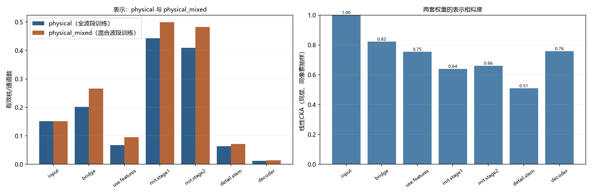

# USE诊断复核与 physical_mixed 参照补查

> 只读复核：不训练、不重跑300步探针、不改正式配置/权重。

## 1. 复核结论

- 128块清单文件SHA256 `c4749296998be3e860f897f4aacea6b982d78697f6751f85aa390951927ca988`，内容SHA256 `7aea825c6874c4acf95903ee9f78d56f605db4397678ed58d18e822c5a9f865c`；拟合/检查 96/32。
- 旧300步探针初始化哈希与记录一致：direct/use 均为 True；本次没有重跑这两组探针。
- physical_mixed 正式运行：2000 步完成，best@1200 DEV 0.1895，mixed_bands=True，权重SHA256 `1e30fb04612b5f45fdde74ea126000361010ab587cfc691ff4846487d88cb94b`。
- 审计问题：无。

## 2. 纠正后的解释

- 桥接输出是固定10维隐特征，不是有已知波段身份的反射率；不能按输入`band_valid`索引屏蔽桥接输出，输入可变C与固定输出10也没有逐通道对应。
- 对角相关低、有效秩低、梯度份额低是诊断现象，不是已证实瓶颈；不再把“有效秩>4、梯度份额>0.005、元数据干预>0.01”作为性能晋级硬门槛。
- 本次补查的是 physical_mixed 自身权重，不把 physical（全波段训练）的结论直接套到它上面。

## 3. physical 与 physical_mixed 同口径读数

| 层 | physical 有效秩/通道 | physical_mixed 有效秩/通道 | Δ | physical 滞后1 | physical_mixed 滞后1 | CKA |
|---|---|---|---|---|---|---|
| input | 0.1511 | 0.1511 | 0.0000 | 0.9803 | 0.9803 | 1.0000 |
| bridge | 0.2016 | 0.2663 | 0.0647 | 0.9557 | 0.9302 | 0.8219 |
| use.features | 0.0673 | 0.0949 | 0.0276 | 0.9457 | 0.9317 | 0.7535 |
| mit.stage1 | 0.4428 | 0.4994 | 0.0567 | 0.4755 | 0.4709 | 0.6396 |
| mit.stage2 | 0.4098 | 0.4823 | 0.0725 | 0.4806 | 0.4722 | 0.6607 |
| detail.stem | 0.0640 | 0.0712 | 0.0072 | 0.9613 | 0.9463 | 0.5087 |
| decoder | 0.0125 | 0.0141 | 0.0017 | 0.9405 | 0.9450 | 0.7576 |

桥接（固定10维隐特征；不是波段反射率）：

- 对角相关均值：physical -0.0254，physical_mixed 0.0294。
- 尺度平均绝对log2：physical 0.9490，physical_mixed 1.2681。
- 低于输入一半标准差的通道：physical 4/10，physical_mixed 6/10。

梯度份额（32块一次反传）：

| 参数组 | physical | physical_mixed | Δ |
|---|---|---|---|
| use.tokenizer | 0.0581 | 0.0797 | 0.0216 |
| use.metadata | 0.0032 | 0.0030 | -1.40e-04 |
| use.attention | 0.0236 | 0.0157 | -0.0079 |
| use.pool | 0.0086 | 0.0114 | 0.0028 |
| use.fuse | 0.0059 | 0.0112 | 0.0053 |
| bridge | 0.0097 | 0.0148 | 0.0051 |
| mit.embed1 | 0.2608 | 0.2170 | -0.0438 |
| mit.stage1 | 0.4060 | 0.3006 | -0.1054 |
| mit.stage2 | 0.1142 | 0.1794 | 0.0652 |
| mit.stage3_4 | 0.0401 | 0.0739 | 0.0338 |
| detail.stem | 0.0012 | 0.0016 | 3.59e-04 |
| decoder | 0.0067 | 0.0190 | 0.0123 |
| other | 0.0618 | 0.0727 | 0.0109 |

空间/输入关注：

- 中心输出输入梯度r90均值：physical 57.4 px，physical_mixed 43.1 px；桥接特征r90：physical 55.4，physical_mixed 36.8。
- 十波段输入梯度份额：physical `[0.123, 0.107, 0.16, 0.071, 0.065, 0.067, 0.141, 0.077, 0.069, 0.12]`；physical_mixed `[0.117, 0.112, 0.111, 0.095, 0.09, 0.09, 0.107, 0.092, 0.092, 0.096]`。

接口不变量：

| 检查 | physical | physical_mixed |
|---|---|---|
| 联合置换平均概率差 | 2.27e-06 | 2.82e-06 |
| 仅波段置换 | 0.0543 | 0.0271 |
| 仅元数据置换 | 0.0582 | 0.0293 |
| masked vs absent 概率差 | 3.74e-06 | 3.09e-06 |
| 无效区NaN远处最大变化 | 0.0000 | 0.0000 |

缺波段与全十波段的IoU一致度（越低表示缺波段影响越大）：

| 子集 | physical | physical_mixed |
|---|---|---|
| rgb | 0.0852 | 0.3887 |
| rgb_nir | 0.1113 | 0.4650 |
| six | 0.4900 | 0.5647 |
| unseen5 | 0.4309 | 0.4616 |

判读：physical_mixed 不是 physical 的小扰动。两套权重的同层CKA在MiT两级约0.64–0.66、细节分支约0.51、桥接约0.82；mixed的有效秩更高、十波段梯度更均匀、缺波段一致度更高，但既有DEV 0.1895略低于physical 0.1955。这是同一批权重上的观察，不证明混合波段训练导致鲁棒性或性能变化；不能把physical的机制解释直接套到mixed。

## 4. 图像

左图：每层有效秩/通道数，蓝=physical（全波段训练），橙=physical_mixed（混合波段训练）；看两套权重是否在USE特征、桥接、细节分支上出现不同的秩结构。右图：同层同像素抽样的线性CKA，1表示表示几乎相同、0表示线性不可比；CKA低不等于某套权重“错误”，只说明学习到的表示不同。

## 5. 限制与下一步

- 本次是只读推理/一次反传，不是训练；physical_mixed的9组DEV/组合评价沿用既有结果，不新增正式分数。
- physical_mixed训练使用混合波段采样；本次表示诊断统一用全十波段评估输入，训练采样差异不当作评估输入差异。
- 两套权重均来自既有DEV选模，含开发选模历史；CKA/秩/梯度只作解释读数，不作性能门槛。
- 下一步按当前PLAN.md进入两组恢复实验的隔离实现；本次未启动2000步正式训练。
