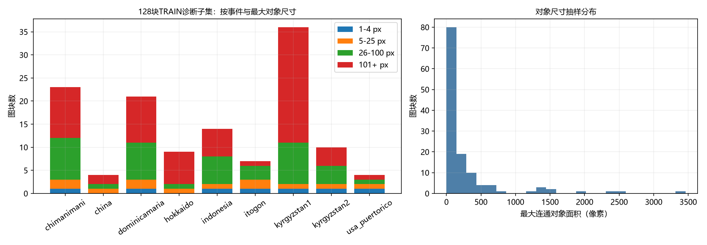
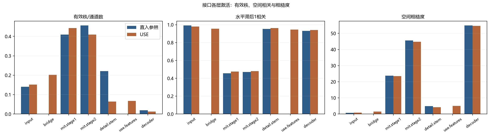
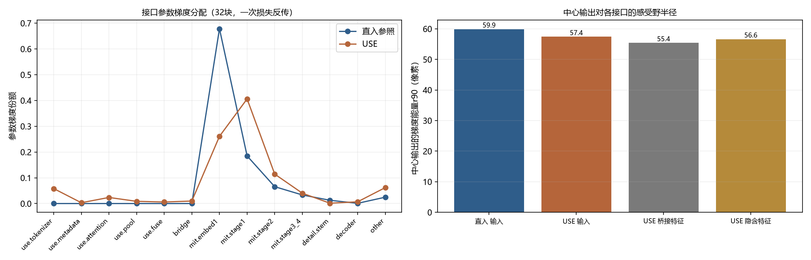
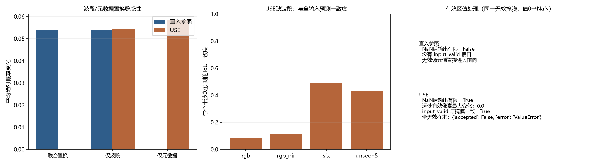
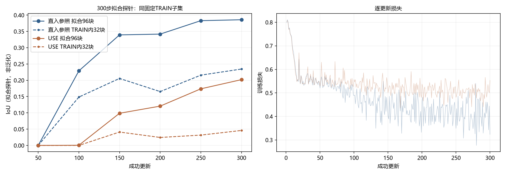

# USE接口首批诊断：固定128块TRAIN子集

> 本页是**诊断证据**，不是正式训练或泛化成绩。300步探针只回答“同一固定TRAIN子集上能否拟合”，
> 不能作为跨事件性能、显著性结论或模型选择依据。

## 结论摘要

- 同一固定TRAIN子集、同一300步短日程：直入在96块拟合集上IoU约0.386、TRAIN内32块约0.234；USE约0.202、约0.046。两组都是拟合探针，不是泛化成绩。
- USE桥接输出与十波段输入的对角相关均值-0.025，10个通道中4个标准差不足输入一半；联合置换输出不变（约2e-6，数值零），仅元数据置换改变0.0582，说明物理描述确实进入前向。
- USE细节分支的有效秩为2.05/32（直入7.08/32），参数梯度份额0.0012（直入0.0127）；USE编码器约9.9%、桥接约1.0%，直入首层67.8%。这些是接口层的实际差异，不等同于架构上限。
- 缺波段：USE对“移除通道”与“band_valid=False+NaN”给出一致预测（概率差3.7e-6）；无效区NaN对USE远处有效像素最大变化0.0000，直入输出非有限。
- 因此下一步优先做桥接波段/尺度标定与细节分支辅助监督；在完成标定对照前，不把本次300步差异当作USE不可用的证据。

## 0. 既有USE队列核验（只读）

- 核验时间 `2026-10-24T04:13:44.271454-04:00`；只读，未启动/停止/修改任何外部数据或完成队列进程、配置或权重。
- 外部扩量 `outputs/use/external/acquisition_status.json`：status `running`，S2 10950、Landsat 281，errors 183，updated `2026-10-24T04:13:11.609516-04:00`。
- completion `outputs/use/completion_status.json`：status `waiting_external`，jobs 0。
- 实测存活进程 4 个（`prepare_use_external.py`/`run_use.py`）；PID、启动时间与完整命令见 `outputs/use_interface_diagnostics/queue_check.json`。

## 1. 数据与范围

- 协议：`event_ood_v4r1`；只取 `split=TRAIN` 的2223块，按事件×最大连通对象尺寸分层抽128块。
- 事件分布：`{'chimanimani': 23, 'china': 4, 'dominicamaria': 21, 'hokkaido': 9, 'indonesia': 14, 'itogon': 7, 'kyrgyzstan1': 36, 'kyrgyzstan2': 10, 'usa_puertorico': 4}`；尺寸分布：`{'101_plus': 67, '1_4': 7, '26_100': 42, '5_25': 12}`。
- 探针划分：拟合96块、TRAIN内检查32块（两者都来自TRAIN，后者不是DEV/泛化集）。
- 清单：`outputs/use_interface_diagnostics/selection/diagnostic_tiles.json`，文件SHA256 `c4749296998be3e860f897f4aacea6b982d78697f6751f85aa390951927ca988`，
  内容SHA256 `7aea825c6874c4acf95903ee9f78d56f605db4397678ed58d18e822c5a9f865c`。

## 2. 权重、配置与复现

| 用途 | 配置 | 权重 | SHA256 | 权重步/最佳步 | 正式运行止步 |
|---|---|---|---|---|---|
| 直入参照（十波段直入＋原网格细节） | `N:/Users/yzh/Disater/landslide-seg/configs/segformer/use/baseline.yaml` | `N:/Users/yzh/Disater/landslide-seg/outputs/use/s2_10band_v4r1_p20/use_baseline/1234/best.pt` | `5498d1dec476613c77f4bed2aea3e4ba6d589cd3c4fb67852043568954e83e98` | 1600/1600 | 2000 |
| USE（共享编码＋物理描述＋桥接） | `N:/Users/yzh/Disater/landslide-seg/configs/segformer/use/physical.yaml` | `N:/Users/yzh/Disater/landslide-seg/outputs/use/s2_10band_v4r1_p20/use_physical/1234/best.pt` | `c51055e5c65126bebc6fbb6f8e28c397e41bf204bd1ba968fb3e2bf976fa7e8e` | 1400/1400 | 2000 |

接口诊断使用DEV选模得到的best权重（直入@1600、USE@1400；两轮正式运行分别止步2000和2000），
因此这些激活/梯度反映“被选中的开发权重”，不是训练末态，也不是无DEV接触的权重；不用于性能比较。


复现命令（项目根目录，Python 环境见研究入口）：

```powershell
python -X utf8 scripts/diagnose_use_interface.py all
# 或分步：
python -X utf8 scripts/diagnose_use_interface.py select
python -X utf8 scripts/diagnose_use_interface.py represent
python -X utf8 scripts/diagnose_use_interface.py probe --arm both
python -X utf8 scripts/diagnose_use_interface.py figures
python -X utf8 scripts/diagnose_use_interface.py report
```

复现性实测：同一命令重跑，`diagnostic_tiles.json`字节级一致（SHA256 `c4749296…`）；探针初始化state_dict SHA256一致；
300步直入拟合IoU在0.3856与0.3858之间浮动，说明GPU算子不是逐位确定，但差异约2e-4。表格以最新一次产物为准，不把末位差异当作方法差异。

## 3. 接口激活与空间信息

| 层 | 直入：有效秩/通道 | USE：有效秩/通道 | 直入：水平滞后1相关 | USE：水平滞后1相关 | 直入：粗糙度 | USE：粗糙度 |
|---|---|---|---|---|---|---|
| input | 0.1400 | 0.1511 | 0.9917 | 0.9803 | 0.6861 | 0.8089 |
| bridge | — | 0.2016 | — | 0.9557 | — | 1.5475 |
| mit.stage1 | 0.4099 | 0.4428 | 0.4568 | 0.4755 | 23.7855 | 23.5628 |
| mit.stage2 | 0.4565 | 0.4098 | 0.4717 | 0.4806 | 45.6002 | 44.8253 |
| detail.stem | 0.2213 | 0.0640 | 0.9535 | 0.9613 | 4.8612 | 4.2721 |
| use.features | — | 0.0673 | — | 0.9457 | — | 5.0705 |
| decoder | 0.0191 | 0.0125 | 0.9306 | 0.9405 | 54.9128 | 54.6618 |

桥接几何：

- `Conv2d(32→10,1)` 奇异值条件数 3.10；奇异值有效秩 9.04。
- 桥接输出/输入逐通道标准差比：均值绝对 log2 = 0.949；低于输入一半的通道 4/10，高于两倍的通道 0/10。
- 桥接输出与十波段输入的逐通道相关（对角线均值）-0.025；非对角绝对最大 0.688。

## 4. 梯度与感受野

| 组 | 直入：梯度份额 | USE：梯度份额 | 直入：相对更新 | USE：相对更新 |
|---|---|---|---|---|
| use.tokenizer | — | 0.0581 | — | 3.98e-05 |
| use.metadata | — | 0.0032 | — | 8.00e-06 |
| use.attention | — | 0.0236 | — | 1.42e-05 |
| use.pool | — | 0.0086 | — | 8.08e-06 |
| use.fuse | — | 0.0059 | — | 1.69e-05 |
| bridge | — | 0.0097 | — | 4.32e-05 |
| mit.embed1 | 0.6783 | 0.2608 | 2.86e-05 | 1.19e-05 |
| mit.stage1 | 0.1848 | 0.4060 | 8.16e-07 | 8.14e-07 |
| mit.stage2 | 0.0654 | 0.1142 | 4.00e-07 | 3.55e-07 |
| mit.stage3_4 | 0.0333 | 0.0401 | 1.34e-07 | 9.92e-08 |
| detail.stem | 0.0127 | 0.0012 | 1.38e-05 | 2.88e-06 |
| decoder | 8.50e-04 | 0.0067 | 4.33e-07 | 8.22e-07 |
| other | 0.0246 | 0.0618 | 2.34e-06 | 2.49e-06 |

中心像素感受野（输入梯度能量50%/90%半径，单位像素）：

| 模型 | 输入 r50 | 输入 r90 | 桥接特征 r90 |
|---|---|---|---|
| 直入 | 8.0 | 59.9 | — |
| USE | 12.4 | 57.4 | 55.4 |

## 5. 波段/元数据置换、缺波段与有效区

| 模型 | 联合置换平均概率差 | 仅波段 | 仅元数据 | 缺波段支持 | NaN无效区最大概率变化（远处有效像素） |
|---|---|---|---|---|---|
| 直入 | 0.0539 | 0.0539 | 0.0000 | 否 | 非有限 |
| USE | 2.27e-06 | 0.0543 | 0.0582 | 是 | 0.0000 |

USE缺波段与全十波段预测的一致度：

| 子集 | 波段数 | 平均概率差 | IoU一致度 |
|---|---|---|---|
| rgb | 3 | 0.0739 | 0.0852 |
| rgb_nir | 4 | 0.0651 | 0.1113 |
| six | 6 | 0.0236 | 0.4900 |
| unseen5 | 5 | 0.0255 | 0.4309 |

## 6. 300步拟合探针（同一固定TRAIN子集）

| 模型 | 拟合96块最终IoU | TRAIN内32块最终IoU | 最佳拟合步 | 参数量 | 用时(s) | 初始化SHA256 |
|---|---|---|---|---|---|---|
| 直入 | 0.3858 | 0.2345 | 300 | 3753602 | 25.8 | `b370e53a921dab6a…` |
| USE | 0.2019 | 0.0460 | 300 | 3778604 | 49.2 | `de164bad285f06ae…` |

探针只用于检查接口在固定小样本上的可拟合性；两组都从头初始化，使用正式配置的优化器/损失与300步短日程，
不是2000步正式训练，不能据此判断事件泛化或显著性。实际探针设置见
`probes/direct_300/resolved_config.json`、`probes/use_300/resolved_config.json`与各自`run_meta.json`的`probe`块；
正式配置里的`stop_updates=2000`/`schedule_updates=3600`没有被用于探针。

## 7. 限制

- 单seed、128块固定TRAIN子集，约375万参数模型中仅300步探针；结论只覆盖“该子集上的接口行为”，不证明其他子集或其他seed。
- 代表层用DEV选模得到的best权重（直入1600步、USE1400步；两轮正式运行均止步2000）做一次反传/统计；梯度不是训练全程轨迹，也不是训练末态。
- 置换检验使用3个固定随机排列；缺波段只覆盖4个预定义子集（含未见5波段组合），不覆盖任意缺波段组合。
- 有效区检验用合成矩形与既有质量侧表，未修改源数组或标签；不证明真实云/阴影边界的行为。
- 本页不新增DEV评价、不使用FINAL/Italy，也不启动或修改任何2000步正式队列；best权重本身来自既有DEV选模，这一点已在第2节标明。
- 300步拟合差距可能来自优化难度、随机初始化、桥接标定或数据顺序；未做多种子、学习率、初始化或架构消融，不能据此做因果归因。

## 8. 判读与方案

本节只解释本次128块TRAIN诊断的实际数值；所有比较都是同一固定子集上的接口/拟合诊断，不是DEV、FINAL或Italy成绩，也不是多种子显著性结论。

**读法与角色。** 直入参照是“十波段直入＋原网格细节”的2000步正式运行，best权重在1600步（DEV两事件等权IoU 0.2985）；USE是“共享编码＋物理描述＋32→10桥接＋原网格细节”的2000步正式运行，best权重在1400步（DEV 0.1955）。两者都使用`event_ood_v4r1`的九事件2223块TRAIN、`stats_core25`统计和seed1234；本次没有重训正式模型、没有改正式配置、没有启动2000步队列。128块按事件×最大连通对象尺寸比例分层，探针再把其中96块用于拟合、32块只作TRAIN内检查（不是泛化集）。

**1. 桥接没有把USE特征标定成“十波段直入”所期望的波段顺序与尺度。** 桥接权重`Conv2d(32→10,1)`本身的奇异值条件数只有3.10、奇异值有效秩9.04/10，说明这个线性层没有降秩；但桥接输出的有效秩只有2.02/10，逐通道标准差与输入十波段的标准差之比平均绝对log2为0.949（约1.93倍），10个通道里有4个不到输入标准差的一半。更关键的是桥接输出通道与同位置输入波段的对角相关均值是-0.025，非对角绝对最大0.688：通道0–3与B02/B03多为负相关、与B04为正，通道0/1与B02的相关分别约-0.52/-0.56。直入参照的第一层卷积是按R/G/B=B04/B03/B02拷贝官方权重的；USE把这样一组“旋转且尺度不一”的10通道送进同一个第一层，初始化的RGB先验与输入语义不对应。**证据支持“桥接未做波段/尺度标定”这一事实；它是否足以解释性能差距，未验证**——因为第一层卷积可训练，模型也可能在更长训练中适应这种重混。

**2. USE编码器和细节分支都被压到很低的秩，细节分支几乎拿不到梯度。** USE特征的有效秩2.15/32，桥接2.02/10，细节分支（`SpectralStem`）输出2.05/32；直入的细节分支是7.08/32，约为USE的3.5倍。USE细节分支的参数梯度份额只有0.0012（0.12%），直入是0.0127（1.27%），相差约10倍；USE的`use.*`编码器合计约9.9%，桥接本身约1.0%，而直入`mit.embed1`单层就占67.8%。这说明当前接口下，梯度主要被MiT前两级吸收（USE的`mit.embed1`+`mit.stage1`+`mit.stage2`约78.1%），共享编码器和细节分支的学习信号很弱。**机制解释（未验证）**：32→10桥接先把32维压到10维，再由同一个桥接同时喂MiT和细节分支；USE特征本身的低秩使细节分支只看到约2个有效方向，而残差融合头的1×1读出又把细节分支的梯度限制在很小的通道子空间。需要消融才能区分“低秩输入”“1×1融合读出”“初始化”三者各自的贡献。

**3. 联合置换与元数据置换证明USE的物理描述确实生效，也证明接口是置换等变的。** 把10个波段的数据、`band_metadata`、`known_mask`、`band_valid`/`pixel_valid`和`band_ids`按同一排列联合置换，USE的平均绝对概率变化约2e-6（数值零；3个固定排列、约200万有效像素），直入是0.0539；只置换波段、保留元数据时USE变化0.0543，只置换元数据、保留波段时USE变化0.0582，直入的仅元数据置换严格为0.0000（直入没有元数据入口）。这与USE的实现一致：共享逐波段tokenizer、元数据按波段身份相加、汇聚对波段顺序不敏感。**边界**：这只说明“联合置换不变、元数据被使用”，不说明物理描述比随机身份更有用；正式九组里“物理描述0.1955 vs 固定随机描述0.1987”也没有支持物理信息带来收益。

**4. 缺波段与有效区的接口行为是本次最干净的正面证据。** USE对`rgb`/`rgb_nir`/`six`/`unseen5`四种缺波段输入都能前向，且“物理移除通道”与“保留10通道但把被移除波段的`band_valid`置False、值置NaN”给出几乎相同的预测：平均概率差3.7e-6，IoU一致度0.9999，全部有限。缺波段预测相对全十波段的IoU一致度分别是rgb 0.085、rgb_nir 0.111、six 0.490、unseen5 0.431，说明缺得越多、与全输入差异越大，但没有崩溃或非有限值。有效区方面，在同一个合成无效矩形掩膜下把值从0改成NaN，USE远处有效像素的最大概率变化是0.0000，输出有限，`input_valid`与`pixel_valid & band_valid`逐像素一致；全无效样本被显式拒绝（`ValueError`）。直入参照没有`input_valid`接口，无效像元值直接进入前向，改成NaN后输出非有限，全无效样本仍被接受但输出非有限。**这不是说直入训练一定被无效像元污染**——训练损失仍按`valid`排除无效像元，但前向特征确实没有掩膜；两者在真实云/阴影边界上的差异未验证。

**5. 300步拟合探针显示USE在短预算下明显更难拟合，但不能据此判定架构上限。** 同一96块拟合集、同一数据顺序/增强/损失/优化器，300步后直入的拟合IoU约0.386（TRAIN内32块约0.234），USE约0.202（32块约0.046）；直入在100步就到约0.229，USE到150步才约0.099。逐更新损失中位数（前50→后50）直入约0.56→0.40，USE约0.56→0.51。USE探针的后50步梯度份额中位数：`use.*` 1.83%、桥接0.49%、`mit.embed1` 27.0%、细节分支0.11%；直入`mit.embed1` 54.3%、细节分支0.17%。USE 300步总墙时约49.2 s、峰值显存3404 MiB，直入约25–26 s、642 MiB（同batch 8、同卡；USE的B×C逐波段tokenizer是主要开销之一，未做逐算子计时）。**边界**：300步只是正式2000步的短前缀，直入/ USE的差距可能来自优化难度、随机初始化、桥接标定、数据顺序或学习率日程；本次没有多种子、没有学习率/初始化/结构消融，不能做因果归因。正式USE在2000步DEV是0.1955，说明它并非不能学习；但本次固定TRAIN探针没有复现正式DEV，不能用它替代正式评价。

**6. 对下一步的直接约束。** 桥接标定应优先解决“波段顺序/尺度不对齐”和“USE特征低秩传到细节分支”这两个可测量问题，而不是先加注意力或换骨干；细节分支需要独立的监督或特征辅助信号，否则在现有1×1融合读出下梯度份额很难提高。任何标定/辅助监督都必须只用TRAIN（或合法通用预训练），不得用DEV/FINAL/Italy拟合统计或选超参；先在同一128块上做诊断对照，再决定是否申请2000步正式训练。

桥接标定与特征辅助监督的具体实现方案见同目录 `PLAN.md`。

## 9. 诊断图



左图每根柱子是一个TRAIN事件、按最大连通对象尺寸分段堆叠；右图是128块的最大对象面积分布。看三点：9个事件是否都有覆盖、尺寸档是否按TRAIN比例保留（1–4 px在TRAIN仅25块，本次7块已属过采样）、有没有事件/尺寸完全缺失。



三栏分别是各层“有效秩/通道数”“水平滞后1相关”“空间粗糙度”；蓝=直入、橙=USE，横轴从输入到解码器。看桥接（bridge）与USE特征（use.features）是否比直入同层更低秩、更平滑，以及细节分支（detail.stem）是否明显掉秩。直入没有bridge/use.features柱是接口本身不存在。



左图是各参数组的梯度份额（32块一次反传），看USE的编码器/桥接/细节分支是否远低于直入首层；右图是中心输出对输入、桥接特征、USE特征的梯度能量r90（像素），看两条路径的空间上下文是否相近。r90只说明“中心输出能受多远输入影响”，不是有效感受野的完整测量。



左图：联合/仅波段/仅元数据置换的平均绝对概率变化，USE联合置换应接近0、仅元数据应非0；中图：USE缺波段预测与全十波段预测的IoU一致度，越低表示缺波段影响越大；右图文字：同一无效掩膜下把值0改成NaN的行为，USE应远处不变、直入应出现非有限。



左图实线是96块拟合IoU、虚线是TRAIN内32块检查IoU，横轴是成功更新；右图是逐更新训练损失。两组都只说明“在固定小样本上拟合得多快”，不是DEV/泛化成绩；曲线末端仍在上升说明300步不是收敛点。

## 10. 证据索引

- `outputs/use_interface_diagnostics/selection/`：清单、对象统计、抽样汇总。
- `outputs/use_interface_diagnostics/interface/`：各层激活、桥接几何、梯度、ERF、置换、缺波段、有效区。
- `outputs/use_interface_diagnostics/probes/`：两组300步探针的逐更新日志、指标、初始化/末态权重与元数据。
- `outputs/use_interface_diagnostics/summary.json`、`provenance.json`：汇总与哈希。
